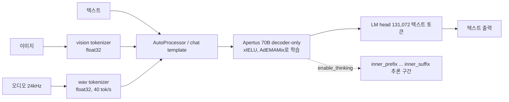

# Apertus v1.5 70B

> [!summary] 한줄요약
> 스위스 AI Initiative(EPFL, ETH Zurich, CSCS)가 가중치·학습 데이터 출처·학습 레시피를 모두 공개한 "fully open" 70B 모델. 8B와 함께 2026-07-24 HF에 올라왔고, Apache-2.0, 컨텍스트 262,144, 텍스트+이미지+오디오 입력(출력은 텍스트), 선택형 thinking 모드를 지원한다. 단 모델카드 본문은 gated이고 기술 보고서는 아직 미공개다.

> [!warning] 접근 제약
> HF 레포는 `gated: auto`다. 파일 목록과 메타데이터는 공개 API로 읽었지만 `raw/main/README.md`, `config.json`은 비로그인 상태에서 HTTP 401이었다. 모델카드 본문은 headless Chrome 렌더(`render.sh`)로 페이지에 노출되는 카드 텍스트를 읽었다. 벤치마크 수치는 카드에 이미지 차트(`assets/text_performance_plot.png`, `assets/visual_performance_plot.png`)로만 있어 **수치는 확인 못함**. 아래 내용은 이 범위 안에서 확인한 것만이다.

## 배경: 무엇을 해결하려는 모델인가

Apertus는 스위스 AI Initiative가 추진하는 공개 LLM 계열이다. 1.0 기술 보고서(arXiv:2509.14233, 2025-09-17 제출, 2025-12-01 v2)의 초록은 문제의식을 두 가지로 요약한다. 하나는 data compliance(데이터 준수)이고 다른 하나는 multilingual representation(다국어 표현)이다. 보고서는 기존 공개 모델 상당수가 가중치만 풀고 재현 가능한 데이터 파이프라인이나 콘텐츠 소유자의 권리는 신경 쓰지 않았다고 지적한다. Apertus는 공개적으로 이용 가능한 데이터만으로 pretraining하며, robots.txt 류의 opt-out을 소급 적용하고 비허용 라이선스·유해·개인식별정보(PII) 콘텐츠를 필터링했다고 설명한다. memorization(학습 데이터 그대로 암기) 위험은 Goldfish objective로 줄였다고 한다. 1.0은 1800개 이상 언어에서 15T 토큰을 학습했고 비영어 비중이 약 40%라고 초록에 적혀 있다(출처: arXiv abs 페이지, 직접 열람).

v1.5는 이 1.0 위에서 이어 학습(continued pretraining)한 후속 릴리스다. 모델카드의 Model Summary에 따르면 멀티모달 믹스 토큰을 8B에는 4T, 70B에는 2T 추가했다. 아키텍처는 1.0과 같은 decoder-only transformer이고 xIELU 활성함수, AdEMAMix 옵티마이저를 쓴다. 카드는 post-training 레시피를 개선해 instruction following과 tool use가 좋아졌고, 처음으로 thinking 모드를 켤 수 있다고 쓴다. 또 Apertus 계열 처음으로 이미지·오디오·텍스트가 섞인 입력을 받는다.

"왜 지금 이 모델을 보는가"를 우리 맥락에서 정리하면 이렇다. 온프렘 LLM 서빙에서는 모델 성능만큼 라이선스, 데이터 출처 설명 가능성, 규제 대응 문서가 의사결정에 들어온다. Apertus는 성능 최상위를 노리기보다 이 세 번째 축(감사·규제 대응)에서 차별점을 가진 모델이다. 카드는 EU AI Act용 `Apertus_1_5_EU_Public_Summary.pdf`와 `Apertus_1_5_EU_Code_of_Practice.pdf`를 레포 파일로 포함한다(파일 목록 API에서 확인).

## 모델 사양 (확인한 것)

| 항목 | 값 | 출처 |
|---|---|---|
| 모델 ID | swiss-ai/Apertus-v1.5-70B | HF API |
| 아키텍처 클래스 | `Apertus1p5ForConditionalGeneration`, model_type `apertus1p5` | HF API `config` |
| 파라미터 | 총 72,005,819,139개 (BF16 71,711,355,040 + F32 294,464,099) | HF API `safetensors` |
| 저장 용량 | usedStorage 145,568,501,756 바이트(약 145.6GB) | HF API |
| pretraining 토큰 | 70B는 17T, 8B는 19T | 모델카드 Training |
| 정밀도 | bfloat16 (비전·오디오 토크나이저는 float32 유지) | 모델카드 |
| 컨텍스트 | 기본 262,144 (1.0의 4배) | 모델카드 |
| 라이선스 | Apache-2.0 (+ Acceptable Use Policy 동의 필요) | HF 메타, 카드 |
| 생성/수정 | 2026-07-24 / 2026-09-17 | HF API |
| 다운로드/좋아요 | 17,871 / 108 | HF API |
| 입력 | interleaved text, image, audio | 카드 |
| 출력 | 텍스트만 (이미지·오디오 생성 안 함) | 카드 |
| 어휘 | LM head는 텍스트 토큰 131,072개, 로짓은 전체 266,752 토큰 어휘로 패딩 | 카드 Input notes |

파일 구성이 흥미롭다. `model-apertus-model-0000{1,2,3}-of-00003.safetensors` 3분할이 본체이고, 별도로 `model-vision_tokenizer-model.safetensors`와 `model-wavtokenizer-model.safetensors`가 있다. 즉 이미지와 오디오는 별도 토크나이저(비전 토크나이저, 파일명상 WavTokenizer 계열)를 거쳐 이산 토큰으로 LM에 들어가는 구조로 보인다(파일명과 카드의 "image and audio tokens are never generated" 문구에서 추정한 것이며 내부 구조 문서는 확인 못함). 카드는 "Audio contributes 40 tokens per second"라고 쓰고, 오디오는 24kHz로 리샘플링된다. 비디오는 네이티브 미지원이며 프레임을 이미지로 뽑아 넣어야 한다.

## 동작 원리와 서빙 구조



핵심은 입력 쪽만 멀티모달이고 출력은 순수 텍스트 LM이라는 점이다. 그래서 서빙 스택(vLLM)에서는 OpenAI 호환 `chat/completions`로 `image_url`을 넣어 이미지 질의를 보낼 수 있다(HF 페이지의 vLLM 예제). 다만 오디오를 vLLM 서빙으로 넣는 예제는 확인하지 못했고, 오디오 예제는 Transformers 경로(`type: audio`)만 있었다.

### Thinking 모드

기본값은 off다. Transformers에서는 `apply_chat_template(..., enable_thinking=True)`, vLLM에서는 `--reasoning-parser apertus`와 `--default-chat-template-kwargs.enable_thinking true`로 켠다. 활성화되면 모델이 `<|inner_prefix|>`와 `<|inner_suffix|>` 사이에서 추론한 뒤 답을 낸다. 카드는 중요한 운영 제약을 둘 적는다. 첫째, thinking 모드에서는 tool calling이 지원되지 않아 tool-call 플래그를 일부러 뺐고 둘을 같이 쓰는 것을 권장하지 않는다. 둘째, 추론 구간이 보이는 답변보다 몇 배 길 수 있으니 `max_new_tokens`를 넉넉히 잡아야 한다. 또 추론 마커는 `skip_special_tokens=True`로도 제거되지 않으니 파싱해서 분리해야 한다. 게이트웨이 입장에서는 thinking 변형을 별도 `--served-model-name`(`...-thinking`)으로 올리라는 카드의 예제가 곧 운영 패턴이다.

## 설치·사용법

### vLLM (카드 기재 명령)

카드는 업스트림 vLLM/Transformers 지원이 진행 중이라고 밝히며, 수정 버전이 미리 설치된 Docker 이미지를 GHCR에 제공한다.

```bash
# amd64 / arm64
docker pull ghcr.io/swiss-ai/vllm_apertus_1.5_release:latest-amd64
docker pull ghcr.io/swiss-ai/vllm_apertus_1.5_release:latest-arm64

# 70B (tool calling 사용)
vllm serve swiss-ai/Apertus-v1.5-70B \
  --chat-template-content-format string \
  --tensor-parallel-size 4 \
  --gpu-memory-utilization 0.8 \
  --max-model-len 262144 \
  --enable-auto-tool-choice \
  --tool-call-parser apertus

# 70B thinking 모드 (tool calling 제외)
vllm serve swiss-ai/Apertus-v1.5-70B \
  --served-model-name swiss-ai/Apertus-v1.5-70B-thinking \
  --chat-template-content-format string \
  --tensor-parallel-size 4 \
  --gpu-memory-utilization 0.8 \
  --max-model-len 262144 \
  --reasoning-parser apertus \
  --default-chat-template-kwargs.enable_thinking true
```

카드는 하드웨어에 따라 `--tensor-parallel-size`, `--gpu-memory-utilization`, `--max-model-len`을 조정하라고 하고, TP>1에서 CUDA Graph capture가 fused all-reduce RMS 최적화 때문에 실패하면 `--compilation-config.pass_config.fuse_allreduce_rms false`로 띄우라고 안내한다. "TP 4가 최소 요구"라고 명시한 것은 아니며 예제가 TP 4일 뿐이다. 가중치만 145GB(BF16)라 80GB급 GPU 2장은 가중치만으로 빠듯하다는 계산이 가능하지만(145.6GB / 2 = 약 72.8GB 이상), KV 캐시와 활성 메모리를 포함한 실제 최소 구성은 확인 못함.

### Transformers

업스트림 릴리스에 아직 들어가지 않아 swiss-ai 포크의 특정 커밋에서 설치해야 한다(`pip install "transformers[torch,vision,audio] @ git+https://github.com/swiss-ai/transformers.git@<commit>"`). `AutoModelForMultimodalLM`과 `AutoProcessor`를 쓰고, 8B/70B가 같은 코드를 공유한다. 배치 입력은 이미지·오디오 개수가 서로 다른 프롬프트를 섞어도 된다(left padding 기본). 카드는 로드한 모델에 `.half()`나 `.to(dtype)`로 재캐스팅하지 말라고 경고한다. 비전/오디오 토크나이저가 정밀도에 민감하기 때문이다.

### 접근 절차

gated "auto" 레포라서 HF 로그인 후 약관(Apache-2.0 + Acceptable Use Policy 동의, 회사명·기관 이메일 필드 제출)에 동의해야 파일이 열린다. 동의 시 이메일과 사용자명이 저장소 저자에게 공유된다(`extra_gated_prompt`). 사내 보안 정책상 외부로 연락처가 공유되는 점은 사전에 승인받아야 한다.

## 구조에서 확인한 것 (레포 파일/메타)

- 평가 결과는 `.eval_results/lexam-hard.yaml` 한 건이 보인다. HF 페이지에는 LEXam-hard에서 24.44로 "Ranked #3 in the < 128B size range"로 표시되며, 출처는 joelniklaus의 SwissLegalEvals(lighteval, 스위스 법률 시험 문항 518개, DeepSeek-R1-0528을 judge로 사용, 독일어·영어 평균)다. 법률 도메인의 외부 평가 한 건일 뿐 일반 능력의 순위가 아니다.
- 카드의 평가 항목 목록은 매우 넓다. 지식(MMLU, MMLU-Pro 등), instruction following(IFEval, Multi-IF, IFBench), 수학, 코딩(HumanEval, MBPP), 추론(BBH, GPQA), 다국어(Global-MMLU, MGSM, INCLUDE, XNLI 등), 문화 지식(BLEnD, CulturalBench, SwitzerlandQA), 안전·편향(BBQ, ToxiGen, WMDP, MultiJail), tool use(BFCL v3), 이미지(GQA, MMStar, ChartQA, DocVQA, OmniDocBench, MathVista, MMMU 등)까지 열거한다. 하지만 "Detailed benchmark evaluations ... will be provided in the technical report"라며 수치는 보고서로 미룬다. 즉 **현재 시점에 카드만으로는 어떤 벤치마크 수치도 재인용할 수 없다.**
- `chat_template.jinja`가 있고 tool 정의를 TypeScript 타입으로 렌더링하는 매크로를 쓴다(API 응답의 chat_template_jinja 일부). tool-call parser가 vLLM 쪽에 `apertus`라는 이름으로 있어야 하므로 수정 vLLM 이미지가 필요한 이유가 여기에 있다고 보인다(추정).
- 파생 모델: HF 페이지 기준 finetune 1개, quantization 7개, 이를 쓰는 Space 3개. 1.5 컬렉션에는 8B와 70B 두 항목(2026-08-21 갱신)이 있다.

## 비교 대상

Apertus의 직접 비교군은 "weights-only 오픈 모델"(Llama, Qwen, DeepSeek 계열 등)과 "fully open 모델"(데이터까지 공개하는 OLMo 계열 등)이다. 이 카드에는 타 모델과의 수치 비교가 없으므로 여기서 성능 우열을 주장하지 않는다. 확인된 차별점은 다음이다.

| 축 | Apertus v1.5 | 일반적인 open-weights 모델 |
|---|---|---|
| 학습 데이터 | 공개 데이터만, opt-out 소급 존중(1.0 보고서 초록, 카드) | 대개 비공개 |
| 규제 문서 | EU AI Act public summary, code of practice PDF 동봉 | 모델별 상이(이 조사에서는 확인 안 함) |
| 라이선스 | Apache-2.0 + AUP 동의 | 모델별 상이 |
| 접근 | gated(연락처 공유) | 대개 무로그인 또는 별도 라이선스 |
| 서빙 | 수정 vLLM/Transformers 필요(업스트림 진행 중) | 대개 업스트림 지원 |

같은 노트 계열에서 소형 모델은 [[qwen3-5-9b]]와 비교해 볼 수 있다. 크기·역할이 달라 직접 대결 대상은 아니고, 게이트웨이의 high 티어 후보로 같은 풀에 넣고 사내 평가셋으로 비교하는 방식이 현실적이다.

## 장단점·한계·성숙도

**장점.** 학습 데이터와 레시피까지 공개되는 구조라 감사·거버넌스 설명이 쉽다. 262K 컨텍스트와 멀티모달 입력, thinking·tool use를 한 모델에서 제공한다. Apache-2.0이라 상용 온프렘 서빙에 법적 장벽이 낮다(AUP 준수 전제). 데이터 삭제 요청 창구(카드에 개인정보·저작권 요청용 메일 주소가 공개)와 반기별 가중치 갱신 권고 같은 운영 정책이 문서화돼 있다.

**한계.**
1. 기술 보고서·벤치마크가 아직 없다("coming weeks"라고 카드가 표기). 성능 근거는 LEXam-hard 한 건뿐이다.
2. 서빙 스택이 업스트림에 합쳐지지 않았다. 수정 vLLM 이미지나 Transformers 포크 커밋에 고정해야 하므로 보안 패치·버전 업그레이드 추적 부담이 있다.
3. thinking 모드에서 tool calling 불가. 에이전트 용도에서는 thinking을 끄고 써야 한다.
4. 출력 필터가 없다. 카드는 "Currently no output filter is provided"라고 적고, 삭제 요청은 데이터 파이프라인 필터 갱신과 정기 가중치 재릴리스로 처리한다고 한다. 즉 서비스 계층에서 자체 필터링을 붙여야 한다.
5. 한국어 성능은 이 조사에서 확인하지 못했다. 카드 평가 목록에 Global-MMLU, INCLUDE 같은 다국어 벤치가 있다는 사실만 확인했을 뿐, 한국어 개별 점수와 토크나이저 효율은 알 수 없다. 1.0 보고서가 1800개 이상 언어를 말하지만 한국어 비중은 확인 못함.
6. 오디오 입력은 카드가 지원을 명시하지만, 카드의 벤치마크 목록은 텍스트와 이미지 항목만 열거하고 오디오 항목은 보이지 않았다. 오디오 품질은 검증 자료가 없으므로 실험적 기능으로 다루는 것이 안전하다.

**성숙도.** 릴리스 약 2개월(2026-07-24 생성), 최종 수정 2026-09-17. 다운로드 17,871로 채택이 시작된 단계다. 프로덕션 투입 전 자체 평가가 필수인 "초기 채택" 단계로 판단한다.

## 보안·라이선스·운영 리스크

- **라이선스**: Apache-2.0이지만 gated 약관에서 Acceptable Use Policy(`apertus-legal` 레포의 PDF) 동의를 요구한다. AUP 세부 조항은 PDF 본문을 열지 않아 확인 못함. 법무 검토 시 PDF를 직접 읽어야 한다.
- **개인정보**: 접근 시 이메일·사용자명이 저자와 공유된다(카드). 사내 개인 계정이 아니라 승인된 서비스 계정으로 받는 절차가 필요하다.
- **공급망**: 수정 vLLM 컨테이너(`ghcr.io/swiss-ai/vllm_apertus_1.5_release`)와 Transformers 포크는 제3자 빌드다. 이미지 다이제스트 고정, 취약점 스캔, 사내 레지스트리 미러링을 권장한다. 소스 Dockerfile이 공개돼 있다고 카드가 쓴다.
- **모델 안전성**: 출력 필터 없음, 사실 오류 가능성 경고. 모델을 assistive tool로 쓰라는 카드 문구를 따라 게이트웨이/애플리케이션 레이어의 guardrail이 필요하다.
- **자원**: 가중치 145.6GB, 컨텍스트 262K를 모두 쓰면 KV 캐시가 크게 늘어난다. 실제 동시성은 `--max-model-len`을 줄여 확보해야 한다(카드도 OOM 시 낮추라고 안내).

## 관련 노트
[[qwen3-5-9b]] [[vllm-moriio-kv-connector]] [[inflab-ai-gateway]] [[lucebox-hub]] [[microvm-isolation-2026]]

## 출처 (실제로 연 URL)
- https://huggingface.co/swiss-ai/Apertus-v1.5-70B (headless Chrome 렌더로 카드 본문 열람; raw README/config.json은 HTTP 401)
- https://huggingface.co/api/models/swiss-ai/Apertus-v1.5-70B (메타데이터, 파일 목록, safetensors 파라미터 수)
- https://arxiv.org/abs/2509.14233 (Apertus 1.0 기술 보고서 초록, 본문 전체는 열지 않음)
- 웹 검색 결과(Apertus 1.0 보고서 리뷰 페이지들)는 보조 참고였고, 위 1.0 수치는 arXiv 초록 기준만 적었다.
- https://publicai.co/stories/apertus-1-5 : 이번 재조사에서는 렌더 결과가 비어 있고 WebFetch 연결 실패(ECONNREFUSED)로 **열람하지 못함**. 이전 노트의 "2026-07-24 공개" 서술은 HF API `createdAt`(2026-07-24T06:07:19Z)으로 대체 확인했다.
