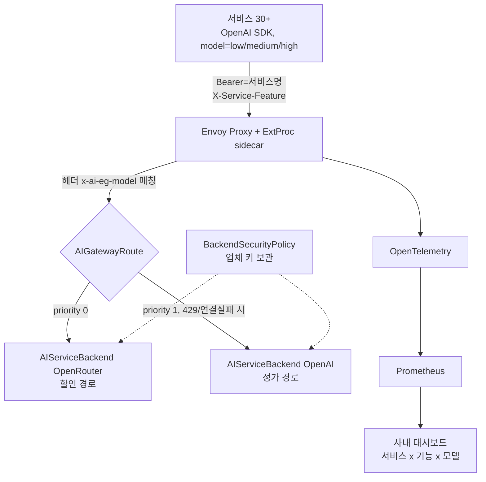

# 인프랩 AI Gateway 도입기 (Envoy AI Gateway)

> [!summary] 한줄요약
> 서른 곳이 넘는 서비스의 LLM 호출을 Envoy AI Gateway로 모아 모델 교체·키 관리·사용량 관측을 중앙화한 사례다.
>
> - 서비스에는 모델 이름 대신 low/medium/high 세 등급만 노출한다.
> - 등급 라우팅을 적용한 첫 온전한 달(8월)의 LLM 비용은 최고월(6월) 대비 약 78% 줄었다고 보고한다.
> - 글쓴이는 절감 일부를 라우팅 효과와 구분해 "사용량이 보이게 된 효과"라고 설명한다.

> [!info] 이번 재조사에서 확인한 범위
> 블로그 원문 전체(약 1.6만 자 텍스트)를 직접 읽었다. 추가로 Envoy AI Gateway 레포의 README와 GitHub API(스타·릴리스)를 확인했다. 인프랩 내부 구성(실제 YAML 전체, 대시보드)은 글에 없는 부분이라 확인 못함.

## 글의 기본 정보

- 제목: "사내 LLM 요청을 한곳으로 모은 AI Gateway 구축기", 저자 포카(Poka, DevOps Engineer), 발행일 표기 2026.09.08, 읽기 10분. URL 경로는 `20260825`인데 페이지 표기 날짜는 2026-09-08이다. 불일치 이유는 확인 못함(초안 작성일과 발행일의 차이로 보이나 추정).
- 태그: devops, ai, LLM, AI, Gateway, Envoy, EKS. 즉 AWS EKS 위에서 운영한다.

## 배경: 어떤 문제를 풀려고 했나

인프랩은 자막 번역, 강의 상세 생성, 학습 에이전트, 커뮤니티 답변 등에서 LLM API를 쓴다. 처음에는 각 서비스가 제공 업체 API 키를 직접 발급받아 호출했는데 사용처가 서른 곳을 넘으면서 한계가 왔다. 글은 문제를 세 덩어리로 나눈다.

**1) 모델이 너무 빨리 바뀐다.** GPT, Claude, Gemini, Qwen 계열이 거의 매주 더 싸고 좋은 모델을 내놓고, 한 업체 안에서도 길어야 3개월 주기로 새 버전이 나오며 오래된 모델은 은퇴해 호출 불가가 된다. 그래서 "지금 가장 가성비 좋은 모델"의 수명이 매우 짧고(할인 정책까지 겹치면 더 짧다), 은퇴 시점까지 교체를 못 하면 그대로 장애가 된다.

모델 교체 때마다 기존 모델과 새 모델이 모두 만족스러운지 검증해야 하는데 이를 서비스 담당자마다 짧은 주기로 반복하면 시간이 많이 든다. 바쁘면 교체가 밀리고 밀리면 장애로 이어진다.

**2) 비용.** 2026년 6월 기준 LLM API 비용이 AWS 비용의 약 23%였다(원문). 같은 성능을 더 싸게 쓰는 일이 전체 인프라 비용 효율에서 큰 비중이 되었다는 설명이다. 절대 금액은 공개하지 않았다.

**3) 키와 사용량이 흩어진다.** 서비스 수만큼 제공 업체 키가 늘어 회수·교체가 어렵고 유출 시 영향 범위 파악이 어렵다. 사용량은 제공 업체 대시보드를 하나씩 열어야 하고, 열어 봐도 "어느 서비스의 어느 기능"이 썼는지 구분이 안 된다.

정리하면 목표는 모델 선택, 키 관리, 사용량 관측 세 가지를 한곳에 모으는 것이었다.

## 후보 비교: Envoy AI Gateway vs LiteLLM Proxy vs Portkey

글은 세 후보를 비교했다고 한다. 최초 비교는 2025년 11월이고 이 글을 쓰며 2026년 9월 기준으로 다시 확인했다. 기준은 "셀프 호스팅 + 무료 플랜"에서 쓸 수 있는가다. 통합 라우팅과 fallback은 세 후보 모두 지원해서 나머지 항목에서 갈렸다.

| 기능 | Envoy AI Gateway | LiteLLM Proxy | Portkey AI Gateway |
|---|---|---|---|
| 예산/rate limit(비용·토큰 기반) | 가능(정책 구성) | 유료 전용 | 유료 전용 |
| 관측성(로그/메트릭/트레이스) | 가능(OpenTelemetry) | 로깅만, 메트릭 내보내기는 유료 | 기본 대시보드만 |
| 비용 트래킹 | 가능(구성 필요) | 기본 집계만, 키/팀별은 유료 | 유료 전용 |
| 가드레일 | 가능 | 유료 전용 | 가능 |
| 프롬프트 관리 | 없음 | 가능 | 유료 전용 |

(표는 원문 그대로. 이 평가는 글쓴이의 2026-09 시점 판단이며 각 제품의 현재 플랜은 직접 재확인해야 한다고 글도 밝힌다. 이번에 이 표의 각 칸을 제품 문서로 교차 검증하지는 않았다.)

결정적 요인은 "CNCF라는 점"이었다. 표에서 "유료 전용" 칸이 Envoy 열에만 없다는 점, 즉 돈을 안 내서 막히는 기능이 없다는 점이다.

글쓴이는 이것이 지금 얼마를 내느냐보다 구조의 문제라고 말한다. 게이트웨이의 존재 이유가 예산 정책, rate limit, 사용량 추적, 인증 같은 통제 장치를 한곳에 모으는 것인데 하필 그런 통제 장치가 상용 플랜의 판매 포인트이기 때문에, 정책을 조여야 할 때 기능마다 플랜 협상을 다시 하는 상황을 피하고 싶었다는 것이다.

관측성이 딱 그 사례였다. 이미 Prometheus와 OpenTelemetry 기반 스택을 쓰고 있었는데 LiteLLM Proxy는 사용량을 자체 UI 안에서만 볼 수 있어 기존 대시보드에 합칠 수 없었고, "사내 대시보드 한 곳에서 보기"가 주요 목표였으므로 탈락했다.

> [!note] 거버넌스 표기에 대한 후속 확인
> 글은 "CNCF에서 관리하는 Envoy 프로젝트의 일부"라고 쓴다. 이번에 열어 본 레포 README(`envoyproxy/ai-gateway`)에는 "Envoy AI Gateway is now **Agent Router**, an Agentic AI Foundation project", "Same code, same maintainers, same release cadence and Apache 2.0 license"라고 적혀 있고, 레포가 `theagentrouter/agent-router`로 옮겨졌으며(옛 링크는 리다이렉트), 웹사이트는 theagentrouter.ai로 이전했다고 한다. CRD와 API 그룹(`aigateway.envoyproxy.io`), CLI(`aigw`), 네임스페이스(`envoy-ai-gateway-system`), 이미지·Helm 차트 경로는 그대로라고 명시한다. 즉 글이 근거로 든 "CNCF 거버넌스"가 현재 어떻게 바뀌었는지는 이 조사에서 확인하지 못했다. 도입 시 "무료 기능이 상용 플랜 뒤에 잠기지 않는다"는 전제가 유지되는지는 프로젝트 거버넌스·라이선스 변경을 직접 확인해야 한다.

## 감수한 트레이드오프

글쓴이가 명시한 비용은 두 가지다.

1. **Envoy Gateway 추가 도입**: Envoy AI Gateway는 Envoy Gateway 위에서 동작한다. 당시 인프랩은 Envoy Gateway를 쓰지 않아 함께 가져왔다.
2. **약한 프롬프트 관리 기능**: 프롬프트는 각 서비스 저장소에서 관리하는 편이 자연스럽다고 보고 감수했다.

대신 라우팅과 인증 정책을 전부 쿠버네티스 커스텀 리소스로 선언할 수 있다는 점이 잘 맞았다. 사내 인프라 설정이 모두 GitOps이므로 새 제공 업체를 붙이는 일이 콘솔 클릭이 아니라 코드 리뷰가 붙는 Pull Request 한 건으로 끝난다.

## 아키텍처

사용자(서비스) 입장에서 알아야 할 것은 거의 없다. 게이트웨이가 OpenAI API 스펙을 받아 각 제공 업체 스펙으로 변환해 주므로 대부분 OpenAI 라이브러리 하나로 Claude, Gemini, Qwen을 모두 호출할 수 있다. 인프랩 구성에서는 게이트웨이 하나가 진입 경로 세 가지를 받고 뒤로 제공 업체 다섯 곳이 붙어 있다(원문 그림, 업체 목록은 글 본문에 열거되지 않아 확인 못함. 본문에서 확인되는 업체는 OpenRouter와 OpenAI다).

Envoy AI Gateway는 설정을 관리하는 Control Plane과 요청이 흐르는 Data Plane으로 나뉜다. Envoy Gateway 위에 얹는 확장이라 라우팅·인증을 쿠버네티스 리소스로 선언하면 컨트롤러가 이를 프록시 설정으로 옮긴다.

- `AIGatewayRoute`: 어떤 모델 요청을 어느 백엔드로 보낼지
- `AIServiceBackend`: 제공 업체 엔드포인트와 API 스펙
- `BackendSecurityPolicy`: 그 백엔드에 쓸 자격증명



리소스 적용 후 반영 흐름은 다음과 같다.

1. `AIGatewayRoute`를 적용한다.
2. AI Gateway Controller가 HTTPRoute와 설정 시크릿을 만든다.
3. Envoy Gateway Controller가 xDS 설정을 생성한다.
4. AI Gateway Extension Server가 xDS에 LLM 처리 필터를 얹는다.
5. Envoy Proxy와 ExtProc sidecar가 요청을 처리한다.

요청 본문을 읽어야 하는 LLM 처리(모델 이름 읽기, 토큰 집계, 스펙 변환)는 Envoy의 external processing(ExtProc) 사이드카가 담당하는 구조다.

## 모델 이름 지우고 등급만 남기기

모델 교체를 중앙에서 처리하려면 서비스가 모델 이름을 직접 지정하면 안 된다. 코드에 `gemini-2.5-flash` 같은 이름이 박혀 있으면 그 모델이 은퇴할 때 서비스 코드를 고쳐야 하고, 그러면 게이트웨이를 둔 의미가 없다. 그래서 `low`, `medium`, `high` 세 등급만 노출한다.

| 등급 | 100만 입력 토큰당 최대 비용 | 권장 용도(원문) |
|---|---|---|
| high | \$2 | 환각에 매우 취약하거나 복잡한 사고가 필요한 경우 |
| medium | \$1 | 사용자가 텍스트를 직접 보거나, 후가공에 쓰이는 데이터 생성 |
| low | \$0.3 | 간단한 논리, 짧은 답변, 분류, 구조적 데이터 생성 |

각 등급에 실제로 연결되는 모델은 시간이 지나면 바뀌지만 표의 최대 비용은 계약처럼 고정된다. 어떤 모델이 붙을지는 몰라도 상한은 알 수 있으니 "월간 예상 입력 토큰 x 상한 비용"으로 입력 토큰 비용을 미리 추정할 수 있다.

글의 예: 한 달 1억 입력 토큰을 쓸 기능이 low를 선택하면 100만 토큰 단위로 100이니 100 x \$0.3 = $30이고, 출력 토큰 비용은 별도다. 호출 예는 이렇다(원문):

```bash
curl -s '<사내 AI Gateway 주소>/v1/chat/completions' \
  -H 'Content-Type: application/json' \
  -H 'Authorization: Bearer <서비스 이름>' \
  -H 'X-Service-Feature: onboarding-chat' \
  -d '{"model":"low","messages":[{"role":"user","content":"hi"}]}'
# 응답의 model 필드에는 실제로 라우팅된 모델명이 담겨서 돌아온다
```

## 라우팅 구성과 failover

게이트웨이 설정에서 등급을 실제 모델로 치환한다. 같은 모델을 여러 제공 업체에서 살 수 있으면 우선순위를 붙여 fallback을 건다.

글에 실린 medium 예시는 `x-ai-eg-model` 헤더가 `medium`과 정확히 일치하면 OpenRouter 백엔드(`modelNameOverride: openai/gpt-5.6-luna`, `priority: 0`)로 먼저 보내고, OpenAI 백엔드(`gpt-5.6-luna`, `priority: 1`)를 후순위로 두는 형태다. 여기에 429 응답과 커넥션 실패에 대한 재시도 정책을 붙였다.

같은 모델을 더 싸게 파는 경로가 생기면 그쪽을 1순위로 두고 한도에 걸릴 때만 정가 경로로 넘어간다. 글쓴이가 강조하는 요지는 이 판단이 서비스 코드가 아니라 게이트웨이 설정에 있다는 것이다. (모델명 `gpt-5.6-luna`는 원문에 있는 표기이며 이 조사에서 해당 모델의 실체를 확인하지는 않았다.)

## 모델 교체 절차

모델이 바뀌면 응답 형태가 달라지거나 잘 되던 패턴이 깨지는 부작용이 서비스에 영향을 줄 수 있다. 이를 중앙에서 최대한 억제하는 것도 게이트웨이의 역할로 보고 다음 절차를 정했다.

1. 등급별로 최소 품질 기준을 자동 검증할 수 있는 테스트 세트를 준비한다.
2. 상한 비용을 넘지 않으면서 가성비가 더 좋아 보이는 모델이 나오면 후보로 올린다.
3. 기존 모델과 후보 모델에 같은 테스트 세트를 돌린다. 하나라도 실패하면 탈락이다.
4. 통과하면 개발 파트 전체에 변경 예정일을 공지하고 관련 기능 모니터링을 요청한다.
5. 변경 후 해당 등급을 쓰는 기능을 집중 확인하고, 새로 발견한 품질 기준은 테스트 세트에 추가한다.

글쓴이는 "기능마다 딱 맞는 모델을 고르는 자유가 줄어드는" 답답함을 인정하면서도, 특정 시점의 완벽한 최적화보다 변화를 빠르게 따라가는 능력이 더 오래 이득이라고 본다. 모델 하나가 크게 인하됐을 때 서른 개 서비스가 각자 반응하는 구조와 게이트웨이가 한 번 반응하는 구조의 차이가 시간이 갈수록 벌어진다는 논리다. 향후 과제로는 등급별 테스트 세트를 더 촘촘히 해 교체 판단을 자동화하는 것을 든다.

## 인증과 사용량 귀속

키를 게이트웨이가 독점하면 제공 업체 대시보드에서는 모든 요청이 한 덩어리로 보인다. 그래서 게이트웨이가 "누가 호출했는지"를 남겨야 한다. 처음에는 서비스마다 게이트웨이용 API 키를 발급하는 방안을 봤지만 없애려던 키가 다시 늘어나는 점이 걸려서 발급 대신 명명 규칙과 검증으로 방향을 틀었다.

배포 애플리케이션 이름을 API 키 자리(Authorization Bearer)에 넣으면 게이트웨이가 허용된 형식인지 확인한 뒤 서비스 식별 헤더로 옮겨 담는다. 여기에 `X-Service-Feature` 헤더로 기능 이름을 받아서 "어느 서비스의 어느 기능이 어떤 모델을 얼마나 호출했는지"를 사내 대시보드 한 곳에서 본다.

> [!warning] 보안 관점 해석 (우리 쪽 판단)
> 이 방식은 비밀이 아닌 "이름"을 Bearer 토큰으로 쓰므로 인증(authentication)이 아니라 귀속(attribution) 용도다. 같은 클러스터 안에서 서비스명을 아는 누구든 다른 서비스 이름으로 호출할 수 있다. 원문은 "허용된 형식인지 확인"한다고만 쓰고 네트워크 정책이나 mTLS 같은 보강 수단은 언급하지 않는다(언급이 없다는 것이지 없다고 확인한 것은 아님). 외부 노출이나 비용 상한 강제가 필요하다면 서비스 계정 토큰/OIDC/mTLS, NetworkPolicy로 보강해야 한다.

## 성과 (원문 수치)

- 서른 곳이 넘는 서비스가 게이트웨이를 경유하고 서비스 코드에서 제공 업체 키가 사라졌다.
- 새 제공 업체 연결이 GitOps Pull Request 한 건으로 수렴했다.
- 서비스와 기능 두 축으로 토큰 사용량·비용을 본다.
- 모델 교체가 게이트웨이 설정 변경 한 번으로 끝난다. 크게 인하된 모델이 나오면 등급 연결만 바꿔 전 서비스에 한 번에 반영한다.
- 비용: 최고월이 6월, 등급 라우팅의 운영 적용이 8월 초라 첫 온전한 달인 8월을 비교했다. 전체 LLM 비용이 최고치 대비 약 78% 감소.

비용 감소에는 두 요인이 함께 작용했다.

1. **등급 라우팅**: medium의 실제 blended 단가가 100만 토큰당 $0.18로 상한 $1의 약 5분의 1 수준이었다(0.18 대 1.00이면 18%이므로 약 5.6분의 1이고 원문은 "5분의 1 수준"이라고 표현). 캐시 히트율 80% 초과가 단가를 끌어내렸다.
2. **사용량이 보이기 시작한 효과**: 예상보다 많이 쓰던 기능, 굳이 비싼 모델일 필요 없던 기능이 드러났다. 라우팅을 바꾸지 않아도 보이는 것만으로 고쳐지는 몫이 있었다.

78%라는 숫자를 읽을 때의 주의점이 있다. 비교 대상이 "최고월 대비 첫 온전한 달"이라 계절성·트래픽 변동·신규 모델 할인 효과를 분리하지 못한다. 절대 금액과 트래픽 변화량도 공개되지 않았다.

캐시 히트율 80% 초과가 게이트웨이 레벨 캐시인지 제공 업체의 프롬프트 캐시인지는 글에서 구분하지 않아 확인 못함.

따라서 "게이트웨이를 도입하면 78% 절감"이라는 일반화는 근거가 약하고, "관측 가능성과 중앙 제어가 비용 최적화 여지를 열었다"는 정성적 결론이 더 안전하다.

## 동작 확인 가능한 공식 자료 (이번에 열어본 것)

`envoyproxy/ai-gateway` README(현재 Agent Router로 개명 안내)에 따르면 이 프로젝트는 "하나의 일관된 OpenAI 호환 API"를 앱 팀에, 자격증명·라우팅·쿼터·failover·사용량 귀속은 플랫폼 팀에 두는 컨트롤 플레인이다. 문구는 "Agent Router controls. Envoy carries."다.

빠른 시작은 단독 CLI로 `OPENAI_API_KEY=... aigw run`을 실행하고 `http://localhost:1975/v1`로 OpenAI 호환 클라이언트를 붙이는 방식이다.

README는 two-tier gateway 패턴도 소개한다. Tier One은 중앙 진입점으로 인증·상위 라우팅·글로벌 rate limit을 담당하고, Tier Two는 자체 호스팅 모델 서빙 클러스터로 들어가는 ingress로 세밀한 접근 제어와 LLM 추론 최적화용 endpoint picker를 지원한다.

지원 제공 업체 목록에는 OpenAI, Azure OpenAI, Google Gemini, Vertex AI, AWS Bedrock, Mistral, Cohere, Groq, Together AI, DeepInfra, DeepSeek, Hunyuan, SambaNova, Grok, Tetrate Agent Router Service, Anthropic이 보인다.

GitHub API 기준 스타 2,162, Apache-2.0, 최근 푸시 2026-10-01, 릴리스 v1.1.0(2026-08-21)과 v1.0.0(2026-06-23)이다.

비교 대상 레포는 LiteLLM(스타 약 59,950, GitHub이 라이선스를 SPDX로 식별하지 못함 "Other/NOASSERTION"; 엔터프라이즈 디렉터리 라이선스가 섞여 있을 가능성이 있으나 이번에는 확인하지 않음)과 Portkey gateway(스타 약 13,118, MIT)다.

## 비교 대상 정리

| 항목 | Envoy AI Gateway(Agent Router) | LiteLLM Proxy | Portkey AI Gateway |
|---|---|---|---|
| 형태 | Envoy Gateway 확장, K8s CRD | Python 프록시 서버 | 게이트웨이(오픈소스 코어 + 상용 플랜) |
| 설정 | AIGatewayRoute 등 CRD, GitOps | 별도(확인 안 함) | 별도(확인 안 함) |
| 관측 | OpenTelemetry 네이티브(원문) | 자체 UI 중심(원문) | 기본 대시보드(원문) |
| 의존성 | Envoy Gateway 필요 | 확인 안 함 | 확인 안 함 |
| 라이선스 | Apache-2.0 | Other/NOASSERTION | MIT |

## 장단점·한계·성숙도

장점은 벤더 락인 제거, 키 중앙화, 선언형 GitOps, 관측 스택 통합, 의사결정 번복 비용 최소화다. 한계는 서비스별 모델 특화 최적화를 포기한다는 점, 프롬프트 관리 부재, Envoy Gateway라는 추가 컴포넌트 운영, 서비스명 Bearer 방식의 약한 인증, 티어 자동 선택이 아직 향후 과제라는 점이다.

프로젝트 성숙도 측면에서 Envoy AI Gateway는 v1.0.0이 2026-06-23에 나와 1.x가 된 지 약 3개월이다. 인프랩이 최초 비교를 2025-11에 했다는 점을 보면 그 이전 0.x 시기부터 쓴 셈이지만 도입 시점은 글에 명시되지 않아 확인 못함.

## 운영 리스크

- **게이트웨이 단일 장애점**: 모든 LLM 호출이 지나가므로 HA 구성이 필수다. 글은 HA 구성(replicas 등)을 다루지 않아 확인 못함.
- **429 failover의 품질 변동**: 같은 모델명이라도 경로(OpenRouter vs 직접)에 따라 지연·가용성이 다를 수 있다. 응답의 `model` 필드로 실제 라우팅 모델을 확인할 수 있다는 점은 장점이다.
- **모델 교체 시 회귀**: 응답 형식이 바뀌는 모델 교체가 전 서비스에 동시에 반영되므로 테스트 세트의 품질이 곧 안전망이다. 글도 이를 인정하고 자동화를 과제로 둔다.
- **프롬프트·응답 데이터**: 게이트웨이가 모든 프롬프트를 지나가게 하므로 로깅 정책(원문 저장 여부, PII 마스킹)이 필요하다. 글은 로깅 내용을 다루지 않음.

## 관련 노트
[[qwen3-5-9b]] [[apertus-v1-5-70b]] [[vllm-moriio-kv-connector]] [[microvm-isolation-2026]] [[lucebox-hub]]

## 출처 (실제로 연 URL)
- https://tech.inflab.com/20260825-ai-gateway/ (원문 HTML 전체를 받아 텍스트 추출 후 정독)
- https://github.com/envoyproxy/ai-gateway (README, GitHub API: 스타·라이선스·릴리스; 현재 Agent Router로 개명 안내가 README에 있음)
- GitHub API: BerriAI/litellm, Portkey-AI/gateway (스타·라이선스 표기만 확인)
- https://aigateway.envoyproxy.io/docs/ 는 요청했으나 이번 조사에서 내용을 얻지 못함(확인 못함).
