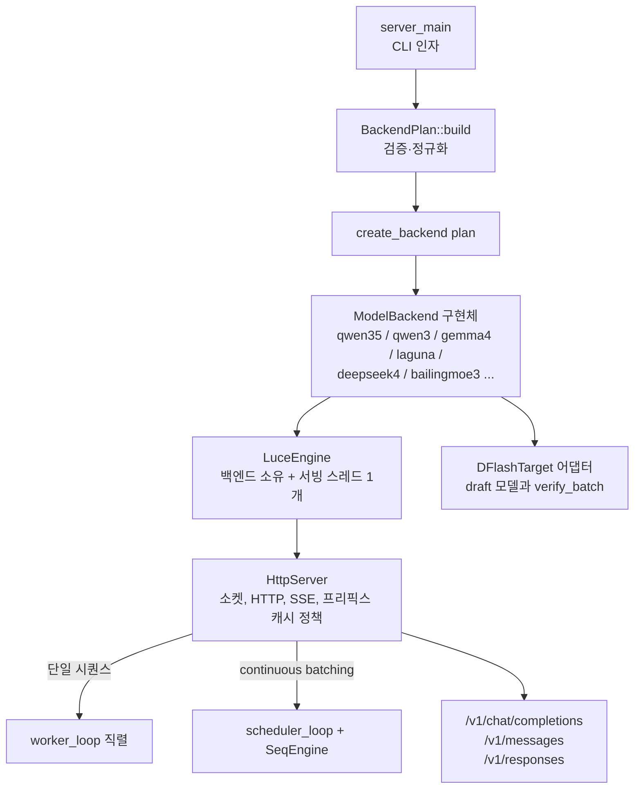

# Lucebox Hub

> [!summary] 한줄요약
> 소비자 GPU와 AMD APU·워크스테이션 카드에 맞춰 ggml 위에 C++/CUDA/HIP로 직접 짠 추론 서버. 수치는 전부 프로젝트 자체 측정이다.
>
> - **대상**: RTX 3090/4090/5090, R9700, Strix Halo에서 큰 모델을 빠르게 실행
> - **최적화**: speculative decoding(DFlash/DSpark/DDTree), speculative prefill(PFlash), KV 페이징(KVFlash), MoE 전문가 핫/콜드 캐시(Spark), megakernel
> - **접점**: 한 서버(`luce_server`)에서 OpenAI Chat/Responses·Anthropic Messages 호환 API 제공

> [!info] 이번 재조사 범위
> `git clone --depth 1`(HEAD `db4cdef`, 2026-10-01 커밋)로 받아 루트 README 전문, `server/docs/`의 ARCHITECTURE·ENGINE_COMPONENTS·API·RECOMMENDED_SETUPS·MODEL_LOAD_BALANCING·PREFIX_CACHE·DS41, `optimizations/*` README 5종, harness README, CI 워크플로, pyproject·.gitmodules를 읽었다. 약 1,949개 파일 중 대용량 문서(DS4.md 62KB, ENVIRONMENT.md 38KB, HIP_PERF_PLAN.md 37KB 등)와 CUDA/HIP 커널 소스는 본문을 읽지 않았고 파일 이름·디렉터리 구조만 확인했다. 직접 빌드·실행·벤치는 하지 않았다.

## 프로젝트 정체와 최신 상태 (GitHub API 확인)

- 설명: "LLM speculative inference server for heterogeneous hardware & consumer GPUs". 소유 조직 Luce-Org, 생성 2026-04-03, 최근 푸시 2026-10-01(조사 당일 새벽에도 커밋).
- 스타 2,887, 포크 282, 열린 이슈+PR 합계(`open_issues_count`) 106, 기여자 59명(API contributors 길이), 라이선스 Apache-2.0, 주 언어 C++. 정식 GitHub Release는 없다(릴리스 API 비어 있음). 이미지는 GHCR의 `:cuda12`/`:rocm` 태그가 `main`을 추적한다고 README가 설명한다.
- 최근 커밋 예: "perf(prefix-cache): exact Qwen snapshot cuts, generated-turn checkpoints, zero-copy restore (#792)", "fix(server): convert Anthropic tool_use and tool_result blocks (#791)", "docs(ds41): link the published DSpark drafter (#787)". PR 번호가 790대이므로 6개월 사이 수백 개 PR이 병합된 매우 빠른 개발 속도다.
- 저장소 이름 혼재: README의 빌드 예제는 `git clone ... Luce-Org/lucebox.git`이고 문서 내 PR 링크도 `Luce-Org/lucebox/pull/...`이다. 현재 레포 이름은 `lucebox-hub`이므로 이름 변경 이력이 있는 것으로 보이나 확인 못함(GitHub 리다이렉트로 둘 다 열릴 가능성).
- 상용 연계: README의 "The Lucebox Machine" 절은 R9700 + Strix Halo를 묶은 로컬 AI PC 제품을 소개한다(lucebox.com). 즉 오픈 엔진 + 하드웨어 판매 모델의 회사 프로젝트다.

## 배경: 어떤 문제를 푸는가

일반적인 로컬 추론 도구(llama.cpp 등)는 범용성을 위해 모델·하드웨어별 최적화를 포기한다. Lucebox의 접근은 반대로 "모델 하나와 칩 하나에 맞춰 손으로 최적화"다. 루트 pyproject의 설명이 이를 직접 말한다: "open LLM inference, rewritten by hand for one specific chip at a time".

목표 환경은 데이터센터 GPU가 아니라 24~32GB 소비자 카드와 128GB 통합 메모리 APU다. 이런 환경의 병목은 세 가지로 정리된다.

1. **decode가 메모리 대역폭에 묶임**: 27B급 양자화 모델은 토큰 하나당 가중치 전체를 읽는다. speculative decoding으로 한 번의 target forward에서 여러 토큰을 검증해 이를 완화한다.
2. **긴 컨텍스트 prefill이 O(S²)**: PFlash 문서는 RTX 3090에서 llama.cpp가 Qwen3.6-27B Q4_K_M의 131,072 토큰 prefill에 약 257초 걸린다고 적는다(FA on, Q4_0 KV). 사용자는 첫 토큰까지 4분을 기다린다.
3. **VRAM 한계**: KV 캐시와 MoE 전문가 가중치가 24GB를 넘는다. KVFlash(KV를 고정 슬롯 풀 + 호스트 RAM 페이징)와 Spark(MoE 핫 전문가만 GPU 상주)가 이를 다룬다.

## 아키텍처

### 계층 구조 (docs/ENGINE_COMPONENTS.md, ARCHITECTURE.md)

문서가 "현재 코드에 구현된 구조"라고 밝히는 소유권 모델은 다음과 같다.



- `BackendPlan`: 모델·배치·캐시·speculation·런타임·아키텍처별 값을 검증해 정규화한 입력. 백엔드 팩토리가 이를 받아 `ModelBackend` 하나를 만든다.
- `ModelBackend`(`common/model_backend.h`): 아키텍처 어댑터의 공통 인터페이스. `generate()`가 단일 진입점이고 AR/spec decode/DDTree 선택은 백엔드 내부 책임이다. 그 외 `park/unpark`(GPU 자원 해제·복원), `snapshot_save`·`restore_and_generate`(프리픽스 캐시, 최대 8슬롯), PFlash 압축 훅, 아키텍처별 확장 명령 `try_handle_command`를 갖는다.
- `LuceEngine`: 백엔드와 서빙 스레드를 소유. 백엔드가 `SeqEngine`을 노출하고 호출자가 동시 서빙을 허용하면 concurrent 루프, 아니면 serial 루프를 시작한다. 모델 실행 상태는 오직 서빙 스레드만 바꾼다.
- `HttpServer`: 소켓, 요청 파싱, SSE, tokenizer 의존 요청 준비, 프리픽스 캐시 정책, `ServerJob` 큐를 가진다. 느리거나 끊긴 클라이언트가 다른 슬롯의 모델 진행을 막지 않도록 출력을 버퍼링해 non-blocking으로 flush한다.
- `SeqEngine`: 동시 서빙용 모델 측 능력. 슬롯 할당, 시퀀스별 상태, KV 용량, 배치 prefill/decode, 샘플링, 퇴출을 담당한다. 스케줄러 루프가 admission 순서, 공정한 prefill 선택, 취소를 관리한다.
- 문서 스스로 밝히는 미완성 지점: 요청 조율이 아직 경계를 완전히 넘지 않았다. "transport-independent generation channel"은 다음 단계로 예고만 되어 있다.

데몬 프로토콜도 흥미롭다. `common/daemon_loop`는 stdin/stdout 프로토콜(`generate`, `park`, `unpark`, `compress`, `SNAPSHOT`, `RESTORE`, `FREE_SNAPSHOT`, `LIST_SLOTS`, `quit`)을 처리하고, `test_dflash`/`run.py` 같은 CLI와 벤치 스크립트가 이를 사용한다.

### 소스 디렉터리 (확인한 것)

`server/src/` 아래에 `qwen35`, `qwen3`, `gemma4`, `laguna`, `deepseek4`, `bailingmoe3`(Ling), `qwen35moe` 모델 백엔드, `common/`(spec decode, DDTree, KV 페이징, 샘플러, 프리픽스 캐시, 레이어 분할, IPC), `engine/`, `server/`(http_server, scheduler, launch_profiles), `draft/`, `placement/`, `ipc/`, `hip_compat/`, 그리고 `flashprefill_*.cu`, `bsa_launcher*.cu`, `rms_norm_hip.cu` 같은 커널이 있다.

`server/deps/llama.cpp`는 서브모듈이 아니라 ggml 부분집합을 레포에 직접 벤더링한 디렉터리이고(`VENDOR.md`, 원본 Luce-Org/lucebox-ggml), 서브모듈은 `Block-Sparse-Attention`(mit-han-lab) 하나뿐이다(.gitmodules). `server/deps/bsa_stubs/`는 libtorch 없이 BSA를 빌드하기 위한 ATen/c10 헤더 스텁이다(PFlash README).

### Speculative decoding 계층 (DFlash / DDTree / DSpark)

`server/README.md`는 DFlash를 이렇게 설명한다. 작은 draft가 여러 토큰을 제안하고 target이 한 번의 forward로 검증한다. DDTree는 단일 체인이 아니라 후보 트리를 검증해 같은 target 연산 예산에서 acceptance length를 높인다. 이 레포가 제공하는 것은 libllama·PyTorch 없이 ggml 위에서 동작하는 C++/CUDA decode 루프, DFlash draft의 GGUF/safetensors 로딩, tree-aware SSM(DeltaNet) rollback 커널, TQ3_0 및 K/V 비대칭 양자화다.

ARCHITECTURE.md의 `DFlashTarget` 인터페이스가 핵심이다. 범용 DFlash draft 모델은 target의 중간층 feature에 cross-attend하므로 target 쪽은 세 가지만 제공하면 된다.

1. `verify_batch()` 중 지정 층 활성값 캡처
2. 거절된 토큰 rollback을 위한 KV snapshot/restore
3. draft hidden state를 target의 lm_head로 투영

현재 qwen35 백엔드만 완전 구현이고 qwen3/gemma4/laguna는 AR 전용이라고 문서가 말한다(문서의 "Gemma4에 DFlash 추가" 가이드는 다소 오래된 내용일 수 있다. 루트 README는 Gemma 4 + DFlash 드래프터 수치를 싣고 있어 이후 구현된 것으로 보이나 문서 간 불일치를 확인했을 뿐 원인은 확인 못함).

DeepSeek V4/V4.1 계열은 "DSpark" 드래프터를 쓴다. DS41 문서에 따르면 DSpark 드래프터는 원 체크포인트의 `mtp.*` 텐서에서 변환한 것이다(MTP 계열 헤드 활용). Qwen 3.8 쪽은 "DFlash2" 드래프터를 쓴다.

## 핵심 최적화 상세

### PFlash (speculative prefill)

SambaNova의 Cross-Family Speculative Prefill 논문(arXiv:2603.02631, ICLR 2026)을 구현한 것이다. 작은 드래프터(Qwen3-0.6B BF16)가 긴 프롬프트의 토큰 중요도를 점수화하고 큰 target은 중요한 span만 prefill한다.

참조 구현은 vLLM+BF16 대형 GPU용인데 PFlash는 24GB 카드의 양자화 GGUF target 앞에서 Python/Triton 없이 쓰기 위해 C++로 짰다. 4개 CUDA 커널(`mean_K → score → select → sparse_fwd`), BSA 연결, 커스텀 Qwen3-0.6B 포워드(libllama 없음)를 포함한다.

README 수치: RTX 3090, Qwen3.6-27B Q4_K_M, 128K에서 TTFT 24.8초 vs llama.cpp 약 257초(약 10.4배), 64K는 13.5초 vs 134.95초(10.0배, FA off dense 기준), NIAH 단일 바늘 검색 유지, keep_ratio 0.05(128K를 약 2.6K span으로).

핵심 주의: 루트 README가 "PFlash is lossy prompt compression; keep it off for exact-retrieval and matched true-context benchmarks"라고 직접 경고한다. 정확한 인용이 필요한 RAG·법률·로그 분석에는 끄는 것이 맞다.

### KVFlash

attention KV 캐시를 고정 크기 슬롯 풀에 두고 64토큰 chunk 단위로 cold 부분을 호스트 RAM으로 페이징한다(bit-exact, 재호출 가능). PFlash의 드래프터가 "Memory Indexer"로 다음에 필요한 컨텍스트를 점수화한다.

README 표: Qwen3.6-27B Q4_K_M, RTX 3090에서 풀 캐시는 256K에서 13.1 tok/s·KV 4608MiB인데 KVFlash 4K 풀은 어떤 컨텍스트에서도 38.6 tok/s, 상주 KV 72MiB, 바늘 검색 14~15/16. 256K 프롬프트가 4.6GiB VRAM 대신 72MiB 상주 + 호스트 RAM 4.2GiB가 된다.

사용법은 `luce_server model.gguf --max-ctx 32768 --kvflash auto`, 정책 기본값은 드래프터 점수화이고 드래프터가 없으면 LRU로 조용히 폴백하므로 시작 배너에서 `policy=drafter`를 확인하라고 문서가 경고한다.

### Luce Spark (MoE 핫/콜드)

활성화 희소성을 이용해 큰 MoE를 작은 GPU에 넣는다. 구성요소는 세 가지다.

1. **Placement 프로파일**: 실제 트래픽을 데몬에 재생해 (레이어, 전문가)별 라우팅 빈도를 모은다. cold-hit율을 균등 배치 36%에서 6.6%로 낮췄고 decode를 66에서 81 tok/s로 올렸다(동일 VRAM).
2. **Bounded 캐시**: 고정 링 버퍼의 GPU 여유 슬롯에 cold 전문가를 LRU로 들여와 cold miss를 거의 0으로 낮춘다.
3. **Per-token fused decode**: 토큰당 40개의 레이어별 GPU 그래프 대신 FFN을 attention 그래프에 접어 넣는다(`laguna_step_hybrid`, 기본 on).

결과: Laguna-XS.2 Q4_K_M(33B total, 3B active) RTX 3090에서 전문가 60% 상주 시 ~100 tok/s(전부 GPU 119 tok/s의 85%, 순진한 오프로드 66 tok/s), 14.6GiB. Qwen3.6 35B-A3B는 13.3GiB(원래 약 20.5GiB).

다음 전문가를 한 스텝 앞서 아는 예측은 토큰 수준 recall 약 53%에서 막혀 "연구 과제로 열려 있음"이라고 솔직히 적는다.

### Paged attention + continuous batching

`GGML_OP_PAGED_ATTN`(CUDA/HIP): 16토큰 물리 블록 풀과 시퀀스별 블록 테이블, D=256 GQA, F16/Q4_0/Q8_0 K/V. 근사나 축출 없이 레이아웃·할당만 바꾼다(KVFlash와 구분).

불균등 8요청(128K + 7x8K) RTX 3090에서 K/V 저장 82% 감소, attention 1.35배. 서버 옵션은 `--paged-attention --max-concurrency N`. 루트 README: Qwen 3.8 27B + DFlash2, R9700, 5 클라이언트에서 총 300.9 tok/s.

한계: 페이징·동시성은 공유 prefix block을 아직 지원하지 않아 `--agent-turn-cache`와 같이 쓸 수 없다(API.md).

### Megakernel

Qwen 3.5-0.8B(DeltaNet+Attention 하이브리드) 24개 레이어를 단일 CUDA dispatch로 융합. RTX 3090에서 prefill 21,347 tok/s, decode 413 tok/s, 220W에서 1.87 tok/J로, 같은 카드의 llama.cpp BF16(11,247 / 267 / 0.76 tok/J)보다 빠르고 Apple M5 Max(229 tok/s, 1.76 tok/J)와 비교한다. 소형 모델 전용 연구 성격이고 R9700·Strix에서는 미지원("Not supported")이다.

### 에이전트 지향 서버 기능

- **Agent Turn Cache**: 모델이 도구 호출을 낸 뒤의 생성 상태를 체크포인트로 보관해 다음 요청에서 도구 결과와 새 접미사만 prefill한다. 코딩 에이전트 루프(도구 호출 반복)에 직접 맞춘 최적화다. 응답 `usage.timings`에 `agent_turn_cache_hit`, `cached_prefix_tokens`, `prefilled_tokens`가 노출된다.
- **프리픽스 캐시**: ChatMarkers로 턴 경계를 감지하고 경계마다 SHA-1 해시, LRU, RAM 풀 2종(inline prefix, exact prefill), 디스크 캐시(재시작 후에도 유지)를 둔다.
- **API 호환**: `/v1/chat/completions`, `/v1/messages`(Anthropic), `/v1/responses`, `/v1/models`, `/health`. 긴 prefill 동안 15초마다 SSE keep-alive 주석을 보내고, 클라이언트 연결이 끊기면 다음 안전 지점에서 백엔드에 취소를 전파한다. API.md 기준 미구현(TODO)은 `n`, `logprobs`, `response_format`, `logit_bias`, `stream_options`, Responses의 `store`/`include`/`text`/`previous_response_id` 등이다(문서가 최신 코드보다 뒤질 수 있음, 직접 호출 테스트는 하지 않았다).
- **모델 로드밸런싱**: 한 `luce_server` 프로세스에서 `--model`마다 별도 블록(`--target-device`, `--model-name`)을 두고 `--load-balancing`으로 primary 우선, 바쁘면 다음 모델로 보내고 모두 바쁘면 bounded 큐(`--routing-queue-limit`)에 대기시킨다. 문서의 예는 R9700에 Qwen, Strix Halo에 DeepSeek V4를 올린다. 중요한 점은 "요청의 model 필드와 무관하게 용량 기반으로 라우팅"한다는 것이고, 응답이 실제 생성 모델을 식별한다.
- **프로파일**: `--profile ds4-strix`, `ds4-r9700-strix`, `ds41-lucebox`처럼 검증된 하드웨어·모델 조합을 한 플래그로 적용한다(`launch_profiles.h`).

### 이기종·다중 GPU

`--target-devices cuda:0,cuda:1 --target-split-mode tensor --peer-access`로 2x RTX 3090 NVLink에서 Qwen 3.8 tensor parallel + DFlash2를 돌려 79.7 tok/s(AR 대비 2.16배, PR #637).

DeepSeek V4 Flash는 RX 7900 XT + Strix Halo(45.0~47.7 tok/s, 132,981 토큰 prefill 111.2 tok/s), R9700 + Strix Halo(86 tok/s decode, 2K prefill 788 tok/s)로 전문가를 두 장치에 나눈다.

DS41 문서는 ROCMFP2S 파일이 383GB(라우팅 전문가 158GiB, dense 8GiB, Engram 테이블 189GiB, 테이블은 파일에서 행 단위로 읽고 mmap하지 않음)이며 R9700 + Strix Halo + SSD 3계층 전문가 배치로 코드 생성 decode 25~26 tok/s를 얻는다고 적는다.

README가 직접 "서로 다른 프롬프트·양자화·추론 정책의 결과이며 하드웨어 순위가 아니다"라고 단서를 단다.

## 설치·사용법

### Docker (README)

```bash
# NVIDIA
docker run --rm --gpus all -p 8000:8080 \
  -v "$PWD/server/models:/opt/lucebox-hub/server/models" \
  ghcr.io/luce-org/lucebox-hub:cuda12

# AMD
docker run --rm --device /dev/kfd --device /dev/dri \
  --group-add video --group-add render --security-opt seccomp=unconfined \
  -p 8000:8080 -v "$PWD/server/models:/opt/lucebox-hub/server/models" \
  ghcr.io/luce-org/lucebox-hub:rocm
```

컨테이너는 모델이 들어가는 GPU(디스크리트 우선)를 고르고 그 GPU 메모리로 컨텍스트를 산정한다. AMD 이미지는 `--security-opt seccomp=unconfined`를 요구한다는 점에 유의(보안 절 참조). `devices` 서브커맨드로 GPU·모델·자동 배치 장치를 미리 볼 수 있다.

### 소스 빌드 (R9700, ROCm 7.2, RDNA4)

```bash
git clone --recurse-submodules https://github.com/Luce-Org/lucebox.git && cd lucebox
cmake -S server -B server/build-hip -G Ninja -DCMAKE_BUILD_TYPE=Release \
  -DCMAKE_HIP_COMPILER=/opt/rocm/lib/llvm/bin/clang++ \
  -DLUCE_GPU_BACKEND=hip -DLUCE_HIP_ARCHITECTURES=gfx1201 \
  -DGGML_HIP_MMQ_MFMA=ON -DGGML_HIP_NO_VMM=ON
cmake --build server/build-hip --target luce_server -j"$(nproc)"

huggingface-cli download unsloth/Qwen3.8-27B-GGUF Qwen3.8-27B-UD-IQ4_XS.gguf --local-dir models
huggingface-cli download incoai/Qwen3.8-27B-DFlash2 --local-dir models/dflash2
python server/scripts/convert_dflash_to_gguf.py models/dflash2/model.safetensors models/qwen38-dflash2-f16.gguf
python server/scripts/quantize_dflash_draft.py models/qwen38-dflash2-f16.gguf models/qwen38-dflash2-q8_0.gguf --scheme q8_0

./server/build-hip/luce_server models/Qwen3.8-27B-UD-IQ4_XS.gguf \
  --draft models/qwen38-dflash2-q8_0.gguf --draft-block-size 16 --max-ctx 131072 \
  --cache-type-k q8_0 --cache-type-v q8_0 --port 8216
```

동시 N개 서빙은 `--paged-attention --max-concurrency N --max-ctx 16384`를 더한다. NVIDIA는 CUDA 아키텍처를 CMake가 고르고 HIP는 장치의 정확한 `gfx` 아키텍처를 지정해야 한다. 서버 기본 바인드가 `--host 0.0.0.0`, 기본 포트 8080이다(server/README 파라미터 표).

### 클라이언트 harness

`harness/clients/run_{claude_code,codex,opencode,hermes,omp,pi,openclaw,openwebui}.sh`가 서버를 띄우고 실제 클라이언트 하나를 실행해 로그를 저장하고 서버를 종료한다. 예: `LUCE_SERVER_BIN=server/build/luce_server LUCE_TARGET=... LUCE_DRAFT=... MAX_CTX=32768 harness/clients/run_codex.sh`. 이는 서버 호환성 회귀 테스트이기도 하다.

## 지원 모델 (README 표 기준)

- **Qwen 3.5 0.8B**: Megakernel
- **Qwen 3.8 27B**: DFlash2, 비전 mmproj 포함
- **Laguna XS 2.1 33B**: PFlash/KVFlash/DFlash Q4
- **Gemma 4 26B-A4B 및 31B**: DFlash Q8_0 드래프터, 31B에서 3.2배
- **DeepSeek V4 Flash 및 V4.1 Flash**: DSpark, 비전 실험판
- **Ling 3.0 Flash 124B-A5.1B**: DGX Spark에서 AR 34.6 tok/s

모델 이름은 README 표기를 그대로 옮긴 것이며 각 모델의 실체와 가중치는 열어 확인하지 않았다.

테스트 하드웨어: R9700(gfx1201), Ryzen AI MAX+ 395/Strix Halo(gfx1151), RX 7900 XT/XTX(gfx1100), RTX 3090(sm_86), RTX 5090(sm_120), DGX Spark/GB10(sm_121), RTX 4090(sm_89), RTX 2080 Ti(sm_75), V100/P40, Jetson AGX Thor(sm_110, CUDA 13). 런타임은 CUDA 12+ 또는 HIP 7+(ROCm 7.2).

## 구조에서 확인한 것 (정리)

- 의존성: C++17, CMake/Ninja, ggml(llama.cpp 벤더링 스냅샷), BSA 서브모듈. Python은 모델 변환·벤치·harness용이며 uv 워크스페이스(Python 3.12)로 관리된다(pyproject `requires-python >=3.12,<3.13`, ruff/mypy/pytest dev 의존성, `luce`와 `pflash` 패키지).
- CI: GitHub Actions 5종(`ci.yml`, `docker.yml`, `speed-profile.yml`, `commit-style.yml`, `compact-commits.yml`)과 `ci-fix.yml`, dependabot. CI는 `server/**`, `harness/**` 변경 시 uv 워크스페이스 락/싱크/임포트 스모크를 돌린다. Actions는 커밋 SHA로 고정되어 있다(체크아웃 액션이 해시로 핀됨). GPU 성능 회귀 테스트가 CI에서 어떻게 도는지는 확인 못함(`speed-profile.yml`의 내용은 열지 않음).
- 문서화 수준은 높다. 서버 파라미터 레퍼런스, 환경변수 레퍼런스(ENVIRONMENT.md 38KB), 모델별 가이드, HIP 성능 계획, 설계·핸드오프 문서가 모두 레포 안에 있다. 반면 `docs/handoffs/`, `HIP_PERF_PLAN.md` 같은 작업 메모가 섞여 있어 문서가 코드보다 앞서거나 뒤처진 부분이 있다(예: ARCHITECTURE의 AR-only 서술, API.md TODO 목록).

## 비교 대상

| 항목 | Lucebox | llama.cpp (llama-server) | vLLM | 비고 |
|---|---|---|---|---|
| 목표 | 특정 칩·모델 수작업 최적화, 단일/소수 사용자 지연 | 범용 로컬 추론 | 데이터센터 다중 사용자 처리량 | 목적이 다름 |
| 기반 | ggml 위 자체 C++/CUDA/HIP | ggml | PyTorch 계열 | Lucebox는 ggml 벤더링 스냅샷 사용 |
| speculative | DFlash/DDTree/DSpark 내장 | 별도 드래프터 지원 | 별도(확인 안 함) | README는 llama.cpp 같은 드래프터 대비 3.8배(R9700, Qwen 3.8)라고 주장 |
| 장기 컨텍스트 | PFlash/KVFlash | KV 양자화 등 | PagedAttention | PFlash는 lossy |
| 하드웨어 | 소비자 NVIDIA + AMD RDNA3/4, APU, DGX Spark | 광범위 | 데이터센터 중심 | |
| 성숙도 | 6개월, 릴리스 없음 | 매우 성숙 | 성숙 | |

우리 노트 중 [[vllm-moriio-kv-connector]]는 vLLM 쪽 KV 이동을 다루므로, "다중 사용자 데이터센터 처리량(vLLM)"과 "소수 사용자 소비자 하드웨어 지연(Lucebox)"의 상보 관계로 읽을 수 있다. 소형 모델은 [[qwen3-5-9b]]가 있고, Reddit의 MTP GGUF 글인 [[reddit-qwen36-27b-q40-mtp-gguf]]는 DSpark 드래프터가 `mtp.*` 텐서에서 변환된다는 점에서 같은 계열 기술(MTP 활용 speculative decoding)을 가리킨다.

## 장단점·한계·성숙도

**장점.** 소비자·APU 하드웨어에서 단일 사용자 decode와 긴 컨텍스트 prefill 지표가 매우 공격적이다. 에이전트(Claude Code, Codex 등)와 맞춘 API 호환·프리픽스/에이전트 턴 캐시·harness 회귀 테스트가 있다. 이기종(AMD+AMD, NVIDIA 다중) 실행과 SSD 계층 전문가 배치까지 다룬다. Apache-2.0이고 개발이 매우 활발하다. 측정 조건과 PR 링크가 수치마다 붙어 검증 경로가 열려 있다.

**한계.**
1. 수치는 전부 자체 측정이며 독립 재현은 확인 못함. 표의 행들은 모델·양자화·정책이 달라 서로 비교할 수 없다(README도 인정).
2. 빌드가 하드웨어 아키텍처(gfx 코드, sm 버전)와 ROCm/CUDA 버전에 종속되고, 드래프터 변환·양자화 스크립트를 직접 돌려야 하는 모델이 많다.
3. 정식 릴리스·버전 태그가 없고 `main`이 곧 배포본이다. API 안정성 보장은 없다.
4. 구조가 빠르게 바뀌는 중이다(ENGINE_COMPONENTS가 "다음 단계"를 예고). 문서-코드 불일치 가능성이 있다.
5. PFlash는 lossy, KVFlash는 도구 호출 정확성에 영향이 있을 수 있어 정확 인용 워크로드는 끄거나 별도 검증해야 한다(근거: README 경고, KVFlash 바늘 검색 14~15/16이 만점이 아님).
6. 다중 사용자 대규모 처리량 용도로는 검증 근거가 없다. 최대 동시성 실험은 5 클라이언트 수준(Qwen)과 4 클라이언트(DeepSeek)다.
7. 열린 이슈+PR이 106개라 지원 부담이 있으나 내용은 열어보지 않았다.

## 보안·라이선스·운영 리스크

- **라이선스**: 레포 Apache-2.0. 모델·드래프터 가중치는 각자의 라이선스를 따르므로 사용하는 GGUF마다 확인해야 한다(Qwen, Gemma, DeepSeek, Laguna, Ling 모두 별개, 이번에 개별 라이선스는 열지 않음). `Lucebox` HF 조직의 변환본 GGUF에 대한 출처 신뢰도 검토가 필요하다.
- **인증 없음, 기본 0.0.0.0 바인드**: 서버 파라미터 표에서 `--host` 기본값이 `0.0.0.0`이고 CORS는 기본 활성(`--no-cors`로 끔)이다. README와 server/README, ENVIRONMENT.md에서 서버 자체의 API 키/인증 옵션은 찾지 못했다(`--prefill-upstream-key`는 업스트림으로 보내는 Bearer일 뿐). 따라서 사내망에 그대로 열면 누구나 추론 자원을 쓸 수 있다. `--host 127.0.0.1`로 두고 게이트웨이(예: [[inflab-ai-gateway]] 패턴)·mTLS 리버스 프록시 뒤에 두는 구성을 권장한다. 코드 전체를 감사한 것은 아니므로 "옵션이 없다"는 결론은 문서 검색 범위 내에서만 유효하다.
- **컨테이너 권한**: ROCm 이미지는 `--device /dev/kfd --device /dev/dri --security-opt seccomp=unconfined`로 실행한다. 컨테이너 격리가 약해지므로 신뢰할 수 없는 코드 실행과 같은 호스트에 두지 말고 전용 노드에 둔다. [[microvm-isolation-2026]]의 논지대로 컨테이너는 보안 경계가 아니다.
- **공급망**: 벤더링된 llama.cpp/ggml 스냅샷(`VENDOR.md`)과 BSA 서브모듈, HF의 제3자 변환 GGUF, `main` 추적 GHCR 이미지. 이미지 다이제스트 고정과 모델 해시 검증이 필요하다. CI Actions가 SHA 핀인 점은 긍정적이다.
- **메모리 안전성**: 코드 대부분이 C++/CUDA다. 외부 입력(GGUF 파서, 요청 JSON)을 다루므로 GGUF 경계 검증(`gguf_bounds.h` 같은 파일이 존재)은 있으나 퍼징·감사 여부는 확인 못함. 신뢰할 수 없는 GGUF를 로드하지 않는다.
- **운영**: 프리픽스 캐시가 디스크에 KV 스냅샷을 남긴다(`Prefix cache (disk)`). 프롬프트 내용이 KV 형태로 디스크에 남을 수 있으므로 민감 데이터 환경에서는 디스크 캐시 위치·암호화·삭제 정책이 필요하다(KV에서 프롬프트가 복원 가능한지는 확인 못함, 보수적으로 민감 정보로 취급).

## 관련 노트
[[vllm-moriio-kv-connector]] [[reddit-qwen36-27b-q40-mtp-gguf]] [[qwen3-5-9b]] [[inflab-ai-gateway]] [[microvm-isolation-2026]] [[apertus-v1-5-70b]]

> [!note] 2026-10-01 팩트체크: README·optimizations·GitHub API와 대조해 두 가지를 바로잡았다. (1) 기여자 수 30명 -> 59명(contributors API per_page=100). (2) llama.cpp/ggml은 서브모듈이 아니라 `server/deps/llama.cpp`에 벤더링된 스냅샷이며(`VENDOR.md`) `.gitmodules`에는 Block-Sparse-Attention만 있다. 스타 2,887, 포크 282, Apache-2.0, 생성/푸시 날짜, HEAD db4cdef, PFlash/KVFlash/Spark/Megakernel/Paged attention 수치 등은 원문과 일치.

## 출처 (실제로 연 것)
- https://github.com/Luce-Org/lucebox-hub (clone HEAD db4cdef: README.md, server/README.md, server/docs/{ARCHITECTURE,ENGINE_COMPONENTS,API,RECOMMENDED_SETUPS,MODEL_LOAD_BALANCING,PREFIX_CACHE,DS41}.md, optimizations/{pflash,spark,kvflash,megakernel,paged_attention}/README.md, harness/README.md, pyproject.toml, .gitmodules, .github/workflows/ci.yml)
- GitHub API: repos/Luce-Org/lucebox-hub(스타·포크·라이선스·푸시), commits, contributors, releases
- 인용된 외부 논문: https://arxiv.org/abs/2603.02631 (PFlash README가 인용한 SambaNova 논문, 이번에는 열지 않고 README 인용만 확인)
- 열지 않은 것: lucebox.com 블로그, DS4.md/ENVIRONMENT.md/HIP_PERF_PLAN.md 본문, 소스 코드 본문, 벤치 재현
