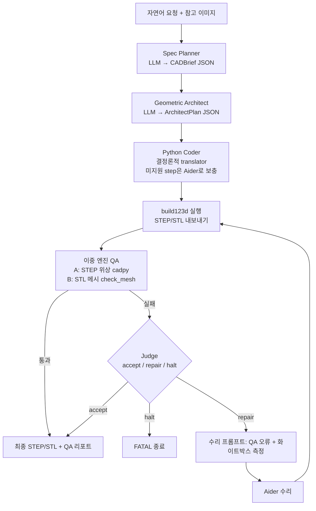
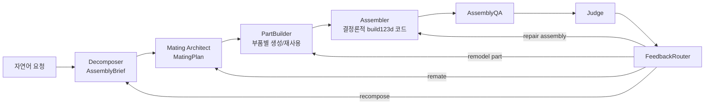

# Multi-Agent CAD (MAC)

> [!summary] 한줄요약
> 자연어 설계 요청을 편집 가능한 CAD(build123d Python 코드 + STEP/STL/GLB)로 바꾸는 LangGraph 기반 멀티에이전트 파이프라인. 비용·토큰 절감 수치는 저자 자체 벤치다.
>
> - **정보 전달**: 대화 전문 대신 압축된 구조화 산출물(CADBrief, ArchitectPlan) 전달
> - **생성·수리**: 결정론적 translator 우선, 기하 QA와 독립 Judge로 제한된 수리 루프 실행
> - **확장**: v1.0.0(2026-09-24)부터 다부품 어셈블리와 URDF 내보내기 포함(기술 프리뷰)

> [!info] 이번 재조사 범위
> `git clone --depth 1`(HEAD `8bf91d8`, 2026-09-24)로 받아 루트 README 전문, `multi_agent_cad/README.md`, `multi_agent_cad/WORKFLOW.md`(중국어, 약 58KB) 핵심 절, `mac_assembly/README.md` 전문, `docs/quantified_quality.md` 앞부분(방법론·요약), `SECURITY.md`, `pyproject.toml`, `nodes.py`의 서브프로세스 env 허용 목록, `_config_defaults.py`의 모델 설정을 읽었다. 전체 Python 약 3만 줄(`multi_agent_cad/*.py` + `mac_assembly/*.py`)의 본문을 다 읽지는 않았고, 직접 실행(LLM 호출, CAD 생성)은 하지 않았다. 따라서 품질·비용 수치는 모두 저자 보고다.

## 프로젝트 상태 (GitHub API)

- MIT, 스타 1,013, 포크 94, 열린 이슈+PR 1, 생성 2026-07-30, 최근 푸시 2026-09-24, 기여자 2명(API), Python.
- 릴리스: `v1.0.0`(2026-09-24)과 `ui-demo-v1`(2026-08-04). `pyproject.toml` 버전 1.0.0, Python 3.11+, classifiers "Development Status :: 4 - Beta". SECURITY.md는 1.0.x만 지원 버전으로 표기한다.
- 최근 커밋 메시지: "docs: document web security controls and environment variables", "test(release): add batch c security regression coverage", "fix(exec): isolate generated code subprocess environment", PR #9 "feature/assembly" 병합. 즉 v1.0.0 직전에 보안 정리 배치가 몰려 있다. 저자는 칭화대 IEI Lab 소속으로 표기(README 감사의 글), 인용 정보의 저자는 Guanxing Qu, Xueyan Zou.
- README는 원래 단일 부품 Text-to-CAD로 "거의 1,000 스타"를 받았고(현재 1,013) 이번 릴리스에서 시각 검증, 독립 Judge, 실험적 어셈블리 생성이 추가됐다고 설명한다.

## 배경: 해결하려는 문제

LLM으로 CAD를 만들 때 흔한 접근은 단일 에이전트가 코드를 쓰고, 실행하고, 오류를 보고 같은 대화 맥락에서 고치는 루프다. 이 방식은 성공하면 좋지만 대화 이력이 매 반복마다 통째로 다시 입력되므로 토큰이 크게 늘어난다. 이 레포의 비교 대상인 "CAD Skills"(earthtojake/text-to-cad의 Claude Code skill)를 저자가 재현했을 때 전체 토큰이 103.95M이었다(그중 cache_read가 96.2M).

MAC의 핵심 아이디어는 WORKFLOW.md의 표현대로 "정보 압축, 단순한 멀티 에이전트가 아님"이다. 4개 에이전트가 있다는 것이 아니라 에이전트 사이에 수십 개 필드의 `CADBrief`와 수백 개 필드의 `ArchitectPlan` 같은 compact structured state만 전달하고 대화 원문은 넘기지 않는다는 점이다. 또한 "constrained test-time compute"라는 부제대로 재시도·수리 횟수를 상한(기본 MAX_RETRIES=5)으로 묶는다.

## 아키텍처: 단일 부품 파이프라인



### 단계별 책임 (WORKFLOW.md, README 기준)

1. **Spec Planner**: 요청에서 핵심 치수와 제약을 추출해 `CADBrief`를 만든다. 검증 목표(`verification_targets`)는 "최종 결과 속성"만 만든다: 전체 바운딩박스(OVERALL_DIMENSION), 단일 바디(SINGLE_BODY), 수밀성(WATER_TIGHTNESS). 구멍 지름, 필렛, 벽 두께 같은 feature 수준 치수는 QA가 아니라 화이트박스 계측과 수리 에이전트가 담당한다.
2. **Geometric Architect**: `ArchitectPlan`을 만든다. 스케치(2D 윤곽), 모델링 step(extrude, revolve, 구멍, boolean, 패턴, mirror, fillet, chamfer, shell), selector map, key dimensions.
   - **설계 규칙**: 프롬프트에 "Iron Rules"가 있다: 2D 스케치 로컬 좌표계 규칙, 대칭 feature는 독립 스케치, 유령 엔티티 금지(좌표 null 금지), notes에는 기하 설명만 허용하고 조작 지시 금지, 비정규 다각형은 반드시 `control_points`.
   - **입력 정규화**: Pydantic 검증 전에 LLM의 흔한 step_type 오기(예: `pattern`→`pattern_circular`, `union`→`boolean_union`, `sweep`/`loft`→`extrude`)를 `_normalize_architect_plan`이 교정한다.
   - **문서 불일치**: 문서 제목은 Iron Rules "5조"라고 쓰고 본문 도입부는 4조라고 써서 문서 간 표기가 어긋난다(WORKFLOW.md의 소소한 불일치).
3. **Python Coder**: 결정론적 translator(`_plan_to_code`, `nodes.py`)가 extrusion, revolution, holes, booleans, patterns, mirrors, fillets, chamfers, shells를 추가 LLM 호출 없이 코드로 번역한다.
   - 번역할 수 없는 step은 `TODO_AIDER` 표식으로 남기고 Aider가 보충한다.
   - `_safe_fillet`은 OpenCascade가 큰 필렛 반경을 거절하면 더 작은 반경으로 자동 낮춰 재시도한다.
   - `_infer_edge_filter`는 하드코딩된 좌표 대신 `e.length()` 기반 list comprehension으로 의미적 edge 선택을 만든다.
4. **Autonomous Skill Loop**(최대 5회 재시도, 내부 즉시 재수리 최대 3회): QA → (선택) 사용자 체크포인트 → 통과 판정 → Judge → 수리 프롬프트 구성 → Aider 수리 → 재실행. CLI에서는 매 QA 후 10초 체크포인트에서 `1` 자동 반복, `2` 새 요구 주입, `3` 중단을 고를 수 있고 시간 초과 시 자동 반복이다. 웹 UI는 아직 이 체크포인트를 노출하지 않고 자동 반복한다.

### QA와 Judge

- **이중 엔진**: Engine A는 vendored `cadpy`(earthtojake/text-to-cad 유래, MIT)로 STEP 위상을 분석한다. Engine B는 `check_mesh.py`(STL 메시: 전체 치수, 구멍, 벽 두께, 구조, 제조성). 연결성은 Union-Find로 메시 면 인접 그래프에서 분리 실체를 찾고 총 체적 0.1% 미만 파편은 무시, 의미 있는 성분이 2개 이상이면 치명(TOPOLOGY)으로 라우팅한다. `check_mesh.py`가 시간 초과·비정상 종료 시에는 nodes.py 내부 fallback 연결성 검사가 대신한다.
- **리포트 병합 규칙**: 이중 엔진 모두 실패면 FATAL, 단일 엔진 실패면 DIMENSION, 위상 연결 실패나 비수밀은 TOPOLOGY, 강도 점수 40 미만이나 심한 오버행·캔틸레버는 TOPOLOGY 등으로 우선순위 규칙이 정해져 있다.
- **Judge**: 기존에는 QA가 실패하면 5회 수리를 끝까지 소모했는데, 오탐·물리적으로 불가능한 요구(예: 60mm 폭 블록에 Ø80mm 보어)·다체 어셈블리 오판에서 예산을 낭비했다. 그래서 통과 판정과 수리 프롬프트 사이에 독립 Judge LLM(기본 `qwen3.8-max`, thinking 활성, 이미지 입력 가능)을 두고 `accept`/`repair`/`halt`를 내게 했다.
  - **환각 방지 장치**: few-shot 9개, 증거 필드가 있는 스키마, 코드 증거 게이트, 감사 로그, 끄는 스위치(`JUDGE_ENABLED`)를 둔다.
  - **남는 한계**: 문서는 Judge가 메시를 보지 못하고 측정값과 오류 설명만 보기 때문에 복잡한 위상 충돌에서 "공간 상상 환각"이 날 수 있다고 스스로 경고한다.
  - **벤치에서의 동작**: 결과적으로 벤치의 유일한 실패(P8 임펠러 필렛 충돌)를 4회 실패 후 ACCEPT로 처리하고, P9 계단은 "DEFENSIVE CORRECTION:" 접두사로 겹침(overlap) 보정을 지시하는 식이다.
- **수리**: Aider(`aider.coders.Coder`)가 스크립트와 `build123d_reference.md`(API 사용법 치트시트: Align.MIN, Pos/Rot 순서, `extrude(dir=)`, 안전 boolean, 필렛 순서 등)를 컨텍스트로 받아 수정한다. Aider가 없으면 DashScope 직접 호출 폴백.

## 아키텍처: 어셈블리 파이프라인 (mac_assembly, 기술 프리뷰)



- **분리 원칙**: 두 계획 단계가 "무엇이 존재하는가(Decomposer)"와 "어떻게 배치되는가(Mating Architect)"를 구분한다. 부품 생성은 단일 부품 MAC 파이프라인을 부품별 격리 작업 디렉터리에서 재사용한다. Assembler는 결정론적이고 LLM은 스크립트 수리가 필요할 때만 쓴다.
- **부품 생성 경로 5종**
  1. 전체 단일 부품 파이프라인
  2. 파라메트릭 builder(`BUILDERS` 레지스트리 29개, 토큰 0)
  3. LLM 본체 + 결정론적 후가공(보어, clevis, knuckle 등)
  4. 동일 부품 재사용(STEP 복사)
  5. 거울 재사용(XY/XZ/YZ 반사로 반대 손잡이 부품 생성; 같은 방향 복사본을 거울쌍인 척하지 않음)
- **조인트(mate)**: rigid, face_to_face, coaxial, revolute, linear, cylindrical, ball. 복잡 부품은 실제 STEP 위상에 대해 의미적 selector(예: 특정 반경의 원통면)를 해석하고 결과 수치 selector를 `assembly_selector_audit.json`에 남긴다. clevis의 `direction`(feature가 뻗는 방향)과 `pin_axis`(힌지 보어 축)를 분리해 기록한다.
- **QA와 라우팅**: 부품 수·라벨, mate 축 정렬, 최소 간극과 깊이 허용 간섭, 회전·직선 운동 스윕, 전체 외곽, 산출물 존재를 결정론적으로 확인한다. 실패 책임을 4개 루프(분해, 배치계획, 부품 형상, 어셈블리 스크립트)로 나눠 라우팅한다. 부품이 시도를 소진했어도 쓸 만한 STEP이 있으면 `degraded`로 표시해 계속 진행하되 QA와 Judge에 노출한다. 인증 오류·의존성 누락·반복 무진전 타임아웃·예산 소진은 무한 재시도하지 않고 incomplete로 멈춘다.
- **출력**: `assembly_jobs/job_<timestamp>/`에 부품별 폴더, `assembly_output.step/.stl/.glb/.urdf`, `assembly_manifest.json`, `assembly_mates.json`, `assembly_selector_audit.json`, `assembly_judge_views/`. 캐시는 분해와 mate 계획을 따로, 부품별 격리 캐시와 토큰 원장, 내용 지문(`spec_fingerprint`)으로 stale 재사용을 방지한다.
- **알려진 한계(문서 명시)**: 부품 생성이 직렬, 어셈블리 전용 브라우저 UI 없음(GLB/STEP을 외부 뷰어로 확인), 상용 표준 부품 카탈로그 연동은 범위 밖, `face_to_face`는 지원 배치 규약으로 제한, 간섭·운동 검사는 의존 라이브러리 필요, URDF는 파일 수준 핸드오프일 뿐 동역학·액추에이터 튜닝·시뮬레이션 검증은 하류 책임, 복잡한 자유형 부품은 실패하거나 프롬프트 개선이 필요.

## 설치·사용법

```bash
git clone https://github.com/Pan-Chera/Multi-Agent-CAD.git
cd Multi-Agent-CAD
conda env create -f environment.yml
conda activate multi_agent_cad
pip install --no-deps "aider-chat==0.82.3"   # aider가 numpy 1.x를 핀해 build123d(numpy 2.x)와 충돌하므로 --no-deps
export DASHSCOPE_API_KEY="..."               # 변수명은 역사적 이유, 실제로는 설정된 공급자의 키

# 단일 부품: multi_agent_cad/config.py 의 USER_REQUEST 를 편집한 뒤
python -m multi_agent_cad.graph
# 기존 temp_design*.py 수정
python -m multi_agent_cad.graph_aider
# 웹 UI
pip install -e ".[web]" && python -m multi_agent_cad.web

# 어셈블리
MAC_ASSEMBLY_REQUEST="$(cat mac_assembly/assembly_prompts/natural_language_benchmarks/01_hinged_twin_claw_gripper.md)" \
python -m mac_assembly
```

pip 전용 사용자를 위한 우회 절차(aider 먼저 설치 후 numpy를 `>=2,<2.3`로 강제 업그레이드)와 Windows 안내(conda-forge 권장)가 README에 있다.

설정(`config.py`): 공급자 엔드포인트 `DS_BASE_URL`, 단계별 모델(`SPEC_PLANNER_*`, `ARCHITECT_*`, `CODER_*`, `REPAIR_*`, `AIDER_*`, `JUDGE_*`)의 모델·온도·토큰 상한·kwargs.

모델 인터페이스는 OpenAI 호환이라 다른 엔드포인트로 바꿀 수 있으나, Qwen에서 벗어나면 `enable_thinking` 같은 공급자 전용 옵션을 `*_KWARGS`에서 지워야 한다고 문서가 말한다.

기본 `DS_BASE_URL`은 DashScope 계열 엔드포인트(`_config_defaults.py`에서 확인한 값은 Alibaba Cloud `maas.aliyuncs.com` 호스트이며 호출 시 외부로 설계 내용이 전송된다), 기본 모델은 `qwen3.8-max`. 초기화는 `python -m multi_agent_cad._config_defaults --reset`.

**캐시 함정(문서 명시)**: 단일 부품 캐시(`pipeline_cache/cad_brief.json`, `architect_plan.json`)는 파일 존재 여부만 보고 현재 `USER_REQUEST`와 일치하는지는 확인하지 않는다. 다른 모델을 만들기 전에 두 파일을 지우거나 `force_refresh: True`로 바꿔야 한다. 어셈블리 캐시는 지문 규칙이 달라 이 함정이 없다.

## 벤치마크 (저자 보고) 읽는 법

단일 부품 10개 프롬프트·141 feature(P1 블록 7개부터 P10 유성기어 21개까지)에서 binary pass/fail로 채점했다.

| 워크플로 | 모델 | 검증 | 토큰 | 추정 비용(root README, USD) | feature 통과 |
|---|---|---|---:|---:|---:|
| CAD Skill 재현 | Qwen 3.7 | - | 103.95M | \$18.59 | 138/141 (97.9%) |
| CAD Skill 재현 | Qwen 3.8 | Visual | 87.46M | \$29.45 | 132/141 (93.6%) |
| MAC v1 | Qwen 3.7 | Geometric | 0.90M | \$1.43 | 140/141 (99.3%) |
| MAC v2 | Qwen 3.8 | Visual+Geometric | 1.40M | \$4.85 | 140/141 (99.3%) |

README는 Qwen 3.7에서 v1이 116배 적은 토큰·13배 낮은 비용, Qwen 3.8에서 v2가 62.7배 적은 토큰·6.1배 낮은 비용이라고 쓴다. 하위 README는 같은 비용을 CNY(¥125.69, ¥9.66 등)로 표기하고 루트 README는 USD로 표기한다. 환율 근거는 문서에 명시되지 않아 확인 못함.

해석 시 주의할 점은 다섯 가지다.

1. **인과관계 미분리**: 저자 스스로 "정확한 인과(아키텍처 때문인지 모델 때문인지)는 전용 ablation 없이 단정하지 말라"고 `docs/quantified_quality.md`에 적는다. 오케스트레이션, 도구 컨텍스트, 수리 동작, 캐시 계산이 구현마다 다르다.
2. **토큰과 비용의 차이**: 토큰 비율(116배)은 baseline의 cache_read 96.2M이 지배한다. 같은 보고서의 비용 공식은 cache_read를 입력의 1/10 가격(0.6 대 6.0 CNY/백만 토큰)으로 계산하므로 비용 비율(13배)이 토큰 비율보다 실제 체감에 가깝다. API 호출 수 비교(1,307 대 50, 26.1배)도 같이 제시된다.
3. **평가 대상**: 141개 feature는 대부분 정성적 위상 항목(단일 바디/어셈블리, 대칭, 배치, 관통 vs 막힘, 필렛 범위)이라 치수 정밀도 평가가 아니다.
4. **통과 수치의 구성**: 99.3%의 140/141에는 "실제 실패 1건 + 독립 방어 보정 1건"이 섞여 있다(리포트 표기).
5. **어셈블리 평가 범위**: 어셈블리는 큐레이션된 갤러리일 뿐 성공률 지표가 없고 CAD-agent skill보다 우월하다는 주장도 하지 않는다고 README가 명시한다.

어셈블리 4종 갤러리의 토큰·비용은 약 30만~580만 토큰, 약 $1~$13이었다(README 표: 시선 검사 로봇팔 약 30만 토큰·\$1, 이동 매니퓰레이터 약 580만 토큰·\$13, 총합은 하위 README에서 약 865만 토큰·약 ¥132).

## 구조에서 확인한 것

- 디렉터리: `multi_agent_cad/`(graph.py, graph_aider.py, nodes.py, schemas.py, render_views.py, token_tracker.py, web/ FastAPI 서버, service_*.py 3종 등), `mac_assembly/`(nodes_assembly.py, builders.py, selector_resolver.py, assembly_qa.py, urdf_export.py 등), `packages/cadpy`(vendored), `legacy_refs/check_mesh.py`, `tests/release/`(5개 회귀·보안·URDF 테스트), `docs/`.
- 서비스 모듈 `service_armoured_chassis.py`, `service_counterweight_frame.py`, `service_cover_panel.py`: 특정 부품형(장갑 섀시, 균형추 프레임, 커버 패널)의 전용 생성 로직으로 보이나 내용은 열지 않아 확인 못함.
- 의존성(pyproject): build123d>=0.8, langgraph>=0.2,<0.3, langgraph-checkpoint, pydantic>=2.5, openai>=1.20, anthropic>=0.30(선택 폴백), 옵션으로 trimesh/rtree(메시 QA), numpy/scipy/scikit-learn, 웹용 fastapi/uvicorn. aider-chat은 numpy 충돌 때문에 의도적으로 별도 설치.
- WORKFLOW.md 말미의 "CAD Skill과의 비교" 표는 "어셈블리 지원: ❌ 단일 부품만", "시각 검토: ❌ 순수 기하 분석"으로 되어 있어 v2(어셈블리·시각 검증 추가) 이후 코드와 맞지 않는다. 문서 갱신 지연 사례다. 또한 본문 일부는 중국어다.

## 비교 대상

| 항목 | MAC | CAD Skills(earthtojake/text-to-cad) | 일반 단일 에이전트 코드 생성 |
|---|---|---|---|
| 구조 | LangGraph 다단계 + 결정론적 translator | 단일 에이전트 + CLI/스냅샷 | 대화 이력 반복 |
| 에이전트 간 전달 | 압축 JSON | 산문 노트 | 전체 대화 |
| QA | 이중 엔진 + 독립 Judge | CLI inspect + 스냅샷 | 모델 자체 판단 |
| 어셈블리 | 지원(프리뷰) | 지원(MAC 문서 표에서는 본체 외 표기, 비교 표가 낡았을 수 있음) | 모델 의존 |
| 라이선스 | MIT | MIT (cadpy 재배포 근거) | - |

MAC의 cadpy는 CAD Skills의 런타임에서 파생되어 원 MIT 라이선스로 재배포된다(`packages/cadpy/LICENSE`).

## 장단점·한계·성숙도

**장점.** 압축 상태 전달과 결정론적 번역으로 LLM 호출을 줄이는 설계 철학이 분명하고 산출물(계획 JSON, 생성 코드, 측정값, QA 리포트, 수리 이력)이 디스크에 남아 감사 가능하다. STEP/STL/GLB/URDF 출력으로 하류 도구 연계가 쉽다. 부품별 모델을 다르게 지정할 수 있다. 어셈블리 쪽 캐시 지문·무진전 중단·degraded 상태 처리 등 운영 안전장치가 신중하다.

**한계.** 신생(생성 약 2개월, 기여자 2명)이고 벤치는 저자 보고이며 외부 재현 확인 못함. 어셈블리는 프리뷰이고 부품 생성이 직렬이다. 기본 설정이 Qwen/DashScope에 맞춰져 있어 다른 모델은 튜닝이 필요하다. Judge가 메시를 못 보는 구조적 환각 위험, 캐시 stale 함정, 문서 간 불일치. 생성물은 제조(3D 프린트, 가공)와 시뮬레이션 전에 사람이 검증해야 한다고 README가 반복해 경고한다.

**성숙도.** 연구 코드에서 제품화로 넘어가는 초기 단계(Beta, v1.0.0). 회귀 테스트와 보안 테스트가 릴리스 직전에 추가된 흔적이 있다.

## 보안·라이선스·운영 리스크

- **모델이 생성한 Python을 그대로 실행한다.** 이것이 가장 큰 리스크다. SECURITY.md는 자식 프로세스가 "생명주기 격리일 뿐 보안 샌드박스가 아니며" 생성 코드가 MAC을 실행한 사용자와 같은 OS 권한(파일시스템, 네트워크, 프로세스 생성)으로 돈다고 명시한다.
  - **완화책**: 환경변수 allowlist(`PATH, HOME, TMPDIR, TMP, TEMP, LANG, LC_ALL, LC_CTYPE, PYTHONPATH, PYTHONIOENCODING, LD_LIBRARY_PATH, DYLD_LIBRARY_PATH` + 매 반복 `ITERATION`)만 자식에 넘겨 API 키 유출을 줄였다(`nodes.py` `_build_child_env`).
  - `MAC_CHILD_ENV_ALLOW`로 프록시 변수 등을 추가할 수 있지만 키를 넣지 말라고 경고한다.
  - 문서와 코드 주석 모두 "진짜 샌드박싱(컨테이너/네임스페이스)은 향후 마이너 릴리스로 연기"라고 적는다.
- **웹 UI**: 기본 `127.0.0.1` 바인딩. 상태 변경 요청(POST/PUT/PATCH/DELETE)은 `X-MAC-CSRF: 1` 헤더가 필수이고 없으면 403. 루프백 바인딩이면 Host 헤더 allowlist가 추가 방어로 켜지고, 비루프백이면 꺼진다.
  - **엔드포인트 제한**: 사용자 지정 엔드포인트(`DS_BASE_URL`)는 loopback, api.openai.com, api.deepseek.com, generativelanguage.googleapis.com, `.aliyuncs.com`, `.googleapis.com`만 기본 허용하고 사설 vLLM 등은 `MAC_WEB_ALLOW_CUSTOM_ENDPOINT=1`을 켜야 한다(SSRF 방어 성격).
  - **결과 복사 경로**: `dest_path`는 `MAC_WEB_ALLOW_DEST_PATH=1` + `MAC_WEB_DEST_ROOT` 절대 경로가 필요하고 상대 경로·`..` 탈출은 거절한다.
  - README는 UI를 인증·샌드박스 계층 없이 비신뢰 네트워크에 노출하지 말라고 명시한다.
- **공급망**: aider-chat 0.82.3 고정 설치, 전이 의존성 다수(OCP는 build123d 경유 `cadquery-ocp-novtk`), vendored cadpy.
- **데이터 반출**: 설계 요청·계획·코드가 외부 LLM 엔드포인트(기본 DashScope)로 전송된다. 사내 설계 데이터에는 온프렘 OpenAI 호환 엔드포인트로 바꾸고 `MAC_WEB_ALLOW_CUSTOM_ENDPOINT`를 신중히 쓴다.
- **라이선스**: MIT(+ cadpy MIT). 생성물 지적재산권·모델 약관은 사용하는 LLM 제공자 약관을 따라야 하며 이번에 확인하지 않았다.

## 관련 노트
[[opencut]] [[qwen3-5-9b]] [[microvm-isolation-2026]] [[inflab-ai-gateway]] [[lucebox-hub]]

## 출처 (실제로 연 것)
- https://github.com/Pan-Chera/Multi-Agent-CAD (clone HEAD 8bf91d8: README.md, multi_agent_cad/README.md, multi_agent_cad/WORKFLOW.md, mac_assembly/README.md, docs/quantified_quality.md, SECURITY.md, pyproject.toml, multi_agent_cad/nodes.py 일부, _config_defaults.py 일부)
- GitHub API: repos/Pan-Chera/Multi-Agent-CAD (스타·포크·라이선스·푸시), releases, commits, contributors
- 열지 않은 것: 소스 코드 대부분(nodes.py 본문, schemas.py, 어셈블리 노드), docs/qwen3.7_token.md·qwen3.8_token.md 프롬프트별 토큰 표, 중국어 README, 비교 baseline인 earthtojake/text-to-cad
