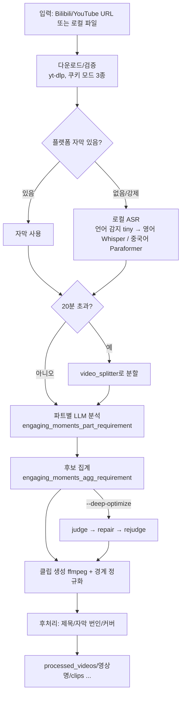

# OpenClip

> [!summary] 한줄요약
> 긴 영상(라이브 방송, 발표, 인터뷰)에서 하이라이트 클립을 만드는 경량 Python 파이프라인.
>
> - **처리 흐름**: 다운로드 → 전사 → 20분 단위 분할 → LLM 하이라이트 분석 → 집계 → 클립 생성 → 제목/자막/커버
> - **진입점**: Streamlit UI, CLI(`video_orchestrator.py`), Claude Code 등용 Agent Skill
> - **온프렘 연동**: OpenAI 호환 `custom_openai` 엔드포인트로 vLLM, Ollama 등의 LLM 서버 연결

> [!info] 이번 재조사 범위
> `git clone --depth 1`(HEAD 단일 커밋: 저장소가 2026-03-04 이력 재작성을 겪었다고 README가 밝힘)로 받아 `README_EN.md` 전문, `pyproject.toml`, `core/config.py`, `core/transcript_generation_whisper.py` 일부, `core/engaging_moments_analyzer.py`와 `core/analysis_coordinator.py`의 구조(함수 목록과 핵심 부분), `prompts/engaging_moments_part_requirement.md` 앞부분, `core/editor/service.py`, `job_manager.py` 앞부분, `.claude/skills/video-clip-extractor/SKILL.md`를 읽었다. 실제 영상을 처리해 보는 실행·품질 평가는 하지 않았다. 한국어 영상 처리 결과는 직접 시험하지 못했으므로 **확인 못함**으로 남긴다.

## 프로젝트 상태 (GitHub API)

- MIT, 스타 567, 포크 69, 열린 이슈+PR 8, 생성 2026-01-24, 최근 푸시 2026-08-24, 기여자 4명(API).
- 릴리스: `v0.6.0`(2026-04-27), `v0.5.0`(2026-04-18), `v0.4.9`(2026-03-30). 즉 마지막 정식 릴리스 이후 약 5개월 동안 태그가 없고 main에는 커밋이 계속 들어왔다(2026-08-21~24에 외부 기여 PR 병합: `custom_openai`의 `max_tokens`/timeout 환경변수화, Windows 폰트 경로).
- 코드 규모: README는 "약 5K 줄"이라고 주장하지만, `core/*.py`(하위 디렉터리 제외)와 최상위 `.py`만 합쳐도 약 13,181줄이었다(예: `analysis_coordinator.py` 1,861줄, `streamlit_app.py` 1,802줄, `video_orchestrator.py` 1,494줄, `engaging_moments_analyzer.py` 1,071줄, `subtitle_burner.py` 1,011줄). `core/llm/`, `core/downloaders/`, `core/editor/`, 테스트, 프런트엔드는 제외한 수치다. 즉 "경량"은 AutoClip(프런트 포함 약 200만 줄 주장) 대비 상대적 표현으로 읽는 것이 맞고 5K 줄이라는 서술은 현재 코드와 맞지 않는다.

## 배경: 해결하는 문제

방송·강연 영상에서 하이라이트를 수작업으로 찾는 일은 시간이 많이 든다. 이 도구는 "영상 한 편 -> 쇼츠/클립 후보"를 자동화한다. README가 비교하는 AutoClip은 Docker, Redis, PostgreSQL, Celery를 요구하는 무거운 구성인데 OpenClip은 `uv sync` 하나와 FFmpeg로 시작하는 단순한 스택을 내세운다(비교 표는 README 자체 주장). 영감을 AutoClip에서 얻었다고 밝힌다.

## 아키텍처

### 기본 흐름



### 단계별 상세

1. **입력/다운로드**: `core/downloaders/`에 `bilibili_downloader.py`, `youtube_downloader.py`, `video_downloader.py`, `download_error_utils.py`. 쿠키는 세 가지 모드(`No cookies` -> `Browser cookies` -> `Cookies file(Netscape cookies.txt)`)를 이 순서로 시도하도록 안내한다. YouTube에서 쿠키를 쓰면 yt-dlp가 불완전한 포맷을 주거나 실패할 수 있어 Deno 또는 Node 같은 JS 런타임이 사실상 필요하다(`--js-runtime auto|deno|node|none`). 로컬 파일이면 같은 이름 `.srt`를 옆에 두면 기존 자막으로 쓴다.
2. **전사**: 플랫폼 자막이 있으면 우선 사용한다. 없거나 `--force-whisper`면 로컬 ASR을 쓴다.
   - **백엔드 선택**: `core/transcript_generation_whisper.py`의 `select_transcript_backend()`는 감지된 언어가 `zh`로 시작하고 Paraformer가 설치돼 있으면 `paraformer`를 고른다. 아니면 화자 식별 모드에서 `whisperx`, 기본은 `whisper`다.
   - **모델 기본값**: 언어 감지는 별도의 `tiny` 모델(`TRANSCRIPT_LANGUAGE_DETECT_MODEL`), 본 전사는 `base`(`core/config.py`의 `WHISPER_MODEL`)다.
   - **중국어 보정**: Whisper 출력이 번체로 나오는 문제를 완화하려고 중국어에 대해서만 initial prompt를 주는 코드가 있다.
   - **한국어**: 전용 경로 없이 일반 Whisper `base` 경로로 간다. 한국어 정확도는 확인 못함. `base` 모델은 정확도가 낮은 편이라는 것은 코드의 "Good balance" 주석 수준 정보뿐이고 한국어 WER 수치는 없다.
3. **분할**: 영상 길이가 `MAX_DURATION_MINUTES = 20.0`분을 넘으면 분할한다. LLM 컨텍스트 한계와 분석 품질을 위한 것으로 보인다(이유는 코드 주석에서 확인하지 못함).
4. **파트별 분석**: `EngagingMomentsAnalyzer`가 SRT를 파싱해 프롬프트를 만들고 LLM을 호출한 뒤 JSON을 추출·정제·검증한다.
   - **JSON 복구**: JSON이 깨지면 `_ai_fix_json`으로 LLM에게 다시 고치게 한다. 그래도 실패하면 실패 응답을 파일로 덤프한다(`_export_failed_responses`).
   - **시간 환각 방지**: 프롬프트는 "입력 트랜스크립트에 존재하는 타임스탬프만 사용하라"고 강조한다. `_validate_moment`가 후보 구간이 실제 자막 엔트리에 있는지 코드로 확인한다.
   - **점수화**: 콘텐츠를 entertainment, knowledge, speech, opinion, experience, business, content_review 7종으로 분류한다. 유형별 참여도 신호(웃음 정점, "아하" 순간, 감정 정점 등)와 공통 기준(감정, 정보 가치, 상호작용, 기억성, 완결성)으로 점수화하도록 지시한다.
5. **집계**: 파트별 후보를 모아 `aggregate_top_moments`로 상위 N개(기본 `--max-clips 5`)를 고른다. `--user-intent "AI 위험에 관한 순간"` 같은 자연어 지시가 파트 단계와 집계 단계 모두에서 후보 우선순위에 영향을 준다(하드 필터는 아님). 클립 길이 프리셋은 `auto(30s-3m)`, `30_60`, `60_90`, `90_180`, `180_300`이다.
6. **Deep Optimize(선택)**: 집계 뒤에 각 후보를 독립 클립으로 심사(judge), 경계 수리(repair), 재심사(rejudge)한다. `AnalysisCoordinator`에 judge 배치 크기(기본 4), rejudge 배치(2), 병렬 judge 배치(2), 병렬 수리(2), 호출 시작 지연(0.25초) 같은 파라미터가 있어 동시 호출 수를 제한한다. README 설명으로 60분 영상에서 지연이 약 3~6분 늘고 토큰도 늘어난다(후보 수·수리 발생 여부에 따라 변동).
7. **클립 생성**: ffmpeg로 자른다. 경계 정규화(기본 on)는 시작/끝을 가까운 자막 경계, 우선 문장 경계, 다음으로 자막 간 휴지에 맞춰 부자연스러운 컷을 줄인다.
8. **후처리**: 10종 아트 타이틀 스타일(`fire_flame` 기본 등), 제목 폰트 크기, 커버 텍스트 위치·색, SRT 하드번인(`--burn-subtitles`, libass 포함 ffmpeg 필요), 번역 자막 병기(`--subtitle-translation "Simplified Chinese"`), 커버 이미지(`cover_rank_01_*.jpg`). 번인 시 화자 태그는 화면에서 자동 제거된다.
9. **Clip Editor**(2026-04-23 추가): `editor_frontend/`(TypeScript, Vite) + FastAPI 서비스(`core/editor/service.py`, `editor_runtime.py`)로 클립 경계·자막·커버 제목을 수정하고 속도 기반 재렌더를 큐에 넣는다. 프로젝트는 `processed_videos/`의 manifest로 관리된다.
10. **화자 식별(프리뷰)**: `uv sync --extra speakers`로 WhisperX와 pyannote를 설치하고 `HUGGINGFACE_TOKEN`과 pyannote 모델 약관 동의가 필요하며, `tools/extract_reference.py`로 10~30초 기준 음성을 만들어 `--speaker-references references/`를 주면 전사에 `[Host]` 같은 이름이 붙는다. 유사도 임계값 기본 0.7. CPU에서는 느리다고 README가 경고한다.

### 작업 관리

`job_manager.py`는 Celery/Redis 없이 스레드 기반으로 백그라운드 작업을 처리하고 작업 상태(pending, processing, completed, failed, cancelled)를 JSON으로 영속화한다. Streamlit은 브라우저를 닫아도 작업이 이어지고, 탭마다 다른 작업을 추적하며(Watch Progress), 취소·삭제·재시도를 지원한다. 업로드 파일은 `core/upload_staging.py`가 세션별 디렉터리(`_uploads/<세션ID>`)에 `sanitize_uploaded_filename`으로 정리해 저장한다.

### Agent Skill

`.claude/skills/video-clip-extractor/SKILL.md`가 Claude Code류 에이전트용 스킬 정의다. `allowed-tools`가 `Bash(uv run python video_orchestrator.py*)`, `Bash(git clone*)`, `Bash(git -C*openclip*)`, `Bash(cd ~/.local/share/openclip*)`, `AskUserQuestion`으로 제한돼 있다. 전역 설치는 `git clone ... ~/.local/share/openclip && uv sync`이고 업데이트는 `git pull`이다. `npx skills add https://github.com/linzzzzzz/openclip --skill video-clip-extractor [-g]`로 설치한다고 README가 안내한다.

## 설치·사용법

```bash
# 사전: uv, FFmpeg(필수), Deno 또는 Node(YouTube 쿠키 사용 시 권장), Python 3.11+
git clone https://github.com/linzzzzzz/openclip.git && cd openclip
uv sync                       # 선택: --extra paraformer (중국어 ASR), --extra speakers (화자 식별)

# LLM 공급자 하나 이상 설정 (키 값은 환경변수로만, 노트/코드에 쓰지 않는다)
export QWEN_API_KEY=...       # 기본 모델 qwen3.6-plus
export CUSTOM_OPENAI_BASE_URL=http://127.0.0.1:8000/v1     # 온프렘 vLLM 등
export CUSTOM_OPENAI_MODEL=Qwen/Qwen2.5-7B-Instruct
# CUSTOM_OPENAI_API_KEY 는 엔드포인트가 Bearer 인증을 요구할 때만

# 웹 UI
uv run python -m streamlit run streamlit_app.py      # http://localhost:8501

# CLI
uv run python video_orchestrator.py "VIDEO_URL_OR_PATH"
uv run python video_orchestrator.py --llm-provider custom_openai \
   --llm-model Qwen/Qwen2.5-7B-Instruct --llm-base-url http://127.0.0.1:8000/v1 \
   --language en --max-clips 5 --clip-length 60_90 --deep-optimize "meeting.mp4"
```

주요 CLI 옵션은 용도별로 나누어 볼 수 있다(README 표).

- **모델·언어**: `--llm-provider qwen|openrouter|glm|minimax|custom_openai`, `--language zh|en`(출력 언어)
- **입력·전사**: `--browser`, `--cookies`, `--js-runtime`, `--force-whisper`
- **작업 실행**: `--use-background`, `--skip-download|transcript|analysis|clips|cover`
- **클립 선정**: `--user-intent`, `--max-clips`, `--clip-length`
- **제목·자막**: `--title-style`, `--add-titles`, `--burn-subtitles`, `--subtitle-translation`
- **디버깅**: `--debug`(전체 LLM 프롬프트 내보내기)

출력 구조는 `processed_videos/{영상명}/{downloads,splits,clips,clips_post_processed}`다.

LAN 공유 모드: `OPENCLIP_EDITOR_BASE_URL`, `OPENCLIP_EDITOR_HOST`, `OPENCLIP_EDITOR_PORT`를 설정하고 Streamlit을 `--server.address 0.0.0.0`로 띄우면 다른 기기에서 접속한다(방화벽 포트 8501, 8765 필요).

기본 기능 가이드의 `custom_openai` 설명에 따라 `CUSTOM_OPENAI_MAX_TOKENS`(기본 8192), `CUSTOM_OPENAI_TIMEOUT`(기본 240초)를 늘려 느린 로컬 추론 모델(thinking 출력이 긴 경우)에 대응할 수 있다.

## 구조에서 확인한 것

- **LLM 클라이언트**(`core/llm/`): `qwen_api_client.py`, `openrouter_api_client.py`, `glm_api_client.py`, `minimax_api_client.py`, `custom_openai_api_client.py`. 공급자 기본값은 `core/config.py`에 있다.
  - Qwen: `qwen3.6-plus`(DashScope 호환 엔드포인트, `max_tokens` 16384)
  - OpenRouter: `stepfun/step-3.5-flash:free`(32768)
  - GLM: `glm-4.7`
  - MiniMax: `MiniMax-M2.7`
  - custom_openai: 모델 기본값은 비어 있고 기본 URL은 `https://api.openai.com/v1/chat/completions`다. 설정 없이 쓰면 OpenAI로 향한다.
  - 공통 샘플링 기본값은 temperature 0.7, top_p 0.8. 환경변수 `{PROVIDER}_BASE_URL`, `{PROVIDER}_MODEL`로 덮어쓸 수 있고, URL은 `/v1` 같은 루트를 `/chat/completions`로 정규화한다.
- **프롬프트 구조**(`prompts/`): `engaging_moments_part_requirement.md`, `engaging_moments_agg_requirement.md`, `insights_*_requirement.md`, `language_patches/{en,zh}.md`, `background/`, `reference/`. 출력 언어 패치가 **영어와 중국어 두 개뿐**이라 `--language`도 `zh|en`만 받는다. 한국어 출력용 패치는 없다(한국어로 결과를 받으려면 프롬프트 패치를 직접 추가해야 할 것으로 보이며 시험은 못 함).
- **인사이트 분석기**: `insights_analyzer.py`와 `insights_*` 프롬프트가 있어 "engaging_moments" 외에 요약형 인사이트 모드가 있는 것으로 보이나 상세는 열지 않아 확인 못함(`--clip-length`는 `engaging_moments` 모드에만 영향이라는 README 문구가 모드 존재를 시사).
- **테스트**: `tests/` 아래 테스트 파일 20개(conftest.py 제외)(분석 코디네이터, 브라우저 설정, 클립 길이, 클립 생성기, config, custom_openai 클라이언트, 에디터 manifest/runtime/service, 폰트, FunASR JSON→SRT, 잡 매니저, Paraformer, Qwen 클라이언트, Streamlit 업로드 상태, 자막 번인, 전사 라우팅, 업로드 스테이징, 오케스트레이터). 실행하지는 않았다.
- **서브프로세스**: `subprocess.run/Popen` 호출이 테스트 포함 22곳(테스트 제외 16곳)이고 `shell=True`는 한 곳도 없다(grep 확인). 외부 입력이 셸 문자열로 합쳐지는 전형적 커맨드 인젝션 경로는 이 검색 범위에서는 보이지 않았다. 다만 각 호출의 인자 구성(URL, 파일명)을 하나씩 감사하지는 않았다.
- **의존성**(pyproject): moviepy, imageio-ffmpeg, **yt-dlp를 GitHub `master` 브랜치에서 직접 설치**(`yt-dlp[default] @ git+https://github.com/yt-dlp/yt-dlp.git@master`), requests, streamlit, openai-whisper, fastapi, uvicorn. 선택: funasr, modelscope, torch/torchaudio(paraformer), whisperx 등(speakers). uv.sources로 PyTorch 인덱스(cu128/cpu)를 플랫폼별로 지정한다.
- **이력**: 로컬 clone 기준 커밋이 1개뿐이다. README가 2026-03-04 "이력 재작성"을 공지하며 기존 사용자는 `git fetch origin && git reset --hard origin/main`이 필요하다고 안내한다. 변경 이력 추적이 어렵고 고정 커밋/태그 기반 재현이 중요하다는 뜻이다.

## 비교 대상

| 항목 | OpenClip | AutoClip(README 비교) | 일반 영상 편집 SaaS |
|---|---|---|---|
| 배포 | `uv sync` + FFmpeg | Docker, Redis, PostgreSQL, Celery | 호스팅 |
| 규모 | 수만 줄 이하(실측 약 1.3만 줄+모듈) | 약 200만 줄(프런트 포함, README 주장) | - |
| 인터페이스 | Streamlit + CLI + Agent Skill | Web UI | GUI |
| 커스터마이즈 | 프롬프트 파일 편집 | 설정 파일 | 제한적 |
| LLM | Qwen/OpenRouter/GLM/MiniMax/OpenAI호환 | 확인 안 함 | 벤더 고정 |
| 데이터 위치 | 로컬 처리, LLM 호출만 외부(또는 온프렘) | 확인 안 함 | 업로드 필요 |

AutoClip 쪽 항목은 OpenClip README의 비교 표를 옮긴 것으로 AutoClip 레포를 직접 열지 않았다. 비슷한 영상 계열 노트로는 [[opencut]]이 있다(편집기 쪽, 목적이 다름).

## 장단점·한계·성숙도

**장점.** 설치가 단순하고, 파이프라인 단계마다 `--skip-*`로 재개할 수 있으며, 프롬프트가 파일이라 도메인(사내 교육·세미나)에 맞게 수정하기 쉽다. LLM 시간 환각을 코드 검증(`_validate_moment`)과 JSON 복구로 방어한다. `custom_openai`로 온프렘 모델을 붙일 수 있다. 에디터 UI와 Agent Skill까지 있다. 동시 LLM 호출 수를 제한하는 파라미터(배치·병렬·시작 지연)가 있어 자체 서버 과부하를 줄일 수 있다.

**한계.**
1. 중국 플랫폼(Bilibili)과 중국어 ASR(Paraformer) 중심으로 설계됐다. 출력 언어 패치도 zh/en 두 개뿐이고, 한국어 ASR·한국어 프롬프트 품질은 확인 못함.
2. 기본 Whisper 모델이 `base`라서 한국어 같은 비영어권에서는 정확도 문제가 예상되지만 측정 근거는 없다. 모델 크기는 `core/config.py`의 `WHISPER_MODEL`로 바꿀 수 있다(tiny~large, turbo).
3. 정식 릴리스가 v0.6.0(2026-04)에서 멈춰 있고 이력 재작성 사례가 있어 재현성·버전 고정이 약하다. 의존성에 yt-dlp master 직접 설치가 있어 빌드 시점마다 결과가 달라질 수 있다.
4. 단일 LLM 호출 품질에 의존한다. 하이라이트 선정의 "좋음"을 측정하는 벤치나 정량 평가는 README에 없다(확인 못함). 필요하면 deep-optimize의 자체 심사에 의존하게 된다.
5. README의 "약 5K 줄" 주장은 현재 코드 규모와 맞지 않는다.
6. 다운로드는 외부 플랫폼의 로그인 확인·봇 방어에 의존하고 쿠키 사용을 권장 순서로 안내한다. 플랫폼 약관 준수는 사용자 책임이다.

**성숙도.** 2026-01 시작, 약 8개월, 스타 567. 개인/소규모 프로젝트에 가까운 베타 성격이다(릴리스 0.x, 기여자 4명).

## 보안·라이선스·운영 리스크

- **라이선스**: MIT(LICENSE: "Copyright (c) 2025 OpenClip Contributors"). 단, 사용하는 모델(Whisper, Paraformer, pyannote 화자 모델은 HF 약관 동의 필요)과 다운로드한 영상의 저작권·플랫폼 약관은 별개다. 하이라이트 클립을 재배포하면 원 영상 저작권 이슈가 생긴다.
- **LLM 외부 전송**: 기본 공급자는 모두 외부 SaaS다. 전사 텍스트(영상 내용)가 Qwen/OpenRouter/GLM/MiniMax로 전송된다. 사내 영상은 반드시 `custom_openai`를 온프렘 엔드포인트로 지정해야 한다. 주의: `custom_openai`의 기본 URL이 OpenAI이므로 `CUSTOM_OPENAI_BASE_URL` 미설정 상태로 쓰면 외부 호출이 발생한다.
- **Clip Editor 서비스의 CORS**
  - **허용 범위**: `core/editor/service.py`에서 `CORSMiddleware(allow_origins=['*'], allow_credentials=True, allow_methods=['*'], allow_headers=['*'])`로 모든 출처를 허용한다.
  - **바인드 변경**: 기본은 `127.0.0.1`(`editor_runtime.py --host` 기본값)이다. LAN 공유 모드에서 `OPENCLIP_EDITOR_BASE_URL`이 설정되면 `bind_host`가 `0.0.0.0`으로 바뀐다(`core/editor/runtime.py`).
  - **노출 위험과 확인 범위**: LAN 모드에서는 인증 없는 편집 API가 네트워크에 열리고 CORS도 전체 허용이다. 다만 코드 일부만 보았으므로 이 서비스에 인증 계층이 있는지는 확인 못함.
  - **운영 권고**: 신뢰할 수 없는 네트워크에서는 쓰지 말고 VPN/프록시 인증 뒤에서만 쓴다.
- **Streamlit 노출**: LAN 모드는 `--server.address 0.0.0.0`을 권장한다. 인증이 없다면 업로드 기능으로 임의 파일이 서버에 저장·처리된다. 업로드 파일명은 `sanitize_uploaded_filename`으로 정리하지만 세부 검증은 확인 못함.
- **쿠키/자격**: 브라우저 쿠키나 `cookies.txt`를 yt-dlp에 넘기므로 계정 세션이 노출될 수 있다. README도 필요할 때만, 가능하면 일회용 계정으로 쓰라고 한다. 쿠키 파일은 접근 권한을 제한한다.
- **공급망**: yt-dlp master 직접 설치, torch/whisperx/pyannote 등 대형 의존성, GitHub 소스 직접 의존. 사내 도입 시 `uv.lock` 고정과 오프라인 미러가 필요하다.
- **자원**: Whisper/Paraformer/WhisperX는 CPU에서 느리다(README 인정). 긴 영상은 메모리 문제가 있어 `--max-duration`으로 분할을 줄이라는 트러블슈팅이 있다.

## 관련 노트
[[opencut]] [[qwen3-5-9b]] [[inflab-ai-gateway]] [[apertus-v1-5-70b]] [[lucebox-hub]] [[microvm-isolation-2026]]

> [!note] 2026-10-01 팩트체크: clone(HEAD 0289627)과 GitHub API로 대조해 두 가지를 바로잡았다. (1) 테스트 파일 19개 -> 20개(`tests/test_*.py` 20 + conftest). (2) subprocess 호출 22곳은 테스트 포함 수치이고 테스트 제외는 16곳(shell=True는 0곳 그대로). 스타 567, 포크 69, MIT, 릴리스 v0.6.0/v0.5.0/v0.4.9 날짜, 기여자 4명, 코드 13,181줄 vs README 5K, config 기본값(qwen3.6-plus, WHISPER_MODEL base, 20분, custom_openai 기본 URL, timeout 240), CORS `*`, LAN 시 0.0.0.0 바인드, SKILL allowed-tools 등은 원문과 일치.

## 출처 (실제로 연 것)
- https://github.com/linzzzzzz/openclip (clone: README_EN.md, pyproject.toml, core/config.py, core/transcript_generation_whisper.py, core/engaging_moments_analyzer.py·core/analysis_coordinator.py(구조), core/editor/service.py·runtime.py(grep), prompts/engaging_moments_part_requirement.md, job_manager.py, .claude/skills/video-clip-extractor/SKILL.md, LICENSE)
- GitHub API: repos/linzzzzzz/openclip (스타·포크·라이선스·푸시), releases, commits, contributors
- 열지 않은 것: README.md(중국어판), 소스 본문 대부분, Bilibili 데모 영상, AutoClip 레포, 실제 영상 처리 시험
