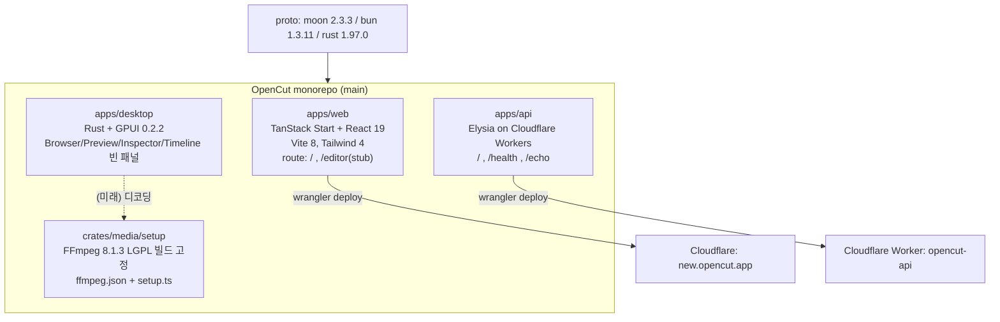

# OpenCut

> [!summary] 한줄요약
> CapCut 대안을 표방하는 MIT 오픈소스 비디오 에디터. 스타는 9만 개를 넘지만, 지금 main 브랜치는 "처음부터 다시 쓰는 중"인 스캐폴드(데스크톱은 창 하나, 웹 에디터는 "Coming soon")이고, README가 약속한 Editor API·플러그인·MCP 서버·headless 모드는 코드에 아직 없다. 실제로 쓸 수 있는 에디터는 이전 버전(opencut-classic)이다.

> [!warning] 읽는 법
> 이 노트는 2026-10-01 시점에 `git clone --depth 1`로 받은 main 브랜치 전체와 GitHub API, 릴리스·changelog를 직접 읽고 쓴 것이다. README의 "계획"과 저장소 안의 "실물"을 구분해서 적었고, 확인하지 못한 항목은 그렇게 표시했다.

## 1. 배경 — 무엇을 해결하려는 프로젝트인가

영상 편집은 오래 전부터 CapCut, Premiere, DaVinci Resolve 같은 상용 도구가 주도해 왔다. 오픈소스 쪽에도 Kdenlive, Shotcut, OpenShot 같은 데스크톱 편집기가 있지만(이 셋은 일반 지식이며 이번 조사에서 직접 확인하지는 않았다), "브라우저에서 바로 열리고, 모바일까지 같은 코드베이스로 가고, 무료이며, 외부 개발자가 확장할 수 있는" 조합은 드물었다. OpenCut은 이 빈자리를 노린다. README 첫 줄의 표어가 그대로 목표다: "A free and open source video editor for web, desktop, and mobile."

프로젝트는 2025-06-22에 만들어졌다(GitHub API `created_at`). 이후 웹 기반 에디터(현재 opencut-classic으로 분리된 코드)로 빠르게 관심을 모았고, 2026년 중반부터 Rust 코어 위에 처음부터 다시 짓는 방향으로 전환했다. README의 Status 절은 이 상황을 숨기지 않는다. "OpenCut is being rewritten from the ground up"이라고 선언하고, 이전 버전은 별도 저장소 opencut-classic으로 안내하며 "지금 쓰려면 그쪽을 쓰라"고 적어 두었다. opencut.app은 아직 classic을 서비스 중이고, 재작성본은 new.opencut.app에서 "준비될 때까지" 따로 올라간다.

따라서 이 노트의 핵심 질문은 두 가지다. 하나는 "재작성 프로젝트가 지금 어디까지 와 있나", 다른 하나는 "우리 쪽(온프렘 LLM 서빙·게이트웨이·샌드박스 맥락)에서 이 프로젝트가 어떤 의미가 있나"이다. 전자는 코드로 답할 수 있고, 후자는 아직 약속 단계의 기능(MCP 서버, headless)에 달려 있다.

## 2. 한눈에 보는 상태 (2026-10-01 확인)

| 항목 | 값 | 출처 |
|---|---|---|
| 라이선스 | MIT | GitHub API, LICENSE |
| 스타 | 91,015 | GitHub API |
| 열린 이슈 | 376 (PR 포함 수치) | GitHub API `open_issues_count` |
| 기여자 수 | 30 | GitHub API contributors |
| 마지막 push | 2026-09-24 | GitHub API |
| 정식 릴리스 | v0.2.0(2026-03-02), v0.3.0(2026-04-15) | GitHub Releases |
| 최신 태그 | `ffmpeg-8.1.3-1`(2026-09-24, FFmpeg 번들 릴리스) | GitHub Releases |
| 후원 | fal.ai | README |
| 외부 기여 | 현재 미수용 | README Contributing |
| 이전 버전 | opencut-classic (MIT, 스타 262, 마지막 push 2026-05-17) | GitHub API |

숫자에서 눈에 띄는 점이 있다. 메인 저장소의 스타는 9만 개인데 classic 저장소는 262개다. 스타 이력은 원래 저장소에 붙어 있고, 코드만 classic으로 옮겨진 것으로 보인다(이 해석은 추정이며 GitHub 이력을 따로 추적해 확인하지는 않았다). 즉 9만이라는 수치는 "지금 코드의 성숙도"가 아니라 "프로젝트에 모인 관심"의 지표로 읽어야 한다.

## 3. 저장소 구조 — 실제로 들어 있는 것

클론한 main의 최상위는 다음과 같다: `apps/`, `crates/`, `brand/`, `changelog/`, `.moon/`, `.prototools`, `Cargo.toml`, `Cargo.lock`, `bunfig.toml`, `moon.yml`, `LICENSE`, `README.md`. 도구는 moonrepo 생태계(proto + moon)로 고정한다. `.prototools`가 못박은 버전은 moon 2.3.3, bun 1.3.11, rust 1.97.0이다. 이렇게 하면 개발자와 CI가 같은 도구 버전을 쓰게 된다.



### 3.1 apps/web

`package.json`을 보면 `@tanstack/react-start`, `@tanstack/react-router`, React 19.2, Vite 8, Tailwind 4, shadcn과 `@base-ui/react`, radix-ui, `react-resizable-panels`, zod 4, vitest 4가 들어 있다. 배포 대상은 Cloudflare Workers이며 `wrangler.jsonc`가 `new.opencut.app`을 custom domain으로 지정한다(`compatibility_flags: ["nodejs_compat"]`). `src/components/ui/`에는 shadcn 컴포넌트가 수십 개 생성되어 있다. 반면 에디터 라우트(`src/routes/editor.tsx`)의 전체 내용은 제목 "Editor"와 문단 "Coming soon."이 전부다. 이슈 #902 "new.opencut.app website is not visible"도 이 상태와 맞물린다.

### 3.2 apps/api

Elysia를 Cloudflare Worker 어댑터(`CloudflareAdapter`)로 올린 아주 작은 서버다. 라우트는 `GET /`(status ok), `GET /health`(timestamp 포함), `POST /echo`(body 스키마 `{message: string}`) 세 개이고, 코드 주석에 따르면 `.compile()`이 AoT 컴파일을 일으키기 때문에 필수다. 인증, 저장소, 프로젝트 API는 아직 없다.

### 3.3 apps/desktop

Rust 2024 edition, 의존성은 `gpui = "0.2.2"` 하나다. GPUI는 Zed 에디터를 만든 쪽의 Rust UI 프레임워크로 알려져 있다(일반 지식, README 링크는 gpui.rs). `main.rs`는 960x600 기준 창을 열고, `shell.rs`가 Browser·Preview·Inspector 패널을 가로로, Timeline 패널을 아래에 배치한다. 각 패널 파일은 20줄 안팎이라 이름만 있는 빈 껍데기다(패널 4개 합계 95줄). 데스크톱 README도 "Very early. Right now this is just a window that opens."라고 스스로 적었다.

눈여겨볼 대목은 `main.rs` 맨 앞의 WSL 대응 코드다. WSLg가 `xdg_wm_base` v1만 광고하는데 GPUI 0.2.2는 v2~5를 요구해 패닉하므로, WSL이고 DISPLAY와 WAYLAND_DISPLAY가 모두 있으면 `WAYLAND_DISPLAY`를 지워 XWayland로 떨어뜨린다. 여기서 `unsafe { std::env::remove_var(...) }`를 쓰는데, 이슈 #895가 바로 이 호출의 안전성을 문제 삼는다(코드 주석은 "main의 첫 구문이라 아직 다른 스레드가 없다"는 근거를 단다). 같은 계열로 #894는 `ResizablePanelGroup`의 0 나눗셈 패닉이다. 이런 이슈가 보인다는 것은 코드가 아직 초기 단계라는 뜻이다.

### 3.4 crates/media

현재 Cargo 워크스페이스 멤버는 `apps/desktop` 하나뿐이고, `crates/*`는 주석 처리되어 있다. `crates/media`에는 Rust 코드가 없고 `setup/ffmpeg.json`과 `setup/setup.ts`만 있다. 여기서 읽은 내용은 꽤 구체적이다.

- `ffmpeg.json`: 버전 8.1.3, 라이선스 `LGPL-2.1-or-later`, 소스 tarball URL과 sha256, 그리고 플랫폼별 사전 빌드 4종(windows-x86_64, windows-aarch64, linux-x86_64, linux-aarch64)의 URL과 sha256. 사전 빌드는 BtbN의 FFmpeg-Builds `lgpl-shared` 빌드(autobuild-2026-09-23)를 가리킨다. macOS 항목은 이 manifest에 없다.
- `setup.ts`(Bun 스크립트): 호스트 플랫폼 감지(windows/macos/linux × x86_64/aarch64), 다운로드 후 sha256 검증(불일치 시 예외), `tar`로 해제(Windows는 System32의 bsdtar 사용), `--from-source` 옵션으로 소스 빌드, `--target <platform>`으로 교차 빌드. 주석은 "프리빌트는 `.github/workflows/media-deps.yml`이 모든 플랫폼에 대해 같은 소스 빌드로 만든다"고 설명한다.
- 최신 커밋(2026-09-24)이 "ci(media): add the workflow that builds FFmpeg for every platform"이고 최신 태그가 `ffmpeg-8.1.3-1`이다. 지금 가장 활발히 움직이는 부분이 미디어 디코딩 의존성 파이프라인이라는 뜻이다.

이 설계에서 읽히는 방향은 분명하다. 코어는 Rust가 맡고, 디코딩은 FFmpeg를 동적(shared) 링크로 쓰며, LGPL 의무를 지키기 위해 사용자가 교체 가능한 공유 라이브러리 형태로 배포하려는 것이다(마지막 문장은 빌드 구성에서 내린 추론이고, 프로젝트가 명시한 라이선스 전략 문서는 찾지 못했다).

## 4. 아키텍처 — README가 약속한 것과 코드의 거리

README의 "What's coming" 목록은 다음과 같다: Editor API, 서드파티 플러그인(plugin-first 아키텍처), Rust 코어로 데스크톱·모바일·브라우저 단일 코드베이스, AI 에이전트용 MCP server, headless 모드(자동화·배치 렌더링), 에디터 안의 scripting 탭. 이 중 저장소에서 구현의 흔적을 찾은 것은 하나도 없다. MCP나 headless에 해당하는 크레이트, 스키마, 문서가 없고, 플러그인 API 정의도 없다. 유일하게 방향을 뒷받침하는 물증은 (1) Rust 워크스페이스와 GPUI 셸, (2) FFmpeg 고정 빌드 파이프라인이다.

기능 쪽 맥락은 `changelog/`에서 볼 수 있다. 0.1.0(2026-02-23) "Editor foundation"은 속성 패널 재구성, 폰트 1,000개 이상, 블렌드 모드, 색상 선택기를 담았고, 0.2.0(2026-03-01) "Motion & effects"는 키프레임 애니메이션, 클립별·독립 이펙트(첫 이펙트는 Blur), 리플 편집 모드를, 0.3.0(2026-04-15) "Masks, animation & more"는 마스크, 곡선용 그래프 에디터, 볼륨·속도 제어, 프리뷰 줌, 캔버스 배경, 스티커를 추가했다. 이 기능들은 classic 에디터에 해당하는 것이고, 현재 main 브랜치 코드에는 해당 구현이 없다(changelog만 남아 있다). 재작성본이 이 기능 수준을 되찾으려면 상당한 시간이 필요하다는 것이 가장 정직한 해석이다. 다만 재작성 일정은 어디에도 공개되어 있지 않다.

## 5. 설치·실행

README의 개발 절차는 다음과 같다.

```sh
# proto 설치 (Linux/macOS/WSL)
bash <(curl -fsSL https://moonrepo.dev/install/proto.sh)

# 저장소 루트에서 .prototools에 고정된 도구 설치
proto use

moon run web:dev       # localhost:5173
moon run api:dev       # localhost:8787
moon run desktop:dev   # cargo run (apps/desktop/README.md 참고)
```

데스크톱 쪽은 `moon run desktop:check`(cargo check)와 `moon run desktop:build`(cargo build --release, 산출물 `/target/release/opencut-desktop`)도 있다. 첫 빌드는 GPUI를 소스로 컴파일하므로 오래 걸린다고 README가 적는다. 플랫폼 요구사항은 macOS Xcode CLT(Metal), Windows는 추가 의존 없음, Linux는 Vulkan 드라이버와 `libwayland-dev`, `libx11-xcb-dev`, `libxkbcommon-x11-dev`, `libfontconfig-dev`, C 툴체인과 cmake다.

미디어 의존성은 `moon run media:setup`(고정 프리빌트) 또는 `-- --from-source` 형태로 받는다(setup.ts 헤더 주석). 단, 이 명령을 실제로 실행해 보지는 않았다.

써 보고 싶은 사용자라면 README의 지시대로 classic을 쓰는 것이 맞다. 이 노트는 classic의 기능과 품질을 평가하지 않았다(코드를 읽지 않았음).

## 6. 비교 대상

- CapCut: 상용·폐쇄형이며 모바일/데스크톱/웹 통합 경험이 강점. OpenCut이 표어에서 직접 겨냥하는 대상이다(비교 기준은 일반 지식).
- Kdenlive / Shotcut / OpenShot: 성숙한 오픈소스 데스크톱 NLE. 플러그인·스크립팅 생태계가 이미 있으나 브라우저·모바일 단일 코드베이스는 아니다(일반 지식, 미확인).
- Remotion류 코드 기반 영상 생성: 영상을 "코드로 선언"하는 접근이라 에이전트 자동화에는 자연스럽다. OpenCut의 "Editor API + MCP + headless"가 같은 자리를 GUI 에디터와 결합해 노리는 것으로 보인다(해석).
- FFmpeg CLI 스크립팅: 에이전트가 영상을 다루는 현재 가장 단순한 방법. OpenCut이 FFmpeg를 내부 의존성으로 쓰므로 경쟁보다는 하위 계층에 가깝다.

## 7. 장단점·한계·성숙도

장점은 분명하다. MIT 라이선스, 폭넓은 관심(스타 9만), 도구 버전 고정과 체크섬 검증 같은 위생 수준 높은 빌드 설계, Rust 코어 + GPUI라는 일관된 방향, 그리고 AI 에이전트를 1급 사용자로 두겠다는 설계 의도(MCP, headless)다.

한계는 그만큼 크다.

1. 지금 main은 쓸 수 있는 에디터가 아니다. 데스크톱은 창만 뜨고 웹 에디터는 stub이다.
2. 약속된 핵심 기능(Editor API, 플러그인, MCP, headless)은 구현이 없고 일정도 없다.
3. 외부 기여를 받지 않는다. 설계가 굳을 때까지 구조에 영향을 줄 수 없다는 뜻이고, 이슈 #897·#898("Rewrite input: ...")이 보여 주듯 현장 경험 공유만 환영한다.
4. 재작성 전환으로 classic의 기능 수준(마스크, 키프레임, 그래프 에디터 등)을 다시 따라잡아야 한다.
5. GPUI 0.2.2에 의존한다. GPUI의 라이선스와 안정성은 이번에 확인하지 못했다.

성숙도 판정: 재작성본은 "프리알파 스캐폴드", 제품으로서의 OpenCut은 "classic 기준 사용 가능, 재작성본 관찰 단계".

## 8. 보안·라이선스·운영 리스크

- 사칭 사이트: 이슈 #899 "opencut.net Fake websites appear". 공식 도메인은 README가 밝힌 opencut.app과 new.opencut.app뿐이다. 사내에서 쓰려는 사람이 있다면 검색 결과의 다운로드 링크를 믿지 말고 GitHub에서 받아야 한다.
- FFmpeg LGPL: 동적 링크 빌드를 쓰는 것으로 보이지만, 사내 재배포 시 LGPL 의무(공유 라이브러리 교체 가능성, 고지)는 법무 확인이 필요하다. 우리가 FFmpeg를 이미 쓰고 있다면 같은 기준을 적용하면 된다.
- 공급망: `apps/api/package.json`과 `apps/web/package.json`이 `latest` 태그 의존성(`elysia`, `@tanstack/*`, `wrangler` 등)을 다수 사용한다. 이는 빌드 재현성에 위험 요소다. 반면 FFmpeg 쪽은 sha256 검증이 있다.
- Cloudflare 종속: 웹과 API 배포가 Cloudflare Workers 전제다. 온프렘에서 웹 에디터를 호스팅하려면 정적 빌드와 서버 함수 대체를 별도로 고민해야 한다(미검증).
- unsafe 사용: `main.rs`의 `unsafe remove_var`는 단일 스레드 시점이라는 근거가 주석에 있지만, 이슈로 제기된 상태다.
- 프로젝트 지속성: 후원사 fal.ai 한 곳이 README에 있다. 상업 모델이나 거버넌스 문서는 찾지 못했다.

## 10. 확인 못한 것

- opencut-classic의 코드 품질과 기능 범위(코드를 읽지 않음).
- 재작성 일정, 로드맵 문서, 거버넌스.
- GPUI의 라이선스 및 장기 안정성.
- `media-deps.yml` 워크플로 본문과 macOS 프리빌트 제공 여부.
- Discord, X 등 커뮤니티 채널의 공지.

## 관련 노트
[[openclip]] [[multi-agent-cad]] [[inflab-ai-gateway]] [[microvm-isolation-2026]]

## 출처
- https://github.com/OpenCut-app/OpenCut (README, LICENSE, Cargo.toml, .prototools, apps/*, crates/media/setup/*, changelog/*.md를 shallow clone으로 직접 읽음)
- GitHub API: repos/OpenCut-app/OpenCut (스타, 라이선스, push, 이슈 수), /releases, /commits, /contributors, /issues
- GitHub API: repos/OpenCut-app/opencut-classic
