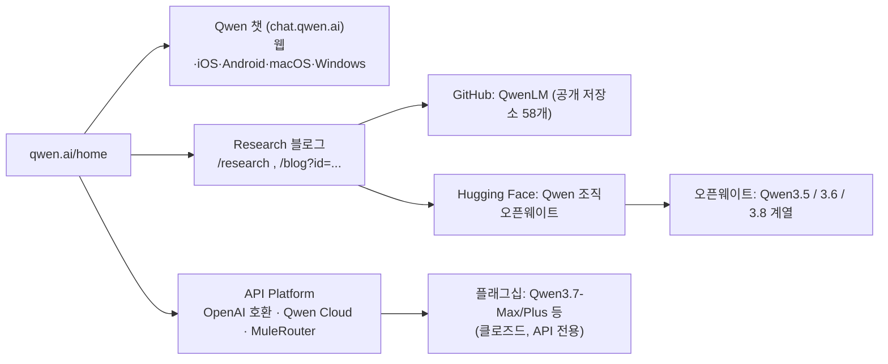

# Qwen (qwen.ai)

> [!summary] 한줄요약
> Alibaba Qwen 팀의 공식 사이트이자 제품 허브. 오픈웨이트는 Hugging Face/GitHub에서, 플래그십 모델(Max/Plus 계열)은 API로만 제공하는 이원 구조다.
>
> - **세 입구**: Qwen(무료 AI 어시스턴트), API Platform(OpenAI 호환), 다운로드(웹·iOS·Android·macOS·Windows)
> - **최신 연구 글**: 2026-09 기준 Qwen-Image-2.1, Qwen3.8-LiveTranslate, Qwen3.8-Omni-Flash 등

> [!info] 조사 방법
> qwen.ai는 SPA라 WebFetch와 curl로는 `<title>`만 나온다. 그래서 headless Chrome 렌더(`render.sh`)로 홈, `/research`, `/apiplatform`, 개별 블로그 글(`/blog?id=...`)을 읽고, 블로그가 가리키는 GitHub 조직(QwenLM)과 Hugging Face Qwen 조직은 API로 교차 확인했다. 이전 판 노트가 "본문 미확인"이던 부분을 이번에 채웠다.

## 1. 이 사이트는 무엇인가

qwen.ai는 한 제품의 랜딩 페이지가 아니라 Alibaba의 Qwen 계열 모델과 제품을 묶는 포털이다. 렌더링된 홈 본문은 다음 순서로 읽힌다.

1. 상단 칩: Image Edit, Thinking, Search, Web Dev, Artifacts, Deep Research, Image Generation, Video Generation. 챗 제품이 제공하는 기능 단위들이다.
2. 세 개의 입구:
   - **Qwen**: "Qwen series 모델로 구동되는 모두를 위한 AI 어시스턴트. 무료이고 누구에게나 열려 있다"는 소개와 "Use Now" 버튼.
   - **API Platform**: "OpenAI API와 호환되는 형식의 Qwen API".
   - **Download**: 휴대폰과 데스크톱용 앱.
3. Product Features: 이미지 생성(Qwen VLo), Deep Research, Web Dev, Thinking, Search, Multimodal Understanding. 각 카드에는 2025/03/28 날짜가 붙어 있어, 이 섹션 자체는 2025년 3월 시점에 만들어진 소개 문구가 그대로 남은 것으로 보인다(날짜 표기에서 낸 추정).
4. Latest Research: 최신 글 목록. 이번 조사 시점(2026-10-01)에 노출된 글은 아래 4절에서 정리한다.
5. 푸터: 앱 플랫폼(Web, iOS, Android, macOS, Windows), API Platform 하위 메뉴(Our Flagship Models, Platform Overview, API Platform, Qwen Cloud), Research(Latest Advancements, Research Index, GitHub), 약관류(Terms of Service, Privacy Policy, Usage Policy, Cookies Notice, Training Data Summary), "Powered by Alibaba Cloud".

한 가지 짚을 점이 있다. 푸터에 "Training Data Summary" 항목이 따로 있다. 학습 데이터 요약을 공개 문서로 두는 것은 규제 대응 성격으로 보이지만, 이번에는 이 문서를 열어 보지 않았으므로 내용은 확인하지 못했다.

## 2. 제품 구성도



핵심은 같은 이름 아래 접근 방식이 세 갈래라는 점이다.

1. **챗 앱**: 데이터가 Alibaba 쪽으로 간다.
2. **API**: 마찬가지로 호스티드 서비스다.
3. **가중치 직접 서빙**: 우리가 통제하는 환경에서 실행한다.

온프렘 LLM 서빙 관점에서 의미 있는 것은 세 번째뿐이다.

## 3. API Platform 페이지에서 읽은 것

`/apiplatform`은 "Building AI Products with Qwen"이라는 제목으로, OpenAI 호환 API로 채팅, Q&A, 창작, 번역, 요약, 코딩 앱을 만들 수 있다고 설명한다. 버튼은 "Start building", "MuleRouter", "Contact sales"다. MuleRouter가 무엇인지는 이번에 확인하지 못했다.

"Our Flagship Models" 목록은 렌더 시점 기준으로 다음과 같다(입력/출력 모달리티, 컨텍스트).

| 모델 | 입력 | 출력 | 컨텍스트 |
|---|---|---|---|
| Qwen3.7-Max | 텍스트 | 텍스트 | 1,000,000 |
| Qwen3.7-Plus | 텍스트·이미지·비디오 | 텍스트 | 1,000,000 |
| Qwen3.6-Max-Preview | 텍스트 | 텍스트 | 262,144 |
| Qwen3.6-Plus | 텍스트·이미지·비디오 | 텍스트 | 1,000,000 |
| Qwen3.5-Plus | 텍스트·이미지·비디오 | 텍스트 | 1,000,000 |
| Qwen3.5-Flash | 텍스트·이미지·비디오 | 텍스트 | 1,000,000 |
| Qwen3-Max | 텍스트 | 텍스트 | 262,144 |
| Qwen3-VL-Plus / Flash | 텍스트·이미지·비디오 | 텍스트 | 131,027 |
| Qwen3-Omni-Flash | 텍스트·이미지·오디오·비디오 | 텍스트·오디오 | 65,536 |
| Qwen3-ASR-Flash | 오디오 | 텍스트 | (표기 없음) |
| Qwen-Image-2.0 / 2.0-Pro, Qwen-Image-Plus, Qwen-Image-Edit | 텍스트(·이미지) | 이미지 | (해당 없음) |
| Qwen3-TTS-Flash | 텍스트 | 오디오 | (표기 없음) |

이전 노트가 "검색 결과(2차 자료)"로 적었던 Qwen3.7-Max, Qwen3.7-Plus의 존재는 이 공식 페이지로 확인된다. 반면 2차 자료에 있던 발표일(2026-05-20, 2026-06-01)은 이번에 공식 페이지에서 다시 확인하지 못했다.

API 종류는 세 가지로 소개된다.

- **Chat Completions API**: 질의응답·코딩·도구 사용
- **Realtime API**: 저지연 멀티모달, 음성 대 음성
- **Batch API**: 오프라인·저비용 연산. 모델 평가·데이터셋 의미 추출·텍스트 임베딩 배치에 적합하다고 설명한다.

에이전트 기능으로는 Web Search(출처가 달린 최신 답변)와 Function Call(외부 도구 연결)이 있다.

엔드포인트의 실제 모양은 블로그 예제 코드에서 보인다. Omni-Flash 글의 예제는 OpenAI SDK를 쓰고 `base_url`을 `https://dashscope-intl.aliyuncs.com/compatible-mode/v1`로, 키는 환경변수 `DASHSCOPE_API_KEY`로 받는다. LiveTranslate 예제는 중국(베이징) 리전용 `wss://{workspace_id}.c...` WebSocket URL을 쓰며 "리전마다 URL이 다르다"고 주석을 단다. 즉 이 API는 Alibaba Cloud Model Studio(DashScope) 위에서 서비스된다.

## 4. Latest Research — 2026-09 시점의 흐름

`/research` 목록과 개별 글을 읽은 결과다.

### 4.1 Qwen-Image-2.1 (2026-09-20, 오픈소스)

텍스트→이미지 생성과 이미지 편집을 하나의 모델로 합친 이미지 모델이다. 시각 생성 부분이 7B 파라미터이고 32개 Single-Stream DiT 레이어로 구성된다. 글이 강조하는 특징은 네 가지다.

1. 가벼운 구조와 추론 최적화
2. 네이티브 투명(RGBA) 이미지 생성·편집(2025-12의 Qwen-Image-Layered 기능을 통합)
3. 최대 10장의 참조 이미지를 쓰는 편집과 원 마스크·붓 주석·별도 마스크를 통한 국소 편집
4. 타이포그래피와 인물 조명 개선

구조적으로 흥미로운 점은 "mixed-granularity attention"이다. 텍스트는 토큰 단위 causal mask를, 이미지 생성은 청크 단위 mask를 쓰고, 입력 이미지와 편집 지시문을 정적 컨텍스트로 두어 첫 단계에서 계산한 KV를 재사용한다. 다중 입력 이미지 편집의 추론 효율을 이렇게 높인다는 설명이다.

가중치는 Hugging Face `Qwen/Qwen-Image-2.1`(2026-09-14 생성, 다운로드 약 7.1만, 좋아요 2,725, 라이선스 태그 `other`)에 올라 있고, GitHub `QwenLM/Qwen-Image-2.1`은 라이선스가 NOASSERTION으로 표시된다. 상업 이용 조건은 라이선스 본문을 직접 읽어야 하며 이번에는 확인하지 못했다.

### 4.2 Qwen3.8-Omni-Flash (2026-09-18, 릴리스)

차세대 네이티브 옴니모달 모델이다. 목표는 "옴니모달 콘텐츠를 이해하는 모델"에서 "작업을 계획하고 도구를 호출해 창작 작업을 끝내는 모델"로의 이동으로 소개된다. 글의 주요 주장은 다음과 같다(모두 Qwen 팀의 자체 수치다).

- 텍스트·이미지·오디오·비디오 입력, 1M 토큰 컨텍스트. 29개 평가 평균이 Qwen3.5-Omni-Plus 대비 25% 이상 상승. 오디오 1시간당 입력 API 가격은 98% 이상, 시청각 입력은 93% 이상 하락(가격 산정 방식은 글의 각주에 명시: 2분 분량 입력 비용의 30배로 추정, 비디오는 720p 1fps).
- 에이전트형 장편 이해: 질문에서 출발해 coarse-to-fine으로 증거를 찾는 방식으로, OmniVideoBench 정확도를 63.4에서 67.8로 올리면서 쿼리당 토큰을 145,736에서 79,117로(약 45.7%) 줄였다고 한다.
- 최대 1시간 분량 회의의 화자 분리·전사·신원 정렬을 end-to-end로 수행.
- 제작 워크플로: Music2MV(음악 이해 → 기획 → 최종 검수), 숏드라마 번역(화자 인식·번역·음성 복제 더빙·리믹스), 장편 영화 해설 영상.
- "모델 개발에 쓰는 모델": Qwen2.5-Omni-3B의 쓰촨 방언 인식을 12시간 안에 개선하라는 과제에서 에이전트가 학습 데이터 3,413건을 만들어 4라운드 실험을 거쳐 CER을 25.79%에서 15.30%로(상대 약 40.7%) 낮췄다는 사례.
- Qwen3.8-Omni-Flash-Realtime: 라이브 오디오·비디오 스트림을 받으면서 응답하는 실시간 변형. 소리 방향을 활용한 위치 파악, Skills 주입을 통한 역할·지식 로딩.
- 지원 프로토콜: OpenAI 호환 Chat Completions와 Responses API.

이 글의 렌더링 결과에는 제목 옆에 `[draft]` 표시가 붙어 있었다. 공개된 글에 초안 표지가 남은 것인지 의도된 표기인지는 알 수 없으므로, 수치는 "공식 블로그의 자기 보고"로만 취급해야 한다.

글이 소개하는 오픈소스 부속물은 두 개다.

**Qwen-MM-Plugins**(GitHub `QwenLM/Qwen-MM-Plugins`, Apache-2.0, 스타 약 3,106): 에이전트 하네스(Codex, Claude Code, Qwen Code, Gemini CLI, Qoder, CodeBuddy, OpenClaw)에 이미지·오디오·비디오·문서 이해와 장편 영상 메모리, 콘텐츠 제작 능력을 붙이는 플러그인 묶음이며, `install.sh` 가이드 설치와 Video2Note, Omni Skill Creator(시연 영상에서 SOP를 뽑아 Skill.md로 만든다는 기능) 등이 포함된다.

**Qwen-Live-Harness**(Apache-2.0, v1.0.0이 2026-09-21): Qwen Omni Realtime API를 중심으로 한 데스크톱 하네스로, 실시간 음성·화면 상호작용, Qwen Code·Qoder CLI·Codex·Claude Code·Gemini CLI로의 작업 위임, 조건 기반 알림, 장기 메모리를 제공한다.

README의 아키텍처는 "Host(UI) ↔ daemon(조정자) ↔ Qwen Omni Realtime(클라우드)" 구조이며, 전체 데스크톱 경험은 현재 macOS 12+만 지원하고 DashScope API 인터넷 연결이 필요하다고 밝힌다(로컬 모델 가중치·GPU는 불필요). 즉 이 하네스는 클라우드 의존형이다.

### 4.3 Qwen3.8-LiveTranslate (2026-09-18)

실시간 동시통역 모델이다. 오디오와 텍스트를 하나의 interleave 스트림으로 다루는 구조("Interleave architecture")로, 평균 지연(LAAL)을 이전 세대 2.8초에서 2.3초로 줄였다고 한다. Hybrid-MoE 기반 Thinker–Talker 이중 모듈 설계이며, 실시간 화자 분리, 원문·번역 동시 출력, 장문 문맥 기반 중의성 해소, 60개 언어 입력(오디오 출력은 29개 언어)을 지원한다. 이 글은 한국어를 입출력 지원 언어 목록에 포함한다.

### 4.4 그 밖의 항목

E-Commerce Bench(2026-09-03, 오픈소스): 장기 과업 에이전트 벤치마크. Qwen-Drive-1.0(2026-09-03, 오픈소스): 자율주행용 비전-언어 파운데이션 모델로, 네이티브 멀티모달 Qwen3.5-4B 위에 BEV 인지 헤드를 얹는다고 소개된다. 둘 다 목록의 요약문만 읽었다.

## 5. 오픈웨이트 쪽 지형 (Hugging Face Qwen 조직 확인 결과)

API로만 제공되는 플래그십과 별개로, HF Qwen 조직에는 최근 이런 모델이 올라와 있다(API 조회 기준).

| 모델 | 생성일 | 라이선스 태그 | 비고 |
|---|---|---|---|
| Qwen3.8-27B | 2026-08-05 | apache-2.0 | 다운로드 약 704만. `architectures: Qwen3_5ForConditionalGeneration`, 64 layers, 262,144 컨텍스트(config.json) |
| Qwen3.8-2.4T-A95B | 2026-08-08 | other (`qwen3.8-max` 라이선스) | 2.4T 총 파라미터 / 95B 활성으로 표기. 카드는 "Qwen-Max급 모델의 첫 오픈 릴리스"라고 소개 |
| Qwen3.8-Flash-Next | 2026-08-24 | other | 다운로드 약 120만 |
| Qwen3.6-27B | 2026-04-21 | apache-2.0 | 이전 노트의 "Qwen3.6-27B" 언급과 대응 |
| Qwen3.6-35B-A3B | 2026-04-15 | apache-2.0 | MoE |
| Qwen3.5 시리즈 | 2026-02 | 9B는 apache-2.0 확인, 나머지는 개별 확인 안 함 | 0.8B/2B/4B/9B/27B/35B-A3B/122B-A10B/397B-A17B와 FP8·GPTQ-Int4 변형. [[qwen3-5-9b]] 참조 |

눈여겨볼 점은 두 가지다.

1. **서빙 코드의 연속성**: 최신 오픈 모델 Qwen3.8-27B가 `Qwen3_5ForConditionalGeneration` 아키텍처를 그대로 쓴다. 세대가 바뀌어도 서빙 엔진 입장에서는 Qwen3.5 계열 지원 코드를 재사용할 수 있다는 뜻이다(vLLM 쪽 구현은 [[qwen3-5-9b]] 노트 참조).
2. **라이선스 차이**: 가장 큰 모델들은 Apache-2.0이 아니라 별도 라이선스(`other`)다. 사내 서빙 후보로 삼기 전에 라이선스 본문(상업 이용, 사용자 수 제한 등)을 읽어야 한다. 이번에는 그 본문을 확인하지 않았다.

GitHub QwenLM 조직은 공개 저장소가 58개이고, 최근 push가 활발한 것은 qwen-code(터미널용 코딩 에이전트, Apache-2.0, 스타 약 28,250), FlashQLA(TileLang 기반 고성능 linear attention 커널 라이브러리, MIT, 스타 약 716), Qwen-Image-2.1, Qwen-Live-Harness, Qwen-MM-Plugins 등이다.

FlashQLA는 Gated DeltaNet류 linear attention을 쓰는 하이브리드 모델의 추론 커널과 관련된 것으로 보이지만 코드는 읽지 않았다.

## 6. 사용법 (경로별)

**챗 앱**: qwen.ai에서 "Use Now"로 웹 챗에 들어가거나 iOS/Android/macOS/Windows 앱을 받는다. 계정 정책과 데이터 이용 조건은 약관 페이지를 읽지 않아 확인하지 못했다.

**호스티드 API(OpenAI 호환)**:

```python
from openai import OpenAI
import os
client = OpenAI(
    api_key=os.environ["DASHSCOPE_API_KEY"],
    base_url="https://dashscope-intl.aliyuncs.com/compatible-mode/v1",  # 블로그 예제의 값
)
resp = client.chat.completions.create(
    model="<API Platform 목록의 모델 id>",   # 정확한 id는 Model Studio 문서에서 확인
    messages=[{"role": "user", "content": "..."}],
)
```

위 코드는 블로그 예제에서 `base_url`과 환경변수 이름을 가져온 형태다. 실제 모델 id와 과금은 Model Studio 문서를 확인해야 하며 이번에는 호출해 보지 않았다.

**오픈웨이트 자체 서빙**: HF에서 받아 vLLM 또는 SGLang으로 서빙한다. 구체 명령은 [[qwen3-5-9b]]에 정리했다.

## 7. 비교 대상

호스티드 API와 오픈웨이트를 한 조직이 병행하는 모델은 다른 대형 연구 조직에도 있다. 다만 구체 비교(가격, 성능)는 이 노트의 조사 범위가 아니며, 자체 보고 수치끼리 비교하는 것은 신뢰하기 어렵다. 우리 맥락의 실질적인 비교는 "Qwen 오픈웨이트 vs 다른 오픈웨이트"이고, 그 후보로는 [[apertus-v1-5-70b]](완전 공개 70B)와 [[reddit-qwen36-27b-q40-mtp-gguf]]가 다루는 Qwen3.6-27B 양자화 배포가 있다.

## 8. 장단점·한계·성숙도

장점: 한 사이트에서 연구 글, 오픈웨이트, API, 앱에 모두 접근할 수 있다. 오픈 모델 라인업이 크기별로 촘촘하고(0.8B~397B 및 2026-08의 2.4T), 서빙 엔진 지원도 빠르다. API는 OpenAI 호환이라 기존 클라이언트 코드를 거의 그대로 쓴다.

한계: 사이트가 SPA라 검색엔진·크롤러·자동화로 읽기 어렵다(이번에도 headless 렌더가 필요했다). 홈의 제품 소개 문구 일부는 2025-03 날짜로 오래되었다. 가장 강력한 모델은 오픈이 아니거나(Max/Plus) 별도 라이선스다. 블로그 수치는 전부 자체 보고이고, 일부 글에 `[draft]` 표지가 남아 있다. API는 Alibaba Cloud 리전 구조(베이징/국제)를 따른다.

## 9. 보안·라이선스·운영 리스크

- **데이터 반출**: 챗 앱과 DashScope API로 보낸 프롬프트는 Alibaba Cloud로 간다. 사내 정책상 개인정보·키·사내 기밀은 이런 외부 서비스에 보내면 안 된다. 외부 모델이 필요하면 익명화한 입력만 쓰고, 기본은 온프렘 오픈웨이트로 둔다.
- **리전·법적 관할**: 엔드포인트가 리전별로 나뉘고 중국(베이징) 리전이 존재한다. 데이터 위치와 관할 요건은 계약·약관으로 확인해야 한다(이번에는 약관 미확인).
- **모델 라이선스 혼재**: 같은 Qwen 이름이어도 모델별로 Apache-2.0, `other`(Qwen3.8-Max 라이선스 등), NOASSERTION이 섞여 있다. 모델마다 LICENSE를 확인하고 사내 레지스트리에 기록해야 한다.
- **공급망**: Qwen-MM-Plugins의 설치 방식이 `curl ... | bash`다. 이 방식은 내용 검토 없이 실행하면 위험하므로, 스크립트를 먼저 읽고 샌드박스에서 실행한다. 에이전트에 이런 플러그인을 붙이는 환경은 [[microvm-isolation-2026]]의 격리 논지가 그대로 적용된다.
- **하네스의 클라우드 의존**: Qwen-Live-Harness는 화면·카메라·마이크 입력을 클라우드 Omni Realtime API로 보낸다. 사내 화면에는 기밀이 보일 수 있으므로 업무 PC에서의 사용은 별도 검토 대상이다.

## 11. 확인 못한 것

- 약관, 개인정보처리방침, 사용 정책, Training Data Summary 본문.
- MuleRouter와 Qwen Cloud의 가격·SLA.
- Qwen3.7-Max/Plus의 공식 발표일과 벤치마크(2차 자료만 있었음).
- Qwen3.8 계열 모델 카드의 벤치마크와 라이선스 본문.
- 챗 앱의 데이터 보관 및 학습 사용 정책.

## 관련 노트
[[qwen3-5-9b]] [[reddit-qwen36-27b-q40-mtp-gguf]] [[apertus-v1-5-70b]] [[inflab-ai-gateway]] [[vllm-moriio-kv-connector]] [[opencut]] [[openclip]] [[microvm-isolation-2026]]

## 출처
- https://qwen.ai/home (headless Chrome 렌더 본문)
- https://qwen.ai/research
- https://qwen.ai/apiplatform
- https://qwen.ai/blog?id=qwen-image-2.1
- https://qwen.ai/blog?id=qwen3.8-omni-flash
- https://qwen.ai/blog?id=qwen3.8-livetranslate
- https://qwen.ai/blog?id=qwen3.5
- https://github.com/QwenLM/Qwen-Live-Harness (README 직접 읽음, shallow clone)
- GitHub API: orgs/QwenLM, repos/QwenLM/{qwen-code, FlashQLA, Qwen-Image-2.1, Qwen-Live-Harness, Qwen-MM-Plugins}
- Hugging Face API: huggingface.co/api/models (Qwen 조직 목록, Qwen3.8-27B 등 메타데이터, config.json, 모델 카드 README)
