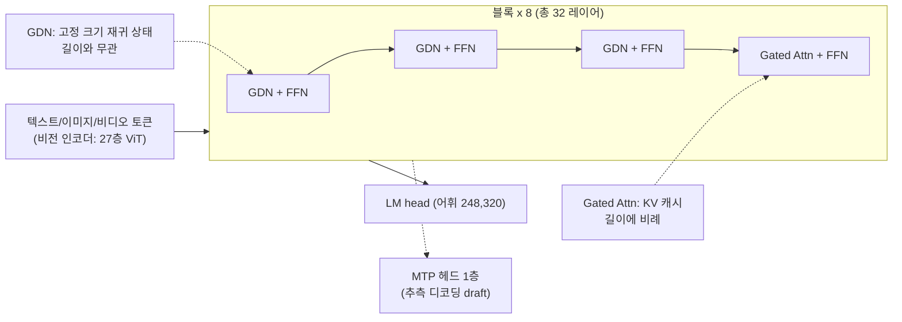

# Qwen3.5-9B

> [!summary] 한줄요약
> 32개 레이어 중 24개가 Gated DeltaNet(선형 어텐션), 8개가 Gated Attention(풀 어텐션)인 하이브리드 구조의 9B 멀티모달(텍스트·이미지·비디오) 오픈웨이트. Apache-2.0, 네이티브 262,144 컨텍스트(YaRN으로 약 1,010,000까지), 기본이 thinking 모드. FFN은 dense(MoE 아님)이고, 풀 어텐션 레이어가 8개뿐이라 KV 캐시가 같은 크기의 일반 트랜스포머보다 크게 작다.

> [!info] 조사 범위
> HF 모델 카드 README 전문, `config.json`, 파일 목록(크기), HF API 메타데이터를 읽었고, vLLM 저장소(shallow clone)에서 `qwen3_5.py`, `qwen3_5_mtp.py`, `config/speculative.py`를 확인했다. 아래 "계산" 표시가 붙은 수치는 config 값에서 내가 직접 산술한 추정치이며, 모델 카드나 vLLM이 보고한 값이 아니다. 모델을 직접 내려받아 돌려 보지는 않았다.

## 1. 배경 — 무엇을 해결하려는 모델인가

Qwen3.5 계열은 2026-02-16에 Qwen3.5-397B-A17B를 첫 오픈웨이트로 공개하며 시작됐다(qwen.ai 블로그 `qwen3.5`). 블로그는 이 계열의 설계를 "선형 어텐션(Gated Delta Networks)과 sparse mixture-of-experts를 합친 하이브리드 구조"로 설명하고, 397B 총 파라미터 중 활성 17B만 쓰는 효율, 언어·방언 지원을 119개에서 201개로 확대한 점을 내세운다. 9B는 이 계열의 소형 dense 모델이다(HF 저장소 생성 2026-02-27).

해결하려는 문제는 세 가지로 읽힌다.

1. **장문 컨텍스트의 메모리 비용**: 일반 트랜스포머는 토큰마다 모든 레이어의 K/V를 저장하므로 컨텍스트가 길수록 KV 캐시가 선형으로 커진다. Gated DeltaNet 레이어는 시퀀스 길이와 무관한 고정 크기 상태만 갖는다.
2. **소형 모델의 멀티모달·에이전트 능력**: 카드는 "early fusion" 멀티모달 학습, 수백만 에이전트 환경에서의 RL 확장을 강조한다. 즉 작은 모델에도 도구 호출과 시각 입력 능력을 넣는 것이 목표다.
3. **서빙 편의성**: vLLM, SGLang, KTransformers, Transformers에서 모두 쓸 수 있게 하고, MTP(Multi-Token Prediction) 헤드를 포함해 추측 디코딩까지 공식 지원한다.

## 2. 한눈에 보는 사양 (config.json + 모델 카드)

| 항목 | 값 | 출처 |
|---|---|---|
| 아키텍처 클래스 | `Qwen3_5ForConditionalGeneration` (`model_type: qwen3_5`, 텍스트 `qwen3_5_text`) | config.json |
| 파라미터 | 총 9,653,104,368 (BF16 9,653,100,528 + F32 3,840) | HF API safetensors |
| 레이어 수 / hidden | 32 / 4096 | config.json |
| 어휘 크기 | 248,320 (패딩) | config.json |
| 레이아웃 | 8 × (3 × (Gated DeltaNet → FFN) → 1 × (Gated Attention → FFN)) | 카드, `layer_types`로 확인 |
| Gated DeltaNet | V 헤드 32 / QK 헤드 16, head dim 128, conv kernel 4 | 카드, config |
| Gated Attention | Q 헤드 16 / KV 헤드 4, head dim 256, RoPE 차원 64 (`partial_rotary_factor 0.25`), `attn_output_gate: true` | 카드, config |
| FFN | intermediate 12,288 (dense, `silu`) | config |
| MTP | `mtp_num_hidden_layers: 1`, "multi-steps로 학습" | config, 카드 |
| 위치 인코딩 | interleaved mRoPE (`mrope_section` [11,11,10]), `rope_theta` 1e7 | config |
| 컨텍스트 | 262,144 네이티브, 최대 1,010,000 확장 | 카드 |
| 비전 인코더 | depth 27, hidden 1152, patch 16, spatial merge 2, temporal patch 2, 출력 4096 | config |
| 라이선스 | Apache-2.0 | HF 메타, LICENSE |
| 가중치 파일 | safetensors 4샤드 합계 19,306,310,880 바이트 (약 19.3GB, BF16) | HF 파일 목록 |
| HF 지표 | 다운로드 9,455,127 / 좋아요 2,076 / 생성 2026-02-27 / 수정 2026-03-02 | HF API |
| 파생 | `Qwen/Qwen3.5-9B-Base`에서 post-training | HF 태그 |

### 2.1 "sparse MoE" 문구 정리

이전 판 노트는 "카드 소개에 sparse MoE가 나오지만 9B의 MoE 여부는 확인 못함"이라고 적었다. 이번에 확인했다. 카드 Highlights의 "Gated Delta Networks combined with sparse Mixture-of-Experts"는 시리즈 공통 문구다. 9B의 `config.json`에는 전문가 수·라우팅 관련 키가 하나도 없고(`num_experts` 등 부재), 레이어 레이아웃도 FFN이다. 결정적으로 vLLM 구현(`qwen3_5.py`)의 주석이 "Qwen3.5 use all layers for MLP / Qwen3.5-MoE use sparse MoE blocks"라고 명시하며, `model_type == "qwen3_5_text"`이면 일반 `Qwen3NextMLP`를, `qwen3_5_moe_text`이면 `Qwen3NextSparseMoeBlock`을 쓴다. 9B는 전자이므로 dense 모델이다.

## 3. 동작 원리 — 하이브리드 레이어와 KV 캐시

### 3.1 레이어 구성

`config.json`의 `layer_types`를 보면 `linear_attention` 세 개 다음에 `full_attention` 하나가 8번 반복된다(`full_attention_interval: 4`). 풀 어텐션 레이어의 인덱스는 3, 7, 11, ..., 31이다.



**Gated DeltaNet(GDN)** 은 delta rule 기반의 선형 어텐션이다. 각 레이어가 (헤드 수 × key 차원 × value 차원) 크기의 재귀 상태 행렬과 짧은 합성곱(커널 4) 상태를 유지하며, 토큰이 들어올 때마다 이를 갱신한다. 시퀀스가 길어져도 상태 크기가 늘지 않는다는 것이 핵심이다. 이 설명은 Qwen3-Next/Gated DeltaNet 계열에 대한 일반 지식이며, 카드는 구조 이름과 헤드 수만 밝힌다. **Gated Attention** 은 출력 게이트(`attn_output_gate: true`)가 붙은 일반 GQA 어텐션이다(Q 16, KV 4).

### 3.2 KV 캐시 크기 계산 (내 계산, 추정)

풀 어텐션 레이어 8개만 토큰별 KV를 저장한다고 가정하면, 토큰당 KV는 다음과 같다.

- 레이어당: 2(K,V) × 4(KV 헤드) × 256(head dim) × 2바이트(BF16) = 4,096바이트
- 8개 레이어: 32,768바이트 = 32 KiB/토큰
- 262,144 토큰 한 시퀀스: 8 GiB (131,072 토큰이면 4 GiB)

같은 차원의 32층 전부가 풀 어텐션이라면 128 KiB/토큰, 262K 토큰에서 32 GiB가 된다. 하이브리드 구조는 KV를 1/4로 줄이는 셈이다. 여기에 GDN 레이어 24개의 재귀 상태가 시퀀스당 고정으로 붙는다. 상태 행렬만 대략 레이어당 32(V 헤드) × 128 × 128 = 524,288 원소이고, `mamba_ssm_dtype`이 float32이므로 레이어당 약 2 MiB, 24개면 약 48 MiB 수준이다(합성곱 상태는 이보다 훨씬 작다). 실제 vLLM 할당은 패딩·페이지 정렬 때문에 다를 수 있으므로 서빙할 때는 시작 로그의 KV 캐시 토큰 수와 가용 동시 시퀀스 수를 직접 보는 것이 맞다.

가중치 BF16 약 19.3GB에 시퀀스당 최대 약 8GiB(262K 풀 컨텍스트)를 더하면, 24GB GPU 한 장에서는 풀 컨텍스트 동시 처리가 어렵고, 80GB급 GPU 한 장이면 풀 컨텍스트 몇 개와 짧은 요청 다수를 병행할 수 있다는 감이 나온다(위 계산 기준, 활성화 메모리·CUDA 그래프 여유 제외). 카드도 OOM이 나면 컨텍스트를 줄이되 사고(thinking) 능력을 보존하려면 최소 128K를 유지하라고 권고한다.

### 3.3 MTP (Multi-Token Prediction)

모델에는 1층짜리 MTP 헤드(`mtp_num_hidden_layers: 1`)가 포함되어, 다음 토큰 이후 여러 토큰을 초안으로 예측하는 추측 디코딩의 draft로 쓸 수 있다. vLLM 쪽에서는 `qwen3_5_mtp.py`에 `Qwen3_5MTP` 클래스가 있고, `config/speculative.py`가 `qwen3_5_text` 등 모델 타입을 `qwen3_5_mtp`로 변환하며 `n_predict`를 `mtp_num_hidden_layers`에서 가져온다. 카드는 vLLM에서 `{"method":"qwen3_next_mtp","num_speculative_tokens":2}`, SGLang에서 NEXTN 알고리즘(`--speculative-num-steps 3`, `--speculative-num-draft-tokens 4`)을 권장한다. 이 설정값들은 카드의 권장이고 내가 실행해 속도 이득을 측정하지는 않았다.

### 3.4 vLLM 구현에서 확인한 것

`vllm/model_executor/models/qwen3_5.py`의 `Qwen3_5ForConditionalGeneration`은 `IsHybrid` 인터페이스를 구현한다. 레이어 타입이 `linear_attention`이면 `QwenGatedDeltaNetAttention`, `full_attention`이면 Qwen3-Next의 어텐션을 쓰고, 정규화는 `Qwen3_5RMSNorm`이다. `IsHybrid`라는 점이 서빙 설계에서 중요하다. 하이브리드 모델은 KV 캐시 매니저가 어텐션 KV 블록과 GDN 재귀 상태 슬롯을 서로 다른 캐시 그룹으로 관리해야 하기 때문에, prefix caching이나 KV 전송 같은 기능의 지원 범위가 일반 트랜스포머와 다를 수 있다. 실제로 vLLM의 MoRIIO KV connector 코드에는 mamba/KDA 상태를 전송하는 별도 경로와 "WRITE 모드는 hybrid KV cache group을 지원하지 않는다"는 거부 로직이 있다([[vllm-moriio-kv-connector]] 참고).

## 4. 성능 — 모델 카드 벤치마크 (자체 평가)

카드의 Language 표는 GPT-OSS-120B, GPT-OSS-20B, Qwen3-Next-80B-A3B-Thinking, Qwen3-30B-A3B-Thinking-2507, Qwen3.5-9B, Qwen3.5-4B를 나란히 놓는다. 9B 열의 값과 일부 비교는 다음과 같다. 모두 카드의 자체 보고이며 평가 설정은 카드 각주를 따른다.

| 벤치마크 | Qwen3.5-9B | GPT-OSS-120B | GPT-OSS-20B | Qwen3.5-4B |
|---|---|---|---|---|
| MMLU-Pro | 82.5 | 80.8 | 74.8 | 79.1 |
| MMLU-Redux | 91.1 | 91.0 | 87.8 | 88.8 |
| GPQA Diamond | 81.7 | 80.1 | 71.5 | 76.2 |
| IFEval | 91.5 | 88.9 | 88.2 | 89.8 |
| LongBench v2 | 55.2 | 48.2 | 45.6 | 50.0 |
| AA-LCR | 63.0 | 50.7 | 30.7 | 57.0 |
| LiveCodeBench v6 | 65.6 | 82.7 | 74.6 | 55.8 |
| HMMT Feb 25 | 83.2 | 90.0 | 76.7 | 74.0 |
| BFCL-V4 | 66.1 | -- | -- | 50.3 |
| TAU2-Bench | 79.1 | -- | -- | 79.9 |
| MMLU-ProX(29개 언어 평균) | 76.3 | 74.5 | 67.3 | 71.5 |

해석 포인트: 9B가 지식·지시 이행·장문 항목에서는 GPT-OSS-120B와 비슷하거나 앞서지만, 코딩 대회류(LiveCodeBench v6, OJBench)와 고난도 수학(HMMT)에서는 크게 뒤진다. 에이전트 항목은 BFCL-V4, TAU2-Bench에서 높은 값이 나오지만 GPT-OSS 쪽 값이 "--"(미제공)라 직접 비교가 불가능하다. 이 표는 모델 제작사가 고른 항목이므로, 우리 업무(한국어 문서, 사내 도구 호출)에 대한 별도 평가가 반드시 필요하다.

Vision Language 표(비교군: GPT-5-Nano, Gemini-2.5-Flash-Lite, Qwen3-VL-30B-A3B, Qwen3.5-4B)에서 9B는 MMMU 78.4, MMMU-Pro 70.1, MathVision 78.9, MathVista(mini) 85.7, We-Math 75.2, DynaMath 83.6이다. 시각 수학·차트 추론 쪽이 강하다는 신호다. 다국어 항목(MMMLU 81.2, WMT24++ 72.6, MAXIFE 83.4)은 있으나 한국어만 분리한 수치는 카드에 없다. 한국어 품질은 확인하지 못했다.

## 5. 설치·서빙 (모델 카드 기준)

카드는 vLLM 또는 SGLang 최신(main/nightly) 버전을 요구한다.

```bash
# vLLM (nightly 휠)
uv pip install vllm --torch-backend=auto --extra-index-url https://wheels.vllm.ai/nightly

# 기본 서빙: 262K, reasoning 파서
vllm serve Qwen/Qwen3.5-9B --port 8000 --tensor-parallel-size 1 \
  --max-model-len 262144 --reasoning-parser qwen3

# 도구 호출
vllm serve Qwen/Qwen3.5-9B --port 8000 --tensor-parallel-size 1 \
  --max-model-len 262144 --reasoning-parser qwen3 \
  --enable-auto-tool-choice --tool-call-parser qwen3_coder

# MTP 추측 디코딩
vllm serve Qwen/Qwen3.5-9B ... \
  --speculative-config '{"method":"qwen3_next_mtp","num_speculative_tokens":2}'

# 텍스트 전용: 비전 인코더 건너뛰고 KV 여유 확보
vllm serve Qwen/Qwen3.5-9B ... --language-model-only

# SGLang
python -m sglang.launch_server --model-path Qwen/Qwen3.5-9B --port 8000 --tp-size 1 \
  --mem-fraction-static 0.8 --context-length 262144 --reasoning-parser qwen3
```

`--language-model-only` 플래그는 현재 vLLM 저장소의 `arg_utils.py`와 `config/vllm.py`에서 확인된다. 카드에는 표준 서빙 설명에 "tensor parallel on 8 GPUs"라는 문구가 남아 있지만 명령은 `--tensor-parallel-size 1`이다(문구와 명령이 불일치하는 카드의 오탈자로 보인다).

**thinking 모드 끄기**: 카드는 Qwen3의 `/think`, `/nothink` 소프트 스위치를 공식 지원하지 않는다고 밝힌다. 대신 요청마다 `extra_body={"chat_template_kwargs": {"enable_thinking": False}}`를 준다(Alibaba Model Studio API는 `enable_thinking: False`). 이때 권장 샘플링은 temperature 0.7, top_p 0.8, top_k 20, presence_penalty 1.5다.

**권장 샘플링(카드)**:

| 모드 | temperature | top_p | top_k | presence_penalty |
|---|---|---|---|---|
| thinking, 일반 | 1.0 | 0.95 | 20 | 1.5 |
| thinking, 정밀 코딩 | 0.6 | 0.95 | 20 | 0.0 |
| instruct(비사고), 일반 | 0.7 | 0.8 | 20 | 1.5 |
| instruct, 추론 과제 | 1.0 | 1.0 | 40 | 2.0 |

출력 길이는 일반 32,768, 수학·코딩 대회류 벤치 시 81,920을 권장한다. 다중 턴에서는 이력에 사고 내용을 넣지 말고 최종 답만 남기라는 지침이 있으며, 제공되는 Jinja 채팅 템플릿(`chat_template.jinja`, 7,756바이트)이 이를 처리한다. 템플릿을 쓰지 않는 프레임워크는 직접 지켜야 한다.

**초장문(1,010,000)**: `rope_parameters`를 YaRN으로 바꿔야 한다(`rope_type: yarn`, `factor: 4.0`, `original_max_position_embeddings: 262144`). vLLM에서는 `VLLM_ALLOW_LONG_MAX_MODEL_LEN=1`, `--hf-overrides '{...}'`, `--max-model-len 1010000`을 함께 준다. 카드는 모든 주요 프레임워크의 YaRN이 정적(static)이라 짧은 입력 성능에 영향이 있을 수 있으니, 정말 필요할 때만 켜고 평소 컨텍스트가 524,288이면 factor를 2.0으로 낮추라고 안내한다.

**장시간 비디오**: 기본 `video_preprocessor_config.json`의 `size`는 보수적이다. 시간 단위 비디오를 다루려면 `longest_edge`를 469,762,048(224k 비디오 토큰에 해당)로 올리라는 안내와, vLLM PR #34330 / SGLang PR #18467이 링크되어 있다.

**클라이언트**: OpenAI 호환 Chat Completions로 텍스트·이미지(`image_url`)·비디오 입력을 보낸다. 카드에는 Qwen-Agent와 Qwen Code(터미널 코딩 에이전트) 연동 예제도 있다. vLLM 비디오 프레임 샘플링은 `--media-io-kwargs '{"video": {"num_frames": -1}}'`로 열고 `extra_body`에서 `fps`(기본 2)를 조정한다고 설명한다.

## 6. 계보와 형제 모델

HF에서 확인한 Qwen3.5 계열: 0.8B, 2B, 4B, 9B(각각 -Base 포함), 27B, 35B-A3B, 122B-A10B, 397B-A17B와 FP8/GPTQ-Int4 변형. 다운로드는 9B가 약 945만, 4B 약 742만, 0.8B 약 250만으로 소형 모델이 많이 쓰인다. 이후 세대인 Qwen3.8-27B(2026-08, Apache-2.0)가 같은 `Qwen3_5ForConditionalGeneration` 클래스를 쓰는 것을 config에서 확인했다. 즉 9B에서 얻은 서빙 경험(하이브리드 캐시 설정, MTP, 파서 옵션)은 이후 세대에도 이어질 가능성이 높다. 사이트 전체 지형은 [[qwen-ai-home]]에 정리했다.

## 7. 비교 대상

- GPT-OSS-20B / 120B: 카드가 직접 비교하는 오픈웨이트. 9B가 지식·지시 이행에서 앞서는 항목이 있으나 코딩 대회·고난도 수학은 열세(위 표).
- Qwen3-30B-A3B-Thinking-2507, Qwen3-Next-80B-A3B-Thinking: 같은 조직의 이전 세대 MoE. 활성 파라미터는 작지만 총 파라미터(메모리 상주량)는 훨씬 크다. 단일 GPU 관점에서 9B dense는 메모리 계획이 단순하다는 장점이 있다(해석).
- Qwen3.5-4B: 한 단계 아래. 대부분의 항목에서 몇 점 뒤지지만 TAU2-Bench(79.9 vs 79.1)처럼 역전되는 항목도 있다.
- 양자화·소비자 GPU 배포: [[reddit-qwen36-27b-q40-mtp-gguf]]는 한 세대 위의 27B를 GGUF로 돌리는 사례를 다룬다. 9B는 같은 방식으로 더 작은 GPU에서 돌리기 쉬운 쪽이다.
- 완전 공개 모델 [[apertus-v1-5-70b]]는 데이터까지 공개된 70B로, 목적(투명성)이 다르다.

## 8. 장단점·한계·성숙도

장점: Apache-2.0이라 사내 상업 이용에 걸림이 적다. 하이브리드 구조로 장문 KV 비용이 낮다. 비전까지 한 모델에 있다. vLLM, SGLang, KTransformers의 공식 서빙 안내와 MTP가 갖춰져 있고, HF 다운로드 950만 건 가까이로 커뮤니티 검증량이 많다. 라이선스 파일(LICENSE 11,544바이트)과 채팅 템플릿이 함께 배포된다.

한계: 기본이 사고 모드라 간단한 요청에도 지연과 토큰이 늘어난다(비사고 모드는 별도 설정). 하이브리드 구조는 엔진 버전 의존성이 높다. 카드 자체가 vLLM/SGLang "main 브랜치 필요"라고 적고 있으며, 안정 릴리스에서의 동작은 엔진 버전별로 확인해야 한다. 코딩 대회·고난도 수학은 큰 모델에 못 미친다. 한국어 단독 벤치마크가 카드에 없다. 사고 내용을 이력에서 빼야 하는 등 클라이언트 쪽 주의사항이 있다. 정적 YaRN은 짧은 입력 성능을 해칠 수 있다.

성숙도: 공개 후 7개월(2026-02 → 2026-10) 경과, 다운로드·파생이 많아 "프로덕션 후보"로 볼 수 있다. 다만 하이브리드 캐시 관련 기능(prefix caching, KV 전송, 양자화 조합)은 기능별 호환 표를 직접 확인해야 한다.

## 9. 보안·라이선스·운영 리스크

- **라이선스**: Apache-2.0. 같은 조직의 대형 최신 모델은 별도 라이선스인 경우가 있으므로, 모델을 올릴 때마다 LICENSE를 확인하는 절차가 필요하다([[qwen-ai-home]] 참고).
- **프롬프트 인젝션·도구 호출**: 에이전트 용도로 `--enable-auto-tool-choice`를 켜면 모델 출력이 도구 실행으로 이어진다. 도구 실행 환경은 격리하고 권한을 최소화해야 한다([[microvm-isolation-2026]]).
- **safetensors**: 가중치 포맷이 safetensors라 pickle 기반 임의 코드 실행 위험은 없다. 다만 `trust_remote_code` 옵션 필요 여부는 이번에 확인하지 못했다(HF 카드는 Transformers 네이티브 클래스를 쓴다고만 안내).
- **엔진 의존성**: nightly 휠과 main 브랜치를 요구하므로, 사내에는 검증된 엔진 버전을 고정하고 모델 카드의 명령을 그대로 복사하지 않는 편이 안전하다. 컨테이너 이미지에 버전을 못박아 재현성을 확보한다.
- **사고 토큰 노출**: `<think>` 내용이 사용자에게 노출될 수 있다. `--reasoning-parser qwen3`로 분리해 로그·응답 정책을 정해야 한다. 사고 내용에 입력 기밀이 그대로 반복될 수 있으므로 로그 보관 정책도 함께 정해야 한다.
- **긴 컨텍스트 DoS**: `max-model-len` 262K를 그대로 열면 한 요청이 수 GiB의 KV를 점유할 수 있다. 게이트웨이에서 요청별 입력 길이 상한을 두는 것이 안전하다.

## 11. 확인 못한 것

- 한국어 업무 문서·코드에 대한 실제 품질(카드에 한국어 전용 벤치마크 없음).
- 실제 GPU(예: 24GB/48GB/80GB)에서의 최대 동시 시퀀스 수와 처리량, MTP 이득.
- 안정 릴리스 vLLM/SGLang에서의 지원 버전 경계(카드는 main/nightly 요구).
- 하이브리드 구조에서의 prefix caching·양자화(FP8/GPTQ) 조합 호환성 세부.
- 학습 데이터 구성과 안전성 평가(카드에 상세 없음).
- `trust_remote_code` 필요 여부.

## 관련 노트
[[qwen-ai-home]] [[reddit-qwen36-27b-q40-mtp-gguf]] [[inflab-ai-gateway]] [[apertus-v1-5-70b]] [[vllm-moriio-kv-connector]] [[lucebox-hub]] [[microvm-isolation-2026]]

## 출처
- https://huggingface.co/Qwen/Qwen3.5-9B (README 전문: `raw/main/README.md`, 77,643바이트)
- https://huggingface.co/Qwen/Qwen3.5-9B/raw/main/config.json
- https://huggingface.co/Qwen/Qwen3.5-9B/raw/main/chat_template.jinja (앞부분)
- Hugging Face API: `/api/models/Qwen/Qwen3.5-9B`(메타데이터, safetensors 파라미터), `/tree/main`(파일 크기), `/api/models?author=Qwen`(계열 목록)
- https://qwen.ai/blog?id=qwen3.5 (시리즈 발표 글)
- vLLM 저장소(shallow clone, 2026-10-01 main): `vllm/model_executor/models/qwen3_5.py`, `qwen3_5_mtp.py`, `vllm/config/speculative.py`
