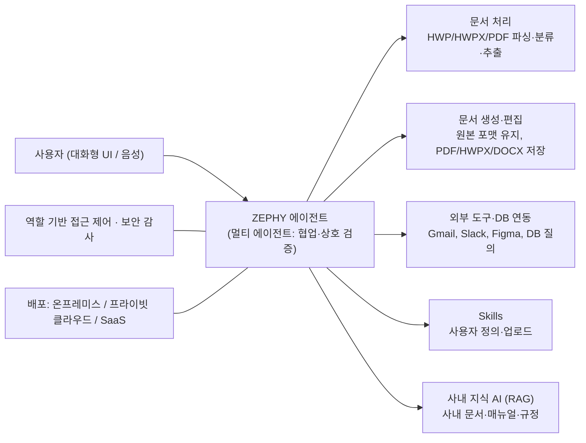

# UNIVA / ZEPHY

> [!summary] 한줄요약
> 한국 AI 기업 UNIVA(유니바)의 상용 엔터프라이즈 에이전트 "ZEPHY(제피)". 공개된 것은 홍보 자료뿐이라 모델·추론 엔진·벤치마크·가격은 확인되지 않는다.
>
> - **회사·출시**: DGIST 출신 팀이 2021년 설립. ZEPHY는 2026-04 출시, 같은 달 TTA GS인증 1등급 획득 발표
> - **주요 주장**: HWP/HWPX/PDF 고정밀 파싱, 원본 포맷 직접 편집, 외부 도구·DB 연동, 스킬 확장, 역할 기반 접근 제어
> - **배포**: 온프레미스(폐쇄망)·프라이빗 클라우드·SaaS

> [!warning] 신뢰 수준
> 이 노트의 제품 설명은 회사 홈페이지(univa.ai)와 보도자료·언론 보도에 근거한다. 설치할 수 있는 소프트웨어도, 공개 문서도, 공개 저장소도 없으므로 코드 수준 검증은 불가능했다. "주장"과 "확인"을 구분해 적었다. ZEPHY 앱(zephy.univa.ai)은 로그인 화면만 열렸고, 요금제 페이지(`/pricing`)도 로그인 화면으로 연결되어 가격은 확인하지 못했다. 회사 Medium 블로그(medium.com/@univa-zephy)는 Cloudflare 차단 화면이 떠서 읽지 않았고, 우회를 시도하지 않았다. 네이버 블로그는 렌더 결과에 본문이 없었다.

## 1. 배경 — 어떤 문제를 겨냥하는가

국내 공공기관과 많은 기업의 업무 문서는 HWP/HWPX(한글) 형식과 정형화된 공문·보고서 양식에 묶여 있다. 범용 해외 AI 에이전트는 이런 문서의 표·서식 구조를 제대로 읽거나, 원본 서식을 유지한 채 고쳐 쓰는 데 약하다는 것이 UNIVA의 문제의식이다. 홈페이지는 이를 "글로벌 에이전트에서는 해결이 어려운 HWP, HWPX 등 국내 문서 포맷과 업무 양식의 호환"이라고 표현한다.

두 번째 축은 보안이다. 공공·금융·의료는 망분리 환경이 흔하고 외부 SaaS에 데이터를 보내기 어렵다. 그래서 "사내 내부망에서만 학습하고 운영한다"는 온프레미스 배포를 전면에 놓는다.

회사 소개는 다음과 같다(홈페이지 About, 보도자료). 2021년 DGIST 창업기업으로, 본사는 대구 달성군 DGIST 산학협력관, 지사는 성남 판교에 있다. "범용 인공지능(AGI)을 연구 개발한다"는 문구와 "Built In-House, Beyond Generic, Fully Isolated, Lean by Design"이라는 네 가지 경쟁력 문구를 쓴다.

연혁은 2025년에 NIA 초거대 AI 확산 생태계 조성 사업 3건 협약 및 우수 과제 선정, 실시간 음성합성 솔루션 GS 1등급, 국제 인공지능 대전 중소벤처기업부 장관상, DNA 혁신상(정보통신산업진흥원장상)이고, 2026년에 ZEPHY 출시와 ZEPHY v1.0 GS 1등급이다.

보도자료는 LLM·OCR·STT 등 핵심 기술을 "자체 내재화"했다고 주장한다. 이 내재화의 범위(자체 학습 모델인지, 오픈 모델 파인튜닝인지)는 공개 자료로는 알 수 없다.

## 2. 타임라인 (univa.ai 뉴스 페이지와 언론 보도)

| 날짜 | 내용 | 출처 |
|---|---|---|
| 2026-04-09 | ZEPHY 공식 출시(디지털인사이트 기사 날짜 04-09, 유니콘팩토리 기사는 04-10 "10일 밝혔다") | 언론 보도 |
| 2026-04-15 | "ZEPHY, GS 1등급 획득…공공 AI 시장 본격 진출" (TTA로부터 GS인증 1등급) | univa.ai 뉴스(페이지상 날짜) |
| 2026-05-14 | 과기정통부 'AIx바이오 혁신연구거점 조성 시범사업' 세부 주관기관 선정, 2030년까지 46억원 규모 국가과제, 엔비디아 B300 GPU 48장 활용, 경북대·대구시 등과 총 491억원 규모 컨소시엄 | univa.ai 뉴스 |
| 2026-06-15 | "기업·공공 문서 업무, '제피'로 자동화" [AI 2026] 기사 | univa.ai 뉴스 |
| 2026-09-07 | "[주목! 이 기업] 만능 AI에이전트 '제피'로 사무실 풍경을 바꾼다" | univa.ai 뉴스 |

뉴스 페이지의 날짜는 각 항목 본문 뒤에 붙어 있어 그렇게 해석했다(레이아웃 해석이므로 개별 기사 원문 날짜와 하루 이틀 차이가 있을 수 있다). 신약개발 과제 소식은 문서 에이전트와는 별개로 회사가 연구용 AI 파운데이션 모델 개발도 맡았다는 의미다.

## 3. 제품 구성

### 3.1 핵심 기능 7가지 (ZEPHY 제품 페이지)

1. **올인원 업무 환경**: 대화형 인터페이스와 외부 서비스 플러그인, 노코드 스킬 확장.
2. **국내 비즈니스 환경 최적화**: HWP, HWPX 등 국내 문서 포맷과 업무 양식 호환.
3. **문서 전 과정 자동화**: 초안 자동 생성부터 검색·요약·분석·검토.
4. **문서 자산 통합 관리**: 흩어진 지식을 드라이브에 자동 전환 저장하고 키워드로 검색.
5. **강력한 보안 제어**: 사용자 접근 권한 세분화, 단계별 데이터 보안 설정, 보안 감사, 자산 생애주기 통제, 실시간 리소스 운영 관리.
6. **Hands-Free 음성 업무**: 음성 명령으로 처리하는 실시간 라이브 채팅.
7. **사용자 맞춤형 에이전트**: 직무별 커스터마이징과 반복 업무 자동화.

### 3.2 기술적 차별점으로 내세우는 것

- Multi Agent: 에이전트 간 협업과 상호 검증으로 복잡한 로직을 해결해 정확도를 높인다고 설명한다.
- Multi Modal: 텍스트·이미지·음성을 통합 인지한다.
- 외부 시스템 연동으로 컨텍스트 전환을 없앤다. 보도자료의 문구로는 "API 연동을 통한 내·외부 시스템 통합"이다.
- 국내 법령과 산업별 전문 용어·약어에 맞춘 도메인 특화.
- **"확장형 에이전트" 3종**
  - **(a) 문서 편집**: 기존 편집 툴 위에서 직접 편집, PDF/HWPX/DOCX 다운로드
  - **(b) 외부 도구·DB 연결**: Gmail, Slack, Figma 등을 클릭 한 번으로 연결. DB를 연결하면 사내 데이터를 실시간 분석
  - **(c) Skills 연동**: 스킬을 직접 만들어 업로드하고, 켜면 해당 분야 전문가처럼 동작

여기서 (c)의 "Skills"는 업계에서 쓰는 에이전트 스킬 개념과 같은 계열의 이름이지만, 포맷이 공개 표준(예: Agent Skills)과 호환되는지는 확인하지 못했다.

언론 보도에 나온 처리 단계는 구체적이다(유니콘팩토리 2026-04-10).

1. 데이터 전처리 및 정보 추출(Extract)
2. 다량 문서 분류(Classify)
3. 맥락 기반 요약·분석
4. 초안 생성·문서 편집
5. 원하는 포맷으로 저장
6. API 연동을 통한 내·외부 시스템 통합

이것은 전형적인 문서 처리 파이프라인(추출 → 분류 → 요약 → 생성 → 저장 → 연동) 구조와 같다. "RAG 기반 환각 억제"라는 표현은 6월 기사의 요약에 나오지만 기술 설명은 없다.

### 3.3 Enterprise 솔루션 라인

Enterprise 페이지는 제품이 아니라 "솔루션 납품" 성격을 드러낸다. 제시하는 영역은 여섯 가지다.

1. **문서·보고서 자동화**
2. **사내 지식 AI 에이전트**: 사내 데이터·매뉴얼·히스토리를 학습해 누구나 조회
3. **업무 프로세스 자동화**: 승인·결재·데이터 처리
4. **레거시 시스템 연동 AI**: ERP·그룹웨어·내부 DB
5. **의사결정 지원 AI**: 데이터 분석·시장 모니터링·리포트
6. **도메인 특화 에이전트**: 금융·의료·공공·제조

마지막에는 "기획·인프라 설계·GPU 구성·보안 검증·납품까지 UNIVA가 처음부터 끝까지 책임진다"고 적었다. 즉 SaaS 구독과 별도로, 고객 환경에 GPU 서버를 포함해 구축하는 SI형 사업을 병행한다.

### 3.4 배포 방식

| 방식 | 설명(홈페이지) | 해석 |
|---|---|---|
| 온프레미스 | 사내 서버·IDC에 직접 설치. 완전한 데이터 주권, 폐쇄망·인터넷 단절 환경에서도 동작, 내부 보안 감사·컴플라이언스를 자체 인프라로 충족 | 망분리 환경에서 모델 서빙까지 로컬 GPU로 수행하는 구성으로 읽힌다 |
| 프라이빗 클라우드 | 사내 클라우드에 설치, 사용자 수·워크로드에 맞춰 확장, 퍼블릭 클라우드와 분리된 독립 환경 | 자체 하드웨어 없이 빠른 도입 |
| SaaS | 보도자료에서 "유연한 SaaS 모델"로 언급, 앱 `zephy.univa.ai`는 구글·네이버·카카오·이메일 로그인 제공 | 요금제 페이지가 존재하나 로그인 뒤라 내용 미확인 |

온프레미스 쪽 강점 문구에는 "역할 기반 접근 제어 시스템으로 사용자 및 부서별 데이터 접근 권한을 정교하게 통제"가 있다. "학습은 사내 내부망에서만"이라는 표현도 있는데, 이는 고객 데이터로 모델을 계속 학습·튜닝하는 구조를 암시한다("조직만의 데이터와 피드백이 재학습되어 시간이 지날수록 강해진다"). 어떤 방식의 학습(파인튜닝, RAG 인덱싱, 피드백 반영)인지는 구분되지 않는다.

## 4. 확인된 것과 확인되지 않은 것

**홈페이지와 보도로 확인되는 것**: 제품 이름과 기능 목록, 배포 형태, 회사 연혁, 보도 일정, 문의 폼과 로그인 앱의 존재, "100+ 기업" 문구.

**주장일 뿐 독립 검증이 없는 것**: 100개 이상 기업 도입(고객명 목록은 홈의 텍스트에 없다. 이전 판 노트가 언급한 고객 로고류는 이번 텍스트 렌더에서 이름을 확인하지 못했다), 국가정보원 보안 가이드라인 준수, HWP/HWPX "고정밀" 파싱의 정확도, "환각 억제" 효과, 업무 시간 "획기적" 단축.

**GS 인증의 의미**: GS(Good Software) 인증은 TTA 등이 소프트웨어 품질을 평가하는 제도로 알려져 있다(일반 지식, 이번에 인증서를 확인하지 않음). 공공 조달에서 유리하게 작용하지만, 모델의 정확도나 보안 취약점 전수 점검을 의미하는 것은 아니다. 국정원 보안적합성 검증, CC 인증 등과는 별개이므로, 도입 검토 시 어떤 인증을 어느 범위로 받았는지 서류로 요구해야 한다.

**공개되지 않은 것**: 사용 모델(자체/오픈 파인튜닝), 파라미터 규모, 추론 엔진, 요구 GPU 사양, 처리량·지연 수치, HWP 파싱 방식, 벤치마크, 가격, SLA, 로그·감사 기능의 상세, 데이터 보관·삭제 정책.

홈 페이지의 푸터에서 Alibaba Cloud, AWS, NVIDIA Inception 프로그램 로고 자산이 보이는데(`ico_logo_alibaba`, `ico_logo_aws`, `ico_logo_InceptionProgram`, `ico_logo_nvidia`, `ico_logo_pooweredByAlibabaCloud` 등 파일명), 이 로고들이 어떤 관계(클라우드 크레딧, 파트너 프로그램, 사용 모델)를 뜻하는지는 확인하지 못했다. 파일명만으로 모델 의존 관계를 단정하면 안 된다.

## 5. 설치·사용법

공개 설치 방법은 없다. 접근 경로는 세 가지다.

1. **SaaS 체험**: `https://zephy.univa.ai/`에서 구글·네이버·카카오·이메일로 가입. 이번 조사에서는 가입하지 않았다(개인정보 입력과 약관 동의가 필요하며 업무 계정을 쓸 수 없는 사안).
2. **문의**: 홈페이지 하단 문의 폼(개인/기업·기관, 문의 유형). 필수 동의 항목이 개인정보 수집·이용이다.
3. **온프레미스/프라이빗 클라우드 도입**: Enterprise 페이지의 "문의하기"를 통한 영업 협의. 인프라 설계와 GPU 구성까지 회사가 맡는 구조다.

사용 흐름은 보도 시나리오가 대신 설명한다. 실무자가 "이 프로젝트 계획서 초안을 만들어주고 한글문서로 생성해줘"라고 입력하면, 에이전트가 사내 저장소에서 관련 자료를 모아 분석하고 서식을 유지한 HWP 초안을 만들며, Gmail 요약 같은 외부 연동 작업도 처리한다(2026-09 보도 요약). 이 시나리오는 언론이 시연을 본 결과라는 점에서 홍보 시연 이상의 검증은 아니다.

## 6. 비교 대상

- **범용 에이전트(ChatGPT류, Claude류, Microsoft Copilot 등)**: 영어권 문서와 Office 포맷에는 강하지만 HWP/HWPX 직접 편집은 약하다고 UNIVA가 주장한다. 이 비교는 공급자 측 주장이며 이번에 직접 비교 실험하지 않았다.
- **국내 오피스 벤더의 AI 기능**: HWP를 만드는 쪽의 AI 기능이 직접 경쟁일 수 있으나 이번 조사에서는 확인하지 않았다(일반 지식 수준의 언급).
- **자체 구축(RAG + 오픈 LLM + HWP 파서)**: HWPX는 ZIP 컨테이너 안의 XML 문서로 알려져 있어(일반 지식) 파싱 난이도가 HWP 바이너리보다 낮다. 오픈소스 HWP 파서도 존재한다. 이 조합으로 사내 문서 검색·요약 에이전트를 구축하는 것이 가장 직접적인 대안이며, 서빙 모델 후보는 [[qwen3-5-9b]], [[apertus-v1-5-70b]] 같은 오픈웨이트다.
- **게이트웨이 중심 접근**: 여러 모델과 서비스를 중앙 게이트웨이로 묶고 정책을 적용하는 방식은 [[inflab-ai-gateway]]가 설명한다. 에이전트 제품을 통째로 사는 것(ZEPHY)과 게이트웨이 위에 에이전트를 직접 짓는 것은 통제권과 도입 속도의 교환이다.

## 7. 장단점·한계·성숙도

장점으로 읽히는 것: 국내 문서 환경(HWP/HWPX)에 정면으로 맞춘 포지셔닝, 폐쇄망 온프레미스 지원, 역할 기반 접근 제어, 공공 조달 진입 요건(GS 인증)을 갖춘 점, 인프라 설계부터 납품까지 맡는 구축 서비스, 음성·멀티모달·스킬 확장 등 기능 폭.

한계와 의문: 제품 출시가 2026-04로 6개월이 채 안 된 신제품이다. 기술 근거(모델, 정확도, 성능)가 공개되어 있지 않고, 요금도 로그인 뒤에 있어 비교가 어렵다. "자체 내재화"와 "멀티 에이전트" 같은 표현은 구현 방식이 불투명하다.

외부 도구 연동(Gmail, Slack, Figma)은 SaaS 토큰을 다루는 기능이라 온프레미스 폐쇄망 약속과 충돌하는 지점이 있다(폐쇄망에서는 이런 연동을 끄는지, 어떻게 분리하는지 확인 필요). 회사 규모와 제품 지속성(후속 지원, 업데이트 주기)도 외부에서 알기 어렵다.

성숙도 판정: "공공·기업 대상 상용 1.0 단계, 레퍼런스 확장 중"으로 볼 수 있다. 도입 결정을 내릴 만한 독립 검증 자료는 없다.

## 8. 보안·라이선스·운영 리스크

- **벤더 종속**: 상용 제품이라 문서 처리 파이프라인과 지식 베이스가 벤더 포맷에 묶일 수 있다. 계약 시 데이터 반출(Export) 방식과 종료 시 삭제 증빙을 확인해야 한다.
- **학습 데이터 취급**: "사내 데이터로 학습"이라는 문구는 개인정보·기밀이 모델 가중치나 인덱스에 들어간다는 뜻일 수 있다. 삭제 요구(잊힐 권리, 퇴사자 문서) 대응 방법이 핵심 질문이다.
- **권한 상속**: 사내 문서를 RAG로 묶을 때 가장 흔한 사고는 원본 시스템의 접근 권한이 인덱스로 상속되지 않는 것이다. RBAC가 문서 단위까지 내려가는지 확인 항목이다(일반적인 RAG 보안 지식).
- **외부 연동 토큰**: Gmail/Slack/DB 연동이 에이전트에게 장기 토큰을 준다. 토큰 범위 최소화, 도구 호출 승인 단계, 감사 로그가 필요하다. 에이전트 실행 환경의 격리 수준은 [[microvm-isolation-2026]]의 논지를 기준으로 질문할 수 있다(컨테이너 격리만으로 충분한가).
- **프롬프트 인젝션**: 외부 문서나 메일을 읽는 에이전트는 문서 안의 지시문에 속을 수 있다. 문서 요약 경로에서 도구 호출을 허용할지 여부를 정책으로 분리해야 한다. 벤더가 이를 어떻게 막는지는 공개 자료에 없다.
- **인증 범위**: 위 4절대로 GS 인증은 품질 인증 중심이다. 보안 인증과 혼동하지 않는다.
- **우리 조직의 데이터 정책**: 사내 기밀, 개인정보, 비밀번호·API 키가 담긴 문서를 외부 서비스(SaaS 포함)에 올릴 수 없다는 규정이 있으면 SaaS 체험 자체가 제약된다. 평가는 비식별화한 샘플 문서로만 해야 한다.

## 10. 확인 못한 것

- 사용 LLM, 모델 규모, 추론 엔진, 권장 GPU 사양.
- 요금제(`zephy.univa.ai/pricing`은 로그인 필요), 계약 조건, SLA.
- GS 인증서 원문과 평가 범위, 국정원 보안 가이드라인 준수의 구체적 근거.
- 고객사 목록과 도입 규모 검증("100+ 기업"은 주장).
- Medium과 네이버 블로그의 기술 글(차단 또는 본문 없음).
- HWP 파싱 정확도와 편집 호환성의 실측.
- 이전 판에 있던 일부 고객사 언급의 원천(이번 렌더에서는 재확인 안 됨).

## 관련 노트
[[inflab-ai-gateway]] [[microvm-isolation-2026]] [[apertus-v1-5-70b]] [[qwen3-5-9b]] [[qwen-ai-home]]

## 출처
- https://univa.ai/ (홈, headless 렌더)
- https://univa.ai/ko/zephy/ (제품 페이지)
- https://univa.ai/ko/enterprise/ (Enterprise 페이지)
- https://univa.ai/ko/company/aboutus/ (회사 소개·연혁)
- https://univa.ai/ko/resource/pr/ (뉴스)
- https://zephy.univa.ai/ 및 https://zephy.univa.ai/pricing (로그인 화면만 확인)
- https://ditoday.com/유니바-국내-특화-올인원-ai-에이전트-제피/ (2026-04-09 출시 기사)
- https://www.unicornfactory.co.kr/article/2026041010542511627 (2026-04-10 출시 기사)
