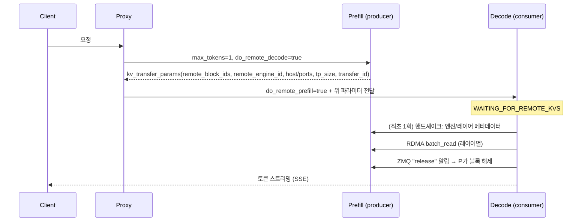
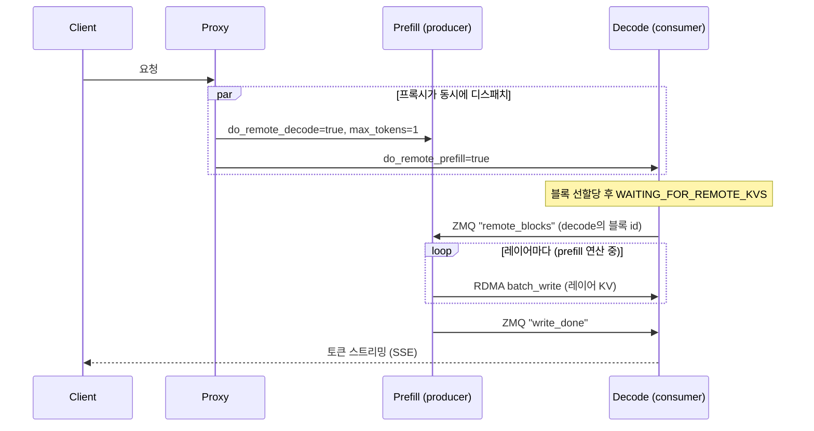

# vLLM MoRIIO KV Connector

> [!summary] 한줄요약
> `MoRIIOConnector`는 prefill과 decode를 별도 vLLM 인스턴스로 분리하고 KV 캐시를 RDMA로 넘기는 ROCm 전용 connector다. AMD의 RDMA 라이브러리 MORI(Modular RDMA Interface)의 MORI-IO 위에 구현되어 있다.
>
> - **보고된 효과**: AMD·Embedded LLM 블로그에서 8×MI300X 한 노드를 4+4 GPU로 나눴을 때, TTFT<1s와 ITL<50ms를 동시에 만족한 요청이 표준 collocated 대비 약 2.4~2.5배
> - **근거 범위**: 단일 워크로드 한 지점의 수치이며 저자가 AMD 측
> - **성숙도**: 코드는 vLLM main에 있지만, 문서상 disaggregated prefill 기능 전체가 "experimental"

> [!warning] 조사 경로와 한계
> 요청 URL `vllm.ai/blog/moriio-kv-connector`와 정식 URL `vllm.ai/blog/2026-04-07-moriio-kv-connector` 모두 이 환경에서 연결이 되지 않았다(curl HTTP 000). 본문은 사이트 소스 저장소 `vllm-project/vllm-project.github.io`의 `_posts/2026-04-07-moriio-kv-connector.md`를 GitHub API로 받아 전문(약 33KB)을 읽었다. 구현은 vLLM 저장소를 shallow clone(2026-10-01 main, 커밋 ac9126e)해서 `vllm/distributed/kv_transfer/kv_connector/v1/moriio/`의 4개 파일(`moriio_connector.py` 3,716줄, `moriio_engine.py` 940줄, `moriio_layout.py` 621줄, `moriio_common.py` 654줄), 사용 문서, 참조 프록시, 단위 테스트 목록까지 읽었다. 하드웨어가 없어 실행은 하지 못했다. 코드에서 읽은 내용과 블로그의 주장이 다른 곳은 따로 표시했다.

## 1. 배경 — 왜 prefill/decode를 나누는가

LLM 추론은 두 단계로 나뉜다.

- **Prefill**: 프롬프트 전체를 한 번에 병렬 처리하는 연산 집약(compute-bound) 단계
- **Decode**: 토큰을 한 개씩 생성하면서 매번 가중치와 KV를 HBM에서 읽어 오는 메모리 대역폭 집약(memory-bandwidth-bound) 단계

한 인스턴스가 둘을 섞어 처리하면(collocated) 긴 prompt의 prefill이 배치에 끼어들 때 진행 중인 모든 decode 스트림의 다음 토큰이 늦어진다. 이것이 ITL(Inter-Token Latency) 튀는 현상이다. 반대로 decode가 점유한 자원 때문에 새 prefill의 스케줄이 밀려 TTFT가 늘기도 한다.

chunked prefill로 완화할 수 있지만, vLLM 문서는 적절한 청크 크기를 찾기 어려워 disaggregated prefill이 꼬리 ITL을 제어하는 더 믿을 만한 방법이라고 설명한다.

블로그는 여기에 "disaggregation은 데이터센터 규모 클러스터 이야기"라는 통념을 반박한다. 노드 하나의 GPU 8장을 4장(prefill) + 4장(decode)으로 나누어도 이득이 있다는 주장이다.

걸림돌은 KV 전달이다. prefill이 만든 KV 캐시(긴 프롬프트와 큰 모델에서는 수 GB)를 decode 인스턴스로 옮겨야 하는데, 이 전송이 느리면 분리의 이점이 사라진다. MoRIIOConnector는 그 전송을 RDMA(CPU 개입 없이 GPU 메모리끼리 직접 읽고 쓰기)로 처리하는 구현체다.

여기서 조심할 점이 있다. vLLM 공식 문서는 같은 페이지에서 "Disaggregated prefill DOES NOT improve throughput"이라고 못박는다. 이 기능이 개선하는 것은 TTFT와 ITL을 따로 튜닝할 수 있다는 점과 꼬리 ITL이다. 블로그의 "2.5× goodput"은 처리량이 아니라 "SLO를 만족한 요청 수"라는 점을 구분해서 읽어야 한다.

## 2. 구성 요소와 역할

| 구성 | 역할 | 비고 |
|---|---|---|
| Prefill 인스턴스 | `kv_role: kv_producer`. 프롬프트를 처리해 KV 생성 | 블로그 구성: GPU 0-3, TP4 |
| Decode 인스턴스 | `kv_role: kv_consumer`. 전달받은 KV로 토큰 생성 | 블로그 구성: GPU 4-7, TP4 |
| Proxy / Router | 요청의 진입점. prefill → decode 순서와 방식을 조율 | 문서 권장: `vllm-router`; 참조용: `moriio_toy_proxy_server.py` |
| MORI(IOEngine) | RDMA(또는 xGMI) 전송 엔진. 세션 생성, `batch_read`/`batch_write` | `mori.io`, 패키지 `amd_mori` |
| ZMQ 제어면 | 핸드셰이크, 블록 id 교환, 완료 알림, 인스턴스 등록/하트비트 | 인스턴스마다 여러 TCP 포트 |

MORI 쪽 설명은 ROCm/mori의 README에 있다: MORI는 RDMA+GPU 통합에 초점을 둔 모듈형 프레임워크이고, MoE 디스패치/컴바인 커널 MORI-EP, KV 캐시 전송용 점대점 통신 MORI-IO, 집합 통신 MORI-CCL, 계층 메모리 풀 MORI-UMBP 등을 포함한다.

지원 NIC는 AMD Pensando DSC, Broadcom Thor2, NVIDIA Mellanox ConnectX-7이다. 이 저장소는 MIT 라이선스, 스타 약 181개다(GitHub API). README 뉴스에는 2026-01에 MORI-IO가 vLLM(PR #29304)과 SGLang(PR #14626)에 통합되었다는 항목이 있다.

## 3. 동작 원리 — 두 가지 전송 모드

두 모드 모두 KV 전송 직전에 한 번의 핸드셰이크가 있다. 블로그 설명으로는 인스턴스 쌍이 처음 만날 때 ZMQ로 KV 캐시 기준 주소, 블록 크기, 레이어별 텐서 stride 등 메타데이터를 교환하고, 이 과정은 백그라운드 스레드에서 비동기로 돌아 엔진 루프를 막지 않으며, 만들어진 RDMA 세션은 이후 요청에서 재사용된다.

코드로 확인한 바로는 이 핸드셰이크가 `_moriio_handshake_listener`(ROUTER 소켓으로 `get_meta_msg`를 받으면 엔진 디스크립터와 레이어별 KV 텐서 메타데이터를 msgpack으로 응답)와 `_moriio_handshake`(DEALER로 질의 후 `register_remote_engine`)의 쌍이다.

모드 선택은 블로그에서는 환경변수 `VLLM_MORIIO_CONNECTOR_READ_MODE=1`이지만, 현재 main 코드는 이 환경변수를 deprecated로 경고하고 무시한다(`_DEPRECATED_ENV_VARS`). 대신 `--kv-transfer-config`의 `kv_connector_extra_config.read_mode`(true/1)를 읽는다(`get_moriio_mode`).

같은 방식으로 `VLLM_MORIIO_QP_PER_TRANSFER`, `VLLM_MORIIO_POST_BATCH_SIZE`, `VLLM_MORIIO_NUM_WORKERS`도 `qp_per_transfer`, `post_batch_size`, `num_workers` 키로 이동했다. 즉 블로그 날짜(2026-04) 이후 설정 방식이 바뀌었으므로 블로그의 명령을 그대로 복사하면 안 된다.

### 3.1 READ 모드 — decode가 끌어간다



프록시가 prefill 응답을 기다린 뒤에야 decode로 보내므로 직렬이다. 코드 쪽 세부는 다음과 같다.

- **Prefill의 블록 보관**: 요청이 `FINISHED_LENGTH_CAPPED`로 끝나면 `request_finished`에서 블록 해제를 미루고(`delay_free_blocks`) 반환할 `kv_transfer_params`를 만든다.
  - **전달 값**: `do_remote_prefill=True`, `remote_block_ids`, `remote_engine_id`, `remote_host`, `remote_handshake_port`, `remote_notify_port`, `remote_dp_rank`, `remote_dp_size`, `tp_size`, `transfer_id`
  - **보호 타임아웃**: 읽기 중단 한도 3,600초(`VLLM_MORI_READ_ABORT_REQUEST_TIMEOUT`), ack 미수신 시 강제 해제하는 `defer_timeout` 기본 60초
- decode의 스케줄러(`get_num_new_matched_tokens`)는 원격에서 가져올 토큰 수를 `프롬프트 길이 − 이미 계산된 토큰 − 1`로 계산한다. 마지막 토큰은 decode에서 다시 계산한다. 주석은 READ 모드에서 "마지막 토큰은 항상 decode가 로컬에서 재계산"한다고 밝히고, 해당 대기를 동기식(같은 step 안에서 `wait_for_layer_load`로 기다림)으로 선언한다.
- 워커(`start_load_kv`)는 먼저 참조되는 모든 원격 prefill rank와 `_eager_handshake_all_dp_ranks`로 핸드셰이크한다. 주석에 이유가 있다: 읽기 경로에서 rank별로 게으르게 핸드셰이크하면 TP 워커들이 서로 다른 시점에 forward collective로 들어가 NCCL 교착이 생길 수 있다.
- 레이어마다 오프셋을 계산해(`_compute_block_transfer_offsets`, 연속 블록은 `merge_contiguous_blocks`가 한 전송으로 병합) 세션의 `batch_read`를 게시한다. NIC의 송신 큐가 가득 차면 1ms에서 50ms까지 백오프하며 재게시한다(`_post_read_with_backoff`, `_SQ_FULL_BACKOFF_*`).
- 완료는 별도 폴링으로 감지하고(`get_finished`/`_pop_done_transfers`), 성공하면 prefill의 notify 포트로 `release`를 보낸다. 실패한 읽기는 `get_block_ids_with_load_errors`로 스케줄러에 알려 해당 블록을 재계산하게 한다.

### 3.2 WRITE 모드(기본) — prefill이 밀어 넣는다



핵심은 블록 id의 방향이다. decode가 먼저 자기 블록을 할당하고(`update_state_after_alloc`가 `send_notify_block`으로 `remote_blocks` 메시지를 prefill의 notify 포트에 보낸다), prefill은 그 블록 주소로 직접 쓴다. 그래서 프록시는 `remote_block_ids`를 중계할 필요가 없고 두 요청을 동시에 던진다. 블로그 서술과 코드를 연결하면 다음과 같다.

- `MoRIIOConnector.save_kv_layer`는 producer에서만 동작하며 레이어 연산 직후 호출된다. `MoRIIOWriter.schedule_write`가 `WriteTask`를 큐에 넣고, 전용 스레드(`moriio-write-worker`)가 처리한다. 작업은 CUDA 이벤트를 `synchronize()`한 뒤 실행된다. 코드 주석은 "현재 레이어의 어텐션 계산이 KV 전송과 겹치면 정밀도 문제가 생기므로 이 이벤트로 동기화한다"고 적는다. 즉 쓰기는 레이어 k의 연산이 끝난 뒤에 시작되어 레이어 k+1 연산과 겹치는 파이프라인이다.
- decode의 블록 id가 아직 도착하지 않았으면 작업은 deferred 목록에서 대기하며, `defer_timeout`(기본 60초) 안에 안 오면 포기하고 해당 요청을 완료 처리해 블록이 풀리게 한다.
- 청크 단위 prefill(chunked prefill)에서는 마지막 청크 전까지 블록을 모았다가 쓰기를 시작한다(블로그, 코드 주석).
- forward가 끝나면 `wait_for_save`가 `seal_pending_transfers`를 호출해 "이 전송에 대해 예약된 쓰기 개수"를 확정한다. 이유는 코드 주석에 있다. 하이브리드 모델은 등록된 KV 텐서 수보다 `save_kv_layer`가 실제로 호출되는 횟수가 적을 수 있어서, 완료 판단은 실제 큐에 들어간 작업 수로 해야 한다. `writes_done == writes_expected`가 되면 전송 상태들을 기다린 뒤 `write_done`을 decode에 보내고, prefill 블록 해제 ack를 낸다.
- decode는 `async_wait_reqid`가 띄운 ROUTER 소켓 스레드로 notify 메시지를 받고, 스케줄러는 `pop_finished_write_req_ids`로 완료를 확인해 `WAITING_FOR_REMOTE_KVS` 요청을 일반 대기열로 옮긴다. 블로그가 인용한 스케줄러 코드(`request.status == RequestStatus.WAITING_FOR_REMOTE_KVS`면 건너뛰고 다음 step에 다시 확인)가 이 대기를 구현한다.

### 3.3 TTFT 비용 모델 (블로그)

블로그는 disaggregation이 ITL을 안정시키는 대가로 TTFT를 늘린다고 분명히 쓴다.

- **READ**: prefill 연산 + 프록시 직렬화 + RDMA 전송 대기 + decode 큐가 모두 더해진다.
- **WRITE**: 전송이 prefill 연산과 겹친다. `max(prefill큐+prefill연산+RDMA쓰기, decode큐) + 첫 토큰 샘플링…`으로 근사된다.

따라서 WRITE가 TTFT에서 유리하고(블로그 결과 73/100 vs 70/100), ITL 이득은 두 모드가 같다.

반대로 TTFT가 지배적 제약인 챗봇 UX나 저요청률·짧은 프롬프트에서는 표준 서빙이 낫다고 블로그의 의사결정표(Table 4)가 안내한다.

## 4. 벤치마크 상세 (블로그, Table 3과 4)

벤치마크 조건은 다음과 같다.

- **모델·입출력**: `Qwen/Qwen3-235B-A22B-FP8`, ISL 2000, OSL 1000
- **부하**: 랜덤 데이터셋, 요청 100건, 요청률 0.5~10(0.5 단위)
- **SLO**: TTFT < 1초 그리고 ITL < 50ms
- **Goodput 정의**: DistServe 방법론에 따른 SLO를 만족하는 최대 요청률
- **하드웨어**: 8×MI300X(192GB), EPYC 9654 2소켓
- **소프트웨어**: ROCm 7.0, vLLM `0.16.0rc1.dev1+gc46b0cd0a`, PyTorch 2.9.1
- **MORI 커밋**: `c365eaed`(디스클레이머) 또는 `2d02c6a9`(Dockerfile 안내). 글 안에서 두 커밋이 모두 등장한다.
- **테스트 일자**: 2026-03-12

| 구성 | 요청률 8에서 SLO 충족 | 주 실패 원인 |
|---|---|---|
| Standard 1×TP8 (EP 사용) | 26/100 | ITL 스파이크 |
| Standard 2×TP4 (라운드 로빈) | 30/100 | ITL이 약 30ms와 약 150ms 두 군집으로 갈림 |
| MORI-IO READ 1P+1D | 70/100 | 일부 요청 TTFT 1초 초과 |
| MORI-IO WRITE 1P+1D | 73/100 | 일부 요청 TTFT 1초 초과 |

요청률별 SLO 달성률(Figure 4 설명): Standard 2×TP4는 0.5에서 100%, 1에서 약 60%, 2 이후 약 25%에서 정체한다. READ는 요청률 약 5까지 100%, 10에서 약 44%, WRITE는 약 5.5까지 100%, 10에서 약 46%로 서서히 떨어진다.

읽을 때 주의할 점이다.

1. 블로그가 보고한 상대 goodput(0.9x, 1x, 2.4x, 2.5x)은 단순 비율로 재계산하면 READ 70/30 ≈ 2.33, WRITE 73/30 ≈ 2.43이다. 표기가 2.4/2.5로 한 단계 높은 이유(소수점 처리인지, 별도 보간인지)는 확인하지 못했다.
2. 표본이 100건이고 반복·분산 보고가 없다. 요청률 8이라는 한 점을 헤드라인으로 삼았다.
3. 비교 기준(Standard 2×TP4)은 같은 GPU를 둘로 나눈 공정한 대조군이다. 이 설계는 설득력이 있다.
4. 비교 구성은 모두 prefix caching을 껐다(`--no-enable-prefix-caching`; 블로그는 WRITE 쪽에서 "connector가 요구한다"고 적었다). 반면 코드에는 READ 모드에서 로컬 prefix 캐시 hit와 결합하는 로직이 있다(블록 정렬 `_align_read_blocks`, "full prefix cache hit이면 전체 no-op" 주석). 두 서술이 완전히 일치하지는 않아, prefix caching 병용 여부는 확인하지 못했다.
5. 블로그의 저자 표기는 "AMD and Embedded LLM"이고, 테스트 하드웨어도 AMD 플랫폼이다. 독립 재현은 확인하지 못했다.

## 5. 설치·사용법 (docs/features/moriio_connector_usage.md, main 기준)

전제: ROCm용 vLLM, `pip install amd_mori`(또는 공식 이미지 `vllm/vllm-openai-rocm:nightly`에 포함), NIC 유저스페이스 라이브러리가 호스트의 RDMA 커널 모듈·펌웨어와 맞아야 한다.

공식 이미지에 미리 들어 있는 NIC는 AMD Pensando Pollara(AINIC, `libionic1=54.0-187-1`, `ionic-dkms=26.03.3.001` 테스트)와 Broadcom Thor2(`bnxt-re-dkms=235.2.86.0` 테스트)다. 이 외 NIC는 벤더 안내를 따라야 한다. 불일치하면 `availDevices.size() > 0` assertion으로 기동 실패한다(문서 troubleshooting).

```bash
# 1) 프록시(vllm-router)를 먼저 기동. 인스턴스는 등록이 될 때까지 재시도한다.
docker run --network host vllm/vllm-router:nightly vllm-router \
  --vllm-pd-disaggregation --kv-connector moriio \
  --vllm-discovery-address "0.0.0.0:36367"

# 2) Prefill (GPU 0-3)
export VLLM_ROCM_USE_AITER=1 CUDA_VISIBLE_DEVICES=0,1,2,3 HIP_VISIBLE_DEVICES=0,1,2,3
vllm serve Qwen/Qwen3-235B-A22B-FP8 -tp 4 --port 20005 --gpu-memory-utilization 0.9 \
  --kv-transfer-config '{
    "kv_connector":"MoRIIOConnector","kv_role":"kv_producer",
    "kv_connector_extra_config":{
      "proxy_ip":"127.0.0.1","proxy_ping_port":"36367",
      "http_port":"20005","handshake_port":"6301","notify_port":"6105"}}'

# 3) Decode (GPU 4-7): kv_role=kv_consumer, http_port/handshake/notify 포트는 달리
#    READ 모드: kv_connector_extra_config 에 "read_mode": true 추가 (양쪽 동일하게)
```

참조 프록시를 쓰려면 `pip install quart aiohttp msgpack` 후 `examples/disaggregated/disaggregated_serving/moriio_toy_proxy_server.py`를 실행한다. 이 파일 머리 주석은 "프로토콜 참조용이지 프로덕션 라우터가 아니다"라고 못박고, 멀티 파드 Wide-EP에서 필요한 피어 정보는 llm-d-router나 vLLM의 vllm-router 같은 실제 라우팅 사이드카가 만든다고 안내한다.

### 설정 키 (kv_connector_extra_config)

| 키 | 의미 | 기본 |
|---|---|---|
| `proxy_ip`, `proxy_ping_port` | 프록시 등록·하트비트 수신 위치 | (필수/0) |
| `http_port` | 인스턴스의 OpenAI API 포트. 프록시가 요청을 여기로 전달 | (필수) |
| `handshake_port` | MoRI 엔진 1회성 핸드셰이크 TCP 포트 | 6301 |
| `notify_port` | 제어·동기화 메시지. **기준 포트**이며 (DP rank, TP rank)별 오프셋이 더해짐 | 61005 |
| `read_mode` | true/1이면 READ 모드 | false(WRITE) |
| `backend` | `rdma`(기본, 멀티노드 필수) 또는 `xgmi`(같은 호스트, NIC 불필요) | rdma |
| `qp_per_transfer` | 전송당 RDMA Queue Pair 수 | 1 |
| `post_batch_size` | `ibv_post_send` 한 번에 묶는 WR 수 | -1(백엔드 기본) |
| `num_workers` | MoRI 전송 완료 폴링 스레드 | 1 |
| `transfer_timeout` | 전송 완료 대기 한도 후 `TransferError` | 30초 |
| `defer_timeout` | ack 미수신 시 강제 블록 해제 | 60초 |
| `recv_abort_timeout` | RDMA 완료가 오지 않는 수신 중단 | 120초 |
| `host_ip` | 전송에 광고할 IP(Ray 등에서 `get_ip()`가 공인 IP를 줄 때) | `get_ip()` |

멀티노드 예시는 문서에 DeepSeek-R1-0528, TP8 + expert parallel 구성의 `docker run`으로 제시된다(prefill 노드에 프록시 동거). 이때 컨테이너 옵션은 `--privileged`, `--network host`, `--ipc host`, `--security-opt seccomp=unconfined`, `--ulimit memlock=-1`, `--device /dev/kfd /dev/dri /dev/infiniband`다. RDMA 메모리 고정과 장치 접근을 위한 것이지만, 보안 관점에서는 뒤의 8절에서 따로 짚는다.

## 6. 구조에서 확인한 것 (코드 수준)

**vLLM KV connector 계약.** `MoRIIOConnector`는 `KVConnectorBase_V1`과 `SupportsHMA`를 상속한다. 한 클래스 안에서 `KVConnectorRole`에 따라 스케줄러와 워커 역할이 갈린다.

- **스케줄러(`MoRIIOConnectorScheduler`) 훅**
  - `get_num_new_matched_tokens`: 원격에서 올 토큰 수와 비동기 여부
  - `update_state_after_alloc`: 블록 할당 직후
  - `build_connector_meta`: 워커에 넘길 메타
  - `request_finished`: 블록을 바로 풀지 지연할지와 전달 파라미터
  - `update_connector_output`
- **워커(`MoRIIOConnectorWorker`) 훅**
  - `register_kv_caches`: KV 텐서를 MoRI에 등록
  - `start_load_kv`, `wait_for_layer_load`
  - `save_kv_layer`, `wait_for_save`
  - `get_finished`

이 인터페이스는 NIXL, Mooncake, LMCache 등 다른 connector도 공유하므로, 다른 connector를 분석해도 같은 틀로 읽힌다.

**메모리 등록과 오프셋 계산.** `register_kv_caches`가 각 레이어 KV 텐서를 MoRI 엔진에 등록(`register_torch_tensor`)하고, 전송 때는 (로컬 오프셋, 원격 오프셋, 크기) 3중 리스트를 만들어 한 번의 `batch_read`/`batch_write`로 넘긴다. 서로 인접한 블록은 병합해 WR 수를 줄인다. 모양이 다른 레이어(MLA, 슬라이딩 윈도우, mamba류)는 `moriio_layout.py`의 geometry 함수들이 처리한다.

**랭크 매핑.** `get_moriio_remote_tp_rank`는 prefill과 decode의 TP 크기가 다를 때(한쪽이 다른 쪽의 배수) 대응 rank를 정하고, `validate_moriio_heterogeneous_tp_kv_heads`는 이질 TP에서 양쪽 모두 KV 헤드가 복제 상태(TP ≥ KV 헤드 수)가 아니면 `NotImplementedError`를 낸다.

이질 TP에서는 소비자 TP가 더 클 때 `consumer_tp / producer_tp`개의 ack를 모아야 해제한다(`get_moriio_expected_ack_count`).

MLA에서 decode world size가 1이고 prefill이 순수 TP이면 prefill의 TP rank를 라운드 로빈으로 골라 읽어 NIC 부하를 분산한다("flexible read").

**요청 ID에 피어 주소 삽입.** 참조 프록시는 `request_id`를 `___prefill_addr_{zmq}___decode_addr_{zmq}_{uuid}` 형태로 만들고, 커넥터는 정규식으로 상대 주소(`host:IP,handshake:PORT,notify:PORT`)를 뽑는다. 이 방식이 안 맞는 경로(llm-d 사이드카)는 `kv_transfer_params`의 `remote_host`, `remote_handshake_port`, `remote_notify_port`로 대체한다. 둘 다 없으면 예외를 낸다("안전한 기본 호스트/포트는 없다").

**장애 처리.** 전송 상태는 레이어별 상태의 묶음으로 판정한다(`TransferBatchState`: DONE/FAILED/PENDING). 가장 최근 상태 하나로 판단하지 않는 이유는 주석에 명시돼 있다. 송신 큐 고갈로 중간 레이어가 실패할 수 있기 때문이다.

타임아웃 3종(`transfer_timeout` 30초, `defer_timeout` 60초, `recv_abort_timeout` 120초), RDMA 알림 비활성(`enable_notification=False`: 고동시성에서 `ibv_post_send` ENOMEM이 상태를 오염시켜 요청이 `WAITING_FOR_REMOTE_KVS`에 영원히 걸리는 문제를 피하려는 선택이라고 주석에 적혀 있다), 소비자 DP rank 불일치로 인한 행 방지를 위한 라우팅 계약 등이 코드 곳곳에 방어 로직으로 남아 있다. 구현의 상당 부분이 "분산 상태 기계의 정합성 유지"에 쓰인다.

**하이브리드 모델 지원.** 현재 main은 슬라이딩 윈도우와 mamba/KDA 계열 그룹을 READ 모드에서만 지원하고, WRITE 모드에서는 하이브리드 KV 캐시 그룹에 대해 `NotImplementedError`("READ 모드를 쓰거나 `--disable-hybrid-kv-cache-manager`를 주라")를 낸다.

mamba 상태는 conv와 ssm 두 영역으로 따로 등록되어 슬롯 단위로 읽는다. `moriio_layout.py`의 주석에는 "homogeneous GDN layers" 언급이 있어 Gated DeltaNet류도 같은 경로를 쓰도록 설계된 것으로 보이지만, Qwen3.5 하이브리드([[qwen3-5-9b]])로 실제 PD 분리를 검증한 자료는 확인하지 못했다.

**테스트.** 단위 테스트 파일이 11개 있다(`tests/v1/kv_connector/unit/test_moriio_*.py`: connector, routing, routing_fairness, proxy_routing, toy_proxy_server, transfer_completion, tp_ack, write_done_routing, unmap, kv_layout, hma_scheduler). GPU·RDMA 없이 도는 로직 테스트로 보이며, 실제 RDMA 통합 테스트는 이 저장소에서 확인하지 못했다.

## 7. 비교 대상

vLLM 문서(disagg_prefill.md)는 "9 types of connectors"를 지원한다고 쓰지만, 본문에 실제로 나열된 항목은 8개다.

- **ExampleConnector**
- **LMCacheConnectorV1**: NIXL 위에서 전송, 멀티프로세스 모드 `LMCacheMPConnector` 포함
- **NixlConnector**: 완전 비동기 송수신, UCX/GDS 등 백엔드 선택, 별도 사용 가이드와 호환성 표 있음
- **MooncakeConnector**: 사용 가이드 및 store 가이드 있음
- **MoRIIOConnector**: ROCm 전용
- **MultiConnector**: 여러 connector를 순서대로 조합
- **OffloadingConnector**: KV를 CPU 메모리·파일시스템 계층으로 오프로딩
- **FlexKVConnectorV1**: 분산 KV 스토어

같은 디렉터리에 hf3fs, hisparse 등의 하위 패키지도 보인다.

- **MoRIIO vs NIXL/Mooncake**: 역할은 같고 전송 라이브러리가 다르다. MoRIIO는 AMD GPU와 MORI에 최적화된 경로, NIXL은 벤더 중립에 가까운 범용 경로다. 우리 GPU가 NVIDIA라면 NixlConnector 쪽이 현실적인 비교 대상이다(이번에는 NIXL 문서를 읽지 않았다).
- **Disaggregation vs chunked prefill**: chunked prefill은 한 인스턴스 안에서 prefill을 쪼개 끼워 넣는 타협안이고, 분리는 자원 자체를 격리한다. 문서가 후자를 꼬리 ITL 제어에 더 신뢰할 만하다고 평가한다.
- **Disaggregation vs 단순 인스턴스 분할(2×TP4)**: 블로그의 핵심 대조군이다. 같은 GPU 수에서 "섞어서 둘" 대 "역할을 나눠 둘"의 차이만 측정하도록 설계됐다.
- **SGLang MORI-IO**: MORI README가 SGLang PR #14626으로 같은 라이브러리를 통합했다고 적는다(이번에 SGLang 코드는 읽지 않음).

## 8. 장단점·한계·성숙도

장점: 단일 노드에서도 분리의 이점을 노릴 수 있다는 실증 사례, SLO 기반 goodput이라는 평가 틀, WRITE/READ 두 모드의 명확한 트레이드오프, 레이어 단위 파이프라인으로 전송과 연산을 겹치는 설계, 이질 TP·MLA·슬라이딩 윈도우·mamba류까지 다루는 폭, 단위 테스트가 있는 것.

한계: **ROCm 전용**이다(문서 "MoRIIOConnector (ROCm only)"). 검증 하드웨어는 MI300X(블로그)이고 MORI 지원 NIC는 한정돼 있다. 벤치는 한 모델·한 워크로드·한 요청률 지점이며 저자가 AMD 측이다. TTFT는 악화되는 구조다(블로그 자체가 인정). 단일 노드 내 전송은 xGMI 백엔드를 쓸 수 있는데 블로그 벤치 설정은 `MORI_DISABLE_AUTO_XGMI=1`로 자동 xGMI를 껐으므로 어떤 경로로 측정했는지 해석에 주의가 필요하다(`MORI_IO_ENABLE_NOTIFICATION=0`도 설정). 설정 방식이 블로그 이후에 바뀌었다(환경변수 → extra_config). WRITE 모드는 하이브리드 KV 그룹 미지원.

문서는 전체 기능을 experimental로 분류한다. 코드 규모가 크고(약 5,900줄) 상태 기계가 복잡해 운영 중 디버깅 난이도가 높을 것이다(해석).

성숙도: 2026-01-09에 PR #29304 "[ROCm][PD] add moriio kv connector."가 머지됐다(작성자 inkcherry, 머지 TJian(tjtanaa), +3,369/−3, 파일 10개). 이후 hybrid·heterogeneous TP·multi-pod 등이 계속 붙고 있어 활발히 진화 중이다. 실제 프로덕션 도입 사례는 확인하지 못했다. 참고로 vLLM 프로젝트 자체는 Apache-2.0, 스타 약 93,000, 최신 릴리스 v0.30.0(2026-09-22)이다.

## 9. 보안·라이선스·운영 리스크

- **라이선스**: vLLM은 Apache-2.0(코드 헤더 SPDX), MORI는 MIT. 배포 이미지에 포함된 NIC 드라이버·유저스페이스 라이브러리는 각 벤더 라이선스를 따로 확인해야 한다.
- **제어면 인증 없음(읽은 범위)**: 핸드셰이크/notify 소켓은 `tcp://*:port`에 ROUTER로 바인딩하고, 코드에서 ZMQ CURVE 같은 인증·암호화 설정은 보이지 않았다. 포트 목록도 많다(프록시 ping, http, handshake, notify는 rank별 오프셋 포함). 신뢰 네트워크 안에서만 열어야 하고, 방화벽·VLAN으로 노드 간 통신만 허용하는 것이 전제다.
- **RDMA 메모리 노출**: RDMA는 등록된 메모리 영역(KV 캐시)에 원격이 직접 읽기·쓰기를 할 수 있게 한다. 같은 RDMA 패브릭에 신뢰할 수 없는 호스트가 있으면 위험하다. 멀티테넌트 클러스터에서는 패브릭 분리가 필요하다.
- **권한 높은 컨테이너**: 문서의 `docker run`은 `--privileged`, `seccomp=unconfined`, 호스트 네트워크·IPC, `/dev/infiniband` 접근을 쓴다. 이는 컨테이너 격리가 사실상 해제된 상태다. [[microvm-isolation-2026]]이 지적하듯 컨테이너는 자원 제어이지 보안 경계가 아니므로, 이런 노드에는 신뢰할 수 있는 모델과 코드만 올리고 사용자 코드 실행은 분리해야 한다.
- **요청 ID 기반 피어 주소(가설, 미검증)**: 커넥터가 `request_id`에서 피어 호스트·포트를 파싱하므로, 백엔드 인스턴스가 외부 클라이언트에 직접 노출되어 요청 ID를 클라이언트가 지정할 수 있다면 임의 주소로 핸드셰이크를 시도하게 만들 여지가 있다. 실제로 가능한지는 확인하지 못했다. 방어는 간단하다: 백엔드 포트는 프록시에서만 접근 가능하게 한다.
- **프록시 키 전달**: 참조 프록시는 환경변수 `OPENAI_API_KEY`를 `Authorization: Bearer`로 백엔드에 전달한다. 프로덕션 라우터가 아니라는 안내가 있으므로 인증·속도 제한·로깅은 별도 게이트웨이에서 처리해야 한다.
- **장애 모드**: 프록시 하트비트가 끊긴 인스턴스는 등록 목록에서 정리되지 않으면 라우팅 실패를 일으킬 수 있다(참조 프록시는 재등록 시 갱신만 보였고 만료 처리는 확인하지 못했다). prefill 블록 누수 방어는 60초/3,600초 타임아웃에 의존한다. 비정상 종료 시 RDMA 세션·등록 메모리 정리 동작은 확인하지 못했다.
- **버전 고정**: nightly 이미지와 main 브랜치 기준 문서이므로 사내에서는 vLLM, MORI, NIC 드라이버, ROCm 버전을 한 세트로 고정하고 회귀 테스트(핸드셰이크, 대용량 요청, 중단 요청)를 둔다.

## 11. 확인 못한 것

- vllm.ai 블로그 페이지의 렌더 결과(연결 불가). 본문은 소스 마크다운으로 대체했고 그림(SVG/PNG)은 보지 않았다.
- 블로그 수치의 독립 재현, 2.4x/2.5x 산식, NVIDIA 하드웨어에서의 동작(범위 밖).
- 실제 RDMA 하드웨어에서의 기동·성능 측정, 멀티노드 실측.
- Qwen3.5류 하이브리드 모델 + MoRIIO 조합의 실제 동작.
- ZMQ 제어면 인증 설정의 존재 여부(코드 일부만 읽음)와 프록시의 인스턴스 만료 처리.
- vllm-router의 구현과 llm-d 사이드카의 상세 계약.
- SGLang의 MORI-IO 통합 코드, NIXL·Mooncake connector와의 성능 비교.
- MORI 저장소 내부 구현(IOEngine/백엔드)과 docs/MORI-IO-GUIDE.md.

## 관련 노트
[[lucebox-hub]] [[qwen3-5-9b]] [[inflab-ai-gateway]] [[microvm-isolation-2026]] [[qwen-ai-home]]

## 출처
- https://vllm.ai/blog/2026-04-07-moriio-kv-connector (접속 실패; 소스로 대체)
- https://github.com/vllm-project/vllm-project.github.io/blob/main/_posts/2026-04-07-moriio-kv-connector.md (본문 전문, GitHub API)
- vLLM 저장소의 `docs/features/moriio_connector_usage.md`, `docs/features/disagg_prefill.md` (clone에서 직접 읽음; docs.vllm.ai 웹 페이지는 열지 않음)
- vLLM 저장소 shallow clone (main, ac9126e): `vllm/distributed/kv_transfer/kv_connector/v1/moriio/{moriio_connector,moriio_engine,moriio_layout,moriio_common}.py`, `examples/disaggregated/disaggregated_serving/moriio_toy_proxy_server.py`, `tests/v1/kv_connector/unit/test_moriio_*.py`(목록)
- https://github.com/vllm-project/vllm/pull/29304 (PR 메타데이터: gh pr view)
- https://github.com/ROCm/mori (README, GitHub API)
- GitHub API: repos/vllm-project/vllm (스타, 라이선스, 릴리스 v0.30.0)
- 블로그가 인용한 DistServe: https://haoailab.com/blogs/distserve/ (열어보지 않고 블로그의 인용으로만 확인)
