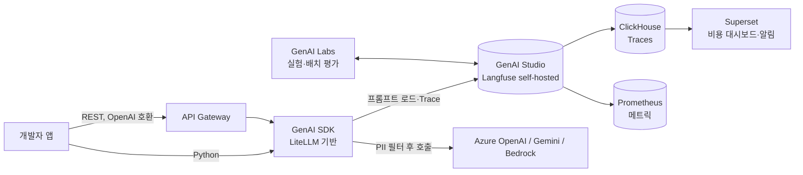

# 우아한형제들 AI플랫폼 2.0 — LLMOps

> [!summary] 한줄요약
> ML 모델 중심의 MLOps(1.0)에서 LLM 호출 중심 환경으로 바뀌며 드러난 운영 문제 8가지를, Langfuse 기반 **Studio** + LiteLLM 기반 **SDK** + OpenAI 호환 **API Gateway** + 자체 개발 **Labs**로 푼 사례.

> [!warning] 출처 상태
> 사용자가 본문을 붙여넣은 것을 기준으로 정리했다. 원문 URL·게시일·저자는 확인하지 못했다(링크를 열어 대조하지 않음). 그림 26장은 캡션만 전달되어 도표의 세부 수치는 모른다. 아래 "내 평가" 절 외의 내용은 모두 글의 주장이다.

## 1. 배경
- AI플랫폼 1.0: ML 모델 개발·배포·운영을 지원하는 MLOps 플랫폼.
- LLM 등장으로 모델을 직접 학습하지 않고 파운데이션 모델 API 호출만으로 프로덕트를 만들 수 있게 됨. 과제의 성격이 바뀜.
  - ML 시대: 데이터 준비, 모델 학습, 재학습 운영
  - LLM 시대: 비용, 지연 시간(latency), 외부 의존성
- 사내에서 1~2년 사이 AI 프로덕트가 10개 이상 만들어졌고, 개발 주체가 DS/MLE에서 PM·프론트엔드·백엔드까지 확대됨.
- 결론: LLM은 "호출"이 아니라 운영·정책·보안까지 포함한 플랫폼 차원의 접근(LLMOps)이 필요하다.

## 2. 운영 중 드러난 8가지 문제
| # | 문제 | 구체적 증상 |
|---|---|---|
| 1 | 멀티 Provider 복잡성 | Azure OpenAI·Gemini·AWS Bedrock의 API 스펙과 크레덴셜이 모두 달라 서비스마다 다른 코드·키 관리 |
| 2 | 프롬프트 관리 한계 | Google 시트, `prompt1.py` 같은 파일에 분산. 어느 버전이 배포본인지 파악 불가, 재현성·협업 저해 |
| 3 | 안정성 | 2025-04 Azure OpenAI East US 장애로 GPT-4 계열 장시간 불가. Gemini는 안전성 필터에 걸리면 `PROHIBITED_CONTENT`로 차단. 다른 리전 재배포 + 트래픽 우회로 대응 |
| 4 | 비용·리소스 관리 | 벤더 콘솔 + 시트 수동 집계. Bedrock에서 모델을 여러 프로젝트가 공유할 때 Application Inference Profile을 수동 관리해야 해 프로젝트별 비용 추적 불가. 클라이언트 타임아웃 후 자동 재시도로 요금 폭증 사례 |
| 5 | 실험 관리 부재 | 프롬프트·실험 결과를 시트에서 관리, 이력 유실. Golden/Evaluation Dataset 구조 없음 → 팀 간 중복 실험 |
| 6 | 새 고객층과 셀프 서비스 | PM·기획자가 UI에서 프롬프트를 수정·실험하길 원하나 환경 부재 |
| 7 | 크레덴셜 발급 허들 | 보안 검토 + 비용 승인을 거쳐야 키 발급 → PoC에서 "첫 호출조차 못 해본다" |
| 8 | 보안·개인정보 | 이름·연락처·계좌번호·주민등록번호가 필터 없이 외부 벤더로 전송될 위험 |

서비스 개발자 인터뷰에서는 두 가지 요구가 우선순위로 나타났다.

- **프롬프트 관리 91%**: 모델 간 비교, 버전별 변경 추적, 변경 이력 메모
- **Trace 수집·가시성(Observability) 45%**

## 3. 해결 전략과 컴포넌트 매핑
| 문제 | 전략 | 컴포넌트 |
|---|---|---|
| 멀티 Provider | 호출·크레덴셜 차이를 표준화한 통합 인터페이스 | API Gateway, SDK |
| 프롬프트 관리 | 중앙 관리, 버전·이력 | Studio |
| 안정성 | Retry/Fallback, Trace 로깅, PII 필터링 | SDK, Studio |
| 비용 관리 | 토큰·비용 기록, 대시보드, 알림 | Studio, Superset |
| 실험 관리 | Golden/Evaluation Dataset 평가, 결과 저장 | Labs, Studio |
| 새 사용자층 | 비개발자 셀프 서비스 | Labs, Studio, SDK |
| 크레덴셜 허들 | PoC 공용 키, 정식 단계 분리 발급 | 거버넌스(프로세스) |
| 보안 | PII 탐지·차단, 공통 정책 | SDK, Studio |

## 4. 컴포넌트 상세

### 4.1 GenAI Studio = Langfuse (self-hosted)
**후보와 탈락 사유(글의 평가)**
- MLflow: 안정적 실험 관리지만 LLM 특화 부족. 프롬프트 기능 제한, 최신 버전 업그레이드와 별도 Gateway 배포 필요.
- PromptFlow: Azure 통합은 좋으나 독립 웹 UI가 없어 대시보드·Trace 뷰어·협업 부족.
- LangSmith: 평가·디버깅 강력하나 LangChain 중심이라 범용성 제한.
- Agenta, Opik: 실험·평가 루프엔 적합, 엔터프라이즈 성숙도(보안·권한·대규모 운영) 부족.
- Pezzo: 프롬프트 관리·API 배포는 유용하나 모니터링·피드백 없음.
- OpenPrompt: 학계용, 로깅·버전·권한 부족.

**Langfuse 선택 이유**

프롬프트 관리와 Trace 기반 Observability가 처음부터 핵심 기능이라는 점을 높게 평가했다.

- **프롬프트**: 텍스트 + 변수 placeholder + config, 라벨/버전 관리
- **관측**: 입력·출력·재시도·지연·비용을 Trace 단위로 기록하고 토큰·비용 대시보드 제공
- **평가·실험**: A/B, 사용자 피드백, 커스텀 평가, 데이터셋 관리
- **통합·운영**: 주요 프레임워크 통합, self-hosted 지원, 오픈소스 생태계

**감수한 부담**: self-host하면 ClickHouse, Redis 같은 운영 컴포넌트가 늘어난다. Langfuse의 확장 아키텍처("From Zero to Scale" 블로그)를 근거로 장기 안정성에서 오히려 이득이라 판단.

**자주 쓰는 4가지 기능**
1. **프롬프트 관리** — 버전 저장·변경 이력·모델 간 비교·롤백, 운영 배포 버전 지정.
2. **Observability** — 요청 Trace로 지연·비용·오류 지점·토큰 확인.
   - 수집·분석은 3계층 파이프라인: Application(Studio가 LLM 응답 수집) → Collection(Traces는 ClickHouse, 서비스·시스템 메트릭은 Prometheus) → 분석·모니터링.
   - 기존 Grafana 서빙 모니터링에서는 평균 응답 시간 변동이 크고 Max에서 클라이언트 타임아웃이 나도 원인을 찾지 못했다. Langfuse 도입 후 모델별 Percentile 분석과 Trace로 병목을 확인했다.
   - ClickHouse + Superset으로 프로젝트별 비용 모니터링·알림.
3. **크레덴셜 관리** — Studio에 provider 키를 등록해 두면 SDK는 Studio 단일 API Key로 프로젝트의 모든 모델 호출. 과거의 AWS Secret Manager/ENV 분산 관리를 대체. 유출 위험 축소, 팀·프로젝트별 사용 추적.
4. **Evaluation** — 사람이 검수한 소규모 고신뢰 **Golden Dataset**(기준선)과 실제 서비스 데이터로 확장한 **Evaluation Dataset**(넓은 커버리지). 실험별 응답 속도·비용·정확도 비교. Manual Annotation, User Feedback, LLM-as-a-Judge.

### 4.2 GenAI SDK
- LiteLLM 기반 단일 인터페이스(모델 이름만 바꿔 호출).
- 라우팅·로드밸런싱·Fallback은 LiteLLM 기능을 그대로 사용, 여러 리전·벤더 간 트래픽 전환.
- 크레덴셜은 Studio 단일 키로 단순화.
- Studio 프롬프트를 불러와 동적 컨텍스트 주입(Context Engineering).
- 호출 전 자체 개발 PII 탐지 모듈을 거침.

### 4.3 GenAI API Gateway
- ML SDK와 GenAI SDK 기능을 내장하고 **OpenAI-Compatible API**로 노출.
- 라우팅·LB·Fallback·Trace·크레덴셜 기능이 SDK와 동일.
- OpenWebUI, Langfuse Playground, LangChain, LlamaIndex를 추가 개발 없이 연동. Non-Python·Web/Mobile도 REST로 사용.

### 4.4 GenAI Labs (직접 개발)
**직접 만든 이유**

- 신기능을 즉시 실험할 수 있는 환경
- 프롬프트·데이터셋·결과를 Studio와 한 흐름으로 연결
- 코드 레벨 Custom Evaluation
- Prompt Variables 기반 Context Engineering

Studio UI만으로는 Context Engineering이 어렵고, 당시 Langfuse Playground가 멀티모달 입력을 지원하지 않았다.

**세 가지 모드**

- **단일 테스트**: Studio 프롬프트 로드, 모델·파라미터, 이미지 입력, 스트리밍
- **배치 실험**: Golden Dataset 연동, 평가 함수·커스텀 로직
- **데이터셋 업로드**: 입력·출력·메타 매핑 후 프로젝트별 Studio 업로드

출력은 응답 속도·비용·스코어.

## 5. 문제별 해결 사례 요약
- **멀티 Provider** → SDK 단일 인터페이스 + Gateway의 OpenAI 호환 API.
- **프롬프트** → Studio 중앙 관리, 운영 배포 버전 안정화.
- **안정성** → SDK Retry/Fallback으로 리전 장애 시 자동 전환, Trace로 구간 분석, 호출 전 PII 차단.
- **비용** → Studio가 토큰·비용 기록 → Superset 팀·프로젝트 리포트·알림(예산 초과, 비정상 패턴, 재시도 폭증 감지).
- **실험** → Labs 결과를 Studio에 자동 저장, 중복 실험 감소.
- **새 사용자층** → Labs/Studio UI로 비개발자 셀프 서비스. 그러나 UI에 내부 개념이 그대로 드러나고 절차가 엔지니어링 관점이라 진입 장벽이 남음 → Langflow, n8n 같은 시각적 워크플로우 도입과 직군별 정책 체계를 고민 중(미해결 과제).
- **크레덴셜** → PoC 전 보안 검토를 거치면 공용 API 키 하나로 여러 벤더 모델을 자유 실험, 정식 과제 전환 시 필요한 모델만 정식 키 발급.
- **보안** → 외부 호출 전 PII 탐지(이름·연락처·계좌번호·주민번호), 포함 시 즉시 차단 + 별도 로그. Studio에서 정책화해 모든 프로젝트에 동일 적용, Trace로 차단·위반 현황 모니터링.

## 6. LLMOps 사이클
- **개발**(Studio+SDK+Gateway): 프롬프트를 Studio에 저장, SDK로 불러 호출, ML Projects 컴포넌트로 프롬프트를 API로 빠르게 개발, 버전·Trace.
- **연구**(Studio+SDK+Labs): 프롬프트·모델 설정 실험, LLM-as-a-Judge·사용자 피드백·수동 라벨링, 결과 기록으로 재현성.
- **운영**(Studio+SDK): 라벨 기반 A/B·배포, Trace 기반 Observability, 축적 데이터를 Golden/Evaluation Dataset으로 정제해 연구 단계로 환류.

## 7. 결과 (글의 수치)
- 2025년 기준 사용자 수 전년 대비 **+50%**, 프로젝트 수 **+69%**.
- LLM 활용에서 DS/MLE 외 직군 비중 **38.3%**(2025).
- 사용자 성장 지수: 2022=100 기준 2023 +625%, 2024 +38%, 2025 +50%.
- 신규 LLM 프로젝트 증가율: 2023 대비 2024 +333%, 2025 +633%. 2025년엔 다수가 배포(Deployed) 단계, 개발 중 비중도 큼.
- 정성: Observability·보안·안정성 확보, 개발·배포 표준화·자동화.

## 8. 내 평가 (글의 주장이 아닌 해석)
> [!note] 수치 불일치
> 프로젝트 증가를 본문 요약은 "+69%"로, 차트 설명은 "+333%, +633%"로 적는다. 정의(누적 대 전년비, 분모)가 달라 보이나 글만으로는 알 수 없다. 사용자 성장 지수 "2023년 625%"도 전년 대비 증가율인지 지수값인지 모호하다. 그대로 인용하지 말고 원문 도표를 확인할 것.

- **강점**: 문제 8개를 컴포넌트에 1:1로 매핑한 구조가 명확하고, 조직 변화(비개발 직군 확대)와 거버넌스(크레덴셜 정책)를 기술 구성과 함께 다룬다. 후보 솔루션 비교와 탈락 사유가 구체적이다.
- **한계/비어 있는 부분**: PII 탐지 모듈의 방식·오탐률·지연 영향, 한국어 주민번호 등 패턴 외 문맥 PII 처리, Gateway 장애 시 단일 장애점 여부, 캐싱·레이트리밋·예산 한도 강제, 프롬프트 인젝션 방어, Langfuse 운영 규모(트래픽, ClickHouse 스케일)는 글에 없다. 효과 수치는 내부 사용량 지표뿐이고 비용 절감·장애 감소 같은 운영 성과 지표는 없다.
- **LLM-as-a-Judge**는 평가 방식으로만 언급되고 편향·신뢰도 검증은 다루지 않는다. 관련: [[jev-as-a-judge-agent-evals]], [[ragas]].
- 같은 층위의 다른 사례와 비교하면 게이트웨이 선택(LiteLLM 계열 vs Envoy AI Gateway)이 다르다: [[inflab-ai-gateway]].

## 10. 관련 노트
[[inflab-ai-gateway]] · [[jev-as-a-judge-agent-evals]] · [[ragas]] · [[gepa]] · [[classifier-dev]]

## 11. 출처
- 사용자가 붙여넣은 우아한형제들 AI플랫폼팀의 글 전문 (원문 URL 미확인).
- 글이 인용한 외부 자료(직접 열지 않음): Application Inference Profile(AWS 문서), Langfuse "From Zero to Scale: Infrastructure Evolution", "Observability in Multi-step LLM Systems", Langfuse Evaluation overview, "A Survey of Context Engineering for LLMs"(Mei et al., 2025), McKinsey 블로그.
