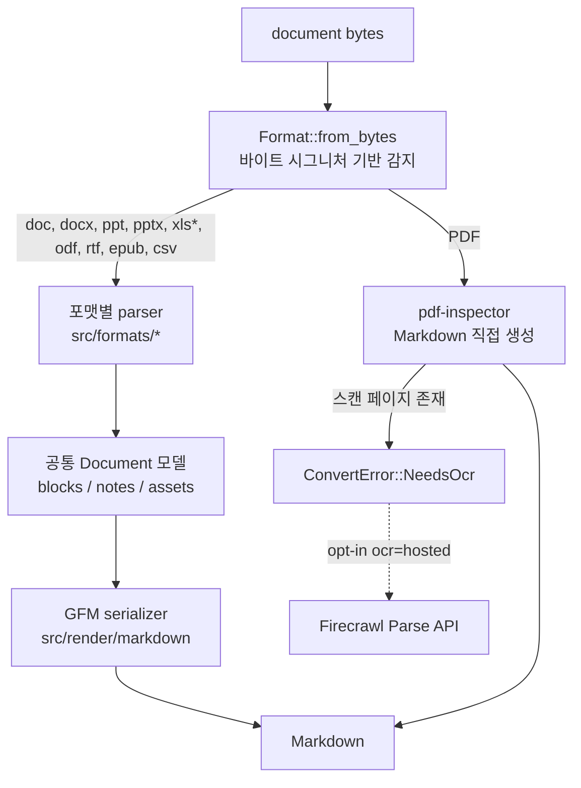

# anydoc

> [!summary] 한줄요약
> Firecrawl이 만든 순수 Rust 문서 변환 라이브러리로, Word/PowerPoint/Excel/OpenDocument/RTF/EPUB/CSV/PDF를 ML 모델 없이 "포맷별 parser -> 공통 Document 모델 -> 단일 GFM serializer" 경로로 Markdown으로 바꾼다. 벤더 벤치마크상 문서당 median 4.4ms. 스캔 PDF는 OCR 대신 `NeedsOcr` 에러로 돌려주며, 생성 2개월짜리 신생 프로젝트다.

## 배경 / 해결하는 문제

LLM·RAG 파이프라인에서 가장 먼저 부딪히는 문제는 입력 문서가 너무 다양하다는 점이다. 사내에는 2003년식 `.doc`, 병합 셀이 가득한 `.xls`, 발표용 `.pptx`, 매뉴얼 `.pdf`, 전자책 `.epub`이 섞여 있고, 포맷마다 파서도 다르고 출력 Markdown의 표·목록·각주 처리도 제각각이다. 기존 선택지는 크게 세 갈래였다. (1) LibreOffice headless로 HTML을 뽑고 pandoc으로 변환(정확하지만 프로세스 기동이 무겁고 느림), (2) `unstructured`/`docling` 같은 ML 기반 파이프라인(무겁고 수 GB 의존성), (3) 포맷별 전용 라이브러리를 이어붙인 가벼운 도구([[markitdown]] 등, 포맷마다 품질 편차).

anydoc의 문제의식은 README 표현 그대로 "어떤 포맷이 들어와도 하나의 일관된 출력"이다. 포맷마다 파서는 따로 두되 모두 같은 중간 표현(Document 모델)으로 내리고 Markdown 직렬화는 한 곳에서만 한다. 그래서 표 이스케이프 버그를 한 번 고치면 docx/rtf/odt 전부에 적용된다는 것이 설계 논리다. Firecrawl이 자사 상용 서비스(Firecrawl Parse)의 변환 엔진으로 쓰는 코드를 MIT로 공개한 것으로, README가 "It powers Firecrawl Parse"라고 직접 밝힌다.

## 동작 원리 / 아키텍처

핵심 흐름은 README의 "How it works" 절과 `src/lib.rs`로 확인했다.



**포맷 감지.** `Format::from_bytes`는 확장자를 보지 않고 PDF 헤더, RTF의 여는 그룹, OLE 스트림 이름, ZIP 패키지의 mimetype/content types를 본다. 확장자가 틀린 파일도 제대로 변환되며, 시그니처가 없는 CSV만 확장자나 명시적 `Format::Csv`가 필요하다. `to_markdown(path)`는 내용 감지를 먼저 하고 실패하면 확장자로 폴백한다(`src/lib.rs`).

**Document 모델.** `src/model/`은 정보 보존형 중간 표현이다. `Block`은 Heading(레벨, anchor, 인라인), Paragraph, List, Table, BlockQuote, CodeBlock, Rule, Math(LaTeX)로 구성된다. `Document`는 본문 `blocks`, 각주/미주 `notes`, 임베디드 `assets`(바이트와 media type)를 가진다. 포맷 프런트엔드가 스타일 캐스케이드·번호 매기기·참조를 모두 해소한 뒤 모델을 만들기 때문에 serializer는 단순하다. 표는 병합 셀을 포함한 grid(`table.rs` 495줄)로 표현된다.

**Serializer.** `src/render/markdown/`(escape, inline, table, anchors)가 GFM을 만든다. 병합 셀 표, 제목 anchor(문서 내 링크 대상), 각주, LaTeX 수식(`$...$`, `$$`)을 처리한다. PDF만 예외로 Document 모델을 거치지 않으며, `to_document()`는 PDF에 대해 미지원이라고 코드 주석에 명시돼 있다.

**PDF 경로.** `src/formats/pdf.rs`(52줄)는 같은 조직의 `pdf-inspector` 크레이트(Cargo.toml에서 1.14.2)를 호출해 분류와 Markdown 추출을 맡긴다. 특이한 설계 결정은 스캔/이미지 전용 페이지가 한 장이라도 있으면 일부가 빠진 결과를 완전한 것처럼 내보내지 않고 `NeedsOcr { pages, page_count }`로 실패시킨다는 점이다. 코드 주석의 이유는 "누락 페이지가 있는 출력은 완전해 보이기 때문"이다. v0.2.4 릴리스 노트에는 이전에 스캔 페이지가 조용히 빠졌다고 쓰여 있어 실제로 한 번 고친 문제다. RAG 인제스트에서는 조용한 누락(silent drop)보다 바람직한 동작이다.

**안전 한계.** `src/package/limits.rs`에는 고정 상수가 있다. 엔트리 1개 압축 해제 128MiB, 아카이브 합계 512MiB, 엔트리 수 10만, XML 중첩 256, XML 노드 200만, 스프레드시트 grid 400만 슬롯, 임베디드 에셋 총 128MiB 등이다. 주석은 "공격·남용 입력(decompression bomb 등)에 대한 하드 캡이며 의도적으로 설정 불가"라고 말한다. 초과하면 `ResourceLimit` 에러. 신뢰할 수 없는 업로드 문서를 받는 서비스에서 중요한 속성이다. `fuzz/`에는 csv/doc/docx/epub/numfmt/odf/pdf/ppt/rtf/xls/xlsb/xlsx용 cargo-fuzz 타겟이 있고, `tests/robustness.rs`가 모든 fixture를 변이 테스트한다고 README가 설명한다.

## 핵심 기능 상세

- **지원 포맷(README 표):** Word(.doc/.docx/.docm), PowerPoint(.ppt/.pps/.pot/.pptx/.pptm/.ppsx/.ppsm), Excel(.xls/.xlsx/.xlsm/.xlsb), OpenDocument(.odt/.ods/.odp), RTF, EPUB, CSV, PDF. 레거시 바이너리(.doc/.ppt/.xls)를 OLE(`cfb` 크레이트)로 직접 파싱하는 코드가 있다(`src/formats/doc/`, `ppt/`, `sheet/xls.rs` 1,307줄, `xlsb.rs` 899줄). LibreOffice 없이 .doc/.ppt/.xls를 읽는 점이 차별점이다.
- **문서 구조 보존:** 제목+anchor, 굵게/기울임/취소선, 인라인 코드·코드블록, 링크와 내부 상호참조, 소스 고유 번호를 유지하는 중첩 리스트와 체크리스트, 병합 셀·헤더 행 표, 인용, 각주/미주, 발표자 노트.
- **수식:** OMML(Word/PowerPoint), MathML(ODF/EPUB), RTF 수식을 LaTeX로 변환.
- **스프레드시트 숫자 서식:** `sheet/numfmt.rs`(1,328줄)가 엑셀 셀 서식(날짜·통화·퍼센트·분수·과학 표기·경과시간·조건 섹션)을 해석한다. fuzz seed도 `numfmt/` 아래 currency, datetime, fraction 등으로 따로 있다.
- **에셋:** 이미지는 Markdown에서 alt text로만 나오고 원본 바이트는 `Document.assets`에 media type과 함께 남는다. 외부 URL 이미지는 일반 Markdown 이미지로 나온다.
- **바인딩:** Node(libuv thread pool에서 실행, 이벤트 루프 비차단), Python(GIL 해제, maturin 빌드), WASM(`@firecrawl/anydoc-wasm`, 브라우저 데모는 로컬 변환이라 파일이 외부로 안 나간다고 README가 명시), Rust 크레이트, CLI.
- **에러 타입:** `Unsupported`/`NeedsOcr`/`Malformed`/`Encrypted`/`ResourceLimit`/`MissingPart`/`Io`. Node는 `error.code`, Python은 서브클래스. CLI exit code는 0 성공, 1 변환 불가, 2 사용법 오류, 3 OCR 필요(SKILL.md).
- **Agent Skill:** `skills/convert-documents-to-markdown/SKILL.md`가 에이전트에게 `npx -y @firecrawl/anydoc <file> -o out.md` 사용 규칙(큰 문서는 파일로 쓰고 필요한 부분만 읽기 등)을 가르친다. Claude Code, Codex, Cursor, OpenCode 호환이라고 README가 적는다.

## 설치 · 사용법

```bash
# 에이전트 스킬로 설치
npx skills add firecrawl/anydoc

# CLI (첫 실행 시 플랫폼별 prebuilt 바이너리 다운로드)
npx @firecrawl/anydoc report.docx               # stdout
npx @firecrawl/anydoc slides.pptx -o slides.md  # 파일로
npx @firecrawl/anydoc - --format csv < data.csv # stdin
npm install -g @firecrawl/anydoc                # 영구 설치

# 라이브러리
npm install @firecrawl/anydoc
pip install firecrawl-anydoc
cargo add anydoc
```

```python
import anydoc
md = anydoc.to_markdown("report.docx")
md = anydoc.to_markdown_bytes(data)          # 바이트에서 포맷 자동 감지
md = anydoc.to_markdown_bytes(data, "csv")   # CSV는 포맷 명시
doc = anydoc.to_document(data)               # 자산 포함 Document 모델
```

```rust
match anydoc::to_markdown(path) {
    Ok(md) => Some(md),
    Err(e @ (ConvertError::Encrypted | ConvertError::Unsupported(_) | ConvertError::NeedsOcr { .. })) => {
        unconverted.push((path, e)); None   // 변환 불가 파일은 기록하고 다음 파일로
    }
    Err(e) => return Err(e),
}
```

OCR은 선택 사항이다. `anydoc scan.pdf --ocr hosted` 또는 `toMarkdown('scan.pdf', { ocr: 'hosted' })`. README에 따르면 OCR이 필요한 문서 전체(페이지 선택 불가)가 Firecrawl Parse로 전송되며 가입 없이 쓸 수 있고 `FIRECRAWL_API_KEY`로 한도를 올린다. `--api-url`/`FIRECRAWL_API_URL`로 다른 Parse 배포를 가리킬 수 있다. Rust 크레이트에는 ocr 옵션이 없고 네트워크 호출도 하지 않는다. 소스 빌드 요구사항은 Cargo.toml 기준 Rust 1.88 / edition 2024.

## 디렉터리 · 코드 구조에서 확인한 것

- `src/`: `formats/`(doc, docx, epub, odf, pdf, ppt, pptx, rtf, sheet, csv, detect), `model/`, `package/`(zip 아카이브·관계·XML·안전 한계), `render/markdown/`, `shared/`(drawingml, fields, assets 등 포맷 간 공유 로직). 합계 약 2.4만 줄 Rust.
- 의존성(Cargo.toml): `cfb`(OLE), `csv`, `flate2`, `encoding_rs`(레거시 코드페이지 처리용으로 보이나 한국어 인코딩 동작은 직접 검증 못함), `quick-xml`, `zip`, `pdf-inspector`, `log`. ML 런타임 의존성 없음.
- `bench/`: 벤치 하네스(convert.py, judge.py, metrics.py, report.py). 코퍼스는 재배포 불가라 레포에 없어 외부 재현이 불가능하다.
- `tests/`: fixtures(abuse, malformed 포함)와 insta 스냅샷. `fuzz/`: 포맷별 퍼즈 타겟. `examples/`: convert.rs/.mjs/.py.
- 릴리스: v0.2.1~v0.2.4 노트가 `.github/releases/`에 있고, v0.2.4(2026-08-27)가 스캔 페이지 보고와 hosted OCR을 추가했다.

## 비교 대상

| 항목 | anydoc | [[markitdown]] | docling / unstructured | LibreOffice+pandoc |
|---|---|---|---|---|
| 언어/런타임 | Rust, ML 없음 | Python | Python, ML·무거운 의존성 | 외부 프로세스 |
| 레거시 .doc/.ppt | 직접 지원 | README 벤치표상 해당 칸 "-" | unstructured 일부 | 지원 |
| PDF | pdf-inspector, 텍스트 PDF만 | 별도 라이브러리 | 레이아웃/OCR 모델 | 부적합 |
| OCR | hosted(opt-in) | plugin / Azure | 내장 가능 | 없음 |
| 브라우저 실행 | WASM 가능 | 불가 | 불가 | 불가 |

README의 자체 벤치마크(100개 실문서, 14개 포맷, LLM judge로 Claude Sonnet 5 사용, 위치 편향 상쇄를 위해 순서를 바꿔 2번씩 판정해 482 verdict)에서 anydoc은 포맷 커버리지 14/14, median 4.4ms, 평균 점수 81이다. markitdown은 6/14 포맷, 134.8ms, 점수 65이고 LibreOffice는 1129.5ms, 점수 40이다. 포맷별로는 docx 88 대 71(markitdown), pptx 74 대 66, xlsx 72 대 55로 표에 나온다. 이 수치는 벤더 자체 측정(Ryzen 9 9950X3D, Windows 11)이며 코퍼스가 비공개라 독립 재현은 불가능하다. 평균 점수가 도구마다 다른 포맷 집합 위에서 계산돼 포맷별 표가 공정한 비교라고 README 스스로 단서를 단다. 또한 README의 포맷별 표에는 csv와 xlsb 행이 없어 "14개 포맷" 서술과 표(13행)가 정확히 맞지는 않는다.

## 장단점 · 한계 · 성숙도

사실(GitHub API, 2026-10-01 조회): Stars 22,312, Forks 1,412, 라이선스 MIT, 주 언어 Rust, 생성 2026-08-03, 마지막 push 2026-08-28, 최신 릴리스 v0.2.4(2026-08-27). open_issues_count는 103(PR 포함 수치). 열린 이슈 샘플에는 PPTX 이미지 누락(AlternateContent), mobi 지원 요청, ligature 처리, RTL 텍스트 추출 수정 등이 보여, 포맷별 엣지 케이스가 아직 활발히 발견·수정되는 단계다. 기여자 수는 API상 5로 스타 대비 코어 기여자가 매우 적다(Firecrawl 팀 중심).

장점은 극도로 빠르고 가볍다는 점, 단일 바이너리/WASM으로 배포 가능하다는 점, 레거시 오피스 포맷을 직접 파싱한다는 점, 악성 입력 대비 하드 캡과 fuzz, 에러를 명시적으로 분류해 조용한 누락을 막는다는 점, Agent Skill 동봉이다.

한계는 다음과 같다. (1) OCR이 없다. 스캔 PDF는 hosted Parse로 보내야 하는데 이는 문서 전체가 외부로 나간다는 뜻이다. (2) PDF 품질은 pdf-inspector에 전적으로 의존하며, 복잡한 레이아웃·표·다단 PDF 품질은 검증하지 못했다. bench/README도 PDF는 벤치 범위 밖이라고 적었다. (3) 한국 사내 문서의 상당수인 `.hwp`/`.hwpx`는 지원 포맷에 없다. 한글 PDF 품질도 확인 못함. (4) 이미지·도형 안 텍스트는 alt text 수준. (5) 생성 2개월, v0.2.x라 API 안정성이 보장되지 않는다.

## 보안 · 라이선스 · 운영 리스크

- MIT 라이선스. Rust 메모리 안전성 + 고정 리소스 캡 + fuzz는 장점이나 의존 크레이트 취약점은 별도 점검하지 않았다.
- `--ocr hosted`를 켜면 문서 전체가 Firecrawl 서버로 전송된다. 사내 문서·개인정보 포함 문서에서는 켜지 말 것. 기본값(로컬 전용)은 외부 호출이 없다.
- `npx @firecrawl/anydoc`는 첫 실행 시 prebuilt 바이너리를 내려받는다. 폐쇄망·공급망 정책이 있는 환경에서는 버전 고정, 사설 레지스트리 미러링, 또는 Rust 소스 빌드가 필요하다. 패키지명(`@firecrawl/anydoc`, `firecrawl-anydoc`)은 공식 README 기준으로만 설치할 것.
- 벤더 오픈소스 특성상 상용 서비스(Parse)로의 유도(OCR)가 설계에 들어 있음을 인지할 것.

## 관련 노트

- [[markitdown]] — 가장 직접적인 대체재, 포맷별 품질·속도 비교 대상
- [[opendataloader-pdf]] — 스캔/복잡 PDF 처리 보완재
- [[pageindex]] — 변환된 Markdown을 트리 인덱스로 쓰는 후단 RAG 방식

## 출처

- https://github.com/firecrawl/anydoc — README 전문, Cargo.toml, src/lib.rs, src/formats/pdf.rs, src/error.rs, src/package/limits.rs, src/model/*, skills/convert-documents-to-markdown/SKILL.md, bench/README.md, .github/releases/v0.2.4.md (클론하여 열람, 2026-10-01)
- GitHub REST API: repos/firecrawl/anydoc, /releases, /issues, /contributors (2026-10-01)

확인 못한 것: 한국어/CJK 문서 변환 품질, pdf-inspector 내부 품질, 벤치마크 재현, 독립 제3자 평가, hosted OCR의 데이터 보존 정책.
