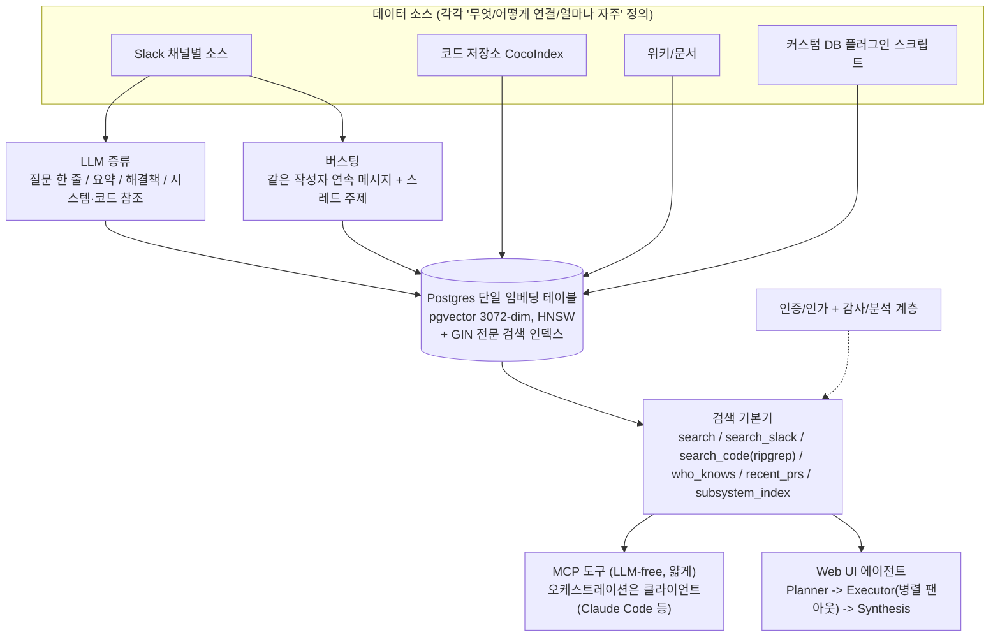

# 하루 15,000개 질문에 답하는 Cerebras 사내 지식 베이스

> [!summary] 한줄요약
> Cerebras가 공개한 사내 KB "Cerebras Knowledge"의 설계 사례(원문 + PyTorchKR 9bow의 한국어 해설). 모든 소스(Slack, 코드, 문서, 커스텀 DB)를 Postgres 임베딩 테이블 하나(pgvector 3,072차원 + HNSW)에 모으고, 전문 검색 + 임베딩 + IDF + 시간 감쇠를 RRF(k=60)로 융합한 뒤 0~10점 reranker와 문맥 확장을 거치며, 검색 기본기를 얇은 MCP 도구로 노출한다. 구현체는 공개되지 않았고 수치는 Cerebras 자체 주장이다.

> [!note] 출처 열람 상태
> PyTorchKR 해설글은 렌더링 후 전문을 읽었다. 해설글은 말미에서 "GPT 모델로 정리한 글이라 원문과 다를 수 있다"고 스스로 밝힌다. Cerebras 원문(cerebras.ai/blog/how-we-built-our-knowledge-base)은 일반 요청에서 HTTP 500 응답을 돌려주었지만 응답 본문에 기사 데이터(Next.js 페이로드의 본문 블록과 인라인 SVG 도표)가 실려 있어 그 텍스트를 읽을 수 있었다. 봇 차단 챌린지는 아니었고 우회 시도는 하지 않았다. 원문 게시일은 페이지에서 확인하지 못했다. 해설글 게시: 2026-07-20T21:30Z(PyTorchKR 표기 7월 21일, 조회 1,354 시점).

## 배경 / 해결하는 문제

Cerebras는 웨이퍼 스케일 AI 가속기 회사로, 데이터센터 운영, 칩 설계, 하드웨어, 학습, 추론, 클라우드 플랫폼 팀이 함께 일하고 매년 수백 명이 합류한다. 원문에 따르면 사내 채널은 "X는 어디서 찾나요", "Y 전문가가 누구죠", "Z가 뭐죠" 같은 같은 질문으로 채워졌고, 답을 아는 사람이 자리를 비우면 정보 흐름이 막혔다. 그래서 만든 Cerebras Knowledge는 사람과 시스템이 유용한 정보에 연결되도록 돕는 도구이며, 공개 3개월 만에 하루 15,000건 이상의 질문을 받는 가장 널리 쓰이는 내부 도구 중 하나가 됐고 사람뿐 아니라 자동화 스크립트와 에이전트도 쓴다고 한다.

설계 철학의 첫 줄은 "데이터가 있는 곳에서 데이터를 만난다(Meeting data where it lives)"다. 분기마다 누군가는 모든 것을 한 플랫폼에 기록하자는 "single source of truth"를 제안하지만 현실에서는 거의 작동하지 않는다고 원문은 말한다. 정보는 가장 편한 곳에서 생기고(Google Docs의 제안 수정, Slack 스레드, GitHub 코드 참조, Jira 상태 메타데이터), PR 논의를 Google Docs에서 하는 건 끔찍한 경험이다. 그래서 사람의 행동을 바꾸지 않고 각 플랫폼에서 데이터를 직접 추출한다. 한국 기업 환경에도 그대로 적용되는 관점이다(메신저, 그룹웨어, Jira, Git, 위키가 흩어져 있다).

## 동작 원리 / 아키텍처



**테이블 하나.** 원문 핵심은 "임베딩, 원본 요약(raw summaries), 메타데이터를 담는 단일 Postgres 테이블"이다. Slack 스레드부터 넷리스트(netlist)까지 모든 소스가 같은 임베딩 테이블에 안착하고, 그 안의 무엇이든 같은 인터페이스로 즉시 질의된다. 각 데이터 소스는 데이터가 무엇인지, 어떻게 연결하는지, 얼마나 자주 가져올지를 정의한다. 원문의 인라인 도표에는 "PGVECTOR - 3072-DIM - HNSW"와 "One consistent record, 3,072 dimensions"라는 표기가 있고, 해설글은 이를 풀어서 pgvector 확장으로 3,072차원 벡터를 저장하고 HNSW 인덱스로 근사 최근접 탐색을 한다고 쓴다. 검색 상태와 임베딩 저장소가 같은 DB에 있어 뒤의 여러 결정이 단순해진다는 것이 요지다. 다른 개발자가 커스텀 커넥터를 직접 만들 수 있게 한 것도 의도된 설계 목표였다.

**Slack 수집(가장 까다롭고 중요).** 원문은 Slack 메시지의 어려움을 셋으로 정리한다. 정보 밀도 편차("hey yeah sure mike"와 상세한 커널 설명이 똑같이 한 메시지), 길이 편차(짧은 메시지가 코사인 유사도에서 긴 메시지를 자주 이김), 주변 맥락 의존. 해결은 한 가지 점수에 의존하지 않는 하이브리드다. (1) 전문 검색: 에러 문자열, 플래그 이름, 호스트명처럼 임베딩이 뭉개는 정확한 토큰. (2) 임베딩 검색: "restore hangs after manifest load"와 "checkpoint stalls on the NFS mount"처럼 어휘를 공유하지 않는 paraphrase 연결. (3) IDF: 희귀 토큰 중심의 짧은 메시지는 올리고 "sounds good, thanks!"는 임베딩 공간에서 많은 질의와 가까워도 용어 희소성을 고려하면 0에 수렴. (4) 시간 감쇠: 6개월 전 스레드는 이미 사라진 인프라를 설명할 수 있으므로 동률이면 최신 우선. 이 네 신호는 각자 순위 목록을 만들고 질의 시점에 RRF로 융합된다.

**실시간 수집(Socket Mode).** Slack 봇을 Socket Mode로 실행해 영속 WebSocket으로 모든 메시지 이벤트를 받는다(Web API 폴링과 rate limit 소진 회피). 이벤트는 즉시 ack하고 안정적인 event ID로 중복 제거한 뒤 ingest consumer가 처리한다. consumer는 메시지를 고립 저장하지 않고 소속 스레드의 전체(부모 + 모든 답글)를 Slack API에서 다시 가져와 스레드 전체를 한 행으로 다시 쓴다. 따라서 저장된 콘텐츠, 참여자 목록, 마지막 활동 시각이 항상 완전한 대화 상태를 반영한다. Slack 채널마다 별도 데이터 소스라서 바쁜 인시던트 채널만 더 자주 수집하는 신선도 튜닝이 가능하다.

**LLM 증류(distillation).** 원본 텍스트는 Postgres 전문 검색(GIN) 인덱스 덕분에 도착 즉시 키워드 검색이 되지만, 벡터 검색용으로는 LLM이 스레드 전체에서 (a) 엔지니어가 실제로 검색할 한 줄 질문, (b) 짧은 요약, (c) 해결책, (d) 언급된 시스템·코드 참조를 추출한다. 이 데이터 포인트를 임베딩하고 원본 transcript는 직접 임베딩하지 않는다. "스레드를 일관된 형식으로 정규화했을 때 정확도가 크게 올랐다"는 것이 원문의 주장이다(구체 수치는 원문에 없음).

**버스팅(bursting).** 증류 후에도 긴 스레드 속 중요한 메시지가 스레드 수준 요약에 안 담히는 문제가 남았다. burst는 같은 작성자의 연속 메시지 묶음이고, 스레드 주제를 앞에 붙여 개별 burst를 임베딩한다(Anthropic의 Contextual Retrieval과 같은 문제의식, 원문 참고문헌 2). 저신호 데이터를 막기 위해 가중 신호 점수가 임계값을 넘어야 임베딩된다. 조건은 코퍼스 내 IDF 4.0 이상의 희귀 토큰 포함, 결합 길이 200자 이상, 하나 이상의 메시지에 리액션 존재(사회적 가중치)다.

**코드 저장소(CocoIndex).** 팀은 "grep is all you need" 시대에 코드 임베딩이 필요한지 논쟁했지만 업계 대화와 Cursor의 대규모 코드베이스 시맨틱 검색 연구를 보고 시도했다. 40GB가 넘는 저장소도 있어 최신 상태 유지가 관건이었고, 코드베이스 벡터화에 특화된 오픈소스 CocoIndex를 선택했다. 언어별 정규식 경계를 굵은 것에서 미세한 것으로 정렬해(클래스 -> 메서드 -> 더 작은 블록) 분할하고, 한 파일이 파일 수준과 함수 수준 등 여러 임베딩을 낳을 수 있다. CocoIndex는 동기화 메타데이터를 Postgres에 추적해 커밋마다 바뀐 청크만 재임베딩한다. 동기화 상태와 임베딩 저장소가 같은 DB라는 점이 특히 잘 맞았다고 한다. 저장소 온보딩은 팀이 직접 제출하는 설정 파일(파일 경로 allowlist/denylist 포함)로 옮겼다.

**커스텀 소스 = 플러그인 스크립트.** 자체 DB를 가진 팀은 데이터를 옮기고 싶어 하지 않았다. 팀이 자기 시스템에서 읽어 임베딩 테이블 스키마의 행을 내보내는 작은 Python 모듈과 데이터 소스 항목을 PR로 제출하면, 공유 DB에 같은 스키마로 쓰기만 하면 나머지 스택은 변경 없이 동작한다.

**질의 처리: Planner -> Executor -> Synthesis.** 모든 질의에서 먼저 짧은 계획 단계를 돌려 LLM이 어떤 도구와 소스가 중요할지 정한다. 주요 도구는 `subsystem_index`(파일별 LLM 요약), `search`(Slack, 위키, 코드 등을 아우르는 통합 벡터 파이프라인, 내부에서 병합·재순위), `search_slack`(직접 Slack 검색), `search_code`(소스 저장소 ripgrep), `recent_prs`, `who_knows`(주제별 입증된 전문성이 있는 사람)다. 계획기는 "어떤 프로젝트가 있고 각 소스가 어떤 질문에 강한지"의 압축 설명을 보고 도구를 고르며, executor가 병렬 팬아웃해 공통 증거 형식으로 정규화한 뒤 종합 LLM에 넘긴다. `who_knows`가 "Y 전문가가 누구냐"는 질문에 직접 답한다는 점이 단순 문서 검색을 넘는 차별점이라고 해설글이 강조한다.

**재순위.** 어휘만 겹치고 다른 질문에 답하는 문서가 위로 뜨는 문제를 줄이기 위해 먼저 RRF로 검색기별 호환되지 않는 목록을 합친다. 공식은 score(d) = sum_L w / (k + rank_L(d)), w = 1.0, k = 60. 평활화 상수 덕에 한 검색기의 1위보다 여러 검색기 상위권 합의가 이길 수 있다. 이후 중복 청크를 소스 단위로 병합하고 파일당 기여 결과 수에 상한을 둬 더 다양한 상위 20개를 만든 다음, 원 질의와 후보를 작은 reranker 모델에 보내 각 문서에 0~10점을 매겨 상위 10개를 남긴다. 순위가 확정된 뒤에야 승자에게 문맥을 되돌린다(예: 위키 섹션이 매칭되면 인접 두 섹션을 함께 가져와 제목·전제조건·주의사항이 잘려 나가지 않게 함). 따라서 `search`의 출력은 융합 -> 소스 중복 제거 -> 질문 기준 재순위 -> 문맥 확장을 거친 증거 묶음이다.

**MCP vs Web UI.** MCP에서는 검색 기본기를 "이 질문에 답하라"는 단일 엔드포인트 뒤에 숨기지 않고 직접 호출 가능한 도구로 노출한다. 도구는 일부러 단순하고 가능한 한 LLM-free이며 입출력은 좁고 구조화되고 안정적이다. 대부분 하나의 질의 파이프라인(벡터, 어휘, ripgrep)을 돌려 경량 채점 휴리스틱을 적용하고 원본 증거 행을 반환한다. 오케스트레이션 엔진은 Claude Code 같은 MCP 에이전트다. 반면 Web UI는 같은 도구를 planner -> executor -> synthesis 파이프라인에 연결해 인용·주의사항이 포함된 최종 답을 낸다. 같은 검색 계층을 두 방식으로 노출하는 셈이다.

**프로젝트(범위 지정).** "모든 걸 모든 곳에서 검색"은 코퍼스가 커지며 쓸모없어졌다(컴파일러 엔지니어는 인프라 런북을 원치 않음). 프로젝트는 특정 Slack 채널, 저장소, 내부 DB, 문서 공간의 이름 붙은 묶음이며 같은 소스를 복제 없이 여러 프로젝트가 참조할 수 있다. 온보딩에서 기본 프로젝트를 고르게 하고 사용자 프로필에 저장해 질의를 자동으로 범위 지정한다.

## 핵심 기능 상세 (교훈 정리)

1. **벡터 단독으로는 부족하다.** 전문 검색 + 임베딩 + IDF + 시간 감쇠의 순위를 RRF로 융합한다. IDF와 시간 감쇠는 임베딩이 못 보는 "희소성"과 "신선도"를 보충한다.
2. **임베딩 전에 LLM으로 구조화한다.** 질문/요약/해결책/참조로 증류한 정규화 문서를 임베딩한다. 해설글은 LLM이 이해하기 좋은 데이터 형식 비교 연구와 Anthropic의 XML 태그 권고를 관련 읽을거리로 연결한다.
3. **한 DB에 모은다.** 임베딩, 전문 검색 인덱스, 동기화 상태, 메타데이터를 Postgres 하나에 두어 증분 동기화(CocoIndex)와 운영이 쉬워진다.
4. **검색은 얇은 도구로, 오케스트레이션은 에이전트로.** MCP 도구는 LLM-free 기본기, 지능은 클라이언트에.
5. **범위(project) 설정이 관련성을 만든다.** 코퍼스가 커지면 필터링 단위(프로젝트)가 필수다.
6. **원문에 정량 평가가 거의 없다.** 15,000건/일, 3개월, 40GB+ 저장소, IDF 4.0, 200자, k=60, 0~10점, 상위 20 -> 10 외에는 정확도·지연·비용 수치가 없다. 해설글이 "구체적인 수치와 함께 공개했다"고 소개하지만 이는 이런 설정값을 뜻하며 품질 벤치마크는 아니다.

## 설치 · 사용법

이 글은 설계 사례이며 구현 코드·패키지·설정 스키마는 공개되지 않았다(원문과 해설 어디에도 저장소 링크 없음). 다만 사용된 요소를 이어 붙이면 사내에서 재현할 최소 골격은 다음과 같다. 아래는 원문 설명을 바탕으로 한 개념 예시이며 Cerebras의 실제 스키마가 아니다.

```sql
-- 개념 예시: 단일 임베딩 테이블 (실제 스키마는 비공개)
CREATE EXTENSION IF NOT EXISTS vector;
CREATE TABLE kb_chunk (
  id bigserial PRIMARY KEY,
  source_id text NOT NULL,          -- 데이터 소스(채널/저장소/문서 공간)
  project_ids text[] NOT NULL,      -- 범위 지정용
  kind text NOT NULL,               -- thread / burst / code / wiki ...
  content text NOT NULL,
  summary jsonb,                    -- 증류 결과: question / summary / resolution / refs
  embedding vector(3072),
  last_activity timestamptz,
  tsv tsvector GENERATED ALWAYS AS (to_tsvector('simple', content)) STORED
);
CREATE INDEX ON kb_chunk USING gin (tsv);
-- pgvector HNSW는 일반적으로 2,000차원 초과 vector 컬럼을 직접 인덱싱하지 못한다는 제약이 있으므로
-- 3072차원을 쓰려면 halfvec 캐스팅 인덱스 등을 확인해야 한다 (pgvector 문서에서 확인 필요, 이번에 검증하지 않음)
```

```python
# RRF 융합 (원문 공식: w=1.0, k=60)
def rrf(rank_lists, k=60, w=1.0):
    score = {}
    for lst in rank_lists:                  # 전문검색/임베딩/IDF/시간감쇠 등 각 순위 목록
        for rank, doc in enumerate(lst, 1):
            score[doc] = score.get(doc, 0) + w / (k + rank)
    return sorted(score, key=score.get, reverse=True)
```

## 디렉터리 · 코드 구조에서 확인한 것

저장소가 없으므로 해당 사항 없음. 대신 글의 구조적 요소를 확인했다. 원문은 Sanity CMS 기반 Next.js 블로그이며 도표(전체 계층, 소스 -> 임베딩 테이블, Slack Socket Mode 흐름, 증류, 버스팅, 코드 청킹, 질의 처리, RRF 병합, MCP 대 Web UI, 프로젝트 공유 참조)는 인라인 SVG로 들어 있다. 원문 참고문헌은 HNSW 논문(Malkov & Yashunin), Anthropic Contextual Retrieval(2024), RRF 원 논문(Cormack et al., SIGIR 2009), Search-o1(arXiv:2501.05366), Anthropic Code Execution with MCP(2025), Lost in the Middle(arXiv:2307.03172), Anthropic Use XML Tags, Slack AI 엔지니어링 글, "Best Nested Data Format", Cursor의 시맨틱 검색 글 등 10건이다.

## 비교 대상

| 항목 | Cerebras KB | 일반적인 RAG 챗봇 | [[graphify]] | [[pageindex]] |
|---|---|---|---|---|
| 저장소 | Postgres 단일 테이블 + pgvector | 별도 벡터 DB | 파일 기반 knowledge graph | 문서 트리 인덱스 |
| 검색 | 전문 + 벡터 + IDF + 시간 감쇠, RRF, reranker | 벡터 top-k | 그래프 순회 | LLM 추론 기반 트리 탐색 |
| 인제스트 | LLM 증류 + burst + 증분 동기화 | 청킹 후 임베딩 | AST + LLM 의미 패스 | 문서 구조 파싱 |
| 에이전트 연동 | 얇은 MCP 도구 + 내장 planner | 단일 질의응답 API | MCP 서버 | 해당 없음 |

해설글이 같이 묶은 관련 글로는 PIKE-RAG, AKB(Git 기반 조직 지식베이스), pgAI, Hugging Face의 하이브리드 검색(pgvector + RRF) 사례 등이 있다(링크 목록만 확인). 이 사례는 sparse 신호를 전문 검색(tsvector)으로 구현했는데, [[inference-free-splade-blog]]에서 다룬 학습형 sparse 검색은 그 자리를 대체/보완할 후보다.

## 장단점 · 한계 · 성숙도

장점: 설계 판단의 이유가 구체적이다(왜 임베딩만으로 안 되는지, 왜 증류와 burst가 필요한지, 왜 도구를 얇게 하는지). 운영 단순성(Postgres 하나)과 확장 경로(플러그인 스크립트, 프로젝트 단위 온보딩)가 현실적이다.

한계/주의: (1) 구현체가 공개되지 않았고 정확도·지연·비용·비교 실험 수치가 없다. "정확도가 크게 올랐다"는 서술은 검증 불가다. (2) 글은 Cerebras 자사의 사내 시스템 소개이며 마케팅 성격이 섞여 있다(원문 하단에는 추론 성능 면책 문구가 있음). (3) 권한 모델이 중요한 대목인데 "인증/인가 + 감사/분석 계층이 있다"는 한 줄 외에 문서 단위 ACL을 검색 시점에 어떻게 강제하는지는 설명이 없다. 사내 도입 시 가장 중요한 질문이 비어 있다. (4) Slack 전체 스레드를 LLM에 보내 증류하는 데이터 흐름은 어떤 LLM을 쓰는지(자체 호스팅 여부)가 글에 없다. (5) 한국어 환경에 대한 고려는 없다. (6) 해설글은 GPT 요약이며 일부 문장(예: "구체적인 수치와 함께 공개")은 원문보다 과장될 수 있다.

## 보안 · 라이선스 · 운영 리스크

- **권한 상속 문제:** 모든 소스를 한 테이블에 모으면 원 시스템(Slack 비공개 채널, 인사 문서 등)의 접근 권한이 사라지기 쉽다. 행 단위 ACL 메타데이터를 임베딩 행에 넣고 검색 쿼리에서 강제(Postgres RLS 등)해야 한다. 원문은 "authentication and authorization, with auditing"이라고만 쓴다.
- **LLM 증류의 데이터 노출:** 스레드 전문을 LLM에 입력하므로 사내 승인 모델/온프레미스 여부, 로그 보존 정책을 사전에 정해야 한다. 증류 결과(질문·요약·해결책)에 민감정보가 남아 임베딩과 함께 영구 저장된다.
- **프롬프트 인젝션:** Slack/문서 본문은 신뢰할 수 없는 입력이다. MCP 도구가 원본 증거 행을 그대로 반환하면 에이전트가 증거 속 지시문을 따를 수 있다. 증거 영역 구분 표기와 도구 권한 최소화가 필요하다.
- **MCP 노출:** 읽기 전용 도구만 제공하고 호출 감사 로그, 사용자별 스코프를 둔다.
- **라이선스/의존성:** 글에 등장한 CocoIndex, pgvector, Postgres, ripgrep은 오픈소스이나 이번 조사에서 개별 라이선스를 확인하지 않았다. 사용 전 확인.
- **임베딩 모델 비공개:** 3,072차원이라는 정보만 있고 어떤 임베딩 모델인지, reranker가 무엇인지는 원문에 없다.

## 관련 노트

- [[inference-free-splade-blog]] — 하이브리드에서 sparse 신호를 학습형으로 대체/보완하는 접근
- [[vector-db-comparison-2023]] — 벡터 저장소 선택 기준
- [[pageindex]] — 벡터 없는 문서 트리 기반 검색과의 대비
- [[ragas]] — 이 설계를 평가할 때 쓸 RAG 지표 프레임워크
- [[graphify]] — 코드·문서 관계 그래프 접근과 보완 관계
- [[markitdown]] — 문서 소스를 텍스트화하는 인제스트 전처리

## 출처

- https://discuss.pytorch.kr/t/15-000-cerebras-feat-pgvector-rrf-mcp/11329 — 해설글 전문(headless Chrome 렌더, 2026-10-01). Discourse JSON(`/t/11329.json`)로 게시 시각 확인.
- https://www.cerebras.ai/blog/how-we-built-our-knowledge-base — 원문. 응답은 HTTP 500이었으나 본문에 기사 데이터가 포함되어 텍스트와 도표 문구를 읽음(2026-10-01). 챌린지/차단 우회는 하지 않음.

확인 못한 것: 원문 게시일, 구현 코드/저장소 존재 여부, 사용 임베딩 모델·reranker·LLM의 정체, 정량 평가 결과, 문서 단위 권한 강제 방식, pgvector에서 3,072차원 HNSW를 실제로 어떻게 인덱싱하는지, CocoIndex 등 개별 도구의 라이선스.
