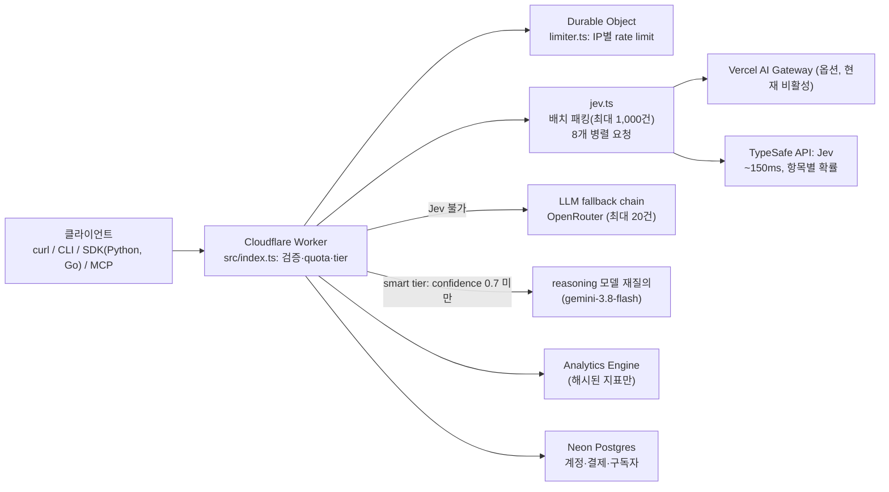

# classifier.dev

> [!summary] 한줄요약
> 라벨 목록과 텍스트만 HTTP로 보내면 라벨과 보정된(calibrated) confidence를 돌려주는 zero-shot 분류 SaaS의 소스 저장소. 핵심 모델은 TypeSafe의 결정 모델 "Jev"이고, 불확실한 건은 reasoning LLM으로 승격(smart tier)한다. 익명 무료 사용이 가능하지만 요청 텍스트가 외부 업체(TypeSafe, OpenRouter 등)로 전달되는 호스팅 서비스이므로 사내 데이터에는 쓸 수 없다. 자체 호스팅용 오픈소스라기보다 "서비스 + 그 운영 코드"에 가깝다.

## 배경 / 해결하는 문제

텍스트 분류는 RAG·에이전트 파이프라인에서 질의 라우팅, 티켓 분류, 검색 결과 필터링, 로그 버킷팅처럼 자주 필요하지만, 라벨마다 학습 데이터를 모으거나 LLM 프롬프트를 짜서 확률을 보정하기는 번거롭다. LLM에게 직접 분류시키면 토큰 비용이 들고 응답의 "confidence"(logprob 기반)가 실제 정답률과 어긋나는 문제도 있다. classifier.dev는 이를 `curl https://classifier.dev/spam,not+spam/Win+a+free+iPhone` 한 줄로 해결하겠다는 서비스다. README는 "No key, no signup. Up to a thousand texts per request"라고 소개하고, 스택은 "단일 Cloudflare Worker, DB 없음, 프레임워크 없음"이라고 밝힌다(다만 후술하듯 계정·결제 기능이 추가되며 이 설명은 이미 사실과 다르다).

흥미로운 점은 이 저장소가 에이전트 에코시스템을 직접 겨냥한다는 것이다. 에이전트용 Skill(`bulk-classify`), MCP 서버, Claude Code/Codex 플러그인 마켓플레이스, OpenAPI, `llms.txt`, feedback.now 프로토콜 엔드포인트까지 모두 제공한다. SKILL.md는 "당신은 이미 언어 모델이라 보이는 텍스트는 무료로 분류할 수 있다. 외부 호출의 이유는 능력이 아니라 컨텍스트(읽는 비용)다"라고 쓰고, 검색 스니펫 40개를 읽지 않고 6개로 거르는 사용 사례를 든다.

## 동작 원리 / 아키텍처

README의 Layout과 `src/` 구조를 기준으로 한 흐름이다.



- **Jev 모델:** README에 따르면 Jev는 "언어 모델이 아니라 결정 모델"로, 상태(state)와 타입이 있는 질문을 받아 옵션별 보정 확률을 약 150ms에 돌려준다. 이 형태 때문에 (1) 입력 `{id, text}` 배열을 한 번의 upstream 호출로 처리(문서화된 한도 요청당 64k 토큰, `jev.ts`가 보수적 예산으로 패킹하고 8개씩 병렬 실행), (2) 의미 있는 confidence, (3) 라벨마다 yes/no 질문 하나씩을 던지는 multi-label 단일 패스가 가능하다고 한다.
- **측정 주장(README, 저자 자체 측정):** 뉴스 헤드라인 400건을 end-to-end 650ms에 분류. 6-way emotion 400건에서 confidence 0.9 이상 답변의 정답률 82%, 0.5 미만 답변의 정답률 29%. 이전 모델의 logprob 기반 confidence는 뉴스 항목의 87%를 0.9 이상으로 매기고 그중 68%만 맞았다고 한다. multi-label은 7개 케이스 F1 0.887로, 이전의 sweep-and-verify LLM 캐스케이드(0.799, 1.5초)보다 낫고 230ms라고 한다.
- **smart tier:** 단일 라벨 답변 중 confidence 0.7 미만을 "빠른 reasoning 모델"로 다시 묻고 교체하며 `escalated: true`로 표시한다. README의 모델 비교에 따르면 Jev가 불확실한 항목에서 deepseek-v4-flash, qwen3.7-flash, mercury-2.5는 Jev보다 낫지 않았고, gemini-3.8-flash가 뉴스 토픽 87.5% -> 90.0%, emotion 61.8% -> 63.7%로 개선해 이것이 체인으로 채택됐다. 프런티어 모델(claude-fable-5.1)은 72.3% / 90.7%에 약 3배 가격이라고 적혀 있다. multi-label은 tier를 무시한다(reasoning 재판정이 오히려 나빠지고 23초가 걸렸다고 설명).
- **Fallback:** Jev를 쓸 수 없을 때 OpenRouter LLM 체인으로 폴백하지만 입력당 호출 1회이므로 20건으로 제한된다. 흥미로운 운영 사고 기록이 있다: 이전 primary 모델이 upstream에서 삭제되어 몇 주간 백업 모델이 F1 0.546으로 조용히 서빙되었고(광고된 0.800), 이후 digest가 "어떤 모델이 실제 응답했는지"를 `FALLBACK` 표식과 함께 보고하도록 바뀌었다(`eval/README.md`, 2026-09-17 측정 표). 이 사례는 "fallback 체인이 있으면 품질 저하가 무음으로 일어난다"는 교훈이다.
- **Multiple dimensions:** `items`와 `dimensions`(예: team/urgency/kind)를 한 번에 보내 각 입력에 차원별 결정을 받는다. 최대 20개 차원, 1,000 decision.
- **긴 문서:** 3.2만 자 초과 입력은 Chonkie RecursiveChunker(600 토큰 `cl100k_base` 청크)로 나누고 Jev로 관련·불확실 증거 청크를 병렬 선별한 뒤 최대 20,000 토큰 증거 위에서 최종 판단한다. 동기 한도는 합계 25만 토큰/20 문서/32 decision/1MB 본문, 비동기 업로드는 문서 1개 최대 1천만 토큰(100MB). README는 "전체 문서를 끝까지 읽음을 보장하지 않는다"고 명시한다.

## 핵심 기능 상세

- **API 형태:** 경로 형식 `GET /{labels}/{text}`, 쿼리 형식 `GET /?labels=...&text=...`, 배치 `POST /` 또는 `POST /v1/classify`(JSON `labels`, `inputs`, `tier`, `multi`, `max_labels`, `instructions`, `items`, `dimensions`). `OpenAPI 3.1`은 `/openapi.json`, 에이전트용 요약은 `/llms.txt`, 벤치마크는 `/benchmark`에 공개.
- **분류 모드:** single-label(분포), multi-label(독립 확률, 0.7 이상 라벨을 확률 순으로), dimensional. CONTEXT.md는 용어를 정의한다: Scores는 "제공한 라벨이 입력을 충분히 커버하는지는 보장하지 않는다", Escalation은 "불확실하지만 유효한 답을 재질의하는 것"이고 Fallback은 "선호 모델이 답하지 못해 다른 모델을 쓰는 것"으로 구분된다.
- **CLI(`cli/`):** npm 패키지 `classifier-dev`, 실행 파일 `classify`. 의존성 없는 Node 파일 하나, 자체 CHANGELOG와 semver(0.1.3, 2026-09-19 등), 입력은 줄 단위 텍스트 또는 NDJSON. `classify bug,feature,praise < feedback.txt`.
- **SDK:** `sdk/python`(표준 라이브러리만, git URL로 설치), `sdk/go`.
- **에이전트 통합:** `plugins/classifier`가 Claude Code/Codex/ChatGPT 공용 플러그인이다. MCP `https://classifier.dev/mcp`(도구 `classify_texts`, `classify_dimensions`, `classify_multi_label`, `count_labels`, `review_uncertain`; 모두 읽기 전용, 키 불필요)와 문서 서버 `/mcp/docs`. Skill은 `npx skills add https://classifier.dev`로 well-known discovery(RFC 8615, sha256 인덱스)를 통해 설치된다.
- **Rate limit:** IP별 Durable Object 카운터, fast 분당 3,000 / 일 20,000, smart 분당 200 / 일 2,000 (README). Cloudflare 네이티브 `ratelimit` 바인딩은 감소하지 않았고 KV는 최종 일관성이라 부적합해서 Durable Object를 택했다는 실측 기록이 있다.
- **관측·알림:** Analytics Engine에 요청당 1 데이터포인트(tier, 라벨셋 지문, 국가, 상태, 개수, 지연)만 기록하고 요청 텍스트는 기록하지 않는다고 한다. 15분 cron이 Jev 키 거부(401/402/403), 5xx, smart 승격 실패, 지출 급증, 트래픽 중단을 감시해 이메일로 알린다.
- **프라이버시 처리:** IP와 라벨셋은 키 있는 해시(`PRIVACY_SALT`)로 가명화하고 호출자 해시에는 UTC 날짜가 섞여 매일 값이 바뀐다(그래서 7일/30일 unique 카운트는 사실상 caller-days). 비밀 비교는 `secretEquals`로 상수 시간 비교.

## 설치 · 사용법

```bash
# 가장 단순한 호출
curl https://classifier.dev/spam,not+spam/Win+a+free+iPhone
# -> spam

# 쿼리 형태
curl "https://classifier.dev/?labels=spam,not+spam&text=Win+a+free+iPhone"

# 배치(JSON)
curl https://classifier.dev -d '{"labels":["relevant","not relevant"],"inputs":["first snippet","second snippet"]}'

# CLI
npm i -g classifier-dev
classify bug,feature,praise < feedback.txt

# Claude Code 플러그인
claude plugin marketplace add mrmps/classifier-dev
claude plugin install classifier@classifier-dev
```

```python
from classifier_dev import classify
for r in classify(["the checkout button does nothing", "love the new dark mode"], ["bug", "praise", "feature"]):
    print(r.label, r.confidence)
```

다차원 분류 요청 본문 예:

```json
{
  "items": ["Checkout charges me twice"],
  "dimensions": {
    "team": ["billing", "identity", "platform"],
    "urgency": {"labels": ["immediate","normal","low"], "instructions": "Active financial harm is immediate."}
  }
}
```

자체 배포(운영 코드 재현)는 `cp wrangler.example.toml wrangler.toml` 후 `npx wrangler deploy`이며, 필요한 Worker 시크릿은 `TYPESAFE_API_KEY`, `AI_GATEWAY_API_KEY`, `OPENROUTER_API_KEY`, `RESEND_API_KEY`, `CF_ANALYTICS_TOKEN`, `REPORT_KEY`, `PRIVACY_SALT` 등이다. 즉 자체 호스팅해도 분류 엔진은 여전히 TypeSafe의 외부 API에 의존한다. 이 저장소만으로 로컬/오프라인 분류기가 되지는 않는다.

## 디렉터리 · 코드 구조에서 확인한 것

저장소는 README의 "Single Cloudflare Worker, no database" 설명보다 훨씬 커졌다. `src/` 합계 약 1.77만 줄 TypeScript(`src/*.ts` 기준)이고 파일에는 `account-openapi.ts`, `billing-identity.ts`, `spending/`, `server/`, `routes/`, `components/`(React UI), `chat.ts`, `market.ts`, `dgemma.ts`, `laya.ts` 등이 있다. `drizzle/`·`migrations/postgres/`에는 계정, 토큰 과금, API 키 관리, 조직(organizations), 선결제/자동 충전, 뉴스레터 테이블 등 17개 마이그레이션이 있다. `BILLING.md`에 따르면 Pro는 월 $20(사용량 $20, 3 seats, 쿼터 10x), Scale은 월 $200(무제한 seat, 쿼터 100x)이고 WorkOS 로그인, Autumn(Stripe 결제), Neon Postgres를 쓴다. 즉 "키도 계정도 필요 없다"는 것은 익명 무료 티어에 한한 이야기이고, 유료 워크스페이스 키(`classifier_agent_` 접두사)와 잔액 기반 과금이 별도로 존재한다. `eval/`에는 AG News/emotion 단일 라벨 벤치(`single.py`), 다중 라벨 7케이스(`run.py`, `bench.py`), `vs_jev.py`(배포 서비스 vs Jev 직접 호출)가 있고 `eval/README.md`는 "수치를 인용하기 전에 읽으라"고 주의를 준다. `e2e/`는 실제 프로덕션 API에 대한 live 테스트(모킹 없음)다. 의존성(package.json)에는 `@typesafe-ai/sdk`, `@chonkiejs/core`, `@neondatabase/serverless`, vite, wrangler 등이 보이고 `author`는 Michael Ryaboy, 라이선스 MIT. 클론은 depth 1이라 커밋 이력은 확인하지 못했다.

## 비교 대상

| 접근 | 장점 | 단점 |
|---|---|---|
| classifier.dev (Jev + LLM 승격) | 라벨만 주면 즉시, 보정된 확률, 1,000건 배치, 키 없이 시작 | 외부 호스팅·텍스트 반출, 한국어 미검증, 외부 모델 변경에 따른 결과 변동(SKILL.md가 직접 경고) |
| 직접 LLM 프롬프트 분류 | 도메인 지시 자유도 | 호출당 비용, logprob confidence 부정확 |
| 임베딩 + kNN/로지스틱 회귀 | 사내 완전 로컬, 저비용 | 라벨별 예시 데이터 필요 |
| NLI 기반 zero-shot(예: HuggingFace pipeline) | 로컬 실행 | 라벨 수가 많으면 느리고 품질 편차 |
| 한국어 파인튜닝 분류기 | 최고 정확도 | 학습 데이터·MLOps 필요 |

저장소의 `eval/`은 Jev와 TF-IDF/압축 기반 방법을 비교하는 이슈(#133 "Evaluate zero-shot TF-IDF and compression on JevBench")도 열려 있어, 저자 스스로 비LLM 대안과의 비교를 진행 중이다(이슈 제목만 확인, 내용 미열람).

## 장단점 · 한계 · 성숙도

사실(GitHub API, 2026-10-01): Stars 423, Forks 34, 라이선스 MIT, 주 언어 TypeScript, 생성 2026-08-13, 마지막 push 2026-09-28, 기여자 2명, open_issues_count 14(PR 포함). 릴리스(GitHub Releases)는 조회 결과 없음. CLI는 npm에서 0.1.x. 즉 사실상 1인 주도의 신생 제품 저장소다. 이슈에는 audio/video 입력 거부, 이미지 분류(Beam DiffusionGemma), Python User-Agent 안내, SPF는 있으나 DMARC가 없어 From 헤더 스푸핑이 가능하다는 보안 이슈(#77) 등이 있다.

장점은 사용 장벽이 극히 낮고(curl 한 줄), 에이전트 배포 채널(MCP, Skill, 플러그인)이 완비돼 있으며, 운영 관측·fallback 실패 사례·측정 표 등 투명한 엔지니어링 기록이 풍부하다는 점이다. 한계: (1) 분류 엔진의 실체가 외부 상용 모델(TypeSafe Jev, OpenRouter)이라 가용성·가격·모델 변경에 종속된다. SKILL.md가 "모델 업데이트, fallback, smart reasoning이 결과를 바꿀 수 있으며 어느 tier도 호출 간 동일 결과를 보장하지 않는다"고 직접 쓴다. (2) 정확도 수치는 모두 영어 공개 데이터(AG News, dair-ai/emotion)이며 한국어 성능에 관한 기록은 저장소에서 찾지 못했다(문서 내 "korean"/"한국" 검색 결과 없음). (3) 익명 무료 쿼터는 IP당이라 공유 NAT에서는 금방 소진된다. (4) 공개 smart 배치는 200건 상한. (5) 문서화되지 않은 SLA. 실제 호스트 서비스(classifier.dev)의 가용성은 직접 확인하지 않았다.

## 보안 · 라이선스 · 운영 리스크

- **데이터 반출:** 분류할 텍스트가 classifier.dev Worker -> TypeSafe(및 폴백 시 OpenRouter 경유 외부 LLM, smart tier는 Gemini)로 전송된다. README는 분석 지표에 텍스트를 기록하지 않는다고 하지만, 이는 운영자의 자기 서술이며 upstream 업체 측 보관 정책은 확인하지 못했다. 사내 문서·고객 정보·개인정보는 절대 전송 금지.
- **익명 서비스의 일반 리스크:** 신뢰 경계 밖 API이므로 응답을 신뢰해 자동 조치(삭제, 권한 변경 등)를 하면 안 된다. 입력에 프롬프트 인젝션이 섞이면 smart tier(LLM)의 판정이 흔들릴 수 있다.
- **공급망:** Python SDK는 PyPI가 아니라 git URL(`@python-v0.1.0`)로 설치하도록 안내하며, 플러그인/마켓플레이스 설치도 이 저장소를 신뢰한다. 사용 시 태그를 고정하고 코드를 검토해야 한다.
- **라이선스:** MIT(저장소 및 CLI). 단, Jev(TypeSafe)와 각 LLM 공급자의 약관은 별개이며 확인하지 않았다.
- **운영 종속:** 도메인·Cloudflare·Stripe(Autumn)·WorkOS·Neon·Resend 등 다수 SaaS를 엮은 구조라 서비스 중단/정책 변경 위험이 있다.

## 관련 노트

- [[ragas]] — 분류/라우팅 결과를 포함한 RAG 평가 프레임워크(평가 관점에서 결합)
- [[cerebras-knowledge-base-pgvector-rrf-mcp]] — 질의 계획·라우팅이 있는 사내 KB 설계 사례

## 출처

- https://github.com/mrmps/classifier-dev — README 전문, CONTEXT.md, BILLING.md, eval/README.md, cli/CHANGELOG.md, sdk/python/README.md, plugins/classifier/README.md, src/SKILL.md, package.json, 디렉터리 구조 (클론하여 열람, 2026-10-01)
- GitHub REST API: repos/mrmps/classifier-dev, /contributors, /issues (2026-10-01)

확인 못한 것: 한국어 분류 성능, 호스트 서비스 실제 가용성/SLA, TypeSafe(Jev) 및 upstream LLM 업체의 데이터 보관 정책, 커밋 이력(shallow clone), 저장소 외부의 독립 벤치마크, 이슈 #133 등 개별 이슈의 내용.
