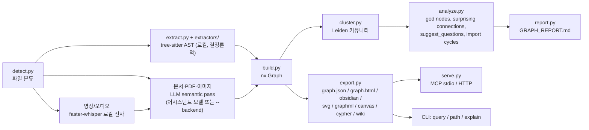

# Graphify

> [!summary] 한줄요약
> 코드·문서·PDF·이미지·영상을 NetworkX 기반 knowledge graph(`graph.json`)로 바꾸고, AI 코딩 어시스턴트(Claude Code, Codex, Cursor 등 20여 종)가 grep 대신 `query`/`path`/`explain`으로 질의하게 만드는 `/graphify` skill + Python 라이브러리. 코드는 tree-sitter AST로 LLM 없이 로컬에서 파싱하고, 엣지마다 `EXTRACTED`/`INFERRED`/`AMBIGUOUS` 신뢰 태그를 붙인다. 6개월 만에 스타 12만을 넘긴 YC S26 회사의 오픈소스 코어이며 릴리스가 하루 단위로 나올 만큼 빠르게 변한다.

## 배경 / 해결하는 문제

대형 코드베이스에서 AI 어시스턴트가 질문에 답하는 방식은 대개 grep과 파일 순차 읽기다. 이는 토큰을 많이 쓰고, 파일 간 관계(누가 누구를 호출·상속하는가, 이 모듈이 어떤 서브시스템에 속하는가)를 매번 처음부터 재구성해야 한다. 한편 벡터 RAG는 "의미상 비슷한 청크"는 찾지만 호출 경로나 의존 관계처럼 구조적 질문에는 약하다. Graphify는 폴더 하나를 한 번 훑어 그래프를 만들어 두고, 이후 질의는 실제 그래프 순회로 처리한다는 접근이다. README의 첫 요점이 이를 요약한다: 코드는 무료이고 완전 로컬, 모든 엣지에 설명이 붙고, 벡터 인덱스가 아니라 순회 가능한 진짜 그래프라는 것.

저자 측 포지셔닝도 알아둘 만하다. README 상단에는 "Graphify Labs", Y Combinator S26 배지, 유료 플랫폼(app.graphify.com, 14일 무료 체험), 그리고 회의·문서·코드를 항상 갱신하는 "graphify Enterprise"(대기자 명단) 안내가 있다. 즉 이 오픈소스는 상용 제품의 on-demand 코어이고, "항상 켜져 있는 버전"은 유료 제품이다. 이 저장소의 NOTICE에 따르면 저작권자는 Safi Shamsi와 기여자들이며, 과거 MIT로 기여된 부분은 Apache-2.0으로의 재라이선스 이후에도 MIT 조건으로 `LICENSE-MIT`에 보존돼 있다(GitHub API 표시는 Apache-2.0, pyproject도 `Apache-2.0`이며 `license-files`에 LICENSE, LICENSE-MIT, NOTICE를 함께 선언). 이전에 "Apache-2.0 and MIT"로 표기된 이유가 이것이다.

## 동작 원리 / 아키텍처

`ARCHITECTURE.md`는 파이프라인을 한 줄로 정의한다: `detect() -> extract() -> build() -> cluster() -> analyze helpers -> report.generate() -> export.to_*()`. 각 단계는 모듈 하나이고 일반 dict와 `networkx.Graph`로만 통신한다. `tests/test_architecture_doc.py`가 문서에 나온 심볼을 전부 import해 보므로 문서가 코드와 어긋나지 않게 강제한다는 점이 인상적이다.



**세 개의 패스(`docs/how-it-works.md`).** Pass 1은 코드 구조(클래스, 함수, import, call graph, 인라인 주석)를 tree-sitter로 추출하며 LLM이 없다. SQL은 테이블·뷰·외래 키·JOIN 관계를 결정론적으로 뽑는다. Pass 2는 영상·오디오를 faster-whisper로 로컬 전사하며, 전사 프롬프트를 지금까지의 god node(가장 연결이 많은 개념)로 시딩해 도메인 용어를 맞춘다. Pass 3은 문서·논문·이미지·전사본을 병렬 서브에이전트(LLM)가 읽어 노드·엣지 JSON 조각을 만들고 병합한다. 코드만 있는 코퍼스는 Pass 3을 건너뛰므로 토큰 비용이 0이다.

**신뢰 태그.** 모든 관계가 `EXTRACTED`(소스에 명시, 신뢰도 1.0), `INFERRED`(합리적 추론, 0.55~0.95의 이산 루브릭: 0.95 거의 확실, 0.85 강한 근거, 0.75 합리적, 0.65 이름 유사성만, 0.55 추측), `AMBIGUOUS`(불확실, 리포트에서 사람 검토 표시) 중 하나다. 이 설계 덕에 "AI가 지어낸 관계"를 구분해 볼 수 있다. 추출 스키마는 `{nodes:[{id,label,source_file,source_location}], edges:[{source,target,relation,confidence}]}`이고 `validate.py`가 `build()` 전에 검증한다.

**커뮤니티 탐지.** Leiden 알고리즘(선택 extra `graspologic`)으로 엣지 밀도 기준 클러스터링한다. 문서에 따르면 임베딩이나 벡터 DB가 따로 없고, LLM이 뽑은 `semantically_similar_to` 엣지가 이미 그래프에 있어 구조 자체가 유사도 신호가 된다. 커뮤니티 이름은 LLM 없이 붙는 기본 라벨이 있고 필요하면 LLM이 정제한다(0.9.73 changelog에 "community labeling" 수정 항목 있음).

**분석 산출물.** `GRAPH_REPORT.md`에는 god nodes, surprising connections(서로 다른 파일/모듈 간 의외의 연결, 의외성 순 정렬), 설계 근거(`# NOTE:` `# WHY:` `# HACK:` 주석, ADR/RFC 인용이 별도 노드로 코드에 연결), 그래프가 특히 잘 답할 수 있는 추천 질문 4~5개, AMBIGUOUS 엣지 목록이 들어간다. 그 외 import 순환 탐지(`find_import_cycles`), 그래프 diff(`graph_diff`), PR 영향 분석이 있다.

## 핵심 기능 상세

- **질의 3종:** `graphify query "<질문>"`(범위가 좁은 subgraph 반환), `graphify path A B`(최단 경로), `graphify explain X`(노드의 출처·커뮤니티·degree·연결 목록). README의 FastAPI 예시 출력에는 `APIRouter` 노드가 degree 47, `RequestValidationError [uses] [INFERRED]`처럼 신뢰 태그가 함께 나온다.
- **지원 입력:** tree-sitter 문법 37종(`.py .ts .go .rs .java .c .cpp .rb .cs .kt .swift .sql .sh` 등), Salesforce Apex, Terraform/HCL(extra), OCaml, Common Lisp, Robot Framework, MCP 설정 파일(`.mcp.json` 등: 서버 노드, 패키지 참조, 환경변수 요구), 패키지 매니페스트(`pyproject.toml`, `go.mod`, `pom.xml`: 의존 허브 노드), 문서(`.md .rst .html .yaml`; 마크다운 링크와 `[[wikilink]]`가 `references` 엣지가 됨), Office(`.docx .xlsx`, extra), Google Workspace(opt-in, `gws` 인증), PDF, 이미지, 영상/오디오, YouTube URL. 코드 쪽 `graphify/extractors/`에는 COBOL, Erlang, Solidity, Razor, Blade, Verilog, Zig 등 폭넓은 언어 모듈이 있다.
- **증분·자동 갱신:** `/graphify . --update`는 변경 파일만 재추출하고 `graphify hook install`은 commit/branch checkout 때 자동 재빌드한다. SHA 기반 캐시(`cache.py`)와 이식 가능한 `manifest.json`이 있다. `watch.py`는 파일 변경 감시.
- **어시스턴트 상시 사용 유도:** `graphify claude install` 등은 플랫폼별로 지침 파일(CLAUDE.md, AGENTS.md, `.cursor/rules/graphify.mdc` 등)을 쓰고, Claude Code/Gemini CLI에는 검색성 도구 호출 전에 "그래프부터 쓰라"고 넛지하는 PreToolUse 훅을 건다. Codex는 훅이 no-op이고 AGENTS.md가 실제 역할을 한다고 README가 이유까지 적는다(Codex Desktop이 PreToolUse의 additionalContext를 거부).
- **MCP 서버:** `python -m graphify.serve graph.json`으로 `query_graph`, `get_node`, `get_neighbors`, `shortest_path`, `list_prs`, `get_pr_impact`, `triage_prs` 도구 제공. `--transport http`로 팀 공유 서버(`--api-key`, `--stateless`, 세션 타임아웃)도 가능하고 Dockerfile이 있다. 다중 프로젝트 그래프 서빙(`GRAPHIFY_MAX_CONTEXTS`, 기본 8)도 지원한다.
- **PR 대시보드:** `graphify prs`, `--triage`(LLM이 리뷰 큐 우선순위화), `--conflicts`(같은 커뮤니티를 건드리는 PR 간 병합 순서 리스크).
- **내보내기:** HTML(인터랙티브), Obsidian vault, SVG, GraphML, Canvas, Cypher(Neo4j/FalkorDB `--push`), Mermaid call-flow HTML, 커뮤니티별 Markdown wiki.
- **LLM 백엔드(헤드리스 추출용):** Claude, Gemini, OpenAI 및 호환 서버(llama.cpp, vLLM, LM Studio), DeepSeek, Kimi(Moonshot), Azure OpenAI, AWS Bedrock, Ollama. 자동 감지 우선순위는 Gemini -> Kimi -> Claude -> OpenAI -> DeepSeek -> Azure -> Bedrock -> Ollama.

## 설치 · 사용법

```bash
uv tool install graphifyy      # 패키지명은 y가 두 개. CLI 명령은 graphify
# 또는 pipx install graphifyy
graphify install               # 어시스턴트에 skill 등록 (--project 로 저장소 범위 설치)

# 어시스턴트 안에서
/graphify .                    # 현재 폴더 그래프 생성
/graphify ./docs --update      # 변경분만 재추출
/graphify . --no-viz --wiki

# CLI 직접 질의
graphify query "what connects auth to the database?"
graphify path "UserService" "DatabasePool"
graphify explain "RateLimiter"

# 상시 사용 설정 (Claude Code)
graphify claude install
graphify hook install          # commit 때 자동 재빌드

# 코드만 오프라인 추출 (API 키 불필요)
graphify extract . --code-only

# 완전 로컬 의미 추출
graphify extract ./docs --backend ollama

# MCP / 팀 공유 서버
python -m graphify.serve graphify-out/graph.json
python -m graphify.serve graphify-out/graph.json --transport http --host 0.0.0.0 --api-key "$SECRET"
```

산출물은 `graphify-out/graph.json`, `graph.html`, `GRAPH_REPORT.md`다. 팀 공유 시에는 `git add -f graphify-out/graph.json graphify-out/GRAPH_REPORT.md`처럼 질의용 산출물만 강제 추가하고 머신 로컬 파일(`.graphify_root`, AST 캐시 등)은 커밋하지 말라고 안내한다. `.graphifyignore`는 `.gitignore`와 병합되며 제외만 더 한다.

## 디렉터리 · 코드 구조에서 확인한 것

`graphify/` 패키지 Python 파일 합계 약 5.05만 줄. 주요 모듈은 `detect`, `extract`(+`extractors/` 40여 언어 모듈과 MIGRATION.md), `build`, `cluster`, `analyze`, `report`, `export`(+`exporters/`), `serve`(MCP), `llm`(백엔드 호출과 프롬프트 방어), `security`, `cache`, `hooks`/`install`(플랫폼별 skill 파일 `skill-*.md` 20종 이상), `resolver_registry`/`*_resolution.py`(언어별 호출·상속 해석), `cross_repo_calls`/`cross_repo_types`, `global_graph`, `scip_ingest`, `pg_introspect`, `prs`, `affected`, `querylog`. 테스트는 `tests/`에 파일 317개. `worked/`에는 예제 코퍼스(httpx, karpathy-repos, mixed-corpus 등), `BENCHMARKS.md`, `docs/`(how-it-works, 다국어 README 번역 — 한국어 README 포함). 핵심 의존성은 `networkx`, `numpy`, `rapidfuzz`, `tree-sitter` 및 언어별 grammar 패키지 약 25개이며 mcp, neo4j, pdf, watch, svg, leiden, office, video(faster-whisper, yt-dlp) 등은 선택 extra다. pyproject는 Python 3.10 이상, 현재 버전 0.9.73. CHANGELOG는 언어별 해석 수정(Java 상속 메서드 호출, VB.NET, Solidity, Astro 등)이 매일 쌓이는 형태다.

## 비교 대상

| 도구 | 접근 | 차이 |
|---|---|---|
| Graphify | AST + LLM 의미 패스 -> 그래프, 질의는 순회 | 구조 질문에 강함, 코드 부분은 LLM 불필요, 신뢰 태그 |
| 벡터 RAG / 코드 임베딩 검색 | 청크 임베딩 유사도 | 의미 검색은 쉬우나 호출 경로·영향 분석 불가 |
| [[ragu]] / [[semantica]] | 문서 중심 GraphRAG·지식 그래프 | 문서에서 엔티티를 LLM으로 추출. Graphify는 코드 AST 우선 |
| [[pageindex]] | 문서를 트리로 인덱싱, 추론 기반 검색 | 장문 문서 구조 활용. Graphify는 코드/혼합 코퍼스의 관계 그래프 |
| codecanvas 류(Python 호출 그래프 도구) | 단일 언어 정밀 CFG/호출 그래프 | Graphify는 다언어 광범위, 정밀도는 낮을 수 있음(INFERRED) |

`BENCHMARKS.md`(2026-07-05 갱신, 저자 자체 harness)의 수치: LOCOMO(n=300) 검색 recall@10에서 graphify 0.497, BM25 0.362, mem0 0.048, supermemory 0.149(단 supermemory는 자체 768-d 영어 전용 임베더라 recall이 임베더에 교란된다고 문서가 인정). QA 정확도는 graphify 45.3%, supermemory 49.7%, mem0 27.3%. LongMemEval-S(n=50)는 graphify 76%로 dense RAG와 동률. 코드 인텔리전스는 약 100만 LOC의 ERPNext에서 grep+read 기준선의 key-fact coverage 70.8%가 graphify 도구 하나를 쓰면 82.0%지만, 질문 수가 n=6이다. 모든 시스템에 동일 모델(Kimi K2.6)과 judge를 썼고 judge는 두 번째 judge와 90.6% 일치(Cohen's kappa 0.81). 중요한 주의점은 (1) 벤더 자체 harness, (2) 코드 벤치 n=6으로 통계적 의미가 약함, (3) README는 "임베딩 없음"이라 말하지만 BENCHMARKS의 graphify 행은 "hybrid retrieval"과 로컬 임베더(BGE-m3)를 쓰는 구성이라 두 서술의 범위가 다르다는 점이다(코드 그래프 질의 자체는 임베딩이 없고, 메모리 벤치용 구성은 임베딩을 병용한 것으로 보이나 이 구분은 문서 문구 기준의 추정이며 코드로 확인하지 않았다).

## 장단점 · 한계 · 성숙도

사실(GitHub API, 2026-10-01): Stars 122,851, Forks 11,841, 라이선스 Apache-2.0, 생성 2026-04-03, 마지막 push 2026-09-30, 기본 브랜치 `v8`, open_issues_count 1,500(PR 포함), 최신 릴리스 v0.9.73(2026-09-30), v0.9.72(09-29), v0.9.71(09-28). 기여자는 changelog에 감사 표기된 다수의 외부 개발자가 보이는 활발한 커뮤니티 구조다(정확한 수는 API 호출 오류로 조회하지 못함). 열린 이슈/PR 예: Windows 깊은 경로 보존, GitHub Copilot SDK 백엔드, 다중 레포 그래프 연결, F# extractor 등.

장점: 코드 그래프가 오프라인·무비용·결정론적, 신뢰 태그로 환각 구분, 20여 종 어시스턴트 설치 자동화, 팀 공유(HTTP MCP)와 증분 갱신, 보안 위협 모델 문서화(`SECURITY.md`). 한계: (1) 0.9.x 미성숙 버전이며 하루 단위 릴리스로 동작이 자주 바뀐다. (2) 이슈·PR 1,500건 적체. (3) 의미 추출 패스(문서/PDF/이미지)는 LLM 비용·품질에 의존하고 파일당 20,000자 상한이 있어 잘리면 경고한다(0.9.73). (4) `graph.json` 크기 상한 기본 512MiB. (5) 정적 AST 해석이므로 동적 디스패치·리플렉션·DI 컨테이너 기반 호출은 INFERRED/누락 가능. (6) 한국어 문서 품질은 선택한 LLM에 달려 있고 직접 검증하지 않았다. (7) 벤치마크는 자체 측정.

## 보안 · 라이선스 · 운영 리스크

- **패키지명 주의:** 공식 PyPI 패키지는 `graphifyy`(y 두 개)이고, README는 "다른 `graphify*` 패키지는 무관"하다고 경고한다. 오타 패키지(typosquatting) 위험이 있으므로 공식 README 표기만 사용하고, 사내에서는 버전을 고정(pin)한 뒤 사설 미러로 배포한다.
- **데이터 흐름:** 코드는 로컬 처리이지만 문서·PDF·이미지는 어시스턴트의 모델 또는 설정한 `--backend`로 전송된다. 데이터 거주 요건이 있으면 `--backend ollama`(완전 로컬)를 쓰거나 `--code-only`로 코드만 인덱싱한다. 특히 `--backend kimi`는 중국 Moonshot 서버로 라우팅된다고 README가 명시하므로 사내 자료에는 금지. 백엔드는 API 키 존재 여부에 따라 자동 선택되므로 환경변수에 여러 키가 있으면 의도치 않은 외부 전송이 일어날 수 있다. 헤드리스 실행 시 `--backend`를 반드시 명시할 것.
- **텔레메트리:** README는 "no telemetry"라고 한다. 단 질의 로그(`~/.cache/graphify-queries.log`)는 문서에 따르면 기본 off이고 환경변수로 opt-in한다(Privacy 절에는 "모든 query가 로깅된다"는 서술과 환경변수 표의 "기본 off" 서술이 공존하여 문서 내 불일치가 있다. 실제 동작은 코드로 확인하지 못함).
- **프롬프트 인젝션:** 의미 추출 시 소스 파일은 공격자 통제 텍스트가 될 수 있다. `llm.py`가 `<untrusted_source sha256=...>` 구분자, 시스템 프롬프트 지시, 채팅 템플릿 토큰 무력화로 기본 방어를 하며 "인젝션을 불가능하게 만들지는 않는다"고 SECURITY.md가 인정한다. 외부 저장소를 그래프화한 결과를 에이전트에 연결하면 간접 프롬프트 인젝션 경로가 될 수 있다.
- **SSRF·경로:** `ingest`는 http/https만, private/loopback/link-local/클라우드 메타데이터 차단, 50MB 다운로드 상한, MCP는 `graphify-out/` 안의 경로만 허용. HTTP MCP는 기본 127.0.0.1이며 `0.0.0.0` 노출 시 반드시 `--api-key`를 함께 쓰라고 한다.
- **에이전트 설정 변경:** `graphify install`은 CLAUDE.md/AGENTS.md/훅/`.claude/settings`를 수정한다. 변경 범위를 검토하고, 사내 표준 설정과 충돌하지 않게 `--project` 범위로 먼저 시험할 것.
- **라이선스:** Apache-2.0 + 레거시 MIT 부분. 상용 사내 사용 가능하나 NOTICE 보존 의무 확인. 유료 플랫폼/Enterprise는 별도 약관.

## 관련 노트

- [[ragu]] — 지식 그래프 기반 RAG, 문서 중심 대안
- [[semantica]] — 시맨틱/지식 그래프 접근과 비교
- [[pageindex]] — 트리 인덱스 기반 추론형 검색과의 비교
- [[markitdown]] — 문서 -> Markdown 전처리(그래프의 문서 입력 전 단계로 연계 가능)

## 출처

- https://github.com/Graphify-Labs/graphify — README(발췌 열람: 설치·플랫폼·파일 유형·명령·MCP·환경변수·Privacy), ARCHITECTURE.md, BENCHMARKS.md, SECURITY.md, NOTICE, LICENSE-MIT, docs/how-it-works.md, pyproject.toml, CHANGELOG.md 상단, 디렉터리 구조 (클론하여 열람, 2026-10-01)
- GitHub REST API: repos/Graphify-Labs/graphify (스타, 포크, 라이선스, 생성일, push, 이슈 수), /releases, /issues (2026-10-01)

확인 못한 것: 실제 실행 결과와 한국어 문서 추출 품질, 정확한 기여자 수, 벤치마크 독립 재현, 질의 로그 기본값의 실제 코드 동작, 유료 플랫폼(graphify.com) 상세, `graph.json` 질의 알고리즘(BFS/스코어링)의 내부 구현.
