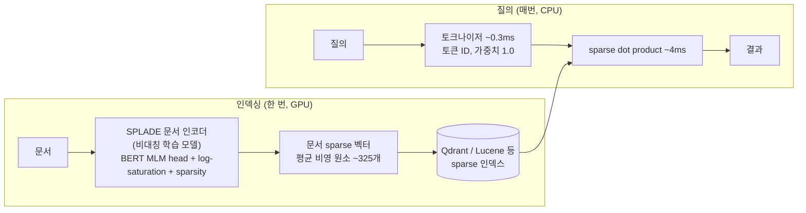

# Inference-Free SPLADE

> [!summary] 한줄요약
> 문서 쪽만 신경망으로 확장(index time)하고 질의는 BERT 토큰 ID를 그대로 sparse 벡터로 쓰는 "inference-free SPLADE"가 BEIR SciFact에서 풀 SPLADE 대비 질의 지연을 57ms에서 4.3ms로(13배) 줄이면서 NDCG@10 손실은 -0.0093(상대 1.3% 미만)이고 BM25보다 +3.5% 좋다는 벤치마크 글. 다만 한 개 데이터셋(5,183 문서) 결과이고, 원 논문의 BEIR-13 평균에서는 doc 변형이 풀 모델보다 4.7점 낮아 일반화에는 주의가 필요하다.

## 배경 / 해결하는 문제

BM25는 GPU 없이 빠르고 대부분의 검색 벤치마크에서 의외로 경쟁력이 있지만, 글의 표현대로 정확히 일치하는 단어만 찾는다. "cardiac arrest" 질의는 "heart attack"이라고 쓴 최적 문서를 놓친다(vocabulary mismatch). SPLADE는 신경망(BERT의 MLM head)으로 문서를 확장해 sparse 표현으로 바꾼다. 글은 `naver/splade-v3-doc`이 "heart attack"에 대해 heart 1.60, attack 1.13, die 0.77, cardiac 0.77, attacks 0.76, disease 0.67, stroke 0.59, chest 0.50, death 0.36, illness 0.27의 활성 가중치를 낸다고 보여 준다. 원 단어가 가장 높지만 의미상 관련된 단어도 의미 있는 가중치로 켜지기 때문에, "cardiac arrest" 질의는 문서에 없는 단어인 cardiac(0.77)에 걸린다.

문제는 질의 지연이다. 풀 SPLADE는 검색 시점에 transformer로 질의도 인코딩해야 해서 질의당 50~100ms가 추가된다(글 본문). 검색 엔진 입장에서는 BM25가 4ms에 끝나는데 신경 인코더 호출이 50ms를 먹는 셈이다. inference-free 방식은 이 질의 측 추론을 없앤다. 모델은 인덱싱 때 문서에만 돌고, 질의는 토크나이저만 거쳐 모든 토큰에 가중치 1.0을 준다. 글은 이를 코드 한 덩어리로 보여 준다.

```python
def encode_query_inference_free(tokenizer, query: str):
    enc = tokenizer(query, add_special_tokens=False, truncation=True, max_length=512)
    unique_ids = list(set(enc["input_ids"]))
    return SparseVector(indices=unique_ids, values=[1.0] * len(unique_ids))
```

"cardiac arrest"는 토큰 ID [3684, 6295]가 되고 각 가중치가 1.0이다. 질의 시점 작업은 토크나이저 호출 1회와 sparse dot product 1회가 전부다.

## 동작 원리 / 아키텍처



글의 "How It Works" 비교는 표준 SPLADE가 query -> SPLADE encoder(~50ms) -> pre-computed vecs와의 점수 계산이고, SPLADE-IF는 query -> tokenizer(~0.3ms) -> 같은 점수 계산이라는 것이다. 두 방식 모두 문서 벡터는 인덱스 시점에 미리 계산되며 질의 처리만 다르다.

핵심 통찰은 "왜 이렇게 해도 품질이 유지되는가"다. 글에 따르면 `naver/splade-v3-doc`은 질의가 가중치 없는 원시 토큰으로 들어온다는 사실을 알고 비대칭으로 학습됐다. 그래서 문서 인코더가 인덱싱 시점에 공격적으로 확장하고, 질의의 원시 단어들은 그렇게 미리 준비된 어휘 위에 떨어진다. 증거로 문서당 평균 비영 원소 수를 든다: splade-v3-doc(비대칭, IF) 325, splade-v3(비대칭, 풀) 286, OpenSearch GTE(비대칭, IF) 244, Splade_PP_en_v1(대칭) 205. 즉 IF 모델이 가장 조밀하다 — 확장 작업이 인덱스 쪽으로 전부 앞당겨져 있다는 해석이다.

학술적 배경을 원 논문에서 확인했다. SPLADE(Formal et al., SIGIR 2021, arXiv:2107.05720)는 명시적 sparsity 정규화와 term 가중치의 log-saturation 효과로 매우 희소한 표현을 만드는 first-stage ranker로 소개된다. SPLADE-v3 기술 보고서(Lassance et al., arXiv:2403.06789, 2024-03)는 학습 구조 개선(배치당 다중 hard negative, cross-encoder 앙상블 증류 점수, KL-Div와 MarginMSE 혼합, SPLADE++ SelfDistil에서 이어 학습)을 기술하고, 변형 4종을 낸다: DistilBERT, Lexical(질의 확장 제거), Doc(질의 계산 없음, 사실상 이진 bag-of-words 질의). 논문 Table 1(BEIR-13 평균 nDCG@10)은 SPLADE-v3 51.7, DistilBERT 50.0, Lexical 49.1, Doc 47.0, SPLADE++SD 50.7이다. 논문은 Doc 변형을 "전반적으로 가장 덜 효과적이며, 특히 zero-shot에서 질의 측 계산이 조금이라도 중요함을 보여 준다"고 평가하면서도 최신 dense bi-encoder와 견줄 만하고 효율(질의 인코딩 없음, 순회할 posting list 짧음)이 좋다고 적는다.

## 핵심 기능 상세 (벤치마크 결과)

**실험 설계(글 기준).** BEIR의 SciFact(5,183 문서, 300 질의, 과학 주장 검증)에서 SPLADE 모델 3종 x 백엔드 2종 x (풀/IF) 조합 + 양 백엔드의 BM25를 비교했다. 문서 인코딩은 Modal A10G GPU에서 수행. 모델: `naver/splade-v3`와 `naver/splade-v3-doc`(같은 계열, 대칭 vs 비대칭 학습이라 "질의 측 추론 제거"만의 효과를 깨끗이 비교), OpenSearch의 비대칭 doc 전용 인코더 `opensearch-neural-sparse-encoding-doc-v3-gte`, 대칭 모델 `prithivida/Splade_PP_en_v1`.

**Qdrant(네이티브 float sparse 스코어링) 결과표(글 그대로).**

| 방법 | NDCG@10 | Recall@10 | MRR@10 | 전체 지연 median/p90 | 질의 임베딩 | 검색 |
|---|---|---|---|---|---|---|
| SPLADE-Full (naver) | 0.7161 | 0.8289 | 0.6886 | 57.2ms / 79.0ms | 50.0ms | 6.6ms |
| SPLADE-Full (PP) | 0.7093 | 0.8240 | 0.6811 | 60.4ms / 88.8ms | 53.2ms | 7.1ms |
| SPLADE-IF (naver) | 0.7068 | 0.8254 | 0.6748 | 4.3ms / 5.7ms | 0.3ms | 4.0ms |
| SPLADE-IF (OpenSearch) | 0.7021 | 0.8220 | 0.6717 | 4.3ms / 5.7ms | 0.3ms | 4.0ms |
| SPLADE-IF (PP, sym) | 0.6859 | 0.8121 | 0.6507 | 3.9ms / 5.7ms | 0.3ms | 3.6ms |
| BM25 | 0.6830 | 0.8088 | 0.6470 | 4.0ms / 5.0ms | 0.1ms | 3.8ms |

13배 격차는 전부 질의 인코더 호출 제거에서 나오며 검색 시간은 같다. IF(naver) 대 BM25는 NDCG@10 +3.5%, Recall@10 +2.1%, MRR@10 +4.3%(표의 수치에서 계산해도 0.7068/0.6830, 0.8254/0.8088, 0.6748/0.6470와 일치). 같은 모델 계열의 풀 대 IF는 NDCG@10 -0.0093(0.7161 -> 0.7068, 상대 -1.3%).

**Lucene/pyserini(정수 양자화 impact 스코어링).** 수치가 1~2% 낮다. Lucene은 문서 가중치를 정수로 저장해 float 정밀도를 일부 잃고, OpenSearch/Elasticsearch도 같은 제약이라 정확한 float sparse 스코어링을 지원하지 않는다는 설명이다(글은 "정수 연산이 검색을 빠르게 하므로 괜찮은 트레이드오프"라고 평가). 결과: Full(naver) 0.7156 / 57.9ms, IF(naver) 0.6953 / 3.2ms, IF(OpenSearch) 0.6886 / 2.5ms, IF(PP) 0.6704, BM25 0.6789 / 5.5ms. 즉 Lucene 환경에서는 IF(naver)의 BM25 우위가 약 +2.4%로 줄어든다(표 값에서 계산한 추정치이며 글이 직접 명시한 수치는 아님).

**인덱싱 비용.** IF 모델은 A10G GPU에서 58~83 docs/s로 인코딩하고, BM25는 CPU에서 1,439 docs/s라 약 17~25배 느리다(글 본문). 글은 백만 문서 코퍼스에 3~5시간이라고 쓴다(1,000,000/83 = 약 3.3시간, 1,000,000/58 = 약 4.8시간으로 산술 일치). 인코딩 처리량 그래프에는 SPLADE-Full 98 docs/s(GPU), IF-naver 83, IF-GTE 58이 표시된다. 정적 또는 갱신이 느린 코퍼스에는 일회성 비용이지만, 변경이 잦은 인덱스는 비동기 재인코딩 파이프라인이 필요하다고 글이 언급한다.

## 설치 · 사용법

이 글 자체는 벤치 스크립트를 공개 링크로 제공하지 않았다(블로그 소스 저장소 KShivendu/blog 안의 `data/blog/if-splade.mdx`는 본문 원고이며 벤치 코드는 확인하지 못함). 글의 질의 인코딩 코드와 모델 카드의 사용 예를 합치면 다음과 같은 흐름이 된다.

```python
# 인덱싱: 문서 인코더 (GPU 권장)
from sentence_transformers import SparseEncoder
model = SparseEncoder("naver/splade-v3-doc")      # 게이트 모델: HF에서 이용 조건 동의 및 로그인 필요
doc_vecs = model.encode_document(["UV-A light causes tanning and skin aging..."])

# 질의: 모델 없이 토큰화만 (글의 encode_query_inference_free 와 동일 원리)
from transformers import AutoTokenizer
tok = AutoTokenizer.from_pretrained("naver/splade-v3-doc")
ids = list(set(tok("heart attack", add_special_tokens=False, truncation=True, max_length=512)["input_ids"]))
query_sparse = {"indices": ids, "values": [1.0] * len(ids)}   # Qdrant sparse vector 형식
```

질의 쪽에는 중복 토큰을 set으로 제거하므로 질의 단어 빈도가 가중치에 반영되지 않는다는 점이 BM25의 질의 항 빈도 처리와 다르다. 엔진 측에서는 Qdrant의 sparse vector(float 스코어링)를 쓰면 정밀도 손실이 없고, Lucene/OpenSearch/Elasticsearch 계열은 정수 양자화 때문에 소폭 하락한다는 것이 글의 결론이다.

## 디렉터리 · 코드 구조에서 확인한 것

저장소가 아니라 블로그 글이다. 확인한 구조는 글의 섹션(작동 원리, 결과, 트레이드오프, 한계, 핵심 요약)과 게시 정보뿐이다. 저자는 Kumar Shivendu, 게시일 2026-06-09, 읽는 시간 8분, `mentions: Inference-Free SPLADE`, 소스는 GitHub KShivendu/blog의 mdx 파일이며 BEIR(`beir-cellar/beir`) 링크가 본문에 있다. 저자의 GitHub 계정에는 `ann-benchmarks`, `awesome-vector-search`, `bier-eval` 등 검색 벤치마크 관련 저장소가 있는 것을 목록으로 확인했으나(내용 미열람), 이 글의 재현 코드가 거기에 있는지는 확인하지 못했다. 같은 블로그의 다음/이전 글 제목("Stop Averaging Search Evals: Report p25/p50 and debug your queries", "Token-Native Storage")도 페이지에 보이지만 읽지 않았다.

## 비교 대상

| 방식 | 질의 시 연산 | 어휘 불일치 | 인덱싱 비용 | 비고 |
|---|---|---|---|---|
| BM25 | 토큰 매칭 | 해결 못함 | 매우 낮음(CPU) | 한국어는 형태소 분석기 품질에 좌우 |
| SPLADE 풀(대칭/비대칭) | 질의 인코더(transformer) 호출 | 질의 확장 포함 | 높음 | 질의 50ms 안팎 |
| SPLADE-IF (doc 전용) | 토크나이즈만 | 문서 측 확장에만 의존 | 높음(GPU 58~83 docs/s) | 신규 용어에 약함 |
| Dense bi-encoder | 질의 임베딩 + ANN | 의미 매칭 | 중~높음 | 메모리(벡터) 큼 |
| OpenSearch IDF-aware IF 계열 | 토크나이즈 + IDF 가중 | 문서 측 확장 | 높음 | 논문 arXiv:2411.04403 |

OpenSearch 팀 논문(arXiv:2411.04403)은 이 방향의 후속 연구다. 초록에 따르면 기존 SOTA inference-free 모델(SPLADE-v3-Doc 포함)은 같은 크기·학습 방식의 siamese sparse 검색기보다 BEIR 평균 NDCG@10이 4.7점 낮았는데, 그 원인으로 FLOPS 정규화의 균일한 토큰 페널티가 드문 중요 용어를 억제한다고 보고 IDF 인지 페널티와 dense+sparse 이종 앙상블 지식 증류를 제안한다. 결과는 기존 SOTA inference-free 모델 대비 BEIR NDCG@10 +3.3, 클라이언트 지연은 BM25의 1.1배라고 한다. 블로그가 비교에 넣은 `opensearch-neural-sparse-encoding-doc-v3-gte`가 이 계열의 모델이며 HF 메타데이터상 Apache-2.0, 영어 전용이다(2026-10-01 HF API 조회).

## 장단점 · 한계 · 성숙도

글이 스스로 밝힌 한계 네 가지가 정직하고 유용하다. (1) 모델 선택이 중요하다. 대칭 모델(Splade_PP_en_v1)을 IF 모드로 쓰면 BM25는 이기지만 약 2% NDCG@10을 잃는다. (2) 질의 시점 적응이 없다. 신약명·신제품·속보 고유명사 같은 신규 용어에서는 BM25 수준으로 퇴화하고, 풀 SPLADE가 이 경우 더 낫다. (3) 도메인 민감성. 과학·의료·법률처럼 어휘 매칭 문제가 핵심이고 도메인 어휘가 예측 가능한 곳에서 잘 되며, 상품명이 질의어와 이미 거의 일치하는 이커머스에서는 BM25 대비 이점이 크게 줄어든다. (4) 인덱스가 더 조밀하고(비영 원소 325 대 286, 약 14% 증가) 인덱싱에 GPU가 필요하다.

내가 추가로 확인한 점검 사항은 다음과 같다. 첫째, 글의 결론은 SciFact 한 데이터셋(문서 5,183건)에서 얻은 값이다. 원 논문 Table 2의 SciFact에서 SPLADE-v3 71.0, v3-Doc 68.8로 차이가 약 2.2점인데, 블로그는 0.7161 대 0.7068로 약 0.9점이다(측정 조건이 달라 직접 비교는 불가). 더 중요하게 논문의 BEIR-13 평균은 v3 51.7 대 v3-Doc 47.0으로 4.7점 차이이고, Climate-FEVER(23.3 대 15.9), FEVER(79.6 대 68.9), DBPedia(45.0 대 36.1), TREC-COVID(74.8 대 68.1)처럼 큰 하락이 있는 데이터셋도 있다. 즉 "1.3% 이내 손실"은 SciFact 한정이고 다른 도메인에서는 훨씬 클 수 있다. 둘째, 지연은 로컬 Qdrant 단일 환경의 median이며 네트워크·동시성·코퍼스 크기 영향은 다루지 않았다. 셋째, 한국어 성능에 대한 언급은 글에도 논문에도 없다. 넷째, 독립 재현은 하지 못했다.

성숙도 측면에서 IF/doc-only 학습 sparse 검색은 연구·실무 모두에서 활발한 주제이고 OpenSearch가 제품 기능(neural sparse)으로 지원하지만, 본 글은 개인 블로그의 소규모 벤치마크다(저자 단독, 동료 검토 없음).

## 보안 · 라이선스 · 운영 리스크

- **모델 라이선스:** `naver/splade-v3-doc`은 HF 메타데이터 기준 `cc-by-nc-sa-4.0`(비상업·동일조건)이며 gated(접근 제한) 모델이다. 2026-10-01에 HF 파일 직접 접근 시 "Access to model ... is restricted" 응답을 확인했다. 따라서 사내 상용 서비스·업무용 운영에는 법무 검토 없이 사용하면 안 된다. 대안으로 같은 방향의 OpenSearch `doc-v3-gte`는 Apache-2.0(영어 전용)이다. SPLADE-v3 논문 자체는 arXiv의 CC BY-NC-SA 4.0 표시.
- **gated 모델의 운영 영향:** 다운로드에 HF 토큰이 필요하므로 CI/배포에 토큰을 넣어야 한다. 토큰은 비밀 관리 시스템으로 주입하고 코드·노트에 기록하지 않는다. 폐쇄망에서는 승인된 사본을 내부 레지스트리에 둘 때 라이선스 조건을 재확인해야 한다.
- **인덱스 재생성 비용:** 모델이나 토크나이저가 바뀌면 전체 재인코딩이 필요하다. 모델 버전과 어휘를 인덱스 메타데이터에 고정해 기록한다.
- **질의 측 단순함의 보안 이점:** 질의 경로에 모델 추론이 없어 질의 서버에 GPU/모델 가중치를 둘 필요가 없고 공격면(모델 로딩, 프롬프트성 입력 처리)이 줄어든다. 반대로 인덱싱 파이프라인이 문서 내용을 모델에 넣으므로 민감 문서의 처리 위치(온프레미스 GPU)를 통제해야 한다.

## 관련 노트

- [[splade-v3-doc]] — 이 글이 쓴 핵심 모델 카드 정리(비상업 라이선스 확인용)
- [[cerebras-knowledge-base-pgvector-rrf-mcp]] — 하이브리드 검색·RRF 설계 사례, sparse 신호를 끼울 자리
- [[vector-db-comparison-2023]] — sparse 지원 여부 등 벡터 DB 비교 기준
- [[ragas]] — RAG 평가 지표

## 출처

- https://www.kshivendu.dev/blog/if-splade — 본문 전체(headless Chrome 렌더, 2026-10-01 열람)
- https://raw.githubusercontent.com/KShivendu/blog/main/data/blog/if-splade.mdx — 글 원고 일부(메타데이터와 도입부)
- https://arxiv.org/abs/2403.06789 및 https://arxiv.org/html/2403.06789 — SPLADE-v3 보고서(본문, Table 1/2 열람)
- https://arxiv.org/html/2411.04403 — OpenSearch inference-free sparse 논문(초록과 서론, 결론 열람)
- https://arxiv.org/html/2107.05720 — 원 SPLADE 논문(초록 열람)
- https://huggingface.co/api/models/naver/splade-v3-doc, .../opensearch-project/opensearch-neural-sparse-encoding-doc-v3-gte, .../opensearch-neural-sparse-encoding-multilingual-v1 — 라이선스·gated·언어 메타데이터(HF API, 2026-10-01)

확인 못한 것: 블로그의 벤치마크 재현 코드, SciFact 이외 데이터셋 결과, 한국어 성능, 다국어 sparse 모델의 inference-free 여부, naver/splade-v3-doc 모델 카드 원문(gated로 접근 불가 — 기존 노트와 arXiv 보고서로 대체), 동시성 하의 지연 특성.
