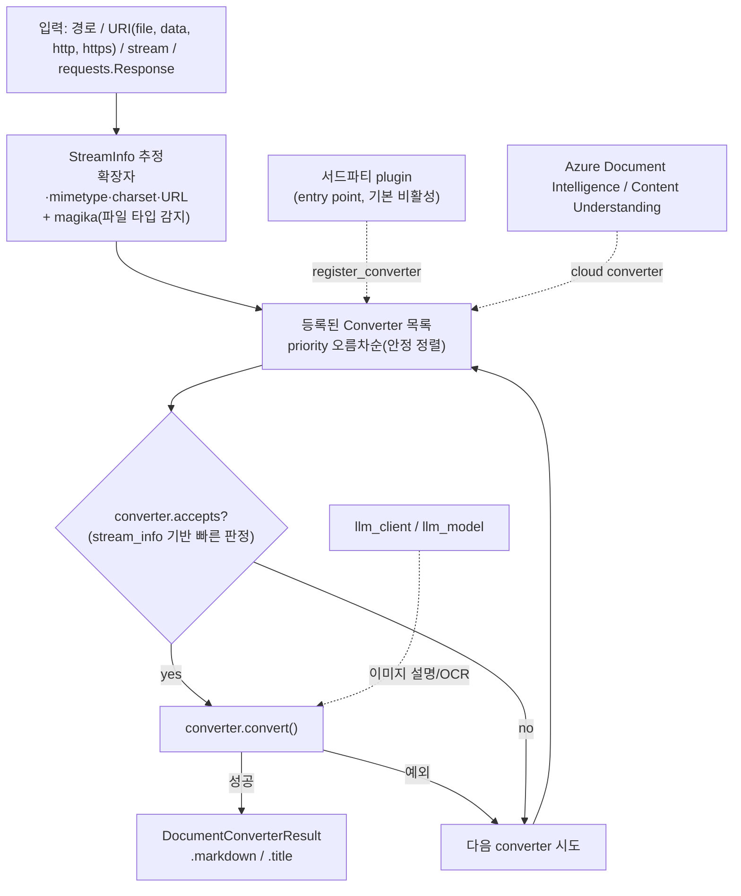

# MarkItDown

> [!summary] 한줄요약
> Microsoft가 관리하는 경량 Python 변환 라이브러리/CLI로, PDF·Word·PowerPoint·Excel·HTML·이미지·오디오·ZIP·EPUB 등을 LLM 입력용 Markdown으로 바꾼다. "converter 레지스트리 + 우선순위 + 플러그인" 구조라 확장이 쉽고, 기본 변환은 포맷별 라이브러리로 오프라인에서 돌지만 이미지 설명·OCR·일부 클라우드 변환은 LLM 또는 Azure에 위임하는 하이브리드다. 사람이 읽는 고충실도 변환용이 아니라고 README가 스스로 선을 긋는다. 2026-10-01 기준 v0.1.8, 스타 약 18.8만.

## 1. 배경 / 해결하는 문제

README의 설명에 따르면 MarkItDown은 `textract`와 가장 비슷한 도구이되, 제목·목록·표·링크 같은 문서 구조를 Markdown으로 보존하는 데 초점을 둔다. 출력은 사람이 보기에도 괜찮은 경우가 많지만 텍스트 분석 도구가 소비하는 것을 전제로 하며, 사람이 읽는 고충실도 변환에는 최선이 아닐 수 있다고 명시한다. Markdown을 고른 이유로 README가 드는 논리는 두 가지다. 주요 LLM이 학습 데이터에서 Markdown을 많이 봤기 때문에 구조를 잘 이해하고, 마크업이 최소라 토큰 효율이 높다는 것이다.

RAG에서 해결하는 문제는 "여러 포맷을 한 줄 API로 텍스트화"하는 인제스트 전처리다. 직접 Word/Excel/PowerPoint 파서를 조합하는 수고를 없애고, 이미지 설명이나 스캔 문서 OCR이 필요하면 LLM 클라이언트나 Azure 서비스를 꽂을 수 있게 해 둔다. 2024-11-13 공개 이후 GitHub 스타가 18만을 넘겼고, 저장소는 모노레포이며 코어 패키지, MCP 서버, OCR 플러그인, 샘플 플러그인 네 개 패키지로 이뤄진다.

이번 조사는 2026-10-01에 저장소를 클론해 `_markitdown.py`, `__main__.py`, `converters/*.py`, `pyproject.toml`, MCP·OCR·샘플 플러그인 패키지의 코드와 README를 직접 열람하고 GitHub API로 릴리스·메트릭을 확인했다. 변환 성능과 품질은 직접 실행해 측정하지 않았다.

## 2. 동작 원리 / 아키텍처

핵심은 `packages/markitdown/src/markitdown/_markitdown.py`의 `MarkItDown` 클래스다.



- **Converter 추상화.** `DocumentConverter`는 `accepts(file_stream, stream_info)`로 "이 문서를 시도할지"를 빠르게 판정하고, `convert()`가 `DocumentConverterResult(markdown, title)`를 돌려준다. `accepts`가 스트림을 읽었다면 위치를 되돌려야 한다는 계약이 docstring에 있다. `text_content`는 `markdown`의 soft-deprecated 별칭이다.
- **우선순위.** `PRIORITY_SPECIFIC_FILE_FORMAT = 0.0`(docx, pdf, xlsx 등 구체 포맷), `PRIORITY_GENERIC_FILE_FORMAT = 10.0`(PlainText, Zip, Html 같은 범용). 변환할 때마다 priority로 안정 정렬해(코드 주석: 변환 중에 priority가 바뀔 수 있어서) 낮은 값부터 시도한다. 같은 우선순위에서는 나중에 등록한 것이 먼저 시도된다. 플러그인은 priority 9처럼 값을 골라 내장 변환기 앞이나 뒤에 끼어들 수 있다.
- **스트림 정보 추정.** 확장자, mimetype, charset, URL에 더해 `magika`(Google의 ML 기반 파일 타입 분류기, 의존성 `magika~=0.6.1`)와 `charset-normalizer`로 후보 StreamInfo 여러 개를 만들어 순서대로 시도한다.
- **입력 경로.** `convert()`는 의도적으로 관대한 진입점(로컬 파일, 원격 URI, 바이트 스트림)이다. `convert_local`, `convert_stream`, `convert_url`, `convert_uri`, `convert_response`가 좁은 변형이다. `convert_uri`는 `file:`(netloc 없음/localhost만), `data:`, `http(s):`만 허용하고 나머지는 ValueError.
- **실패 처리.** 변환기가 예외를 내면 다음 후보로 넘어가고, 모두 실패하면 `FileConversionException`, 해당 변환기가 없으면 `UnsupportedFormatException`. 선택 의존성이 없으면 `MissingDependencyException`이 어떤 extras를 설치할지 안내한다.

## 3. 지원 변환기별 구현과 의존 라이브러리

`converters/*.py` 합계 약 4,850줄. 코어 의존성은 beautifulsoup4, requests, markdownify, magika, charset-normalizer, defusedxml이고 포맷별 의존성은 extras로 분리된다(Python 3.10~3.14, 빌드 hatch, 라이선스 MIT, 분류자 `Development Status :: 4 - Beta`).

| 포맷 | 변환기 | 구현 방식과 의존 라이브러리 | 특이사항 |
|---|---|---|---|
| .docx | DocxConverter | `mammoth`(~1.11.0)로 HTML 변환 후 markdownify 기반 커스텀 변환기(`_CustomMarkdownify`)로 Markdown화. `lxml` 필요. 문서 내장 스타일 맵과 호출자 `style_map`, 밑줄 스타일 맵을 합친다. OMML 수식을 LaTeX로 바꾸는 보조 모듈(`converter_utils/docx/math/omml.py`)과 전처리(`pre_process_docx`) 포함 | 이미지는 훅(`_image_to_html`)이 있어 OCR 플러그인이 끼어듦. 제목은 스타일 기반이라 스타일을 안 쓴 문서는 구조가 약함 |
| .pptx | PptxConverter | `python-pptx`. 슬라이드마다 `<!-- Slide number: N -->` 주석, 제목은 `#`, 표는 HTML 경유 표, 차트는 별도 변환, 그룹 도형은 재귀. 도형은 위치(top, left) 순으로 정렬해 읽기 순서를 근사. 노트(notes)는 내용이 있을 때만 `### Notes:` 섹션으로 추가 | 이미지는 `llm_client`가 있으면 LLM 캡션(alt text 대체), 없으면 원본 alt text 유지 |
| .xlsx / .xls | XlsxConverter / XlsConverter | `pandas` + `openpyxl`(xlsx), `xlrd`(xls). 시트마다 `## 시트명`과 Markdown 표. 일부 생성기가 쓰는 `showZeroes` 속성을 openpyxl이 거부하므로 zip을 열어 `showZeros`로 고쳐 재시도하는 보정 코드 포함 | 수식은 값 위주, 셀 서식·병합 셀·차트는 손실 |
| .pdf | PdfConverter | `pdfplumber`(>=0.11.9) + `pdfminer.six`(>=20251230). 페이지별 단어 좌표로 "폼/표 스타일" 여부를 판정해 맞으면 정렬된 Markdown 표를 만들고, 폼 페이지가 하나도 없으면 `pdfminer.high_level.extract_text`로 전체 추출. pdfplumber 실패 시에도 pdfminer 폴백. MasterFormat식 부분 번호(".1", ".2")가 줄바꿈으로 갈라진 것을 병합하는 후처리, 페이지별 캐시 해제로 메모리 관리 | 텍스트 레이어가 있는 PDF 전제의 규칙 기반 추출. 스캔 PDF는 텍스트가 안 나오며 OCR은 플러그인/Azure 필요. 레이아웃 인식 ML 없음 |
| 이미지(.jpg .jpeg .png) | ImageConverter | `exiftool`(외부 바이너리, 있을 때만)로 메타데이터(ImageSize, Title, Caption, Description, Keywords, Artist, Author, DateTimeOriginal, CreateDate, GPSPosition)를 뽑고, `llm_client`+`llm_model`이 있으면 OpenAI 호환 chat completions로 이미지를 data URI로 보내 `# Description:` 추가. 기본 프롬프트 "Write a detailed caption for this image." | 코드상 확장자는 jpg/jpeg/png만. 기본은 OCR이 아님. LLM 없이는 메타데이터뿐 |
| 오디오(.wav .mp3 .m4a .mp4) | AudioConverter | 메타데이터는 exiftool, 전사는 `SpeechRecognition` + `pydub`. 코드는 `recognizer.recognize_google`을 호출한다 | **외부 전송 주의**: Google 웹 음성 인식 API로 오디오가 나간다. 사내 음성에는 부적합. 기본 언어 en-US |
| HTML | HtmlConverter | BeautifulSoup으로 script/style 제거 후 `_CustomMarkdownify`: ATX 제목(`#`), javascript 링크 제거, 큰 data URI 이미지 절단(`--keep-data-uris`로 유지), URI 이스케이프 | 웹 크롤링용 본문 추출 기능(광고 제거 등)은 없음 |
| CSV | CsvConverter | 표준 `csv` + `charset-normalizer`. 셀 값을 Markdown 표에 안전하게 이스케이프, 앞뒤와 헤더 직후 빈 행 제거 | 대용량 CSV는 표 전체를 문자열로 만들어 토큰 폭증 |
| 텍스트(.txt .md .json .jsonl 등) | PlainTextConverter | charset-normalizer로 인코딩 추정 후 그대로 | text/* 전반을 받는 범용 |
| ZIP | ZipConverter | 내부 파일을 메모리로 읽어 각각 `MarkItDown`으로 재귀 변환해 `## File: 경로` 아래 이어 붙임 | 열람한 코드 범위에서 압축 해제 크기 상한은 확인하지 못함. 신뢰할 수 없는 zip은 사전 검사 필요 |
| EPUB | EpubConverter | `defusedxml`로 OPF/spine 파싱 후 각 (x)html을 HtmlConverter로 | |
| RSS/Atom | RssConverter | `defusedxml` 파싱, 피드·항목을 Markdown으로 | |
| Jupyter(.ipynb) | IpynbConverter | JSON 파싱, markdown/code/raw 셀을 순서대로 | 셀 출력 처리 방식은 확인하지 못함 |
| Outlook .msg | OutlookMsgConverter | `olefile`로 OLE 구조 직접 파싱, 코드페이지 처리 | 메일 파일 전용(.msg) |
| YouTube URL | YouTubeConverter | HTML에서 메타데이터 추출 + `youtube-transcript-api`(~1.2.3)로 자막 | 네트워크 호출 발생 |
| Wikipedia / Bing SERP | WikipediaConverter / BingSerpConverter | 해당 도메인 HTML 전용 본문 추출 | 범용 HTML보다 먼저 시도 |
| 클라우드 | DocumentIntelligenceConverter / ContentUnderstandingConverter | Azure SDK 호출(아래 5절) | 선택 설치 |

**구형 포맷.** 이슈 목록에 legacy `.doc` 변환기 추가 PR(#1710)과 ".doc 확장자 지원" 요청(#23)이 열려 있어 `.doc`는 내장 지원이 아니다. 한글(HWP/HWPX) 변환기도 없다. 형제 도구 [[anydoc]]의 벤치표에서도 markitdown의 doc 칸은 비어 있다.

**PDF 세부.** `_extract_form_content_from_words`가 단어의 x 좌표 정렬로 열 구조를 추정하는데, 코드 주석상 인치당 열 밀도가 너무 높으면(10 초과) 폼이 아니라고 보고 단일 열이면 폼이 아니라고 본다. 즉 선(line) 없는 표를 휴리스틱으로 잡는 방식이다. 이 방식은 규칙이 맞는 문서에서는 표가 살지만 다단 논문, 병합 셀이 많은 표, 도장·스캔본에서는 틀리기 쉽다. 테스트 디렉터리에 `test_pdf_tables.py`, `test_pdf_masterformat.py`, `test_pdf_memory.py`가 있어 표·번호·메모리가 알려진 취약 지점임을 보여 준다.

## 4. 설치 · 사용법 (CLI / Python)

```bash
python -m venv .venv && source .venv/bin/activate   # Python 3.10-3.14
pip install 'markitdown[all]'
# 필요한 것만
pip install 'markitdown[pdf,docx,pptx]'

# CLI
markitdown path-to-file.pdf > document.md
markitdown path-to-file.pdf -o document.md
cat path-to-file.pdf | markitdown                 # stdin 입력(확장자 힌트는 -x, MIME 힌트는 -m, charset 힌트는 -c)

# Docker
docker build -t markitdown:latest .
docker run --rm -i markitdown:latest < ~/your-file.pdf > output.md
```

`__main__.py`의 인자는 `-v`(버전), `-o`(출력 파일), 확장자 힌트(`-x`), MIME 힌트(`-m`), charset 힌트(`-c`), `-d`/`-e`(Document Intelligence와 endpoint), `--use-cu`/`--cu-endpoint`/`--cu-analyzer`/`--cu-file-types`(Content Understanding), `-p`/`--use-plugins`, `--list-plugins`, `--keep-data-uris`다. 중요한 점은 이 CLI에 `--llm-client`, `--llm-model` 같은 옵션이 없다는 것이다. 그런데 OCR 플러그인 README는 `markitdown document.pdf --use-plugins --llm-client openai --llm-model gpt-4o`라는 CLI 예시를 싣고 있다. 클론한 커밋의 `__main__.py`에서 `llm`을 검색해도 일치가 없어서, 해당 예시는 이 커밋 기준으로 동작하지 않거나 문서가 앞서 간 것으로 보인다(확인한 사실은 코드에 옵션이 없다는 것까지). LLM 기반 기능은 Python API로 쓰는 것이 확실하다.

```python
from markitdown import MarkItDown

md = MarkItDown(enable_plugins=False)
result = md.convert_local("report.xlsx")    # 로컬 파일만 받는 좁은 API 권장
print(result.markdown)

# 이미지 설명/OCR (OpenAI 호환 클라이언트)
from openai import OpenAI
md = MarkItDown(enable_plugins=True, llm_client=OpenAI(), llm_model="gpt-4o",
                llm_prompt="이미지 속 텍스트를 표 구조를 유지해 그대로 추출하라")

# Azure Document Intelligence
md = MarkItDown(docintel_endpoint="<endpoint>")
```

## 5. 클라우드·LLM 옵션

**LLM 이미지 설명.** `llm_client`/`llm_model`/`llm_prompt`. 현재 pptx 안의 이미지와 이미지 파일에 적용된다(README). 코드는 이미지를 base64 data URI로 만들어 `client.chat.completions.create`에 보낸다. 즉 OpenAI 호환 `chat.completions`와 `image_url` 형식을 받는 모델이면 사내 호스팅 모델도 연결할 수 있다(비전 모델이어야 함).

**Azure Document Intelligence.** `-d -e <endpoint>` 또는 `MarkItDown(docintel_endpoint=...)`. 코드상 `prebuilt-layout` 모델을 호출하고, PDF와 이미지(JPEG, PNG, BMP, TIFF)에는 수식 추출(FORMULAS), 고해상도 OCR(OCR_HIGH_RESOLUTION), 폰트 스타일(STYLE_FONT) 기능을 켠다. DOCX, PPTX, XLSX, HTML은 OCR 기능 없이 호출한다. 결과의 주석(`<!-- ... -->`)은 제거한다. 인증은 API 키(환경변수 `AZURE_API_KEY`) 아니면 `DefaultAzureCredential`이다. 파일 전체가 Azure로 전송된다.

**Azure Content Understanding.** `--use-cu --cu-endpoint`. 오디오·비디오 포함, 분석기(analyzer) 기반 구조화 필드 추출 결과를 YAML front matter로 직렬화하고, `--cu-analyzer`로 사용자 정의 analyzer를 지정하며, 지정하지 않으면 파일 유형에 맞춰 prebuilt 분석기(문서·이미지는 `prebuilt-documentSearch`, 비디오 `prebuilt-videoSearch`, 오디오 `prebuilt-audioSearch`)를 자동 선택한다. 호출당 과금되므로 `--cu-file-types pdf,jpeg,mp4`로 라우팅 대상을 제한해 비용을 통제한다. `azure-ai-contentunderstanding>=1.2.0b1`이 필요하다(베타 SDK).

**markitdown-ocr 플러그인 (`packages/markitdown-ocr`).** PDF·DOCX·PPTX·XLSX 안의 이미지에서 LLM Vision으로 텍스트를 추출하고, 스캔 문서는 전체 페이지 OCR로 폴백한다. 변환기별 구현 파일(`_pdf_converter_with_ocr.py` 등)과 `_ocr_service.py`가 있다. `markitdown>=0.1.8,<0.2.0`이 필요하고, `llm_client`가 없으면 플러그인은 로드되지만 OCR이 조용히 건너뛰어진다(README). 새로운 ML 라이브러리나 바이너리를 쓰지 않으므로 OCR 품질·비용·데이터 반출이 전적으로 연결한 LLM에 달려 있다.

## 6. 플러그인 구조

- 진입점 그룹 `markitdown.plugin`(`importlib.metadata.entry_points`). 기본 비활성이며 `MarkItDown(enable_plugins=True)` 또는 CLI `--use-plugins`로 켠다. `--list-plugins`로 설치된 플러그인을 본다. 발견용 GitHub 해시태그는 `#markitdown-plugin`.
- 플러그인 모듈은 `__plugin_interface_version__ = 1`과 `register_converters(markitdown, **kwargs)` 함수를 내보낸다. 이 함수 안에서 `markitdown.register_converter(변환기, priority=...)`를 부른다.
- 샘플(`packages/markitdown-sample-plugin`)은 `striprtf`로 RTF를 변환하는 `RtfConverter`를 등록하는 20여 줄 예제이고 `pyproject.toml`의 `[project.entry-points."markitdown.plugin"]`에 `sample_plugin = "markitdown_sample_plugin"`을 선언한다. 사내 포맷(예: HWP, 사내 양식)을 붙이려면 이 템플릿을 복사하면 된다.
- 보안상 플러그인은 임의 코드 실행이므로 신뢰하는 패키지만 설치해야 한다.

## 7. MCP 서버 (`packages/markitdown-mcp`)

- `mcp` Python SDK(`MCPServer`)로 만든 서버이며 도구는 `convert_to_markdown(uri)` 하나. `http:`, `https:`, `file:`, `data:` URI를 받는다.
- 전송 방식: 기본 STDIO. `--http --host 127.0.0.1 --port 3001`로 Streamable HTTP/SSE(Starlette + uvicorn). 호스트를 127.0.0.1/localhost 외로 지정하면 경고를 출력한다. README는 "로컬 신뢰 에이전트용이며 다른 인터페이스에 바인딩하지 말 것, 인증이 없다"는 취지로 강하게 경고한다.
- `MARKITDOWN_ENABLE_PLUGINS` 환경변수로 플러그인 활성화. 오류 메시지는 경로 같은 세부를 노출하지 않도록 정리돼 있다.
- Claude Desktop 연동은 Docker 이미지 사용을 권장하며 `claude_desktop_config.json`의 `mcpServers`에 `docker run --rm -i markitdown-mcp:latest`를 등록하고, 로컬 파일 접근은 `-v /home/user/data:/workdir` 볼륨 마운트로 한다.

## 8. 구체 수치 (출처 표기)

| 항목 | 값 | 출처 |
|---|---|---|
| 스타 / 포크 | 187,807 / 13,886 | GitHub API, 2026-10-01 |
| 생성 / 마지막 push | 2024-11-13 / 2026-10-01 | GitHub API |
| 릴리스 | v0.1.5(2026-02-20), v0.1.6(2026-05-26), v0.1.7(2026-07-29), v0.1.8b1(2026-09-04), v0.1.8b2(2026-09-14), v0.1.8(2026-09-21) | GitHub API(앞의 세 개는 이전 조사 기록, 뒤의 세 개는 이번에 재확인) |
| open_issues_count | 631(PR 포함) | GitHub API(이전 조사 기록) |
| 코어 converters 코드 | 약 4,850줄 | 클론 `wc -l` |
| 가장 큰 변환기 | PDF 589줄, CU 570줄, RSS 488줄, PPTX 364줄, Outlook 349줄 | 클론 `wc -l` |
| 벤치마크(경쟁사 측정) | median 134.8ms, 14포맷 중 6개, 점수 65 | [[anydoc]] README 자체 벤치(100개 실문서, LLM judge) |

벤치마크 수치는 경쟁 도구를 만든 쪽이 측정했으므로 감안해서 읽어야 하며 직접 재현하지 않았다.

## 9. 비교: markitdown vs 대체 도구

| 항목 | MarkItDown | [[anydoc]] | docling | unstructured | [[opendataloader-pdf]] | Azure Document Intelligence |
|---|---|---|---|---|---|---|
| 개발 주체 | Microsoft | Firecrawl | IBM Research Zurich 출신, 현재 LF AI & Data 프로젝트 | Unstructured-IO | Hancom 주도 | Microsoft(클라우드) |
| 구현 | Python, 규칙 기반 + 선택적 LLM/Azure | Rust, 규칙 기반(ML 없음) | Python, ML 레이아웃·표 구조 모델, VLM(GraniteDocling 등) 옵션 | Python, partition 전략(fast/hi_res/OCR) | Java 코어 규칙 기반 + 필요 페이지만 Docling 백엔드(hybrid) | 클라우드 ML(prebuilt-layout) |
| 라이선스 | MIT | 해당 노트 참조 | MIT | Apache-2.0 | Apache-2.0 | 상용 |
| 포맷 폭 | office 중심 + PDF, 이미지, 오디오, ZIP, EPUB 등 | office/PDF 등 14종 | PDF, DOCX, PPTX, XLSX, HTML, EPUB, 오디오, 이미지, LaTeX, 이메일, 비디오 등 | 60종 이상 | PDF 특화 | PDF·이미지·office |
| 출력 | Markdown 위주 | Markdown(GFM) | Markdown, HTML, JSON, DocTags 등 | 구조화 elements(제목·문단·표 등) | Markdown, JSON(bbox 포함), HTML | Markdown 등 |
| 표·레이아웃 | 휴리스틱(PDF) / office는 구조 보존 | 규칙 기반 | 강점(레이아웃, 읽기 순서, 표 구조) | hi_res에서 모델 사용 | 규칙 + AI 보조 | 강점 |
| 스캔 문서 | LLM OCR 플러그인 / Azure | `NeedsOcr` 에러로 반환 | 내장 OCR 옵션 | OCR 지원(tesseract 등 시스템 의존) | AI 백엔드 | 강점 |
| 설치 무게 | 가벼움(extras 선택) | 단일 바이너리 | 무거움(모델 다운로드) | 시스템 패키지 다수(libmagic, poppler, tesseract, libreoffice) | JDK + 선택적 Python 서버 | 서비스 호출 |
| 확장 | 플러그인, MCP, Azure | 바인딩 | LangChain/LlamaIndex/CrewAI/Haystack 통합, MCP 서버, API 서버 | 오픈소스 + 엔터프라이즈 플랫폼 | 접근성(Tagged PDF) 기능 | API |

docling과 unstructured 열은 각 저장소 README(2026-10-01 WebFetch 요약)에 근거하며, 성능 수치는 README에 없어서 비교하지 못했다. 선택 기준을 한 줄로 쓰면 이렇다. office 문서를 빠르게 텍스트화하는 전처리는 MarkItDown, PDF 레이아웃·표 정확도가 중요하면 docling이나 opendataloader, 스캔 위주면 Azure Document Intelligence 또는 사내 승인 OCR, 포맷 폭과 속도가 최우선이면 anydoc을 후보로 놓고 한국어 샘플로 직접 비교하는 것이다.

## 10. 한계 · 성숙도

- **레이아웃 손실.** PDF는 텍스트 레이어 기반 규칙 추출이라 다단·각주·머리글/바닥글·읽기 순서가 섞일 수 있다. 문서의 좌표(bbox)·페이지 번호 같은 출처 정보가 출력에 남지 않아 인용(citation) 요건이 있는 RAG에는 부족하다. 페이지 단위 텍스트 추출 요청(#1263)이 이슈로 남아 있다.
- **표 처리.** PDF 표는 선 없는 정렬 휴리스틱이라 병합 셀·중첩 표에 약하다. Excel은 시트 전체를 Markdown 표로 만들기 때문에 크면 토큰이 폭증하고 서식·수식·차트는 사라진다. docx는 mammoth의 스타일 의존이라 스타일 없이 굵은 글씨로만 제목을 만든 문서는 구조가 안 살아난다.
- **이미지 안의 텍스트.** 기본 설정에서는 OCR이 없다. 이미지 설명과 OCR은 LLM 비전 모델 호출 비용과 반출 위험이 따른다.
- **포맷 공백.** 구형 .doc/.ppt/.hwp 미지원. 한국어 PDF 품질은 직접 검증하지 못했다.
- **버전 성숙도.** 0.1.x 베타, 릴리스는 1~3개월 간격이며 API가 바뀔 수 있다. 이슈 631건 적체로 개별 버그 수정 속도는 보장되지 않는다. 대표 이슈는 LLM 연동 문의(#12), docx `w:ilvl` KeyError(#1282), 중국어 이미지 변환 문의(#114) 등.
- **성능.** 변환은 동기 단일 호출이며 병렬 처리·진행률·재시도 오케스트레이션은 호출자 몫이다.
- **범위.** CONTRIBUTING이 웹 서버·REST API·UI 앱은 범위 밖이라고 못박아 라이브러리 계층에 머문다.

## 11. 보안 · 라이선스 · 운영 리스크

README의 IMPORTANT 박스가 핵심이다. MarkItDown은 현재 프로세스 권한으로 I/O를 수행하므로 `open()`이나 `requests.get()`처럼 프로세스가 접근 가능한 모든 자원에 접근한다.

1. 신뢰할 수 없는 입력(사용자가 준 경로/URL)을 `convert()`에 그대로 넘기지 않는다. 로컬 경로 제한, URI 스킴·네트워크 목적지 제한, loopback·link-local·클라우드 메타데이터 주소(169.254.x.x) 차단이 필요하다. SSRF와 임의 파일 읽기 위험이다.
2. 가장 좁은 API(`convert_local`, `convert_stream`)를 쓴다.
3. MCP 서버를 0.0.0.0에 바인딩하지 않는다(인증 없음).
4. 플러그인은 임의 코드이므로 출처를 검증한다(기본 비활성).
5. LLM OCR·이미지 설명·Azure·YouTube 자막 조회·오디오 전사(Google 음성 인식)를 켜면 문서 내용이나 요청이 외부로 나간다. 사내 문서에는 사내 호스팅 모델이나 사내 Azure 테넌트 같은 승인된 엔드포인트만 쓴다.
6. XML 계열(EPUB, RSS)은 `defusedxml`로 기본 방어하지만, ZIP·거대 파일의 리소스 한도는 열람한 코드 범위에서 고정 상수 형태로 확인하지 못했다. 업로드형 서비스라면 파일 크기·압축 해제 크기·타임아웃을 호출 측에서 걸어야 한다.
7. MIT 라이선스라 상용 제약은 없다. 의존 라이브러리(magika, mammoth, pdfminer.six 등)의 라이선스는 개별 점검하지 않았다(`ThirdPartyNotices.md` 존재). `SECURITY.md`는 Microsoft 표준 절차(공개 이슈 대신 MSRC).

## 13. 관련 노트

- [[anydoc]]: Rust 기반 고속 대안, 포맷 폭과 속도 비교
- [[opendataloader-pdf]]: PDF 특화, 한국어 PDF 비교 대상
- [[pageindex]]: 변환 후단의 문서 트리 인덱싱

## 14. 출처

- https://github.com/microsoft/markitdown 클론(2026-10-01): README, packages/markitdown/pyproject.toml, `__about__.py`(0.1.8), `__main__.py`, `_markitdown.py`, `_base_converter.py`, `converters/*.py`(docx, pptx, xlsx, pdf, image, audio, html, csv, zip, epub, rss, youtube, doc_intel, cu 등), packages/markitdown-mcp(README, `__main__.py`), packages/markitdown-ocr(README, 소스 목록), packages/markitdown-sample-plugin, SECURITY.md
- GitHub REST API: repos/microsoft/markitdown, releases (2026-10-01)
- https://github.com/firecrawl/anydoc README 벤치마크 표(기존 [[anydoc]] 노트 경유)
- https://github.com/docling-project/docling , https://github.com/Unstructured-IO/unstructured (README 요약, WebFetch, 2026-10-01)
- 기존 vault 노트 [[opendataloader-pdf]]

## 15. 확인하지 못한 항목

- 한국어 PDF/문서 변환 품질, 직접 속도 측정, 대체 도구와의 실측 비교. 사유: 이번에는 코드·문서 열람 중심이며 변환을 실행하지 않음.
- ZIP·대용량 파일의 리소스 한도 방어 수준(열람 범위 밖일 수 있음), 의존 라이브러리 라이선스 전수 점검.
- markitdown-ocr의 실제 OCR 정확도, OCR README의 CLI 예시(`--llm-client`)와 코드 불일치의 원인(문서 선행인지 별도 브랜치인지).
- docling의 레이아웃·표 모델 이름과 성능 수치(README 요약에 없음), unstructured의 partition 전략별 세부(요약에 일부만).
- Azure Document Intelligence/Content Understanding의 실제 호출 결과와 요금.
