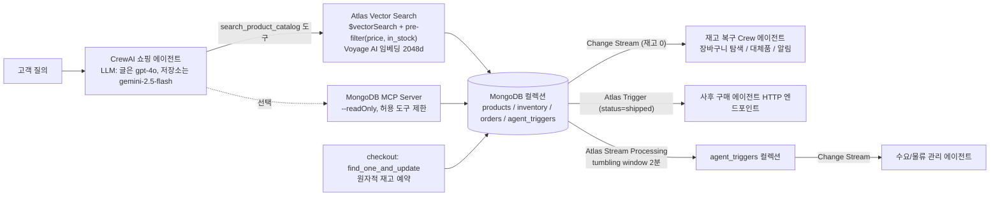

# MongoDB + CrewAI 이커머스 AI 에이전트

> [!summary] 한줄요약
> MongoDB 벤더 블로그(2026-08-19, Nasir Qureshi, Jordan Smith)로, 한 개의 Atlas 클러스터 안의 Vector Search, MongoDB Search, Change Streams, Atlas Triggers, Atlas Stream Processing으로 쇼핑 에이전트의 "탐색 -> 구매 결정 -> 결제 -> 사후 관리" 여정을 구성하는 튜토리얼이다. 실제로 값어치 있는 기술 포인트는 (1) 필터를 벡터 검색 전에 적용하는 pre-filter 하이브리드 검색, (2) 원자적 `find_one_and_update` 재고 예약, (3) 이벤트 성격별 서비스 선택 기준이고, 나머지는 자사 플랫폼 홍보 성격이 강하다.

## 배경 / 해결하는 문제

글의 출발점은 Stord의 2026 AI 이커머스 보고서를 인용한 소비자 동향이다(생성형 AI로 온라인 쇼핑을 한다고 답한 소비자 수가 전년 대비 34% 증가, Z세대 37%, 밀레니얼 29%). 이 수치는 글이 제3자 보고서를 인용한 것으로 원 보고서는 확인하지 못했다. 글은 "agentic commerce journey(제로클릭 구매)"를 다섯 단계로 정의한다. (1) 고객이 질문하면 에이전트가 키워드가 아니라 의도를 해석, (2) 에이전트가 사양·가격·평점·리뷰와 함께 후보를 추려 제시, (3) 후속 질문을 거쳐 고객이 구매 결정, (4) 즉시 결제가 가능한 상품은 에이전트가 결제 전체를 처리(결제 정보가 없으면 에이전트가 안전하게 수집, 암호화, DB 저장), (5) 주문 추적, 상태 변경 시 선제 안내, 반품 처리.

각 단계가 플랫폼에 요구하는 것은 자연어 이해, 의미 기반 상품 검색, 수천 개 옵션의 품질·가격 평가, 구매 순간의 정확한 재고 확인, 사용자 요청 없이도 주문 이벤트를 인지하는 능력이다. 글의 논지는 "대부분의 팀이 검색 서비스, 벡터 DB, 메시지 브로커, 이벤트 처리 인프라, 운영 DB를 따로 조합하는데, 각 인계마다 지연·동기화 문제·운영 부담이 늘고 데이터가 현실과 어긋난다. MongoDB는 이를 한 플랫폼으로 통합한다"는 것이다. 즉 이 글은 RAG 일반론이 아니라 "에이전트가 쓰는 데이터 계층을 한 곳에 두자"는 아키텍처 주장이다.

## 동작 원리 / 아키텍처



**Step 1~3: 상품 탐색과 구매 결정.** 상품 임베딩은 상품 데이터와 같은 클러스터에 저장된다. 글의 코드는 상품 문서를 `Name/Brand/Category/Description/Features/Review summary/Price/In stock`을 줄 단위로 이어 붙인 텍스트(`productToEmbeddingText`)로 만들고 임베딩해 `embedding`과 `embedding_text` 필드에 `$set`한다. Vector Search 인덱스는 `embedding`을 `vector` 타입(numDimensions 2048, similarity cosine)으로, `price`와 `in_stock`을 `filter` 필드로 정의한다. 중요한 설계 포인트는 글이 직접 설명하듯 filter 필드로 인덱싱해 두면 "벡터 유사도 검색을 먼저 하고 나중에 거르는" 후처리 필터가 아니라 유사도 계산 전에 조건을 적용(pre-filter)해 "$100 이하이며 구매 가능한 상품 안에서만" 검색한다는 점이다. 에이전트는 `@tool("Search product catalog")` 함수로 이 파이프라인(`$vectorSearch`: numCandidates 100, limit 5, filter `price <= 100 and in_stock == True`, `$project`로 `vectorSearchScore` 포함)을 호출한다.

**auto-embedding 대안.** 위는 앱이 임베딩을 직접 만드는 방식이고, 대안으로 인덱스 정의에 `{"type":"autoEmbed","modality":"text","path":"search_text","model":"voyage-4"}`를 두면 Atlas가 문서와 질의 임베딩을 자동 생성해 앱은 `"query": {"text": query}`로 질의 텍스트만 보내면 된다. 앱 코드가 줄어드는 대신 임베딩 모델 선택과 데이터 이동이 플랫폼에 종속된다. 글은 이 경우 필터를 위해 MongoDB Search를 "Vector Search 위에 얹는다"고 설명하지만 본문 코드에서는 `$vectorSearch`의 `filter`로 구현했고, 키워드와 벡터를 결합한 하이브리드 점수 융합(RRF 등) 코드는 글에 없다. 즉 "하이브리드"는 시맨틱 + 정확 조건 필터를 뜻한다.

**MongoDB MCP Server(선택).** `MCPServerStdio(command="npx", args=["-y","mongodb-mcp-server@latest","--readOnly"], env={"MDB_MCP_CONNECTION_STRING": ...}, tool_filter=create_static_tool_filter(allowed_tool_names=["list-databases","list-collections","collection-schema","collection-indexes","find","aggregate"]), cache_tools_list=True)`로 에이전트(`mcps=[mongo_mcp]`)에 읽기 전용 일반 DB 조회 능력을 준다. 주 경로는 Vector Search 도구이고 MCP는 후속 질의(상품 메타데이터, 재고 필드, 주문 맥락 조회)용이다. 글은 읽기 전용 모드와 도구 허용 목록으로 "무제한 DB 접근은 주지 않는다"고 강조한다.

**Step 4: 재고 정확성(Change Streams).** 글은 고트래픽 세일에서 마지막 한 개가 장바구니 담기와 결제 확정 사이 몇 초에 팔려 나가면 구매는 통과하는데 재고 시스템이 거부해 "품절 알림과 환불"이 발생하고 규모가 커지면 CS와 환불 비용이 쌓인다고 문제를 설명한다. 해법은 두 부분이다. 첫째, 원자적 업데이트: `inventory.find_one_and_update({"sku": sku, "quantity": {"$gte": quantity}}, {"$inc": {"quantity": -quantity}}, return_document=ReturnDocument.AFTER)`. 이미 마지막 한 개가 팔렸다면 쿼리가 매치하지 않아 `None`이 오고, 결제 확정 전에 흐름을 중단할 수 있다. 이 방식은 조건 확인과 차감을 하나의 단일 문서 연산으로 처리해 경합을 막는다(MongoDB 단일 문서 연산의 원자성에 의존). 둘째, Change Streams로 재고가 0이 되는 순간 이벤트를 받아(`inventory.watch([{"$match": {"operationType":"update","fullDocument.quantity":0}}], full_document="updateLookup")`) CrewAI "재고 복구 전문가" 에이전트를 기동한다. 이 에이전트는 해당 SKU가 담긴 활성 세션을 찾고, 대체 상품을 제안하고, 고객에게 알린다. 글 코드의 세 도구(`find_active_sessions_with_sku`, `suggest_alternative`, `notify_customer`)는 "여기를 실제 로직으로 교체하라"는 주석과 함께 빈 값/문자열을 반환하는 스텁이다.

**Step 5: 사후 관리 3종 세트.** Atlas Triggers는 주문 `status`가 `shipped`가 되는 순간(커밋된 DB 이벤트)을 서버리스 함수로 처리한다. Atlas가 내부 change stream을 열고 유지하며, 함수는 `changeEvent.fullDocument`를 받아 JSON 본문으로 사후 구매 에이전트의 HTTP 엔드포인트에 POST한다(응답이 2xx가 아니면 에러). Atlas Stream Processing은 단일 이벤트가 아닌 "패턴"을 본다. 파이프라인은 `orders` 컬렉션의 `estimatedDelivery` 변경을 소스로 받아 `delayMinutes = $dateDiff(originalEstimatedDelivery, estimatedDelivery)`를 계산하고 30분 이상 지연된 것만 남긴 뒤, 2분 `$tumblingWindow`(processingTime 기준)에서 carrier + shippingRegion 별로 건수·평균·최대 지연과 최대 25개의 주문 ID를 집계한다. 같은 carrier-region 코호트에서 10건 이상이면서 평균 지연이 45분 이상일 때만 `agent_triggers` 컬렉션에 `delivery_delay_pattern` 신호(`severity: warning`, `agentAction: draft_customer_delay_notice`)를 `$merge`로 쓴다. 별도 Change Stream이 그 컬렉션을 감시해 "수요 관리 에이전트"를 호출하는 구조다.

**서비스 선택 기준(본문 Figure 1의 의사결정 프레임워크).** 글은 그림으로 제시했고 본문 텍스트는 도식을 설명하지 않는다. 요약 문구와 앞뒤 설명을 합치면 Change Streams는 애플리케이션이 직접 커서를 열어 실시간 반응하는 경우, Atlas Triggers는 완전 관리형 서버리스로 개별 이벤트에 반응하는 경우, Stream Processing은 시간 윈도우 집계 등 지속적 패턴 탐지에 쓰는 것으로 정리된다(그림 자체는 이미지라 읽지 못함).

## 핵심 기능 상세

- **의도 -> 후보 -> 필터:** 시맨틱 검색에 가격·재고 같은 하드 조건을 pre-filter로 함께 걸어 "적격한 후보만" 반환. 상품 카탈로그, 재고, 리뷰, 가격 같은 운영 데이터가 같은 DB에 있어 에이전트가 한 번의 조회로 완전한 상품 문서를 얻는다는 점이 글의 강조점이다.
- **원자성 + 이벤트의 분업:** 정확성(재고 차감)은 원자적 단일 연산이 책임지고, Change Streams는 사후 반응(대체품 안내)을 담당. 글은 "폴링 간격이 없어 동기화 격차가 없다"고 쓰지만 Change Streams는 커밋 이후 비동기로 전달되므로 정확성의 근거는 원자적 업데이트라고 읽어야 한다.
- **에이전트 도구 설계:** CrewAI `Agent(role, goal, backstory, tools, llm)` + `@tool` 데코레이터. 에이전트별로 도구 집합이 작고 목적이 분명하다(쇼핑 에이전트, 재고 복구 에이전트, 사후 구매 에이전트, 수요 관리 에이전트의 4개 역할).
- **이벤트 -> 에이전트 연결 패턴:** DB 이벤트(Change Stream, Trigger, ASP 결과 컬렉션)가 에이전트 실행의 트리거가 되는 "이벤트 기반 에이전트" 구조.

## 설치 · 사용법

예제 저장소 `mongodb-developer/ecommerce-ai-agents`를 클론해 구조를 확인했다. README 요약:

```sh
python -m venv .venv && source .venv/bin/activate
pip install -r requirements.txt     # pymongo>=4.9, crewai[google-genai]>=1.14.0, voyageai>=0.3.0, python-dotenv
cp env.example .env                 # MONGODB_URI, VOYAGE_API_KEY, GEMINI_API_KEY (+MDB_MCP_CONNECTION_STRING)
python -m scripts.seed_data         # 샘플 상품 + inventory 삽입 (컬렉션 생성 겸)
python -m scripts.create_vector_index   # product_vector_index 생성 후 queryable 대기
python demo.py "lightweight running shoes under $100 with good arch support"
python demo.py --checkout SHOE-RUN-001  # 원자적 재고 예약
python -m checkout.stock_recovery       # Change Stream 감시자 (별도 터미널)
```

저장소 파일: `db.py`(lru_cache로 메모이즈된 단일 MongoClient), `demo.py`, `search/product_search.py`(`voyage-4-lite`, output_dimension 2048, `$vectorSearch`), `search/product_search_mcp.py`(MCP 변형), `checkout/reserve_inventory.py`, `checkout/stock_recovery.py`, `indexes/product_vector_index.json`, `post_purchase/atlas_trigger_shipped.js`, `stream_processing/delivery_delay_pipeline.json`, `docs/DEPLOYING_CLOUD_ARTIFACTS.md`. 코드는 총 약 470줄 규모의 작은 데모다. 연결 문자열과 API 키는 `.env`(gitignore)에 두고 코드·노트에 기록하지 않는다(env.example에는 자리표시자만 있음).

예제 요구사항(README): Atlas 클러스터 필수(Vector Search는 자체 관리형 MongoDB에서는 쓸 수 없다고 명시), 무료 M0 티어로 Vector Search와 Change Streams 테스트 가능(M0는 search/vector 인덱스 3개 상한, 본 앱은 1개 사용), Atlas Stream Processing은 M10 이상과 별도 Stream Processing Instance가 필요하며 로컬 실행 범위 밖, Atlas Trigger는 M0에서도 동작.

## 디렉터리 · 코드 구조에서 확인한 것

- 블로그 대비 저장소의 차이: 블로그는 LLM으로 `gpt-4o`, auto-embed 예시는 `voyage-4`를 쓰지만 저장소는 `gemini/gemini-2.5-flash`와 `voyage-4-lite`를 쓴다(무료 티어로 돌리기 위한 선택이라고 README가 설명). 블로그의 `search_product_catalog` 첫 코드(수동 임베딩)와 저장소의 구현은 같은 구조다.
- 저장소 `reserve_inventory.py` 주석은 "자체 MongoClient 대신 `db.py`의 공유 클라이언트를 쓴다. CHANGES.md 참조"라고 쓰는데 `CHANGES.md`는 저장소 파일 목록에 없다.
- GitHub API(2026-10-01): 스타 2, 포크 0, 생성 2026-07-08, 마지막 push 2026-07-08, 라이선스 표시 없음(`license: null`, LICENSE 파일도 목록에 없음). 즉 이 예제 저장소는 사실상 일회성 데모이며 라이선스가 명시되지 않아 재사용 조건이 불명확하다. 또한 글(2026-08-19)보다 저장소 활동(2026-07-08)이 앞서 있다.
- 블로그의 Atlas Trigger 함수는 `order.status !== "shipped"`를 함수 안에서 확인한다. 저장소 문서(DEPLOYING_CLOUD_ARTIFACTS.md)는 여기에 더해 트리거에 서버 측 match expression `{ "updateDescription.updatedFields.status": "shipped" }`을 거는 것을 권장한다(match가 없으면 주문의 모든 필드 업데이트마다 함수가 호출되어 대부분 버려진다는 이유). 글의 코드를 그대로 쓰면 비용 낭비가 생긴다는 보완 지침이다.

## 비교 대상

| 항목 | MongoDB 통합(이 글) | Postgres + pgvector([[cerebras-knowledge-base-pgvector-rrf-mcp]]) | 분리형(전용 벡터 DB + 브로커 + OLTP) |
|---|---|---|---|
| 벡터 검색 | Atlas Vector Search (Atlas 전용) | pgvector 확장(자체 호스팅 가능) | Qdrant/Pinecone 등 |
| 하이브리드 | 시맨틱 + 구조화 필터, 점수 융합 코드는 없음 | 전문 검색 + 벡터 + RRF | 구성에 따라 |
| 이벤트 | Change Streams/Triggers/Stream Processing | LISTEN/NOTIFY, 논리 복제, 외부 큐 | Kafka 등 별도 |
| 임베딩 | Voyage AI auto-embed 가능(플랫폼 종속) | 앱에서 생성 | 앱에서 생성 |
| 락인 | 높음(Atlas 전용 기능) | 낮음 | 중간 |

글은 "단일 플랫폼"이 단순성과 일관성을 준다고 주장하지만 Vector Search, Triggers, Stream Processing이 모두 Atlas(관리형) 기능이라 온프레미스·폐쇄망 환경에서는 쓸 수 없다. 이 점은 글의 결론에서 장점으로만 서술되고 락인 비용은 다뤄지지 않는다. 임베딩 모델/벡터 DB 선택 기준 일반론은 [[vector-db-comparison-2023]]를 참고하되 2023년 자료라 최신 상태 확인이 필요하다.

## 장단점 · 한계 · 성숙도

장점: 코드가 짧고 이해하기 쉽다. 특히 (1) pre-filter, (2) 원자적 재고 예약, (3) 이벤트 종류별 도구 선택, (4) MCP 읽기 전용 + 도구 허용 목록 패턴은 이커머스가 아니어도 재사용할 만한 설계다. 저장소는 재현 단계(시드 -> 인덱스 -> 데모)가 명확하고 인덱스 queryable 대기 같은 세부도 처리한다.

한계(글/저장소 확인 범위): (1) 벤더 마케팅 글이며 성능·지연·비용·정확도 벤치마크가 전혀 없다. "단일 플랫폼이 낫다"는 주장은 정성적이다. (2) 상품 5개 안팎의 시드 데이터로 시연하는 수준이라 실제 규모(수십만 SKU, 동시성)에서의 재고 경합, 인덱스 지연, 임베딩 비용은 검증되지 않았다. (3) Change Stream 처리 루프가 동기식이다. 저장소 `stock_recovery.py`에서 `stock_recovery_crew.kickoff()`가 스트림 순회 루프 안에서 직접 실행되어, LLM 호출 동안 다음 이벤트 처리가 막힌다(운영에서는 큐로 분리해야 함, 이는 코드를 읽고 내린 판단). (4) MongoDB 공식 Change Streams 문서(v8.0, 2026-10-01 열람)는 `fullDocument: "updateLookup"`에 `$match`를 함께 쓰면 급속한 삭제·트래픽 급증 시 'Resume Token Not Found' 오류가 날 수 있다고 경고하며 pre/post image(`whenAvailable`) 사용을 권한다. 글과 저장소의 재고 감시 코드는 정확히 이 조합(`updateLookup` + `fullDocument.quantity` match)이다. (5) 에이전트가 결제 정보를 수집·암호화·저장한다는 서술이 있으나 구체적 구현·PCI 범위 논의는 없다. (6) 결제 확정이 에이전트 판단에 맡겨질 때의 승인·한도·감사 통제가 다뤄지지 않는다. (7) 4개의 CrewAI 에이전트 정의는 있으나 평가(오작동, 환각, 비용)에 관한 내용이 없다. (8) 글에 쓰인 수치(2048차원, 30분/10건/45분 임계값, 2분 윈도우)는 예시 파라미터일 뿐 근거 없는 설정값이다.

성숙도: 글은 2026-08-19 게시, 예제 저장소는 별(★) 2개의 소규모 데모. CrewAI의 MongoDB 공식 통합 문서(Atlas 문서의 "Build an Agentic RAG Application with CrewAI and MongoDB")는 별도로 존재하며 PDF 분석 에이전트 튜토리얼이다(OpenAI 키 필요, `crewai-tools[mongodb]`). 이 글의 이커머스 튜토리얼과는 다른 문서다.

## 보안 · 라이선스 · 운영 리스크

- **연결 문자열/키:** 글과 저장소 모두 `MONGODB_URI`, `MDB_MCP_CONNECTION_STRING`, `VOYAGE_API_KEY`, `GEMINI_API_KEY`를 환경변수로 받는다. 사내 적용 시 시크릿 매니저로 주입하고, MCP용 연결 문자열은 읽기 전용 DB 사용자로 분리한다(저장소 env.example도 "별도 read-only 사용자 권장"을 시사). 노트에 값은 기록하지 않았다.
- **MCP 서버 공급망:** `npx -y mongodb-mcp-server@latest`는 버전을 고정하지 않아 실행 시점의 최신 패키지를 내려받는다. 운영에서는 버전 핀, 해시 검증, 사내 미러를 쓴다. `--readOnly`와 허용 도구 목록(`find`, `aggregate` 포함)을 걸었어도 `aggregate`는 `$out`/`$merge` 같은 쓰기 단계를 허용할 수 있으므로 readOnly가 이를 막는지 확인해야 한다(이번에 검증하지 못함).
- **프롬프트 인젝션/권한:** 상품 설명·리뷰는 외부 입력이다. 리뷰 텍스트에 지시문이 있으면 에이전트가 따를 수 있으므로 도구 권한 최소화, 구매·환불 같은 쓰기 행위는 사람 승인 또는 서버 측 정책 검사를 둔다. 에이전트 도구는 `price <= 100` 같은 정책을 코드에 고정한 반면(좋은 점), 사용자 지시로 우회되지 않게 서버에서 강제해야 한다.
- **데이터 반출:** 질의와 상품 텍스트가 Voyage AI(임베딩), LLM 제공자(OpenAI/Gemini)로 전송된다. auto-embed를 쓰면 문서 임베딩도 Atlas를 통해 모델 제공자 경로로 처리된다. 개인정보·사내 데이터는 승인된 엔드포인트에서만 처리.
- **Atlas 종속·비용:** Vector Search/Triggers/Stream Processing은 Atlas 전용이며 Stream Processing은 M10+와 별도 인스턴스 비용이 든다(README). 호출 단위 과금 항목은 사전 산정 필요.
- **라이선스:** 예제 저장소는 라이선스 미표기(권리 불명확). 코드를 그대로 가져다 쓰지 말고 참조해 재작성한다. CrewAI, pymongo, voyageai의 라이선스는 이번에 개별 확인하지 않았다.

## 관련 노트

- [[semantica]] — 에이전트 시맨틱/지식 계층 비교
- [[vector-db-comparison-2023]] — 벡터 저장소 선택 기준
- [[cerebras-knowledge-base-pgvector-rrf-mcp]] — Postgres 단일 스택 하이브리드 검색 + 얇은 MCP 도구 설계와 대비
- [[ragas]] — 이 글에 빠져 있는 에이전트/검색 품질 평가를 보완할 프레임워크

## 출처

- https://www.mongodb.com/company/blog/technical/building-ecommerce-ai-agents-on-mongodb-with-crewai — 본문 전문과 코드 블록(HTTP 응답 HTML 텍스트 추출, 2026-10-01). 본문 Figure 1(의사결정 프레임워크)은 이미지라 읽지 못함.
- https://github.com/mongodb-developer/ecommerce-ai-agents — 예제 저장소 클론: README, requirements.txt, env.example, db.py, search/*, checkout/*, scripts/*, indexes/*, docs/DEPLOYING_CLOUD_ARTIFACTS.md (2026-10-01)
- GitHub REST API repos/mongodb-developer/ecommerce-ai-agents (스타, 라이선스, 날짜)
- https://www.mongodb.com/docs/v8.0/changeStreams/ — Change Streams 공식 문서 (updateLookup 경고, pre/post image)
- https://www.mongodb.com/docs/atlas/ai-integrations/crewai/build-agents/ — CrewAI + MongoDB 공식 튜토리얼(별도 문서 확인용)

확인 못한 것: Stord 보고서 원문, Figure 1 이미지 내용, MongoDB MCP Server `--readOnly`와 `aggregate`의 쓰기 단계 차단 여부, 실제 규모에서의 성능, Atlas 가격, 한국어 상품 검색 품질(Voyage 모델의 다국어 성능), 예제 저장소의 라이선스(미표기).
