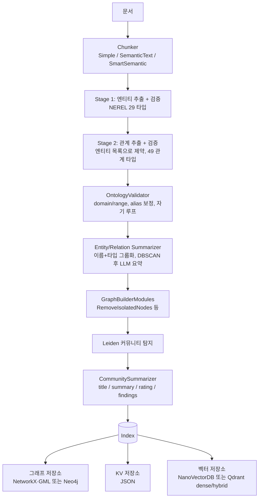

# RAGU

> [!summary] 한줄요약
> 러시아 ITMO·NSU 연구진의 MIT 라이선스 GraphRAG 엔진. 추출과 통합을 분리해 지식 그래프를 만들고 여러 검색 방식으로 질의한다.

텍스트 청킹 후 **2단계 타입 추출(엔티티 → 관계)**, DBSCAN 기반 중복 통합과 LLM 요약, Leiden 커뮤니티 탐지를 거친다. 검색은 Local/Global/Naive/Mix와 QueryPlan을 제공한다.

2026-07 arXiv 논문(2607.11683)이 나왔고 v0.1.0(2026-09)에서 온톨로지 검증 계층이 추가됐다. 다만 스타 135개의 소규모 알파 프로젝트이며, 평가 대부분은 저자 자체 수행이다.

## 배경: 해결하려는 문제

GraphRAG(Microsoft, LightRAG, HippoRAG 2 등)는 문서에서 지식 그래프를 만들어 청크 검색만으로는 어려운 "코퍼스 전체에 걸친 질문"이나 다중 홉 질문을 푼다. RAGU 논문은 현행 시스템의 세 가지 장애물을 든다.

1. 그래프 구축이 단일 LLM 추출 패스라서 중복되고 잡음 많은 엔티티가 생기고 청크 간 정보를 합치는 단계가 없다.

2. 추출 품질이 그래프 품질을 정하기 때문에 GPT-4급 대형 API 모델에 의존하게 된다.

3. 오픈소스 프레임워크의 공학적 미성숙(설치 실패, LLM 출력에 `eval()`을 쓰는 불안전 코드 경로 등).

RAGU의 설계 주장은 "추출과 통합을 분리한다"는 것이다. 청크별로 엔티티를 먼저 뽑아 스키마로 검증하고, 그 엔티티를 제약으로 삼아 관계를 뽑는다.

그런 다음 동일 엔티티·관계를 모아 필요하면 군집화와 LLM 요약으로 하나의 설명으로 합친 후에야 커뮤니티 탐지를 한다.

논문은 또 "파이프라인 안의 LLM에 필요한 능력(이해, 추출, 문맥 추론)은 언어 능력이고 세계 지식보다 모델 크기에 따라 천천히 느는 능력"이라는 가설 아래, 작은 모델로도 추출이 가능하다고 주장한다.

이 가설은 Qwen2.5 계열에서 CheGeKa(세계 지식 퀴즈)가 0.5B→72B로 21.1배, MultiQ(모든 사실이 문맥에 있음)는 4배만 오른다는 그림으로 뒷받침되는데, 논문 스스로 "한 모델 패밀리에 근거한 가설이지 정리는 아니다"라고 한계에 적었다.

README는 "nano-graphrag에 부분적으로 기반한다"고 밝힌다. 이 저장소는 설계 아이디어와 인터페이스를 nano-graphrag에서 가져왔다는 뜻이다(코드 대조는 하지 않음).

## 동작 원리와 아키텍처

### 인덱싱 파이프라인

`AGENTS.md`(개발 가이드)가 설명하는 인덱싱 흐름은 다음과 같다.

1. **문서 분할:** 문서 → Chunker → 청크 목록
2. **추출:** ArtifactExtractor가 엔티티·관계를 추출
3. **통합:** EntitySummarizer/RelationSummarizer가 병합하고 선택적으로 LLM 요약
4. **그래프 보정:** 선택적 GraphBuilderModule 적용(예: RemoveIsolatedNodes)
5. **커뮤니티 구성:** Leiden 커뮤니티 탐지 → CommunitySummarizer의 커뮤니티 리포트
6. **영속화:** Index에 그래프+KV+벡터 저장

질의는 `SearchEngine.a_search()`(검색만) 또는 `a_query()`(검색+LLM 답변)로 진행한다.



이 그림은 `AGENTS.md`, `docs/en/ragu_components.md`, 논문 §2.1, `ragu/storage/README.md`에서 재구성했다.

### 청킹

`SimpleChunker`는 고정 크기(예: `max_chunk_size=1000`)로 나누고, `SemanticTextChunker`는 임베딩 기반 분할점을 쓰며, `SmartSemanticChunker`는 `smart_chunker`(교차 인코더 재순위화 기반; 선택 extra `graph_ragu[local]`)를 쓴다. 한국어 문서에서 어떤 청커가 맞는지는 확인하지 못했다. `smart_chunker`와 `razdel`, `pymorphy3` 같은 의존성이 러시아어 NLP 도구라는 점은 짚어 둘 만하다(의존성 목록 기준).

### 2단계 추출과 온톨로지 검증

`TwoStageArtifactsExtractorLLM`은 먼저 엔티티를 뽑아 검증하고, 관계 단계에서 `source_entity`와 `target_entity`가 검증된 엔티티 이름과 일치해야 한다고 강제해 "엔티티-관계 불일치"를 줄인다. 단일 패스 `ArtifactsExtractorLLM`도 있다. 둘 다 few-shot ICL을 지원하며 선택 전략은 `semantic`, `bm25`, `hybrid`, `random`이고 `ICLConfig(enabled=True, num_examples=2)`로 켠다(1~3개 권장). ICL 예시를 직접 만드는 스크립트 `scripts/generate_icl_examples.py`와 설정 `config/icl_generation.yaml`도 있다.

v0.1.0(CHANGELOG 표기 2026-09-08, GitHub 릴리스 게시 2026-09-07 UTC)의 가장 큰 변화는 온톨로지 계층(`ragu/triplet/ontology`)이다. 어휘(엔티티·관계 타입)와 이를 제약하는 규칙을 한 객체로 묶었다. 술어별 `domain`/`range`, 엔티티 타입 계층, 대칭·역관계, `aliases`, 끝점 타입에 따라 술어를 바꾸는 `retype_when` 규칙이 있다.

`Ontology.builtin("nerel")`, `Ontology.from_yaml(path)`(다른 온톨로지를 `extends:` 가능), `Ontology.from_type_lists(entities, relations)`로 만든다.

`OntologyValidator`는 어휘 밖 타입, domain/range 위반, 자기 루프, 청크에 없는 끝점을 검사하고, `ValidationPolicies`로 검사별 처리(`COERCE` 보정, `DROP`, `KEEP`, `RAISE`)를 선택한다. 프리셋은 `permissive()`, `strict()`, `failing()`이다.

즉 LLM 출력의 스키마 위반을 코드가 정리하는 방식이어서, 한국어/도메인 온톨로지를 YAML로 정의해 같은 구조를 쓸 수 있다는 점이 우리에게는 실용적이다.

반면 CHANGELOG에는 이것이 **Breaking change**로 기록됐다(`entity_types`/`relation_types` 인자가 `ontology` 하나로 대체). 소규모 알파 프로젝트에서 minor 단위 호환성 파괴가 잦다는 신호다.

### 통합(consolidation), 군집, 요약

`EntitySummarizer`는 (이름, 타입)으로 엔티티를 묶는다. 논문과 코드(`ragu/graph/artifacts_summarizer.py`의 `DBSCAN(eps=0.5, min_samples=2)`)에 따르면 중복 언급이 많은 엔티티에 대해 임베딩 DBSCAN 군집화를 하고 LLM으로 요약을 만든다. `RelationSummarizer`도 같은 패턴이다.

설정은 `BuilderArguments`의 `use_llm_summarization`, `use_clustering`, `cluster_only_if_more_than`(기본 10000), `summarize_only_if_more_than`(7), `max_cluster_size`(128), `make_community_summary`, `remove_isolated_nodes`, `build_only_vector_context`(그래프 추출 없이 청크 임베딩만) 등이고 `min_cluster_size`가 v0.1.0에 추가됐다.

그래프는 방향성 멀티그래프로 영속화되고 커뮤니티 탐지는 내부적으로 무방향 투영에서 한다(공식 문서 기재). 커뮤니티 요약은 `title/summary/rating/rating_explanation/findings[]` 구조의 JSON이다. 의존성 `graspologic-native`가 Leiden을 제공한다.

### 검색 엔진 5종

모든 엔진은 `a_search`(검색만)와 `a_query`(검색+답변)를 가진다(동기 `search`/`query`와 토큰 스트리밍 `stream_query`도 있음).

- **LocalSearchEngine**: 질의 임베딩과 엔티티 임베딩의 코사인 유사도로 상위 k개 엔티티를 찾고, 이웃 엔티티, 관련 관계, 해당 커뮤니티 요약, 원본 청크를 모아 컨텍스트를 만든다. 사실 확인형("알렉산드르 2세는 언제 죽었나") 질문용이다.
- **GlobalSearchEngine**: 모든 커뮤니티에 대해 0~10점 관련도가 붙은 "meta-answer"를 생성하고 점수순으로 정렬해 최종 답변을 합성한다. 코퍼스 전반을 묻는 추상형 질문용이며, 문서 스스로 "계산 비용이 큰 연산"이라고 경고한다. `GlobalSearchParams(min_cluster_size=...)`로 작은 커뮤니티를 질의 시 제외할 수 있다.
- **NaiveSearchEngine**: 그래프 없이 청크 벡터 RAG. 리랭커를 설정하면 `rerank_top_k`로 최종 청크를 줄인다.
- **MixSearchEngine**: 여러 엔진을 병렬 실행하고 LLM이 답변들을 종합한다.
- **QueryPlanEngine**: 임의 엔진을 감싸 복합 질문을 의존 관계가 있는 하위 질의 DAG로 분해(예: q1 "Quo Vadis 저자는?" → q2 "그 저자의 국적은?", `depends_on=['q1']`)하고 중간 답을 다음 질의에 전달한다.

Qdrant 어댑터를 쓰면 dense+sparse 하이브리드 질의가 가능하고, sparse 방식으로 `bm25`, `bm42`, `splade`, `custom`을 지원한다(`ragu/storage/vdb_storage_adapters/README.md`). 즉 [[splade-v3-doc]] 같은 SPLADE 계열 sparse 임베더를 끼울 자리가 이미 설계에 있다(실제 연결 예제는 확인하지 못함; `examples/hybrid_local_search_example.ipynb`가 있음).

### 저장소 계층과 공학 요소

저장은 3계층 추상화(그래프/KV/벡터)다. 개발용은 NetworkX+GML, JSON KV, NanoVectorDB이고 서버용은 Neo4j(그래프)와 Qdrant(dense/hybrid 벡터)다. 증분 upsert/update/delete, 결정론적 해시 ID(`ent-…`, `rel-…`), 교차 저장소 일관성 감사기, LLM 응답 디스크 캐시(`CachedAsyncOpenAI(cache='./llm_cache')`), 비동기+속도 제한(`rate_max_simultaneous`, `rate_max_per_minute`), Pydantic v2 구조화 출력, 쓰기 원자성(임시 파일+`os.replace`)이 갖춰져 있다.

테스트는 `tests/`에 약 46개 테스트 파일이 있고, 논문은 약 374개 테스트와 API 키 없이 CI를 돌리는 결정론적 mock LLM 서버를 언급한다(후자는 이번에 확인하지 않음). `mypy.ini`에서 `disallow_untyped_defs`를 켜고 타입 검사를 한다.

## 설치와 사용법

```bash
pip install graph_ragu                 # PyPI 패키지명 (모듈명은 ragu)
pip install "graph_ragu[local]"        # sentence-transformers, transformers, smart-chunker
# 또는 소스
git clone https://github.com/RaguTeam/RAGU.git && cd RAGU && uv pip install -e .
```

```python
import asyncio, os
from ragu import (SimpleChunker, KnowledgeGraph, BuilderArguments, Settings,
                  TwoStageArtifactsExtractorLLM, LocalSearchEngine, GlobalSearchEngine,
                  MixSearchEngine, NaiveSearchEngine, QueryPlanEngine)
from ragu.models.embedder import EmbedderOpenAI
from ragu.models.llm import LLMOpenAI
from ragu.models.openai import CachedAsyncOpenAI
from ragu.utils.ragu_utils import read_text_from_files

client = CachedAsyncOpenAI(base_url=os.environ["OPENAI_BASE_URL"], api_key=os.environ["OPENAI_API_KEY"],
                           rate_max_simultaneous=10, cache="./llm_cache")
llm = LLMOpenAI(client=client, model_name="gpt-4o-mini")
embedder = EmbedderOpenAI(client=client, model_name="text-embedding-3-large", dim=3072)

Settings.storage_folder = "ragu_working_dir"
Settings.language = "english"            # "russian" 도 지원, 한국어 값은 문서에 없음

kg = KnowledgeGraph(
    llm=llm, embedder=embedder, chunker=SimpleChunker(max_chunk_size=1000),
    artifact_extractor=TwoStageArtifactsExtractorLLM(llm=llm, embedder=embedder,
                          do_entity_validation=True, do_relation_validation=True),
    builder_settings=BuilderArguments(use_llm_summarization=True, make_community_summary=True,
                                      remove_isolated_nodes=True),
)
asyncio.run(kg.build_from_docs(read_text_from_files("path/to/files")))

local = LocalSearchEngine(llm=llm, knowledge_graph=kg, embedder=embedder)
print((asyncio.run(local.a_query("질문", use_summary=True, use_chunks=True))).response)
```

(위 코드는 README 예시를 줄여 옮긴 것이며 직접 실행하지는 않았다.) 이미 저장 폴더에 그래프가 있으면 자동으로 로드한다.

모든 LLM 사용 모듈은 `RaguGenerativeModule`을 상속해 `get_prompts()`, `get_prompt(name)`, `update_prompt(name, RAGUInstruction)`로 프롬프트를 확인·교체할 수 있다(Jinja2 템플릿 + Pydantic 응답 스키마). `DEFAULT_PROMPT_TEMPLATES`를 직접 수정하지 말라는 주의가 있다.

토큰 한도는 `Settings.embedder_token_limit`, `Settings.llm_context_token_limit` 등으로 설정하고 `Settings.save/load`로 JSON 직렬화한다. 예제는 `examples/`에 노트북 15개 안팎(배치 연산, Neo4j+Qdrant 구성, 하이브리드 검색, 증분 업데이트, 쿼리 플랜, 스트리밍, LLM-as-judge 등)이 있다.

## RAGU-lm과 Meno-Lite: 혼동 주의

README와 `docs/en/ragu_lm.md`가 소개하는 RAGU-lm은 Qwen-3-0.6B를 NEREL 데이터로 미세조정한 러시아어 전용 추출 모델이다(엔티티 인식, 정규화, 설명 생성, 관계 설명의 4 태스크; vLLM으로 서빙 `vllm serve RaguTeam/ragu-lm --max_model_len 4096`). 문서의 비교표는 NEREL에서 엔티티 F1 0.60, 관계 F1 0.71(Qwen-2.5-14B-Instruct는 0.32/0.69, "small-model pipeline"은 0.74/0.75)이다.

그런데 CHANGELOG v0.1.0은 `RaguLmArtifactExtractor`를 **Deprecated**로 표시하고 `TwoStageArtifactsExtractorLLM`/`ArtifactsExtractorLLM`을 권고한다.

한편 2026-07 논문에서 새로 제시한 모델은 7B급 Meno-Lite-0.1(RuadaptQwen2.5-7B 기반, Apache-2.0, HF `bond005/meno-lite-0.1`)이다.

저장소의 README/문서는 아직 RAGU-lm 중심이고 Meno-Lite는 문서에서 찾지 못했다(`grep` 결과 ICL 예시 JSON 한 곳에만 문자열 등장).

정리하면 모델 계보가 RAGU-lm(0.6B) → Meno-Lite(7B)로 옮겨 가는 중이고 문서 정리는 아직이다. 두 모델 모두 러시아어/영어 중심이며 한국어 지원 근거는 없다.

## 논문(arXiv:2607.11683) 핵심 수치와 읽는 법

2026-07-13 제출 v1. 저자는 프로젝트 팀(ITMO, NSU 등)이고 평가도 저자가 수행했다는 점을 먼저 염두에 둬야 한다. 모든 시스템이 답변 생성에 gpt-4o-mini, 평가 judge에 gemini-3-flash-preview를 쓰고 그래프 구축 LLM만 변수로 둔 설계이며, 그 자체는 공정하게 설계되었다.

- **GraphRAG-Bench(Medical)**: 사실 검색(Fact Retrieval)에서 HippoRAG 2가 AC 72.4, RAGU 54.2로 앞서고, 복합 추론(Complex Reasoning)도 68.4 대 53.7로 HippoRAG 2가 앞선다. 문맥 요약(Contextual Summarize)에서는 65.0 대 64.1로 사실상 동률, 창의 생성(Creative Generation)에서는 RAGU가 AC 59.0 대 56.9, Faithfulness 34.2 대 26.6으로 역전한다. Coverage는 모든 수준에서 RAGU가 높다(창의 생성 57.4 대 34.7). 증거 재현율(Evidence Recall)은 사실형 수준에서 RAGU가 0.84까지(타 시스템 ≤ 0.76). LightRAG는 모든 수준에서 가장 낮다. 요약: "모든 면에서 우월"이 아니라 단일 사실 조회는 HippoRAG 2(개인화 PageRank)가 낫고 광범위한 종합 질문에서 RAGU가 낫다는 교차 구조다.
- **다중 홉 QA(BioASQ, MuSiQue, 2WikiMultiHopQA)**: 장황한 기본 프롬프트에서는 HippoRAG 2가 전 칼럼에서 크게 앞서지만(BioASQ AC 74.1 대 RAGU 56.0), 논문은 이를 답변 형식 불일치(정답이 짧은 문구라 ROUGE-L이 12 대 49로 차이남)에서 오는 인공물이라고 해석하고 "간결 답변" 프롬프트로 통제하면 BioASQ는 RAGU 72.9 대 72.4로 동률 이상이고 2Wiki 격차는 19.3pp에서 5.5pp로 줄며 MuSiQue만 HippoRAG 2가 진짜 우위(54.4 대 40.1)라고 한다. 이 "형식 통제" 논거는 합리적이지만 저자가 프롬프트를 설계했다는 점에서 독립 재현이 필요하다.
- **Meno-Lite-0.1**: KG 구축 벤치에서 Qwen2.5-32B 대비 조화평균 +12.5%(상대). 다만 논문 한계 절은 SFT에 NEREL의 train/validation을 썼고 벤치는 held-out test를 쓰지만 스키마·도메인 중복으로 잔여 이점을 배제할 수 없다고 밝힌다. 장문(32K 초과) 다중 홉 추론은 저하되고, 기본 NetworkX 백엔드는 수백만 노드 규모에 맞지 않으며, 약한 기반 모델은 통합 단계로도 구조 잡음을 다 못 지운다고 적었다.

## 디렉터리·코드 구조

`ragu/` 아래에 `chunker/`, `common/`(Settings, 로깅, `prompts/`와 `icl_examples/`), `graph/`(knowledge_graph, graph_builder_pipeline, artifacts_summarizer, community_summarizer, index, builder_modules), `models/`(llm, embedder, sparse_embedder, scorer, openai 캐시 클라이언트), `search_engine/`(base_engine, local/global/naive/mix, query_plan), `storage/`(graph_storage_adapters: networkx·neo4j, vdb_storage_adapters: nano_vdb·qdrant, kv_storage_adapters), `triplet/`(extractors, ontology/builtin/nerel.yaml, prompts, validator), `utils/`가 있다.

파이썬 파일 약 70개다. 모듈마다 README(역할, 파이프라인상 위치, 핵심 컴포넌트, 코드 예)가 있어 문서화 수준이 높다. `docs/`는 영어/러시아어 대응.

핵심 의존성은 `openai`, `qdrant-client`, `neo4j`, `fastembed`, `networkx`, `graspologic-native`, `scikit-learn`, `pydantic`, `jinja2`, `diskcache`, `tiktoken`, `razdel`, `pymorphy3`, `lingua-language-detector`다.

## 비교 대상

- **Microsoft GraphRAG / nano-graphrag**: 커뮤니티 요약 기반 Global 검색의 원형. RAGU는 여기에 2단계 추출, 온톨로지 검증, 증분 갱신, Neo4j/Qdrant 어댑터, QueryPlan을 더했다고 주장한다.
- **LightRAG**: 단일 패스 추출과 이중 수준 검색. 논문 표에서 RAGU/HippoRAG 2 대비 전 구간에서 낮다(저자 측정).
- **HippoRAG 2**: 개인화 PageRank로 다중 홉 사실 조회에 강하다. 논문도 이 영역은 HippoRAG 2 우위를 인정한다.
- **[[semantica]]**: 같은 "그래프 + 에이전트 컨텍스트"를 말하지만 초점이 다르다. Semantica는 결정 기록, 추론, 출처(PROV-O) 같은 거버넌스 계층이고 RAGU는 텍스트 → 그래프 → 검색 품질에 집중한다.
- **[[graphify]]**: 코드·문서를 NetworkX 그래프로 바꿔 코딩 에이전트가 질의하게 하는 도구. RAGU는 일반 문서 QA용 엔진이라는 점에서 용도가 다르다.
- **[[pageindex]]**: 그래프가 아니라 문서 내부 위계 트리 + LLM 탐색. 구조가 뚜렷한 장문 한 건에는 PageIndex, 코퍼스 전반 종합 질문에는 RAGU류가 맞다.

## 장단점, 한계, 성숙도

장점: 모듈 구조가 깔끔하고 문서화가 좋다. 온톨로지 검증, 증분 업데이트, 비동기+레이트리밋, 캐시, Neo4j/Qdrant 같은 "운영에 가까운" 요소가 있다. 검색 엔진이 다양하고 프롬프트를 교체할 수 있다. MIT.

한계:

1. 러시아어·NEREL 중심이다. NEREL 29/49 타입은 러시아 위키뉴스 계열 개체 체계이고 한국어 개체명 체계와 다르다. YAML 온톨로지로 대체할 수는 있으나 프롬프트(`Settings.language`가 english/russian만 문서화)와 도구(`razdel`, `pymorphy3`)는 한국어를 상정하지 않는다.

2. 소규모 프로젝트다. Stars 135, Forks 24, 오픈 이슈+PR 12건, 생성 2025-02-04, 최신 릴리스 v0.1.0(GitHub 릴리스 게시일 2026-09-07), 직전 v0.0.5(2026-08-12), v0.0.4(2026-07-25). CHANGELOG 표기는 각각 09-08, 08-13, 07-24로 하루 정도 어긋난다(시간대 차이로 보임). PyPI classifier는 "Development Status :: 3 - Alpha".

3. minor 릴리스에서 Breaking 변경이 잦다(0.0.4와 0.1.0의 CHANGELOG에 Breaking 다수).

4. 그래프 구축 비용이 크다. 청크마다 다단계 LLM 호출이 필요하고, 실패를 삼키지 않도록 바뀌어(0.0.4) 대규모 배치에서 중간 실패가 전체를 멈출 수 있다.

5. 기본 그래프 저장소가 NetworkX라 대규모에는 Neo4j 어댑터가 필요하다(논문도 인정).

6. 평가가 저자 중심이고 영어/의료·위키 계열 벤치다.

참고 사실: 이전 노트에서 불명이던 README의 `AsphodelRem/RAGU` clone URL은 GitHub API 조회 시 `RaguTeam/RAGU`로 해석된다(같은 저장소, 스타 135로 동일). 소유자 이전/개명으로 보이며 사유는 확인하지 못했다.

## 보안·라이선스·운영 리스크

- **라이선스**: 저장소 MIT. 모델 Meno-Lite-0.1은 Apache-2.0(논문 기재). RAGU-lm의 라이선스는 이번에 HF 카드를 열지 않아 확인하지 못했다.
- **데이터 반출**: 기본 구성은 OpenAI 호환 API에 청크 전체를 반복해서 보낸다. 사내 문서는 사내 호스팅 모델(OpenAI 호환 엔드포인트; README 예시도 임의 `base_url` 사용)이나 비식별 데이터로 제한해야 한다.
- **LLM 출력 안전성**: 논문은 `eval()` 없이 Pydantic 검증으로 구조화 출력을 처리한다고 주장한다. 이번에 코드 전체를 감사하지는 않았다.
- **프롬프트 인젝션**: 문서 본문이 추출 프롬프트에 들어가므로 악성 문서가 그래프에 거짓 엔티티·관계를 심을 수 있다. 온톨로지 검증이 타입 위반은 막아도 내용의 진위는 막지 못한다. 문서 출처 신뢰 등급과 검수가 필요하다.
- **운영**: LLM 캐시 디렉터리(`Settings.cache_path`)는 모델·온도·공급자 변경 시 오래된 캐시 적중에 주의하라고 문서가 경고한다. Qdrant/Neo4j 접속 정보는 환경변수로 관리하고 `close()`로 커넥션 풀을 정리한다.

## 관련 노트

[[graphify]] [[semantica]] [[pageindex]] [[ragas]] [[splade-v3-doc]] [[cerebras-knowledge-base-pgvector-rrf-mcp]]

> [!note] 2026-10-01 팩트체크
> 스타·포크·라이선스·릴리스, BuilderArguments 기본값, DBSCAN 파라미터, RAGU-lm 비교표, 논문 표 수치(GraphRAG-Bench, 다중 홉, 12.5%, 374 테스트, Apache-2.0)를 clone과 arXiv HTML로 재확인했고 오류는 없었다. 릴리스 날짜만 CHANGELOG(09-08)와 GitHub 릴리스(09-07)가 달라 둘을 병기했다.

## 출처

- https://github.com/RaguTeam/RAGU (README 전문, `pyproject.toml`, `CHANGELOG.md`, `AGENTS.md`, `docs/en/ragu_components.md`, `docs/en/ragu_lm.md`, `docs/en/ontology.md`, `ragu/storage/README.md`, `ragu/storage/vdb_storage_adapters/README.md`, `ragu/graph/README.md`, `ragu/graph/artifacts_summarizer.py`, 디렉터리/예제 구조; 2026-10-01 clone 후 열람)
- https://arxiv.org/abs/2607.11683 및 https://arxiv.org/html/2607.11683 (RAGU: A Multi-Step GraphRAG Engine with a Compact Domain-Adapted LLM, 2026-07-13, 본문 전체 렌더 열람)
- GitHub REST API: repos 메타데이터, releases, `AsphodelRem/RAGU` 조회(2026-10-01)
- 열람하지 않은 것: Hugging Face의 RaguTeam/ragu-lm 및 bond005/meno-lite-0.1 모델 카드, GraphRAG-Bench 원 논문, 논문 부록의 비용 분석 표, 한국어 실측
