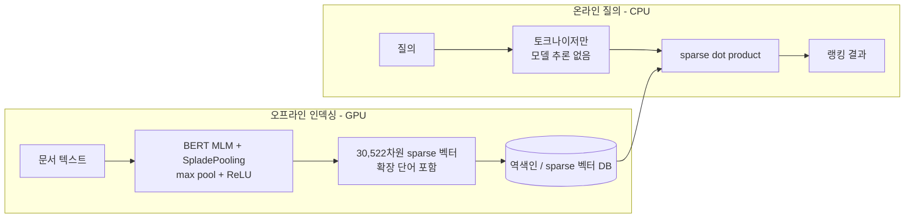

# naver/splade-v3-doc

> [!summary] 한줄요약
> NAVER LABS Europe의 SPLADE-v3 계열 중 "질의 쪽 모델 계산이 없는" Doc 변형. 문서만 BERT MLM 헤드로 30,522차원 sparse 벡터(어휘 확장 포함)로 인코딩하고, 질의는 토큰화 수준으로 처리하는 비대칭 inference-free 검색 모델이다. BEIR-13 평균 nDCG@10 47.0으로 SPLADE-v3 계열 중 가장 낮지만 질의 지연이 BM25 수준이고, 영어 전용이며 CC-BY-NC-SA-4.0(비상업)이라 사내 상용 사용에는 제약이 크다.

## 배경: SPLADE와 이 모델이 해결하려는 문제

BM25 같은 어휘 기반 검색은 역색인으로 빠르고 해석 가능하지만 어휘 불일치(질문의 단어와 문서의 단어가 다름)에 약하다. dense 임베딩 검색은 의미를 잡지만 해석이 어렵고, 정확한 용어(코드명, 고유명사) 일치에 약하며 ANN 인덱스 운영 비용이 든다. SPLADE(Formal et al., SIGIR 2021)는 BERT의 MLM 헤드가 내는 "어휘 전체에 대한 가중치 분포"를 sparse 벡터로 쓴다. 문서에 없는 연관 단어까지 가중치를 부여하는 학습된 확장(expansion)과 희소성 정규화로 역색인을 그대로 쓰면서 의미적 확장을 얻는다. 저장소(github.com/naver/splade) README는 이를 "효율적인 역색인 활용, 명시적 어휘 일치, 해석 가능성, 도메인 외(OOD) 일반화(BEIR)에서의 강점"으로 요약한다.

SPLADE의 약점은 질의 시점에도 transformer를 돌려야 한다는 점이다. 질의 인코딩만으로 수십 ms가 추가된다. 이를 없애려는 흐름이 "inference-free" 또는 "doc-only" 방식이다. 문서 쪽은 오프라인에서 한 번 크게 확장해 색인하고, 질의는 토크나이저만 거쳐 곧바로 sparse dot product를 한다. `splade-v3-doc`이 이 방식의 NAVER 공식 체크포인트다.

SPLADE-v3 기술 보고서(Lassance, Déjean, Formal, Clinchant, arXiv:2403.06789, 2024-03-11)는 SPLADE 라이브러리 새 버전 공개에 맞춘 문서로, "신규성이 부족해 정식 논문은 아니지만 더 나은 baseline을 커뮤니티에 제공하기 위해" 쓴다고 서두에서 밝힌다.

## 동작 원리와 아키텍처

### 모델 구조

모델 카드에 따르면 구조는 두 모듈이다. `MLMTransformer`(BertForMaskedLM, `max_seq_length` 512, `do_lower_case` False)와 `SpladePooling`(pooling 전략 max, activation relu, 차원 30,522). 즉 BERT의 마지막 층 로짓을 토큰 위치에 걸쳐 max pooling하고 ReLU(논문의 log-saturation 형태는 학습 설정에 속함)를 거쳐 30,522개 어휘 차원의 희소 가중치 벡터로 만든다. 유사도 함수는 dot product다. 기반 모델은 `Luyu/co-condenser-marco`(CoCondenser)다. 모델 카드 기준 "Maximum Sequence Length: 512 tokens (256 for evaluation reproduction)"이므로 논문 수치를 재현할 때는 256으로 평가한다. 어휘는 BERT uncased 계열이라 영어 외 언어를 위한 어휘가 아니다(모델 카드의 언어 태그가 English뿐인 점으로 확인).



### 학습 방식(기술 보고서)

SPLADE-v3 계열의 학습 개선점은 다음과 같다. (1) 배치당 여러 hard negative 사용(SPLADE++에서 뽑은 음성 100개: 상위 50개 + 상위 1k에서 무작위 50개). (2) 증류 점수를 단일 cross-encoder가 아니라 여러 cross-encoder 재순위화 모델 앙상블로 생성(MiniLM, 그리고 TREC DL 2022용으로 학습한 RankT5-3B, DeBERTaV3, DeBERTaV2, ELECTRA), 점수를 쿼리별 min-max 정규화한 뒤 아핀 변환으로 이전 증류 분포의 평균·표준편차에 맞춘 "rescored" 버전도 사용. (3) 증류 손실을 KL-Div와 MarginMSE로 혼합(가중치 λ_KL=1, λ_MSE=0.05; 교차검증으로 결정; MarginMSE는 recall, KL-Div는 precision에 더 집중한다는 관찰). (4) SPLADE++ SelfDistil 체크포인트에서 이어서 학습하면 CoCondenser/DistilBERT에서 시작하는 것보다 좋았는데, 보고서는 원인을 확실히 모르며 커리큘럼 학습 효과일 수 있다고 추정만 한다. 메인 모델 `naver/splade-v3`는 SPLADE++ SelfDistil에서 시작하고 질의당 8개 음성으로 학습했다. 다만 이 모델(`splade-v3-doc`)은 보고서에 따르면 "CoCondenser에서 시작하며 질의 쪽에서 계산을 전혀 하지 않는, 사실상 이진 bag-of-words 질의" 변형이다.

## 핵심 기능 상세: 성능 수치

모델 카드의 성능 값은 MS MARCO dev MRR@10 37.8, BEIR-13 평균 nDCG@10 47.0이다. 기술 보고서 Table 1(평균 지표)에서 변형별 비교는 다음과 같다.

| 모델 | MS MARCO MRR@10 | TREC19 | TREC20 | BEIR-13 | LoTTE-S | LoTTE-F | FLOPS |
|---|---|---|---|---|---|---|---|
| SPLADE++ SD | 37.6 | 73.0 | 71.8 | 50.7 | - | - | 1.4 |
| SPLADE-v3 | 40.2 | 72.3 | 75.4 | 51.7 | 74.7 | 66.0 | 1.2 |
| SPLADE-v3-DistilBERT | 38.7 | 75.2 | 74.4 | 50.0 | 70.3 | 62.8 | 1.4 |
| SPLADE-v3-Lexical | 40.0 | 71.2 | 73.6 | 49.1 | 74.2 | 64.5 | 0.6 |
| **SPLADE-v3-Doc** | **37.8** | **71.5** | **70.3** | **47.0** | **71.1** | **59.0** | **1.4** |

BEIR 13개 데이터셋별 nDCG@10(보고서 Table 2)에서 SPLADE-v3(풀) 대비 Doc의 차이는 데이터셋마다 크게 다르다. 예컨대 NQ 58.6 → 52.1, FiQA 37.4 → 33.6, Climate-FEVER 23.3 → 15.9, FEVER 79.6 → 68.9, DBPedia 45.0 → 36.1, TREC-COVID 74.8 → 68.1, ArguAna 50.9 → 46.7로 하락하지만, Touché-2020은 29.3 → 27.0, SciFact 71.0 → 68.8, NFCorpus 35.7 → 33.8, HotpotQA 69.2 → 66.9처럼 격차가 작은 곳도 있다. Quora는 81.4 → 77.5다. 보고서의 해석은 "Doc 변형은 전반적으로 가장 덜 효과적이며, 특히 zero-shot에서 질의 측에 최소한의 계산이라도 필요함을 보여 주지만, 최신 dense bi-encoder와 견줄 만하고 효율(질의 인코딩 없음, 순회할 posting list가 적음)이 뛰어나다"는 것이다. 이 수치는 모두 영어 데이터셋(MS MARCO, BEIR 등) 기준이다.

참고: 같은 보고서의 meta-analysis(RANGER 방식, 44개 질의 집합)는 SPLADE-v3(풀)에 대한 것이며 BM25 대비 통계적으로 유의미하게 높고 일부 cross-encoder와도 견줄 만하다고 보고한다. Doc 변형에는 별도의 meta-analysis가 없다.

## 설치와 사용법

모델 카드의 예시는 sentence-transformers의 `SparseEncoder`를 쓴다.

```bash
pip install -U sentence-transformers
```

```python
from sentence_transformers import SparseEncoder

# 게이트 모델: Hugging Face에서 로그인하고 연락처 공유/이용 조건 동의 후에야 파일 접근 가능
model = SparseEncoder("naver/splade-v3-doc")

queries = ["what causes aging fast"]
documents = [
    "UV-A light, specifically, is what mainly causes tanning, skin aging, and cataracts, ...",
    "Answers from Ronald Petersen, M.D. Yes, Alzheimer's disease usually worsens slowly. ...",
    "Bell's palsy and Extreme tiredness and Extreme fatigue (2 causes) ...",
]
q = model.encode_query(queries)          # [1, 30522]
d = model.encode_document(documents)     # [3, 30522]
print(model.similarity(q, d))            # 모델 카드 출력: tensor([[2.7963, 2.0568, 0.9769]])
```

모델 카드 하단에는 `SentenceTransformer` 로 불러오는 일반 예시도 있으나 sparse 용도라면 `SparseEncoder`가 맞다. 질의 측 모듈이 정확히 어떻게 구성되는지(토큰 가중치를 모델이 학습한 정적 값으로 쓰는지 단순 1.0인지)는 모델 카드의 아키텍처 출력(문서 측 `MLMTransformer` + `SpladePooling`만 표시)에서 알 수 없다. 별도 노트의 블로그([[inference-free-splade-blog]])는 질의를 토큰 ID에 가중치 1.0으로 처리하는 구현을 보여 주지만, 이 모델 카드가 같은 방식을 쓴다고는 확인하지 못했다. 실제로 쓰기 전에 `encode_query`의 동작을 소스로 확인하거나 임의 질의로 비영 원소를 출력해 보자.

Qdrant에 연결할 때는 벡터 DB가 sparse vector(인덱스 + 값)를 받으므로 `SparseEncoder` 출력에서 비영 인덱스/값을 추출해 업서트한다. 위 블로그 노트와 RAGU의 Qdrant 어댑터가 `sparse_type="splade"` 모드를 지원한다는 점([[ragu]])이 구현 참고가 된다.

## 디렉터리·코드 구조에서 확인한 것(모델 저장소와 원 구현)

- 모델 저장소 파일은 게이트(이용 조건 동의)로 보호되어 있어 이번에는 파일 목록을 직접 열람하지 못했다. 페이지 메타데이터에서 확인한 것: 태그에 sentence-transformers, PyTorch, Safetensors, English, bert, splade, sparse-encoder, sparse, asymmetric, inference-free, text-embeddings-inference, arxiv:2403.06789. 라이선스 cc-by-nc-sa-4.0. Files 탭은 xet 저장.
- 원 구현은 `github.com/naver/splade`: 학습, 인덱싱, 검색, BEIR 평가 코드를 담는다. 이번에 확인한 사실: Stars 1,015, 마지막 push 2024-05-03(2년 이상 변동 없음), `LICENSE`는 CC BY-NC-SA 4.0(NAVER Corp. 2021-present)으로 GitHub API는 NOASSERTION으로 표기한다. 코드도 비상업 라이선스라는 점이 중요하다. README의 2023-11 항목은 "SPLADE와 reranker 학습 코드 개선, 새 모델 곧 공개"라고 적고 있다. 새 코드는 `hf` 브랜치(HF Trainer 기반, 다중 음성)에 있다.
- 파생: 페이지에 "Finetunes 1 model", "Space using this model 1"(SiddharthAK/TextLSRDemo)이 표시된다.

## 비교 대상

- **같은 계열의 풀 모델 `naver/splade-v3`**: 같은 보고서에서 BEIR-13 평균 51.7, 질의 시 인코더 필요. 페이지 표시 기준 지난달 다운로드는 `naver/splade-v3`가 119,592, `splade-v3-doc`이 184로 사용량 차이가 크다(2026-10 시점 페이지 표기). Doc 변형은 아직 틈새 선택지로 보인다.
- **BM25**: 영어 BEIR에서 Doc은 BM25보다 평균적으로 높게 보고되지만(블로그 [[inference-free-splade-blog]]는 SciFact에서 IF(naver)가 BM25 대비 NDCG@10 +3.5%라고 저자 측정), Lucene/OpenSearch처럼 정수 양자화 스코어링을 쓰는 엔진에서는 이득이 줄어든다고 그 글이 보고한다.
- **dense 임베딩(예: BGE, E5 계열)**: 보고서는 최신 dense bi-encoder와 "견줄 만하다"고만 쓰고 구체 모델별 수치 비교는 이번에 확인하지 못했다. 다국어·한국어 검색에서는 dense 다국어 모델이 현실적 선택이다.
- **한국어 sparse 접근**: 한국어는 형태소 분석 기반 BM25(Nori 등)나 다국어 학습된 sparse/learned 모델이 필요하며, 본 모델의 BERT uncased 영어 어휘로는 한국어 확장이 되지 않는다. 한국어 지원 sparse 모델은 이번에 조사하지 않았다(확인 못함).
- **RAGU의 Qdrant 하이브리드**: [[ragu]]가 bm25/bm42/splade/custom sparse를 지원하는 설계라 비교 실험 틀로 쓸 수 있다.

## 장단점, 한계, 성숙도

장점: (1) 질의 지연이 거의 없다. 질의 시 신경망 추론이 없어 BM25급 지연으로 학습형 확장 검색이 가능하다(지연 수치는 블로그 저자 측정). (2) 해석 가능한 sparse 벡터라 왜 매칭됐는지 확장 단어로 설명할 수 있다. (3) 기존 역색인/sparse 인프라(Qdrant, Lucene 계열)에 얹기 쉽다. (4) CPU만 있는 질의 서버로 운영 가능하다. 인덱싱에만 GPU가 필요하다.

한계: (1) **영어 전용**이다. 한국어를 포함한 다국어 지원은 모델 카드에 없다. (2) **비상업 라이선스**(CC-BY-NC-SA-4.0)이며 ShareAlike가 있어 파생물도 같은 조건을 요구한다. 사내 상용 제품·서비스에 쓰려면 법무 검토가 필수이고 사실상 쓸 수 없는 경우가 많다. (3) 성능은 풀 SPLADE-v3보다 낮고(BEIR 47.0 vs 51.7) 특히 zero-shot에서 격차가 크다. (4) 최대 512 토큰이다. 긴 문서는 분할이 필요하다. (5) 문서당 비영 원소가 많아(블로그 측정 평균 약 325개) 인덱스가 커지고, 인덱싱이 GPU에서 초당 수십 문서 수준이라 갱신이 잦은 코퍼스에는 부담이다(블로그 측정). (6) 접근 게이트가 있다. 자동화된 배포 파이프라인에서 HF 토큰과 약관 동의 절차가 필요하다. (7) 원 구현 저장소의 마지막 push가 2024-05라 장기 유지 보수를 기대하기 어렵다.

성숙도 사실: 기술 보고서 2024-03-11, HF 페이지 Like 4, 지난달 다운로드 184, 원 저장소 Stars 1,015. 연구용 baseline의 성격이 강하고 대규모 상용 채택 신호는 약하다.

## 보안·라이선스·운영 리스크

- **라이선스**: 가장 큰 리스크다. 사내 상용 서비스, 고객 대상 제품, 그 파생 모델 배포 모두 CC-BY-NC-SA-4.0의 비상업·동일조건 요건에 걸린다. 내부 연구·평가(비상업) 목적 PoC 범위에서만 쓰고 그 결과물(모델 가중치 파생물 포함)이 외부 배포로 이어지지 않게 관리해야 하며, 판단은 법무에 맡긴다.
- **모델 보안**: 페이지 태그에 Safetensors가 있어 Safetensors 가중치로 받으면 pickle 계열 임의 코드 실행 위험은 낮다(PyTorch 태그도 함께 있어 저장소에 다른 형식 파일이 있는지는 확인하지 못함). 다만 `trust_remote_code`가 필요한지는 확인하지 못했다.
- **개인정보**: 문서를 로컬 GPU에서 인코딩하므로 외부 API로 나가지 않는 점은 장점이다. 그러나 sparse 벡터는 확장 단어를 포함해 원문 정보를 일부 복원할 수 있으므로 민감 문서의 벡터도 원문과 같은 등급으로 보호해야 한다(일반적 성질에 근거한 주의이며 이 모델에서 실험한 것은 아니다).
- **운영**: 임베딩 모델을 바꾸면 전체 재인덱싱이 필요하다. 모델 버전을 인덱스 메타데이터에 기록한다. 지연 이점은 질의 모델이 없다는 점에서 나오므로, 하이브리드(dense+sparse) 구성에서 병목은 dense 질의 인코딩이 될 수 있다.

## 관련 노트

[[inference-free-splade-blog]] [[ragu]] [[ragas]] [[cerebras-knowledge-base-pgvector-rrf-mcp]] [[vector-db-comparison-2023]]

## 출처

- https://huggingface.co/naver/splade-v3-doc (모델 카드 렌더 전문: 구조, 사용 예, 성능, 메타데이터, 다운로드 수; 2026-10-01 열람. 파일 탭은 게이트로 열람 못함)
- https://huggingface.co/naver/splade-v3 (라이선스, 지난달 다운로드 수만 확인)
- https://arxiv.org/abs/2403.06789 및 https://arxiv.org/html/2403.06789 (SPLADE-v3: New baselines for SPLADE, 본문 전체와 Table 1/2 열람)
- https://github.com/naver/splade (README, LICENSE 확인) 및 GitHub REST API(스타, 마지막 push)
- 같은 vault의 [[inference-free-splade-blog]]에서 인용한 블로그 수치는 해당 노트 기준이며 이번에 원문을 다시 열지는 않았다.
- 열람하지 않은 것: 모델 저장소 파일 목록(config, 토크나이저), 한국어 성능 실측, sentence-transformers SparseEncoder 내부 구현
