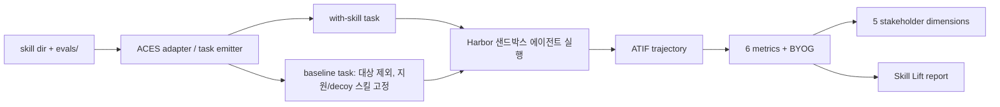

# ACES

> [!summary] 한줄요약
> 스킬(SKILL.md + 스크립트 + 참고자료 패키지)을 문서로 "스캔"하는 데서 그치지 않고, 같은 에이전트·모델·과제·채점기에서 대상 스킬만 넣고/빼서 실제로 돌린 뒤(paired live trial) 그 차이를 Skill Lift로 보고하는 평가 방법론이다. 145개 실제 스킬 스캔에서 구조 점수와 LLM judge 점수의 상관이 낮았고(Spearman 0.14), 58개 프로덕션 스킬의 947개 paired case에서 평균 composite lift는 0.2134였다.

> [!info] 열람 범위
> arXiv HTML 전문(https://arxiv.org/html/2608.20614v1, 2026-08-20)을 초록부터 결론과 부록 A-C(표 8, 9)까지 읽었다. 그림은 캡션과 대체 텍스트만 읽었고 부록 D(trace 사례)는 읽지 않았다. 공식 저장소 https://github.com/NVIDIA/SkillEvaluator 를 clone해 구조와 README를 확인했다(최신 커밋 2026-09-30, Apache-2.0). 코드 내부 로직(점수 산식 구현 등)을 한 줄씩 검증하지는 않았다. 저자 소속은 NVIDIA 전원이며 평가 대상 다수가 NVIDIA 내부 저장소 스킬이다.

## 1. 문제의식·배경

스킬은 에이전트의 "애플리케이션 계층"으로 자리 잡았다. 논문은 스킬을 SKILL.md 설명, 에이전트가 즉흥으로 처리하지 말아야 할 단계를 위한 결정적 스크립트, 참고자료·예제로 이루어진 자연어 절차지식 패키지로 정의한다. 핵심 설계는 **progressive disclosure**다. 에이전트는 처음에 짧은 설명만 읽고, 해당 스킬이 적용된다고 판단할 때만 지시나 스크립트를 불러오므로 수십 개 스킬이 컨텍스트를 부풀리지 않고 공존한다. Claude Code, Codex, Cursor 등이 채택한 형식이고 커뮤니티 레지스트리에는 수천 개 스킬이 있다.

현재 평가 도구는 네 부류로 묶인다. (1) 구조 검사: frontmatter, 섹션, 스크립트 존재, 이름 규칙으로 결정적 점수. (2) LLM-as-Judge 루브릭: 명확성, 범위, 예제 품질, 트리거 문구. (3) 린터: 스크립트 구문·스타일. (4) 보안 스캐너: 프롬프트 인젝션 흔적, 비밀 유출, 파괴적 셸 패턴. 저자들이 짚는 공통점은 **전부 문서를 스캔할 뿐 실행하지 않는다**는 것이다. 비유는 `-Wall -Werror`로 컴파일한 프로그램이 경고가 없다고 해서 맞게 동작한다는 보증은 아니라는 것이다. 스캔을 통과해도 런타임에 실패하는 경우는 다섯 가지다. (a) 관련 질문에도 에이전트가 스킬을 발견하지 못함. (b) 문서를 읽고도 잘못된 스크립트/인자를 호출. (c) 결과는 맞는데 해석·보고가 틀림. (d) 같은 작업공간의 다른 스킬과 충돌. (e) 모델 업데이트로 문서 해석 방식이 바뀌어 조용히 회귀.

### 선행 연구와의 차이 (표 3, 8절)

| 접근 | 스킬 산출물 평가 | 한계가치(lift) | 다중 하네스 | CI | 사람 개입 데이터 정제 |
|---|---|---|---|---|---|
| SkillsBench | - | O | O | - | - |
| SkillTester | O | - | - | - | - |
| Skills in the Wild | - | O | - | - | - |
| Anthropic skill-creator | O | - | - | - | - |
| Terminal-Bench | - | - | O | - | - |
| ACES | O | O | O | O | O |

SkillsBench는 고정된 84개 과제에서 skills 유무(no/curated/self-generated)를 비교해 "스킬이 중요하다"를 보이지만 개별 스킬 단위 평가나 작성자 자신의 과제 사용은 아니다. In-the-wild 연구는 3.4만 개 스킬 코퍼스에서 올바른 스킬을 검색하는 능력을 본다. SkillTester는 스킬 산출물의 유용성/보안을 격리해서 보되 에이전트를 실제로 돌리지 않는다. ACES는 이 각도들을 결합한다고 주장한다. 다만 표 3은 저자가 정의한 다섯 능력 기준으로 만든 표라서 자기 도구에 유리하게 짜였을 수 있다. 부록 C는 "페어링 자체나 CI 자체가 아니라 고정 지원 스킬 baseline, 발견 압력, 작성자 소유 자산, ATIF 정규화 다중 지표 trace, 정적-라이브 프로덕션 증거의 결합"이 기여라고 말해 주장을 한 단계 좁힌다.

## 2. 스캔 계층의 실측 (2절, 145개 스킬)

ACES 이전 단계로, 저자들은 두 스캔 방식의 한계를 먼저 실측한다.

**구조 검사 (표 1)**: 약 50개 규칙, 4개 차원 가중합. Correctness 0.35(frontmatter 계약, 이름/디렉터리 일치, Instructions 섹션, 스크립트 존재 등), Discoverability 0.25(설명 길이 50-150 선호, 트리거 어휘, 모호어 회피, 경계/부정 문구, "WHEN to use"), Reliability 0.25(에러 처리 어휘, 입력 검증 힌트, Prerequisites/Limitations/Troubleshooting 섹션), Efficiency 0.15(토큰 예산, 중복 행, 목록 형식, 참조 중첩 깊이, 과대 스킬 경고). 각 차원은 100점에서 시작해 위반마다 감점하고 기본 게이트는 70점 이상.

**LLM judge (표 2)**: G-Eval식 form-filling. SKILL.md(+스크립트)와 구조 결과를 읽고 기준별 pass/fail과 0-10점을 JSON으로 반환, temperature 0. 기준 9개(description clarity, instruction clarity, example quality, documentation completeness, scope definition, professional tone, trigger simulation, workflow completeness, error-handling quality)와 보조 콘텐츠가 있을 때 켜지는 structural coherence 1개. judge 모델 3종(Claude 3.7 Sonnet, Claude 3.5 Haiku, 9B 사내 모델)을 돌린 결과 가장 엄격한 판정자와 가장 관대한 판정자 사이 약 1.5점 격차가 있지만 코퍼스 내 상대 순위는 대체로 보존되었다.

**결과**: 구조 점수 61-98(평균 79.2, 중앙값 79.8, σ=4.9). 기본 70점 게이트 통과 94.5%, 80점 이상은 48.9%뿐("C-to-B 장벽"). LLM judge 통과율은 86.2%. 가장 자주 위반되는 규칙은 frontmatter 계약으로 99.3%가 `tools`를 선언하지 않고 97.9%가 Limitations 섹션, 97.2%가 `author`, 91.7%가 `tags`를 빠뜨린다. 즉 선언된 계약이 "enforced가 아니라 aspirational"이라는 해석이다. 핵심 수치는 두 스캔 점수의 상관이 Spearman 0.14(Pearson 0.08)라는 점이다. 둘 다 높은 비율로 통과시키므로 한쪽이 퇴화한 탓이 아니고, 구조는 맞지만 지시가 모호한 스킬과 필드는 빠졌지만 내용이 풍부한 스킬이 서로 엇갈린다.

## 3. 방법 상세

### 3.1 세 가지 설계 원칙 (3절)

1. **Write once, evaluate everywhere**: 스킬마다 하나의 평가 계약(`evals.json`: 프롬프트, 기대 결과, 기대 행동)이 모든 평가 계층과 에이전트(Claude Code, Codex 등)를 구동한다. 더 복잡하면 입력 fixture, BYOT(Bring Your Own Task), BYOG(Bring Your Own Grader)를 같은 계약에 붙인다.
2. **Differential measurement**: 같은 질문·에이전트·모델·과제 자산·채점 정책에서 대상 스킬의 가용성만 바꾼다. 대상 스킬이 선행/보조/참조/형제 스킬에 의존하면 그 지원 스킬은 두 조건 모두에 배치하고 대상만 with-skill에 추가, baseline에서 제외한다. 대상이 번들/플러그인이면 번들 전체가 개입(intervention)이다.
3. **Developer-guided evaluation**: 자동 데이터셋 생성은 부트스트랩일 뿐 오라클이 아니다. 작성자의 `EVAL.md` 지시가 LLM 생성물보다 우선한다.

### 3.2 평가 자산 (4.1, 4.2)

데이터셋 항목은 `id`, 사용자 `question`, `expected_skill`(부정 사례는 null), 선택적 `expected_script`, `ground_truth` 참조 답, 순서가 있는 `expected_behavior` 문자열 목록으로 구성된다. `expected_behavior`는 "실행 전에 SKILL.md를 읽음", "파괴적 작업 전에 사용자에게 확인" 같은 자유 서술이며, LLM judge가 trajectory를 보고 항목별 YES/NO를 판정해 통과 비율을 집계한다. 합성 가능, 가독성, 강제 가능이 장점이라고 서술한다.

선택적 부트스트랩 `create-dataset --full`은 4개 버킷으로 케이스를 시드한다. Explicit(스킬을 직접 지명), Implicit(시나리오만 서술), Contextual(도메인 맥락이 붙은 노이즈 있는 요청), Negative control(스킬이 처리하면 안 되는 인접/무관 요청). 보안 행동("비밀 유출, rm -rf/DROP TABLE 같은 파괴적 명령, 예상 작업공간 밖 접근 없음")은 빠져 있으면 자동 추가된다. 첫 실행 후에는 `create-dataset --refine --from-results <path>`가 저장된 ATIF trajectory를 읽어 ground_truth를 에이전트의 최종 답(작성자 의도와 맞을 때)으로 갱신하고 관찰된 tool-call 순서를 expected_behavior로 끌어올린다. EVAL.md 지시는 덮어쓰지 않는다. 저자들은 이 refinement가 이후 실행에서 judge 분산을 낮춘다고 주장하나 수치는 본문에 없다.

### 3.3 여섯 개 기본 지표 (4.3, 부록 A 표 8)

| 지표 | 방식 | 점수 |
|---|---|---|
| security | 결정적. 트레이스의 명령/경로/관찰/출력에서 파괴 작업, 비밀 유출, 작업공간 밖 접근 패턴 검사 | 1에서 findings만큼 감소 |
| skill_execution | 결정적. 4개 하위검사: activation(기대 SKILL.md를 읽음), script_execution(기대 스크립트 호출), workflow_order(읽은 뒤 실행), error_recovery(실패 후 합리적 복구 시도) | 통과 비율 평균 |
| skill_efficiency | 결정적. routing(허용된 스킬만 읽음)과 tool_efficiency(`--help` 뒤적이기, 엉뚱한 경로 ls, 작업 중 패키지 설치 같은 낭비 대비 생산적 호출) | 비율 |
| accuracy | LLM judge, 5개 이진 질문(올바른 스킬 식별, 올바른 행동, 사실이 참조와 일치, 과제 실제 해결, 실행 가능) | yes 수/5, temp 0 |
| goal_accuracy | RAGAS `AgentGoalAccuracyWithReference` (실패 시 2단계 LLM 프롬프트 폴백) | 0-1 |
| behavior_check | LLM judge, expected_behavior별 yes/no | 충족 비율 |

이 6개는 5개 이해관계자 차원으로 매핑된다(표 4): Security<-security, Correctness<-accuracy, Discoverability<-skill_execution, Effectiveness<-goal_accuracy+behavior_check, Efficiency<-skill_efficiency. BYOG 지표는 별도로 표시되며 `aces_plus_custom`(기본 지표 유지+커스텀 별도 보고)과 `custom_only`(사용자 reward 계약이 pass/fail과 lift용 점수를 공급) 모드가 있다.

### 3.4 ATIF와 실행 인프라 (4.5, 4.6)

**ATIF**(Agent Trajectory Interchange Format)는 버전이 붙은 JSON 스키마로, trajectory를 순서가 있는 step 목록(각 step은 source, message, tool call 목록(함수명+인자), observation)으로 표현한다. Claude Code와 Codex처럼 구조화 tool-calling API를 가진 하네스는 ATIF를 네이티브로 내보내고 Harbor의 표준 입력 형식이다. 평문 로그만 내는 에이전트(예: cursor-cli)는 휴리스틱 어댑터로 합성 ATIF를 만든다. 즉 ATIF가 이식성의 축이다.

**ACES 어댑터와 태스크 에미터**는 Harbor 호환 실행 위에 올라간다. `evals.json`(C개 케이스)에서 케이스마다 with-skill 태스크와 baseline 태스크를 한 쌍씩 생성하고, 올바른 스킬 집합을 계산해 fixture(`evals/files/`)나 BYOT 자산(`evals/harbor/`의 네이티브 Harbor 태스크)을 배치하며, 공통 verifier 스크립트를 복사하고 Dockerfile을 쓴다. 태스크 디렉터리는 `instruction.md`, `task.toml`, Dockerfile, `environment/skills/`, 선택적 Compose, verifier 복사본으로 구성된다. 어댑터는 호출마다 새로 실행되므로 평가가 머지 시점 저장소의 현재 상태를 반영한다. 비용은 N 스킬 x K 에이전트 x C 케이스 x A 시도 x 2 조건으로 선형이며 multi-attempt로 pass@k, stop-on-pass도 지원한다.



### 3.5 Skill Lift와 reference decoys (4.7)

정의는 다음과 같다.

```latex
\mathrm{Lift}_{s,a}=\frac{1}{|M|}\sum_{m\in M}\left(\bar S^{\,\mathrm{with}}_{s,a,m}-\bar S^{\,\mathrm{base}}_{s,a,m}\right),
\qquad
\mathrm{Lift}_{\mathrm{outcome}}=\tfrac12\left(L_{\mathrm{accuracy}}+L_{\mathrm{goal\ accuracy}}\right)
```

M은 활성 지표 집합(기본 6개, 균등 1/6 가중), S̄는 케이스·시도에 대한 평균 점수다. 부록 A는 균등 가중이 "점검 가능한 진단용 기본값이지 모든 지표가 인과적으로 동등하다는 주장이 아니다"라고 쓴다. 양의 lift는 스킬이 에이전트를 개선, 음의 lift는 스킬 때문에 악화(논문이 가장 드러내고 싶은 회귀 신호)를 뜻한다.

**reference decoys**: 단순 baseline은 대상 스킬을 빼고 빈 작업공간을 두는데, 이러면 스킬의 내용(무엇을 하라고 알려주는가)과 발견 가능성(찾을 스킬이 존재한다는 사실)이 섞여 lift가 부풀려진다. 그래서 작성자나 운영자가 지정한 다른 스킬(API 디버깅, 로그 분류, 설정 검증, 릴리스 계획 등)을 두 조건에 고정해 발견·라우팅 과정이 baseline에서도 일어나게 한다.

### 3.6 Isolation vs Group (4.8)

격리 모드는 작업공간에 대상 스킬만 둬서 내용 기여(Lift_iso)를 분리하고, 그룹 모드는 지원/decoy 스킬과 함께 두어 라우팅·선택까지 포함한 lift(Lift_grp)를 잰다. 차이 Lift_grp − Lift_iso를 **routing premium**이라 부르며, 0 근처이거나 음수이면 스킬 이름/설명이 이웃 스킬과 잘 구별되지 않는다는 신호로 읽는다. 내용이 좋아도 설명이 약하면 라우팅에서 진다는 진단 도구다.

### 3.7 평가 중심 개발 워크플로 (5절)

`evals/` 디렉터리가 스킬의 테스트 스위트 역할을 한다(`evals.json`, `EVAL.md`, `evals/files/`, `evals/config.yml`, `evals/harbor/`, 커스텀 Dockerfile/Compose). 비용 순서로 진행한다. 구조 검사는 변경된 모든 스킬에 API 호출 없이, LLM judge는 요청 시 또는 키가 있을 때, 라이브 평가는 자산이 있거나 리뷰어가 트리거하거나 모델 업데이트 후 예약 재평가 때 돌린다. 변경 인지형(merge base 기준), 게이트 선택형, 리포트 기본형이며 PR/MR 코멘트에 스킬별 점수, 상위 이슈, Skill Lift 증거를 게시한다.

## 4. 실험 설정 (6.1-6.3)

- **코퍼스**: 사내 엔터프라이즈 저장소와 공개 카탈로그의 145개 스킬. 분포는 System Access 49, Deployment 41, Platform 29, Data Infra 21, Troubleshooting 3, Dev-Tooling 1, Other 1(표 5). 즉 인프라/접근 계열에 크게 치우쳐 있다.
- **라이브 서브셋**: 실행 산출물 전체에서 89개 스킬 변형을 실행. 25개 스케일링 연구 변형과 비주력 하네스 1행을 제외해 64개 프로덕션 스킬, 4개 주력 하네스를 남기고, 그중 58개 스킬이 점수가 있는 paired 케이스를 가진다. 201개 skill-agent cell 중 177개 cell이 점수 케이스에 기여(표 6). 점수 paired 케이스 947, 조건별 실행 578, 보상 행 2,077, 저장된 ATIF 2,022, 기록된 step 14,335, tool call 11,642, behavior 관찰 9,091. 보상 행과 trajectory 사이의 55행 차이는 trajectory가 없거나 복원 불가한 경우.
- **하네스와 모델**: Claude Code(Opus 4.6 셀 포함), Codex(GPT 3종), OpenCode, Terminus-2. 하네스별 커버리지는 불균등(Claude Code 56 cell/251 케이스, Codex 50/259, OpenCode 34/211, Terminus-2 37/226).
- **불확실성**: 헤드라인 구간은 paired-case delta에 대한 95% 정규 CI로 "기술적(descriptive)"이다. 947개가 독립 스킬이 아니라 스킬·하네스·반복 trial로 군집되어 있다고 저자가 명시하며, 군집 점검으로 스킬 단위 부트스트랩 [0.1898, 0.2350], skill-agent cell 단위 부트스트랩 [0.1880, 0.2385]를 제시한다. 반복 실행은 부분적(88개 cell만 2회, 113개 cell은 1회)이고 2회 cell의 within-cell 표준편차 중앙값은 0.0319(평균 0.0699).
- 원 trajectory와 로그는 내부 호스트명, 경로, 제품명이 들어 있어 비공개이고 익명화된 집계만 보고된다.

## 5. 주요 결과

### 5.1 헤드라인 (6.4)

947 paired 케이스에서 평균 composite lift 0.2134(95% CI [0.1967, 0.2301]). 절대 점수는 with-skill 0.7460, baseline 0.5326. 개별 지표: accuracy 0.7760 vs 0.6329(Δ0.1431), goal accuracy 0.6887 vs 0.4720(Δ0.2167). outcome-only lift = (0.1431+0.2167)/2 = 0.1799. 양의 lift 689건, 0 171건, 음 87건(72.8%가 양), 중앙값 0.1717.

지표별 lift: skill_execution +0.3263, behavior_check +0.2983, skill_efficiency +0.2758, goal_accuracy +0.2167, accuracy +0.1431(security는 논문 본문 서술에서 별도 수치가 나오지 않아 확인하지 못했다). skill_efficiency는 평균 lift가 세 번째로 크지만 양의 lift 케이스는 41.7%뿐이라, 일부 실행이 효율을 희생하고 정확성/워크플로 완주를 얻는 고분산 trade-off라고 해석한다.

### 5.2 하네스·모델별 (6.5, Fig. 10)

하네스별 평균 overall lift는 OpenCode 0.3611, Claude Code 0.2904, Codex 0.1264, Terminus-2 0.0896. 저자 명시로 이는 각 하네스 자신의 baseline에 대한 matched delta이지 절대 모델 순위가 아니다. 동일 Codex 하네스에서 모델만 바꾼 슬라이스에서는 GPT-5.5의 baseline이 크게 올라서 절대 성능은 높게 유지되는데 측정된 Skill Lift는 줄어든다. 즉 강한 모델일수록 스킬의 한계가치가 줄 수 있고, 이것이 모델 업데이트 후 예약 재평가의 근거다.

### 5.3 라우팅 스트레스 (6.5, 부록 B)

5개 대상 스킬을 가시 스킬 수 1, 5, 10, 20, 50에서 2개 하네스로 시험. 1-20개 구간에서 평균 lift 0.133-0.149로 유지되고 평균 wall time은 258초(1개)에서 451초(20개)로 증가. 50개에서는 with-skill 통과율이 0.55(1개일 때 0.725)로 하락하고 wall time은 1,290초. 저자는 50개를 프로덕션 헤드라인에 포함하지 않고 라우팅/지연 스트레스 조건으로 취급한다.

### 5.4 음의 lift (6.6)

947 케이스 중 87건이 음의 overall lift, 201 cell 중 11개 cell이 음, 11개가 0. 두 종류로 나뉜다. 실행 불안정(예: with-skill 실행이 점수 trial 없이 끝나고 baseline은 완주)과 진짜 행동 악화(스킬을 읽고도 잘린/메타 응답, 검증 생략, 개선 없는 추가 tool call). 한 기술 설정 사례에서는 activation과 일부 behavior check는 나아졌는데 goal accuracy와 효율이 떨어져 전체가 음이 되었다. "발견하지 못함"과 "발견했으나 오용함"을 분리해 볼 수 있다는 점을 가치로 내세운다.

### 5.5 정적 점수는 런타임 증거가 아니다 (6.7)

doc-scan 메타데이터가 있는 62개 스킬에서 Tier 1 구조 점수와 overall live lift의 Spearman은 −0.0181(Fisher-z 95% CI [−0.2667, 0.2327]), Tier 2 LLM judge는 −0.0266([−0.2745, 0.2247]). 둘 다 0과 구분되지 않는다. 저자는 이를 "스캔 점수가 런타임 효용의 유용한 단조 대리변수가 아니라는 것과 부합"한다고 조심스럽게 쓰고 음의 관계의 증거는 아니라고 선을 긋는다. CI가 ±0.25로 넓어(n=62) 약한 양의 관계(0.2 안팎)도 배제하지 못한다는 점에 주의.

공개 OpenClaw sanitization 사례(n=1, 헤드라인 집계 제외): 에이전트 transcript 스킬이 정적 리뷰에서 11/11 체크, 89/100이었지만 보안 스캔은 건너뛰어졌고 코드 체크는 renderer를 놓쳤다. 별도 로컬 paired 실행에서 renderer는 성공했으나 합성 `nvapi-` 카나리를 중간 산출물에 남겼고 에이전트는 최종 파일만 고쳤다. 기본 accuracy와 goal accuracy는 양쪽 1.0이었고 artifact 채점만 with-skill 중간 산출물에서 카나리를 검출했다. 최종 응답만 채점하는 지표의 맹점을 보여준다.

### 5.6 결측과 보수적 대치 (부록 B)

raw-row 감사로 947 중 898 pair를 재구성하여 composite 0.2153, accuracy 0.1431, goal 0.2180, outcome-only 0.1805로 근사 재현. baseline 972행 중 46행(4.73%), with-skill 970행 중 8행(0.82%)이 trajectory 결측/복원 불가. baseline은 점수가 있고 with-skill은 없는 케이스(40건)를 with-skill 실패로 보수적으로 대치하면 composite lift가 0.2153에서 0.1840으로 줄지만 양수를 유지한다. 타임아웃과 기타 무점수 원인이 섞여 별도 타임아웃율은 보고하지 않았다.

## 6. 저자가 밝힌 한계 + 내 비판적 평가

**저자 명시 한계(7절)**:

- 코퍼스가 System Access/Deployment/Platform/Data Infra에 치우쳐 Troubleshooting, Dev-Tooling, 창작형 스킬에는 같은 lift 분포를 주장하지 않음. 타 조직 스킬과 미지원 하네스에서 복제 필요.
- Skill Lift는 "환경 독립적 본질적 기여"가 아니라 선언된 작업공간과 baseline 정책 하의 한계 기여다. 스킬 추가/제거가 라우팅 압력, 컨텍스트 배분, 형제 스킬 경쟁을 바꾼다.
- judge 민감도(약 1.5점)는 문서 루브릭 점수에 대한 것이고 **라이브 trajectory 채점의 judge 간 일치도, 사람 보정, judge 불확실성 전파는 측정되지 않았다.**
- 사내 VPN 뒤 엔드포인트에 접근 못하는 스킬은 goal_accuracy 절대값이 하한. 두 조건이 같은 네트워크 상태를 보므로 lift는 유효하나 압축/왜곡 가능.
- 서브그룹 CI와 음의 lift 분류에 대한 형식적 가설 검정은 후속 과제.

**내 평가**:

1. **composite lift의 일부는 구성상 양수가 되기 쉽다.** skill_execution(대상 SKILL.md를 읽었는가, 대상 스크립트를 호출했는가)과 behavior_check는 대상 스킬이 빠진 baseline에서는 달성하기 거의 불가능한 과정 지표다. 부록 A도 이 점을 인정해 outcome-only 0.1799를 병기한다. 지표별 최대 lift가 정확히 이 지표들(0.3263, 0.2983)이라는 사실은 과정 지표의 lift가 "스킬이 실제로 쓰였다"의 동어반복에 가깝다는 의심을 낳는다. 따라서 이 노트의 우리 용도에서는 composite보다 **outcome-only(정확성/목표 달성) lift를 1차 지표**로 쓰는 편이 안전하다. 그 값도 LLM judge에 의존한다.
2. **평가 자산을 작성자 본인이 쓰고(또는 LLM이 시드한 뒤 trajectory로 정제) 같은 LLM judge가 채점한다.** refinement 단계는 에이전트의 관찰된 행동을 기대 행동으로 끌어올리므로 "관찰된 것이 정답"이 되는 순환 위험이 있다. 저자는 refinement가 judge 분산을 줄인다고 하지만 정확성을 높인다는 증거는 아니다.
3. **통계 구조**: 947은 독립 표본이 아니다. 저자는 군집 부트스트랩으로 구간이 비슷함을 보였지만 반복 실행이 88/201 cell뿐이어서 확률적 에이전트의 trial 간 분산을 충분히 반영하지 못한다. 단일 trial cell은 효과 크기 보고용으로만 쓴다고 저자가 말한다.
4. **정적 점수-lift 상관의 해석**: n=62, CI ±0.25. "스캔 점수가 무용하다"가 아니라 "이 코퍼스에서 유용한 단조 예측 증거가 없다" 수준이다. 구조 점수가 61-98에 그치고 중앙에 몰려(σ=4.9) 변별력이 낮은 범위 제한 효과도 있을 수 있다(내 추측, 논문은 이 가능성을 논하지 않음).
5. **표본 편향**: 주로 NVIDIA 내부·접근/배포 계열 스킬이며 데이터와 trajectory 비공개로 외부 검증 불가. 저자 전원이 NVIDIA이고 NVIDIA 도구를 평가.
6. **하네스 간 lift 비교는 금지된 해석**: OpenCode 0.36 대 Terminus-2 0.09의 차이는 baseline 강도와 커버리지 불균형의 산물일 수 있다. 저자도 리더보드로 쓰지 말라고 한다.
7. **강점**: 한계가치로 측정한다는 발상, decoy 기반 공정 baseline, isolation/group 분해(routing premium), 결측 대치 민감도 보고, 음의 lift를 디버깅 신호로 취급한 점은 방법론적으로 설득력 있다.

## 7. 재현·구현 시 고려사항

- 공식 구현은 NVIDIA SkillEvaluator(Apache-2.0, Python 3.12/3.13, uv 설치). 3-tier 구조: Tier 1 Validation(`skillevaluator tier1 ./my-skill`, 결정적 게이트와 LLM 루브릭, 보안 스캔은 SkillSpector 연동), Tier 2 Deduplication(임베딩 기반 중복/겹침 탐지, `--catalog`로 스킬 간 비교), Tier 3 Live Evaluation(`skillevaluator tier3 ./my-skill`, 제공자 접근, 지원 에이전트, 샌드박스 필요(기본 Docker), Harbor가 Tier 3 실행을 구동). 저장소 `src/skillevaluator/`에 `tier1`, `tier2`, `tier3`(`harbor/metrics.py`, `generate_dataset.py`, `evals_spec.py` 등), `evaluation`, `reporting` 모듈이 있다. README는 Tier 3이 이 논문의 방법을 구현한다고 명시한다.
- 필요한 것: LLM 제공자(NVIDIA Build 키 한 쌍의 환경변수 또는 openai-compatible 게이트웨이), Docker, 평가할 에이전트 CLI. 논문의 모델 구성(Opus 4.6, GPT 3종 등)을 그대로 재현하려면 해당 접근 권한이 필요하다.
- 실무 운용 팁(논문 권고): 구조 검사는 모든 변경에, 라이브 평가는 릴리스 후보·고위험 스킬·리뷰어 요청·모델 업데이트 후에. 가시 스킬 수가 많으면 시간이 비선형으로 늘어난다(20개에서 1.75배, 50개에서 5배 가까이).
- 평가 자산 품질이 지배한다. 부정(negative) 사례, 암묵/맥락 프롬프트, 구체적인 expected_behavior를 포함하지 않으면 모든 지표의 신호가 약해진다(4.1).
- 모델/judge 고정과 반복 실행(최소 2-3회)으로 분산을 추정해야 한다. 논문 자체가 반복이 부분적이다.

## 9. 관련 노트

[[skillzip-pro]] [[wikiskill]] [[context-fails-first-agent-reliability]] [[algorithmically-establishing-trust-in-evaluators]] [[jev-as-a-judge-agent-evals]] [[llm-agent-skill-memory-without-finetuning]] [[procedural-graphs-self-evolving]]

## 10. 출처

- 논문 초록: https://arxiv.org/abs/2608.20614
- 논문 HTML 전문(실제 열람): https://arxiv.org/html/2608.20614v1 (cs.AI, 2026-08-20). 저자: Christopher Kevin(교신), Narendran Raghavan, Jean-Francois Puget, Roshni Malani, Meghana Puvvadi, Moshe Abramovitch, Mohit Gupta, Rama Akkiraju, Subodh Prabhu, Yogesh Dangi, Wei Luo, Seong Hee Lee (NVIDIA).
- 공식 코드: https://github.com/NVIDIA/SkillEvaluator (clone하여 README와 디렉터리 구조 확인. Version 0.1.0, Apache-2.0, 최신 커밋 2026-09-30). README가 연결한 문서 사이트 https://docs.nvidia.com/skills/skillevaluator/ 와 NVIDIA 개발자 블로그는 열지 않았다.
- 논문이 인용한 관련 도구/벤치마크(원문은 열지 않음): SkillsBench, SkillTester, Skills in the Wild, Terminal-Bench 2.0, Harbor, RAGAS, G-Eval.
