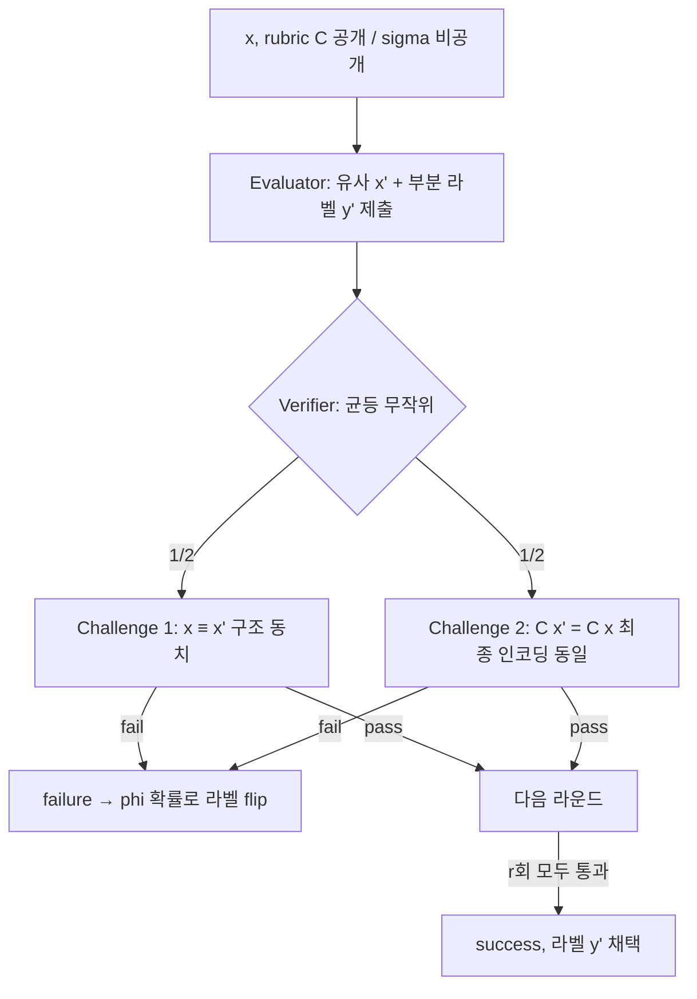

# Algorithmically Establishing Trust in Evaluators

> [!summary] 핵심 요약
> 정답 라벨 없이 evaluator(예: LLM-as-a-judge)의 신뢰를 평가하려는 **Arthur-Merlin형 No-Data Algorithm**이다. 신뢰 지표는 정확도가 아니라 **success rate**다.
>
> Evaluator가 유사한 데이터포인트 x'와 부분 라벨을 만들면, 라운드마다 순열 동치 또는 동형 동치 중 하나를 무작위로 검증한다. 프로토콜의 이론적 주장은 거짓/무지한 evaluator의 통과 확률이 라운드당 최대 1/4이라는 것이다.

> [!info] 조사 범위와 출처 관계
> frontmatter의 `source`는 요약 사이트(baba9811 논문 리뷰, 2026-05-14 작성)이다. 이 페이지가 가리키는 원 논문은 **arXiv:2506.03083**(Adrian de Wynter, 최초 제출 2025-06-03, 내가 연 HTML은 v4 / 2026-02-11, cs.DS, CC BY-NC-SA 4.0)이며, 본 노트는 원 논문 HTML 전문(1~9절 + 부록 A~E)을 직접 읽고 요약 사이트와 대조해 원문 기준으로 작성했다. 공식 코드(`github.com/adewynter/no_data_algorithm`)를 clone해 구조를 확인했다. 논문 v1 제목은 repo README 기준 "Labelling Data with Unknown References"였다고 되어 있다(README 인용; v1 본문은 직접 열람하지 않음).

## 1. 문제의식·배경

### 1.1 풀려는 문제
"evaluator가 신뢰할 만한가"는 보통 정답 라벨이 있는 데이터셋으로 통계적으로 검증하거나(참조 기반), evaluator가 정답을 "안다"고 가정한다.

저자는 두 방법 모두 참조가 없을 때 무너진다고 말한다. 전자는 데이터가 필요하고, 후자는 증거가 아니라 가정이기 때문이다(초록).

벤치마크 오염 문제(Sainz et al. 2023)까지 겹치면 참조가 있어도 믿기 어렵다(1절).

그래서 "참조가 없을 때 evaluator의 신뢰를 과학적으로 세우려면 형식적 증명밖에 없다"는 논지로 알고리즘 + 증명 + 실험을 제시한다.

### 1.2 선행연구와의 위치 (2절)
- LLM-as-a-judge 계열의 신뢰성 비판(인간 판단과의 상관 부족, 프롬프트 민감성, 암기 가능성, 추론의 허위성 등)을 길게 정리하지만, 신뢰를 높이려는 기존 시도는 대부분 prompting 전략이나 다른 LLM을 쌓는 call stack이라고 평가한다.
- noisy teacher로 학습하는 알고리즘(Northcutt 등)이나 provable robustness 연구들은 "노이즈가 있더라도 라벨 데이터셋이 존재한다"는 전제를 둔다.
- 이론적 뿌리는 Babai(1985)의 Arthur-Merlin(AM) 프로토콜, 즉 zero-knowledge proof 계열의 challenge-response 게임이다. 단, 저자는 EV 프로토콜이 프라이버시/비밀성을 제공하지 않는다고 못박는다. 암호학적 성질이 아니라 "challenge-response 구조"만 평가에 빌려온 것이다. repo README는 이를 "cryptographically secure"라고 홍보하지만, 논문 본문은 그런 주장을 하지 않는다(README와 논문 사이의 표현 차이로, 이 노트는 논문 본문 기준을 따른다).

## 2. 방법 상세

### 2.1 형식 설정 (3절)
- 데이터포인트 $x\in\mathcal{X}\subset\{0,1\}^n$(이론은 n-bit 이진 문자열), 라벨 $y\in\{0,1\}$. 참 라벨링 함수 $f:\mathcal{X}\to\mathcal{Y}$는 미지.
- **criterion** $c:\mathcal{X}\to\{0,1\}$, **rubric** $C$는 정렬된 criterion 집합의 출력을 이어붙인 비트열, **aggregator** $\sigma:\{0,1\}^n\to\mathcal{Y}$는 rubric 출력을 라벨로 합치는 함수(예: 다수결).
- **Assumption 3.1**: $f=\sigma\circ C$. 저자는 "데이터가 라벨을 갖는 데는 이유(criterion)가 있고, 여럿이면 합치는 방법이 있어야 하므로 강한 가정이 아니다"라고 말한다. rubric이나 σ를 모르면 사용자 정의 surrogate로 적용하되, 그때의 신뢰 경계는 surrogate에 대한 것이지 "진짜" 정답에 대한 것이 아니라고 인정한다.
- rubric이 **total**이라는 것은 비선형 criterion(예: XOR $c_a\oplus c_b$)을 명시적으로 분해해 둔 것이다. total evaluation은 이 분해된 항목을 따로따로 평가할 수 있다는 뜻이다.
- "similar": $x\cong x'$(동형: 같은 rubric 출력)이면서 $x\equiv x'$(순열 동치: 부분집합 구조 수준의 동치)일 때 x와 x'는 similar.
- **lying**: 근거 없이 정답을 안다고 주장하는 evaluator 전체를 가리킨다. 아무것도 모르는 uninformed(무작위 추측)와 분포 내에서만 잘하고 밖에서는 실패하는 sycophantic이 모두 포함된다.

### 2.2 No-Data Algorithm (4절, Algorithm 1)
```text
Input: 라벨 없는 데이터 X, evaluator E, verifier V, rubric C, flip 확률 phi, 라운드 수 r
for x in X:
    success, y = EV(x, E, V, C, r)         # r 라운드 EV 프로토콜
    if success: predictions += y ; successes += 1
    else:       y~ = (not y) with prob phi ; predictions += y~ ; successes += 0
return predictions, successes              # 신뢰도 = 평균 success rate
```
- 시간 복잡도: $O(r\,|D|)$ (부록 B Lemma B.1). 라벨링이 아니라 evaluator **보정**을 위한 것이므로 |D|, r이 작아도 된다.
- 실패 시 확률 φ로 라벨을 뒤집는 이유는 Theorem 5.2의 정확도 복원 때문이다. repo 주석: "논문은 φ를 flip rate로 쓰지만 코드는 가독성 때문에 1−φ를 쓴다."

### 2.3 EV(Evaluator-Verifier) 프로토콜 (4.1절, Figure 1)
입력으로 둘 다 데이터포인트 x와 rubric C를 받고 **σ는 받지 못한다**. C를 알고 있으므로 evaluator가 "f를 안다"는 주장은 "σ를 안다"로 환원된다. 한 라운드:
1. evaluator가 x와 "비슷한" 데이터포인트 x'와, f(x')=y라고 주장하는 **부분 라벨** $\tilde y'$를 만들어 제출(제출 후 이 라운드에서 수정 불가). f에 접근할 수 없으므로 $C(x')$로부터 추측한 값이다. x'를 만드는 방식은 evaluator에 맡겨진다(LLM 생성이든 데이터에서 고르든 상관없음).
2. verifier가 두 챌린지 중 하나를 **균등 무작위**로 선택.
   - **Challenge 1 (순열 동치, $x\equiv x'$)**: $\forall s\in S_x,\ \exists t\in S_{x'}.\ \forall c\in\bar{\mathcal{C}},\ c(s)=c(t)$. 즉 total rubric의 모든 세부 criterion 평가에서 x의 부분 구조와 대응되는 x'의 부분 구조가 존재하는지(구조 검증).
   - **Challenge 2 (동형 동치, $x\cong x'$)**: $C(x')=C(x)$. rubric 출력이 완전히 같은지(최종 인코딩 검증). x의 참 라벨 y는 모르므로 "왜 f(x')=y인가"를 직접 묻는 대신 이 동치로 대신한다.
3. 실패하면 프로토콜은 즉시 failure, 통과하면 다음 라운드. r라운드 모두 통과하면 success. 어느 경우든 $\tilde y'$를 라벨로 반환.

핵심 논증(Remark 4.1): 챌린지가 공개되어 있으므로 evaluator는 한 챌린지만 통과하도록 x'를 "조작"할 수 있다. 그러나 두 챌린지는 서로 상대가 못 주는 정보를 요구하므로(구조 vs 최종 인코딩), 둘 다 항상 통과하려면 사실상 f를 알아야 한다.



### 2.4 정합성(correctness) 결과 (5절, 부록 A)
- **Lemma 5.1**: r라운드 후 verifier가 거짓을 놓칠 확률은 $(1/4)^r$. 논거(부록 A.1~A.3): 거짓말에는 두 유형이 있다 — (Lie 1) 구조는 맞는 x'($S_{x'}=S_x$)를 만들어 Challenge 1은 통과하지만 $C(x')=C(x)$인지는 운에 달림, (Lie 2) $C(x')=C(x)$인 x'를 만들어 Challenge 2는 통과하지만 구조는 운. 챌린지가 선택될 확률 1/2 × 나머지 쪽에서 "운이 좋을" 확률 1/2 = 1/4 per round. Lemma A.1은 두 챌린지가 서로 독립적 정보를 주므로 "필요충분"이라고 주장한다.
- **Theorem 5.2**: 균형 데이터에서 accuracy α인 evaluator가 "틀릴 때는 항상 거짓말을 한다"고 가정하면, No-Data Algorithm의 기대 정확도는
  $$\mathbb{E}[\text{correct}] \le 1-(1-\alpha)\bigl(1-\phi+\phi(1/4)^r\bigr)$$
  증명은 union bound(부록 A.4): 틀렸는데 못 잡을 항 $\epsilon(1/4)^r$과 잡았지만 flip 안 한 항 $\epsilon(1-\phi)(1-(1/4)^r)$의 합, $\epsilon=1-\alpha$.

  해석: evaluator의 실제 정확도가 0이면 φ와 무관하게 복원 불가("허공에서 정보를 만들 수 없다"). 따라서 알고리즘의 1차 목적은 라벨링이 아니라 **신뢰 확립**이다.
- 이 정리의 전제 중 "evaluator가 틀릴 때는 항상 거짓말(= 챌린지에서 걸림)"이 모든 evaluator에 해당하는 것은 아니며, 추측으로 정답을 맞히지만 챌린지는 통과하지 못하는 evaluator는 범위 밖이라고 저자가 직접 적었다(5절).
- 확장(부록 C): k-ary 라벨은 one-vs-all로 k−1회 반복(보장 유지, 런타임 ×(k−1)); 더 효율적인 변형은 Conjecture 1로만 제시. C.2에서는 $C(x)=C(x')$ 등식 제약을 거리 $\delta(C(x),C(x'))<\epsilon$로 완화하는 변형을 스케치하지만 경계가 약해진다고만 서술한다.

## 3. 실험 설정

**공통**: 두 코퍼스 — evaluator가 라벨링 방법을 아는 **in-phenomenon(IP)**과 모르는 **out-of-phenomenon(OOP)**. 참 라벨을 아는 knowable 설정은 알고리즘 출력과 비교하기 위한 기준으로만 쓰며 현실에서는 없는 값이다. r=3으로 실행. 이 설정에서 baseline은 곤란하다고 본다(ensemble은 형식적 경계가 없고 lying evaluator를 설명하지 못함, 부록 D.5).

**Experiment 1 – 합성 이진 문자열 (6.1절, Table 1)**
- IP rubric: c0 = "1의 개수가 짝수", c1 = "0으로 시작하거나 10101을 포함하되 둘 다는 아님"(XOR이므로 total rubric에서는 5개 criterion), c2 = "1이 5개 초과". σ = 다수결.
- OOP rubric: c0 = "111 포함", c1 = "1로 끝남", c2 = "110001 포함". σ = 다수결.
- 각 test set 498개, 균형. evaluator: decision tree(DT, sklearn 기본값)와 o3-mini(IP 학습분 5개 예시 + rubric을 프롬프트에 제공; 생성 단계에서는 "새 문자열 생성" 대신 학습 데이터에서 "고르기"로 설정 — 생성은 성능이 떨어졌기 때문). verifier는 rule-matching 알고리즘. OOP에서는 IP rubric을 준 채 OOP 데이터를 라벨링시킨다. φ는 DT 0.4, LLM 0.1.

**Experiment 2 – West Frisian 저자원 언어 (6.2절, Table 10/11)**
- 1,015개 항목(OpenOrca, MMLU, OpenCode, WildChat의 프롬프트에 대한 GPT-4o 출력을 전문 번역가가 West Frisian으로 번역, 원어민 4명이 주석). Joshi et al. 2020 분류상 "exceptionally limited resources" 언어. train 500 / test 515.
- IP rubric: 6개 criterion(c1 West Frisian으로 답, c2a 문화적·논증적 타당성, c2b 정확성/코드 문법, c3 문법, c4 잘리지 않음, c5 지시 준수), σ = 모든 criterion이 1일 때만 1. OOP rubric은 거의 직교(네덜란드어, 네덜란드 문화 언급, 요약/결론 표기 등 + 복합 항목)로 7개 criterion.
- evaluator와 verifier 모두 GPT-4.1(프롬프트가 다름), 둘 다 label set과 criteria 값을 모른 채 각자 생성. IP rubric에는 의도치 않은 모순이 있었다("정답이 틀려도 반드시 답해야 한다" vs "정답이어야 한다"). 저자는 현실에서 흔한 상황이라며 그대로 두었다.
- 프롬프트 교정은 IP known 케이스에서 사전에 튜닝했다(사용자가 배포 전 verifier를 튜닝하는 상황의 유비).

## 4. 주요 결과

### 4.1 합성 데이터 (Table 2)
| 설정 | 지표 | DT known | DT unknown | LLM(o3-mini) known | LLM unknown |
|---|---|---|---|---|---|
| IP | success / flip | — | 100.0 / 0.0 | — | 81.3 / 1.8 |
| IP | acc / F1 | 62.2 / 58.8 | 62.2 / 59.8 | 99.8 / 99.8 | 97.6 / 97.6 |
| OOP | success / flip | — | 4.8 / 46.4 | — | 28.0 / 6.0 |
| OOP | acc / F1 | 54.2 / 54.2 | 52.8 / 52.1 | 60.6 / 66.2 | 59.0 / 64.0 |

정확도는 known 대비 −2~0%p 이내로 복원된다.

그러나 정확도만 보면 DT의 IP(62.2)와 OOP(52.8)가 크게 다르지 않아 "누가 아는지" 구별이 약하다.

success rate는 DT 100% vs 4.8%, LLM 81.3% vs 28.0%로 갈려 신뢰 판별 신호가 된다. 저자 문장으로는 "정확도는 알 수 없는 상황에서 신호가 아니며 success rate가 신호"라는 것이다.

### 4.2 West Frisian (Table 3, 부록 D.4 Table 8)
| 설정 | IP Acc/F1 | OOP Acc/F1 | IP Succ/Flip | OOP Succ/Flip |
|---|---|---|---|---|
| Known: y 직접 예측 | 76.3 / 80.3 | 51.5 / 67.2 | — | — |
| Known: criterion 평균 | 89.5 / 94.0 | 45.3 / 46.5 | — | — |
| φ=0.7 | 72.4 / 76.6 | 49.3 / 57.8 | 87.8 / 9.3 | 1.4 / 70.3 |
| φ=0.3 | 74.4 / 78.1 | 49.1 / 39.1 | 86.8 / 4.9 | 1.2 / 33.6 |
| φ=0.1 | 76.9 / 79.8 | 50.7 / 16.4 | 86.2 / 1.8 | 1.2 / 9.1 |

success rate는 φ와 무관하게 안정적(IP 86~88%, OOP 1.2~1.4%)이며, 정확도는 φ가 낮을수록 known에 가까워진다(IP는 최대 −3.9%p, OOP는 −2.2%p 수준으로 서술됨).

3-클래스 변형(부록 C.1 Table 4): IP 정확도 known 71.8 대비 φ=0.1에서 66.0(flip)/67.0(no flip), 성공률 39.4%이고 OOP 성공률 0.4%. 즉 거짓 evaluator 검출은 되지만 IP 성공률 자체가 39%로 낮아 binary만큼 선명하지 않다.

또 flip을 끄면 정확도 복원이 약간 더 좋은 경우가 있어 "flip 필수"라는 이론과 3-ary 실험이 완전히 일치하지는 않는다(저자: 추가 알고리즘 개발 필요).

언어 능력이 없는 evaluator(Qwen 2.5 VL 7B)는 IP에서도 성공률 약 34~35%, OOP에서 약 2%로 낮다. 해석은 "거짓말하는 게 아니라 못하는 것"이며 OOP에서 가장 낮은 이유는 rubric을 틀리게 준 상태(lying)에서 틀리기까지 하기 때문이라고 설명한다.

### 4.3 Ablation (부록 D)
- **D.1 다른 LLM**: o3-mini 외에 DeepSeek(r1-distill-qwen-32b), GPT-4o, Qwen 2.5 VL 7B는 합성 문제 자체를 풀지 못해 known 성능도 낮고, OOP에서 정확도가 비교적 높아도 success rate는 낮았다.
- **D.2 거짓 evaluator/generator (Table 6, DT, φ=0.4)**: 정상 DT는 IP 성공 100%. "σ를 모른다고 거짓말" 17.0%, "f를 모른다고 거짓말" 0.6%, "생성 단계에서 확률 p=1/10로 거짓말"(근사적으로 아는 경우) 43.6%. 즉 σ만 모르는 경우의 성공률이 f를 모르는 경우보다 훨씬 높다. 이유: |C̄|=|C|이면 Challenge 1은 항상 통과하고 2에서 실패하며, |C̄|>|C|이면 내부 구조를 알아야 풀리는 criterion이 생기기 때문이라고 설명한다. OOP 성공률은 모든 거짓말 유형에서 일관되게 낮다(2.2~6.4%). 한편 "근사적으로 아는" evaluator의 IP 성공률이 44% 정도로 크게 낮아진다는 점은, 현실 LLM처럼 가끔 틀리는 evaluator는 엄격한 pass 기준에서 불리하다는 뜻이다.
- **D.3 생성 방식 (Table 7, φ=0.1)**: o3-mini IP 성공률 picking 81.3% vs generating 55.4%(−25.9%p), GPT-4o IP 성공률 28.7% vs 5.8%. 정확도 차이는 −3%(o3-mini), −5%(GPT-4o)로 작지만 성공률 영향은 훨씬 크다. 따라서 "x'를 어떻게 만들게 하느냐"가 통과율에 큰 영향을 준다.
- **D.5 baseline (Table 9)**: GPT-4.1/o3-mini/Qwen-2.5 세 모델 ensemble에서 평균은 IP 80.6/81.3, OOP 50.1이며 다수결은 IP 75.5/79.9, OOP **61.6**으로 OOP에서도 무작위 이상 정확도를 보여(속임수 취약) 신뢰 지표로는 부적합. Cohen's κ는 IP 0.39(poor), OOP 0.0이고 percent agreement는 0.72 / 0.37이라 해석에 보정이 필요하지만 라벨이 없으면 보정 불가. No-Data는 별도 보정 없이 success rate 86.2 vs 1.2로 갈렸다.

## 5. 저자가 밝힌 한계 + 비판적 평가

**저자 명시**
- 이론은 이진 라벨, n-bit 이진 문자열을 가정(7절); 다항 라벨은 one-vs-all로 선형 비용 증가, 더 나은 방법은 conjecture.
- **좋은 rubric이 필수**: 알고리즘은 "시킨 것을 측정할 뿐"이다(7.3, 9절). rubric이 부실하면 신뢰 판단도 틀린다. "높은 success rate를 LLM의 무오류성으로 해석하지 말라"고 임팩트 스테이트먼트에서 경고한다.
- 증명에 필요한 decomposability는 런타임에는 필수가 아니나(IP 코퍼스는 decomposable하지 않았음), ambiguity는 실험에서 있었어도 결과에 영향이 없었다고 주장.
- 모델 자체의 신뢰성(프롬프트가 아닌 모델의 신뢰성)과 다른 데이터 타입은 열린 질문(8절).

**내 평가**
1. **(1/4)^r 보장의 엄밀성.** 증명 스케치는 "한 챌린지만 통과 가능하고 나머지는 1/2 확률로 운이 좋다"는 가정에 의존한다. 이 "운이 좋을 확률 1/2"은 일반적인 evaluator에 대해 유도된 값이 아니라 가정에 가깝다.

   실제 실험에서도 o3-mini의 OOP 성공률이 28.0%(r=3)로 이론적 상한 $(1/4)^3\approx1.6\%$ 근처에 한참 못 미친다. 저자는 이를 "모르는 데이터에서 ‘고르기’로 우연히 맞는 후보가 있다" 등으로 직접 해명하지 않는다.

   즉 이론 경계는 거짓 evaluator의 통과 확률이 작다는 방향성만 주고, 정량적 신뢰구간으로 쓰기는 어렵다. (데이터 5개 중 고르는 구조에서는 무작위 통과도 20%라는 점을 감안하면, 28%는 우연 수준에 가까워 보이지만 이는 내 추정이다.)
2. **completeness 문제.** 이론상 f를 아는 evaluator는 확률 1로 통과해야 하지만 o3-mini IP 성공률은 81.3%(합성), GPT-4.1은 86~88%(West Frisian)이다. 12~19%의 정직한 evaluator가 탈락하는 것이며, "신뢰 임계값을 몇 %로 둘 것인가"는 논문에서 제시하지 않는다. IP/OOP가 비교 가능할 때만 상대적 판정이 가능하고, 하나의 evaluator·하나의 코퍼스만 있으면 success rate 86%가 "충분한가"를 판정할 기준이 없다.
3. **verifier 자체의 신뢰.** West Frisian 실험에서 verifier도 LLM(GPT-4.1)이며, IP known 케이스에서 사전에 튜닝했다. "evaluator의 신뢰를 세우려고 또 다른 LLM verifier를 신뢰한다"는 순환 의혹에 대해 저자는 "evaluator와 verifier는 서로 다른 과제를 풀기 때문에 순환이 아니다"라고 답하지만, verifier의 오류율이 보장 $(1/4)^r$에 어떻게 반영되는지는 이론에 포함되지 않았다. 합성 실험의 verifier는 규칙 기반이라 이 문제가 없다.
4. **라벨 없는 상황의 실제 "신뢰"는 rubric에 대한 신뢰.** 결과는 "rubric이 요구하는 대로 라벨링할 수 있음"에 대한 증거이지 인간 판단과의 일치가 아니다. 저자도 이를 인정한다(7.3). 그러므로 West Frisian 실험의 의미는 "GPT-4.1이 이 rubric 하에서 원어민 주석과 비슷하게 행동한다"에 가깝다.
5. **규모와 일반화.** 합성 498개, West Frisian 515개 테스트에서 단일 seed 보고(분산·신뢰구간 없음). 모델도 o3-mini와 GPT-4.1 중심이며 다른 언어/도메인 적용은 주장일 뿐이다.
6. **비용.** 항목당 r라운드 × (생성 + 챌린지 판정) LLM 호출이다. 선형이라고는 하나 정말 라벨이 없는 도메인에서는 verifier의 구현이 가장 큰 공학 비용이 될 것이다(합성에서는 규칙 매처, 자연어에서는 LLM).
7. 요약 사이트(baba9811)는 위 한계를 대체로 충실히 다루지만 `ϕ`/성공률 수치의 일부를 이 노트가 확인한 원 논문 표와 대조하면 일치한다(IP 86~88, OOP 1~2%). 단, "generation 대비 selection 약 25pp 격차"는 성공률에 대한 수치이고 정확도 격차는 3~5%p라는 점을 구분해야 한다.

## 6. 재현·구현 고려사항

- **공식 코드**: `https://github.com/adewynter/no_data_algorithm` clone 확인. 구성: `No-Data-Algorithm.ipynb`(합성 실험), `NLEvaluatorAM.ipynb`(West Frisian 실험), `NLEvaluatorAMkAry.ipynb`(3-ary), `no_data_prompts.py`/`no_data_prompts_k_ary.py`(프롬프트), `no_data_utils.py`(52줄: 정확도/F1/성공률 출력, 다수결, 라벨 비율 집계), `llmclient.py`(50줄: API 키를 사용자가 넣는 래퍼), 합성 train/test json과 West Frisian 데이터 json. EV 프로토콜 로직 자체는 `.py`가 아니라 노트북에 있으며 라이선스는 MIT(단 West Frisian 데이터는 원 출처 OpenOrca/MMLU/OpenCodeReasoning/WildChat 라이선스를 따름).

  API 호출은 Azure OpenAI로 수행했고(논문 부록 E), 파싱 실패 시 최대 5번 재질의하며 5번째도 실패하면 합성은 무작위 문자열, 자연어는 0 라벨을 반환한다.
- 모델 설정: o3-mini(2025-01-31) max tokens 50,000, GPT-4o/Qwen은 temperature 0 / 1,024 tokens, GPT-4.1 evaluator·verifier 256 tokens, generator 5,000 tokens, temperature 0.
- 설계 시 결정 항목: (a) rubric을 criterion 단위로 명시하고 가능하면 total로 분해, (b) 각 챌린지를 코드 가능한 검사로 구현(Challenge 2는 criterion 벡터 일치 검사, Challenge 1은 부분 구조 대응 검사), (c) r(논문은 3)과 φ 선택, (d) "x'를 새로 생성할지 후보에서 고를지"(성공률에 크게 영향), (e) IP/OOP 대조군 코퍼스를 같이 준비해야 임계값을 해석할 수 있다.

## 관련 노트
- [[jev-as-a-judge-agent-evals]]
- [[probe-process-based-hallucination-benchmark]]
- [[aces-agentic-continuous-evaluation-of-skills]]

## 출처
- Adrian de Wynter (Microsoft, University of York). "Algorithmically Establishing Trust in Evaluators." arXiv:2506.03083 (cs.DS), 최초 제출 2025-06-03, 열람본 v4 2026-02-11. 초록 https://arxiv.org/abs/2506.03083 , 전문 https://arxiv.org/html/2506.03083 (실제 열람, 본문 및 부록 A~E 전체).
- 요약 사이트(대조용): https://baba9811.github.io/papers/0014-algorithmically-establishing-trust-in-evaluators/ (실제 열람, "논문 리뷰" 작성일 2026-05-14로 표기, 저자 Adrian de Wynter, 학회란에 arXiv preprint · 2026).
- 공식 코드: https://github.com/adewynter/no_data_algorithm (clone, 구조 확인; 노트북 실행은 하지 않음).
