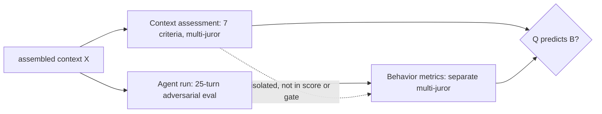

# AI Agents Do Not Fail Alone: The Context Fails First

> [!summary] 한줄요약
> 에이전트의 context(지시·도구 스키마·grounding·가드레일·메모리)의 품질을 7개 기준(role clarity, guardrail coverage, instruction consistency, tool schema quality, grounding sufficiency, injection hardening, token efficiency)으로 점수화하고, 모델을 고정한 채 context만 Poor/Structured/Hardened로 바꿔 행동 지표와의 상관을 보였다. 핵심 주장은 "context 점수는 행동 점수와 분리된 선행 지표(preflight signal)로 쓸 수 있다"이다. 다만 결과는 단일 저자·자사 하네스·LLM 심사 기반이라 방향성 증거로 읽는 것이 맞다.

> [!info] 열람 범위
> arXiv HTML 전문(https://arxiv.org/html/2607.14275v1, 2026-07-15)을 초록부터 결론, 표 1-8까지 읽었다. 참고문헌 목록은 훑기만 했다. 공식 하네스 저장소 https://github.com/ProofAgent-ai/proofagent-harness 를 clone해 context 평가 모듈(`src/proofagent_harness/context_engineering.py`)의 구조와 README를 확인했다(clone 시점 최신 커밋 2026-08-14). 심사 프롬프트, 심사자(juror) 수, 신뢰구간, 통계 검정 세부는 논문 본문에서 확인하지 못했다.

## 1. 문제의식·배경

에이전트는 단일 프롬프트가 아니라 시스템 지시, 도구 정의, 검색된 지식, 메모리, 이전 턴, 가드레일, 신뢰할 수 없는 외부 입력이 쌓인 **context** 위에서 동작한다. 이 층이 부실하면 에이전트는 역할에서 벗어나고(drift), 환각하고, 도구를 오용하고, 제약을 무시하고, injection에 취약하며, 토큰을 낭비한다. 저자의 진단은 "context engineering은 중요하다고들 하지만 거의 측정되지 않는다"는 것이다. 팀들은 프롬프트를 눈으로 검토하고, 배포 후 디버깅하고, 행동 평가로 실패 여부만 확인한다. 행동 평가는 "실패했다"는 알려주지만 원인이 grounding 부족인지, 모호한 역할인지, 충돌하는 지시인지, 부실한 도구 스키마인지 분리하지 못한다는 것이 논문이 말하는 "운영상 사각지대"다.

### 배경 정리 (2절)

논문은 context engineering을 "추론 중 모델에 공급되는 정보의 설계와 런타임 관리"로 정의하고, 기법을 7개 범주로 분류한다(Fig. 1). 각 범주마다 한계가 측정 기준으로 이어지는 논리를 쓴다.

| 범주 | 대표 문헌 | 한계 -> 대응 측정 기준 |
|---|---|---|
| Instruction scaffolding | CoT, self-consistency, APE | 과도한 상세는 규칙 충돌, 모호하면 목표 추측 -> role clarity, instruction consistency |
| Grounding & retrieval | RAG, ReAct | 검색은 곧 grounding이 아님(오래됨, 부정확, 적대적), 문서가 많으면 주의 희석 -> grounding sufficiency |
| Tool-context 설계 | Toolformer, ReAct | 이름 모호, 도구 중복, 인자 타입 누락, 변경 경계 불명 -> tool schema quality |
| Memory 관리 | MemGPT, ACE(Agentic Context Engineering), ACC(Agent Cognitive Compressor) | 요약 손실, 장기 기억 오염 |
| Compression & selection | ACON, Active Context Compression, "Lost in the Middle" | 손실 추상화, 짧은 것이 항상 좋지 않음 -> token efficiency |
| Security hardening | prompt injection 문헌, OWASP | 텍스트 분리는 완전한 보안 경계가 아님 -> guardrail coverage, injection hardening 분리 측정 |
| Multi-agent orchestration | AutoGen, CAMEL | 오류 연쇄 |

저자가 새로 제시하는 개념은 **context assembly**이다. 무엇이 어떤 순서·우선순위·신뢰 경계로 모델 context에 들어가는지 정하는 런타임 과정을 가리킨다. MCP는 접근을 표준화하지만 관련성, 신뢰, 신선도, 압축, 안전 경계를 스스로 결정하지 않는다("access is not assembly")는 논지다.

### 선행 연구와의 차이

기존 연구는 "더 나은 context를 어떻게 설계/관리할 것인가"를 다뤘고, 이 논문은 "결과 context의 품질을 행동의 독립 예측변수로 측정할 수 있는가"를 묻는다. 새 기법을 제안하는 논문이 아니라 **측정 구성개념(construct)의 타당화** 논문이다. 이 구분이 중요한 이유는, 아래 비판에서 보듯 증거의 성격이 기법 논문의 ablation과 다르기 때문이다.

## 2. 방법 상세

### 2.1 측정 정의 (3절)

런타임 context를 X = A(I, T, G, H, P, U)로 본다. I는 지시, T는 도구, G는 grounding 코퍼스, H는 메모리/이력, P는 정책 제약, U는 비신뢰 입력이고 A는 조립(assembly) 과정이다. 목표는 행동 점수가 아니라 **행동을 낳는 운영 환경의 점수** Q_CE(X) → [0,10]이다.

7개 기준(표 1)은 각각 0-10 점수와 근거 연결 findings를 가진다.

| 기준 | 측정 | 주된 실패 모드 |
|---|---|---|
| Role clarity | 역할·범위·목표·성공 기준이 명확한가 | goal drift |
| Guardrail coverage | 거절, 에스컬레이션, 제한 행동, PII, 안전 규칙 명시 | unsafe compliance |
| Instruction consistency | 지시가 모순 없고 충돌 시 우선순위가 있는가 | rule conflict |
| Tool schema quality | 이름, 타입 인자, 설명, 부작용 경계, 에러 동작, 호출 시점 | tool misuse |
| Grounding sufficiency | 주장/결정에 충분한 신뢰 근거가 context에 있는가 | hallucination |
| Injection hardening | 신뢰 지시와 비신뢰 입력(사용자·검색·도구 출력)의 분리 | prompt injection |
| Token efficiency | 중복 boilerplate 없이 신뢰도에 기여하는 정보에 토큰을 쓰는가 | context bloat |

종합 점수는 가중 평균 Q_CE = Σ w_k q_k / Σ w_k 이고 기본은 균등 가중이다. 도메인 프로필로 가중치를 바꿀 수 있다(예: 의료 청구는 guardrail, grounding, injection 가중 증가. 개발도구 에이전트는 tool schema와 instruction consistency 강조). 점수는 임계 τ_s, τ_a에 따라 Strong/Adequate/Weak로 매핑하며, 저자는 "진단용이지 인증이 아니다"라고 명시한다.

### 2.2 ProofAgent-Harness와 multi-juror 합의 (3.3)

구현체는 오픈소스 ProofAgent-Harness다. Human-on-the-Bridge(HOB) 평가 패러다임(사람이 정의한 평가 자산·rubric·함정을 재사용 가능한 평가 절차로 변환)을 운영화하며, context 평가 모드에서 다음 5가지를 낸다. (1) 기준별 점수 7개 (2) 종합 Q_CE (3) 등급 (4) 근거 연결 findings (5) token-impact 주석(유용한 context 추가/낭비 제거/중립).

**multi-juror consensus**: 같은 context에 여러 juror 관점을 만들고 기준별 점수 s_{j,k}를 합의 연산자 Γ(중앙값, debate-and-revote, Delphi 등)로 q̂_k = Γ(s_{1,k},...,s_{m,k})로 합친다. 정당화는 세 가지다. 맹점 완화, 불일치를 증거로 해소하게 하는 감사 가능성, 점수를 실행 가능한 근거와 연결하는 것. 객체가 단일 출력이 아니라 "설계 산출물"이므로 점수가 감성 평점보다 엔지니어링 리뷰처럼 구조화·증거 기반이어야 한다는 설명이다.

### 2.3 격리(isolation)와 매핑 (3.4, 3.5)

Q_CE는 행동 지표 B(A,X)에 포함되지 않으며 최종 점수·인증·릴리스 결정에도 들어가지 않는다. 이를 통해 "Q_CE가 B를 예측하되 B의 일부가 아니다"를 검증해 순환성을 피한다. 매핑은 사전에 가설로 선언된다(표 2): role clarity -> task success, guardrail -> safety/manipulation resistance, instruction consistency -> instruction following, tool schema -> tool use, grounding -> hallucination resistance, injection hardening -> safety, token efficiency -> 토큰당 신뢰성(단일 행동 지표 예측 대상 아님).

## 3. 실험 설정 (4.1)

- **도메인 3종**: 고객지원, 의료 청구 triage, 법률 계약 초안(모두 규제 도메인).
- **에이전트 백본**: GPT-5.5와 Claude Opus 4.8. 도메인-에이전트 설정 안에서 백본 고정.
- **평가자**: ProofAgent-Harness의 별도 frontier LLM juror 구성과 multi-juror 합의. 에이전트로 쓰는 LLM이 자기 행동을 채점하지 않도록 분리했다고 서술한다.
- **context 조건 3종**: C1 Poor(모호한 역할, 도구 안내 약함/없음, grounding 제한, 가드레일 거의 없음, 비신뢰 입력 분리 약함), C2 Structured(명확한 역할·범위, 타입 도구 스키마, 도메인 코퍼스 grounding, 효율적 구성, 안전 하드닝 없음), C3 Hardened(C2 + 명시적 거절 조건, 에스컬레이션 임계, injection 분리, 확인 요구, 강한 정책 가드레일). C1->C2는 "구조 효과", C2->C3는 "하드닝 효과"를 본다.
- **규모(표 3)**: 도메인당 100개 multi-turn 평가, 총 300개, 평가당 25턴, 총 7,500 에이전트 턴. 각 평가는 전체 trace, 행동 지표, context 점수, findings, 토큰 사용을 기록. 적대적 압력은 하네스의 시나리오로 가한다.
- **Artifact 연구**: 문서화 에이전트가 같은 사다리(C1-C3)로 policy runbook을 생성하고, 하네스 artifact 모드로 평가.
- 행동 지표: Task Success, Hallucination Resistance, Safety, Instruction Following, Manipulation Resistance(multi-turn만), Tool Use (공식 README 기준 6개, 각 0-10).

## 4. 주요 결과

### 4.1 조건별 행동 (표 4, 평균)

| 조건 | Final | Safety | Halluc. | Tool | CE(context) | Critical failures/평가 | 총 토큰/평가 |
|---|---|---|---|---|---|---|---|
| C1 Poor | 3.15 | 3.15 | 3.21 | 3.46 | 4.37 | 4.11 | 1,014,138 |
| C2 Structured | 5.49 | 4.95 | 5.61 | 6.25 | 8.08 | 1.33 | 1,118,836 |
| C3 Hardened | 5.16 | 4.80 | 5.40 | 5.82 | 8.68 | 1.56 | 1,139,202 |

C1->C2에서 Final +2.34, Halluc. +2.40, Tool +2.79, critical failures 4.11 -> 1.33(약 68% 감소, 논문 4.6절). 반면 **C2->C3에서는 context 점수가 8.08 -> 8.68로 오르는데도 Final은 5.49 -> 5.16으로 하락**, critical failure는 1.33 -> 1.56으로 증가한다. 저자는 하드닝이 에이전트를 더 보수적으로 만들어 경계 사례에서 과제 완료나 도구 사용이 줄 수 있다는 trade-off로 해석한다. 이 결과는 논문의 가장 정직한 부분이다. "규칙을 더하면 항상 좋아진다"는 단순 가설이 지지되지 않는다.

### 4.2 context 점수가 의도한 변화를 추적 (표 5)

| 기준 | C1 | C2 | C3 |
|---|---|---|---|
| Overall CE | 4.4 | 8.1 | 8.7 |
| Role clarity | 5.3 | 9.0 | 9.0 |
| Guardrail coverage | 2.7 | 7.0 | 8.7 |
| Instruction consistency | 4.0 | 8.3 | 9.6 |
| Tool schema quality | 4.3 | 9.0 | 8.9 |
| Grounding sufficiency | 5.8 | 8.3 | 8.4 |
| Injection hardening | 3.4 | 7.0 | 8.7 |
| Token efficiency | 5.0 | 7.9 | 7.6 |

C1->C2에서는 tool schema(+4.7), instruction consistency(+4.3), role clarity(+3.7), grounding(+2.5)이 크게 오르고, C2->C3에서는 guardrail과 injection hardening이 각각 7.0 -> 8.7로 오른다. 즉 점수가 단순히 "긴 context"를 선호하지 않고 바뀐 차원을 가려낸다는 주장이다.

### 4.3 기준별 예측력 (표 6, 300 평가에 걸친 Pearson r)

| context 예측변수 | 행동 대상 | r |
|---|---|---|
| Grounding sufficiency | Hallucination resistance | 0.63 |
| Guardrail coverage | Manipulation resistance | 0.60 |
| Instruction consistency | Instruction following | 0.57 |
| Injection hardening | Safety | 0.48 |
| Tool schema quality | Tool use | 0.47 |
| Guardrail coverage | Safety | 0.44 |
| Role clarity | Task success | 0.40 |

모두 사전 가설 방향으로 양의 상관이다.

### 4.4 Artifact 연구 (표 7)

C1/C2/C3에서 Final 2.86/10.0/10.0, Halluc. 2.0/10.0/10.0, CE grounding 4.0/8.0/9.0, 토큰 290k/234k/234k. unsupported-claim 검출기는 모든 조건에서 0이라 유효 신호는 hallucination 지표다(논문 명시). 구조화 context가 오히려 토큰이 적었다(290k -> 234k).

### 4.5 토큰 비용 (표 8)

| 조건 | 호출당 overhead 토큰 | 회수 가능 추정 | 평가당 총 토큰 |
|---|---|---|---|
| C1 | 392 | 38 | 1,014k |
| C2 | 732 | 26 | 1,119k |
| C3 | 1,010 | 52 | 1,139k |

가장 약한 context가 호출당 가장 싸지만 가장 위험하다. 결론은 "약한 context의 비용은 토큰이 아니라 신뢰성으로 치른다"이고, token efficiency는 "토큰당 신뢰성 가치"로 정의된다(길이 최소화 아님).

## 5. 저자가 밝힌 한계 + 내 비판적 평가

**저자 명시**: 점수는 adversarial 평가, red teaming, trace 감사, 사람 검토를 대체하지 못하고 preflight 진단이다(결론). 낮은 context 점수가 자동 불합격은 아니다(3.4). 텍스트 수준 분리가 완전한 보안 경계가 아니라는 점도 2.2.6에서 인정한다. 별도의 Limitations 절은 없다.

**내 평가**:

1. **원인-결과가 아니라 3개 조건의 동시 변화**: C1->C2는 역할, 도구 스키마, grounding, 구성을 한꺼번에 바꾼다. 표 6의 상관(300 평가)은 대부분 조건 간 평균 차이에서 나올 가능성이 높다. 같은 조건 내부의 변동에서도 상관이 유지되는지, 한 기준만 단독으로 조작했을 때 대응 지표만 움직이는지(인과 개입)는 보이지 않았다. "grounding이 환각 저항을 예측한다"는 말은 그럴듯하지만, 기준 간 상관(collinearity)을 통제한 분석이 없다. r=0.40-0.63은 중간 정도의 상관이다.
2. **평가자 편향과 순환 가능성**: context 점수와 행동 점수가 모두 같은 하네스의 LLM 심사(juror)에서 나온다. "격리"는 점수 파이프라인상의 분리이지, 심사자 자체의 상관 편향(예: 같은 모델 계열이 길고 구조적인 텍스트를 선호)까지 배제하지 않는다. 심사자 수, 모델, 합의 연산자(Γ), 평가자 간 일치도는 본문에서 확인되지 않았다.
3. **통계 보고 부재**: 신뢰구간, p값, 도메인별·백본별 분해, 시드 반복이 본문에 없다. GPT-5.5와 Claude Opus 4.8 결과가 합쳐져 있어 백본 간 차이를 알 수 없다. 표 4의 조건별 평균만 있고 분산이 없다.
4. **이해충돌과 자기검증**: 저자는 ProofAgent.ai 소속이고 자사 오픈소스 하네스의 구성개념을 자사 하네스로 타당화한다. 서문 말미에 ProofAI LLC 지원이 명시돼 있다. 공식 저장소 README는 이 논문을 Q 축의 근거로 인용한다. 독립 재현이 필요하다.
5. **Poor 조건이 지푸라기 인형**: C1은 "모호한 역할, 도구 안내 없음, 가드레일 없음"으로 일부러 나쁘게 만든 것이다. 실무에서 흔한 "중간 품질" context에서의 민감도는 검증되지 않았다.
6. **C2->C3 역전의 함의**: Q 점수는 상승했는데 행동은 하락했다. 즉 Q는 "행동의 선행 지표"라기보다 "설계 속성의 지표"에 가깝다. 그리고 저자 해석(보수성 증가)은 가설일 뿐 거절률/과잉거절 분석이 제시되지 않았다.
7. **저장소가 스스로 보여주는 반례 신호(내 관찰, 논문 외)**: 공식 저장소의 `context_engineering.py`는 `instruction_consistency`와 `token_efficiency`를 **headline Q 점수에서 제외**하는 `NON_SCORING_CRITERIA`로 둔다. 주석에 따르면 "프롬프트가 작아질수록 두 기준이 오히려 높아져서" 450자짜리 얇은 프롬프트가 1,033자짜리 더 나은 프롬프트보다 높게 나오는 순위 역전이 측정되었기 때문이다. 반면 논문은 7개 기준을 모두 균등 가중 종합 점수에 넣는다고 쓴다(기본 구성). 논문과 현재 구현 사이에 점수 정의 차이가 있음을 시사하며, 논문의 표 5의 Overall CE(균등 평균)를 구현 기본값과 같다고 가정하면 안 된다. 또한 이 사실은 "짧고 빈 context가 높은 점수를 받는" 구성개념 타당도 위험을 저자 스스로 발견했다는 뜻이다.
8. **토큰 결과의 외적 타당성**: 총 토큰이 C1 대비 C2에서 약 10% 늘어난 정도라서 "약한 context도 비슷한 비용"일 뿐, 비용 우위를 주장하는 결과로 읽기 어렵다.

종합: 아이디어(context를 별도 감사 대상으로 측정)와 실무적 체크리스트로서의 가치는 크다. 반면 "타당화(validated)"라는 단어는 강하다. 증거는 한 팀·한 하네스·세 조건·LLM 심사의 상관 수준이다.

## 6. 재현·구현 시 고려사항

- 하네스는 pip 패키지(`proofagent-harness`)와 CLI `proof`로 제공되며 README 기준 `proof run agent.py --context-dir ./ctx --domain-knowledge-dir ./knowledge --assess-context`로 Q 축을 켠다. context 디렉터리에는 `system_prompt.md`, `tools.json`, `agent.yaml`이 들어간다(README). Q는 `report.context_engineering`에 별도 저장되고 게이트에 영향을 주지 않는다고 README가 밝힌다. 저장소에는 Apache 2.0 라이선스, `tests/test_context_engineering.py` 등 테스트가 있다.
- 재현 때 먼저 결정할 것: juror 모델과 수, 합의 방식(median/debate/Delphi 중 무엇), 균등 가중이냐 저장소 기본(2개 기준 제외)이냐. 논문 표 수치를 그대로 맞추려면 이 설정을 알아야 하나 논문에 전부 나와 있지 않다.
- C1-C3 사다리는 직접 만들어 자신의 에이전트에 적용할 수 있다. 같은 모델, 같은 시나리오 시드, 같은 심사 구성에서 context만 바꾸고, 기준 하나씩 단독 조작하는 확장 실험을 해야 인과 주장으로 갈 수 있다.
- 평가 비용: 25턴 x 300 평가의 토큰이 평가당 약 100만(표 4)이므로 반복 실험은 비용이 크다.

## 8. 관련 노트

[[aces-agentic-continuous-evaluation-of-skills]] [[new-sdlc-with-vibe-coding]] [[jev-as-a-judge-agent-evals]] [[algorithmically-establishing-trust-in-evaluators]] [[llm-agent-skill-memory-without-finetuning]] [[llm-online-deanonymization]]

## 9. 출처

- 논문 HTML 전문: https://arxiv.org/html/2607.14275v1 (cs.AI, 2026-07-15). 저자 Fouad Bousetouane (ProofAgent.ai, University of Chicago).
- 공식 코드: https://github.com/ProofAgent-ai/proofagent-harness (clone 후 README, `src/proofagent_harness/context_engineering.py` 상단 및 `tests/test_context_engineering.py` 확인). README에는 HOB 패러다임 논문 arXiv:2605.24134와 이 논문(arXiv:2607.14275)이 Q 축의 근거로 인용되어 있다.
- 본문이 인용한 선행(원문은 열지 않음): RAG, ReAct, Toolformer, MemGPT, ACE, ACC, ACON, Lost in the Middle, AutoGen, CAMEL, OWASP LLM Top 10.
