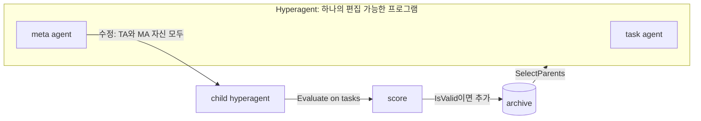

# Hyperagents

> [!summary] 핵심 요약
> 과제를 푸는 task agent와 에이전트를 수정·생성하는 meta agent를 **하나의 수정 가능한 Python 프로그램(hyperagent)**으로 합친다. 이를 Darwin Gödel Machine(DGM)의 archive 기반 열린 탐색에 얹은 것이 DGM-Hyperagents(DGM-H)다.
>
> 개선 절차 자체도 수정 대상인 metacognitive self-modification이 핵심이다. 논문 리뷰, 로봇 reward 설계, 올림피아드 수학 채점처럼 코딩이 아닌 도메인에서도 성능 향상을 보고한다. 학습된 meta-level 기능(성능 추적, persistent memory 등)의 다른 도메인 전이와 누적도 보고한다.

> [!info] 열람 범위
> arXiv HTML 전문(https://arxiv.org/html/2603.19461, v1, 2026-03-19)을 초록부터 부록 A-F(알고리즘, 베이스라인, 도메인, 하이퍼파라미터, 비용, imp@k, 전이 선택, 정성 사례, parent selection 수정, 안전 논의)까지 읽었다. 도메인별 최고 에이전트 코드 전문(부록 E.1)과 그림(Fig. 2-4, 7-12)의 곡선 자체는 캡션과 본문 서술로만 확인했다.
>
> 공식 저장소 https://github.com/facebookresearch/Hyperagents 를 clone해 구조를 확인했다(최신 커밋 2026-04-14, 라이선스 CC BY-NC-SA 4.0).
>
> 논문 본문 첫 페이지 표기에 "date: August 24, 2026"이 보이는데 arXiv 제출은 v1 2026-03-19로 표기되어 있어, 이 날짜는 개정 시점일 가능성이 있으나 확인하지 못했다.

## 1. 문제의식·배경

자기개선 AI의 병목은 대개 **고정된 meta-level**이다. 기반 시스템(base)을 고치는 상위 시스템(meta agent)이 손으로 설계되어 있으면 base는 meta가 허용하는 범위까지만 개선된다.

meta-meta를 추가해도 무한 후퇴만 일어난다는 것이 저자들의 진단이다.

해결책은 시스템이 **자기참조적(self-referential)**이어서 스스로를 분석·수정·평가할 수 있게 하는 것이다.

### DGM과 그 가정의 한계

DGM(Zhang et al., 2025b)은 코딩 에이전트가 자기 코드를 수정한 변종을 만들고 평가해 archive에 쌓는 열린 탐색(open-ended exploration)으로 SWE 계열 코딩 성능을 올렸다. 그러나 두 가지 구조적 제약이 있다.

1. 어디를 고칠지 알려주는 **self-improvement instruction 생성 단계가 손으로 고정**되어 있다(부록 B에 프롬프트 공개). 이 단계가 수정 불가능하다.
2. DGM은 "평가 과제를 푸는 기술 = 효과적으로 자기 수정을 하는 기술"이라는 정렬 가정에 의존한다. 평가와 수정이 둘 다 코딩이라서 코딩 능력이 오르면 자기개선 능력도 오른다. 평가 과제가 시 쓰기라면 시 쓰기를 잘하게 되어도 자기 코드를 잘 고치게 되지는 않는다.

Hyperagent는 이 정렬 가정을 없앤다. meta-level 수정 절차까지 편집 가능한 프로그램에 포함되므로 평가 과제와 무관하게 "개선하는 방법"을 개선할 수 있다는 논리다.

### 선행 연구 지도

- 이론: Hutter(AIXI), Schmidhuber의 Gödel Machine(증명 가능할 때만 자기 재작성, 비현실적).
- 자기개선 계열: 가중치/학습 동역학 메타러닝, 진화, self-play, 그리고 FM 기반의 프롬프트·추론 trace·코드베이스 반복 개선. 이들 대부분(DGM 및 후속 포함)은 고정된 손설계 meta-level을 가진다.
- 자기참조 메타러닝: Kirsch & Schmidhuber, Jackson 등 신경망 계열, 그리고 FM 기반의 Zelikman, Robeyns, Yin, Zhang(DGM) 계열. 대부분 코딩 영역 내에서만 "improve at improving"한다.
- 열린 탐색/quality-diversity: 아카이브에 다양한 디딤돌(stepping stone)을 유지한다는 발상을 DGM-H가 계승한다.

차별점은 한 줄로 "DGM의 열린 탐색 + 편집 가능한 meta agent"다.

## 2. 방법 상세

### 2.1 용어 정의 (3절)

- **Agent**: 임의의 계산 가능한 프로그램. FM 호출, 외부 도구, 학습된 컴포넌트를 포함할 수 있다.
- **Task agent**: 주어진 과제 집합을 푸는 에이전트(코드 편집 생성, 논문 accept 예측, 로봇 reward 함수 작성 등). 경험적으로 평가된다.
- **Meta agent**: 기존 에이전트를 수정하고 새 에이전트를 만드는 일만 하는 에이전트. 이전 에이전트와 평가 결과 전체(archive)에 접근하며, 수정 대상에는 task-solving 로직뿐 아니라 meta agent 자신이 포함된다.
- **Hyperagent**: task agent와 meta agent를 **단일 편집 가능 프로그램**으로 통합한 것. 구현 언어를 Python(튜링 완전)으로 잡았으므로 원리적으로 어떤 계산 가능한 기계도 구성할 수 있다.
- **Metacognitive self-modification**: 에이전트가 과제 수행 방식과 함께 "향후 수정을 제안·적용하는 절차"도 동시에 수정하는 것.

### 2.2 DGM-H 알고리즘 (3절, 부록 A)

외곽 루프는 DGM과 같다. archive를 단일 초기 hyperagent로 시작해 (1) 부모 선택 -> (2) 부모가 스스로를 수정(metacognitive self-modification) -> (3) 자식을 과제 집합에서 평가 -> (4) 컴파일/유효한 자식을 archive에 추가를 반복한다.

```text
Algorithm 1 (DGM-H, 논문 부록 A.3)
s0 = Evaluate(a0, T); A = {(a0, s0)}
for t in 1..T:
    P = SelectParents(A)                  # 핸드크래프트, 수정 불가
    for (a, _) in P:
        a' = a.Modify(a, A)               # 부모 a 자신의 meta 코드가 자기와 archive를 보고 수정
        s' = Evaluate(a', T)
        if IsValid(a'): A = A ∪ {(a', s')}
return A
```

DGM-H w/o self-improve(ADAS 유사)에서는 `a.Modify`가 항상 **초기 meta agent a0**의 Modify로 고정된다(부록 B Algorithm 2). 이 대비가 핵심 ablation이다.

**부모 선택 (A.2)**: 성능에 비례하고 "컴파일에 성공한 자식 수"에 반비례하는 확률적 선택이다.

현재 상위 m=3개 에이전트 평균으로 동적 중간값 α_mid를 잡고, 각 에이전트 점수에 시그모이드 s_i = 1/(1+exp(−λ(α_i − α_mid))) (λ=10)를 적용하고, 자식 수 n_i에 대해 novelty 보너스 h_i = 1/(1+n_i)를 곱해 w_i = s_i·h_i를 만들고 정규화해 categorical 분포에서 복원추출한다.

본문 실험에서는 이 선택기를 **수정 불가**로 고정했다(효과를 hyperagent 자기수정에 격리하기 위해).

**멀티 도메인 최적화 (A.4)**: 한 run에서 여러 도메인을 동시에 평가하며 meta agent가 모든 도메인의 평가를 본다.

부모 선택은 도메인 평균 성능 기준이고, 어느 도메인을 우선할지 지정하지 않는다.

어느 도메인의 staged evaluation이 실패하면 다른 도메인의 전체 평가도 건너뛰고 나머지를 0점 처리한다(5.1절).

### 2.3 초기 hyperagent (4절, A.1)

의도적으로 단순하게 시작한다. 고정된 FM 하나와 도구 2개(bash, 파일 조회·수정 도구)를 쓴다.

- **초기 task agent**: 과제 입력을 받아 FM 호출 한 번의 응답을 JSON(`{"response": ...}`)으로 출력할 뿐이다. 그래서 형식 후처리가 없는 paper review에서는 점수 0.0이다.
- **초기 meta agent**: 지시문이 사실상 한 줄이다. "Modify any part of the codebase at `{repo_path}`." 입력으로 저장소 경로, 이전 평가 결과 경로, 남은 반복 횟수를 받는다.

공식 코드의 `meta_agent.py`(18줄)와 `task_agent.py`(44줄)가 이 초기 상태 그대로다.

저장소에서 확인한 meta agent는 `chat_with_agent(instruction, tools_available='all')`을 호출하는 것이 전부다.

모든 구조 개선은 이 단순한 시작점에서 진화로 나온다.



### 2.4 비교 대상 (4.1, 부록 B 표 1)

| 방법 | 자기개선 meta agent | 열린 탐색(archive) | 메타인지 자기수정 |
|---|---|---|---|
| DGM-H | O | O | O |
| DGM-H w/o self-improve | X(초기 meta로 고정) | O | O |
| DGM-H w/o open-ended exploration | O | X(archive 없이 자식이 부모를 대체) | O |
| DGM (원본) | O | O | X(손설계 고정 instruction 생성) |
| DGM-custom | O | O | X(도메인별로 사람이 instruction 생성 프롬프트를 수정) |

표 1의 DGM과 DGM-custom의 "자기개선 meta agent" 칸이 O인 것은 코딩 에이전트가 자신을 수정한다는 뜻이다. 저자들 표기를 그대로 옮겼다. 추가로 도메인별 손설계 정적 솔루션도 비교한다(AI-Scientist-v2 reviewer, ProofAutoGrader, 로봇 기본 reward 등).

## 3. 실험 설정

### 3.1 도메인과 평가 프로토콜 (4.2, 부록 C)

| 도메인 | 과제 | 지표 | 분할/스테이징 |
|---|---|---|---|
| Polyglot (코딩) | 저장소 + 자연어 변경 지시 -> 코드 수정 | 통과율 | DGM과 동일 분할, 10개 -> 50개 staged. FM: 자기수정 Claude 3.5 Sonnet(New), 평가 o3-mini |
| Paper review | 논문 전문 -> accept/reject 이진 예측 (Zhao et al. 2026 벤치마크, ICLR 2024/2025·NeurIPS 2023/2024 실제 결정) | 정확도 | train/val/test 각 100개, 10개 staged(한 개 이상 성공 시 100개 평가). 정적 baseline: AI-Scientist-v2 reviewer. 평가 FM: GPT-4o |
| Robotics reward design | Genesis 시뮬레이터의 Go2 사족보행 로봇. 텍스트 설명 -> Python reward 함수 -> PPO 학습 -> 성능 측정 | 학습 시 속도 추종(MSE), 테스트는 torso height 최대화 | train은 "전진 보행", **test는 zero-shot "torso 높이 최대화"**(점프 필요). 3회 -> 6회 반복. 평가 FM: Claude 4.5 Sonnet |
| IMO-level grading | IMO급 문제 + 후보 풀이 + 참조 풀이 + 채점 지침 -> {0,1,6,7} 점수 (IMO-GradingBench) | 전문가 채점 대비 정확도 | train/val/test 각 100개. **meta 전이 평가용 held-out 도메인**. 정적 baseline: ProofAutoGrader. 평가 FM: o4-mini (temperature 1.0) |

로봇 도메인에서 기본 reward(`height`를 그대로 보상)는 로봇이 "가능한 한 높이 서 있기"에 머무는 지역 최적에 빠지고, 높은 성능은 몸을 낮췄다 점프하는 비근시적(non-myopic) reward 설계를 요구한다(C.3, Fig. 6). 즉 train과 test 과제가 의도적으로 다르다.

### 3.2 실행 규모

도메인별로 각 방법을 **5회 반복**, 보고는 중앙값과 1,000회 부트스트랩 95% CI, 유의성은 Wilcoxon signed-rank 검정이다. paper review와 robotics는 한 run에서 함께 최적화하고 100 iteration을 돈다. Polyglot은 DGM과 같은 80 iteration. 자기수정 FM은 대부분 Claude 4.5 Sonnet(Polyglot만 DGM 설정 승계), temperature 0.0.

비용(D.2): 100 iteration의 self-modification만 약 3,300만 토큰, paper review + robotics 평가는 iteration당 약 0.506M 토큰(paper review 0.5M, robotics 0.006M)이라 100 iteration 총 약 8,860만 토큰이다. IMO-GradingBench 평가는 100 과제당 약 0.11M(o4-mini)이다.

### 3.3 새 지표 imp@k (5.2, D.3)

meta agent의 "개선된 task agent를 만드는 능력"을 직접 재기 위해 improvement@k를 정의한다. meta agent M을 **고정**하고 초기 task agent A에서 시작해 최대 k개의 새 task agent를 생성하게 한 뒤, 검증 점수로 고른 최고 에이전트의 테스트 성능에서 A의 성능을 뺀 값이다. 이 논문에서는 k=50, 즉 imp@50.

한계로, 성능 구간별 난이도(0.7->0.8 vs 0.0->0.1)를 반영하지 못해 선형으로 취급한다는 점을 저자가 부록에서 인정한다.

### 3.4 전이 에이전트 선택 (D.4)

전이 실험용 hyperagent는 단순한 최고 점수 에이전트가 아니라 "좋은 디딤돌"을 고른다. archive 트리에서 노드 i의 후손 집합 D(i)에 대해 할인 성장 점수 G_γ(i) = (1/|D(i)|)·Σ_{j∈D(i)} (α_j − α_i)·γ^{dist(i,j)}를 계산해(γ=0.6, 후손 3개 이상인 노드만 고려) 최대인 노드를 택한다.

## 4. 주요 결과

### 4.1 과제 성능 개선 (5.1, Fig. 2)

**Polyglot(코딩)**: 초기 에이전트 -> DGM-H, 50개 train 부분집합 0.140 -> 0.340(CI 0.300-0.380), 전체 벤치마크 0.084 -> 0.267(CI 0.231-0.280).

비교로 원본 DGM은 train 0.140 -> 0.380, 전체 0.142 -> 0.307로 보고되어 있다(Zhang et al., 2025b 수치). DGM-H는 코딩 전용으로 설계되지 않았음에도 유사한 개선폭을 낸다는 주장이다.

단, 전체 벤치마크 초기값이 0.084 vs 0.142로 다르고 DGM의 최종 수치가 더 높다는 점은 "comparable"이라는 표현이 넉넉한 표현임을 보여준다.

**Paper review / Robotics (테스트 중앙값)**:

| 방법 | Paper review | Robotics reward |
|---|---|---|
| 초기 에이전트 | 0.0 | 0.060 |
| DGM (원본) | 0.0 (CI 0.0-0.510) | 0.0 (CI 0.0-0.090) |
| DGM-custom | 0.590 (0.570-0.650) | 0.348 (0.305-0.385) |
| DGM-H w/o self-improve | 0.0 (0.0-0.130) | 0.213 (0.180-0.348) |
| DGM-H w/o open-ended exploration | 0.0 (0.0-0.560) | 0.116 (0.0-0.348) |
| **DGM-H** | **0.710 (0.590-0.750)** | **0.372 (0.355-0.436)** |
| 정적 baseline | 0.630 (AI-Scientist-v2 reviewer) | 0.348 (기본 reward) |

DGM-H는 원본 DGM, w/o self-improve, w/o open-ended exploration 대비 두 도메인에서 모두 p<0.05로 유의하게 높았다.

DGM-custom과는 중앙값이 높지만 **유의하지 않다**(p>0.05).

해석은 이렇다. 사람이 도메인마다 instruction 생성 단계를 손으로 맞추면(DGM-custom) 꽤 따라잡는다. DGM-H는 사람 없이 그 수준에 도달한다.

정성적으로 로봇 test(torso 높이)에서 DGM-H는 거의 항상 점프 보상을 설계한 반면 DGM-custom은 "서 있기" 지역 최적에 자주 갇혔다.

정성적 진화 양상(E.2): paper review에서 "엄격한 심사자" 같은 태도 지시(generation 39)에서 "LLM에는 태도 지시 대신 구조적 절차를 쓰라"는 통찰(generation 54)과 함께 체크리스트로 약점을 먼저 식별한 뒤 규칙에 따라 accept/reject를 결정하는 2단계 평가로 진화했다. robotics에서는 generation 8에 유효한 상태 변수와 제약, reward 설계 가이드를 담은 환경 문서화를 추가해 환각 속성에 의한 컴파일 실패를 제거하고, 12-13에서 예제 코드와 스케일 범위를 정교화했다. IMO grading에서는 generation 3의 채점 카테고리 정의(풀이하려는 경향 교정), 18/37의 결정 절차와 경계 사례, 168의 명시적 rubric·항목별 체크리스트·결정 트리로 진행했다.

### 4.2 "개선하는 능력" 자체의 개선과 전이 (5.2, Fig. 3)

설정: IMO 채점을 held-out 도메인으로 두고 meta agent를 고정해 imp@50을 잰다.

- 초기 meta agent로 DGM w/o self-improve와 DGM-H w/o self-improve를 돌리면 imp@50은 0.0 (CI 0.0-0.0), 0.0 (CI 0.0-0.130). 초기 meta agent는 이 도메인에서 개선된 task agent를 거의 못 만든다.
- **DGM-custom 계열 전이 에이전트**(paper review/robotics에서 최적화된 것)를 쓰면 imp@50은 0.0 (CI 0.0-0.010) 수준. 해석: DGM-custom의 개선은 도메인 특화 수작업에 의존했고 일반적 meta 능력이 늘지 않았다.
- **DGM-H 전이 hyperagent**를 쓰면 시작 테스트 점수는 0.0인데, 50 iteration 후 최고 에이전트가 0.630(CI 0.540-0.630), 즉 imp@50 = 0.630. 초기 에이전트의 imp@50과 비교해 p<0.05.

저자들은 전이 hyperagent가 가진 일반 meta 기능으로 **performance tracking**(세대별 점수를 기록·집계·추세 비교, 논문에 `PerformanceTracker` 코드 제시: `record_generation`, 이동평균 기반 `get_improvement_trend`, `get_statistics`)과 **persistent memory**(단순 점수 로그가 아닌 종합된 통찰, 인과 가설, 향후 계획을 저장하고 이후 수정 단계에서 참조. 예: "Gen55는 정확도 63%이나 너무 가혹함, Gen64는 균형이 좋음, Gen66은 과교정" 같은 항목)를 든다.

부록 E.3에는 이 외에도 평가 결과를 분석한 뒤 수정하는 `_analyze_evaluations()`(E.3.1), 남은 반복 횟수에 따라 보수성을 바꾸는 compute-aware 계획(E.3.2: iterations_left가 많으면 근본 개선, 적으면 보수적), 한 클래스로 예측이 쏠리는 classification collapse를 label 분포 추적으로 탐지·교정하는 장치(E.3.3), 프롬프트 템플릿 시스템(E.3.5), 다세대 성능 기반 정제(E.3.6)가 나온다.

어느 것도 지시된 적 없는 emergent 기능이라고 저자들은 강조한다.

### 4.3 누적(compounding) (5.3, Fig. 4)

IMO 채점에서 전이 hyperagent로 200 iteration 계속하면 최고 테스트 0.640 (CI 0.550-0.720). 초기 에이전트에서 시작하면 0.610 (CI 0.510-0.680).

중앙값과 CI 하한은 높으나 **통계적으로 유의하지 않다**(p>0.05). 저자들은 포화 효과로 같은 개선이 어렵다고 해석한다.

또한 ProofAutoGrader를 task agent로 초기화하고 전이 meta agent를 붙여 200 iteration 최적화하면 테스트 0.700으로 ProofAutoGrader의 0.670을 넘고, 전체 IMO-GradingBench에서는 정확도 0.561 -> 0.601, MAE 0.178 -> 0.175였다(E.4, 아티팩트 공개).

### 4.4 parent selection도 수정시켜 보기 (E.5, Fig. 11-12)

무작위 선택에서 시작해 hyperagent가 선택 메커니즘을 수정하게 한 예비 실험이다(`modifiable`). paper review + robotics 평균 테스트 점수: 무작위 선택 0.030 -> 0.428 (CI 0.407-0.432), 수정 가능 0.491 (CI 0.387-0.512), 손설계 score-child-prop 0.532 (CI 0.384-0.586). 차이는 유의하지 않다.

모든 run이 초기 몇 iteration 안에 UCB형 선택(탐색 보너스 sqrt(log(total_children+1)/(children+1)))을 독립적으로 만들었고, 이어서 온도 softmax, 온도의 적응, 다성분 점수(다양성, 최근성, 엘리트 보너스), 점수 분산이 작으면 탐색 가중치를 1.4배 올리는 정체 탐지까지 진화했다.

그러나 정교해질수록 복잡·민감해져서 손설계 선택기를 넘지 못했다.

## 5. 저자가 밝힌 한계 + 내 비판적 평가

**저자 명시 한계(7절)**:

1. 고정된 task distribution에서만 동작한다. 과제 분포와 커리큘럼의 공진화는 미래 과제.
2. 열린 탐색 루프의 일부(parent selection, 평가 프로토콜)가 고정이다. hyperagent는 outer loop를 바꿀 수 없다. 안정성과 안전을 위해 고정했지만 완전한 자기수정 가능성은 제한된다(E.5의 예비 결과는 아직 손설계를 못 넘음).
3. 안전 논의(6절, 부록 F): 인간이 감사·해석할 수 있는 속도보다 빠르게 진화할 가능성, 벤치마크에 내재된 인간 편향의 반영과 증폭(paper review는 기존 심사 데이터를 학습), 평가 gaming(Goodhart 법칙)에 대한 취약성. 실험은 샌드박스, 자원 제한(타임아웃), 제한된 인터넷, 사전 정의된 과제와 지표, 인간 감독 하에서 수행되었다.

**내 비판**:

1. **"자기가속(self-accelerating)" 서사에 비해 증거가 약하다.** 5.3의 누적 결과는 p>0.05이고, 전이 imp@50 개선(0.0 -> 0.630)도 5회 반복(전이 에이전트 5개)이라 표본이 작다. 비교 기준이 "초기 meta agent"인데 이는 지시문이 한 줄뿐인 매우 약한 기준선이다. 따라서 imp@50이 크다는 것은 "DGM-H가 학습한 메타 기능 덕"이라기보다 "약한 초기 meta보다는 진화한 meta가 낫다"일 수 있다. 같은 FM(Claude 4.5 Sonnet)에 처음부터 좋은 손설계 meta 프롬프트를 준 baseline과의 비교는 없다. DGM-custom이 비슷한 위치(paper review 0.590)까지 간다는 점도 같은 이야기를 한다.
2. **DGM-custom과의 격차는 통계적으로 구분 불가**(p>0.05). "사람 설계 없이 사람 설계 수준"이라는 주장은 방어되지만 "능가"는 아니다.
3. **0.0에서 출발한 개선폭의 의미**: paper review 초기 0.0은 JSON 출력 형식 후처리가 없어서 생긴 값이다(5.1 본문). 큰 개선폭의 상당 부분이 기본 형식 오류의 해소일 수 있다. 비교 가능한 의미 있는 기준은 정적 baseline 0.630 대비 0.710이며, 이 차이의 유의성은 별도로 제시되지 않았다("several top-performing agents outperform").
4. **paper review의 판정 가능성**: 100개 test 과제에서 accept/reject 이진 예측 정확도 0.71은 불확실성이 크고, 정답이 주관적 결정이다. 모델 체크포인트와 평가 FM(GPT-4o)에 따른 민감도, 학습 데이터 오염(논문이 이미 FM 학습 데이터에 있을 가능성)은 논의되지 않는다(내 지적).
5. **Goodhart/평가 gaming을 실험으로 점검하지 않았다.** 안전 논의에서 위험을 인정하나 hyperagent가 평가 하네스를 건드리는지(예: 평가 결과 파일 수정)를 실제 로그에서 체계적으로 점검한 결과는 본문에 없다. 에이전트가 자기 코드와 archive 평가 결과에 접근하므로 구조적으로 가능한 공격면이다.
6. **비용과 재현성**: 100 iteration에 약 8,860만 토큰, 5회 반복이면 수억 토큰이다. 코드와 실험 로그는 공개되었으나 CC BY-NC-SA 4.0이라 상업 활용에 제약이 있다.
7. **정성적 사례의 선택 편향**: E.3의 인상적인 코드(PerformanceTracker, persistent memory)는 선택된 run의 사례다. 모든 run에서 같은 기능이 나왔는지, 얼마나 자주 나왔는지는 정량화되지 않았다. parent selection 실험에서만 "모든 run이 독립적으로 UCB를 만들었다"고 명시한다.
8. **외곽 루프 고정 문제**: 가장 중요한 선택(부모 선택, 평가)이 고정이라 "improve the improvement process"의 범위가 meta agent 코드에 한정된다. 평가 기준 자체를 고치게 하면 안전성과 정당성 문제가 급격히 커질 것이다.

## 6. 재현·구현 시 고려사항

**공식 저장소 구조 (clone 확인)**: 루트에 `generate_loop.py`(1,189줄, 진입점·외곽 루프, 컨테이너 평가 호출), `meta_agent.py`(초기 meta agent, 18줄), `task_agent.py`(초기 task agent, 44줄), `select_next_parent.py`(부모 선택 모듈, 57줄), `run_meta_agent.py`, `run_task_agent.py`, `ensemble.py`, `setup_initial.sh`, `Dockerfile`. 디렉터리: `agent/`(FM 호출·도구, `llm_withtools`, `base_agent`), `domains/`(balrog, search_arena, polyglot, imo, genesis, paper_review), `baselines/`(dgm, ai_reviewer, imo_grading, imo_proof, genesis_go2walking, sft_openai 등), `analysis/`(그림), `utils/`. README의 실행: `.env`에 OpenAI/Anthropic/Gemini 키, Python 3.12 venv, `docker build -t hyperagents .`, `bash ./setup_initial.sh`, 이어서 `python generate_loop.py --domains <domain>`. 출력은 `outputs/`에 저장되고 실험 로그는 README의 Google Drive 링크로 제공된다.

**논문과 코드의 연결 지점**:

- 논문 부록의 부모 선택 옵션은 `generate_loop.py --parent_selection {random, latest, best, score_prop, score_child_prop}`에 대응한다(기본값 `score_child_prop`). E.5 실험은 `--edit_select_parent`(에이전트가 선택 메커니즘을 편집하게 허용)에 대응한다. 흥미롭게도 저장소의 `select_next_parent.py` 파일은 마지막 줄이 "Select parent randomly, keeping the search space open"으로 `random.choice`를 반환하는 초기 상태(E.5에서 에이전트가 수정하는 출발점)다. 기본 선택기는 `generate_loop.py` 쪽 로직에 있어 보이지만 이 대응은 코드 전체를 추적해 검증하지 않았다.
- `--reset_task_agent`, `--reset_meta_agent`, `--meta_patch_files`, `--agent_archive_path`, `--optimize_option`(예: only_ensemble)은 전이 실험(5.2, 5.3)과 앙상블 평가를 위한 옵션으로 보이나, 각각의 정확한 사용법은 코드를 따라가 검증하지 않았다.
- 초기 meta agent 프롬프트가 한 줄이라는 논문 서술이 코드에서도 그대로 확인된다.

**고려사항**:

- 실행 환경 위험: README가 "신뢰할 수 없는 모델 생성 코드를 실행한다"고 명시 경고한다. Docker 샌드박스, 네트워크 제한, 자원 제한 없이 돌리면 안 된다.
- 비용 관리: 스테이징 평가(10개로 걸러 일부만 전체 평가)와 한 개라도 성공해야 전체 평가하는 규칙이 비용 절감의 핵심이다. 도메인 중 하나의 staged 평가가 실패하면 모든 도메인의 전체 평가가 생략되는 멀티 도메인 규칙은 의도치 않은 커플링을 만든다.
- 평가 과제 설계: held-out 테스트(로봇은 다른 과제, paper review/IMO는 별도 split)와 검증 분할을 반드시 분리한다(parent selection과 최종 선택은 val 기준).
- 평가 FM, 자기수정 FM, 온도를 논문 표 3대로 고정해야 비교가 가능하다.

## 8. 관련 노트

- [[wikiskill]]
- [[procedural-graphs-self-evolving]]
- [[skillzip-pro]]
- [[llm-agent-skill-memory-without-finetuning]]
- [[aces-agentic-continuous-evaluation-of-skills]]
- [[context-fails-first-agent-reliability]]
- [[algorithmically-establishing-trust-in-evaluators]]
- [[jev-as-a-judge-agent-evals]]

## 9. 출처

- 논문 초록: https://arxiv.org/abs/2603.19461
- 논문 HTML 전문(실제 열람): https://arxiv.org/html/2603.19461 (v1, cs.AI, 2026-03-19). 저자: Jenny Zhang(UBC, 교신), Bingchen Zhao, Wannan Yang, Jakob Foerster, Jeff Clune, Minqi Jiang, Sam Devlin, Tatiana Shavrina. 소속은 UBC, FAIR at Meta, NYU, Meta Superintelligence Labs, Vector Institute, University of Edinburgh 등(본문 표기).
- 공식 코드: https://github.com/facebookresearch/Hyperagents (clone 후 README, `meta_agent.py`, `task_agent.py`, `select_next_parent.py`, `generate_loop.py` 인자 확인. CC BY-NC-SA 4.0). 실험 로그는 README의 Google Drive 링크(열지 않음).
- 비교 기반 선행(원문 열지 않음, 본문 인용 수치만 사용): Darwin Gödel Machine(Zhang et al., 2025b), ADAS(Hu et al., 2025), AI-Scientist-v2, IMO-GradingBench(ProofAutoGrader), Genesis 시뮬레이터, Polyglot 벤치마크(Gauthier).
