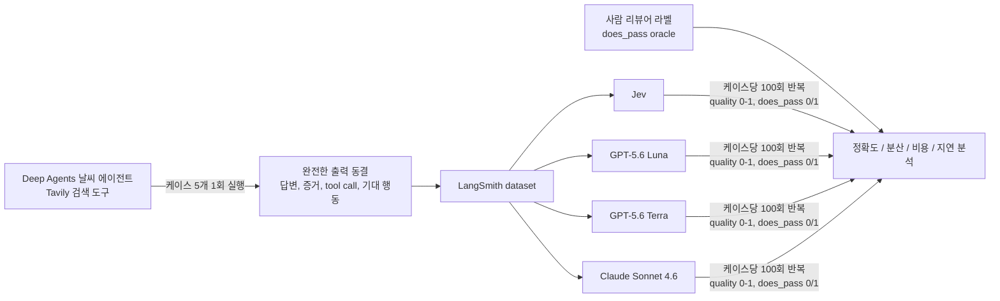

# Jev-as-a-Judge for Agent Evals

> [!summary] 한줄요약
> LangChain 팀이 TypeSafe AI의 "System One" 결정 모델 Jev를 코드 기반 평가, LLM-as-a-judge에 이은 제3의 에이전트 평가자로 시험했다. 고정된 날씨 에이전트 실행 5건을 100회씩 채점시킨 좁은 실험에서 Jev는 사람 oracle과 이진 판정 500건 전부 일치(100%), 연속 점수 분산은 Claude Sonnet 4.6의 1/92 수준, 호출당 \$0.00035, 평균 0.44초였다. 단, 저자들 스스로 "유망하지만 초기 단계"라고 못 박은 결과다.

> [!warning] 이전 판 노트 정정
> 이전 노트에는 "Claude 호출당 $0.28-$0.34"라고 적혀 있었으나 원문·README를 열어 보니 틀린 값이었다. 실제로는 Claude Sonnet 4.6이 호출당 \$0.02811, 전체 평가 비용 $28.17이고, $0.34는 오히려 Jev의 전체 비용이다. 아래 표는 모두 원문 또는 GitHub README에서 직접 옮겼다.

## 1. 문제의식·배경

에이전트를 만드는 팀은 결국 "이 에이전트가 방금 한 일이 좋았는가"를 반복해서 물어야 한다. 이 글은 지금 쓰이는 평가자를 두 갈래로 정리하는 데서 출발한다.

첫째, **code-based evaluator**다. 코드로 짠 평가 함수는 코드가 생긴 이래 존재했고, 싸고 빠르고 믿을 만하다. 단점은 적용 범위가 좁다는 것이다. 결정론적 함수는 정해진 입력을 요구하는데, 에이전트의 행동은 확률적이다. 저자들의 예가 구체적이다. 에이전트가 첫 실행에서 도구를 호출했는지는 함수로 쉽게 검사하지만, "도구 결과를 받아 사용자 질문에 성공적으로 답했는가"는 검사하기 어렵다. 열린 과업에서는 같은 도구 결과를 쓰는 올바른 방식이 여럿이라서, 허용 가능한 답을 모두 결정론적 로직으로 인코딩하는 순간 범위의 한계에 부딪힌다.

둘째, **LLM-as-a-judge**다. 질문, trace, 증거를 비구조화 입력으로 넘기고 프롬프트로 "사용자의 요청에 답했는가"를 채점시킨다. 유연하지만 본질적으로 비결정적이라 "신뢰할 수 있는 테스트 장치"의 토대로는 약하고, 코드 평가보다 느리고 비싸다. 글은 이를 "에이전트 엔지니어라면 누구나 증언할 것"이라고 표현한다.

여기에 TypeSafe AI의 Jev가 등장한다. LangChain의 질문은 간단하다. 이 "System One" 모델이 제3의 평가자 형태가 될 수 있는가, 그리고 에이전트 엔지니어링에 어떤 영향을 주는가. 글에는 Key Takeaways 네 줄이 있다. (1) Jev는 LLM 판정자처럼 텍스트를 생성하지 않고 typed answer를 직접 반환하는 근본적으로 다른 종류의 평가자다. (2) 연속 점수의 일관성이 압도적이었다. 품질 점수 분산이 GPT-5.6 Luna, Terra, Claude Sonnet 4.6보다 92-913배 낮았다. (3) 가장 빠르고 가장 쌌다. 평균 0.44초, 호출당 $0.00035(전체 \$0.34 대 Claude \$28.17). (4) 결과는 유망하지만 이르다.

## 2. Jev와 System One 모델이란 무엇인가

### 2.1 LangChain 글의 설명

글은 Jev를 "전통적 LLM이 아니며 텍스트를 생성하지 않는다"고 소개한다. TypeSafe AI가 "System One" 모델이라 부르는 이 클래스는 "빠르고 구조화된 결정을 내려 소프트웨어가 그대로 쓸 수 있게 만든 AI 모델"이며, 상태(state)를 평가해 typed answer와 확률을 반환한다. TypeSafe 측 주장으로는 comparable LLM 대비 분류 과업에서 최대 200배 빠른 추론, 400배 낮은 비용이다(글 본문의 표현, 즉 벤더 주장이다).

### 2.2 TypeSafe 공식 소개 글에서 확인한 것

글에서 링크된 TypeSafe 블로그(2026-09-15, 창업자 Diogo Almeida)를 따라가 읽었다. 요점은 다음과 같다.

- 학습법은 **RLCD(Reinforcement Learning for Calibrated Decisions)**라 부른다. 기존 LLM은 RLHF/RLVR로 인간 선호나 검증 가능한 보상을 최적화하고, Jev는 "calibrated probability를 가진 답"을 최적화한다고 설명한다.
- 입력은 비정형 데이터(텍스트)지만 "구조화된 프로그램 상태"에 중점을 둔다. 출력은 사전에 정의된 type-safe 값이며 모든 답에 보정된 확률과 confidence가 붙는다. 샘플링은 순차(token by token)가 아니라 한 번의 질의로 모든 출력을 **병렬** 생성한다.
- 가격은 입력 \$0.042/MTok, 출력은 "too cheap to meter"로 무료라고 적혀 있고, 응답 시간은 70ms-500ms, 이를 frontier LLM의 3-329초와 대비한다.
- 스스로 인정하는 부분도 있다. "가격이 보조금을 받는지 증명할 수 없다", workflow evals의 참조 정답을 최대 모델(GPT-6 Astra와 Fable 5.1의 평균)로 삼아 OpenAI/Anthropic 쪽으로 편향되었을 수 있다, 홈페이지의 "193.6x 빠르고 444.6x 저렴" 수치는 "실제 세계에서는 높은 쪽 끝일 것", 해당 workflow들은 자사 capability 팀이 만들어 편향 가능성이 있다는 식이다. 스키마 일치는 구조상 보장되므로 type error 0%라는 주장은 "경험적 수치가 아니라 수학적 보장"이라고 밝힌다. Jev는 cardinality 255까지 지원하고 그 이상은 2단계(각각 점수화 후 선택)로 처리한다고 한다.
- "string을 포기했기 때문에 hallucinate할 수 없다"는 말은 형식 오류(type error)에 한정해 읽어야 한다. 판단 자체가 틀릴 수는 있고, 이는 이 실험의 accuracy 지표가 따로 재는 것이다.

### 2.3 세 가지 질문 유형

Jev는 평가를 "타입이 있는 질문"으로 던진다. 글과 README가 같은 구분을 쓴다.

| 유형 | 반환 | 예시 질문 |
|---|---|---|
| Choice | 선택지 중 하나 + 확률 + confidence | "이 실행을 가장 잘 설명하는 검색 결과는?" (searched_appropriately / searched_unnecessarily / failed_to_search) |
| Score | 순서형 rubric 점수(1-5) + 확률 + confidence | "답이 얼마나 유용한가?" |
| Noul | yes/no 판단이 참일 확률(0.0-1.0) | "최종 답이 검색된 증거에 근거하는가?" |

원문 표기는 "Noul"이다(글 본문에 이렇게 적혀 있고 README 표에도 동일). 여러 개의 원자적(atomic) 질문을 같은 state에 대해 병렬로 평가할 수 있다. 이 설계는 "하나의 긴 rubric 프롬프트로 종합 점수를 요구"하는 LLM judge 관행과 대조적이다. 질문을 잘게 쪼개 각각 확률을 얻는다.

### 2.4 LangSmith에서의 사용 방식 (링크된 문서 확인)

글이 링크한 LangSmith 문서 "How to define an LLM-as-a-judge evaluator"는 LLM 판정자의 UI 설정을 설명한다(prompt, model, 변수 매핑, few-shot, feedback 타입 Boolean/Categorical/Continuous). 여기서 "SemIf나 Jev 같은 decision model을 judge로 쓰려면 별도 가이드를 보라"고 안내하고, 연결된 "decision model evaluator" 문서에서 다음을 확인했다.

- Jev는 TypeSafe API 키를 LangSmith의 Provider secrets에 `TYPESAFE_API_KEY`로 등록하는 BYOK 방식이고, SemIf는 LLM Gateway를 거친다.
- 평가자는 **UI에서만** 만들 수 있고 SDK는 아직 지원하지 않는다.
- LLM judge와 달리 prompt hub 불러오기, 사용자 정의 output schema, few-shot examples를 지원하지 않는다.
- **State에는 채점 지침을 넣지 않는다.** 평가 기준은 question의 Instructions에 쓰고, 각 question의 이름이 곧 run/thread의 feedback key가 된다. 이 방식은 데이터셋 실험(offline)과 tracing project의 online evaluator 양쪽에 쓰인다.
- OpenRouter나 자체 호스팅처럼 TypeSafe System One API를 구현한 endpoint도 저장된 model configuration으로 연결할 수 있다.

## 3. 실험 설계

- **대상 에이전트**: LangChain의 오픈소스 하네스 Deep Agents로 만든 날씨 에이전트(Tavily web search 사용).
- **테스트 세트**: LangSmith dataset의 다섯 요청. README 기준으로 정리하면 다음과 같다. 현재 날씨(Seattle), 주말 예보(Austin), 의사결정 지원(Dublin, 우산을 가져가야 하는가), 장기 예보(Tokyo), 모호한 위치(Springfield, 유일한 장소가 없는 요청 처리).
- **동결(freezing)**: 에이전트를 케이스당 한 번만 실행해 최종 답, 증거, tool call, 기대 행동을 고정 예제로 저장했다. 따라서 반복 사이의 변동은 오직 judge에서만 나온다. 에이전트와 검색 결과가 달라지면 judge 비교가 흐려지는 문제를 제거한 설계다.
- **두 가지 신호**: `quality`(grounding, 검색 행동, 유용성을 합친 0-1 연속 점수)와 `does_pass`(전체 성공을 뜻하는 0/1).
- **oracle**: 사람 리뷰어 한 명이 같은 rubric으로 각 고정 응답에 라벨을 붙였다. 이진 정확도의 정답으로만 쓰고, 연속 quality 점수는 정확도가 아니라 **신뢰도(reliability, 분산)**를 재는 데만 쓴다.
- **비교군**: GPT-5.6 Luna, GPT-5.6 Terra, Claude Sonnet 4.6. LLM들은 LangSmith Gateway(`openai/gpt-5.6-luna`, `openai/gpt-5.6-terra`, `anthropic/claude-sonnet-4-6`)를 통해 호출했다.
- **측정 정의**: accuracy는 사람 oracle과의 일치, variance(precision)는 같은 에이전트 행동에 대해 판정자가 매번 같은 점수를 주는지다. 저자들은 "낮은 분산이 곧 높은 정확도는 아니다. 일관되게 틀리는 judge도 있을 수 있다. 하지만 정확한 judge라면 낮은 분산이 프로덕션에서 그 정확성을 신뢰할 수 있게 만든다"고 적었다.

재현 정보도 공개되어 있다. LangSmith experiment 이름은 `benchmark-jev-luna-terra-sonnet`(2026-09-18 시작), 사용 버전은 deepagents 0.7.15, langchain-openai 1.6.2, langsmith 0.12.6, tavily-python 0.8.3, Jev는 `langchain-typesafe==0.0.1a2`다. LLM judge에는 temperature, top-p, seed, max tokens를 지정하지 않아 provider 기본값이 적용되었고, 호스팅된 Jev 서비스의 버전은 실험 메타데이터에서 알 수 없었다고 밝힌다. 실행은 `uv run python src/evals/judge_reliability.py` 형태이며 Python 3.13+, Tavily/TypeSafe/LangSmith 키가 필요하다.

## 4. 결과 (모두 원문·README 표에서 옮긴 값)

### 4.1 정확도: 이진 does_pass vs 사람 oracle

judge당 500건의 반복 결정(5케이스 x 100회)을 기준으로 한다.

| Judge | pass/fail 정확도 |
|---|---|
| Jev | 100.0% (500/500) |
| GPT-5.6 Terra | 99.8% |
| GPT-5.6 Luna | 96.4% |
| Claude Sonnet 4.6 | 80.0% |

README는 곧바로 "이것은 다섯 개의 agent run과 한 명의 사람 리뷰어로 이뤄진 작은 코퍼스다. 일반적인 judge 정확도 순위가 아니다"라고 단서를 단다.

### 4.2 신뢰도: quality 점수의 케이스별 분산 평균

| Judge | 평균 분산 | Jev 대비 |
|---|---|---|
| Jev | 0.0000149 | 1x |
| Claude Sonnet 4.6 | 0.00137 | 92x |
| GPT-5.6 Luna | 0.00647 | 433x |
| GPT-5.6 Terra | 0.01364 | 913x |

흥미로운 점은 LLM끼리의 순서다. 분산이 가장 작은 LLM은 Claude(92x)인데, 이진 정확도는 가장 낮다(80.0%). 즉 Claude는 "일관되지만 사람과 덜 맞는" 쪽이고, Terra는 정확도는 높지만 점수 흔들림이 가장 크다. 저자들이 "정확도와 분산을 분리해서 봐야 한다"고 한 이유가 이 데이터 안에서 드러난다. Jev만 두 축에서 동시에 좋았다.

원인에 대해서는 신중하다. "이 실험으로는 Jev의 점수가 왜 덜 흔들렸는지 말할 수 없다. 한 가설은 모델이 서로 다른 출력에 최적화되어 있다는 것이다. TypeSafe는 Jev를 보정된 확률과 typed answer를 내는 결정 모델로 설명하고, 자기회귀 LLM judge는 텍스트를 생성한 뒤 평가자가 그것을 점수로 매핑한다. 이 차이가 이 한정된 평가 과업에 더 잘 맞았을 수 있으나 관찰일 뿐 학습 목표가 원인이라는 증거는 아니다."

### 4.3 비용과 지연

| Judge | 호출당 평균 비용 | 평균 지연 | 전체 평가 비용 |
|---|---|---|---|
| Jev | \$0.00035 | 0.44 s | \$0.34 |
| GPT-5.6 Luna | \$0.00039 | 2.50 s | \$0.39 |
| GPT-5.6 Terra | \$0.00289 | 2.83 s | \$2.90 |
| Claude Sonnet 4.6 | \$0.02811 | 2.16 s | \$28.17 |

README는 "이 비용은 프롬프트, 입력, 평가 시점의 provider 가격에 의존한다"고 단서를 붙였다. 전체 비용을 호출당 비용으로 나누면 judge마다 약 1,000회 호출(500 판정 x 2 신호)이 된다. 이는 표에서 거꾸로 계산한 추정이고 원문이 명시한 숫자는 아니다.

내가 계산해 보면 이런 비교가 가능하다(모두 위 표의 산술). Jev 대비 호출당 비용은 Claude 약 80배, Terra 약 8배, Luna는 약 1.1배다. 지연은 Luna 약 5.7배, Terra 약 6.4배, Claude 약 4.9배 느리다. 즉 "Jev는 비용이 극적으로 싸다"는 헤드라인은 비싼 Claude 대비일 때 두드러지고, 소형·저가 LLM(Luna)과는 비용이 거의 같다. 그 경우 장점은 지연(5배 이상)과 분산(433배)에서 나온다.

### 4.4 Online eval 확장성과 signal value

글은 하루 10,000 trace를 내는 프로덕션 에이전트를 가정하고 관찰된 호출당 비용이 의미 있는 운영 비용 차이를 만든다고 말한다(그림에 숫자가 있고 본문 텍스트에는 없다). 또 "저비용 호출이 쓸모 있는가"를 따지기 위해 **signal value = (사람 oracle과의 이진 일치) x (이진 반복성)**을 정의한다. 반복성은 같은 trace에 독립적으로 두 번 호출했을 때 같은 판정을 내릴 확률이다. 정확하면서 안정적인 judge를 보상하고, 일관되게 틀린 judge는 벌점을 받는 지표다. 숫자 결과는 차트에만 있어 이 노트에서는 옮기지 못했다.

## 5. 저자들의 해석: "abundant evaluation"

글의 결론부 주장은 이렇다. 지금은 모든 평가가 비용과 맞바꿔진다. 더 많은 run을 채점하고, 더 많은 차원을 평가하고, 더 많은 변경을 테스트할수록 테스트 비용이 늘어서 팀은 원하는 만큼 평가하지 못한다. 호출당 $0.00035에서 정확하고 안정적인 judge가 있으면, 각 run을 여러 개의 초점이 좁은 기준으로 평가하고, 모든 에이전트 변경을 측정하고, 확신이 필요할 때 판정을 반복할 수 있다. 프로덕션에서는 더 많은 trace에 judge를 붙여 더 촘촘한 피드백 신호를 얻고 품질 하락 추세를 알림으로 잡을 수 있다. "열쇠는 단지 싼 eval이 아니라 더 촘촘한 피드백 루프"라는 문장이 요약이다.

동시에 저자들은 단서를 둘 붙인다. (1) 이 실험 결과가 다른 에이전트와 프로덕션 워크플로로 이어지는지는 아직 봐야 한다. (2) **낮은 비용은 실수를 증폭할 수 있다.** 일관되게 틀리는 평가자는 대규모로 나쁜 피드백을 만든다. 따라서 사람 리뷰와 judge 정렬(alignment) 작업은 여전히 필요하다.

## 6. 한계·비판적 평가

1. **표본이 극단적으로 작다.** 서로 다른 에이전트 응답은 5개이고 사람 라벨러는 1명이다. 500회 "결정"은 독립 표본이 아니라 5개 응답을 100번씩 되풀이한 것이므로 100% 정확도는 사실상 "5개의 고정 응답 모두 맞혔다"는 뜻이다. 신뢰구간이 매우 넓다. 반대로 Claude의 80.0%도 어느 응답에서 일관되게 틀리는 현상일 수 있다(예: 5개 중 1개). 이는 내 해석이며, 원문은 케이스별 분해를 본문에 싣지 않았다.
2. **과업이 쉽다.** 날씨 조회는 정답이 비교적 명확하고, 증거 근거성이 뚜렷하다. 도메인 지식이나 긴 trace, 다단계 추론, 미묘한 취향이 필요한 평가에서 결정 모델이 어떻게 행동할지는 이 실험 밖이다.
3. **분산은 정확도가 아니다.** 저자도 인정하듯 낮은 분산은 일관된 오류와 공존한다. 이 실험에서는 Jev의 정확도가 높아서 문제가 안 됐을 뿐이다. 일반화되는 보장은 없다.
4. **LLM judge는 약하게 세팅되었을 가능성.** temperature, seed 등을 지정하지 않고 provider 기본값을 썼다. 결정론적 설정(낮은 temperature, 구조화 출력 강제, 다중 샘플 평균)을 쓰면 LLM의 분산이 줄 수 있다. 같은 이유로 LLM이 reasoning을 하게 하는 방식과의 공정 비교인지는 열려 있다. 또 LLM 쪽의 프롬프트와 Jev의 질문 정의가 동일한 rubric을 얼마나 동등하게 표현했는지는 원문만으로는 확인할 수 없다.
5. **Jev 서비스 버전을 알 수 없다.** 호스팅 모델의 버전이 메타데이터에 없어 재현성이 제한된다. 클라이언트는 `0.0.1a2` 알파다.
6. **이해관계.** 결과를 낸 곳은 LangChain 블로그(LangSmith 판촉 맥락)이고, 글 발행 이틀 뒤(9월 22일) TypeSafe와 공동 livestream을 예고했으며, 소개된 Jev는 TypeSafe의 early-access 제품이다. 저자들은 한계를 솔직히 적었으나 구조적 이해관계는 인지하고 읽어야 한다. TypeSafe의 큰 수치(193.6x, 444.6x)는 자사 workflow eval이 출처이며 저자들 스스로 상한에 가깝다고 적었다.
7. **비용 비교의 프레이밍.** 위 4.3에서 보았듯 같은 가격대(Luna)와는 비용 이득이 없고 Claude와 비교할 때만 극적이다. 그리고 Claude Sonnet 4.6은 이 평가에서 가장 정확도가 낮았다. "비싼 모델 = 좋은 judge"가 아니라는 부수 관찰이 있지만, 이 역시 5개 케이스 한정이다.
8. **스키마 제약의 비용.** 결정 모델은 질문을 미리 정의된 typed 형태(choice/score/noul)로 쪼개야 한다. 새로운 실패 모드를 탐색하는 open-ended 진단("왜 실패했는지 설명해 줘")은 문자열을 생성할 수 없는 모델의 영역이 아니다. LangSmith 문서도 decision model evaluator에서 few-shot, custom output schema, Prompt Hub를 지원하지 않는다고 적어 이 방식의 제약을 보여 준다.

## 8. 확인하지 못한 것

- 비용 차트(10,000 trace/일)와 signal value의 숫자: 이미지에만 있어 텍스트로 읽지 못했다.
- GitHub 저장소의 `analysis/`, 사람 oracle 라벨 파일, 케이스별 결과: README만 읽었고 파일 내용은 열지 않았다.
- TypeSafe의 모델 카드, 학습 데이터, 공개 벤치마크 성능(FAQ 항목들): 페이지의 접힌 FAQ 본문은 렌더 결과에 포함되지 않았다.
- 9월 22일 livestream 내용.

## 관련 노트
[[algorithmically-establishing-trust-in-evaluators]] [[probe-process-based-hallucination-benchmark]] [[aces-agentic-continuous-evaluation-of-skills]] [[new-sdlc-with-vibe-coding]] [[karpathy-llm-wiki]]

## 출처
모두 2026-10-01에 직접 열람.
- Daniel Shea, Sean Roche, "Jev-as-a-Judge for Agent Evals", LangChain Blog, 2026-09-20 (본문 전체): https://www.langchain.com/blog/jev-agent-evals-langsmith
- 실험 저장소 README (danielgshea/jev-as-a-judge, 2026-09-19 커밋): https://github.com/danielgshea/jev-as-a-judge
- Diogo Almeida, "Introducing System One Models & Jev", TypeSafe AI Blog, 2026-09-15: https://typesafe.ai/blog/introducing-system-one-models-and-jev
- LangSmith Docs, "How to define an LLM-as-a-judge evaluator": https://docs.langchain.com/langsmith/llm-as-judge
- LangSmith Docs, "How to define a decision model evaluator": https://docs.langchain.com/langsmith/decision-model-evaluator
