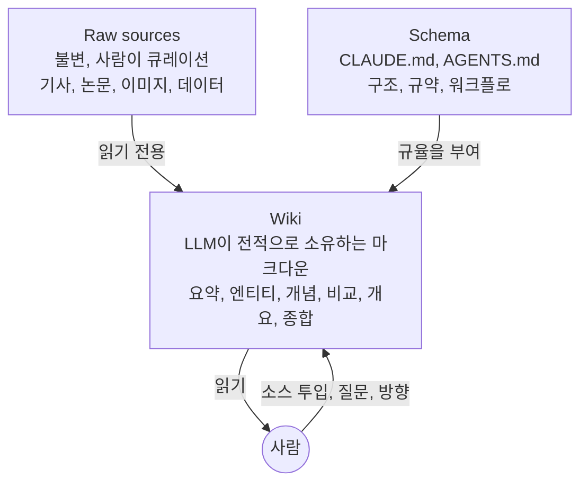

# LLM Wiki

> [!summary] 한줄요약
> 질문할 때마다 raw 문서에서 조각을 찾아 지식을 다시 조립하는 RAG 대신, LLM이 raw sources와 사용자 사이에 놓인 영속적·상호링크된 마크다운 wiki를 점진적으로 만들고 유지하게 하라는 "idea file". 사람은 소스 큐레이션과 질문, 해석을 맡고 LLM은 요약·상호참조·정리·기록 같은 bookkeeping 전부를 맡는다. "Obsidian은 IDE, LLM은 프로그래머, wiki는 코드베이스."

> [!info] 읽은 범위
> gist 본문 전체(약 12,000자, 단일 파일 `llm-wiki.md`)를 raw로 받아 끝까지 읽었다. 2026-04-04 생성, 이 시점 기준 revision 1건(수정 이력 없음), 댓글 API 수치는 1,131개, star/fork는 페이지에 "5,000+"로만 표시된다. 댓글은 최신 페이지(2026-09-13~21)에 로드되는 부분만 읽었고 1,131개 전체는 읽지 못했다. 이전 노트의 "댓글 50여 개"는 정확하지 않았다.

## 1. 문제의식·배경

Karpathy는 문서와 LLM을 함께 쓰는 대부분의 경험이 RAG와 같다고 말문을 연다. 파일 묶음을 올리면 LLM이 질의 시점에 관련 chunk를 검색해 답을 생성한다. 작동은 하지만 LLM이 "매 질문마다 지식을 처음부터 다시 발견(rediscovering)"하고 있다. 축적이 없다. 다섯 문서를 종합해야 하는 미묘한 질문이 오면 매번 조각을 찾아 이어 붙여야 하고 아무것도 쌓이지 않는다. 그가 이 방식의 예로 든 것은 NotebookLM, ChatGPT 파일 업로드, 그리고 대부분의 RAG 시스템이다.

대안의 핵심 문장은 이렇다. LLM이 **incrementally builds and maintains a persistent wiki**를 만든다. 이 wiki는 사용자와 raw sources 사이에 놓인 구조화되고 상호링크된 마크다운 파일 모음이다. 새 소스를 추가할 때 LLM은 그것을 나중 검색을 위해 인덱싱만 하지 않고, 읽고, 핵심을 추출하고, 기존 wiki에 **통합**한다. 엔티티 페이지를 갱신하고, 주제 요약을 고치고, 새 데이터가 옛 주장과 모순되는 곳을 표시하며, 진화하는 종합(synthesis)을 강화하거나 반박한다. 지식은 한 번 "컴파일"되고 이후 계속 최신 상태로 유지(kept current)되며, 질의마다 재도출되지 않는다.

그래서 wiki는 **"persistent, compounding artifact"**다. 상호참조는 이미 있고, 모순은 이미 표시되어 있으며, 종합은 읽은 모든 것을 이미 반영한다. 소스를 더하고 질문을 할수록 풍부해진다.

역할 분담도 명시한다. 사람이 wiki를 직접 쓰는 일은 (거의) 없다. 소싱, 탐색, 올바른 질문은 사람의 몫이고, 요약·상호참조·분류·기록 같은 "grunt work"는 LLM이 한다. 그가 실제로 쓰는 풍경은 한쪽에 LLM 에이전트, 다른 쪽에 Obsidian을 띄우고, 대화에 따라 LLM이 편집하면 사용자가 실시간으로 링크를 따라가고 그래프 뷰를 확인하고 갱신된 페이지를 읽는 것이다. 이를 "Obsidian is the IDE; the LLM is the programmer; the wiki is the codebase"로 요약한다.

문서의 성격도 강조되어 있다. "idea file"이라서 자신의 LLM 에이전트(Codex, Claude Code, OpenCode/Pi 등)에 그대로 복붙해 쓰도록 설계되었고, 구체 구현은 에이전트가 사용자와 협업하며 채운다. 문서의 마지막 Note도 "의도적으로 추상적이며 아이디어를 설명할 뿐 특정 구현이 아니다. 디렉터리 구조, 스키마 규약, 페이지 포맷, 도구는 모두 도메인·취향·LLM에 달렸고, 언급한 모든 것은 선택적이고 모듈식이다"라고 못 박는다.

### 적용 맥락 (원문이 든 다섯 가지)

- **Personal**: 목표, 건강, 심리, 자기계발 추적. 일기, 기사, 팟캐스트 노트를 정리해 시간에 따라 자기 자신에 대한 구조화된 그림을 쌓는다.
- **Research**: 몇 주-몇 달에 걸쳐 한 주제를 깊게 판다. 논문·기사·보고서를 읽으며 진화하는 thesis를 가진 종합 wiki를 점진적으로 구축한다.
- **Reading a book**: 챕터마다 정리해 인물·주제·플롯 가닥 페이지를 만든다. Tolkien Gateway 같은 팬 wiki(수천 개의 링크된 페이지, 자원봉사자 공동체가 수년간 구축)를 개인이 책을 읽으며 LLM과 만든다고 상상해 보라는 비유가 붙어 있다.
- **Business/team**: Slack 스레드, 회의 녹취, 프로젝트 문서, 고객 통화를 입력으로 LLM이 유지하는 사내 wiki. 사람이 갱신을 검토하는 human-in-the-loop 가능. "팀의 누구도 하고 싶어 하지 않는 유지보수를 LLM이 하기 때문에 wiki가 최신 상태로 남는다."
- 경쟁 분석, 실사(due diligence), 여행 계획, 수업 노트, 취미 심화 등 "지식을 시간에 걸쳐 축적하며 흩어지지 않게 정리하고 싶은 모든 곳".

## 2. 아키텍처: 세 개의 층

1. **Raw sources**: 큐레이션한 원본 문서 모음. 기사, 논문, 이미지, 데이터 파일. **immutable**이다. LLM은 읽기만 하고 절대 수정하지 않는다. source of truth.
2. **The wiki**: LLM이 생성한 마크다운 디렉터리. 요약, 엔티티 페이지, 개념 페이지, 비교, 개요, 종합. 이 층은 LLM이 전적으로 소유한다. 페이지를 만들고, 새 소스가 오면 갱신하고, 상호참조를 유지하고, 일관성을 지킨다. "You read it; the LLM writes it."
3. **The schema**: LLM에게 wiki의 구조, 규약, 소스 ingest·질의 응답·유지보수 때 따를 워크플로를 알려 주는 문서(Claude Code라면 CLAUDE.md, Codex라면 AGENTS.md). 원문은 이를 "핵심 설정 파일"이라 부르고, LLM을 범용 챗봇이 아닌 규율 있는 wiki 관리자로 만드는 것이 이 파일이라고 한다. 사용자와 LLM이 무엇이 잘 되는지 알아가며 함께 진화시킨다.

## 3. 연산(Operations): Ingest, Query, Lint

### 3.1 Ingest

새 소스를 raw 컬렉션에 넣고 LLM에게 처리하라고 한다. 예시 흐름은 다음과 같다. LLM이 소스를 읽고, 핵심 takeaway를 사용자와 논의하고, wiki에 요약 페이지를 쓰고, index를 갱신하고, wiki 전반의 관련 엔티티·개념 페이지를 갱신하고, log에 항목을 추가한다. **한 소스가 10-15개의 wiki 페이지를 건드릴 수 있다.** Karpathy 본인은 소스를 한 번에 하나씩 ingest하며 계속 개입하는 방식을 선호한다. 요약을 읽고, 갱신을 확인하고, 무엇을 강조할지 LLM을 안내한다. 감독을 줄여 배치로 넣을 수도 있다. 자신의 스타일에 맞는 워크플로를 개발해 이후 세션을 위해 schema에 문서화하는 일은 사용자 몫이다.

### 3.2 Query

wiki에 질문하면 LLM이 관련 페이지를 찾아 읽고 인용과 함께 답을 종합한다. 답의 형태는 질문에 따라 마크다운 페이지, 비교 표, 슬라이드(Marp), 차트(matplotlib), canvas 등으로 다양하다. 여기서 중요한 통찰이 나온다. **좋은 답은 새 페이지로 wiki에 다시 저장(file back)될 수 있다.** 요청한 비교, 분석, 발견한 연결은 가치가 있고 채팅 기록 속으로 사라지면 안 된다. 그렇게 해야 탐색 활동도 ingest된 소스처럼 지식베이스에 복리로 쌓인다.

### 3.3 Lint

주기적으로 LLM에게 wiki의 건강 점검을 시킨다. 원문이 열거한 점검 항목은 다음과 같다.

- 페이지 간 모순
- 새 소스가 대체한 오래된(stale) 주장
- 인바운드 링크가 없는 orphan 페이지
- 언급은 되는데 자체 페이지가 없는 중요한 개념
- 누락된 상호참조
- 웹 검색으로 채울 수 있는 데이터 공백

LLM은 조사할 새 질문과 찾아볼 새 소스를 제안하는 데도 능하다고 덧붙인다.

## 4. 색인과 로깅

탐색을 돕는 두 특수 파일이 있고 목적이 다르다.

- **index.md**는 내용 중심이다. wiki 전체의 카탈로그로, 각 페이지의 링크, 한 줄 요약, 선택적으로 날짜나 소스 수 같은 메타데이터를 담고 카테고리(엔티티, 개념, 소스 등)별로 정리한다. LLM이 매 ingest마다 갱신한다. 질의에 답할 때 LLM은 먼저 index를 읽어 관련 페이지를 찾고 그 안으로 파고든다. 원문은 이 방식이 "중간 규모(~100개 소스, ~수백 페이지)에서 놀랄 만큼 잘 작동하며 임베딩 기반 RAG 인프라가 필요 없다"고 적었다.
- **log.md**는 시간순 append-only 기록이다. ingest, 질의, lint 패스가 무엇이 언제 일어났는지 쌓인다. 팁: 항목마다 일관된 접두사(예: `## [2026-04-02] ingest | Article Title`)로 시작하면 `grep "^## \[" log.md | tail -5` 같은 유닉스 도구로 최근 5개 항목을 볼 수 있다. log는 wiki의 진화 타임라인이자 LLM이 최근 한 일을 파악하는 수단이다.

## 5. 선택적 CLI 도구와 운영 팁

규모가 커지면 wiki 검색 엔진이 필요해진다. 원문이 추천한 **qmd**(github.com/tobi/qmd)는 마크다운용 로컬 검색 엔진으로 하이브리드 BM25/벡터 검색과 LLM re-ranking을 모두 온디바이스로 수행하고, CLI(LLM이 shell로 호출)와 MCP 서버(LLM이 네이티브 도구로 사용)를 모두 제공한다. 더 단순한 검색 스크립트는 LLM과 바이브코딩으로 만들 수도 있다.

Tips and tricks 섹션의 요점은 다음과 같다.

- **Obsidian Web Clipper**: 웹 기사를 마크다운으로 변환하는 브라우저 확장. 소스를 raw 컬렉션에 빠르게 들이는 용도.
- **이미지를 로컬에 다운로드**: Settings → Files and links의 "Attachment folder path"를 고정 폴더(예: `raw/assets/`)로 지정하고, Hotkeys에서 "Download attachments for current file"을 단축키(예: Ctrl+Shift+D)로 바인딩한다. LLM이 깨질 수 있는 URL 대신 이미지를 직접 볼 수 있다. 단, LLM은 인라인 이미지가 있는 마크다운을 한 번에 읽지 못하므로 "텍스트를 먼저 읽고, 참조된 이미지를 따로 보는" 우회를 써야 한다. 약간 번거롭지만 충분히 쓸 만하다고 평가한다.
- **Graph view**: wiki의 형태, 허브 페이지, orphan을 보는 최선의 방법.
- **Marp**: 마크다운 슬라이드 형식. Obsidian 플러그인이 있어 wiki 콘텐츠에서 바로 발표자료를 만든다.
- **Dataview**: 프런트매터에 대해 쿼리를 돌리는 플러그인. LLM이 YAML frontmatter(태그, 날짜, 소스 수)를 붙이면 동적 표와 목록을 만든다.
- wiki는 그냥 마크다운 파일의 **git 저장소**다. 버전 이력, 브랜칭, 협업이 공짜로 따라온다.

## 6. 왜 이것이 작동하는가

원문의 논증은 짧고 선명하다. 지식베이스 유지에서 힘든 부분은 읽기나 생각이 아니라 **bookkeeping**이다. 상호참조 갱신, 요약 최신화, 새 데이터와 옛 주장의 모순 기록, 수십 페이지에 걸친 일관성 유지. "사람은 유지보수 부담이 가치보다 빨리 늘어나기 때문에 wiki를 포기한다." LLM은 지루해하지 않고, 상호참조 갱신을 잊지 않으며, 한 번에 15개 파일을 만질 수 있다. 유지 비용이 거의 0이라 wiki가 유지된다. 사람의 일은 소스 큐레이션, 분석 방향, 좋은 질문, 그리고 이 모든 것이 무엇을 뜻하는지 생각하는 것이고, LLM은 나머지 전부를 한다.

마지막으로 Vannevar Bush의 **Memex(1945)**와 정신적으로 연결한다. 문서 사이의 연상적 경로(associative trails)를 가진 개인적·능동적으로 큐레이션되는 지식 저장소라는 구상이다. Bush의 비전은 실제 웹보다 이 패턴에 더 가깝다. 사적이고, 능동적으로 큐레이션되며, 문서 간 연결이 문서만큼 가치 있다. Bush가 풀지 못한 부분은 "누가 유지보수를 하는가"였고 "LLM이 그것을 처리한다"는 것이다.

## 7. 댓글에서 본 구현·논쟁 (최신 페이지 일부, 2026-09-13~21)

댓글은 크게 "내 구현 홍보"와 "gist가 의도적으로 비워 둔 문제에 대한 경험"으로 나뉜다. 읽은 범위에서 실질적인 논점만 정리한다. 모든 내용은 각 작성자의 주장이며 내가 재현하지 않았다.

**쓰기 경로(write path)가 핵심 난제.** 한 구현자(sidleo)는 "형식은 맞추기 쉽고, 쓰기 게이트(write gate)가 논쟁적인 곳"이라며 페이지를 OKF v0.2 규격으로 고정하고 디렉터리별 AGENTS.md로 어떤 concept type이 사람 확인을 요구하는지 선언해, 확인 없이 쓴 것은 "unverified"로 표시한다고 했다. 다른 구현자(frankchu91, MindBase)는 소스와 wiki를 별도 검색 층으로 나눠 답이 사용자 자료를 우선하고 인용에 출처 층을 태그하며, `[@path]` 인용을 모델이 잊어도 결정론적으로 붙이고, lint 지적은 verbatim 인용을 반드시 달게 해 서버가 그 인용이 실제 페이지에 있는지 검증해 거짓 지적을 버린다고 했다. 이 둘은 "LLM이 wiki를 쓴다"의 위험, 즉 출처 없는 사실이 확립된 지식으로 굳는 문제를 코드 규칙으로 막는 접근이다.

**충돌 해결은 lint가 아닌 write time에.** 한 긴 댓글(crajah)은 lint가 모순을 해결하려면 먼저 발견해야 하는데, 발견은 두 페이지를 읽어 비교해야 하는 비싼 절반이며 페이지 수의 제곱으로 늘고 LLM 판정이 필요하다고 지적한다. 쓰기 시점에는 도착하는 주장과 놓일 주장이 이미 손에 있으므로 비용이 lookup으로 줄어든다. 대가는 어떤 주장이 상호배타적인지 미리 선언해야 한다는 것(predicate groups). 설계 규칙 둘은 "추출된 날짜가 아니라 문서 순서(출판순, 회계연도, ingest 순서)로 정렬하라"와 "close, never delete(대체된 간선은 표시하고 타임스탬프를 남기되 지우지 않는다)"이다. "무엇이 참인가"와 "시스템이 3월에 무엇을 믿었는가"를 별도 축(valid time vs belief time)으로 모델링하라는 제안도 있다. 마크다운으로는 이것이 어렵고 그래서 구조화의 가장 강한 논거라고 한다. 이 댓글은 LongMemEval 등에서의 자체 수치도 인용하지만 단일 작성자의 비통제 비교(자신이 인정)라 여기서는 수치를 옮기지 않는다.

**쓰기 시점 게이트와 실패를 크게.** 같은 작성자는 추출 레코드가 구조가 되기 전 결정론적 게이트를 통과해야 하며, 잘못된 레코드는 "고쳐 쓰지 말고 버려라", 특히 파이프라인을 이어가려고 만든 placeholder 구조는 진짜와 구별 불가능해져 저장소를 영구 오염시키므로 청크를 시끄럽게 실패시키라고 주장한다. "복리로 쌓이는 wiki는 초기 오류도 복리로 쌓인다"는 문장이 이 논지를 요약한다.

**Index를 계산된 것으로.** 같은 댓글은 index 유지가 maintenance 부담이 실제로 쌓이는 곳이라며 엔티티를 클러스터링해 계층형 topic tree를 자동 생성하는 접근을 제안한다. 또 "어떤 질의가 어떤 엔티티를 건드렸는가"를 세어 한 번도 검색되지 않은 영역을 gap으로 삼는다. LLM이 완전성을 판정하는 것이 아니라 읽은 것에 대한 카운트라는 점이 요지다. 재미있는 관찰 하나는 retrieval과 모델 사이의 assembler가 토큰 예산에 맞추다 큰 passage를 통째로 버리면 recall@k는 완벽한데 모델은 "정보 없음"이라 답한다는 것, 그래서 "실제로 프롬프트에 도달한 retrieved 문자 수"를 로깅하라는 제안이다.

**마크다운 쓰기 도구의 현실.** securityguy는 장기 에이전트 메모리를 설계하며 배운 점을 나열한다. 형식은 일부 강제해야 한다(날짜 헤더나 status를 모델이 지킬지는 모델마다 다르므로 프로그램이 넣거나 tool 파라미터로 필수화). 마크다운 파일을 읽고-고치고-다시 읽는 과정에서 컨텍스트가 같은 파일의 여러 버전으로 가득 차므로 오래된/중복 복사본을 추방하는 context engine이 필요하다. byte 기반 편집이나 정확 일치 search/replace는 비효율적이고 줄 번호 기반 도구가 가장 낫다. 벡터 없이 키워드 검색 + LLM이 지정한 trigger 키워드/도구 접두사로 RAG식 주입을 해도 충분히 좋았다. 모델이 기억해야 할 것을 놓치거나 충돌하는 지시를 만들기도 하므로 메시지를 임시 보관했다가 주기적으로 스캔·통합한다.

**wiki를 실제로 읽는가라는 문제.** orcosto-lab은 9개 실제 작업 세션을 감사했더니 wiki가 세션 시작에는 읽히지만 작업 도중에는 읽히지 않았고, 두 세션에서 이미 교훈이 적혀 있는 실패를 처음부터 재진단했다고 보고한다. 두 가지 처방: (1) schema에 "외부 도구가 인식 가능한 오류 시그니처로 실패하고 첫 가설이 안 통하면 두 번째 시도 전에 wiki를 확인하라"는 명시적 트리거를 넣는다(규칙이라 건너뛸 수는 있다). (2) 직접 소유한 MCP 서버는 실패를 막는 교훈을 도구 description에 `LESSON:` 접두사 한 줄로 넣는다. 매 세션 로드되고 호출 직전에 읽히기 때문이다. 단점은 토큰 비용과 직접 통제하는 도구에만 적용된다는 점이다.

**언어/토크나이저.** gowtham0992(Link 3.0)는 토크나이저가 `[^a-z0-9]+`로 쪼개 한국어·일본어·중국어 등 비라틴 문자가 토큰 0개가 되어 검색 불가였다는 버그를 고쳤다고 보고한다(공백 없는 문자열은 character bigram, 라틴 악센트는 접기). 비영어 vault 운영에서 검색 도구를 고를 때 점검할 포인트다. 또 "메모리가 가리키는 코드가 사라졌을 때 알려 주는" `lnk stale`, recall만이 아니라 precision을 함께 보고하는 벤치마크도 소개한다.

**팀/제품 개발에서의 사용.** kaimys는 모바일 앱 개발에서 이 wiki를 썼고, MCP로 티켓을 wiki에 동기화하다 결국 티켓 시스템을 쓰지 않고 wiki만 쓰게 되었으며, 회의 녹취에서 노트·ADR·릴리스 노트를 자동 생성했다고 한다. 코드베이스 특화 변형(Repocodex의 git-native 근거 앵커링과 CI pin check, synapse-mcp의 영속 코드 그래프와 쓰기 안전 시뮬레이션, Project Wiki)도 여럿 등장했다.

## 8. 한계·비판적 평가

원문 자체에 대한 평가와 댓글을 읽고 얻은 관찰을 구분한다.

1. **실증 평가가 없다.** 정량 결과 없는 idea file이다. "10-15 페이지 갱신", "~100 소스에서 index만으로 충분" 같은 수치는 저자의 개인 경험이며 근거 실험이 아니다.
2. **오류의 복리.** wiki가 compounding artifact라면 오류도 복리로 쌓인다(댓글에서도 반복된 주장). 요약 단계의 환각이나 잘못된 상호참조가 다음 ingest의 입력이 되어 확산한다. 원문은 Lint를 제안하지만 lint도 LLM이 하므로 같은 모델 오류가 상관된다. raw sources가 불변이라는 설계가 복구의 닻이지만, 각 wiki 주장에 원문 위치 인용이 강제되는 규칙은 원문에 없다. 이는 댓글 구현자들이 앞다퉈 덧붙인 부분이다.
3. **index.md의 확장 한계.** 저자 스스로 "중간 규모"에서 잘 된다고 한정한다. 수천 페이지 이상이면 index 전체를 컨텍스트에 싣는 방식은 한계가 있고 qmd류 검색이나 계층형 index가 필요하다. 이는 원문도 인정한 경로다.
4. **감사 가능성.** LLM이 한 번에 15개 파일을 고치면 사람이 모든 변경을 검토하기 어렵다. git 커밋 단위를 ingest 단위로 맞추면 diff 검토가 가능하다(unclejobs 포크의 실전 노트 7번이 이 점을 다룬다). 이 항목은 원문의 한 줄("git repo for free")을 확장한 내 해석이다.
5. **RAG 대체인가 보완인가.** 원문은 대비로 서술하지만 실제로는 둘이 겹친다. wiki가 compiled knowledge 층이라면 원문 검증을 위한 raw 검색은 여전히 필요하다. 이 지적은 포크 노트 8번이 명시한다.
6. **사람의 해석 노동은 사라지지 않는다.** "Humans abandon wikis because maintenance outgrows value"라는 진단은 설득력 있지만, 사람이 읽고 확인하지 않는 wiki는 사람의 이해로 이어지지 않는다. 원문도 소스를 하나씩 ingest하며 계속 개입하는 방식을 선호한다고 말하는데, 이는 학습 효과를 유지하려는 선택으로 읽힌다.
7. **보안·프롬프트 인젝션.** raw sources가 웹 기사나 이메일일 때 그 안의 지시문이 ingest 단계의 LLM에게 가는 위험은 원문이 다루지 않는다. schema에서 "소스 내용은 데이터이며 명령이 아님"을 명시하고 raw를 읽기 전용으로 두는 것은 필요하지만 충분하지 않다(내 추론).

## 10. 확인하지 못한 것

- 1,131개 댓글 중 대부분(초기 댓글 포함): 로드된 최신 페이지 분만 읽음. 4월 초 댓글에서 언급되는 "write-time conflict" 논의의 원류, valid-time 논의의 다른 작성자 등은 직접 읽지 못했다.
- 댓글이 소개한 외부 저장소와 논문(arXiv 2608.24921 등): 링크를 따라가지 않았다.
- qmd 저장소 내용: 열지 않음.

## 관련 노트
[[unclejobs-llm-wiki-fork]] [[wikiskill]] [[llm-agent-skill-memory-without-finetuning]] [[new-sdlc-with-vibe-coding]] [[jev-as-a-judge-agent-evals]]

## 출처
모두 2026-10-01에 직접 열람.
- Andrej Karpathy, "llm-wiki" (GitHub gist, 2026-04-04 생성) 본문 raw 전체: https://gist.github.com/karpathy/442a6bf555914893e9891c11519de94f (raw: https://gist.githubusercontent.com/karpathy/442a6bf555914893e9891c11519de94f/raw)
- 같은 gist의 댓글 최신 페이지(렌더링 후 텍스트), 댓글 수는 GitHub API 응답(1,131)
