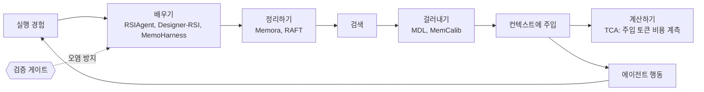

# LLM Agent Skill Memory without Finetuning

> [!summary] 한줄요약
> 코난쌤 블로그의 이 글(현재 제목: "LLM 에이전트가 경험으로 일을 배우게 하는 법: 파인튜닝 없이 메모리·하네스를 키우는 2026 논문 8편 비교", 2026-09-26)은 모델 파라미터를 건드리지 않고 에이전트를 개선하는 8편을 **배우기 / 정리하기 / 걸러내기 / 계산하기** 네 단계로 겹쳐 비교하고, 결론으로 "경험 계층을 붙일 때 같은 설계 안에 신뢰 게이트와 비용 계측을 넣어라. 검색해서 주입만 하면 환각과 청구서가 같이 불어난다"를 제시한다.

> [!warning] 이전 판 노트 전면 정정
> 이전 노트는 "원문 본문을 읽지 못함"이라며 전혀 다른 논문 2편(ProcMEM, Neural Procedural Memory)으로 대체 정리했다. 이번에 headless Chrome 렌더로 본문 전체(약 28,000자 렌더 텍스트)를 읽어 보니 글은 접근 가능했고, 원래 URL(`posts/2026-09-21-...`)은 위 통합 글로 넘어가는 옛 주소였다(본문: "원래 이 블로그에 논문별 단편 정리로 흩어져 있던 8편을 하나의 비교로 다시 썼습니다. 옛 글 URL은 이 페이지로 넘어옵니다"). 따라서 이전 노트의 2편(ProcMEM arXiv:2602.01869, Neural Procedural Memory arXiv:2606.29824)은 이 글이 다루는 논문이 아니다. 아래는 이 글의 8편 비교에 4편의 arXiv 초록 원문 확인을 더한 것이다.

> [!info] 글의 신뢰 구조를 먼저 알아 두자
> 글 하단에 따르면 이 글은 "블로그봇(코난쌤의 오픈클로 에이전트)이 여러 자료를 비교·정리하고 직접 실행해 확인한 내용으로 초안을 만들고, 운영자가 검토해 발행"했다. 기준일은 2026-09-26이고 8편의 arXiv 초록(v1 또는 v2)을 블로그봇이 직접 가져와 대조했다. 단 "본문" 표기가 붙은 수치(OSWorld 78.98, LoCoMo 0.863, Case Hit 84.2% 등)는 회원 글이 논문 본문 표에서 옮긴 것이라 글 안에서도 초록 재확인이 안 된 상태이고, 논문 코드를 실행한 재현은 하지 않았다. 비교 차트는 논문 figure가 아니라 matplotlib 3.10.5로 직접 그린 것이다. 이 노트에서 "(본문)"은 블로그가 논문 본문이라 표기한 수치, "(초록)"은 초록에 있는 수치를 뜻한다. 나는 아래 4편(RSIAgent, Designer-RSI, MDL, MemoHarness)의 arXiv 초록을 직접 열어 대조했다.

## 1. 문제의식·배경

2026년에 "모델 파라미터를 하나도 바꾸지 않고 에이전트를 나아지게 만드는" 연구가 몰려 나왔다는 관찰에서 글은 시작한다. 글이 잡은 질문의 이동은 이렇다. 과거에는 "무엇을 저장하나"가 질문이었는데 지금은 "**경험을 어떻게 검증하고 재사용하나**"로 옮겨 갔다. 파인튜닝은 비용이 크고 모델 의존적이며 폐쇄 모델에는 쓸 수 없다. 반면 외부 계층(메모리, 스킬, 하네스 설정)을 키우는 방식은 모델을 동결한 채 에이전트를 개선할 수 있다. 하지만 외부 계층에는 고유한 위험이 있다. 잘못된 경험이 들어가면 계속 오염을 퍼뜨리고, 많이 넣으면 환각과 비용이 늘 수 있다. 이 글의 8편은 이 이득과 위험을 각각의 방향에서 다룬다.

## 2. 글의 핵심 구조: 네 단계

글 서두 표를 그대로 정리하면 다음과 같다.

| 단계 | 설계 질문 | 대표 연구 | 초록으로 확인된 근거 |
|---|---|---|---|
| 배우기 | 반복 실행에서 규칙·스킬을 얻나 | RSIAgent, 절차 메모리(Designer-RSI), MemoHarness | 학습 없이 Kimi-K3+GLM-5.3가 GPT-6 역전(RSIAgent), GenEval2 72.7→99.3%(절차 메모리) |
| 정리하기 | 쌓인 기록을 어떻게 색인하나 | Memora, RAFT | LoCoMo·LongMemEval 신기록(Memora), 모든 진행 단계에서 유의미한 검색 우위(RAFT) |
| 걸러내기 | 검색된 메모리를 믿어도 되나 | MDL, MemCalib | 충돌 메모리 환각 약 56% 감소·고위험 0에 근접(MDL), 프론티어 모델도 과다·과소 사용(MemCalib) |
| 계산하기 | 메모리는 얼마나 청구되나 | TCA | 주입 토큰이 청구액 약 12%, 깊이 6에서 27.6% |

글의 결론 한 문장: "경험 계층을 붙이는 것과 같은 설계 안에 신뢰 게이트와 비용 계측을 넣으세요. 검색해서 주입만 하면 환각과 청구서가 같이 불어납니다." 그리고 읽는 법의 경고가 따른다. 수치는 논문마다 벤치마크와 평가 설정이 다르므로 논문끼리 직접 비교하면 안 되고 각 논문 안의 전후 비교로만 읽어야 한다.

## 3. 8편 상세

### 3.1 RSIAgent (arXiv 2609.15364): 새 환경을 스스로 탐색해 메모리를 만든다

- **풀려는 문제**: 인터페이스, 도구, 실패 모드가 사전학습 모델에 담기지 않은 새 환경에 적응하지 못한다.
- **설계(초록 확인)**: 학습이 필요 없는(training-free) 멀티에이전트 프레임워크. **curriculum / actor / verifier** 세 역할이 환경을 계속 탐색하고, 결과를 검증하고, 환경 특화 지식을 보존한다. 보존되는 지식에는 행동, 조건, 결과 사이의 재사용 가능한 인과 관계가 포함된다. **broad-then-deep** 탐색이 핵심이다. 병렬적이고 넓은 재귀 자기 탐색으로 다양한 환경 구조를 발견한 뒤, 집중적이고 깊은 자기 탐색으로 어려운 사례, 숨은 제약, 경계 조건, 미지의 인과 의존성을 캐낸다. 결과 메모리는 **동결(frozen)**되어 모델 파라미터 갱신 없이 이후 과업에 바로 재사용된다.
- **평가(초록)**: OSWorld-v2와 Agent's Last Exam에서 강한 오픈소스 모델을 크게 개선해 Kimi-K3와 GLM-5.3가 GPT-6을 포함한 폐쇄형 프런티어 모델을 능가하게 한다. 블로그가 본문에서 옮긴 값은 OSWorld 71.97→78.98이다(본문 표기, 초록 미확인). 논문은 50페이지, v1 2026-09-14, v2 2026-09-18(저자 Sibo Zhu 외 5인).
- **글이 보는 한계**: 탐색 비용이 정확히 공개되지 않았고(글은 8프로젝트 병렬 예산을 언급), 검증을 놓치면 오염이 쌓인다. 글에 따르면 논문 스스로 잘못 들어간 규칙이 후속 탐색을 계속 흔드는 실패 모드를 보고했고, 이를 줄이려 actor와 verifier를 아예 다른 모델로 분리해 상관 오류를 낮췄다.

### 3.2 절차 메모리 = Designer-RSI (arXiv 2609.22086): 사용자 트래픽에서 SKILL.md 뱅크를 진화

글의 "절차적 메모리" 항목이 가리키는 논문의 정식 제목은 "Designer-RSI: Evolving Procedural Memory from User Traffic for Agentic Graphic Design"(Hongyang Du, Lan Yan, Christian Flores, Asim Kadav, 2026-09-18, 9쪽·그림 7개)다. 글은 Adobe라고 표기했는데 내가 본 arXiv 페이지에는 소속이 없어 확인하지 못했다.

- **문제**: 전문 그래픽 디자인은 장기 에이전트 과업이면서 결과에 신뢰할 만한 프로그램적 oracle이 없다(성공 판정 기준이 없다).
- **설계(초록 확인)**: 동결된 프런티어 모델이 **230개 이상의 도구**로 전문 디자인 소프트웨어를 조작하고, 자연어 스킬로 이루어진 외부 절차 메모리가 경험에서 재사용 가능한 디자인 절차를 축적·정제한다. 메모리는 두 방향으로 자란다. **widening**은 반복되지만 커버되지 않은 하위 과업의 절차를 새로 얻는 것이고, **deepening**은 기존 절차를 자기 성공·실패 실행에 비추어 고치는 것이다. 모든 변경은 **matched replay gate**를 통과해야 한다. 실패를 고치면서 이미 관찰된 성공을 퇴행시키지 않는 변경만 허용된다. 글의 설명으로는 후보 스킬을 얼린 컨텍스트에서 페어와이즈로 재실행하고 하나라도 지면 반려한다.
- **결과(초록)**: 실제 사용자 브리프 1,406건과 자동 채점된 궤적 1,869개에 대한 5라운드로, 가중치 갱신과 사람 라벨 없이 뱅크가 문서에서 만든 스킬 76개에서 139개로 늘었다. Claude-Sonnet-4에서 GenEval2 실행 성공률 **72.7%→99.3%**(생성 품질 +11.99점), 네 개 특화 디자인 벤치마크에서 스킬 없는 에이전트 대비 승률 61.8%(Sonnet-4)와 67.6%(Opus-4.6). 두 메커니즘의 결합 효과도 보였다. 200개 held-out 브리프에서 widening만 49.4%, deepening만 48.6%, **둘을 결합하면 58.5%(p = 0.025)**.
- **글이 보는 한계**: 완성도 중심이며 프롬프트 토큰이 +28% 늘었다(본문 표기). 글이 인용한 논문의 관찰로, 문서에서 긁어온 지침을 얹기만 한 것은 효과가 없었고 실제 실패에서 추린 규칙만 효과가 있었다.

### 3.3 MemoHarness (arXiv 2607.14159): 하네스 자체가 경험으로 적응

- **문제**: 하네스 설계가 에이전트 행동을 강하게 좌우하는데 대부분의 자동 개선은 프롬프트, 파이프라인, 워크플로 같은 좁은 산출물만 최적화하고, 배포된 에이전트는 모든 케이스에 단일 전역 하네스를 쓴다.
- **설계(초록)**: 하네스를 **여섯 개의 편집 가능한 제어 차원**으로 분해하고, 케이스별 진단과 증류된 전역 패턴을 **이중 계층 경험 은행(dual-layer experience bank)**에 저장하며, 테스트 시에는 라벨, 피드백, 추가 탐색 없이 검색된 경험으로 각 케이스에 맞춰 하네스를 적응시킨다. 초록은 하네스가 관리하는 요소를 context, tools, orchestration, memory, decoding, output handling으로 나열한다(이 여섯 가지가 곧 "여섯 차원"인지는 본문 미확인).
- **평가**: shell-agent, code-generation, analytical-reasoning 벤치마크(Terminal-Bench, LiveCodeBench, FinanceAgent)에서 비교한 고정 하네스보다 개선되고 보지 못한 스위트와 기반 모델에 **선택적**으로 전이된다. 추가 컨텍스트는 검색된 경험 대부분이 캐시 가능하면 비용 면에서도 경쟁력이 있다. 블로그 본문 수치: FinanceAgent 0.722→0.806, 타 모델 6종 평균 +0.098(본문 표기).
- **한계(초록이 직접 명시)**: 통계적 견고성과 **컴포넌트 귀속(어느 차원이 이득을 냈는지)**은 향후 과제로 남겼다. 글도 "컴포넌트별 어블레이션 부족"으로 적는다. 선택 방식은 correctness-first로, 글에 따르면 싸지만 틀린 설정을 걸러 낸다.

### 3.4 Memora (arXiv 2602.03315, ICML 2026): 추상화와 구체성을 같이 담는 메모리

- **문제**: 추상화하면 디테일이 죽는다.
- **설계(글 요약)**: 각 항목에 "무엇에 관한 것인가"를 나타내는 **추상화 헤더**를 달고 구체 값은 밑에 둔다. 주요 추상화가 메모리 값을 색인하고, 큐 앵커(cue anchor)가 다대다로 연결하며, 능동적 검색 정책을 쓴다. 글이 확인한 초록 내용에는 RAG와 지식 그래프를 이 구조의 특수 사례로 보는 이론이 포함된다.
- **결과**: LoCoMo와 LongMemEval 두 벤치마크 신기록(초록). 블로그가 본문에서 옮긴 값은 LoCoMo 0.863 대 Mem0 0.653(본문 표기).
- **한계**: 그래프 관리 비용, 도메인 일반화는 별도 확인이 필요하다.

### 3.5 RAFT (arXiv 2609.20754, EMNLP 2026 Industry): 지원 케이스를 상태 타임라인으로

- **문제**: 고객지원·트러블슈팅 케이스를 정적 문서처럼 청킹·검색하면 "문제 이해가 바뀌는 순간"을 놓친다.
- **설계**: 닫힌 케이스를 타임라인 엔트리 체인으로 추출하고, 엔트리 단위로 검색한 뒤 부모 궤적을 돌려준다. 글은 문제 이해가 바뀌는 지점마다 엔트리를 자르는 이 구조가 초기 증상 단계의 케이스와 맞물리고 인사말 같은 노이즈 턴은 흡수한다고 설명한다.
- **평가**: 합성 826케이스와 Apache Jira 중복 30그룹. 모든 진행 단계에서 유의미한 Case Hit 우위(초록), 증상 0% 단계에서 84.2% 대 67.3%(본문 표기). Jira 30그룹은 초록이 스스로 "방향성 증거"라고 한정한다.
- 글은 Memora와 RAFT의 공통점을 청크 크기 조정이 아니라 **색인 단위의 재정의**로 이득을 냈다는 것으로 짚는다.

### 3.6 MDL 메모리 판단층 (arXiv 2609.22043): 검색 결과를 믿어도 되는가

- **문제(초록 확인)**: 메모리 시스템은 효율적 검색에 집중했고 검색된 메모리를 신뢰할지의 결정은 상대적으로 소홀했다. 저장소에 상충하는 입장이 섞이면 표준 RAG는 맹목적으로 주입해 환각을 증폭하며, 메모리 주입에 취약한 모델에서는 충돌 메모리 하의 RAG 환각률이 메모리 없는 기준선보다 뚜렷이 높다. 블로그가 본문에서 옮긴 값은 혼합 저장소에서 표준 RAG 53.0% 대 메모리 없음 23.0%로 두 배 이상이다(본문 표기).
- **설계(초록)**: **Memory Decision Layer(MDL)**는 검색과 생성 사이에 놓이는 파라미터 0개의 결정 컨트롤러다. 핵심은 **관련성, 신뢰성, 과업 위험** 세 신호를 QR 기반 직교 부분공간 투영과 meta-working-memory 신호로 융합해 해석 가능한 결정 표현을 만드는 3신호 보완 인코더다. 이를 토대로 **confidence와 consistency를 분리**하고 **risk inversion**(고위험일수록 기각 쪽)과 **explicit abstention**(명시적 기권)을 도입한다.
- **결과(초록)**: 충돌 메모리 하 환각률을 일반 시나리오에서 약 56.04% 줄이고 고위험 시나리오에서는 0에 근접. 완전 화이트박스이며 학습 파라미터가 없고 결정당 약 0.14ms로, 선행 임베딩 검색 단계보다 약 50배 빠르고 LLM 자기 평가 호출보다 4-5 자릿수 빠르다.
- **한계(글)**: 리스크 계수가 의료·법률·금융 매핑으로 하드코딩이고 평가가 TruthfulQA, HaluEval 중심이며 실제 에이전트 장기 메모리 검증은 후속 과제라고 논문이 밝힌다.

### 3.7 MemCalib (arXiv 2609.24259): 메모리를 과하게 혹은 부족하게 쓴다

- 메모리의 원자 단위별로 이상 사용 수준(Ignore/Bound/Control)을 채점하고, 원자를 제거했을 때의 양방향 반사실 크레딧으로 RL(GRPO, OPSD의 방향 편향을 지적)을 한다. 3개 도메인 15,000예시, 모델 9종(본문 표기). 프런티어 모델인 GPT-5.6-SOL도 Exact 28.40%(본문 표기). MemCalib-RL이 3모델 전체에서 1위이고 외부 벤치마크 일반화도 확인했다고 글은 정리한다(초록 기준).
- 한계: 채점이 LLM-as-a-Judge라 사람 일치율 96.7%(본문 표기)에도 judge 모델 의존이 남고 학습 데이터 구축 비용이 든다.

### 3.8 TCA (arXiv 2609.23790): 주입 토큰의 정확한 계측

- 멀티에이전트 워크플로에서 주입된 메모리/컨텍스트 토큰은 입력 단가로 섞여 청구되어 보이지 않는다. TCA는 비용을 5개 항목으로 분해하고 **2패스 토큰 카운트**(프롬프트를 메모리 포함·미포함으로 두 번 조립해 토크나이저로 센다)로 주입분만 정확히 귀속시킨다. 카운트 호출은 과금이 없고 노드당 약 10ms(본문 표기).
- **결과(초록)**: 200개 엔터프라이즈 태스크에서 실제 API 주입이 변동 비용의 13.6%, 청구액의 약 12%이고 깊이(depth) 1의 구조적 0에서 깊이 6에서는 27.6%로 선형 증가(R²=0.9974). 검색 창(retrieval window)을 32에서 2로 줄이면 주입 토큰이 28.7% 줄고 정확도 변화는 시드 변동 폭 안이었다. 글의 실용적 교훈: "이미 있는 파라미터 하나로 지갑과 씨름할 수 있다."
- **한계**: 단일 프로바이더와 고정 토폴로지 DAG만 측정했고 캐싱은 논증만 있으며, 루프형 에이전트는 측정할 수 없는데 논문 스스로 주입 비중이 더 커질 것이라 예상한다.

## 4. 글의 교차 분석

**배우기 3편의 공통 분모는 검증 게이트다.** RSIAgent는 actor와 verifier를 다른 모델로 분리했고, Designer-RSI는 페어와이즈 재실행으로 하나라도 지면 반려했으며, MemoHarness는 correctness-first 선택으로 싸지만 틀린 설정을 걸렀다. 세 논문이 모두 밟은 지점은 "검증 없이 쌓은 경험은 오염으로 굳는다"이다. 같은 모델과 같은 도구 조건에서 경험 계층만 켰을 때의 이득은 +7.0p부터 +26.6p이고(글의 차트 (a)), 세 연구 모두 모델은 동결했고 사람 라벨도 쓰지 않았다. 글의 해석은 "학습 대상이 모델에서 모델 밖의 계층으로 옮겨 갔다"는 것이다.

**반대 방향 경고.** 차트 (b)에서 MDL 논문의 혼합 저장소 표준 RAG 환각률은 53.0%로 메모리 없는 기준(23.0%)의 두 배 이상이다. 초록 표현을 빌리면 검색기는 관련성만 답하고 믿을 수 있는지는 답하지 않는다. 메모리를 늘리는 일과 믿고 쓰는 일은 별개의 설계다.

**정리하기 2편**은 색인 단위를 바꿔서 이득을 냈다는 점이 공통이다.

## 5. "언제 무엇을 쓰나" 표와 도입 순서

| 내 상황 | 먼저 볼 연구 | 적용 포인트 |
|---|---|---|
| 처음 보는 사내툴·특수 소프트웨어에 에이전트 투입 | RSIAgent | 탐색-검증 루프로 환경 지식을 쌓고 얼려 재사용, verifier는 별도 모델 |
| 오라클 없는 창작·문서 작업 | 절차 메모리 | 반복 하위작업을 SKILL.md로 발행, 페어와이즈 재실행 게이트 필수 |
| 하네스(프롬프트·도구·오케스트레이션)가 발목 | MemoHarness | 여섯 차원으로 분해해 진단 저장, 케이스별 적응 |
| 장기 대화·프로젝트 기록 검색이 흔들림 | Memora | 추상화 헤더 + 큐 앵커 이층 구조, 다중 홉 검색 |
| 고객지원·트러블슈팅 유사 케이스 검색 | RAFT | 케이스를 타임라인 엔트리로 증류, 엔트리 단위 검색 |
| 위험 도메인에서 환각이 치명적 | MDL | 주입 전 3신호 판단층, 고위험일수록 기각 쪽 |
| 개인화 어시스턴트 응답 품질 | MemCalib | 원자 단위 over/under 채점 루브릭부터 도입 |
| 멀티에이전트 비용이 설명 안 됨 | TCA | 주입 토큰 컬럼 분리, 검색 창 K 민감도 테스트 |

도입 순서에 대한 글의 주장: **계측이 먼저**(TCA, 거의 0원이고 나머지 결정의 분모가 된다), 다음에 **신뢰 게이트**(MDL, MemCalib), 마지막에 **경험 축적**(RSIAgent, 절차 메모리, MemoHarness)과 **구조 정리**(Memora, RAFT). "쌓는 것부터 시작하면 나중에 걷어내기 어렵습니다."

## 6. 한계·비판적 평가

글 자체가 밝힌 한계에 내 평가를 더한다.

1. **벤치마크가 제각각이다.** OSWorld, GenEval2, Terminal-Bench, LoCoMo, TruthfulQA는 다른 과업이라 연구 간 점수 순위는 성립하지 않는다. 글도 반복해서 경고하며 이득은 각 논문의 내부 비교다.
2. **비용 정보 부재.** 경험 학습 3편에서 탐색·진화에 실제로 든 비용(RSIAgent의 병렬 예산 등)이 초록에 없어 배포 관점의 투자수익을 계산할 수 없다. 이득만 있고 비용이 없는 비교다.
3. **1차 확인의 깊이.** 글은 8편의 초록을 대조한 것이고 코드를 돌려 재현하지 않았다. "본문" 수치는 회원 글 인용이라 이중 전달이다. 나도 4편의 초록만 직접 확인했고 본문 표와 코드 저장소(글이 `git ls-remote`로 존재만 확인한 RAFT, RSIAgent, MemoHarness, TCA)는 열지 않았다.
4. **저작 방식.** 에이전트 초안에 운영자 검토라는 구조이므로 해석 문장("게인이 모델 밖 계층으로 옮겨 갔다" 등)은 8편에서 추려진 요약 판단이다. 개별 논문의 주장과 블로그의 종합 주장을 분리해 읽어야 한다.
5. **MDL의 일반화 불명.** 리스크 계수가 도메인 하드코딩이고 평가 데이터셋이 사실성 벤치마크 중심이라 에이전트 장기 메모리에서의 효과는 아직 열려 있다. 0.14ms는 빠르지만 기각 오류(좋은 메모리를 버리는 비용)에 대한 수치는 글에 없다.
6. **TCA의 범위.** 루프형 에이전트를 재지 못하고 캐싱 효과가 논증 수준이다. 실제 요금은 캐시 히트에 크게 달라지므로 "청구액의 12%"는 상한/하한이 아니라 특정 설정의 값이다.
7. **MemCalib의 judge 의존.** 사람 일치율이 높더라도 평가자가 LLM이다. 이 문제는 [[jev-as-a-judge-agent-evals]]가 다룬 judge 신뢰와 같은 계열이다.
8. **'경험'의 오염 경로.** Designer-RSI는 자동 채점된 궤적(사람 라벨 0)에 의존하므로 자동 채점기가 편향되면 스킬 뱅크가 그 편향으로 진화한다. 초록이 "noisy, unverifiable feedback" 아래에서의 지속 적응 가능성을 주장하지만 채점기 오류의 전파는 별도 검토가 필요하다(내 추론).

## 8. 확인하지 못한 것

- 8편 중 Memora(2602.03315), RAFT(2609.20754), MemCalib(2609.24259), TCA(2609.23790)의 arXiv 원문: 글의 요약만 읽었고 초록도 직접 열지 않았다.
- 글이 "본문"이라 표기한 수치 전부(OSWorld 71.97→78.98, LoCoMo 0.863 vs 0.653, 84.2% vs 67.3%, 53.0% vs 23.0%, 28.40%, 96.7%, +28% 프롬프트 토큰, FinanceAgent 0.722→0.806, +0.098)는 초록과 대조하지 못했다.
- 글의 차트 (a), (b) 이미지의 시각 내용, 글의 +7.0p~+26.6p 값이 어떤 논문·지표에서 나온 것인지의 상세.
- 코드 저장소 4곳(microsoft/RAFT, AetherLabsAI/RSIAgent, HowieHwong/MemoHarness, vsingh45/tca-compiler)의 내용.
- 이전 판 노트가 검색으로 찾았던 ProcMEM(arXiv:2602.01869)과 Neural Procedural Memory(arXiv:2606.29824)는 이 글과 무관하며, 이번에는 재확인하지 않았다. 절차 기억 주제의 별도 배경으로는 유효할 수 있다.

## 관련 노트
[[wikiskill]] [[procedural-graphs-self-evolving]] [[skillzip-pro]] [[karpathy-llm-wiki]] [[new-sdlc-with-vibe-coding]] [[jev-as-a-judge-agent-evals]] [[context-fails-first-agent-reliability]] [[aces-agentic-continuous-evaluation-of-skills]] [[algorithmically-establishing-trust-in-evaluators]]

## 출처
모두 2026-10-01에 직접 열람.
- 코난쌤 블로그, "LLM 에이전트가 경험으로 일을 배우게 하는 법: 파인튜닝 없이 메모리·하네스를 키우는 2026 논문 8편 비교" (2026-09-26, 21 min read, 본문 전체 렌더 후 읽음): https://conanssam.com/posts/2026-09-21-llm-agent-skill-memory-without-finetuning-procedural-memory
- Sibo Zhu 외, "RSIAgent: Autonomous Exploration for Recursive Self-improvement in New Environments", arXiv:2609.15364 (초록): https://arxiv.org/abs/2609.15364
- Hongyang Du, Lan Yan, Christian Flores, Asim Kadav, "Designer-RSI: Evolving Procedural Memory from User Traffic for Agentic Graphic Design", arXiv:2609.22086 (초록): https://arxiv.org/abs/2609.22086
- Yiming Zhang 외, "An Interpretable Memory Decision Controller for LLM Agents Based on Three-Signal Complementarity", arXiv:2609.22043 (초록): https://arxiv.org/abs/2609.22043
- Yue Huang 외, "MemoHarness: Agent Harnesses That Learn from Experience", arXiv:2607.14159 (초록): https://arxiv.org/abs/2607.14159
