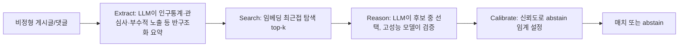

# Large-scale online deanonymization with LLMs

> [!summary] 핵심 요약
> 비정형 게시글·댓글만으로 가명 계정을 실명 프로필이나 다른 가명 계정에 **대규모로 연결할 수 있음**을 보인 논문이다.
>
> Extract-Search-Reason-Calibrate(ESRC) 4단계 파이프라인은 Netflix Prize식 고전 공격을 전 설정에서 크게 앞선다. 예를 들어 HN-LinkedIn에서는 precision 99%일 때 recall이 0.1%에서 45.1%로 올랐다.
>
> 저자들은 "practical obscurity(실질적 난독성)가 더는 가명 보호로 작동하지 않는다"고 결론짓는다.

> [!info] 열람 범위
> arXiv HTML 전문(https://arxiv.org/html/2602.16800, v2)을 초록부터 본문 8장, 윤리 절, 부록 A-G(표 2, 4, 5, 6 포함)까지 읽었다. 저자들이 **코드와 처리된 데이터셋, 에이전트 프롬프트를 의도적으로 공개하지 않았다**(Open Science 절). 따라서 코드 저장소 확인은 불가능한 것이 정상이다. 논문 서지: Lermen, Paleka 등, 제출 2026-02-18, v2 2026-02-25, USENIX Security Symposium 2026 (pp. 1947-1966) 게재 표기(arXiv abs 페이지 기재).

> [!warning] 이 노트의 성격
> 공격 방법의 상위 수준 설명과 결과만 정리한다. 저자들이 하지 않은 것(프롬프트, 에이전트 설정 공개)을 이 노트에서 구체화하지 않는다. 우리 쪽 관심은 방어, 메모리/로그 설계, 위협 모델링이다.

## 1. 문제의식·배경

오랫동안 가명(pseudonymous) 계정은 "공격이 이론적으로 가능해도 구조화된 데이터나 숙련 조사원의 수작업이 필요하므로 대량 적용이 비현실적"이라는 **practical obscurity**에 기대 보호받아 왔다. 선행 사례는 다음과 같다.

- Sweeney: 우편번호, 생년월일, 성별만으로 미국 인구의 87% 식별.
- Narayanan & Shmatikov(Netflix Prize attack): 익명 Netflix 평점을 공개 IMDb 프로필과 소수의 영화 선호로 연결.
- de Montjoye et al.: 시공간 점 4개로 휴대전화 데이터 개인의 95% 식별.

이들은 모두 **구조화된 micro-data**에 의존했다. 저자들의 질문은 "LLM이 비정형 텍스트에서 identity-relevant 신호를 뽑고, 수백만 후보를 검색하고, 두 계정이 같은 사람인지 추론하는 전 과정을 자동화하면 어떻게 되는가"다.

핵심 주장은 LLM이 인간 조사원을 능가해서가 아니라 **비용을 낮춰서** 위협을 현실화한다는 것이다(Staab et al.의 관찰을 이어받음, 서론 Implications).

### 선행 연구와의 차이

| 선행 | 내용 | 이 논문과의 차이 |
|---|---|---|
| Narayanan & Shmatikov | 구조화 평점 벡터의 희소성 가중 매칭 | 비정형 텍스트를 LLM으로 반구조화해 같은 틀(Extract-Search-Calibrate)에 얹고 Reason을 추가 |
| Staab et al. | LLM이 텍스트에서 위치·직업·소득 등 속성 추론 | 속성 추론을 넘어 계정-신원 end-to-end 연결과 precision-recall 곡선 평가 |
| Du et al. (AutoProfiler) | 4개 LLM 에이전트로 속성 추출, 85-92% 정확도 | 실제 신원 연결은 수동 LinkedIn 검색과 k-익명성으로 평가했음. 본 논문은 고정밀 매칭 지표 사용 |
| Li (Anthropic Interviewer 재식별) | 에이전트+웹검색, 과제 분해로 안전장치 우회, 24명 중 6명 | 과제 분해 없이 같은 데이터셋에서 33명 중 9명 |
| 스타일로메트리(PAN 등) | 문체(function word 등)로 저자 판별, 주제는 교란요인으로 통제 | 의미 내용 자체가 주신호. 1만 명 규모 |

## 2. 방법 상세

### 2.1 위협 모델 (3.1)

공격자는 쿼리 사용자 프로필 하나와 후보 프로필 집합을 받아 최적 매치를 반환하거나 abstain한다. 난이도를 좌우하는 두 파라미터를 명시적으로 통제한다.

- **후보 풀 크기 K**: 클수록 어렵다.
- **사전 매치 확률 π**: 쿼리에 대응 후보가 존재할 확률. 낮을수록 abstain이 중요해지고 precision이 떨어진다.

대부분의 실험은 π=100%(모든 쿼리에 정답 후보 존재)의 최선 시나리오를 쓰고, 6.4절에서 K와 π를 변화시킨다.

### 2.2 ESRC 프레임워크 (3.2)



각 단계가 Netflix Prize attack의 대응 단계를 LLM으로 증강한 것이다.

1. **Extract**: 원래 공격은 구조화 평점 벡터를 입력으로 받았다. 여기서는 LLM이 게시글에서 인구통계, 문체, 관심사, 부수적 노출(incidental disclosure) 등을 뽑아 반구조화 요약으로 만든다.
2. **Search**: 요약 임베딩의 최근접 탐색. (Netflix attack은 가중 벡터 유사도.)
3. **Reason**: 원래는 단일 최상위만 반환할 수 있었지만, LLM은 top-k 후보 목록에서 선택하고, 싼 모델이 고른 후보를 비싼 추론 모델이 검증하는 2단 구성이 가능하다.
4. **Calibrate**: 임베딩 유사도, LLM이 낸 숫자 신뢰도, 또는 쌍대 비교 정렬(tournament)로 신뢰 점수를 만들고 임계로 precision-recall을 조절한다.

### 2.3 평가 방법론: 윤리와 ground truth 사이

ground truth가 있어야 하지만 진짜 가명 계정의 정답은 없다. 두 접근을 쓴다.

- **합성 익명화**: 스스로 링크를 공개한 계정(HN bio에 LinkedIn URL)을 골라 직접 식별자를 LLM으로 제거한 뒤, 제거된 링크를 복원하는지 측정. Table 2의 규칙: 개인 URL, 블로그 URL, SNS 핸들, GitHub 저장소/핸들은 **삭제**, 고유 프로젝트/부트캠프명은 **일반화**, 동료 이름, 지역 상점, 기관, 인구통계, 관심사, 기술스택은 **유지**(그것만으로는 본인 특정이 안 되므로).
- **의미 분할(semantic split)**: 한 사용자의 활동을 커뮤니티별 또는 시간별로 갈라 두 프로필을 만든다. 정확한 정답이 대량으로 생기지만 현실성은 낮다.

저자 스스로 편향을 명시한다. 링크를 공개한 사용자는 익명성에 덜 신경 쓰는 집단이라 **recall이 과대평가될 수 있고**, 분할 프로필은 서로 더 닮아 있다.

대신 false positive 비율은 실세계로 이전된다고 논증해 **낮은 FPR(고 precision) 구간의 Recall@Precision을 핵심 지표**로 쓴다(3.3).

recall=정답 존재 쿼리 중 맞힌 비율, precision=non-abstain 중 정답 비율.

### 2.4 설정 1: 에이전트형 end-to-end 공격 (2절)

프로필을 요약하고, 검색 프롬프트를 만들어 이름/핸들 등 직접 검색 가능한 식별자를 제거한 뒤, 웹 검색 도구가 있는 LLM 에이전트에 넘겨 신원을 찾게 한다. 에이전트 구성과 프롬프트는 오용 방지를 위해 비공개다. 프로필당 비용은 1-4달러, 전체 실험 비용은 2,000달러 미만이라고 밝힌다.

### 2.5 설정 2: HN -> LinkedIn 매칭 (4절)

987개 LinkedIn 프로필과 995개 HN 계정(HN bio에 LinkedIn URL이 있는 사용자), 후보 풀 약 89,000 HN 활성 사용자.

- Extract: HN 활동을 전기적 프로필로, LinkedIn은 직무·학력 등을 요약.
- Search: Gemini 임베딩 + FAISS cosine, top-100.
- Reason: Grok 4.1 Fast가 shortlist에서 선택 또는 abstain, 이후 GPT-5.2(low/high reasoning effort)가 선택된 한 쌍만 검증. 값비싼 모델을 후보 한 쌍에만 쓰는 비용 절감 구조.
- Calibrate: 검증 단계의 숫자 신뢰도.
- Baseline: Netflix식. 332개 속성(언어, 도시, 회사, 학교, 직무, 직급)의 이진 벡터와 희소성 가중 Jaccard, 가중치 w_f=1/log(1+c_f).

### 2.6 설정 3: Reddit 영화 커뮤니티 간 매칭 (5절)

2024년 r/movies 사용자 활동을 쿼리로, r/horror, r/MovieSuggestions, r/Letterboxd, r/TrueFilm, r/MovieDetails 활동을 후보로 삼는다. 후보 9,781명 전원이 정답이 존재한다. 두 방식이 같은 micro-data(영화 제목, 추정 평점, 날짜)를 입력받아 **표현 방식만** 다르다(LLM 임베딩 vs 수작업 희소성 가중 유사도). 두 분할에 평균 2.5개 영화가 겹치고 48%는 단 1개만 겹친다. Reason은 (1) 공유 제목 기준 top-K 선택, (2) 전체 프로필로 top 후보 검증(GPT-5.2 high)의 2단.

### 2.7 설정 4: Reddit 시간 분할 (6절)

5,000 사용자의 댓글을 1년 간격을 두고 query(이전)/candidate(이후)로 나눈다. 후보에는 쿼리 없는 distractor 5,000명을 더해 후보 풀 10,000, 매칭 불가 쿼리 distractor 5,000명(π 실험용). 필터: 활동 기간 3년 이상, 총 댓글 200개 이상, 하루 평균 24개 이하(봇 제외), 사용자명이 bot/gpt/mods로 끝나는 계정 제외, 양쪽 각 100개 이상(부록 G.1). 개발셋과 held-out 테스트셋을 별도 구성.

- Extract: 휴리스틱 필터 후 Gemini 3 Flash가 relevant/generic 라벨, Gemini 3 Pro가 요약.
- Search: OpenAI text-embedding-3-large, cosine.
- Reason: top-15(진짜 매치의 80%가 top-15에 있어 정함)에서 Gemini 3 Pro가 선택.
- Calibrate: **Swiss-system tournament + Bradley-Terry 레이팅**. GPT-5-mini가 두 쌍의 query-candidate 중 어느 쪽이 더 그럴듯한지 쌍대 비교하고, 15라운드, 라운드당 약 2,500회 비교로 정렬한다. 쿼리 간 상호작용에 의존하므로 대량 쿼리가 필요하고 **단일 대상 공격에는 못 쓴다**(저자 명시).

```text
Algorithm 1 (논문)
init BT ratings r_i for all (q_i, c_i)
for round = 1..N:
    pair up matches with similar rating (Swiss)
    LLM judges which of two pairs is the more plausible match
    update ratings
return pairs sorted by rating desc
```

## 3. 주요 결과

**에이전트 공격 (2.1절)**

| 대상 | 규모 | 결과 |
|---|---|---|
| HN -> LinkedIn(에이전트) | 338명 | 226명 식별(67%), precision 90%(95% CI 86-93%), 오식별 25, abstain 86 |
| Reddit 학술 | 25명 | 13명(52%), precision 72% (오 5, abstain 7) (부록 B) |
| Reddit 커리어 | 36명 | 9명(25%), precision 90% (오 1, abstain 26) (부록 B). 직접 식별자를 지우면 일반 소프트웨어 주제 댓글만 남아 구별력이 낮다고 설명 |
| Anthropic Interviewer | 33명(연구 이력 언급자) | 9명 식별, precision 82%(오 2, 거부/abstain 22). 에이전트는 11명을 주장했으나 2명은 전사본과 모순되어 수동 판단. 서론은 "최소 9/125" 추정 |

**HN -> LinkedIn, 파이프라인 단계별 (표 1, 987 쿼리, 후보 약 89k)**

| 방법 | 90% Prec | 98% Prec | 99% Prec |
|---|---|---|---|
| Narayanan baseline | 0.1% | 0.1% | 0.1% |
| Search (embedding) | 26.3% | 16.1% | 4.4% |
| Reason (low) | 55.0% | 44.8% | 36.0% |
| Reason (high) | 54.2% | 50.0% | 45.1% |

high reasoning은 99% precision에서만 low를 크게 앞선다(45.1 vs 36.0). 서론의 "recall 0.1%에서 45.1%"가 이 표의 baseline 대 Reason(high) 99% 열이다.

후보 풀 확장(Fig. 3b): 90% precision에서 Reason은 1k 후보 68.3%에서 89k 55.2%로 약 13%p 하락, Search는 47.6%에서 26.6%. 99% precision, 89k에서 Reason 33.0% vs Search 4.2%.

로그-선형 외삽으로 100만 후보에서 Reason 약 45%, Search 약 12%, 1억 후보에서 Reason 약 27%, Search 0이다(부록 D.1).

외삽이므로 거친 추정이다.

**Reddit 영화 (5.3절, 표 4/5)**: high reasoning이 90% precision에서 recall 8.5%(low 5.2%, 상대 +63%), 99%에서 2.8%(low 1.4%, +100%)로 p<0.05. 공유 영화가 많을수록 쉽다. 90% precision recall은 공유 영화 1편 3.1%, 10편 이상 48.1%(Fig. 4b). LLM confidence가 임베딩 top-2 gap보다 낫고, 이 설정에서는 LLM 정렬(sorting)이 verification 단계 confidence를 능가하지 못했다(부록 F).

**Reddit 시간 분할 (표 6, 5k 쿼리, 10k 후보)**

| 방법 | 90% Prec | 98% Prec | 99% Prec |
|---|---|---|---|
| Baseline (Narayanan, subreddit 참여 벡터) | 0.4% | 0.2% | 0.2% |
| LLM (Extract+Search) | 38.3% | 20.2% | 16.0% |
| LLM + Selection (Reason) | 47.8% | 28.2% | 20.3% |
| LLM + Selection + Sorting (Calibrate) | 67.3% | 47.6% | 38.4% |

초록의 "68% recall @ 90% precision"은 HN 에이전트 67%와 이 표의 67.3%에 대응하는 값으로 보이며, 정확히 어느 설정의 반올림인지는 초록에 명시돼 있지 않다(내 해석).

근거 진단: 임베딩 rank-1 정확도는 약 60%이고 top-15에서 80% 이상(Fig. 8a), 임베딩 유사도로 정렬한 매치 순서는 무작위보다 약간 나은 정도라 신뢰도 척도로 부적합(Fig. 8b).

이 두 관찰이 Reason과 Calibrate 단계의 존재 이유다.

**난이도 파라미터 (6.4절)**: 후보 풀 크기에 대해 recall이 대략 로그-선형으로 감소하며 100만 후보로 외삽하면 90% precision에서 약 35% recall(전체 공격 기준, Fig. 7a).

π에 대해서는 정밀도 식 Precision(π)=π·TPR/(π·TPR+π·FMR+(1-π)·FPIR)로 TPR, FMR(false match rate), FPIR(false positive identification rate)을 따로 추정한 뒤 사후 계산했고, 매치 가능 쿼리가 1만 명 중 1명(π=0.0001)이어도 Search+Reason은 90% precision에서 recall 약 9%를 유지한다(Fig. 7b). 고전 baseline은 π=1에서도 실패한다.

Calibrate 단계는 쿼리 간 상관 때문에 이 사후 계산이 불가해 이 분석에서 제외됐다.

## 4. 저자가 밝힌 한계 + 내 비판적 평가

저자 명시 한계(8절 Generalizability 등):

- 평가 데이터가 **실제 가명 사용자보다 쉽다**: 링크를 공개한 사용자는 이미 정보를 많이 드러낸다. 분할 프로필은 서로 더 비슷하다. 따라서 recall은 과대평가될 수 있다.
- 에이전트 실험은 소규모이고 precision-recall 곡선이 아니라 단일 점이며, 불투명한 웹 검색 시스템 때문에 LLM의 기여와 검색엔진의 기여를 분리하기 어렵다.
- 의사결정 근거 일부는 수동 검증(Anthropic Interviewer 33명)이라 정확도를 완전히 검증하지 못했다.
- 100만/1억 후보 결과는 외삽이며 큰 오차 범위를 가진다.
- 오염(contamination) 문제: LLM이 HN/Reddit을 학습 중에 봤을 수 있다. 저자는 reasoning effort를 올리면 성능이 크게 오르는 점을 암기만으로 설명하기 어렵다는 근거로 들고, LinkedIn 프로필은 학습 코퍼스에 없을 것으로 짐작한다고 쓴다(검증 불가, 짐작).

내 평가:

1. **방법론의 강점**: 윤리 제약 하에서 ground truth를 구성한 방식(합성 익명화 + 분할)과 FPR 중심 지표 선택은 설득력이 있다. 특히 "false positive는 이전되고 recall은 과대"라는 논리 분리가 명료하다.
2. **한계의 실질**: HN은 기술자 중심, LinkedIn은 영어권·직업 프로필 중심이다. 한국어/다국어, 개인 프라이버시 의식이 높은 사용자, 짧은 글 위주 플랫폼에서의 일반화는 본문이 보이지 않았다.
3. **모델 의존 재현성**: Grok 4.1 Fast, GPT-5.2, Gemini 3 Flash/Pro, GPT-5-mini 같은 특정 상용 모델에 의존하고 코드·프롬프트가 비공개라 독립 재현이 사실상 불가능하다. 이는 윤리적 선택의 대가이며 저자가 인정한다.
4. **방어 논의의 얇음**: 완화책(API rate limit, 스크래핑 탐지, LLM 제공자의 오용 모니터링, 거절 가드레일, LLM 기반 텍스트 익명화)을 나열하지만 효과는 평가하지 않았다. 저자 스스로 공격이 요약·검색·랭킹이라는 선량한 과제로 분해되므로 제공자 차단에 비관적이라고 쓴다.
5. **k-익명성과 차등 프라이버시**: 구조화 DB용 프레임워크가 이런 공격을 다루지 못한다는 지적은 타당하다.

## 5. 재현·구현 시 고려사항

재현은 윤리적으로 권장되지 않으며 저자도 코드를 비공개했다. 대신 **방어 평가 관점**에서의 시사점만 적는다.

- 위험 평가용 레드팀은 ESRC 단계별로 보호를 점검하는 방식이 가능하다. Extract에 쓰이는 신호(고유 프로젝트, 직무·학력 서술, 사건 언급)가 로그/메모리에 얼마나 남는지가 관건이다.
- 평가 지표 설계는 Recall@Precision(고 precision 구간)과 π, K 변화에 따른 민감도 분석이 참고가 된다. 방어 효과도 평균이 아니라 "소수 고식별 사용자"로 측정해야 한다. π=0.0001에서도 recall 9%가 남는다는 점이 시사하듯, 대부분이 안전해도 일부는 노출된다.
- 비용 구조: 싼 모델로 선택하고 비싼 모델로 한 쌍만 검증하는 2단 구성이 비용을 낮춘다는 설계는 공격 방어 측 탐지 시스템(대량 질의 패턴 탐지)에도 힌트가 된다.

## 7. 관련 노트

[[context-fails-first-agent-reliability]] (context 설계와 injection hardening 측면에서 연결), [[karpathy-llm-wiki]] (개인 지식 저장소에 사실을 축적할 때의 위험 맥락), [[llm-agent-skill-memory-without-finetuning]] (에이전트 메모리 저장 관점)

## 8. 출처

- https://arxiv.org/abs/2602.16800 (초록, 서지)
- https://arxiv.org/html/2602.16800 (v2, 전문 실제 열람. 표 1, 2, 4-6, 부록 A-G 포함)
- 저자: Simon Lermen, Daniel Paleka (공동 기여), Joshua Swanson, Michael Aerni, Nicholas Carlini(Anthropic), Florian Tramèr. ETH Zurich 중심, 윤리 심사는 ETH Zurich ERB 승인(본문 Ethics 절).
- 본문이 인용한 선행: Narayanan & Shmatikov(Netflix Prize attack), Staab et al.(LLM 속성 추론), Du et al.(AutoProfiler), Li(Anthropic Interviewer 재식별), Xin et al.(sanitization 평가). 개별 원문은 열지 않고 본문 서술을 인용했다.
