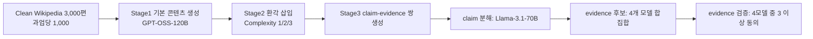

# PROBE

> [!summary] 한줄요약
> RAG식 "근거 문서 대비 불충실(unfaithful)" 환각 탐지를 claim decomposition → evidence finding → evidence evaluation → hallucination localization 4단계 프로세스로 쪼개어 단계별로 채점하는 12,000건(claim 118,628개) 벤치마크. 분해하면 recall이 단발 프롬프트(<40%)에서 80~90%대로 오르고, 병목은 evidence finding(Complete match 약 61~70%)과 evidence evaluation(약 70~82%)이다.

> [!info] 조사 범위
> ACL Anthology PDF 18쪽 전체(`https://aclanthology.org/2026.findings-acl.2099.pdf`)를 내려받아 pypdf로 텍스트를 추출해 초록·본문·표·한계·부록(생성 프롬프트 포함)을 직접 읽었다. Figure 3, 4a, 4b는 막대그래프라서 텍스트에는 축 범위만 있고 개별 값은 본문 서술(예: "recall 95% 이상", "Claude recall 88.8% / precision 74.5%")로만 확인했다. 논문에 데이터셋/코드 공개 URL은 PDF 텍스트에서 확인되지 않는다(초록에 "released training data"라는 표현은 있음). 따라서 "어디서 받는가"는 확인 못함.

## 1. 문제의식·배경

### 1.1 문제
agentic 응용에서는 LLM이 자기 출력의 사실성을 "single-step LLM-as-a-judge 프롬프트"로 자가 평가하는 일이 흔하다. 저자들은 정답(근거) 정보가 주어져도 현재 LLM이 환각을 놓치며(초록), 단발 평가는 "어디서 왜 실패했는지"를 진단할 투명성과 세분성이 없다고 주장한다(1절). 장문 맥락일수록 direct prompting이 불충분하다는 선행 관찰(Wei et al. 2024, LongFact)도 인용한다.

### 1.2 범위 규정: unfaithful hallucination
3절은 환각을 두 가지로 구분한다. (a) 실세계 지식과 맞지 않는 nonfactual, (b) 주어진 입력에 충실하지 않은 unfaithful. PROBE는 **(b)만** 다룬다. 요약·QA·스타일 변환처럼 주어진 passage/reference에 근거해 생성하는 RAG 설정에서, "원문에서 뒷받침되지 않는 문장"을 환각으로 정의한다. 즉 세계 지식 검증이 아니라 "근거 문서 대조"가 과업이므로, 이후 "evidence finding"은 외부 웹 검색이 아니라 **주어진 Wikipedia 원문 안에서 증거 구간을 찾는 일**이다.

### 1.3 선행 연구와의 차이 (2절, 5절, Table 3)
| 벤치마크 | 평가 단위 | 프로세스 기반 | 특징 |
|---|---|---|---|
| RAGTruth | span/word 수준 | 아니오 | 약 18,000 응답, 사람 주석 |
| FACTS Grounding | response-level | 아니오 | judge 모델의 outcome 평가 |
| HaluBench / HaluEval | response(/span) | 아니오 | binary 라벨 |
| FactScore / LongFact | claim(atomic fact) | 아니오 | 분해 후 지지 비율 측정(전체 파이프라인의 단계별 진단은 아님) |
| **PROBE** | **claim-level** | **예** | 12,000 샘플(120,404 claims로 표기, 본문 통계는 118,628), 단계별 주석 |

주의: Table 3은 PROBE 규모를 "12,000 samples (120,404 claims)"로, 본문 3.4절과 Table 1은 "118,628 claims"로 적어 불일치한다. 어느 쪽이 맞는지는 논문만으로 판정할 수 없으므로 이 노트는 본문 통계 표(Table 1)의 118,628을 기준으로 삼는다.

방법론적 계보는 수학 추론의 process supervision(PRM800K, ProcessBench, CriticBench, MathCheck; 5.3절)에 닿아 있다. "정답만 채점하지 말고 과정을 단계별로 채점하라"는 철학을 사실성 검증 도메인으로 옮긴 것이다. 평가 단위로 claim을 고른 이유는 span 경계가 구조적으로 정의하기 어렵고(5.1절), 장문 응답에서 개별 claim 평가가 정확도를 높인다는 선행 연구(Akbar et al. 2024)를 따랐기 때문이다(Figure 5).

## 2. 벤치마크 구성(방법 상세)

### 2.1 3단계 생성 파이프라인 (3절, Figure 2)

**Stage 1 – 기본 콘텐츠**(3.1절). Clean Wikipedia(Foly et al. 2025)의 train split에서 과업당 1,000편, 총 3,000편을 무작위 추출. 요약은 문서 요약, QA는 "2~4개 구체 사실로 답할 수 있는 질문"을 생성한 뒤 해당 문서 passage만으로 답변, 스타일 변환은 blog post / lecture notes / FAQ / textbook 중 랜덤(각 약 25%)으로 재작성. 생성 모델은 GPT-OSS-120B. 부록 B.1에 모든 프롬프트가 있고, 모두 "hallucinate 금지, 텍스트에 없는 정보 금지"를 강하게 명시한다.

**Stage 2 – 환각 삽입**(3.2절). 환각 위치를 정확히 통제하기 위해 "그럴듯하지만 원문에서 지지되지 않는 사실"을 합성 주입한다. 한 과업 블록은 환각 없는 기본 샘플 1,000개 + 환각 샘플 3,000개로, 환각 샘플은 Complexity 1/2/3에 균등 분배된다.
- Complexity 1: 환각 1개, 대개 정확한 요약 안에 직접 언급 형태.
- Complexity 2: 환각 2개, 직접 언급 또는 "참인 주장을 뒷받침/논리적으로 확장하는 것처럼 보이는 조작된 진술".
- Complexity 3: 환각 3개, 추가로 **환각 주장에서 논리적 추론으로 도출된 참인 진술**이 포함될 수 있다.
부록 A Table 4의 "Siam" 예시가 좋은 감각을 준다. 기본 답변 뒤에 "19세기 동남아의 단명한 프랑스 식민지였다" → "라오스 남부의 특정 지역을 가리키기도 한다" → "캄보디아 독립운동 시기 대안 국호로도 거론됐다"가 단계적으로 붙는다. 부록 B.2의 프롬프트에 따르면 요약은 "원문에 없고 논리적 귀결도 아니지만 그럴듯한 새 사실 N개를 발명"시킨 뒤, 답변 편집 프롬프트가 "이 사실들을 자연스럽게, 끝에 덧붙이지 말고 텍스트 전반에 녹이라"고 요구한다.

**Stage 3 – claim-evidence 쌍**(3.3절).
1. Claim decomposition: 각 샘플을 "독립적으로 평가 가능한 최소 정보 단위"인 atomic claim으로 분해(Llama-3.1-70B, 병렬). 부록 B.3의 AssertionDecomposer 프롬프트는 숫자·날짜·이름·사건 주장을 빠짐없이 뽑고, 각 assertion이 어떤 SEGMENT에서 왔는지 `> SEGMENT#1` 형식으로 연결시킨다. 주입 세그먼트에서 나온 claim은 **자동으로 hallucinated** 라벨(근거가 원문에 있을 수 없으므로). 기본 콘텐츠에서 나온 claim만 증거 탐색 대상.
2. Evidence finding: Llama-3.1-70B, GPT-4o-mini, Mixtral-8x22B, Claude-Sonnet-4.5 네 모델이 원문에서 지지/반박/직접 관련 구간을 찾아 **합집합**을 후보로 삼는다. 저자들은 Llama-3.1-70B가 Llama-3.3-70B보다 지시 준수가 좋아 전체에서 3.1을 쓴다고 적었다(근거 수치는 없음).
3. Evidence evaluation: 후보 증거 각각을 동일 네 모델이 독립적으로 PASS/FAIL 판정. **4개 중 3개 이상 동의(≥0.75)** 하면 지지 증거로 채택. 채택된 증거가 1개 이상인 claim은 truth claim, 없으면 hallucinated claim. 평가 프롬프트(Listing 17)는 "증거 구간 단독으로 주장을 지지하는지, 주변 맥락은 이해용일 뿐 정당화 근거로 쓰지 마라"고 요구한다.

여기서 구조적 특징이 있다. **정답 라벨의 상당 부분이 평가 대상과 같은 계열 모델들의 합의에서 나온다.** 평가 모델 네 개(Llama-3.1-70B, GPT-4o-mini, Mixtral-8x22B, Claude-Sonnet-4.5)가 곧 라벨 생성 모델이므로, 라벨 생성 방식이 평가 결과에 미치는 영향(예: 이 모델들이 공통으로 놓치는 증거는 정답에서 빠지는 문제)을 논문이 정량적으로 점검하지는 않는다. 사람 검증 샘플 수나 annotator agreement도 본문에 보이지 않는다. (내 평가)

### 2.2 통계 (3.4절 Table 1)
| 과업 | 인스턴스 | hallucinated claims | truthful claims | 응답 길이 평균/최대(자) | 환각 구간 길이 평균/최대 | 응답 중 환각 비율 |
|---|---|---|---|---|---|---|
| Summarization | 4,000 | 9,908 | 31,560 | 1,697 / 5,331 | 223 / 2,832 | 15.13% |
| QA | 4,000 | 5,489 | 6,529 | 167 / 1,305 | 135 / 562 | 47.42% |
| Style Transfer | 4,000 | 10,216 | 54,836 | 2,060 / 8,437 | 332 / 1,063 | 16.93% |
| 전체 | 12,000 | 25,613 | 92,925 | 1,308 / 8,437 | 230 / 2,832 | 29.96% |

전체 claim은 118,628개(환각 21.7%, 근거 확보 78.3%). 요약·스타일 변환은 응답이 길고 환각 비중이 15~17%로 희석되어 응답 단위 평가에 불리하고, QA는 짧은 답변에 환각 비중이 47%라 사실 정밀도가 취약함을 보여준다는 것이 저자 해석이다. 참고로 표의 숫자 인스턴스는 "과업당 4,000(기본 1,000 + 환각 3,000)"이고 합이 12,000이다.

## 3. 실험 설정 (4.1절)

- 평가 대상 모델 4종: Llama-3.1-70B, GPT-4o-mini, Mixtral-8x22B, Claude-Sonnet-4.5. 모든 탐지 프롬프트는 수작업으로 설계해 모델 간 동일 적용(상세 프롬프트는 부록이라고 되어 있으나 PDF 부록에는 생성 단계 프롬프트만 실려 있고 탐지 단계 프롬프트는 확인되지 않았다).
- 두 방식 비교: (i) direct prompting – 한 번에 환각 내용을 식별하도록 지시, (ii) process-based – 4개 서브스텝.
- **평가셋은 과업당 100개씩, 총 300개 인스턴스**를 무작위 추출한 것이며 나머지는 파인튜닝 전용이다(겹침 없음). 즉 헤드라인 "12,000 테스트 케이스"는 데이터셋 총량이고 실제 모델 비교는 300 인스턴스 규모다. 이 점은 신뢰구간이 보고되지 않은 점과 함께 해석에 주의가 필요하다.
- 지표: claim 단위 매칭 후 precision/recall/F1. 본문에서 "character level"이라고도 하고 "claim level matching"이라고도 서술해 약간 모호하다(두 문단이 거의 중복된 문장).
- 단계 간 연결: EF는 claim decomposition에서 올바로 매칭된 claim에 대해서만 수행. EE는 **EF 단계에서 얻은 후보 증거를 그대로 재사용**해 검색 품질과 분리하여 평가. Localization은 추가 추론 없이 EE의 hallucination 예측과 1단계의 semantic claim matching 결과를 재사용(즉 별도 모델 호출이 없다).

## 4. 주요 결과

### 4.1 Claim decomposition (Figure 3)
precision/recall 모두 높고 recall은 모든 과업에서 95% 초과. 저자 결론: 분해는 상대적으로 쉬운 단계이며 이후 단계 분석의 신뢰할 기반이 된다.

### 4.2 Evidence finding / evaluation (Table 2)
| 모델 | Partial EF (Sum/QA/Style) | Complete EF (Sum/QA/Style) | Evidence Eval (Sum/QA/Style) |
|---|---|---|---|
| Llama-3.1-70B | 82.7 / 88.6 / 82.9 | 69.2 / 69.7 / 69.0 | 77.5 / 72.3 / 81.9 |
| GPT-4o-mini | 78.7 / 80.1 / 79.2 | 64.2 / 61.6 / 66.5 | 79.9 / 70.6 / 79.2 |
| Mixtral-8x22B | 77.0 / 82.0 / 77.9 | 63.4 / 63.5 / 66.0 | 80.3 / 71.6 / 77.9 |
| Claude-Sonnet-4.5 | 81.6 / 86.4 / 81.6 | 68.1 / 69.1 / 69.1 | 81.6 / 69.8 / 81.6 |
| SFT Llama-3.1-8B | 83.2 / 87.4 / 84.1 | 70.3 / 70.1 / 71.4 | 82.9 / 80.7 / 83.1 |

읽는 법: Partial은 "지지 증거를 하나라도 찾았는가", Complete는 "주석된 지지 증거를 전부 찾았는가"다. 프런티어 모델은 partial 약 77~89%이지만 complete는 약 62~70%로 떨어진다. 저자 주장은 "일부는 찾지만 빠짐없이 찾지는 못하는 것이 병목"이다. EE는 증거가 주어져도 정확도가 69.8~82%에 그치며, 가장 강한 Claude-Sonnet-4.5도 QA에서 69.8%다. QA에서 EE가 특히 낮은 점(70~72%대)은 짧은 답변에서 증거가 암시적·간접적이기 때문일 수 있으나 논문은 원인 분석을 하지 않는다.

여기서 "evidence finding이 주된 약점"이라는 헤드라인은 정확히 읽어야 한다. 수치상 EF Complete(약 62~70%)와 EE(약 70~82%)는 모두 낮고, 논문 결론절에서는 "evidence finding과 evidence evaluation 둘 다 일관된 약점"이라고 쓴다. 초록과 서론은 "chiefly evidence finding"이라고 강조하지만, 지표(Complete match vs accuracy)가 서로 달라 단계 간 직접 비교는 엄밀하지 않다. (내 평가)

### 4.3 Localization (Figure 4a)
모든 모델 recall 80% 초과. 하지만 precision은 낮다. Claude-Sonnet-4.5는 recall 88.8%로 최고이나 precision 74.5%로 최저인데, 저자는 evidence evaluation 단계의 "conservative voting"(근거를 엄격히 요구해 지지 판정을 덜 내림) 때문이라고 설명한다. 평균 F1 최고는 GPT-4o-mini. 즉 false positive(진실 claim을 환각으로 오판)가 비용이다. 이는 실무에서 중요하다. 전부 의심하는 검증기는 recall이 높아 보이지만 사용자 경험상 경보 피로를 낳는다.

### 4.4 Direct vs Process (Figure 4b)
direct prompting의 recall은 40% 미만, process-based는 대체로 80% 초과, 최고 90%. 저자는 "분해가 장문 환각 탐지에 결정적"이라 결론짓는다. 단, 본문은 이 비교에서 recall에 초점을 두겠다고 밝혔다. precision/F1 비교는 본문에서 보고하지 않았으므로, process 방식이 recall을 올리는 대신 precision을 얼마나 잃는지는 이 비교만으로는 알 수 없다. 4.3절의 낮은 precision(Claude 74.5%)을 같이 보면 이 trade-off를 가볍게 볼 수 없다.

### 4.5 파인튜닝 (4.4절)
Llama-3.1-8B를 full-parameter SFT: lr 2e-5, Adam(β1=0.9, β2=0.999), cosine 스케줄러, 2% warm-up, A100 80GB 8장, FSDP. 결과(Table 2): EF Partial 83.2/87.4/84.1, Complete 70.3/70.1/71.4, EE 82.9/80.7/83.1로 비교한 5개 중 대부분 최고. 특히 EE QA에서 80.7로 프런티어(최대 72.3) 대비 +8.4 이상. 다만 EF Partial QA는 Llama-3.1-70B(88.6)가 SFT 8B(87.4)보다 높으므로 "모든 칸에서 최고"는 아니다. 또한 8B 모델이 정답 라벨 생성 모델 중 하나(Llama-3.1-70B)와 같은 계열이고 같은 분포(Wikipedia + 합성 환각)에서 학습·평가되므로 분포 내 이득이다. 다른 도메인으로의 일반화는 검증되지 않았다.

## 5. 저자가 밝힌 한계 + 비판적 평가

**저자 명시(7절)**
- 컴퓨팅 제약으로 Llama-3.1-70B 같은 큰 모델은 파인튜닝하지 못함.
- 다중 LLM 호출로 direct prompting 대비 지연이 큼. EF 단계의 confidence 기반 사전선택으로 일부 완화 가능하다고 제안.
- 영어, 비전문 도메인(Wikipedia)에 한정. 금융·의학 등은 도메인 전문성 필요.

**내 판단**
1. **합성 환각의 현실성.** 환각은 GPT-OSS-120B가 "그럴듯한 새 사실"을 발명해 주입한 것이다. 실제 모델이 자연 발생시키는 환각(모순, 수치 왜곡, 과잉 일반화, 미묘한 인과 비약)과 분포가 다르다. 주입물은 원문에 대응 구간이 전혀 없으므로 "원문 어딘가와 부분적으로 일치하지만 틀린" 환각보다 탐지가 쉬울 수 있다. 반대로 Complexity 3의 "환각에서 논리 추론으로 도출된 참 진술"은 판정 기준이 모호할 수 있다.
2. **라벨-평가 모델 순환.** 라벨을 만든 4개 모델이 평가 대상 4개와 동일하므로 고난도의 진짜 정답이 라벨에서 빠질 수 있고(후보는 모델이 찾은 것의 합집합), complete-match 지표는 "주석된 증거 전부"를 기준으로 하므로 라벨 자체가 모델 합집합 기반이라는 점이 해석을 흐린다.
3. **평가셋 300건, 신뢰구간·유의성 없음.** 헤드라인 12,000건과 실제 비교 규모의 격차.
4. **오류 전파의 비분리 측정.** 파이프라인은 직렬이다(EF는 올바로 분해된 claim에 한정, EE는 EF 후보 재사용). 그래서 단계별 점수는 상호 독립 측정이 아니라 조건부 측정이다. 장점은 병목 진단이지만, 최종 end-to-end 환각 탐지 F1을 모델별로 한 번에 보여주는 표는 없고 그림(4a, 4b)으로만 제시된다.
5. **Table 3 비교의 비대칭**: 다른 벤치마크 규모를 "samples/spans/facts"로 서로 다른 단위로 나열해 직접 비교가 어렵다.
6. **프로세스 지시의 효과 vs. 단순 길이/CoT 효과**: direct vs process 비교가 프롬프트 설계의 질(수작업 설계)과 호출 횟수 증가의 효과를 분리하지 못한다. "여러 번 호출"만으로 오른 것인지 "분해 구조" 때문인지에 대한 ablation은 없다.
7. 최신성 측면: 평가 모델이 Llama-3.1, GPT-4o-mini, Mixtral-8x22B, Claude-Sonnet-4.5로, 2026년 시점 최신 프런티어와는 거리가 있다. 결론의 방향성(EF 완전성 약점)이 최신 모델에서도 유지되는지는 논문이 보장하지 않는다.

## 6. 재현·구현 고려사항

- 데이터셋 소스: Clean Wikipedia(Foly et al. 2025)에서 과업당 1,000편 샘플. 생성은 GPT-OSS-120B(부록 B 프롬프트 그대로 재사용 가능).
- 환각 주입은 "새 사실 N개 발명 → 답변에 자연스럽게 분산 삽입" 2단계. 주입 구간 위치를 메타데이터로 저장해 두어야 claim 단위 정답 라벨이 자동으로 따라온다(이것이 이 파이프라인의 영리한 부분).
- 정답 증거 생성: 4개 모델 합집합 후보 + 4중 3 이상 합의. 모델 선택을 바꾸면 라벨이 바뀌므로 버전 고정이 필요.
- 평가 지표 구현: claim 간 semantic matching이 핵심이다. 논문은 매칭 방법(임베딩/LLM 판정)을 상세히 설명하지 않았다. 재현 시 이 부분이 가장 큰 불확실성이다(확인 못함).
- 호출 비용: 응답 하나당 분해 1회 + claim 수만큼 EF + 후보 증거 수만큼 EE 호출. Table 1에서 환산하면 인스턴스당 claim이 요약 약 10개(41,558÷4,000), 스타일 변환 약 16개(65,052÷4,000), QA 약 3개이므로 호출이 수십 번에 이른다. 참고로 Table 1에서 요약 행의 hallucinated(9,908)+truthful(31,560)=41,468이 표기된 합계 41,558과 90 어긋나고, 전체 행도 25,613+92,925=118,538로 118,628과 90 차이가 난다. 사소한 집계 불일치이며 어느 쪽이 맞는지는 확인 못함. 지연·비용 이슈는 저자도 인정.
- 파인튜닝 레시피는 단순(8×A100, full FT, lr 2e-5 cosine)하여 재현이 쉽다. 데이터는 평가 300건을 제외한 나머지.

## 관련 노트
[[algorithmically-establishing-trust-in-evaluators]] [[jev-as-a-judge-agent-evals]] [[aces-agentic-continuous-evaluation-of-skills]] [[procedural-graphs-self-evolving]]

## 출처
- Yu Zhang (CUHK, NVIDIA 인턴십 중 수행), Peter Belcak, Shizhe Diao, Yonggan Fu, Shaona Ghosh, Morteza Mardani, Eileen Long (이상 NVIDIA), Bei Yu (CUHK), Pavlo Molchanov (NVIDIA). "PROBE: PROcess-Based BEnchmark for Hallucination Detection." Findings of the ACL 2026, pp. 42303-42320, July 2-7, 2026. DOI 10.18653/v1/2026.findings-acl.2099. 페이지 https://aclanthology.org/2026.findings-acl.2099/ , PDF https://aclanthology.org/2026.findings-acl.2099.pdf (실제 열람, 본문·부록 B 전체).
- 데이터셋/코드 공개 위치: 논문 텍스트에서 확인 못함.
