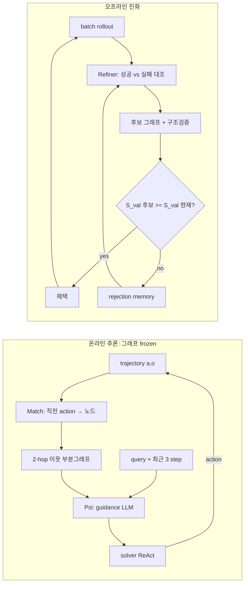

# Procedural Graphs

> [!summary] 한줄요약
> 절차 지식을 `(procedure, relation, procedure)` 트리플의 방향 그래프로 외재화하고, 추론 시에는 "현재 노드의 2-hop 이웃"만 LLM이 step 단위 guidance로 번역해 solver에 붙이며, 오프라인에서는 성공/실패 trajectory를 대조하는 LLM refiner가 그래프를 편집하되 **held-out validation 점수가 떨어지지 않을 때만 커밋하고 거부된 편집은 rejection memory로 남기는** 에이전트 절차 메모리.

> [!info] 조사 범위
> arXiv HTML 전문(`https://arxiv.org/html/2609.09153`, v1, 2026-09-08)의 본문 1~6절과 부록 A~F를 직접 읽고 작성했다. 논문 내에서 공식 코드 저장소 링크는 찾지 못했다(본문에 GitHub URL 없음). 이하 수치는 모두 논문의 표/절 번호를 병기한다. 논문은 Google 소속 저자들(Yuxing Lu는 Georgia Tech, Peking University 소속도 병기)의 preprint이며 peer review를 거친 것이 아니다.

## 1. 문제의식·배경

### 1.1 무엇이 문제인가
논문이 출발하는 관찰은 단순하다. 대부분의 LLM agent는 "계속 늘어나는 flat한 action/observation 로그"를 조건으로 free-form generation을 통해 다음 행동을 고른다(ReAct 계열). 이때 "무엇을 어떤 순서로, 어떤 조건에서 해야 하는가"라는 **절차 지식(procedural knowledge)** 은 암묵적으로 모델 내부에만 있고, 궤적이 길어질수록 (a) 목표를 놓치고, (b) 도구를 순서에 어긋나게 호출하고, (c) 비생산적 행동을 반복한다(서론 첫 문단). 저자들은 이를 planning hallucination, drift, repetitive loop라는 기존 문헌의 실패 양상과 연결한다(2절, Zhu et al. 2025; Xiao et al. 2024 인용).

### 1.2 기존 접근과의 차이 (1절·2절·부록 A)
논문은 절차 구조를 제공하는 기존 방식을 네 부류로 정리하고 각각의 부족한 점을 짚는다.

| 부류 | 대표 | 논문이 지적하는 한계 |
|---|---|---|
| 자유 텍스트 메모리/반성 | Reflexion(Shinn 2023), ExpeL(Zhao 2024), MemoryBank, RAP | 경험은 보존하지만 "현재 step에 어떻게 적용되고 이후 step을 어떻게 제약하는지"를 solver가 매번 재구성해야 함 |
| 상태 조건부 guideline | AutoGuide(Fu 2024) | 더 정확한 조언이지만 연속된 절차 step 사이의 연결이 명시되지 않음 |
| 명시적 workflow/state machine | AWM(Wang 2025b), KnowAgent(Zhu 2025), Xiao 2024 | 실행을 제약하지만 대체로 수작업 설계, 또는 오프라인 search로 한 번 최적화 |
| 도구 그래프 | ToolNet, ControlLLM, Graph RAG-tool fusion 등 | 도구 카탈로그의 조직화이지 "진행 상황에 조건화된 절차 + 경험 기반 갱신"은 아님 |

저자들의 포지셔닝은 "편집 가능한 절차 표현"과 "현재 진행 상황에 조건화된 guidance"를 한 틀에서 결합한다는 것이다. 부록 A.1은 이를 CoALA(Sumers et al. 2023)의 procedural memory 관점으로 해석하며, 24개 방법을 8개 차원으로 비교하는 표(A.5)를 제공한다. 이 노트에는 그 표의 개별 칸 값까지는 옮기지 않았다.

### 1.3 설계 요구사항 네 가지
서론은 에이전트에게 필요한 절차 지식의 성질을 네 가지로 제시한다. (1) 잘못된 행동을 걸러낼 만큼 **구조화**되어 있을 것, (2) 추론 자유도를 보존할 만큼 **유연**할 것, (3) 현재 진행 상황에 **반응**할 것, (4) 경험으로부터 **개선**될 수 있을 것. Procedural Graph(PG)는 이 네 요구를 각각 (1) 방향 그래프의 admissible transition, (2) 지시가 아닌 "bias" 형태의 soft guidance, (3) active node 기반 localized retrieval, (4) self-evolution loop로 대응시킨다.

## 2. 방법 상세

### 2.1 그래프의 형식 (3.1절)
PG는 방향성 속성 그래프다.

$$\mathcal{G} = (\mathcal{V}, \mathcal{R}, \mathcal{E}, \Phi),\qquad \mathcal{E} \subseteq \mathcal{V}\times\mathcal{R}\times\mathcal{V}$$

- 노드 $\mathcal{V}$: tool function, skill, 내부 추론 step, 과업 상태(Start/End 등)를 추상화한 것.
- 관계 어휘 $\mathcal{R}$: 구현에서는 네 가지 — `LEADS_TO`, `TRIGGERS`, `PROVIDES_INPUT_FOR`, `CONVERGES_TO`(부록 B.4).
- 엣지 $e=(u,r,v)$: "u 다음에 relation r 하에서 v가 허용된다"는 선언.
- 속성 $\Phi$: 엣지마다 `condition`(언제 이 전이를 쓰는가), `guidance`(어떻게 진행하는가), `pitfalls`(무엇을 피하는가) 세 텍스트 필드. 부록 B.4에 따르면 대부분 엣지가 세 필드를 모두 갖고 `guidance`가 가장 꾸준히 채워진다.

논문 예시: 엣지 `(cash_flow_forecast, LEADS_TO, fund_raising_request)`에 "projected runway falls below the safety buffer / submit the request early to allow for the financing delivery delay / do not stack a second request while one is pending"이 붙는다. 이 예시가 보여주듯 속성은 도메인 휴리스틱을 자연어로 담는 그릇이다.

그래프는 **작다**. 부록 B.4 Table 7 기준으로 BFCL v3(131 노드, 265 트리플; 함수 카탈로그가 크기 때문)를 제외하면 7~17 노드, 7~27 트리플이다(HotpotQA 9/9, MultiChallenge 7/7, GDPval 15/22, ALFWorld 11/27, τ-bench 17/18, EnterpriseArena 11/13). 즉 이 프레임워크의 주장은 "거대한 지식 그래프"가 아니라 "10개 안팎 노드의 압축된 절차 스케치"로도 효과가 난다는 쪽이다.

### 2.2 추론 시 Generative Guidance (3.2절)
핵심 설계 선택은 "top-k 유사도 검색으로 엣지 속성을 독립적으로 가져오지 않는다"는 점이다. 논문은 `submit` 단계의 guidance만 단독 검색하면 선행 `check_answer` 전이가 빠져 검증 단계가 누락될 수 있다고 예시한다. 그래서 locate → extract → generate의 세 연산을 쓴다.

```text
u_t   = Match(a_{t-1}, V)             # 직전 procedure(예: tool call)를 노드에 exact match
G_t   = N_h(u_t)   if u_t != null    # u_t와 h-hop 이내 outgoing 전이 부분그래프
        G           otherwise        # 매칭 실패 시 전체 그래프로 fallback
g_t   = Psi(G_t, q, T_{t-w:t})       # guidance LLM이 부분그래프 + 질의 + 최근 w step을 읽고 guidance 생성
a_t  ~ P_solver(. | q, T_t, g_t)     # guidance는 solver 프롬프트에 append, 행동 선택은 solver 몫
```

세부 사항.
- 첫 step은 `a_0 = Start`를 초기화 마커로 써서 `u_1 = Start`에 위치시킨다.
- 매칭은 **exact matching**이다. 퍼지/임베딩 매칭이 아니므로, 노드 이름이 실제 tool 이름과 일치해야 한다. 부록 B.6은 "action-node 이름을 tool 목록과 맞추는 것은 refiner 프롬프트의 요구사항이며 일반 structural validator는 tool-catalog 소속을 강제하지 않는다"고 적는다. 즉 이 불일치는 시스템 레벨에서 보장되지 않고 프롬프트 준수에 맡겨진다.
- 설정은 h=2 hop, w=3 step 윈도우(4절). 부록 B.5에 따르면 serializer는 활성 노드 헤더(ID/type/description) 뒤에 hop별로 전이와 condition/guidance/pitfalls를 나열하며, 저장된 relation 라벨(LEADS_TO 등)은 **출력하지 않는다**(해당 부록의 HotpotQA Mode 2 예시 기준). 즉 relation 타입은 구조 검증/표현용이고 guidance 생성 LLM에는 실질적으로 보이지 않는다.
- guidance는 "immediate goal"과 "피해야 할 형식/논리 오류"를 알려주는 상황별 텍스트다. solver는 이를 참고만 하며 다음 행동 선택권을 유지한다("biases the solver's next action without dictating it").



### 2.3 Self-Evolution (3.3절, 부록 B.6 Algorithm 1)
라운드 k=1..K마다 네 단계를 돈다.

1. **Diagnostic Rollout**: 현재 채택 그래프 $\mathcal{G}_{k-1}$로 train batch를 돌려 trajectory와 점수 $S_i\in[0,1]$를 기록. refiner는 고득점/저득점 trace를 대조한다(이진이면 성공 대 실패).
2. **Feedback-Driven Mutation**: 오프라인 LLM refiner가 실패 trajectory의 반복 오류 루프와 성공 trajectory의 추론 지름길을 찾고 구조화된 edit set을 낸다. 위상 편집 연산은 **Add**(누락된 검증 노드/엣지 삽입)와 **Delete**(실패로 이끄는 노드/엣지 제거) 둘뿐이고, 속성 수정은 "엣지를 삭제 후 새 속성으로 재추가"로 표현한다. 부록 B.5에 따르면 `delete_edges`는 source/target이 같은 모든 엣지를 relation 무관하게 지우고, 유지하려는 전이는 이후 적용되는 `add_edges`에 다시 포함시켜야 한다.
3. **Validation Gating**: 후보가 edit 적용과 구조 검사를 통과하면 별도 $\mathcal{D}_{val}$에서 평가한다.
   $$\mathcal{G}_k = \begin{cases}\mathcal{G}_k^{cand} & S_{val}(\mathcal{G}_k^{cand}) \ge S_{val}(\mathcal{G}_{k-1})\\ \mathcal{G}_{k-1} & \text{otherwise}\end{cases}$$
   등호 포함이므로 **동점도 채택**한다(Algorithm 1의 "Accept, including ties"). 기준 점수는 캐시된 이전 그래프의 값이며 재측정하지 않는다. 논문 본문도 "stochastic evaluation 하에서의 결정은 5.4절에서 검토"라고 선을 긋는다.
4. **Rejection Memory**: 검증 점수가 내려간 후보는 (edit set, 후보 그래프, 학습 trajectory, 검증 결과)를 $\mathcal{H}_{rejected}$에 기록하고, 이후 refiner 입력에 음의 증거로 제공한다. 구조 검증 실패도 diagnostic 형태로 기록되지만 이 경우 validation rollout은 건너뛰고 채택 그래프/점수는 그대로다. 학습 trajectory가 너무 길면 $L_{max}$ 토큰을 넘는 앞부분을 잘라내고 **끝부분을 보존**한다("Tail").

$$\Delta\mathcal{G}_{k+1}\sim P_{refiner}(\cdot \mid \mathcal{G}_k, \mathcal{C}_{k+1}, \mathcal{H}_{rejected})$$

구조 검사(부록 B.6 PrepareCandidate): 편집은 사본에 적용(삭제 먼저, 추가 나중), malformed edit·잘못된 node/relation type·존재하지 않는 엣지 끝점은 실패 처리. cycle을 허용하지 않는 설정이면 사이클을 닫는 엣지를 자동 제거한 뒤 검증하고, 모든 노드에서 terminal 노드(out-degree 0)로 가는 경로가 있는지 확인한다(꼭 `End`라는 이름의 노드가 아니라 out-degree 0 노드 기준이라는 단서가 달려 있다).

학습 스트라이드는 HotpotQA 100샘플, MultiChallenge 20샘플 단위로 순차 처리된다(부록 B.1). validation 셋은 train/test와 분리되며 HotpotQA 1,000, MultiChallenge 100, EnterpriseArena 20 에피소드다.

## 3. 실험 설정

- **벤치마크 7종**(4절, 부록 B.1 Table 5): HotpotQA(multi-hop QA), MultiChallenge(다중턴 지시 유지), GDPval(전문직 산출물, rubric 점수), ALFWorld(embodied, 엄격한 행동 순서), τ-bench(retail 도메인, 정책 준수 도구 사용, Pass@1), BFCL v3(multi-turn function calling), EnterpriseArena(최대 132개월 재무 의사결정 시뮬레이터). 테스트 규모는 HotpotQA 1,000 / MultiChallenge 166 / GDPval 44 / ALFWorld 134 / τ-bench 115 / BFCL 100 / EnterpriseArena 50 에피소드이다. GDPval 44, BFCL 100처럼 표본이 작은 설정이 있어 신뢰구간이 넓다.
- **Baseline 7종**(Table 6): Vanilla ReAct, MemoryBank, RAP, ExpeL, AutoGuide, AWM, KnowAgent. 모두 동일 ReAct solver·툴 인터페이스·디코딩을 쓰고, 학습 기반 baseline은 PG 진화와 동일한 train split을 소비한다. 즉 정보량은 맞췄지만 baseline 쪽 하이퍼파라미터 튜닝 수준은 부록 B.3 설명 외에는 확인되지 않는다.
- **모델 4종**: Claude Sonnet 4.6, Gemini 3.1 Pro, Gemini 3.5 Flash, Grok 4.1 Fast. guidance 모델과 refiner는 항상 solver와 동일 LLM, 모든 호출은 temperature 0.
- **심판/지표**(B.2): HotpotQA와 MultiChallenge는 Gemini 3.1 Pro LLM judge. 따라서 Gemini 계열 solver에는 judge-solver 동일 계열 편향 가능성이 이론상 존재하나 논문은 이를 논의하지 않는다(이 문장은 내 비판적 평가이며 논문 주장이 아님).

## 4. 주요 결과

### 4.1 메인 결과 (5.1절, Table 1)
- PG는 24개 모델×벤치마크 칸(HotpotQA, MultiChallenge, GDPval, ALFWorld, τ-bench, BFCL × 4 모델) 중 21칸에서 1위 또는 공동 1위. 각 칸의 최강 baseline 대비 19승 2무 3패, 단측 정확 이항 부호검정 p=4.3×10⁻⁴.
- 최대 격차: BFCL v3 × Gemini 3.5 Flash 67.00% vs 58.00%(+9.00), GDPval × Gemini 3.1 Pro 78.78 vs 71.37(+7.41), τ-bench × Gemini 3.1 Pro 80.00% vs 73.04%(+6.96).
- GDPval과 BFCL v3에서는 4개 모델 모두에서 모든 baseline을 상회. MultiChallenge는 4개 모델 모두에서 1위 또는 공동 1위(Claude에서는 AWM과, Gemini 3.5 Flash에서는 AWM·KnowAgent와 동률).
- HotpotQA는 차이가 작다: 최강 baseline 대비 −0.90 ~ +1.30점. 예컨대 Claude Sonnet 4.6에서 PG 74.50 vs AutoGuide 75.40(PG가 오히려 낮음), Gemini 3.1 Pro 87.30 vs ExpeL 86.00. 신뢰구간이 거의 완전히 겹친다.
- 패배 칸의 예(Table 1): ALFWorld에서 Grok 4.1 Fast는 PG 39.55 < ExpeL 42.54, τ-bench Grok에서 PG 67.83 < KnowAgent 68.70, Claude Sonnet 4.6 HotpotQA 74.50 < AutoGuide 75.40. 즉 "일관되게 우월"이라는 서술은 부호검정 수준에서 성립하되 칸 단위로는 이질적이다. 또 표에 보고된 95% CI는 대부분 서로 크게 겹치며(예: τ-bench Claude 73.91 [65.84, 81.99] vs ExpeL 71.30 [63.05, 79.56]), 부호검정은 칸을 독립 시행으로 간주하지만 같은 벤치마크·같은 train 데이터를 공유하므로 독립 가정이 완전하지 않다는 점은 비판적으로 볼 부분이다(내 평가).
- 특기할 만한 칸: Gemini 3.1 Pro ALFWorld에서 PG 100.00%(AWM 99.25%, ExpeL 97.76%), Gemini 3.5 Flash τ-bench에서 PG 44.35% vs Vanilla 31.30%(+13.05). Claude Sonnet 4.6 ALFWorld PG 93.28% vs Vanilla 86.57%.

### 4.2 장기 의사결정: EnterpriseArena (5.2절, 부록 C, Table 8)
시뮬레이터는 마이크로파이낸스 대출기관의 월별 대차대조표 상태 $\mathcal{S}_t=(C_t,L_t,A_t,IR_t,PR_t,AP_t,D_t,E_t,U_t)$를 다루며, 에이전트는 `book_closing()`으로 월을 넘기고 `fund_raising_request(type, amount)`로 자금을 조달한다. 자금은 요청 후 **1~6개월 지연**되어 도착하고 월별 상한이 있다. 현금이 음수가 되면 즉시 파산. 위기는 32개월(상환율 98%→90%), 59개월(60%로 급락), 112개월(40%, 자금조달 상한 급축소)에 에이전트에게 알리지 않고 발생한다. 점수식은 $s=5\,Rev^{(12)}+C-5{,}000N$(파산 시 0)이다.

결과: 전 모델에서 PG가 최고 또는 공동 최고 full-horizon 생존율과 최장 평균 수명. Claude Sonnet 4.6 44.0%→58.0%, Gemini 3.1 Pro 6.0%→34.0%, Grok 4.1 Fast 26.0%→40.0%(Grok에서 평균 enterprise score도 최고 \$39.62M). 도구 호출 수는 모델별로 다르게 움직인다: Gemini 3.5 Flash는 월 18.94회→12.53회로 줄고, Claude는 0.13→0.36, Gemini 3.1 Pro는 0.89→3.18회로 오히려 늘면서 생존율이 오른다. 저자의 해석은 "호출 횟수가 아니라 어떤 도구를 언제 호출하는가가 바뀐다"이며, 생존과 일관되게 연관된 행동은 "anticipatory fundraising"(안정기에 미리 자금 요청)이다. 평균 조달액이 Flash baseline \$0.00M, PG-Flash \$9.39M, PG-Grok $30.11M으로 제시된다. 단, Claude 블록(Table 8)에서 PG의 Avg. Score $70.38M는 Baseline $78.86M보다 낮다. 생존은 늘었지만 시간평균 점수가 모든 곳에서 오른 것은 아니라는 뜻이다.

### 4.3 구성 전략 비교와 prior 교정 (5.3절, Table 2, 부록 D.1 Table 9/10)
다섯 모드: (1) 손으로 만든 expert 그래프 고정, (2) expert + 1회 static update, (3) expert + online evolution(반복 + gate), (4) scratch(최소 skeleton) + 1회 static build, (5) scratch + online evolution.

| 모드 | HotpotQA EM / F1 | MultiChallenge Overall |
|---|---|---|
| 가이드 없음 | 58.8 / 71.21 | 87.50 |
| 1 Expert | 62.80 / 76.61 | 58.93 |
| 2 Expert+Static | 63.80 / 77.16 | 53.57 |
| 3 Expert+Online | 63.10 / 76.34 | **92.86** |
| 4 Scratch+Static | 55.40 / 69.49 | 89.29 |
| 5 Scratch+Online | **66.30 / 78.79** | 91.07 |

해석: (a) HotpotQA에서는 scratch+online이 expert 설계를 넘어선다(F1 +7.58, EM +7.50 vs 무가이드). (b) MultiChallenge에서 손으로 만든 expert 그래프는 오히려 성공률을 87.50→58.93으로 **떨어뜨렸고**, 1회 static update는 53.57까지 더 악화시켰다. 반복 진화(Mode 3)만이 92.86으로 회복했다(+33.93). 부록 E.4.2는 이 회복을 "엣지 수 13→10으로 가지치기(Generation 5), 이후 제어흐름 재구성, validation 정확도 54.0%→93.9%"의 두 단계로 서술한다. (c) 1회성 static 방식은 둘 다 불안정하다는 것이 이 표의 가장 실용적인 교훈으로 보인다. 단 MultiChallenge 실험은 56샘플 fast split이므로(부록 B.1) 한 문항이 약 1.8포인트다.

부수 효과: 부록 D.1 Table 9에서 가이드는 토큰을 크게 늘린다(HotpotQA 무가이드 4,003 토큰 → Mode 5 10,116 토큰, 레이턴시 18.06s → 31.53s). 5.3절은 파싱 실패 45.7% 감소도 보고한다.

### 4.4 Self-evolution 궤적 (5.4절, 부록 E)
EnterpriseArena에서 20/20/20(train/val/test 에피소드) 설정으로 10라운드. 초기(Start→End만 있는 그래프)의 validation full-horizon 생존율은 0.0%, 평균 수명 34.8개월.
- Round 1: 척추를 발견 — Start → Month_Start → check_cash_in_bank → cash_flow_forecast_calculation → save_note → check_market_data → Decide_Capital. 생존 0%→45%.
- Round 2: `recall_notes`를 Month_Start 뒤에 삽입(외부 작업 메모리). 80%로 상승, 월당 도구 호출 17.23→3.08(부록 E.1은 81.8% 감소로 계산, 라운드 8에서 3.13).
- Rounds 3~6: 커밋 없음. Round 3은 "자금조달 트리거 현금 임계치를 낮추는" 편집이 train 시드에선 통했으나 validation에서 생존 −15.0pt, 수명 −10.45개월로 롤백(Performance Rollback). Round 5는 구조 검증 실패라 rollout 없이 폐기.
- Round 7: `pass_action`("아무것도 안 함") 가지 제거. Round 8: `fund_raising_request → book_closing` 엣지를 `→ End`로 교체(어댑터가 이미 요청 후 월을 넘기므로 연속 month-advance 방지). validation 생존 90%.
- Round 10: train 생존 90.0%이나 validation 85.0%(−5pt)로 하락하여 거부, 루프 종료.
- 테스트: 반환 그래프(Round 9) 85.0% vs baseline 0.0%(Fisher exact p=2.6×10⁻⁸). 탐색 중 최고 단일 라운드는 95.0%였으나 test에서 고르는 것이 선택 편향이므로 반환 그래프 수치를 보고. 저자도 "에피소드 20개 split에서 accept/reject는 한두 에피소드에 좌우되므로 유의성 검정이 아니라 탐색 로그로 읽어야 한다"고 명시한다.

### 4.5 Ablation: 무엇을 보여주는가 (5.5절, Table 3, Gemini 3.5 Flash)
| 구성 | MultiChallenge Acc / Tok / Step | GDPval Rubric / Tok / Step | ALFWorld Succ / Tok / Step |
|---|---|---|---|
| no graph | 80.27 / 6,629 / 3.87 | 54.80 / 275,638 / 28.20 | 72.58 / 18,055 / 21.84 |
| full graph, raw injection | 86.60 / 10,164 / 4.54 | 57.17 / 264,680 / 33.55 | 70.34 / 21,062 / 25.00 |
| full graph, generative | 87.35 / 14,434 / 3.08 | 56.75 / 448,972 / 22.07 | 54.48 / 96,360 / 30.05 |
| subgraph, generative (ours) | **89.31** / 12,295 / 4.22 | **63.99** / 367,738 / **18.57** | **81.53** / 28,064 / **18.80** |

핵심: 전체 그래프를 생성형 guidance로 쓰면 ALFWorld가 54.48까지 무너지고 토큰이 5배 이상 늘어난다. 국소 부분그래프가 같은 그래프에서 세 벤치마크 모두 최고이며, full-graph generative 대비 토큰을 ALFWorld 70.9%, GDPval 18.1%, MultiChallenge 14.8% 줄인다. 다만 무가이드 대비로는 GDPval +33.4%, ALFWorld +55.4% 토큰이 더 든다(결론에서도 "guidance는 step 수를 줄여도 토큰은 늘린다"고 인정, 선택적/재사용 guidance를 future work로 제시). 이 ablation은 Gemini 3.5 Flash 하나, "fixed subsets"에서만 했고 h(홉 수)나 w(윈도우) 민감도는 제시되지 않았다.

## 5. 저자가 밝힌 한계 + 비판적 평가

**저자가 명시한 것**
- guidance가 토큰 사용을 늘림(결론). 선택적/재사용 생성이 future work.
- solver·툴 인터페이스 간 전이(transfer)는 평가하지 않음. "학습된 절차를 얼마나 재사용할 수 있는가"가 열린 질문.
- 5.4절: 20 에피소드 split의 accept/reject는 노이즈에 민감.

**내 판단 (논문에 명시되지 않은 부분)**
1. **validation gate의 통계적 취약성.** 게이트는 `≥`이며 기준 점수는 캐시됨. 평가가 stochastic하고 표본이 작으면 승격은 승자의 저주(winner's curse)를 겪는다. 라운드가 늘면 validation set에 대한 과적합 위험이 커지는데, 논문의 완화책은 rejection memory와 별도 test 보고뿐이다. Round 10에서 train 90% / val 85%로 갈린 사례는 실제로 이런 현상을 일부 보여준다.
2. **동점 채택 정책**은 그래프가 "같은 점수로 계속 드리프트"할 수 있다는 뜻이다. 구조는 바뀌어도 점수가 같다면 보수적인 기본값(채택 안 함)이 더 안전할 수 있다.
3. **refiner·guidance·solver가 항상 같은 LLM.** 설계상 일관되지만 "강한 refiner로 약한 solver용 그래프를 만든다"는 시나리오는 검증되지 않았다.
4. **exact match 로컬라이제이션**은 도구 호출이 아닌 추상 노드(내부 추론 step, 상태)에 대해서는 매칭이 어떻게 이뤄지는지 본문에서 명확하지 않다. 매칭 실패 시 전체 그래프 fallback은 Table 3이 보여주듯 성능과 비용 모두에 불리하므로, 실제 얼마나 자주 fallback이 일어났는지 통계가 있으면 좋았을 것이다(논문에 없음).
5. **비교 baseline의 성격.** baseline은 모두 텍스트 메모리·워크플로 계열이며 프롬프트 최적화(DSPy/GEPA류)나 workflow search와의 직접 비교는 본문 표에 없다(서론에서 Zhang 2025의 automated workflow search를 언급하지만 비교하지 않음).
6. **LLM judge 의존**(HotpotQA, MultiChallenge는 Gemini 3.1 Pro) 및 소표본 벤치마크(GDPval 44, BFCL 100)로 CI가 넓다.
7. 최대 이득이 나타난 곳이 환경 어댑터 특성(예: 요청 후 자동으로 월 진행)을 학습해 반영한 케이스(Round 8)라서, 절차 "지식"과 "하네스 특이 동작에 대한 적응"의 구분이 불분명하다.

## 6. 재현·구현 고려사항

- 공식 코드: 논문 본문에서 링크를 찾지 못했다. 따라서 재구현이 필요하다. 필요한 구성요소는 (1) 그래프 저장/직렬화(노드 id/type/desc, 엣지 triple + 3속성), (2) 2-hop 이웃 serializer(hop별 정렬), (3) guidance 프롬프트, (4) refiner 프롬프트(편집 JSON 스키마: 노드/엣지 add·delete), (5) 구조검사기(엣지 끝점 유효성, terminal 도달성, 옵션 cycle 제거), (6) 평가 하니스와 캐시된 $S_{val}$, (7) rejection memory serializer.
- 편집 연산을 Add/Delete 둘로 제한한 점은 구현 단순성과 diff 가독성 모두에 유리하다. 편집 로그를 그대로 버전 관리(git)에 넣으면 "왜 이 엣지가 사라졌는가"가 추적된다.
- 비용 모델: 라운드당 train batch rollout + refiner 1회 + validation 전체 rollout 1회. validation 크기(HotpotQA 1,000)가 라운드 비용을 지배한다. 부록에는 총 토큰/달러 비용이 따로 제시되지 않았다(확인 못함).
- 노드 이름과 tool 이름의 exact match 계약을 코드로 강제(검증기에 tool catalog 소속 검사 추가)하는 것이 논문 구현보다 안전하다.
- 초기 그래프는 `Start → End`뿐이어도 된다(EnterpriseArena Round 0). 단 노이즈 억제를 위해 validation 세트를 충분히 크게(논문은 20~1,000 사이) 잡아야 한다.

## 관련 노트
[[wikiskill]] [[hyperagents]] [[skillzip-pro]] [[aces-agentic-continuous-evaluation-of-skills]] [[probe-process-based-hallucination-benchmark]]

## 출처
- Yuxing Lu, Yicheng Chen, Shanchan Wu, Sercan Ö. Arık. "Procedural Graphs: Self-Evolving Execution Structures for LLM Agents." arXiv:2609.09153v1 [cs.AI], 2026-09-08. 초록 https://arxiv.org/abs/2609.09153 , 전문 HTML https://arxiv.org/html/2609.09153 (실제 열람, 본문 1~6절·부록 A~F).
- 논문 내 인용 벤치마크: EnterpriseArena = Han et al. 2026, arXiv:2603.23638 (이 노트에서 직접 열람하지는 않음).
- 공식 코드 저장소: 논문에서 확인 못함.
