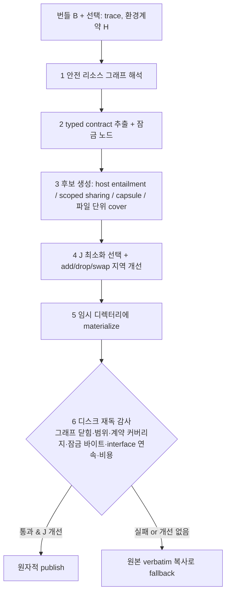

# SkillZip Pro

> [!summary] 핵심 요약
> 스킬을 한 장의 프롬프트가 아닌 **점진적으로 로드되는 리소스 그래프**로 보고 압축하는 방법이다. 그래프에는 루트(SKILL.md), references, subskills, scripts가 포함된다.
>
> 에이전트 하네스는 그대로 두고 다음 순서로 처리한다.
> - 루트·환경 계약이 이미 보장하는 내용을 제거하고, 분기 범위(activation scope) 안에서만 공유하며, 조건부 capsule을 분리한다.
> - 라우팅 테이블을 잠그고 디스크를 다시 읽어 감사한 뒤에만 배포한다.
>
> 핵심은 **witness로 근거를 제시할 수 있는 삭제만 허용**하는 것이다.

> [!info] 조사 범위
> `source`는 DAIR.AI Academy 요약 페이지다. 이 페이지가 가리키는 원 논문은 **arXiv:2608.30785v1 [cs.AI], 2026-08-31**(Alibaba Group · Zhejiang University, 저자 8인, CC BY 4.0)이며 `https://arxiv.org/html/2608.30785`의 본문 I~VII절과 부록 A~D를 직접 읽었다(부록 E 이후 세부 스키마/프롬프트와 부록 D의 일부는 훑는 수준).
>
> 논문 본문에서 공식 코드 저장소 링크는 찾지 못했다.
>
> 선행 논문 SkillZip(arXiv:2608.11079, Bai et al. 2026, "evaluation-free skill compression ... by discovering reusable structure")과 경쟁 방법 SkillReducer(arXiv:2603.29919, Gao et al. 2026)는 참고문헌에서 확인한 것이며 직접 열람하지 않았다.
>
> 아래 수치는 논문의 표(Roman numeral) 번호를 병기한다.

## 1. 문제의식·배경

### 1.1 왜 기존 압축이 맞지 않는가 (I절)
프로덕션 스킬은 보통 디렉터리다. 짧은 루트가 "언제 이 스킬을 쓰는가"를 선언하고, references와 subskills가 분기별 지식을, scripts가 결정적 연산을, schemas가 입출력 제약을 담는다. 에이전트는 이를 점진적으로 로드한다(카탈로그 메타데이터 → 선택 후 루트 → 현재 경로가 요구할 때 보조 파일).

이 실행 방식이 압축 목표를 바꾼다는 것이 논문의 출발점이다.
- 루트만 줄이는 방법은 그럴듯한 압축률을 내면서 배포 텍스트 대부분을 건드리지 않고, 심지어 드문 분기의 세부를 루트로 올려 **모든 호출의 컨텍스트를 키울 수** 있다.
- 파일을 전부 이어 붙여 압축하면 회계는 공정해지지만 progressive disclosure가 파괴된다.
- self-evolving 에이전트는 상황을 악화시킨다. 매 라운드 출력 규칙, 검증 체크리스트, 과거 실수를 편집 대상 스킬에 append하기 때문에 파일 내/파일 간 반복이 누적된다. 공유 자체는 공간을 줄이지만 어디에 두느냐가 중요하다. 드문 두 분기가 쓰는 내용을 루트에 올리면 모든 태스크가 비용을 낸다.

### 1.2 선행 연구와의 차이 (II절)
| 부류 | 대표 | 한계 |
|---|---|---|
| 프롬프트 압축 | LLMLingua / LongLLMLingua / LLMLingua-2 | flat context 가정, 희귀하지만 필수인 내용을 구분하지 못함 |
| 스킬 압축 | SkillReducer | 평가 피드백(rollout)이 필요하고 샘플 태스크에 압축이 묶임 |
| 직전 연구 | SkillZip | 문서 하나만 다룸. 참조·subskill·progressive loading 비용 모델 없음 |
| 문법 기반 압축/MDL | Sequitur, Re-Pair | semantic type, 활성화 범위, 경로 가중치, 잠금 자원, 배포 제약이 없음 |

SkillZip Pro는 "harness-agnostic"을 제약으로 둔다. 출력은 보통의 스킬 디렉터리이며 resolver, interception hook, runtime protocol이 필요 없다. 이 제약이 중요한 이유는 어떤 스킬 로더에도 배포할 수 있기 때문이다.

## 2. 방법 상세

### 2.1 스킬을 번들 그래프로 모델링 (III절)
- 번들 $B=(V,E,r)$: 리소스 $v$마다 경로, 바이트, 미디어 타입, 로딩 클래스. 엣지 $e=(u,v,g,s)$는 참조, 가드(예: "CSV export일 때"), 소스 span을 기록.
- 로딩 4계층: **Catalog**(선택 전 보이는 이름·설명), **Activation**(선택될 때 항상 로드되는 루트), **Path**(실행 분기가 전이적으로 여는 리소스), **Deployment**(배포되는 전체 바이트).
- **Safe resource graph**: 모든 해석된 타겟이 번들 루트 안의 일반 파일이고, 내부 참조 타겟이 존재하며, 엣지가 소스 span과 가드를 보존해야 한다. 외부 URL은 기록만 하고 가져오지 않는다. symlink escape, path traversal, 누락 타겟, 모호한 동적 경로는 strict 모드에서 거부. 인식하지 못한 파일은 배포에는 남지만 의존성으로 추론하지 않는다(압축기가 로딩 의미를 지어내지 않게 하려는 것).
- **Entry contract**: 각 노드를 private / public(독립 호출 가능) / conditional(선언된 호스트 컨텍스트와 함께만 독립 호출)로 분류하되 **작성자나 카탈로그가 선언**하며 압축기가 추론하지 않는다. 독립성 $\mathrm{Ind}(e,B')=\mathrm{Cov}(e,B'_{\downarrow e})\cdot\mathbb{I}[e\text{ discoverable}]$.
- **Typed contract** $\mathcal{C}_v=\langle I,W,T,R,O,E,P,L\rangle$: 적용/인터페이스 조건, 워크플로 상태·순서, 도구/자원 요구, 규칙·금지, 출력 필드/형식, 증거·검증 의무, 출처 span, 반드시 verbatim인 잠금 잔여분. 실행 코드, 구조화 데이터, 이미지 등은 **locked node**로 경로도 바이트도 바꾸지 못한다.
- **Bundle faithfulness**: (i) 모든 소스 unit이 호환 가능한 범위에서 cover되고, (ii) 잠금 노드는 byte-identical, (iii) 내부 참조가 안전하게 해석되며, (iv) 호스트 entailment로 제거된 unit은 환경 digest에 묶인 정확한 typed witness를 갖는다.

  저자는 "이것은 모든 언어모델에 대한 행동 동치성이 아니라 번들의 **명시된 계약**의 보존"이라고 선을 긋는다.

### 2.2 비용 함수 (III-D, 식 3~7)
$C_{cat}=\tau(\text{name,description,entry})$, $C_{act}=\tau(b_r')$, $C_{dep}=\sum_v \tau(b_v')$, $C_{path}(B',\pi)=\sum_{v\in load(B',\pi)}\tau(b_v')$. 최적화 목표는

$$J(B') = C_{cat} + C_{act} + \mathbb{E}_{\pi\sim q}\,C_{path}(B',\pi) + \lambda\, C_{dep},\quad \text{s.t. bundle faithfulness},\ \lambda = 0.05$$

경로 분포 $q$는 실행 trace가 있으면 trace에서, 없으면 명시된 분기 가드가 도출하는 reachable leaf 경로의 균등분포로 추정한다(어느 추정기를 썼는지 반드시 보고해야 한다고 명시).

한 개의 "압축률"은 항상 위험하므로 네 비용을 따로 보고하고 음수 절감도 자르지 않는다.

또 persistent(정본 번들을 다시 씀)와 transient(정본은 그대로, 실행별 view 생성) 두 수명주기에 대해 canonical storage, shipped, per-entry activation, per-run view tokens, build latency, cache 비용, public entry 독립성의 7개 양을 섞어 평균내지 않는다.

### 2.3 이론적 도구 (IV절)
- 파일 단위: SkillZip의 shortest cover(가중 set cover, 식 8). 번들 단위에서는 공유 모듈 $h$ 비용 $w_h d_x+\sum_{v\in S_x}w_v d_{ref}+d_{audit}$(식 9)이 원본 $\sum w_v d_x$보다 작을 때만 factoring 허용.
- **Proposition IV.1 (희소 분기 루트 승격 금지)**: 총 접근 확률 $p<1$인 분기들에만 나오는 x를 루트에 두면 기대 $(1-p)d_x$ 토큰이 늘어난다. 즉 전역 중복 제거가 저장 공간은 줄이되 흔한 요청을 더 비싸게 만든다. 그래서 공유 모듈은 그것을 필요로 하는 분기의 activation scope 안에 둔다.
- **Proposition IV.2 (capsule 임계)**: 가드가 있는 섹션을 on-demand capsule로 옮기면 $(1-p_g)d_b>(1+\lambda)d_g$일 때 J가 줄어든다. 길고 드물게 쓰이는 분기에 짧고 명확한 dispatcher가 있을 때 유리. 가드를 새로 추론하지 않고 명시적 heading이나 조건절에서 온 것만 후보가 된다("Background", "Notes" 같은 heading은 가드로 취급하지 않음, 부록 A-F).
- **Host entailment**: 환경이 이미 강제하는 보장(사용 가능한 도구, 불변 출력 스키마, 필수 안전 정책)을 서명된 typed contract $H=\{(t,k,v,\sigma,\delta)\}$로 표현하고, 정확히 type/key/value/scope가 일치할 때만 삭제를 허용한다. 의미 유사성은 수동 검토 플래그일 뿐이다. 환경 digest가 바뀌면 재감사하거나 이 변환을 끈다. 계약이 없으면 no-op.
- **Interface contract atomicity**: 출력 스키마+예시, 라벨 화이트리스트, 필드 검증 규칙처럼 입출력을 기계 검증 형식으로 규정한 섹션은 **연속된 verbatim 한 덩어리**로만 cover된다. 모든 줄이 보존되더라도 여러 합성 heading에 흩어지면 cover가 아니다.
- **Witness 위계** $W_1\succ W_2\succ W_3$: 모든 삭제는 정확히 하나의 witness를 달아야 한다. $W_1$ = literal containment(삭제된 텍스트가 다른 도달 가능 위치에 바이트 그대로 존재, 되돌릴 수 있음), $W_2$ = cover witness(결정적 content-word coverage 게이트 통과 + 보호된 literal과 부정 극성 보존), $W_3$ = entailment witness(고정된 checker 모델, temperature 0, 고정 프롬프트가 삭제 구간의 조건·판정·임계값·화이트리스트·면제가 다른 곳에 이미 완전히 표현되어 있다고 인증). $W_3$은 금지/출력/면제 마커가 없는 evidence 클래스 unit에만 허용하며 verdict와 근거를 로그에 남긴다.

  루트 내부 적용 시 두 후보가 서로의 삭제를 정당화하면 둘 다 거부하는 "mutual-witness veto"(정규화 bigram 집합 중복 0.6 초과 시 둘 다 보존, 부록 A-E)가 붙는다.

  저자의 표현으로 "삭제 개수가 아니라 witness 강도가 안전한 압축 상한을 정한다".
- **Proposition IV.5**: 안전한 소스 그래프, 정확한 추출 provenance, 환경 안정 가정, interface contract atomicity, sound한 최종 auditor를 전제로 커밋된 출력은 faithful하고 원래 번들의 일반적인 상대 파일 로딩만 지원하는 어떤 하네스에서도 실행된다. 저자도 이 보장이 추출기와 auditor의 정확성에 의존한다고 인정한다.

### 2.4 두 기둥과 네 가지 모드 (V절)
- **Pillar 1 – 활성화 인지 교차 파일 압축**: (i) host-entailment pruning, (ii) activation-scoped sharing(`.skillzip_shared/<digest>.md`, 루트로 승격 금지), (iii) conditional capsules(`capsules/<slug>.md` + 한 줄 dispatcher가 원래 트리거를 보존).
- **Pillar 2 – 라우팅 보존**: "X이면 refs/x.md를 읽어라" 같은 라우팅 줄은 일반 산문처럼 보이지만 스킬의 내비게이션 테이블이다. 세 겹의 방어: (i) 라우팅 테이블을 first-class unit으로 잠금(optimizer가 재서술/병합 불가), (ii) 참조가 있는 모든 소스 줄을 렌더링 중 보존, (iii) 배포 전 독립 패스가 materialize된 디렉터리를 다시 읽어 압축기가 만든 공유 모듈/capsule 포함 모든 파일이 루트에서 링크를 따라 도달 가능한지 확인. 실패하면 후보를 폐기하고 원본(verbatim)을 배포.
- **수명주기 × 스케줄 4조합**(Table I): 스케줄 = One-Shot(전체 재빌드, 이관/릴리스/주기적 재팩) 또는 Continual(evolution patch마다 증분); 수명주기 = Persistent(정본 번들 교체; 디스크와 이후 모든 실행 절감) 또는 Transient(정본 불변, 실행별 execution view; 컨텍스트 절감만, 디스크 불변, public entry 독립성이 구조적으로 보장됨).

**One-Shot (Algorithm 2)**: ResolveSafeGraph → ExtractTypedContracts → EstimateLoadWeights → 후보 생성 → ConstrainedSelect → MaterializeTemporary → `if J(D) ≤ J(B) and AuditFromDisk` 이면 AtomicCommit, 아니면 VerbatimCopy. **절대 원본보다 나쁜 목적함수의 후보를 publish하지 않는다**(never-inflate).

**Continual (Algorithm 3)**: patch Δ를 먼저 **재서술 없이** 원문에 적용(B_raw). 영향 closure(변경 노드, 참조 조상, 새로/더 이상 참조되지 않는 하위, 지지 집합이 바뀐 공유 모듈, 가드가 바뀐 capsule, 무효화된 host witness)만 재추출·지역 최적화하고 변경이 없는 계약은 digest로 재사용. patch 단위는 SkillZip의 4연산 Absorb / Refine / Extend / Refactor.

지역 결정은 one-shot 최적에서 드리프트하므로 continual regret $R_t=(J(B_t^{cont})-J(B_t^{one}))/\max(1,J(B_t^{one}))$를 정의하고, 회수 가능한 절감 $\theta$ 초과, 번들 성장 $\rho$ 초과, 워크로드 드리프트 $\delta_W$ 초과, 환경 digest 변경, 최대 K patch 중 하나가 발생하면 global repack을 트리거한다.

중요한 안전 규칙: continual 실패 시 이전 압축본으로 되돌리지 않고 **검증된 patch가 반영된 verbatim 번들(B_raw)을 publish**한다.

이전 압축본으로 돌아가면 학습된 행동을 버리게 되기 때문이다.

**배포물 레이아웃(부록 A-A)**: 게시 번들은 `SKILL.md`(경로 불변), `references/`, `subskills/`, `capsules/<guard-slug>.md`, `.skillzip_shared/<hash>.md`, byte-identical `scripts/ data/ assets/`. 컴파일러 상태(`state.json`, `manifest.json`, `contracts/<digest>.json`)는 번들 밖 cache에 두며 에이전트에게는 배포되지 않는다.

## 3. 실험 설정 (VI-B~VI-F)

- **벤치마크 3종**: BFCL-v4(도구 이름·호출 순서), LiveMathematicianBench(수학 추론), SpreadsheetBench(셀 값/서식 정확). 스킬 번들은 SkillOpt로 태스크 클래스별로 evolution시킨 결과에서 만들고, evolution patch를 이름 붙은 분기로 replay해 "공통 출력 규칙, 체크리스트, 과거 오류 기록이 여러 분기에 복사되고 한 분기에는 가드 달린 엣지케이스가 쌓이는" 구조를 재현한다. 결정론적 builder가 이동한 섹션의 출처를 기록하며 텍스트는 verbatim 보존. evolution/validation/held-out test 분할, 압축은 evolution 데이터만 사용.
- **모델**: Qwen3.7-Max, Qwen3.6-Plus, Kimi K2.6. 본표는 Qwen3.6-Plus, 이식성 실험에서 세 모델 모두 executor. 실행기는 수정하지 않은 벤치마크 에이전트이며 래퍼가 어떤 경로를 열었는지 기록만 한다.
- **기준 조건**: No Skill, Human Skill(손으로 쓴 원본), Evolved Bundle(압축 전 진화 결과, 비용·충실도 기준).
- **압축 baseline 4종**: Root-only SkillZip(루트만 압축), Flat-concat SkillZip(전부 이어 붙여 압축 후 파일로 매핑), SkillReducer(평가 기반 후보 선택은 끄고 압축 단계만 사용), Expert Progressive(2개 이상 파일에 반복된 문단을 루트에서 링크하는 공유 리소스로 빼는 결정론적 구조 인지 baseline).
- **지표**: 태스크 성공(각 벤치마크 자동 채점기), 비용 4계층 + 목적함수 J, 로딩(required recall, irrelevant load, dispatch, link error, fallback, reachable files), 지식 보존(남아 있는 소스 instruction 줄), 압축 실행 비용. 품질 유지 여부는 3개 벤치마크의 held-out 102개(수학 33 + BFCL 21 + 스프레드시트 48)를 풀링해 Evolved Bundle과 태스크별로 짝지은 paired bootstrap(10,000회)으로 보고, **차이의 95% 구간 하한이 사전에 고정한 −5pt 마진 위**면 "품질 유지"로 판정한다.

## 4. 주요 결과

### 4.1 벤치마크 메인 결과 (Table II~IV, Qwen3.6-Plus, grown version)
| 방법 | BFCL | Math | Sheet | Avg |
|---|---|---|---|---|
| No Skill | 0.809 | 0.364 | 0.312 | 0.495 |
| Human Skill | 0.905 | 0.455 | 0.333 | 0.564 |
| Evolved Bundle | 0.905 | 0.364 | 0.354 | 0.541 |
| Root-only SkillZip | 0.905 | 0.333 | 0.271 | 0.503 |
| Flat-concat SkillZip | 0.857 | 0.394 | 0.167 | 0.473 |
| SkillReducer | 0.857 | 0.394 | 0.271 | 0.507 |
| Expert Progressive | 0.905 | 0.333 | 0.312 | 0.517 |
| **SkillZip Pro (One-Shot)** | 0.952 | 0.394 | 0.333 | 0.560 |

네 비용 계층(Table III, 토큰 수 / Evolved Bundle 대비 절감):
| 방법 | Shipped | Always loaded | One run avg | One run worst |
|---|---|---|---|---|
| Evolved Bundle | 2,649 | 212 | 588 | 755 |
| Human Skill | 328 / +87.7% | 328 / −51.4% | 328 / +43.3% | 328 / +54.3% |
| Root-only ✗ | 2,589 / +2.2% | 153 / +27.8% | 529 / +10.3% | 696 / +8.2% |
| Flat-concat ✗ | 954 / +63.8% | 120 / +42.9% | 183 / +68.9% | 249 / +67.3% |
| SkillReducer | 2,518 / +5.0% | 213 / −0.4% | 564 / +4.1% | 722 / +4.4% |
| Expert Progressive | 2,285 / +13.7% | 226 / −6.5% | 482 / +17.9% | 754 / +0.2% |
| **SkillZip Pro** | 2,112 / +19.7% | 196 / +7.3% | 500 / +14.3% | 669 / +10.8% |

읽는 법: (a) 단일 압축률은 오해를 부른다. Human Skill은 shipped 기준으로 가장 좋은 "압축기"처럼 보이지만 always-loaded 루트는 오히려 51.4% 커진다. (b) Flat-concat은 모든 숫자에서 압도적이지만 **스킬 줄의 24.1%만 남기고**(Table VI) 라우팅 보존율이 0.000이므로 †로 표시되는 비교 불가 행이다. (c) SkillZip Pro는 네 계층을 모두 줄이면서 성공률을 보존하는 유일한 방법이라는 것이 저자 주장이다. 단 Expert Progressive가 "One run avg"는 더 좋다(+17.9% vs +14.3%).

풀링 테스트(Table IV, n=102): 성공률 / Evolved 대비 차이 / 95% 구간 — Pro 0.480 / +0.010 / [−0.029, +0.059] ✓, Human Skill 0.490 / +0.020 / [−0.039, +0.078] ✓, Root-only 0.422 / −0.049 / [−0.128, +0.020] ✗, Flat-concat 0.382 / −0.088 / [−0.167, −0.010] ✗, SkillReducer 0.431 / −0.039 / [−0.108, +0.029] ✗, Expert Progressive 0.441 / −0.029 / [−0.088, +0.029] ✗, No Skill 0.431 / −0.039 / [−0.108, +0.029] ✗.

저자 결론은 "Pro만 품질을 유지하는 압축기"다.

### 4.2 로딩 동작과 지식 보존 (Table V, VI)
Evolved Bundle의 required recall 0.795, irrelevant load 0.171 대비 Pro는 0.755 / 0.193, 다른 압축기는 irrelevant load 0.259~0.290. Root-only와 Flat-concat은 routing을 **삭제**해서 라우팅 보존율 0.000(링크 에러가 없는 것은 dangling이 아니라 지워졌기 때문). Pro의 라우팅 보존 1.000, 링크 에러 0.

Pro가 도달 가능한 파일 수가 6.3→10.3으로 늘어난 것은 만들어낸 shared module과 capsule 때문이다.

지식 보존(Table VI): Pro 0.986(손실 1.0줄), 반복 텍스트 제거 비율 0.736, shipped +19.7%. Expert Progressive는 보존 1.000, 반복 제거 0.482, +13.7%. SkillReducer는 반복 제거 0.073, +5.0%.

### 4.3 누적 비용과 라이브러리 성장 (Table VII, VIII)
누적 토큰 절감(보존 95% 이상 방법만 비교): N=1 / 10 / 50 / 200 / 1000에서 Pro +17.9 / +13.9 / +12.5 / +12.2 / +12.1%, Expert Progressive +13.1 / +11.7 / +11.3 / +11.1 / +11.1%, SkillReducer +5.1 ~ +5.5%.

N=1000에서 Pro와 Expert Progressive의 차이는 1.0pt 정도에 불과하다.

라이브러리 성장 실험(Table VIII)에서 Pro의 shipped 절감은 +21.8%→+25.5%로 늘지만 per-run 절감은 +17.6%→+5.3%로 줄어든다(Expert Progressive는 +18.4%→+10.4%).

논문 본문은 "per-run 비용이 라이브러리가 커져도 평평하게 유지된다"고 서술하지만 이 표만 보면 per-run 절감 폭은 줄어든다.

저장 vs 실행 비용의 trade-off(Expert Progressive는 모든 반복 텍스트를 하나의 루트 링크 파일로 몰아 저장은 더 줄이나 실행마다 그 파일을 읽는다)가 설명이지만, 표와 서술의 불일치는 비판적으로 읽어야 한다.

### 4.4 실제 evolved library와 continual 모드 (Table IX~XI, 그림 7~9)
- 실제 evolution 런이 남긴 라이브러리(17파일, 15라운드, 약 20,000 토큰, **79~84%가 반복 텍스트**)에서(Table IX, 3회 평균): Pro는 보존 1.000, shipped +23.1%(3개 중 2개에서만 publish; publish된 곳만 보면 34.7%, 가장 강한 faithful baseline 25.0%), always-loaded +1.7%, one-run +17.7%, routing 1.000. Expert Progressive는 always-loaded가 −2.9%로 커진다. Root-only(+69.2%)와 SkillReducer(+63.0%)는 루트에서 크게 줄지만 라우팅을 지워(0.000, 0.125) 얻은 수치다. 세 번째 라이브러리에서는 Pro가 감사는 통과했지만 목적함수가 개선되지 않아 원본을 그대로 재배포했다(never-inflate 규칙).
- Continual(13라운드 replay, Table X): 라운드마다 처음부터 재빌드는 shipped +35.1%/per-run +18.7%이지만 compressor 호출 10회/라운드. **Continual + repack은 shipped +48.1%, per-run +28.2%, 3.31 호출/라운드, drift −0.083**(재빌드보다 약간 더 작음; 저자는 최종 재빌드가 non-improving 후보를 거부하는 반면 continual은 이전 repack의 유효한 압축 상태를 유지하기 때문이라고 설명). repack 없이는 shipped +2.7%, per-run +0.8%, drift +0.262. root-only Zip-on-Write는 shipped +2.4%.
- 언제 켜야 하나(Table XI, 15라운드 스트림): 압축을 1라운드부터 켜면 에이전트가 운반한 총 토큰의 40.8%를 절감, 4라운드부터 38.9%, 7라운드 34.4%, 10라운드 30.8%, 13라운드 18.5%. 이유는 "늦게 켠 만큼 이미 지불한 토큰은 되돌릴 수 없고 반복은 누적되기 때문"이다.
- 그림 9의 발견: 라운드마다 새로 추가되는 내용의 **55% ± 3%가 기존 텍스트와 겹친다**(append-only 편집이 출력 포맷·체크리스트·누적 규칙을 반복). Pro가 제거할 수 있는 비율이 라운드 2의 29%에서 라운드 15의 53%로 증가("수확 체증"). 반복은 소수의 "범용 규칙"에 집중(7개 공유 모듈 중 상위 2개가 재사용의 47%, 상위 3개가 64%).

### 4.5 이식성, 오버헤드, ablation (Table XII~XIV)
- 압축 비용(Table XII): Pro 0.21초, 모델 호출 0, 토큰 0, rollout 0, peak 0.02GB(구조 추출·변환·감사가 모두 결정적). 단 이는 benchmark 번들에서의 비용이며, host-entailment/W3 같은 모델 보조 경로를 쓰는 production 설정은 별도다(아래).
- 모델 간 이식성(Table XIII, LiveMath + BFCL 44태스크): 같은 Pro 번들을 세 executor가 수정 없이 실행. 성공률 Evolved→Pro: qwen3.7-max 0.541→0.619, qwen3.6-plus 0.608→0.656, kimi-k2.6 0.611→0.574(irrelevant load 0.077→0.287로 악화). 구조적으로는 이식 가능하나 공유 라우팅 지시를 해석하는 방식에 모델 의존성이 남는다.
- Ablation(Table XIV): host entailment 제거 시 J 절감 0.142→0.077(가장 큰 하락), resource graph 제거 0.118, capsule 제거 0.126(shipped는 +26.9%로 늘지만 per-run은 +11.8%로 악화), scoped sharing 제거 시 shipped +7.9%. **전역 공유(unsafe control)**는 J가 −0.166으로 원본보다 나빠지고 always-loaded −84.9%, 한 파일이 도달 불가. 라우팅 락만 끄면 라우팅은 유지된다(참조 줄 보존과 최종 도달성 감사가 따로 막기 때문). λ∈{0,0.01,0.05,0.1,0.25,1} 스윕에서 변환과 비용이 동일(기본값 0.05는 결과에 맞춰 튜닝하지 않았다고 주장).

### 4.6 다중 엔트리와 수명주기 (Table XVII~XXII)
수학 스킬에서 파생한 통제 번들(root + public subskill + conditional reference 4개): 감사된 persistent Pro는 디스크 0.884, per-run 404→352 토큰, route/independence 1.000. **감사를 끄면** 디스크는 0.845로 더 작지만 public subskill을 rename해 effective independence 0.500이 되고, 실제 에이전트 호출 rollout에서 public subskill 시작 성공률이 0.000(Table XIX). Transient view는 디스크 1.000으로 같은 보장을 유지하며 root-heavy entry는 24.8% 절감, leaf reference는 2% 미만(closure가 겹치는 내용이 적어서). cold build 150~245ms, warm read 2ms 미만, hit율 0.9에서 호출당 15~25ms. 선택 가이드(Table XX): 안정적이고 자주 호출되는 번들은 persistent, 편집이 잦으면(편집/실행 비율 약 0.1 초과) transient, 워크로드 드리프트 0.8 이상이면 transient.

Table XIX는 public n=3, reference n=8로 표본이 매우 작다는 점을 저자가 인정한다.

### 4.7 프로덕션: 콘텐츠 모더레이션 (VI-V, Table XXIII)
루트 약 20,000 토큰, on-demand reference 3개(과거 사례, 모더레이션 기준), 잠금 risk map, 감사 1건당 약 13 추론 라운드, 100개 실제 태스크(위반/정상 반반), 번들은 중국어. 영어 전용 결정론적 추출기는 264개 instruction unit 중 7개만 "필수"로 식별해 대부분의 의무가 무보호가 된다(부록 A-E).
- **보호 없는 공격적 압축**: 배포 번들 71.4%(결정론)/75.8%(모델 보조) 절감, 정확도 88.00% → 70.00% / 62.00%, false positive 10 → 29~35, false negative는 1~3 유지. 제거된 내용의 대부분이 "언제 플래그하지 말아야 하는가"를 정하는 **면제(exemption) 규칙**(인증 판매자, 화이트리스트 예외, 증거 임계)이었다. 또한 JSON 예시 2개와 라벨 화이트리스트가 약 60줄 떨어진 합성 섹션으로 분리됐다.
- **단계적 보호 도입**: C1(면제 포함 unit 잠금) + C2(의무 unit은 witness 변환만 허용) + W1/W2만 → 배포 +13.8%, 실행 +7.1%, 정확도 89.00%, FP 9. W3 entailment witness 추가 → +32.7%, 정확도 88.00%(paired 기준과 동일 혼동행렬), 제거된 106개 reference segment 모두 verdict 로그, 결정을 바꾼 것은 없음. C0 interface 연속성 복원 → +32.2%, 89.00%. 루트 내부 W3 허용(v3) → **배포 +38.1%, 실행당 −10.4%(n=200, 두 100태스크 세션 풀링)**, 정확도 89.00% vs 같은 세션 비압축 기준 92.00%/91.00%. 정적 모델은 per-run 절감을 약 3%로 예측했지만 실측은 6~11%였고 30태스크 파일럿은 날짜별로 6~14%로 변동했다(저자 설명: 루트가 짧아지면 로딩 토큰 수뿐 아니라 읽기와 반복 추론 행동이 달라지는데 정적 모델은 이를 반영하지 않음).
- 같은 세션 baseline이 88/92/91%로 흔들린다. 같은 비압축 번들의 공식 단독 평가 값은 90.91%. 따라서 압축본의 89.00%와의 차이는 세션 노이즈 범위로 해석하되, **수치상으로는 같은 세션 기준 1~3 포인트 낮다**.

## 5. 저자가 밝힌 한계 + 비판적 평가

**저자가 명시한 것**
- 보장은 "명시된 계약의 보존"이지 모든 LM에 대한 행동 동치가 아니며, 추출기와 auditor의 정확성에 의존한다(III-C, IV-E). 불확실하면 byte-identical 복사로 fallback.
- 정적 비용 모델이 실제 에이전트 행동 변화를 반영하지 못한다(VI-V): 런타임 주장은 같은 세션에서 짝지어 측정해야 한다.
- 영어 마커 기반 modality 탐지가 중국어 번들에서 사실상 실패(7/264)했다는 점(부록 A-E). script별 마커 세트가 필요.
- 소규모 rollout: Table XIX는 n=3/n=8이며 저자가 노이즈를 인정. SpreadsheetBench는 한 문항 뒤집힘이 결과를 좌우하므로 2배 밀도로 샘플링했다고 설명.
- Table VIII에서 on-demand grouping 시도는 모든 실행에 hop을 추가해 never-inflate 검사에서 실패했다.

**내 평가**
1. **품질 보존의 통계적 힘이 약하다.** −5pt 비열등성 마진으로 n=102 풀링 테스트를 했는데 Pro의 구간 [−0.029, +0.059] 폭이 약 9pt이다. 마진 −0.05에 비해 하한 −0.029는 통과하지만, Expert Progressive의 하한(−0.088)과의 차이는 베이스라인 간 순서가 아니라 사전 지정 기준의 문턱 효과에 가깝다. Pro 대 Expert Progressive의 직접 paired 비교는 보고되지 않았다. 또한 평균(Table II) 기준으로 Pro 0.560은 Evolved 0.541보다 높게 나오는데, 이는 압축이 성능을 올렸다는 증거라기보다 노이즈 범위(소규모 테스트셋)로 보는 게 안전하다.
2. **Expert Progressive와의 격차가 크지 않다.** 누적 비용(N=1000)에서 12.1% vs 11.1%, Table III의 one-run avg에서는 Expert Progressive(+17.9%)가 오히려 우세. Pro의 차별점은 "더 많이 줄인다"보다 **루트 계층 악화 방지, 라우팅 보증, witness 감사**라는 안전 측면이다. 이득의 상당 부분이 도입된 safeguards로 설명되는 구조다.
3. **번들이 합성(builder로 replay)이다.** 벤치마크 번들은 "self-evolution 패치를 이름 붙은 분기로 replay해 만든" 것이라 반복 구조가 설계되어 있다(약 3분의 1이 반복). 실제 evolved library 실험(79~84% 반복)은 3개 런뿐이고 그중 하나에서는 압축 실패(원본 재배포)했다. 일반적인 사람이 쓴 프로덕션 스킬에서 같은 이득이 나는지는 production 사례 1건에 의존한다.
4. **프로덕션 사례는 단일 서비스, 단일 언어(중국어), 100태스크.** 방법이 "중간 설정(W3 + C0 + 루트 내부 W3)" 단계적으로 튜닝된 결과(v3)라서 사후 선택 효과(여러 구성 중 최고를 보고)의 위험이 있다. 같은 평가셋에서 튜닝하고 같은 평가셋으로 보고하는 설계로 보인다(논문에 별도 held-out 언급은 확인되지 않음). 또 헤드라인의 "38% / 10.4%"는 보호 클래스와 모델 보조 W3를 모두 쓴 설정이며 Table XII의 "모델 호출 0" 결과와는 다른 경로다.
5. **표와 서술의 불일치 가능성**: "per-run 비용이 라이브러리 성장에도 flat"(VI-L 서술) vs Table VIII의 per-run 절감 +17.6→+5.3%. 의미가 "절대 per-run 토큰이 평평"인지 "절감 비율이 평평"인지 불명확하다.
6. **kimi-k2.6 결과**: 한 모델에서는 성공률이 하락(0.611→0.574)하고 irrelevant load가 3.7배(0.077→0.287). "executor-agnostic"이라는 주장은 구조적 실행 가능성에 한정해서만 맞다.
7. **환경 계약(H) 의존성**: host-entailment가 ablation에서 가장 큰 기여(J 절감 0.142→0.077)를 하는데, 이는 서명된 환경 계약이 있어야 작동한다. 계약이 없으면 no-op이다. 실제 현장에서 이런 typed contract를 정의할 수 있는 조직이 드물 수 있다.
8. 모델 이름(Qwen3.7-Max, Kimi K2.6 등)과 일부 참고문헌 날짜는 논문이 주장한 것이며 내가 독립적으로 확인한 것은 아니다.

## 6. 재현·구현 고려사항

- **코드 공개 여부**: 논문에서 링크를 찾지 못했다(확인 못함). 재구현을 위해서는 부록 A의 구현 세부(디렉터리 레이아웃, 결정론적 순회·NFC 정규화·SHA-256, 1MiB 텍스트 상한, heading 단위 chunk + 256토큰 overlap, strict mode 경고=실패, 임시 sibling 디렉터리 + fsync + 원자적 rename, `--replace` 시 타임스탬프 백업, `--mode one-shot|continual`)가 유용하다.
- **참조 해석**: 호스트 에이전트가 이미 따를 수 있는 문법만 인식(상대 Markdown 링크/이미지, 코드 서식 경로, 선언된 front-matter 필드, "read references/csv.md" 같은 명령형 절). 규범 판단이 모호한 가드는 `unknown`으로 표시하고 capsule/경로별 공유 근거로 쓰지 않는다. 임베딩 유사도만으로는 자동 공유 모듈을 만들지 않고, 정규 typed-unit 해시 → 결정론적 구조 비교(type, payload, guard, 규범 강도 일치) 2단계 검증을 한다.
- **감사는 새 프로세스에서**: source 경로, candidate 경로, manifest만 입력으로 받아 그래프를 다시 만들고 해시를 다시 계산해 옵티마이저 객체를 신뢰하지 않게 한다(부록 A-H 8개 검사 항목 포함: 연속된 interface contract, 미참조 파일을 임의로 버리지 않기, 비용이 원본 J를 초과하지 않기 등).
- **W3 checker**: temperature 0, 고정 프롬프트, 응답 첫 줄 verdict + 둘째 줄 한 문장 근거, evidence 클래스에서 boundary 마커가 없는 segment만 허용, verdict·근거·segment 좌표·프롬프트 digest를 witness 로그에 기록. 루트 내부 적용 시 frontmatter와 interface contract는 verdict와 무관하게 면제.
- **언어 주의**: 규범/금지/권고 마커가 영어 위주라 비라틴 문서에서 필수 unit 식별이 붕괴한다. 한국어 스킬이라면 script별 마커 사전을 먼저 만들고 required-unit 검출률을 측정해야 한다(예: 이 논문의 7/264 같은 수치를 확인).
- 토큰 계산은 배포 tokenizer 기준으로 하고 추정값과 materialize 값이 일치하지 않으면 후보를 기각한다.

## 관련 노트
- [[wikiskill]]
- [[aces-agentic-continuous-evaluation-of-skills]]
- [[procedural-graphs-self-evolving]]

## 출처
- Xiaofan Bai, Chao Liu, Hongqiang Lin, Di Wu, Mingli Song, Xuan Jin, Xipeng Cao, Yuhong Li (Alibaba Group, Zhejiang University). "SkillZip Pro: Execution-Aware Dynamic Compression of Progressively Loaded Skills for Self-Evolving Agents." arXiv:2608.30785v1 [cs.AI], 2026-08-31. 초록 https://arxiv.org/abs/2608.30785 , 전문 https://arxiv.org/html/2608.30785 (실제 열람, I~VII절 및 부록 A).
- 요약 페이지(frontmatter source): https://academy.dair.ai/papers/skillzip-pro-execution-aware-dynamic-compression-of-progressively-loaded-skills-2608.30785 (실제 열람, 원문 기준으로 대조·재작성).
- 참고문헌에서 확인(미열람): SkillZip arXiv:2608.11079, SkillReducer arXiv:2603.29919.
- 공식 코드 저장소: 논문에서 확인 못함.
