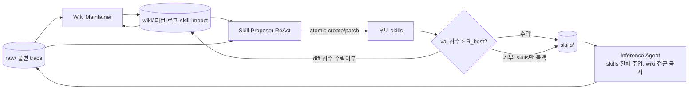

# WikiSkill

> [!summary] 핵심 요약
> 에이전트 경험을 **불변 raw trace / 누적 wiki / 실행 가능한 skill**로 나누는 스킬·지식 공동 진화(co-evolution) 프레임워크다.
>
> Validation gate에서 거부된 skill은 롤백하지만, wiki는 롤백하지 않는다. Wiki에는 패턴 카탈로그, 진화 로그, 제안 diff, 수락 여부가 남아 다음 제안이 이전 시행착오 위에 쌓인다.
>
> 같은 조건의 EvoSkill / SkillOpt / Trace2Skill보다 5개 모델의 평균 성능이 모두 높다고 보고한다.

> [!info] 조사 범위
> `source`는 DAIR.AI Academy 요약 페이지다. 그 페이지가 가리키는 원 논문은 **arXiv:2608.27454v1 [cs.AI], 2026-08-27**(Google Research 소속 저자 6인, CC BY 4.0)이며, `https://arxiv.org/html/2608.27454`의 전문(1~7절, Limitations, 부록 A~E 프롬프트까지)을 직접 읽고 원문 기준으로 작성했다.
>
> 논문 본문에서 공식 코드 저장소 링크는 찾지 못했다(HTML에 GitHub 코드 URL 없음).
>
> 아래 수치는 논문의 표/절 번호를 병기한다.

## 1. 문제의식·배경

### 1.1 문제
agent skill(SKILL.md + 스크립트 + 리소스로 구성된 파일시스템 기반 모듈, progressive disclosure로 필요할 때만 로드)은 모델 파라미터를 건드리지 않고 도메인 절차 지식을 주입하는 가벼운 포맷이다.

문제는 대부분 사람이 직접 쓰고 있다는 점이고(1절), 이를 자동화하려는 최근 연구는 학습 태스크에서 에이전트를 돌리고 성공/실패 trajectory를 분석해 스킬을 고치는 루프를 쓴다.

저자들이 짚는 빈틈은 "루프가 배운 것을 어디에 어떻게 보존하는가"다.

기존 방법들은 각자 다른 방식으로 이를 처리하지만 "배운 것 자체를 별도의 진화하는 지식 표현으로 유지하지는 않는다"고 주장한다.

### 1.2 선행 연구와의 차이 (1절, 부록 D.1)
| 방법 | 경험 보존 방식 | 한계로 지적되는 점 |
|---|---|---|
| EvoSkill (Alzubi 2026) | 후보 program의 frontier 탐색; proposer에 **실패 trace만** + 과거 제안/결과의 평평한 history | 지식이 제안 이력에 흩어져 있음 |
| Trace2Skill (Ni 2026) | trace별 success/error analyst를 병렬로 돌리고 패치를 계층적으로 병합 | 모든 trajectory를 개별 LLM 호출로 분석(O(N_train)) |
| SkillOpt (Yang 2026) | ReflACT 6단계(Rollout, Reflect, Aggregate, Select, Update, Evaluate), rejected-edit 피드백, epoch별 meta guidance | 하나의 monolithic skill 문서를 갱신 |
| **WikiSkill** | raw trace(불변) → wiki(구조화된 패턴) → skill로 분리, 롤백은 skill에만 적용 | — |

영감은 Karpathy(2026)의 "LLM Wiki" 관점, 즉 경험을 지속적으로 복리 누적되는 지식으로 컴파일하라는 아이디어다([[karpathy-llm-wiki]]).

논문은 GEPA 같은 범용 프롬프트 최적화기를 직접 비교에서 제외했다. 근거는 "전용 skill-evolution 파이프라인이 범용 최적화보다 일관되게 낫다"는 SkillOpt 논문의 결과이며, 이 논문에서 재현해 확인한 것은 아니다(4.1절).

## 2. 방법 상세

### 2.1 문제 설정 (2절)
태스크 집합 $\mathcal{D}$를 train / val / test로 분할. 에이전트 π는 도구 집합 $\mathcal{U}$(bash, 검색 API, 파일 리더 등)와 활성 스킬 집합 $S=\{s_1..s_M\}$를 가진다. 스킬은 `SKILL.md`(이름과 짧은 설명 frontmatter + 절차 + 적용 조건)가 든 디렉터리다. 스킬 집합은 빈 집합에서 시작해 데이터셋별로 진화한다. 시스템 상태는 $(S_k, W_k)$이고 $S_0=\emptyset, W_0=\emptyset$. 목표는 최종 $\mathcal{R}(\mathcal{T}_{test})$ 최대화.

### 2.2 3계층 워크스페이스 (3.1절)
```text
workspace/
  raw/                         # Raw Layer: 불변(immutable). 매 iteration 학습 rollout의 전체 trace
    traces/<task_id>           #   추론, 도구 호출, 출력, 최종 답 (proposer는 traces/ 별칭으로 read_file)
  wiki/                        # Wiki Layer: 누적/컴파일. 롤백 없음
    index.md                   #   패턴 카탈로그 (한 줄 요약: PROBLEM + ROOT CAUSE + FIX)
    patterns/*.md              #   실패 모드/성공 전략 + 워크어라운드 (10~30줄 권고)
    logs.md                    #   진화 로그 (Wiki Maintainer가 갱신)
    skill-impact.md            #   스킬 영향 추적기 (outer-loop 하네스가 gate 후 프로그램적으로 갱신)
  skills/                      # Skills Layer: 활성 스킬 (gate 통과분만)
    <skill>/SKILL.md
    <skill>/PURPOSE.md         #   이 스킬이 어떤 wiki 패턴 때문에 생겼는지 역추적 (Origin, Patterns Addressed, Evolution History)
```
핵심은 wiki가 하는 세 가지 일이다(3.1절).

1. 완전한 스킬 수락 이력을 보여줘 거부된 개입이 재제안되지 않게 한다.
2. 이전 iteration에서 무엇을 제안했고 성공했는지 추적한다.
3. 어떤 오류가 iteration을 가로질러 반복되는지 식별한다.

`PURPOSE.md`가 스킬 → wiki 패턴 방향의 provenance를 남기는 것도 눈여겨볼 설계다.

### 2.3 진화 루프 (3.2절, Algorithm 1)
```text
S0 = {} ; W0 = {} ; R_best = R(val rollout with S0)
for k = 1..K:
    if R_best == 1.0: break                      # 검증 만점이면 조기 종료
    T_train_k  = rollout(pi, S_{k-1}, D_train)    # (a) Inference Agent, wiki 접근 불가
    T_sample_k = stratified sample(T_train_k)     #     실패 최대 5 + 성공 최대 3 = 최대 8 trace, 각 15,000자 상한
    W'_k = WikiMaintainer(W_{k-1}, T_sample_k)    # (b) 패턴 생성/패치, index.md 갱신, logs.md append
    P_k  = SkillProposer(W'_k, S_{k-1}, T_train_k)# (c) ReAct, read_file/finish 도구, 최소 4개 trace 열람 필수
    S'_k = Apply(S_{k-1}, P_k)                    #     skill 1개 대상의 atomic create/patch
    R_val = R(rollout(pi, S'_k, D_val))           # (d) validation gate
    if R_val > R_best: S_k = S'_k ; R_best = R_val ; a_k = Accepted
    else:              S_k = S_{k-1} ;               a_k = Rejected   # skills만 롤백
    W_k = W'_k + log(P_k diff, R_val, a_k)        # skill-impact.md에 diff, 점수, 수락 여부 기록
```
세부.
- **Inference Agent**: 활성 스킬의 전체 내용을 system prompt에 직접 주입한다("full injection"). 선행 연구(SkillOpt, Trace2Skill)를 따른 선택으로, 스킬 트리거/검색 실패를 교란 변수에서 제거하기 위해서다.

  따라서 이 논문은 skill retrieval/triggering 능력은 평가하지 않는다. **학습 rollout 중에는 wiki 접근을 금지**한다(5.1절 ablation 근거).
- **Wiki Maintainer**: 전체 wiki와 샘플링된 trace를 받아 실패 task는 root cause analysis, 성공 task는 성공 전략 추출. 출력은 JSON(`create_patterns`, `update_patterns`(append/replace/insert_after 패치 연산), `update_index`(전체 재작성 필수), `append_log`). 프롬프트(E.2)가 강제하는 규칙: 에세이가 아니라 10~30줄, 중복 패턴 금지(기존 것에 증거 추가), index 항목은 "PROBLEM + ROOT CAUSE + FIX"를 1~2문장에 담아 에이전트가 페이지를 열지 않고도 관련성을 판단할 수 있게 한다(index가 "가장 중요한 부분"이라고 명시). 패턴 수 제한은 없다.
- **Skill Proposer**: 고정된 trace 묶음을 받는 대신 wiki index, skill-impact.md, 학습 태스크 결과 요약(통과/실패, 예측, 정답)만 받고, ReAct 방식으로 `read_file`을 써서 필요한 패턴/trace만 열어본다(컨텍스트 소진 방지). 프롬프트(E.3)의 규칙: wiki를 먼저 읽을 것, `skill-impact.md`에 실려 있는 거부된 제안의 전체 내용을 반복하지 말 것, 최소 4개 trace를 읽고 제안할 것, 기존 스킬이 부분적으로 맞으면 새로 만들기보다 패치할 것, 스킬은 간결하게.

  출력 액션은 `create`(SKILL.md + PURPOSE.md 전체), `patch`(edit 연산), `no_action`.
- **Gating**: 후보 스킬셋을 validation split에서 평가해 **엄격한 '>'** 로 개선될 때만 수락(`R_val > R_best`). 동점은 거부. 수락 시 임계값 갱신.



## 3. 실험 설정 (4.1절, 부록 B~C)

- **벤치마크 5종**과 split(부록 B Table 6, 이전 연구와 동일하게 맞춤): LiveMathematicianBench(단일 스텝, 도구 없음; train 35 / val 18 / test 124), SealQA(web_search + read_file; 16 / 10 / 85, 2026년 7월판), SpreadsheetBench(bash로 파이썬 실행; 80 / 40 / 280), OfficeQA(Treasury bulletin 장문 QA, glob/grep/read 도구, oracle 참조 페이지를 초기 증거로 제공; 50 / 24 / 172), ALFWorld(admissible actions; 39 / 18 / 134).
- **모델 5종**: Gemini-3.5-Flash(closed), Qwen-3.5-4B/9B-Instruct, Qwen-3.6-27B, Gemma-4-31B-It(open-weight, vLLM 배포).
- **Baseline**: Trace2Skill, EvoSkill, SkillOpt + no-skill. 모두 빈 스킬셋에서 시작, 진화된 스킬을 추론 시 프롬프트에 주입.
- **통계**: 전체 진화 과정을 독립적으로 **3회 반복**하여 test 성능의 평균을 보고. 유의성은 paired bootstrap(1,000회, p<0.05); 단독 1위 조건은 모든 경쟁 방법 대비 유의한 우위이며, 유의하게 구별되지 않으면 공동 최상위로 모두 굵게 표기. 벤치마크별 macro-average는 stratified bootstrap.
- 구현: Wiki Maintainer는 iteration당 최대 8 trace(실패 5 + 성공 3), 각 로그 15,000자 상한. 배치 크기 B는 전체 학습 셋(B = N_train).

## 4. 주요 결과

### 4.1 메인 결과 (Table 1, 정확도 %, 3회 평균)
| 모델 | 방법 | LiveMath | SealQA | SpreadSheet | OfficeQA | ALFWorld | Avg |
|---|---|---|---|---|---|---|---|
| Qwen-3.5-4B | No skill | 29.1 | 32.5 | 14.6 | 30.2 | 24.4 | 26.2 |
| | SkillOpt | 48.7 | 33.3 | 14.0 | 34.5 | 45.3 | 35.2 |
| | **WikiSkill** | 49.7 | 39.4 | 21.1 | 28.5 | 53.7 | **38.5** |
| Qwen-3.5-9B | No skill | 28.2 | 26.3 | 24.3 | 35.9 | 34.7 | 29.9 |
| | EvoSkill | 58.1 | 34.5 | 35.4 | 34.9 | 48.5 | 42.3 |
| | **WikiSkill** | 56.3 | 43.1 | 33.6 | 40.5 | 63.4 | **47.4** |
| Qwen-3.6-27B | No skill | 33.9 | 27.5 | 40.8 | 42.1 | 52.8 | 39.4 |
| | EvoSkill | 57.3 | 32.9 | 59.5 | 52.5 | 64.2 | 53.3 |
| | **WikiSkill** | 61.9 | 41.6 | 81.7 | 53.7 | 77.6 | **63.3** |
| Gemma-4-31B | No skill | 33.9 | 30.6 | 48.3 | 43.3 | 50.4 | 41.3 |
| | SkillOpt | 40.1 | 36.1 | 63.1 | 44.4 | 61.9 | 49.1 |
| | **WikiSkill** | 56.7 | 41.2 | 68.0 | 44.2 | 64.4 | **54.9** |
| Gemini-3.5-Flash | No skill | 33.0 | 29.4 | 50.5 | 48.6 | 85.9 | 49.5 |
| | EvoSkill | 44.6 | 43.6 | 55.4 | 51.2 | 85.9 | 56.1 |
| | **WikiSkill** | 72.6 | 44.7 | 76.6 | 60.7 | 85.9 | **68.1** |

(각 모델에서 가장 높은 경쟁 방법만 발췌. 전체 표는 논문 Table 1.) 논문 서술: 모든 모델에서 평균 1위이며 가장 강한 경쟁 방법 대비 +3.3(4B), +5.1(9B), +10.0(27B), +5.8(Gemma), +12.0(Gemini Flash)점.

대표 사례: Gemini-3.5-Flash LiveMath 33.0→72.6, SpreadSheet 50.5→76.6, Qwen-3.6-27B ALFWorld 52.8→77.6.

반대로 기존 방법은 불안정하다: EvoSkill은 Qwen-9B LiveMath를 28.2→58.1로 올리지만 Gemma-4-31B의 같은 LiveMath는 33.9→29.8로 떨어뜨리고, SkillOpt는 Gemini-3.5-Flash SealQA를 29.4→28.2로 낮춘다.

주의할 점: (a) Gemini-3.5-Flash ALFWorld는 no-skill 상태에서 이미 validation 100%라서 모든 방법이 85.9%로 동일(진화 자체가 일어나지 않음). (b) 셀 단위로 보면 WikiSkill이 최고가 아닌 곳이 있다: Qwen-4B OfficeQA 28.5는 no-skill 30.2보다 낮고, Qwen-27B OfficeQA 53.7은 SkillOpt 54.8, Trace2Skill 54.3 이하이며, Gemma OfficeQA 44.2는 SkillOpt 44.4 이하, Qwen-9B LiveMath 56.3은 EvoSkill 58.1 이하다. 평균 우위가 모든 셀의 우위를 뜻하지는 않는다.

### 4.2 스케일링과의 관계
Qwen 계열에서 WikiSkill의 평균 개선폭이 +12.3(4B) → +17.5(9B) → +23.9(27B)점으로 모델 규모에 따라 커진다. SpreadSheet에서는 +6.5 → +9.3 → +40.9점으로 더 두드러진다.

동시에 Qwen-3.5-9B + WikiSkill(47.4%)이 스킬 없는 Qwen-3.6-27B(39.4%)를 넘어선다.

저자 해석: 모델 능력과 진화된 절차 지식은 서로 보완적인 성능 원천이다.

벤치마크별로 편차도 크다. LiveMath는 전 모델에서 +20.6~+39.6, ALFWorld는 +14.0~+29.3(Gemini 제외)인 반면, OfficeQA는 장문 문서 탐색 워크플로를 소형 모델이 실행하지 못해 Qwen-4B에서 오히려 소폭 하락한다.

### 4.3 스킬 전이 (Table 2)
소스 모델이 진화시킨 스킬을 다른 추론 모델에 주입해 비교했다(소스: Qwen-4B / Qwen-27B / Gemini Flash).
- Qwen-3.6-27B가 진화시킨 SpreadSheet 스킬은 Qwen-3.5-9B를 24.3(무스킬)·33.6(자체 스킬)에서 50.5로, Gemma-4-31B LiveMath를 33.9(무스킬)·56.7(자체)에서 73.7로 올린다.
- 작은 모델이 만든 스킬이 큰 모델에 이득을 주기도 한다: Qwen-3.5-4B 스킬이 Gemma-4-31B를 LiveMath 73.1, ALFWorld 66.9로. "강한 소스가 더 좋은 스킬을 만드는 것은 아니다."
- **부정 전이도 있다**: Qwen-3.5-4B의 SpreadSheet 스킬은 Gemini-3.5-Flash를 50.5 → 18.1로 떨어뜨린다. 오류 분석(저자): (i) 4B 스킬은 한 줄 파이썬, 문자열 변환 규칙 같은 저수준 워크어라운드로, 작은 모델의 실행 실패는 막지만 강한 모델이 종단 스크립트를 짜는 것을 제약한다. (ii) 파편화된 진단 절차가 중복 도구 호출을 낳아 Gemini의 상호작용 예산을 소진시킨다.
- OfficeQA에서는 Qwen-4B 스킬이 자신의 성능을 30.2→28.5로 낮추지만 Qwen-27B는 42.1→52.9로 끌어올린다. 저자는 이를 "스킬 발견 능력과 스킬 실행 능력은 별개이며 self-evolution은 이 둘을 섞는다"고 요약한다.

### 4.4 Ablation: wiki 접근 (Table 3, Gemini-3.5-Flash, 4개 벤치마크 평균)
| Inference Agent의 wiki 접근 | Skill Proposer의 wiki 접근(+Maintainer) | LiveMath | SealQA | SpreadSheet | OfficeQA | Avg |
|---|---|---|---|---|---|---|
| (no skill) | — | 33.0 | 29.4 | 50.5 | 48.6 | 40.4 |
| 있음 | 없음 | 43.8 | 42.0 | 44.4 | 51.0 | 45.3 |
| 없음 | 없음 | 51.3 | 38.4 | 49.9 | 55.2 | 48.7 |
| 있음 | 있음 | 64.8 | 42.8 | 80.2 | 55.6 | 60.9 |
| 없음 | 있음(기본) | 72.6 | 44.7 | 76.6 | 60.7 | **63.7** |

(표의 행 배치는 텍스트 추출본에서 복원한 것으로, 본문 서술 "Inference Agent의 wiki 접근이 꺼진 상태에서 Proposer가 wiki를 가지면 48.7→63.7(+15.0)", "Proposer가 wiki를 가진 상태에서 Inference Agent에게도 wiki를 주면 63.7→60.9"와 일치한다.)

해석: persistent wiki가 스킬 품질을 가장 크게 올리는 요소이고, 학습 rollout 중 에이전트가 wiki에 접근하면 해결 지식이 스킬이 아닌 wiki에서 직접 나와 trajectory가 스킬 개발에 덜 유익해진다는 것이 저자의 가설이다(검증된 메커니즘은 아님).

### 4.5 정성 분석 (5.2~5.3절, Table 4/5, Figure 3)
- 스킬 길이: Qwen 계열 118.9~128.6줄, Gemma 45.1줄, Gemini Flash 81.2줄. 벤치마크별로는 SpreadSheet 142.5줄(패턴도 9.8개로 최다), LiveMath 84.6줄(패턴 4.4개). 모델별 wiki 패턴 평균 생성 6.3~8.9개, 편집 7.0~18.4회. 제안 대비 수락 건수는 스킬 생성 2.3~4.8개 제안에 1.2~1.6개 수락, 편집 3.2~5.7개 제안에 0.7~1.3개 수락 수준이다(Table 4). 즉 제안의 절반 안팎 이상이 gate에서 걸러진다.
-

  수락 시점(Table 5): 수락된 업데이트의 39~52%(모델별)가 초반(iter 0~1)에 몰리지만, 중반(2~4)과 후반(5~7)에도 계속 나온다. SealQA는 중반 33%, 후반 28%로 후반 개선이 두드러진다.
- 케이스 스터디(ALFWorld, Qwen-3.6-27B, Figure 3): Iteration 0에서 wiki가 `take-examine-move-loop.md`(루프 행동)를 발견, proposer의 `goal-directed-action` 스킬은 validation 개선 실패로 거부되고 `skill-impact.md`에 diff와 거부가 기록. Iteration 1에서 이 기록을 보고 `break-repetition-loop`를 구체 규칙("Never Return an Item to Its Origin Location")으로 제안해 수락. 이후 새 루프 변형(`multi-operation-loop.md`)이 쌓이자 Iteration 4에서 "Each Operation Type ONCE Per Item" 규칙으로 정교화. 이 사례가 논문의 핵심 주장인 "거부 이력과 패턴 누적이 다음 제안을 개선한다"의 구체적 근거로 제시되나, 단일 사례다.

### 4.6 비용 (부록 D.2, Table 7)
iteration당 optimizer API 호출: WikiSkill = $(1+T_{ReAct})N_{train}/B$, 본 실험은 $B=N_{train}$이므로 $1+T_{ReAct}$회(T_ReAct는 대략 10~20). 저자 주장은 학습셋 크기와 무관한 O(1). 비교: EvoSkill $2N/B$, SkillOpt $K_{opt}N/B$(K_opt≈6~8), Trace2Skill $\approx N+(1+1/(c-1))N/B+1$.

단 저자도 "일부 데이터셋에서는 추론 비용이 더 높을 수 있다"고 인정한다.

비교는 optimizer 호출 수만 다루며, rollout(학습/검증) 호출이나 토큰 총량, 달러 비용은 보고되지 않았다.

## 5. 저자가 밝힌 한계 + 비판적 평가

**저자 명시(Limitations)**
1. 스킬을 프롬프트에 전부 주입했으므로 **skill retrieval/triggering은 평가하지 않음**. 스킬 수가 늘면 중요해진다.
2. gating이 엄격한 개선만 수락하므로 **중립 제안**(즉시 성능은 같지만 이후 개선의 발판이 될 수 있는 것)을 배제한다. 더 유연한 수락 기준이 future work.
3. wiki가 계속 커지는데 **자동 pruning이 없다**.
4. 수백 액션/수 시간 규모의 초장기 과제는 평가하지 않았고, 단일 긴 rollout 내 온라인 적응도 미해결.

**내 판단**
- **검증셋이 매우 작다.** val이 SealQA 10문항, LiveMath 18, ALFWorld 18, OfficeQA 24, SpreadSheet 40. 엄격한 '>' 기준의 gate는 문항 1~2개 차이에 좌우된다. 저자도 부록 B에서 "validation 노이즈"를 인정하고 3회 반복 평균과 bootstrap으로 보완했지만, 반복은 최종 test 평균의 분산을 줄일 뿐 각 run 내부의 잘못된 수락/거부를 막지는 못한다. 또 test 셋도 SealQA 85, LiveMath 124 등 크지 않다.
- **얼마나 wiki 덕인가**: ablation은 Gemini-3.5-Flash 하나, 4개 벤치마크에서만 수행했다. wiki 없는 구성은 "Maintainer까지 제거"한 것이어서, 이득이 "persistent knowledge" 때문인지 "추가 LLM 호출(Maintainer + ReAct Proposer의 trace 탐색)로 인한 분석 깊이" 때문인지 분리되지 않는다. 계산량을 맞춘 비교(예: wiki 없이 ReAct proposer가 같은 횟수만큼 trace를 탐색)가 있어야 인과가 선명하다. 또 비교 대상 baseline들은 B < N_train 미니배치에서 최고 성능을 낸다고 저자가 말하는데(D.2), 본 실험에서 baseline이 어떤 B로 돌았는지는 본문에서 명시되지 않는다(확인 못함).
- **출처 편중**: 소스 모델과 추론 모델의 조합이 3개 소스로 제한되고, Gemini 소스는 ALFWorld에서 아예 비어 있다. "다른 모델이 진화시킨 스킬이 자체 진화보다 나은 경우도 있다"는 주장은 사실이지만 표 전반이 일관되게 그렇다는 뜻은 아니다(예: Qwen-4B → Gemini SpreadSheet는 18.1로 파국).
- **gate의 동질성**: 모든 방법이 validation gating을 공유하므로 우위는 gate가 아닌 "제안 품질"에서 온다는 해석이 합리적이다. 반면 wiki 누적이 스킬 길이(Qwen 120줄대)와 복잡도를 키우는 방향의 편향을 가질 수 있다는 점은 논문에서 다루지 않았다.
- **최신 모델 이름들**(Qwen-3.5/3.6, Gemma-4, Gemini-3.5-Flash)은 논문이 사용한 모델이며 내가 독립적으로 확인한 정보는 아니다.

## 6. 재현·구현 고려사항

- 공식 코드 위치: 확인 못함(논문에 URL 없음). 부록 E에 세 에이전트의 system prompt 전문이 있어 재구현은 가능하다(Inference Agent 프롬프트는 태스크별 `{skill_section}` 자리표시자 구조, Wiki Maintainer는 incremental edit JSON 스키마, Proposer는 `read_file`/`finish` 두 도구).
- 하네스가 맡아야 할 일: (a) `skill-impact.md`를 LLM이 아닌 **하네스가 프로그램적으로** 갱신(diff, 점수, 수락 여부)해서 사실 기록의 신뢰성을 확보, (b) trace 파일의 불변 보관과 `traces/` 별칭 해석, (c) gate 평가와 `R_best` 상태 관리, (d) 만점 조기 종료.
- 제안 단위가 "스킬 1개에 대한 atomic create/patch"이므로 gate 점수 변화의 귀인이 명확하다. iteration당 변화량을 작게 유지한다.
- 비용 감각: iteration마다 train 전체 rollout + Maintainer 1회 + Proposer ReAct 10~20턴 + val 전체 rollout. val 크기가 작아도 gate 평가는 매 iteration 필요하다.
- 3회 독립 실행과 paired bootstrap은 평가 하네스의 필수 부분으로 가져갈 만하다.

## 관련 노트
- [[karpathy-llm-wiki]]
- [[skillzip-pro]]
- [[procedural-graphs-self-evolving]]
- [[aces-agentic-continuous-evaluation-of-skills]]

## 출처
- Liyan Tang, Cyrus Rashtchian, Chun-Sung Ferng, Andrew Tomkins, Da-Cheng Juan (Google Research), Tu Vu (Google Research, Virginia Tech). "WikiSkill: Compiling Agent Experience into Persistent Knowledge for Skill Evolution." arXiv:2608.27454v1 [cs.AI], 2026-08-27. 초록 https://arxiv.org/abs/2608.27454 , 전문 https://arxiv.org/html/2608.27454 (실제 열람, 본문·Limitations·부록 A~E).
- 요약 페이지(frontmatter source): https://academy.dair.ai/papers/wikiskill-compiles-agent-experience-into-a-persistent-wiki-2608.27454 (실제 열람, 원문 기준으로 대조·재작성).
- 공식 코드 저장소: 논문에서 확인 못함.
