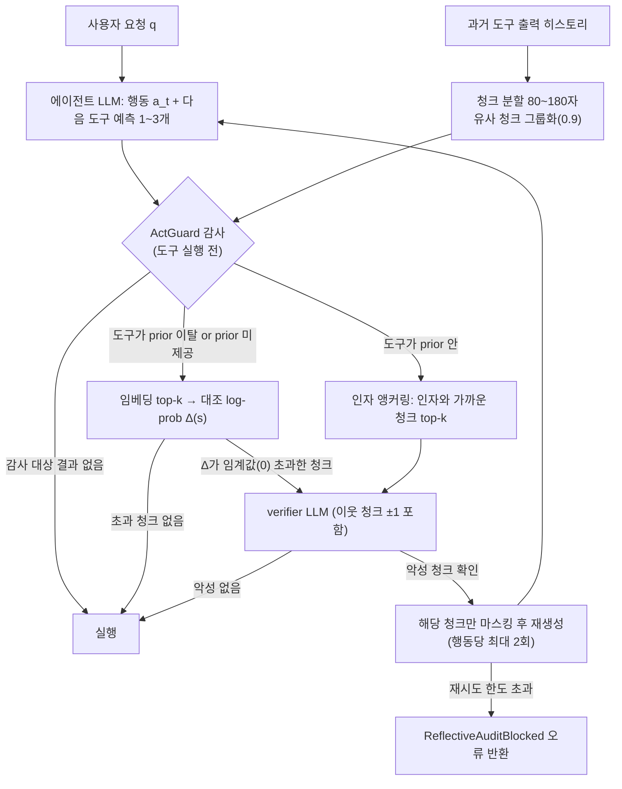

# ActGuard

> [!summary] 한줄요약
> 도구를 쓰는 LLM 에이전트가 간접 프롬프트 주입(IPI, indirect prompt injection)에 넘어가지 않도록, **도구를 실행하기 직전에** "이 행동이 직전 단계에서 예측한 도구 집합(local tool prior)에서 벗어났는가, 인자가 외부 콘텐츠에서 베껴 왔는가"를 검사하고, 검증기(verifier)가 악성이라고 확인한 span만 마스킹한 뒤 행동을 다시 생성하게 하는 방어 기법. 논문(arXiv 2609.14987)과 AgentDojo 기반 공식 구현(MIT)이 함께 공개되어 있다.

## 1. 배경: 왜 이 문제가 어려운가

LLM 에이전트는 웹페이지, 이메일, 문서, 검색 결과 같은 외부 도구 출력을 읽고 다음 행동을 정한다. 이 출력은 과제 수행에 꼭 필요한 정보이면서 동시에 공격자가 지시문을 심을 수 있는 통로다. 논문은 이를 위협 모델로 정리한다. 공격자는 사용자 요청 `q`, 시스템 지시, 에이전트 정책 `π`, 도구 구현을 바꿀 수 없고, 에이전트가 접근하는 외부 콘텐츠의 일부(관측 `o_i`)에만 지시문 `z_i`를 삽입할 수 있다. 오염된 관측은 히스토리에 계속 남기 때문에 영향이 바로 다음 단계에만 국한되지 않고 이후 어느 단계의 행동 `a_t`가 공격 목표 집합 `A_adv(z_i)`에 들어가 실행되기만 하면 공격이 성공한 것으로 본다. 공격은 도구 선택을 바꿀 수도 있고, 같은 도구에서 수신자 주소·URL·명령 같은 인자만 바꿀 수도 있다.

논문이 정리한 기존 방어는 네 갈래다.

- **프롬프트 기반**: Spotlighting, Prompt Sandwich, Tool Filter 등. 구분자·반복 지시로 경계를 강화하지만 악성 지시문이 컨텍스트에 그대로 남아 있어 이후 행동에 영향을 줄 수 있다.
- **필터 기반**: ProtectAI, PromptGuard2, PIGuard 등. 도구 출력이 주입인지 분류해 청크나 출력 전체를 지운다. 정상 정보와 악성 지시를 구분하지 못해 놓치거나(미탐) 과하게 지운다(유틸리티 하락).
- **시스템 기반**: CaMeL, Progent, DRIFT 등. 접근 제어·정보 흐름·사전 계획으로 행동 공간을 제한한다. 긴 궤적이나 환경 피드백에 따라 경로를 바꿔야 하는 작업에서는 합법적인 도구 호출까지 막을 수 있다.
- **정렬 기반**: StruQ, SecAlign 등 학습으로 지시 우선순위를 강화.

ActGuard의 문제의식은 "외부 콘텐츠가 의심스러운가"를 묻는 대신 "그 콘텐츠가 **현재 행동**을 국소적으로 합리적인 기대에서 벗어나게 만들었는가"를 묻는 것이다. 방어 목표를 콘텐츠 분류에서 행동-원인 귀속(attribution)으로 옮긴 셈이다.

## 2. 동작 원리와 아키텍처

### 2.1 세 구성 요소

논문 3장은 ActGuard를 세 부분으로 설명한다.

1. **Step-wise Planning (단계별 계획)**: 전 과정을 미리 계획하지 않고, 현재 행동 `a_t`를 만들 때 **다음 단계에서 쓸 법한 도구 이름 1~3개**를 함께 예측한다(`F_prior^{t+1}`). 인자는 예측하지 않는다. 다음 단계 인자는 현재 관측에 크게 좌우되기 때문이다. 이 집합은 화이트리스트가 아니라 다음 감사의 "기준선"일 뿐이라서 실제 도구 선택이 막히지는 않는다.
2. **Dual-Granularity Evidence Localization (이중 입도 증거 국소화)**: 과거 도구 출력(신뢰할 수 없는 관측 `o_1..o_{t-1}`)을 작은 청크로 나누고 비슷한 청크는 묶은 뒤, (a) 도구 이름이 prior에서 벗어났을 때는 **tool-level contrastive attribution**, (b) 도구가 prior와 같아도 **argument-level parameter anchoring**으로 의심 청크를 좁힌다.
3. **Verifier-Guided Context Sanitization (검증기 기반 정화)**: LLM verifier가 후보 청크(와 이웃 청크)에 IPI가 있는지 판정하고, 악성으로 확인된 청크만 마스킹해 행동을 재생성한 뒤 다시 감사한다.

### 2.2 tool-level contrastive attribution

현재 후보 도구 `f_t`가 이전 단계의 prior `F_prior^t`에 없으면, 임베딩 검색으로 `⟨f_t, θ_t⟩`와 가장 관련 깊은 상위 k개 청크를 뽑는다. 그다음 prior 안에서 전체 컨텍스트 기준 길이 정규화 log-prob가 가장 높은 도구를 기준 도구 `f_prior`로 고른다. 각 청크 `s`에 대한 점수는 논문 식 (9)로 정의된다.

```
Δ(s) = (1/|f_t|)·log[P(f_t|q,H_t) / P(f_t|q,H_t∖s)]
     − (1/|f_prior|)·log[P(f_prior|q,H_t) / P(f_prior|q,H_t∖s)]
```

직관은 이렇다. 악성 청크 `s`가 있으면 후보 도구의 확률이 기준 도구 대비 올라가 있고, `s`를 가리면 후보 도구 점수는 내려가며 기준 도구 점수는 회복된다. 그 둘의 마진 변화가 `Δ(s)`이고, `Δ(s) > τ`(기본 0)이면 verifier로 보낸다. 기준 도구가 실제 정상 행동과 다르면 기준 도구 확률은 거의 변하지 않아 점수가 단순(naive) 귀속으로 환원된다. 이 확률 계산은 로컬 Llama-3.1-8B-Instruct로 한다.

### 2.3 argument-level parameter anchoring

도구 이름이 prior 안에 있어도 인자가 공격자 것일 수 있다(예: 올바른 `send_email`인데 수신자가 공격자 주소). 조작된 인자는 보통 이전 도구 출력에 글자 그대로 또는 비슷하게 등장한다는 관찰을 이용해, 후보 인자에서 검색 가능한 내용을 쿼리로 삼아 청크 중 상위 k개를 증거로 verifier에 직접 보낸다. 이 경로에는 로그확률 필터가 없다.

### 2.4 데이터 흐름



## 3. 코드에서 확인한 구현 세부

저장소는 AgentDojo를 포크한 런타임에 ActGuard를 얹은 구조다. 핵심은 `src/agentdojo/agent_pipeline/reflective_audit.py`(2,934줄)이며, 내부 식별자는 논문 이전 이름인 `reflective_audit`이 그대로 쓰인다. 코드를 읽고 확인한 내용은 다음과 같다.

**텍스트 프로토콜 프롬프트.** `ReflectiveAuditTextProtocolLLM`(OpenAI 호환 LLM 래퍼)이 에이전트에게 매 턴 다섯 개 XML 섹션을 강제한다: `<function_thought>`, `<function_call>`, `<next_function_thought>`, `<allowed_next_tools>`, `<final_answer>`. 도구 스키마를 프롬프트에 직접 넣고 도구 호출을 파이썬 호출식으로 파싱한다(`parse_reflective_audit_text_protocol`, AST 기반 파싱). `allowed_next_tools`는 1~3개의 실제 도구 이름이어야 하며 `next_function_thought`는 이후 컨텍스트에서 제거되는 방어용 메타데이터로 명시되어 있다. 즉 네이티브 function-calling이 아니라 텍스트 프로토콜을 쓰기 때문에, 다른 에이전트 프레임워크에 이식하려면 이 계층부터 다시 만들어야 한다.

**청킹.** `_chunk_text`/`_chunk_structured` 계열이 문장·마크업·YAML 레코드·JSON 필드 단위로 80~180자 청크를 만들고(`CHUNK_MIN_CHARS=80`, `CHUNK_MAX_CHARS=180`), 짧은 인접 조각은 병합하되 `<information>` 태그 경계는 넘지 않게 보호한다. 마스킹은 원문 span 위치를 되찾아 해당 구간만 치환하며(`_replace_chunk_spans_in_tool_result`), 실패하면 소스 단위 폴백(`_fallback_source_unit_span`)을 쓴다. 도구 출력 전체를 지우지 않는다는 주장은 이 구현으로 뒷받침된다.

**감사 대상 선정.** 모든 도구 결과를 감사하지 않는다. `_is_auditable_content_tool_result`는 오류·24자 미만 스칼라·숫자·날짜·마스크 자리표시자는 제외하고, 도구 권한이 `Read`인 경우는 감사 대상으로, `Write`/`Execute` 도구의 결과는 마크업·YAML 레코드·JSON·diff처럼 "복사된 외부 콘텐츠" 모양일 때만 포함한다. 도구 권한(`Read`/`Write`/`Execute`)은 이름 접두사(`get_`, `send_` 등)와 설명 키워드로 추정하는 휴리스틱(`classify_tool_permission`)이며, 분류 불가 시 `Execute`로 간주한다. 이 접두사 목록은 AgentDojo 도구 이름 관례에 맞춰져 있어 사내 도구명에는 다시 맞춰야 한다.

**감사 트리거.** `_current_action_needs_audit`는 감사 가능한 도구 결과가 없으면 건너뛰고, prior가 없으면(`missing_prediction`) 또는 현재 도구가 prior에 없으면(`prediction_deviation`) 도구-수준 경로로, prior 안이면(`predicted_tool_parameter_audit`) 인자-수준 경로로 보낸다. 로그확률 델타가 임계값을 넘는 청크가 하나도 없으면 verifier를 부르지 않고 행동을 통과시킨다(`allowed_no_attributable_chunk`).

**verifier.** 영어 시스템 프롬프트로 IPI 유형(제어권 탈취, 과제 하이재킹, 개인정보 유출, 가짜 권위)과 "IPI가 아닌 것"(사실 데이터만 있는 경우, 과제에 필요한 정상 절차 등)을 구분하라고 지시하고, 반드시 JSON(`is_ipi`, `ipi_chunk_ids`, `reason`)만 내라고 요구한다. 반환된 청크 ID가 입력 청크에 없으면 무시하고, `is_ipi`가 참이어도 유효한 청크 ID가 없으면 비-IPI로 취급한다. **API 오류나 JSON 파싱 실패 시에는 "유틸리티를 위해 비-IPI로 간주(defaulting to non-IPI)"하는 fail-open 설계**다(`default_openai_verifier`). 또 verifier가 양성이지만 마스킹 가능한 청크가 없으면 행동을 허용한다(`verifier_positive_without_maskable_chunk_allowed`). 보안 관점에서 의도적인 가용성 우선 선택이므로 운영 적용 시 정책으로 검토해야 한다.

**재시도.** 양성이면 해당 청크를 마스킹하고 같은 행동 키에 대해 최대 2회(`max_repairs`) 재생성하며, 한도를 넘으면 도구 결과로 `ReflectiveAuditBlocked: <이유>` 오류 메시지를 돌려주어 실행을 막는다.

**감사 로그.** 모든 감사에 대해 트리거 사유, 후보 청크, 로그확률 델타, verifier 요청·원문 응답, 수리 상태를 JSON 이벤트로 남기고, `util_scripts/reflective_audit_trace_viewer.py`와 `actguard-trace` CLI로 열람한다. 사후 감사 가능성은 상당히 좋은 편이다.

**테스트.** `tests/test_agent_pipeline/test_reflective_audit.py`(1,939줄)에 `def test_` 55개가 있다. 텍스트 프로토콜 파싱, 청킹, 마스킹, verifier 실패 처리, 감사 트리거를 다루며, 이번 조사에서는 의존성 설치 없이 코드만 읽었기 때문에 테스트를 실행하지는 않았다.

## 4. 설치와 실행

요구사항은 Python 3.10+, OpenRouter API 키, Llama 3.1 8B Instruct 체크포인트(Hugging Face gated), 로컬 로그확률 계산용 CUDA GPU 권장이다. 선택 의존성 `actguard = ["transformers>=4.41.2", "torch>=2.2.1"]`이고 기본 의존성은 openai, pydantic, tenacity, deepdiff, rich 등이다.

```bash
uv sync --frozen --extra actguard
export OPENROUTER_API_KEY=...        # 키는 환경변수로만 주입, 파일에 기록 금지
uv run --frozen --extra actguard ./scripts/run_actguard.sh
uv run --frozen pytest -q tests/test_agent_pipeline/test_reflective_audit.py
```

`scripts/run_actguard.sh`는 `workspace` 스위트와 `important_instructions` 공격, 벤치마크 버전 v1.2.2로 `--defense reflective_audit`를 돌린다. 결과는 `runs/openai_gpt-4o-mini-2024-07-18-reflective_audit/actguard/`에 쌓인다. 로컬 체크포인트를 쓰려면 `--reflective-audit-embedding-model`, `--reflective-audit-logprob-model` 값을 경로로 바꾼다.

README의 기본 구성값은 다음과 같다: 백엔드 `openai/gpt-4o-mini-2024-07-18`(temperature 0), 청크 80~180자, 임베딩 `all-MiniLM-L6-v2` k=3, 로그확률 모델 Llama-3.1-8B-Instruct(임계값 0), 유사 청크 그룹화 임계값 0.9, verifier `openai/gpt-5-mini`, 다음 도구 예측 1~3개, 이웃 청크 확장 ±1, 행동당 최대 수리 2회, 마스킹 문구 `[Removed suspicious instruction from external tool result.]`. 참고로 논문 구현 세부에는 top-k=5로 적혀 있어 README의 k=3과 다르다. 어느 쪽이 논문 표의 설정인지는 확인하지 못했다.

## 5. 논문 실험 결과(논문 본문·부록 표에서 직접 확인)

- **벤치마크**: AgentDojo(Banking, Slack, Travel, Workspace; 정상 과제 97개, 보안 케이스 629개)와 AgentDyn(DailyLife, GitHub, Shopping; 정상 과제 60개, 주입 케이스 560개). AgentDyn은 궤적이 더 길고 정상적인 제3자 지시가 섞여 있어 과도한 정화를 더 잘 드러낸다고 논문은 설명한다. 지표는 NAU(공격 없는 유틸리티), UAU(공격 하 유틸리티), ASR(공격 성공률)이다.
- **AgentDojo 표 9 (GPT-4o-mini 백엔드, 풀링 평균)**: ActGuard NAU 68.04 / UAU 59.85 / ASR 0.42. 같은 표에서 DRIFT 62.89 / 57.85 / 1.90, Progent 60.82 / 47.84 / 5.16, PIGuard 43.30 / 14.91 / 2.30, CaMeL 24.74 / 23.71 / 0.00. DRIFT만 비슷한 수준이라고 본문이 말한다.
- **Tool prior 적중률(표 1)**: 단계별 prior는 GPT-4o-mini 기준 공격 없음 65.89%, 공격 하 61.07%의 커버리지를 보인 반면 전역 계획(global plan)은 10.17%와 0.00%였다. 즉 "처음에 전체 계획을 세우는" 방식은 환경 피드백에 쉽게 어긋난다.
- **verifier 비교(표 2, AgentDyn)**: 무방어 NAU 46.67 / UAU 35.36 / ASR 51.07. GPT-5-mini verifier는 UAU 47.50, ASR 2.14, 재현율 97.43, 정밀도 87.50. GPT-4o-mini verifier는 ASR 1.60이지만 정밀도 68.99로 정상 정보를 많이 지워 UAU가 23.96까지 떨어졌다.
- **비용(표 3, DeepSeek-V4-Flash 백엔드, AgentDyn)**: 무방어 15.50M·53.50초/과제, ActGuard 19.48M·105.74초, CaMeL 30.94M·212.19초, DRIFT 19.83M·236.80초. 지연의 주원인은 로컬 프록시 모델의 확률 마진 계산이라고 설명한다.
- **어블레이션(표 4, AgentDyn DailyLife)**: 전체 구성 유틸리티 52.5 / ASR 3.0. 인자-수준 국소화를 빼면 ASR이 24.5로 가장 크게 악화, 임베딩 검색을 빼면 비용이 7.08로 늘고 ASR 12.5, 대조 기준을 빼면 ASR 6.5.
- **적응형 공격**: 같은 페이로드를 반복 삽입해 top-k를 점유하는 공격에서도 ASR이 오르지 않았고(감사가 다음 오염 행동에서 다시 일어나므로), verifier에게 "무시하라"고 지시하는 페이로드도 ASR 증가가 없었다고 보고한다(청크가 감사 대상 데이터로 입력되기 때문). 다만 반복 삽입은 재생성 시도를 늘려 유틸리티를 낮춘다.

위 수치는 논문 저자들의 자체 보고이며 독립 재현 결과는 확인하지 못했다. 이전 노트에 적었던 "UAU 59.85, ASR 0.42"는 검색 스니펫이 아니라 부록 표 9에서 직접 확인되었다.

## 6. 비교 대상

| 접근 | 대표 | ActGuard와의 차이 |
|---|---|---|
| 필터링 | PIGuard, PromptGuard2, ProtectAI | 콘텐츠 자체의 악성 여부를 분류. ActGuard는 "이 행동을 유발했는가"로 후보를 좁힌 뒤에만 판정하므로 정상 정보 손실이 작다 |
| 계획 고정 | DRIFT, IPIGuard, Task Shield | 사전 궤적/의존 관계로 제한. ActGuard는 한 단계 앞 도구 이름만 기준선으로 쓰고 제한은 하지 않는다 |
| 정보흐름/권한 | CaMeL, Progent | 설계 단계에서 데이터 흐름을 통제해 강하지만 유연성 비용이 크다(표 3에서 CaMeL은 AgentDyn UAU 0.00) |
| 귀속 기반 | 콘텐츠 ablation·반사실 재실행·어텐션 분석 계열 | 논문은 span ablation이 반복/유사 주입을 과소평가하고 어텐션은 비현저한 위협을 놓칠 수 있다고 비교한다 |

## 7. 성숙도·한계

저장소는 `Initial ActGuard release` 커밋 1개로 2026-09-14에 생성되었고(논문 제출 당일), 스타 1, 포크 0, 오픈 이슈 0, 릴리스·태그 없음이다. `pyproject.toml`은 버전 0.1.0, "Development Status :: Beta"로 표기한다. 라이선스는 MIT이며 AgentDojo 파생 코드의 원저작권 고지를 유지한다고 README가 밝힌다. 사실상 **논문 재현용 연구 코드**이고, 운영 라이브러리나 패키지로 배포된 상태는 아니다.

한계로 코드와 논문에서 확인되는 것은 다음과 같다. (1) 모든 평가가 AgentDojo/AgentDyn 계열이며 한국어 콘텐츠나 사내 도구에 대한 검증은 없다. (2) 에이전트가 텍스트 프로토콜(XML 5섹션)을 따라야 하므로 네이티브 function-calling 기반 스택에 바로 붙지 않는다. (3) 로컬 8B 모델 확률 계산 때문에 GPU와 모델 접근 권한(gated)이 필요하고 지연이 약 2배다. (4) verifier 오류 시 fail-open이다. (5) 도구 권한 분류가 영어 접두사 휴리스틱이다. (6) 공격자가 지시문을 도구 출력이 아닌 곳(시스템 프롬프트, 메모리, 사용자 입력)에 넣는 경로는 위협 모델 밖이다.

## 8. 보안·라이선스·운영 리스크

- 외부 LLM 호출(OpenRouter의 verifier·백엔드)에 도구 출력 원문이 전송된다. 사내 기밀이나 개인정보가 도구 출력에 있으면 외부 반출이 되므로, 도입 시 verifier를 사내 모델로 바꾸거나 마스킹 후 전송해야 한다.
- API 키는 환경변수로만 주입하고 `runs/` 로그(verifier 요청·응답 원문 포함)가 민감정보를 담을 수 있으므로 접근 통제가 필요하다. `runs/`는 `.gitignore` 대상이다.
- MIT라서 사내 사용·수정은 자유롭지만 AgentDojo 파생 부분의 고지 유지 의무가 있다. Llama 3.1은 별도 라이선스(Llama 3.1 Community License)를 따른다는 점은 이 조사에서 직접 확인하지 못했으니 도입 전 확인이 필요하다.

## 관련 노트
[[openworker]] · [[copilotkit-openbot]] · [[agentspace]] · [[ai-engineering-from-scratch]] · [[weknora]] · [[gepa]]

## 출처
- https://github.com/binzhwang/ActGuard (README, pyproject.toml, scripts/run_actguard.sh, src/agentdojo/agent_pipeline/reflective_audit.py, tests/, 로컬 클론 2026-10-01)
- https://arxiv.org/html/2609.14987 (논문 본문 3·4장, 부록 A·B 표 직접 열람)
- https://arxiv.org/abs/2609.14987
- GitHub API `repos/binzhwang/ActGuard` (스타·포크·라이선스·생성일, 2026-10-01)
