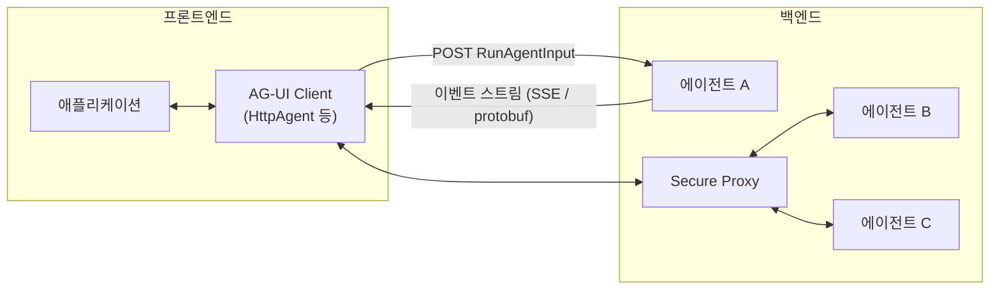

# AG-UI 공식 문서 (Introduction + Concepts + 1.0 Spec)

> [!summary] 한줄요약
> AG-UI는 사용자 대면 앱(프론트엔드)과 에이전트 백엔드 사이를 잇는 개방형·이벤트 기반 프로토콜이다. "RunAgentInput 한 번 보내면 타입이 있는 이벤트 스트림이 순서대로 돌아온다"는 단순한 계약 위에 스트리밍 텍스트, 도구 호출, 공유 상태(JSON Patch), 추론(reasoning), 서브에이전트, 인터럽트(human-in-the-loop)를 얹었고, MCP(에이전트-도구), A2A(에이전트-에이전트)와 함께 3번째 계층(에이전트-사용자)을 맡는다. 2026-09 기준 1.0 명세와 SDK(@ag-ui/core 1.0.1, ag-ui-protocol 1.0.0)가 나와 있다.

## 1. 배경: 왜 request/response로는 부족한가

공식 소개 문서는 사용자 대면 에이전트의 특성을 네 가지로 든다. 에이전트는 오래 실행되며 중간 결과를 계속 스트리밍하고, 비결정적으로 앱 UI를 제어할 수 있으며, 텍스트·음성 같은 비정형 입출력과 도구 호출·상태 갱신 같은 정형 입출력을 섞어 쓰고, 서브에이전트를 재귀적으로 부르는 등 사용자와 상호작용하는 구성이 필요하다. 이런 성질 때문에 REST/GraphQL처럼 "요청 한 번에 응답 한 번"인 계약으로는 표현이 어렵다는 문제의식이다.

AG-UI의 출신도 문서에 적혀 있다. "CopilotKit이 LangChain, CrewAI와 한 초기 협업에서 태어났고 이를 더 넓은 에이전트 생태계로 확장한 것"이다. 저장소(`ag-ui-protocol/ag-ui`)의 README가 CopilotKit 링크와 라이선스 배지를 달고 있어 CopilotKit 진영이 주도하는 프로젝트라는 점은 의사결정에서 고려할 사실이다.

3계층 프로토콜 구도는 문서가 직접 표로 정의한다.

| 계층 | 프로토콜 | 역할 |
|---|---|---|
| Agent ↔ User | AG-UI | 에이전트를 사용자 대면 앱에 실시간·멀티모달·상호작용으로 연결 |
| Agent ↔ Tools & Data | MCP | 외부 시스템(도구·워크플로·데이터)에 연결 (Anthropic 발) |
| Agent ↔ Agent | A2A | 분산 에이전트 간 협업 (Google 발) |

`agentic-protocols` 문서는 AG-UI가 MCP·A2A와 "핸드셰이크"를 두어 MCP/A2A 에이전트를 AG-UI 클라이언트가 그대로 쓸 수 있게 했다고 설명한다(저장소에 `middlewares/mcp-middleware`, `a2a-middleware`, `mcp-apps-middleware`, `a2ui-middleware`가 실제로 있다). 또 A2UI(Google), Open-JSON-UI(OpenAI), MCP-UI(Microsoft+Shopify) 같은 **생성형 UI 스펙과는 다른 층**이라고 못 박는다. 생성형 UI 스펙은 "무엇을 그릴지"이고 AG-UI는 "에이전트와 앱을 잇는 양방향 런타임 연결"이다.

## 2. 아키텍처와 핵심 계약



핵심 추상화는 `run(input: RunAgentInput) -> Observable<BaseEvent>` 하나다. 에이전트 구현은 `AbstractAgent`를 상속해 이벤트 스트림(RxJS Observable)을 돌려주기만 하면 된다. 클라이언트는 `HttpAgent`로 "RunAgentInput을 POST로 받아 BaseEvent를 스트리밍하는 엔드포인트"에 붙는다.

**1.0 명세(`docs/spec/1.0`)의 구조.** 명세는 "스키마가 구조의 권위, 문서가 행동(순서·생애주기·귀속·오류처리·호환)의 권위"라는 분업을 선언하고, 구현 주체를 producer(이벤트를 내는 쪽)와 consumer(읽는 쪽)로 나눠 BCP 14(MUST/SHOULD) 규칙을 건다. 전송 계층(Transport) 규칙은 이렇다. 바인딩은 (1) 이벤트의 순서 보장·완전 전달, (2) 스트림을 여는 `RunAgentInput` 전달, (3) 정상 종료와 잘림(truncation)을 구분할 종료 신호, (4) 잘못된 입력에 대한 오류 경로를 제공해야 한다. 표준 바인딩은 **HTTP + SSE**(구현 시 MUST)와 **HTTP + Protobuf**(선택)이다. 인증·인가는 프로토콜이 아니라 바인딩과 애플리케이션의 몫이고 "AG-UI는 자격 증명을 정의하지 않는다"고 명시한다. 이전 노트가 언급한 WebSocket은 소개 페이지의 "HTTP, WebSockets 같은 웹 기본 위에 얹은 추상화"라는 일반 서술이었고, 명세가 정한 표준 바인딩에는 WebSocket이 없다.

**이벤트 타입.** 개념 문서(`architecture`)는 아직 "16개 표준 이벤트"라고 적혀 있지만, SDK 소스(`sdks/typescript/packages/core/src/generated/types.ts`)의 `EventType` enum은 31개 값을 가진다: TEXT_MESSAGE_{START,CONTENT,END,CHUNK}, TOOL_CALL_{START,ARGS,END,CHUNK,RESULT}, STATE_SNAPSHOT/DELTA, MESSAGES_SNAPSHOT, ACTIVITY_SNAPSHOT/DELTA, RAW, CUSTOM, RUN_{STARTED,FINISHED,ERROR}, STEP_{STARTED,FINISHED}, REASONING_*(7종), SUBAGENT_{STARTED,FINISHED,ERROR}. 문서가 다 따라가지 못한 만큼 사양 변화가 빠르다는 신호이고, 구현 기준은 스키마와 명세를 따라야 한다.

## 3. 핵심 기능 상세

**스트리밍 메시지와 도구 호출.** 텍스트는 `TEXT_MESSAGE_START → CONTENT(delta)* → END`, 도구 호출은 `TOOL_CALL_START → ARGS(delta)* → END → (결과) TOOL_CALL_RESULT`의 패턴으로 흐른다. `*_CHUNK` 이벤트는 시작·종료를 생략한 약식이며 미들웨어가 정식 시퀀스로 풀어준다. 메시지 역할은 user, assistant, system, tool, activity, developer, reasoning이고, 멀티모달 `ContentPart`는 텍스트·이미지·오디오·비디오·문서를 URL, 인라인 데이터, 또는 모델 제공자 파일 핸들(`file` 소스)로 담는다. 제공자 파일 핸들은 불투명 값이라 다른 피어가 가져오려 해서는 안 된다는 규칙이 명세에 있다.

**공유 상태.** `STATE_SNAPSHOT`(전체 교체)과 `STATE_DELTA`(RFC 6902 JSON Patch: add/remove/replace/move/copy/test)를 조합한다. 스냅샷은 시작·재연결·큰 변경 시, 델타는 스트리밍 중 잦은 작은 변경 시에 쓴다. 의존성에 `fast-json-patch`가 있는 이유다. 상태와 메시지는 매 실행마다 소비자를 거쳐 되돌아오므로 명세는 "비밀을 넣지 말라"고 권고한다.

**프론트엔드 정의 도구.** 도구는 백엔드가 정의한 것과 클라이언트가 `RunAgentInput.tools`로 런타임에 넘기는 것으로 나뉜다. 후자는 JSON Schema로 이름·설명·파라미터를 선언하며 UI 액션이나 사용자 확인 같은 프론트 행동을 에이전트가 호출하게 해준다. 문서는 백엔드 전체 도구 스키마를 클라이언트가 보내는 용도가 아니라고 선을 긋는다.

**인터럽트(human-in-the-loop).** 1.0의 가장 눈에 띄는 설계다. 에이전트가 승인·입력이 필요하면 `RUN_FINISHED`의 `outcome`을 `{type:"interrupt", interrupts:[...]}`로 끝내고(그 전에 STATE/MESSAGES 스냅샷으로 재개에 필요한 상태를 내보내야 함), 클라이언트는 같은 `threadId`로 `RunAgentInput.resume=[{interruptId,status:"resolved"|"cancelled",payload}]`를 담아 새 실행을 시작한다. 규칙: 모든 열린 인터럽트를 한 번에 해소해야 하고(부분 재개 불가), 열린 인터럽트가 있는 스레드는 `resume` 없이는 새 입력을 받을 수 없으며, 같은 `(threadId, interruptId, status, payload)` 재전송은 멱등이어야 하고, `expiresAt`이 지난 재개나 `responseSchema` 불일치는 `RunError`가 된다. `reason`은 `tool_call`/`input_required`/`confirmation` 세 코어 값 외에 `<framework>:<name>` 형태 확장을 허용한다. 즉 "승인 대기 후 재개"가 연결 유지가 아니라 **실행 종료 후 새 실행**이라는 모델이라서 서버가 상태를 오래 잡고 있지 않아도 된다.

**추론(reasoning).** 원시 CoT를 노출하지 않고 요약 신호를 보여주며, 암호화된 추론 항목(`encryptedValue`)으로 `store:false`/ZDR 환경에서도 턴 간 연속성을 유지한다. 이전의 THINKING_* 이벤트 5종은 REASONING_*으로 대체되었고 클라이언트가 호환 shim으로 변환한다.

**서브에이전트.** `SUBAGENT_STARTED/FINISHED/ERROR`와 이벤트별 `subagentRunId`로 "어느 서브에이전트가 낸 출력인가"를 귀속시킨다. 문서가 강조하듯 `subagentRunId`는 정의가 아니라 **한 번의 호출**을 가리키는 불투명 핸들이고, 오케스트레이션은 프레임워크 몫이며 AG-UI는 귀속과 시작/종료 보고만 한다.

**Capabilities와 Metadata.** 에이전트가 `getCapabilities()`로 identity, transport, tools, output, state, multiAgent, reasoning, multimodal, execution, humanInTheLoop, custom 카테고리를 선언할 수 있다(발견만 하고 협상은 없으며, 선언 안 한 항목은 "알 수 없음"). 모든 이벤트에 열린 `metadata` 객체가 있어 토큰 사용량·trace id 같은 정보를 실을 수 있고 `ag-ui` 키는 예약이다.

**미들웨어.** `agent.use(...)`로 이벤트 스트림에 로깅·인증·필터·메트릭 같은 횡단 관심사를 건다(함수형 또는 `Middleware` 클래스). 내장 `FilterToolCallsMiddleware`는 허용/차단 목록으로 `TOOL_CALL_*` 이벤트를 걸러주지만, 문서가 밝히듯 **업스트림 모델/런타임의 도구 실행 자체를 막지는 않는다**(이벤트 필터일 뿐). 또 `connectAgent()`는 현재 미들웨어를 타지 않는다고 적혀 있다.

## 4. 설치·사용 예시

빠른 시작은 스캐폴딩 CLI다.

```bash
npx create-ag-ui-app@latest      # 클라이언트+서버 템플릿 생성(CopilotKit 예제 포함)
npm run dev                      # http://localhost:3000
```

직접 에이전트를 붙이는 코드(문서 `architecture`의 예)는 다음과 같다.

```typescript
import { HttpAgent } from "@ag-ui/client";
import { EventType } from "@ag-ui/core";

const agent = new HttpAgent({
  url: "https://your-agent-endpoint.example/agent",
  agentId: "unique-agent-id",
  threadId: "conversation-thread",
});

agent.runAgent({ tools: [/* 프론트 정의 도구 */], context: [] }).subscribe({
  next: (e) => { if (e.type === EventType.TEXT_MESSAGE_CONTENT) { /* UI 갱신 */ } },
  error: (err) => console.error(err),
  complete: () => console.log("done"),
});
```

서버 쪽은 `integrations/server-starter`를 복제해 `AbstractAgent` 서브클래스를 구현하는 방식이다(Python 3.12+, Poetry, protobuf/pnpm/nx 빌드 도구 필요). Claude Agent SDK용 어댑터는 `npm install @ag-ui/claude-agent-sdk @anthropic-ai/claude-agent-sdk zod` 후 `new ClaudeAgentAdapter({...}).run(input)`으로 이벤트 Observable을 얻는 형태이며, 프론트 도구를 MCP 서버로 주입하고 프론트 도구 호출 뒤 스트림을 일시 정지하는 기능 등을 README가 나열한다(커뮤니티 통합으로 분류됨).

## 5. 저장소·코드 구조에서 확인한 것

`ag-ui-protocol/ag-ui`는 nx + pnpm 모노레포다. `sdks/typescript/packages/{core,client,encoder,proto,cli,a2ui-toolkit}`, `sdks/python`(패키지명 `ag-ui-protocol`), `sdks/community/{c++,dart,go,java,kotlin,ruby,rust}`, `sdks/dotnet`, `integrations/` 아래 a2a, adk-middleware, ag2, agent-spec, agno, aws-strands, claude-agent-sdk, claude-managed-agents, crew-ai, langchain, langgraph, langroid, llama-index, mastra, microsoft-agent-framework, pydantic-ai, vercel-ai-sdk, watsonx 등, `middlewares/`, `apps/dojo`(기능 데모), `spec/`(스키마 생성기·적합성 하네스), `docs/`가 있다. `@ag-ui/core` 1.0.1은 `agui.protocolVersion: "1.0"`을 선언하고 `@ag-ui/client`는 rxjs 7.8.1, fast-json-patch, uuid에 의존한다. 공식 통합 목록(소개 페이지)은 파트너십(LangGraph/LangChain, CrewAI), 1st party(Microsoft Agent Framework, Google ADK, AWS Strands Agents, AWS Bedrock AgentCore, Mastra, Pydantic AI, Agno, LlamaIndex, AG2), 커뮤니티(Claude Agent SDK, Claude Managed Agents SDK, Langroid)로 구분하며 OpenAI Agent SDK와 Cloudflare Agents는 진행 중으로 표기한다. 이 목록은 문서 기재 내용이며 개별 통합의 품질은 검증하지 않았다.

**1.0 호환성.** `migrating-to-1-0` 문서에 따르면 0.x 에이전트는 1.0 클라이언트에서 계속 동작한다(THINKING→REASONING 변환, 레거시 `binary` 콘텐츠 파트 변환, 선택 필드의 `null`을 부재로 변환하며 경고 출력). 반대로 1.0 에이전트도 0.x 클라이언트에서 동작하도록 `outcome`, 서브에이전트 이벤트, `protocolVersion`, 활동 이벤트가 모두 선택/신규로 설계되었다. 레거시 shim은 도입 후 12개월을 기한으로 한다고 문서가 적는다.

## 6. 성숙도

- 스타 약 16.2k, 포크 약 1.5k, 오픈 이슈 419, MIT, 생성 2025-05-07, 마지막 push 2026-09-30(GitHub API 2026-10-01). 기여자 페이지 수로 추정한 기여자 수는 약 149명(API `Link` 헤더 기준 last page=149, per_page=1).
- 릴리스 태그가 `release/2026-09-30`, `release/2026-09-29`, `release/2026-09-23`처럼 거의 매일~주 단위로 나오며, 개별 패키지는 SemVer(@ag-ui/core 1.0.1, Python 1.0.0)를 쓴다.
- 1.0 명세·적합성 하네스가 있다는 점은 표준으로서의 성숙 신호다. 다만 오픈 이슈 수와 빠른 릴리스 주기는 안정화가 진행 중임을 뜻한다.

## 7. 비교

| 대상 | AG-UI와의 차이 |
|---|---|
| Vercel AI SDK UI 스트림/데이터 스트림 | 특정 SDK의 UI 스트리밍 포맷. AG-UI는 프레임워크 중립 이벤트 명세와 다국어 SDK를 지향(저장소에 `vercel-ai-sdk` 통합이 있음). 상세 비교는 이번 조사에서 확인 못함 |
| OpenAI Responses 이벤트, Claude Agent SDK 메시지 스트림 | 벤더/SDK 고유 스트림. AG-UI는 이를 어댑터로 AG-UI 이벤트로 변환한다 |
| MCP | 에이전트가 쓰는 도구/데이터 접속 프로토콜. 대상이 사용자 UI가 아님 |
| A2A | 에이전트 간 위임 프로토콜 |
| A2UI / MCP-UI / Open-JSON-UI | 무엇을 그릴지를 정하는 생성형 UI 스펙. AG-UI가 이를 전달하는 운송 계층 역할 |
| CopilotKit | AG-UI의 주도 업체이자 React 프론트엔드 SDK. AG-UI는 그 아래 프로토콜 층 |

## 8. 장단점·한계

장점: 프레임워크 중립, 이벤트 모델이 단순하며 SSE 한 가지만 구현해도 시작 가능, 인터럽트·서브에이전트·상태 diff 같은 실제 UX 요구가 규격에 포함, 1.0 명세와 호환성 shim 제공, 다수 언어 SDK와 통합.

한계: (1) 문서 간 불일치(이벤트 16개 vs 31개)가 있어 명세·스키마를 기준 삼아야 한다. (2) 인증·인가가 프로토콜 범위 밖이라 사내 SSO·권한 통제는 직접 설계해야 한다. (3) `FilterToolCallsMiddleware`는 이벤트만 거르고 실행을 막지 않는다. (4) 커뮤니티 SDK(Go, Java, Rust 등) 완성도는 개별 확인 필요. (5) CopilotKit 의존이 강한 생태계라는 점. (6) 이번 조사에서 실제 서버·클라이언트를 띄워 동작 검증하지는 않았다.

## 9. 보안·라이선스·운영 리스크

명세의 "Security and Trust & Safety" 절이 기본 원칙을 적어 둔다: 부작용 있는 도구 호출 전에 사용자 동의를 받을 것(승인되지 않은 행동을 승인된 것으로 표현해서는 안 됨), 모델 출력(도구 인자·결과·상태·passthrough)은 신뢰 경계를 넘는 비신뢰 입력이므로 검증하고 스트림 콘텐츠를 실행 가능한 마크업으로 렌더링하지 말 것, 상태·메시지는 양방향으로 왕복하므로 비밀을 넣지 말고 추론/암호화 산출물도 대화와 같은 기밀 수준으로 다룰 것. 프로토콜이 강제하지 못하는 항목이라 구현 책임이다. MIT 라이선스라 사내 사용에 제약이 적고, 운영 시에는 SSE 연결 수·프록시 버퍼링·인증 헤더 전달, 인터럽트 만료 정책, 감사 로그(이벤트 스트림 저장)를 설계해야 한다.

## 관련 노트
[[pytorchkr-ag-ui-copilotkit]] · [[copilotkit-openbot]] · [[openworker]] · [[agentspace]] · [[hermes-bot-mode]] · [[actguard]]

## 출처
- https://docs.ag-ui.com/introduction (headless Chrome 렌더, 2026-10-01)
- https://docs.ag-ui.com/concepts/architecture, /concepts/events, /concepts/agents, /concepts/messages, /concepts/state, /concepts/tools, /concepts/middleware (렌더 확인)
- https://github.com/ag-ui-protocol/ag-ui (로컬 클론: docs/concepts/*.mdx, docs/spec/1.0/*, docs/migrating-to-1-0.mdx, sdks/typescript/packages/core, integrations/, README)
- GitHub API `repos/ag-ui-protocol/ag-ui` 및 releases (스타·라이선스·이슈·릴리스, 2026-10-01)
