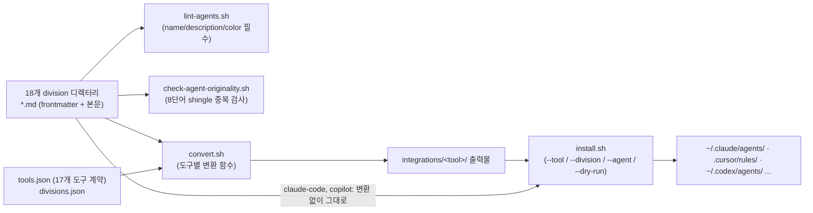

# agency-agents ("The Agency")

> [!summary] 한줄요약
> 엔지니어링·디자인·마케팅·보안·게임·GIS 등 18개 부서(division)에 걸친 약 270개 전문가 페르소나를 YAML frontmatter가 있는 Markdown 서브에이전트 파일로 모아 두고, 같은 원본을 Claude Code·Cursor·Codex·Gemini CLI·OpenCode·Copilot 등 17개 도구 형식으로 변환·설치해 주는 스크립트와 데스크톱 앱까지 제공하는 대형 프롬프트 라이브러리(MIT).

## 1. 배경: 무엇을 해결하려 했나

"당신은 시니어 개발자입니다" 수준의 한 줄 프롬프트는 같은 역할을 매번 다르게 해석하고, 산출물 형식과 성공 기준이 없다. README는 이 저장소를 Reddit 스레드에서 시작해 몇 달간 반복 개선한 컬렉션이라고 소개하며, 각 에이전트가 (1) 전문 영역, (2) 성격과 말투, (3) 코드 예시가 있는 구체 산출물, (4) 측정 가능한 성공 지표를 갖도록 설계했다고 말한다. 일반 프롬프트 모음과의 차이로 내세우는 것은 "투명하고 포크 가능한 에이전트 성격"이라는 점이다.

실제로 저장소에서 확인되는 것은 프롬프트 파일 자체와 그것을 도구별 포맷으로 옮기는 자동화다. 후자가 이 저장소의 실질적인 엔지니어링 부분이다. 아래는 직접 읽은 내용이다.

## 2. 구조와 데이터 흐름



**division과 에이전트 수.** `divisions.json`이 부서 18개를 정의한다(academic, design, engineering, finance, game-development, gis, healthcare, marketing, paid-media, product, project-management, research, sales, security, spatial-computing, specialized, support, testing). 각 디렉터리에서 frontmatter에 `name:`이 있는 파일을 세어 보니 academic 6, design 10, engineering 65, finance 5, game-development 6, gis 13, healthcare 3, marketing 37, paid-media 7, product 6, project-management 7, research 1, sales 9, security 12, spatial-computing 6, specialized 59, support 6, testing 9로 합계 약 267개였다. README는 "230+"라고 쓰고, 다른 저장소(claude-code-best-practice)는 이를 279개로 인용하는 등 숫자가 문서마다 다르다. 또 `game-development`는 파일이 11개지만 frontmatter 에이전트는 6개라서 나머지는 보조 문서로 보인다. `strategy/`와 `examples/`, `integrations/`, `scripts/`는 division이 아니며, `check-divisions.sh`가 `divisions.json`과 디스크 디렉터리, `convert.sh`·`lint-agents.sh`의 `AGENT_DIRS` 배열, CI 경로 필터가 일치하는지 검사한다. 이런 정합성 검사가 CI(`check-divisions.yml`, `lint-agents.yml`, `check-tools.yml`, `check-runbooks.yml`, `test-install.yml`, `check-hermes-config-rewrite.yml`)로 돌아간다.

**에이전트 파일 형식.** frontmatter에는 `name`, `description`, `color`(필수), `emoji`, `vibe`가 있고, 본문은 `Identity & Memory`, `Core Mission`, `Critical Rules`, `Technical Deliverables`(코드 예시), `Workflow Process`, `Success Metrics`, `Communication Style` 구조를 권장한다(`lint-agents.sh`는 필수 frontmatter는 오류로, 권장 섹션 누락은 경고로 처리). 예로 읽은 `engineering-code-reviewer.md`(약 3KB)는 정확성·보안·유지보수성·성능·테스트의 5축 체크리스트, 블로커/제안/nit 우선순위 표기, 리뷰 코멘트 포맷을 정의한다. `engineering-rag-pipeline-engineer.md`(약 18KB)는 청킹 전략(구조 기반 vs 시맨틱), 하이브리드 검색(BM25+벡터), 재순위, 평가 하네스(LangSmith/RAGAS), 에이전틱 RAG(LangGraph), "평가 없이 변경하지 말 것" 같은 규칙과 파이썬 코드 예시를 포함한다. `engineering-privacy-engineer.md`(약 14KB)는 PII 탐지·분류, 동의 집행, DSAR/삭제 파이프라인, 가명화, 보존 기한 자동 만료 같은 원칙을 담았고, `engineering-minimal-change-engineer.md`(약 11KB)는 "요청받은 것만 최소 diff로" 하는 규율을 정체성으로 삼는다.

**변환·설치 계약.** `tools.json`은 도구 17종(claude-code, codex, gemini-cli, copilot, qwen, cursor, opencode, osaurus, aider, antigravity, kimi, openclaw, windsurf, hermes, vibe, zcode, dsh)의 설치 계약(감지 디렉터리, 대상 경로 템플릿, 렌더 `format`, `installKind`=per-agent/roster/plugin, user/project 범위)을 단일 진실 원천으로 둔다. `convert.sh`에는 도구별 변환 함수가 있고(`convert_codex`는 TOML, `convert_cursor`는 `.mdc` 규칙, `convert_antigravity`/`convert_osaurus`/`convert_dsh`는 `SKILL.md`, `convert_openclaw`는 `SOUL.md`+`AGENTS.md`+`IDENTITY.md`, `accumulate_aider`·`accumulate_windsurf`는 `CONVENTIONS.md`/`.windsurfrules` 한 파일에 누적), 슬러그 충돌 검사(`check_agent_slug_collisions`)와 병렬 변환 옵션이 있다. `tools.json`에서 Claude Code 항목은 `format: identity`, 대상은 `.claude/agents/{slug}.md`로 **무변환 복사**다. 설치 스크립트 테스트가 10개 이상(`test-install*.sh`, `test-convert-*.sh`, 심볼릭 링크 출력 거부 등) 있어 스크립트 쪽 품질은 신경 쓴 편이다.

**원본성 검사.** `check-agent-originality.sh`는 새 에이전트가 기존 에이전트와 얼마나 겹치는지 고유명사를 중립화한 8단어 shingle 중복률로 검사해 40% 이상이면 실패, 20% 이상이면 경고한다. 국가·플랫폼 이름만 바꾼 "재탕" 에이전트가 라이브러리를 부풀리는 것을 막으려는 장치다.

**멀티 에이전트 예시와 NEXUS.** `examples/`에 startup MVP, 랜딩 페이지, 책 챕터, 메모리 연동 워크플로가 있고, `nexus-spatial-discovery.md`는 8개 에이전트를 병렬로 돌려 만든 제품 발굴 산출물을 보여준다. `strategy/`는 NEXUS(Network of EXperts, Unified in Strategy)라는 오케스트레이션 전략으로 Full(12~24주)/Sprint(2~6주)/Micro(1~5일) 모드와 phase-0~6 플레이북, 시나리오 런북 4종을 제공한다. 이 부분은 프롬프트 문서이며 실행 엔진은 아니다. `integrations/mcp-memory/README.md`는 `remember`/`recall`/`rollback`/`search` 도구를 제공하는 임의의 MCP 메모리 서버를 붙여 세션 간 기억과 핸드오프를 하는 패턴을 설명한다(특정 서버를 제공하지는 않음).

## 3. 설치·사용

```bash
# 앱: macOS는 brew, 그 외는 릴리스 다운로드 (별도 저장소 agency-agents-app)
brew install --cask msitarzewski/agency-agents/agency-agents

# Claude Code: 전체 설치 또는 division만 수동 복사
./scripts/install.sh --tool claude-code
cp engineering/*.md ~/.claude/agents/

# 다른 도구: 먼저 변환 후 설치 (부서/에이전트 선택, 드라이런 가능)
./scripts/convert.sh --parallel
./scripts/install.sh --tool cursor --division engineering,security
./scripts/install.sh --tool codex --agent frontend-developer,ui-designer
./scripts/install.sh --list teams
./scripts/install.sh --tool opencode --division engineering --dry-run
```

사용은 Claude Code 세션에서 "Activate Frontend Developer mode and help me ..."처럼 에이전트를 이름으로 불러내는 방식이다. README는 OpenCode 런타임이 약 119개 에이전트만 등록하고 나머지를 조용히 무시한다는 상위(upstream) 버그를 경고하며 `--division` 부분 설치를 권한다(설치기가 한도 초과 시 경고).

## 4. 성숙도·활동(GitHub API, 2026-10-01 조회)

스타 155,546, 포크 25,102, 오픈 이슈 192, MIT, 생성 2025-10-13, 마지막 push 2026-10-01(조사 당일 새벽), 크기 약 4.9MB. 릴리스 태그는 없다(releases/latest 404). 약 1년 만에 15만 스타를 넘긴 매우 인기 있는 저장소이며 커뮤니티 번역판이 다수 링크되어 있다(zh-CN, pt-BR, ru, id, ar, ko, ja, vi 등; 한국어판은 jnMetaCode의 `agency-agents-ko`로 README가 소개하며 내용은 확인하지 않았다).

README가 내세운 "Battle-tested", "Production-Ready", "10,000+ lines" 같은 문구는 저자 주장이고 이를 뒷받침하는 평가 결과는 저장소에서 찾지 못했다. 에이전트별 품질이 균일한지도 검증하지 못했다. 이번 조사에서는 일부 파일(Code Reviewer, RAG Pipeline Engineer, Privacy Engineer, Minimal Change Engineer)만 직접 읽었다.

## 5. 비교

| 대상 | 차이 |
|---|---|
| [[agent-skills]] (addyosmani) | 그쪽은 SDLC 단계별 워크플로 skill + 검증 증거 요구 + eval. agency-agents는 직무별 페르소나가 주축이고 역할의 폭(마케팅·영업·게임 등)이 넓으며 검증 장치(eval)는 없다 |
| VoltAgent/awesome-claude-code-subagents | claude-code-best-practice README가 에이전트 컬렉션으로 함께 나열(165개로 표기). 직접 비교는 하지 않음 |
| Claude Code 내장 서브에이전트(general-purpose, Explore, Plan) | 내장은 기능 중심, agency-agents는 성격·산출물 중심 페르소나 |
| [[mengto-skills]] | 디자인/프론트 중심 skill 모음. 도메인 폭이 훨씬 좁음 |
| [[claude-code-best-practice]] | 개념 레퍼런스. 이 저장소는 그 레퍼런스가 "에이전트 컬렉션" 범주로 꼽는 실물 예 |

## 6. 장단점·한계

장점은 도구 간 이식성(단일 원본·다중 출력), division별 선택 설치, 투명한 프롬프트, CI와 테스트로 관리되는 변환 스크립트, 활발한 커뮤니티다. 한계는 다음과 같다. 첫째, 프롬프트 수가 많아 모두 설치하면 Claude Code가 서브에이전트 설명 목록을 컨텍스트에 로드하는 비용이 커질 수 있고(엔지니어링+보안 디렉터리 본문만 약 1.2MB), 라우팅이 모호해질 수 있다(추정; 이번에 측정하지 않음). 둘째, 페르소나 문체(이모지, "never sleep" 식 어조)가 사내 문서 톤과 맞지 않을 수 있다. 셋째, 에이전트 파일은 실행 코드가 아니지만 프롬프트가 에이전트의 행동을 좌우하므로 출처 검증이 필요하다. 넷째, 한국어 지원은 번역판에 의존한다.

## 7. 보안·라이선스·운영 리스크

`SECURITY.md`는 에이전트 파일이 비실행 프롬프트 정의이며 비밀을 포함해서는 안 되고, 설치/변환 셸 스크립트는 실행 파일이므로 기여자가 검토해야 한다고 명시한다. 운영 측면의 위험은 세 가지다. (1) 서드파티 프롬프트를 에이전트 권한이 있는 환경에 설치하는 것은 사실상 지시문 공급망이므로 설치 전 diff 검토와 버전 고정(특정 커밋 포크)이 필요하다. (2) 에이전트의 `tools`/`permissionMode` frontmatter가 있다면 과도한 권한을 상속하지 않는지 확인해야 한다(이번 조사에서 전수 확인은 하지 않음). (3) `install.sh`는 사용자 홈의 설정 디렉터리(`~/.claude/agents/`, `~/.codex/agents/` 등)에 파일을 쓰므로 `--dry-run`으로 먼저 대상 경로를 확인한다. MIT라 상업적 사용과 사내 수정은 자유롭고 저작자 표기는 "권장이나 필수 아님"이라고 README가 적는다. 앱(`agency-agents-app`)은 별도 저장소라서 이번에는 검토하지 않았다.

## 관련 노트
[[agent-skills]] · [[claude-code-best-practice]] · [[mengto-skills]] · [[agentspace]] · [[hermes-bot-mode]] · [[sanglard-agent-md]] · [[ai-engineering-from-scratch]]

## 출처
- https://github.com/msitarzewski/agency-agents (README 전문, divisions.json, tools.json, scripts/convert.sh·install.sh·lint-agents.sh·check-agent-originality.sh, SECURITY.md, examples/, strategy/, integrations/, 일부 에이전트 파일; 로컬 클론 2026-10-01)
- GitHub API `repos/msitarzewski/agency-agents` (스타·포크·이슈·라이선스·생성일·push 시각)
- https://github.com/shanraisshan/claude-code-best-practice (README의 에이전트 컬렉션 표에서 279개로 인용된 수치 교차 확인)
