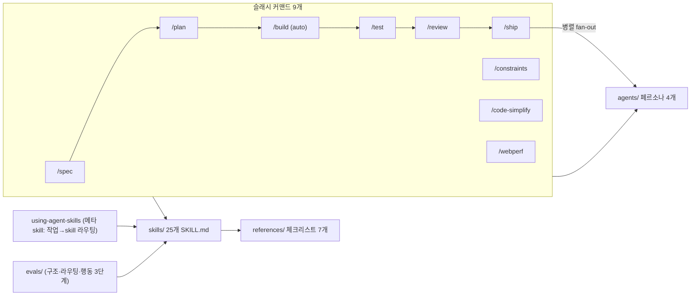

# addyosmani/agent-skills

> [!summary] 한줄요약
> AI 코딩 에이전트가 spec부터 ship까지 소프트웨어 개발 수명주기(SDLC) 전체를 "프로세스"로 따르도록 만든 25개 `SKILL.md` + 9개 슬래시 커맨드 + 4개 리뷰어 페르소나 + 7개 체크리스트 묶음(MIT, 현재 v0.6.11). 모든 skill에 "변명 → 반박" 표(anti-rationalization)와 완료 증거 요구가 들어 있고, 설명(description)이 제대로 라우팅되는지를 검증하는 eval 프레임워크까지 저장소에 포함되어 있다.

## 1. 배경: 에이전트는 왜 절차를 건너뛰는가

README의 진단은 단순하다. 코딩 에이전트는 기본적으로 가장 짧은 경로를 택한다. 그래서 spec 없이 코드를 쓰고, 테스트를 미루고, 보안 리뷰와 롤백 계획을 생략한다. 이 저장소는 시니어 엔지니어가 쓰는 워크플로와 품질 게이트를 에이전트가 일관되게 따르도록 skill 형태로 포장한다. 내용의 출처로 *Software Engineering at Google*과 Google의 engineering practices 가이드를 명시하며, Hyrum's Law(API 설계), Beyoncé Rule과 테스트 피라미드(80/15/5), 변경 크기 약 100줄 권고, Chesterton's Fence(단순화), trunk-based development, Shift Left 같은 개념이 각 skill에 녹아 있다고 설명한다.

설계 원칙은 README가 네 가지로 정리한다. (1) **Process, not prose**: 읽을거리가 아니라 단계·체크포인트·종료 조건이 있는 워크플로. (2) **Anti-rationalization**: 에이전트가 단계를 건너뛸 때 쓰는 변명과 그 반박을 표로 수록. (3) **Verification is non-negotiable**: 모든 skill이 증거(통과한 테스트, 빌드 출력, 런타임 데이터)로 끝난다. (4) **Progressive disclosure**: `SKILL.md`가 진입점이고 보조 자료는 필요할 때만 로드해 토큰을 아낀다.

## 2. 구조



디렉터리 구성(로컬 클론으로 확인): `skills/`(25개 폴더, 각각 `SKILL.md`; 합계 약 345KB), `agents/`(code-reviewer, security-auditor, test-engineer, web-performance-auditor), `references/`(accessibility, definition-of-done, observability, orchestration-patterns, performance, security, testing-patterns), `commands/`(Antigravity용 TOML 9개), `.claude/commands/`(Claude Code용 슬래시 커맨드 9개)와 `.claude/rules`, `.claude-plugin/`(marketplace.json, plugin.json), `.codex-plugin/`, `.gemini/`, `.opencode/`, `.agents/`, `hooks/`, `scripts/`(검증 스크립트), `evals/`, `docs/`(도구별 설치 가이드 9종과 adoption/comparison/skill-anatomy 등). 어댑터 디렉터리는 각 도구가 스캔하는 고정 경로 때문에 분리되어 있고 "이름 변경이나 병합은 도구 탐색을 깨뜨린다"고 README가 설명한다.

**25개 skill의 구성.** 메타 1(using-agent-skills) + 정의 4(interview-me, idea-refine, spec-driven-development, constraint-driven-development) + 계획 1(planning-and-task-breakdown) + 구현 7(incremental-implementation, test-driven-development, context-engineering, source-driven-development, doubt-driven-development, frontend-ui-engineering, api-and-interface-design) + 검증 2(browser-testing-with-devtools, debugging-and-error-recovery) + 리뷰 4(code-review-and-quality, code-simplification, security-and-hardening, performance-optimization) + 배포 6(git-workflow-and-versioning, ci-cd-and-automation, deprecation-and-migration, documentation-and-adrs, observability-and-instrumentation, shipping-and-launch).

**SKILL.md 형식.** `docs/skill-anatomy.md`에 규약이 있다. frontmatter는 소문자-하이픈 `name`(디렉터리명과 일치)과 `description`(1,024자 이내, "무엇을 하는지 + Use when …")뿐이다. 설명이 시스템 프롬프트에 주입되어 에이전트가 이를 읽고 skill을 고르기 때문에 설명에 워크플로 요약을 넣지 말라는 지침도 있다. 본문은 Overview, When to Use, Process, Common Rationalizations, Red Flags, Verification 순서가 권장 패턴이다. 예를 들어 `test-driven-development`의 Rationalizations 표에는 "나중에 테스트를 쓰겠다 → 안 쓴다, 사후 테스트는 구현을 테스트한다" 같은 항목이 있고, `incremental-implementation`에는 "한 번에 다 하는 게 빠르다 → 500줄 중 어느 줄이 문제인지 못 찾는다"가 있다. 최근 추가된 항목으로 "성공한 빌드 명령을 안심용으로 반복 실행하지 말 것"처럼 토큰 낭비를 겨냥한 행이 보인다.

## 3. 핵심 기능 상세

**메타 skill 라우팅(`using-agent-skills`).** 작업 유형에서 skill로 가는 의사결정 트리를 제공한다(예: 요구가 모호하면 interview-me, 새 기능이면 spec-driven-development, 뭔가 깨지면 debugging-and-error-recovery). 더불어 모든 skill에 공통인 6개 행동 원칙을 정의한다: 가정을 드러낸다("ASSUMPTIONS I'M MAKING" 블록), 혼란은 즉시 멈추고 질문한다, 필요하면 반박한다(아첨 금지), 단순함을 강제한다("1,000줄을 썼는데 100줄이면 충분했다면 실패"), 범위를 지킨다(이해 못 하는 주석 삭제·인접 코드 정리 금지), 가정하지 말고 검증한다. 이 부분은 다른 에이전트 지침 파일에도 그대로 옮길 만한 밀도 있는 규칙이다.

**/spec → /plan → /build → /test → /review → /ship.** `spec-driven-development`는 SPECIFY → PLAN → TASKS → IMPLEMENT 4단계에 사람 검토를 끼운 게이트 워크플로이고, 한 요청에 서로 독립적으로 테스트 가능한 능력이 여럿 묶여 있으면 Phase 0에서 capability map(모듈 표 + 빌드 순서)을 먼저 제안한다. `/build`는 기본적으로 **다음 작업 하나**를 RED(실패 테스트) → GREEN(최소 구현) → 회귀 테스트 → 빌드 → 커밋 순으로 처리하고 멈춘다. `/build auto`는 spec이 있어야만(SPEC.md 등 알려진 경로) 동작하고, 깨끗한 git 상태를 확인한 뒤 계획을 한 번 승인받아 모든 작업을 의존 순서로 실행한다. 승인으로 인정하는 응답도 엄격해서 "looks reasonable", "I guess" 같은 모호한 답은 승인이 아니라고 규정한다. 테스트가 안 통과하거나 spec이 모호하거나 `git revert`로 되돌릴 수 없는 고위험 작업(인증 변경, 파괴적 마이그레이션, 결제, 배포, 시크릿)을 만나면 멈추고 사용자에게 묻는다. 자동 실행이어도 작업마다 테스트와 개별 커밋을 요구하므로 검증은 빠지지 않는다.

**/ship은 병렬 fan-out 오케스트레이터.** `.claude/commands/ship.md`는 code-reviewer, security-auditor, test-engineer 세 페르소나를 한 턴에서 동시에 서브에이전트로 띄우고, 메인 에이전트가 보고서를 병합해 GO/NO-GO 결정과 롤백 계획을 낸다. 규칙은 `references/orchestration-patterns.md`에 있다: "오케스트레이터는 사용자 또는 슬래시 커맨드이며 **페르소나는 다른 페르소나를 호출하지 않는다**", 서브에이전트는 서브에이전트를 만들 수 없다. 사용자가 `.claude/agents/`에 같은 이름의 페르소나를 정의하면 그것이 플러그인 버전보다 우선한다.

**doubt-driven-development.** CLAIM → EXTRACT → DOUBT → RECONCILE → STOP 5단계로, 비자명한 결정마다 새 컨텍스트의 적대적 리뷰어(반증이 목적)를 띄워 교차 검증한다. 메인 세션 오케스트레이터용이고 페르소나의 `skills:` frontmatter에 넣지 말라고 명시한다(중첩 호출 금지 규칙 때문). `/review`가 "완성된 산출물에 대한 판정"인 것과 달리 진행 중 자세라고 구분한다.

**constraint-driven-development.** 품질 기준을 인터뷰해 `CONSTRAINTS.md`를 쓰고, 각 검사를 비용에 맞는 단계에 배치하며, 에이전트가 검사를 끄거나 테스트를 건너뛰어 통과시키는 행위를 잡아낸다고 README가 설명한다.

**훅(hooks/).** Claude Code용 훅 세 가지가 있다. `session-start.sh`는 using-agent-skills 메타 skill을 SessionStart 훅의 `additionalContext`로 주입하지만, 플러그인이 기본으로 연결하지 않는다(이미 설명 기반 라우팅이 있는 Claude Code/Codex에서는 라우터가 이중화된다는 이유). `sdd-cache-*.sh`는 WebFetch 응답을 `.claude/sdd-cache/`에 ETag/Last-Modified와 함께 저장해 재검증하는 캐시(jq, curl 필요)이고, `simplify-ignore.sh`는 `/* simplify-ignore-start */ ... end */`로 표시한 블록을 `/code-simplify`가 볼 수 없게 가리는 PreToolUse(Read)/PostToolUse 훅이다.

**eval 프레임워크(evals/README.md).** 세 단계다. Tier 1 구조 검증(`validate-skills.js`, `validate-commands.js`, CI), Tier 2 트리거·라우팅(`run-evals.js`: 어간 처리한 TF-IDF로 설명을 비교해 긍정 프롬프트가 상위에 오르고 부정 프롬프트는 안 오르며 두 skill의 설명이 충돌하지 않는지 확인하는 결정론적 검사, `--min-rank1 95` 같은 하한 지정 가능), Tier 3 행동 평가(`--behavioral`, 헤드리스 `claude`로 skill을 실행해 `expectations[]`로 채점, 토큰 소비). Claude Code 2.1.269+의 `claude plugin eval`로 플러그인 전체를 with/without 두 팔로 비교하는 케이스(`evals/plugin/`)도 있다. 문서는 첫 실행 결과로 skill 호출이 확률적임을 솔직히 적는다(리뷰 skill이 7번 중 5번, TDD skill은 2/7 발동). `evals/cases/`에 25개 skill 파일이 있고 `evals/skill-impact.md`는 eval 증거로 거부된 변경을 기록하는 원장이다. skill 라이브러리 중에서 자기 skill의 라우팅을 측정하려는 장치가 저장소 안에 있는 사례는 드물다(다른 저장소와의 정량 비교는 하지 않았다).

## 4. 설치·사용

```bash
# 어떤 에이전트든: skills CLI (70+ 에이전트 지원이라고 README가 기술)
npx skills add addyosmani/agent-skills                     # 25개 전부
npx skills add addyosmani/agent-skills --list               # 설치 전 목록
npx skills add addyosmani/agent-skills --skill code-review-and-quality

# Claude Code: 마켓플레이스
/plugin marketplace add addyosmani/agent-skills
/plugin install agent-skills@addy-agent-skills

# 로컬/개발
git clone https://github.com/addyosmani/agent-skills.git
claude --plugin-dir /path/to/agent-skills

# Codex (CLI v0.122+)
codex plugin marketplace add addyosmani/agent-skills
codex plugin add agent-skills@agent-skills
```

주의할 점이 두 가지 있다. 첫째, per-skill `npx` 설치는 `skills/<name>/`만 복사하고 저장소 레벨 `references/`를 가져가지 않아 공유 체크리스트 경로가 끊긴다(이슈 #361로 추적 중이라고 README가 기재). 전체 저장소 통합이나 클론을 쓰거나 체크리스트를 skill 안에 복사해야 한다. 둘째, 마켓플레이스 설치는 SSH로 클론하므로 키가 없으면 HTTPS URL을 쓰거나 `git config --global url."https://github.com/".insteadOf git@github.com:` 설정이 필요하다. Cursor, Gemini CLI, Antigravity, OpenCode, Windsurf, Copilot, Kiro, Command Code 설치법은 README와 `docs/*-setup.md`에 있다.

## 5. 비교

`docs/comparison.md`가 Superpowers(obra)와 Matt Pocock skills와의 비교를 직접 정리한다(저자 측 문서이므로 자기 프로젝트에 호의적일 수 있음을 감안해야 한다). 요지는 다음과 같다.

| | agent-skills | Superpowers | Matt Pocock skills |
|---|---|---|---|
| 핵심 | SDLC 전 단계를 skill로 | brainstorm→plan→execute→review의 선형 방법론 | 한 전문가의 실사용 도구상자 |
| 규모(문서 기재) | 25개 | 약 14개 | 약 30개 |
| 진입점 | 단계 대응 슬래시 커맨드 + 메타 라우터 | skill 체인 | 슬래시 커맨드 |
| 특징 | anti-rationalization, 병렬 리뷰 페르소나, 3단계 eval | 서브에이전트 주도 개발, worktree 격리 | 요구사항 "grill", PRD, TDD |

문서가 인용한 제3자 실험(Om Mishra의 LinkedIn 글)은 같은 모델·같은 저장소·같은 프롬프트로 비교했을 때 agent-skills가 코드 작성은 더 빨랐고(약 8분 대 12분) 검증 단계가 더 많았으며(7회 대 5회) 기능 밖 호환성 문제를 잡았고, Superpowers는 사전 설계 추론이 깊었다고 요약한다. 이 글은 직접 열어 확인하지 못했다. 한편 claude-code-best-practice 저장소의 README는 같은 저장소를 99.7k 스타, 3 agents·7 commands·21 skills로 표기하는데 이는 시점·집계 기준이 다른 값이라 현재 구성(25 skills, 9 commands, 4 agents)과 맞지 않는다.

관련해 [[claude-code-best-practice]]는 이 저장소를 "개발 워크플로" 표에 올려놓은 개념 레퍼런스이고, [[agency-agents]]는 직무 페르소나 중심이라 결이 다르다. 이 세션에서 쓰는 superpowers 계열 skill과 역할이 겹치는 부분(brainstorming, TDD, verification-before-completion)이 많아서 병용하면 중복 규칙이 생긴다.

## 6. 성숙도·활동(GitHub API, 2026-10-01)

스타 100,196, 포크 10,525, 오픈 이슈 120, MIT, 주 언어 JavaScript(스크립트 기준), 생성 2026-02-15, 마지막 push 2026-09-26, 최신 릴리스 0.6.11(2026-09-26, 릴리스 13개, 0.6.0~0.6.11 연속), 커밋 590개(API Link 헤더 기준). 생성 후 약 7개월 만에 10만 스타이며 릴리스·eval·CI가 정비된 편이다. 팀은 README 기준 Addy Osmani(창시자)와 협력자 2명이다. 스타 수와 별개로, 이 저장소의 효과를 정량적으로 입증한 독립 연구는 이번에 찾지 못했다.

## 7. 한계

(1) 문서형 skill이므로 효과는 에이전트가 따르는지에 달려 있고, 자체 eval 문서도 skill 발동이 확률적이라고 인정한다. (2) 25개 skill 설명이 모두 컨텍스트에 로드되고 전체 본문이 크므로(약 345KB) 필요한 것만 설치하는 편이 낫다(토큰 비용은 직접 측정하지 않음). (3) 구글 엔지니어링 문화 기반 규범(변경 100줄, trunk-based)은 팀 관행과 충돌할 수 있다. (4) `/build auto`가 자율 실행을 허용하므로 권한 모드·샌드박스와 함께 써야 한다. (5) 예시와 체크리스트가 JavaScript/TypeScript 편향(`testing-patterns.md`가 JS/TS 대상이라고 명시). (6) Antigravity에서는 레거시 TOML 커맨드가 "변환됐다고 보고되지만 호출되지 않는" 알려진 제약이 있다고 README가 기재한다.

## 8. 보안·라이선스·운영 리스크

skill은 에이전트가 따르는 지시문이라 외부 skill 설치는 곧 지시문 공급망 도입이다. 이 저장소는 MIT이고 훅 스크립트(셸)가 포함되어 있다(`sdd-cache`는 외부 URL에 HEAD 요청을 추가로 보낸다). 설치 전 훅과 스크립트를 읽고, 플러그인은 특정 버전(태그)에 고정하는 것이 안전하다. `/build auto`와 `/ship`의 서브에이전트 병렬 호출은 토큰 비용이 늘어난다. 보안 skill(`security-and-hardening`)은 OWASP Top 10 기반 권고이며 사내 보안 정책을 대체하지 못한다.

## 관련 노트
[[claude-code-best-practice]] · [[agency-agents]] · [[k-skill]] · [[huashu-design]] · [[diagram-design]] · [[im-not-ai]] · [[ai-engineering-from-scratch]]

## 출처
- https://github.com/addyosmani/agent-skills (README 전문, skills/using-agent-skills·test-driven-development·spec-driven-development·doubt-driven-development·context-engineering, agents/code-reviewer.md, .claude/commands/build.md·ship.md, hooks/, evals/README.md, docs/comparison.md·skill-anatomy.md·adoption-guide.md, references/orchestration-patterns.md, .claude-plugin/plugin.json; 로컬 클론 2026-10-01)
- GitHub API `repos/addyosmani/agent-skills` 및 releases, commits (2026-10-01)
- https://github.com/shanraisshan/claude-code-best-practice (README의 워크플로 표 교차 확인)
