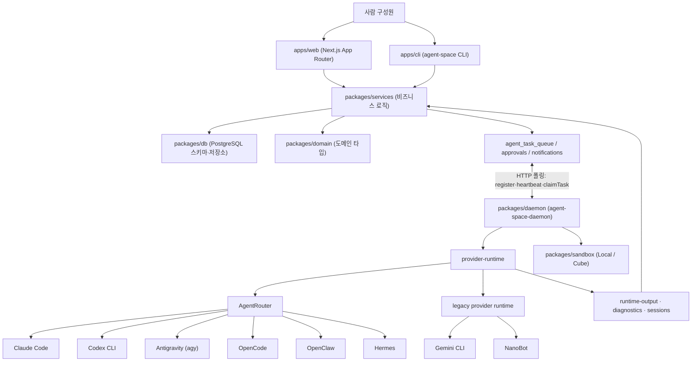

# AgentSpace (HKUDS)

> [!summary] 한줄요약
> 여러 에이전트 CLI를 팀 워크스페이스에서 운영하는 협업 플랫폼이다. 권한 우회 기본값 때문에 도입 전 보안 검토가 필요하다.

사람과 에이전트를 "한 팀, 한 워크스페이스"로 묶는 협업 플랫폼. Claude Code·Codex·Antigravity·OpenCode·OpenClaw·Hermes 같은 여러 에이전트 CLI를 **AgentRouter**라는 하니스 계층으로 정규화해 원격 데몬(daemon)에서 실행하고, 채널·문서·태스크·승인·예산·감사 로그를 Next.js + PostgreSQL 위에 얹은 TypeScript 모노레포(Apache-2.0, v1.0 2026-06-21).

코드 규모는 약 23만 줄이지만 신생 프로젝트이고, 에이전트 실행의 권한 우회(bypass) 기본값이 있어 도입 전 보안 검토가 필수다.

## 1. 배경: 해결하려는 문제

README는 오늘날 에이전트 제품이 "한 사람, 한 터미널, 한 채팅"에 맞춰져 있어 팀 운영에서 다섯 가지 문제가 생긴다고 정리한다.

1. 에이전트가 개인 계정·터미널에 갇혀 팀에 보이지 않는다.
2. 메시지·문서·승인·스크린샷·런타임 파일이 흩어진다.
3. 런타임마다 CLI 동작·세션 모델·진단이 달라 런타임을 바꾸면 컨텍스트를 처음부터 다시 만들어야 한다.
4. 자격 증명·문서·툴 호출·외부 발송을 한곳에서 점검하기 어려운 거버넌스 부재.
5. 며칠 걸리는 작업에 필요한 큐·핸드오프·산출물·재시도·사람 확인 지점이 없다.

답으로 내세우는 모델은 에이전트를 도구가 아니라 **역할·소유자·책임이 있는 디지털 직원(digital employee)**으로 다루는 것이다. 슬로건은 "Humans own direction and authorization. Agents own coordination and execution." 네 가지 능력을 제시한다.

- Scheduling(같은 에이전트를 가장 적합한 런타임에 배정)
- Capability(개인 에이전트를 조직 자산으로 공유·대여)
- Collaboration(에이전트는 조율하고 사람은 승인)
- Security(모든 행동에 경계·기록·소유자)

## 2. 아키텍처

README의 mermaid 다이어그램과 코드를 대조해 정리한 구성은 다음과 같다.



### 데몬은 풀(pull) 모델이다

`packages/daemon/src/daemon-client.ts`의 `HttpDaemonClient`는 `register` → `sendHeartbeat` → `claimTask`(런타임 ID로 작업 가져오기) → `startTask` → `getInputBundle` → `reportMessages` → `createRuntimeApproval`/`getRuntimeApproval` → `uploadOutputBundle` → `completeTask`/`failTask` → `deregister` 흐름을 HTTP로 서버에 건다. 서버가 원격 호스트로 접속할 필요가 없고 데몬이 바깥에서 안으로 폴링하므로 방화벽 구성이 단순하다.

입력/출력은 번들(bundle)로 주고받으며 기본 작업 타임아웃은 12시간(`--task-timeout 43200000`)이다. `packages/daemon/README.md`는 데몬이 AgentSpace 저장소 체크아웃에 의존하지 않는 독립 배포물(`agent-space-daemon-0.1.3.tgz`가 저장소에 커밋되어 있음)이라고 설명한다.

### AgentRouter

`packages/daemon/src/agent-router/`(약 1,600줄) 구성: `types.ts`(요청/결과/이벤트/진단 타입), `router.ts`(`runAgentRouter`), `subprocess.ts`(자식 프로세스 실행, 종료 유예 5초, 출력 redaction), `events.ts`(제공자별 JSON 이벤트를 공통 이벤트로 매핑), `capabilities.ts`(런타임 도구 능력 주입), `adapters/{claude,codex,antigravity,opencode,openclaw,hermes}.ts`. 하니스는 `AGENT_ROUTER_HARNESSES = ["claude","codex","antigravity","opencode","openclaw","hermes"]` 여섯 가지다.

어댑터가 정규화하는 계약은 다음과 같다.

- **인터페이스**: `detect()`/`buildLaunch()`/`run()`/`normalizeError()`.
- **공통 이벤트**: `harness_detected`, `harness_started`, `text_delta`, `thought_delta`, `approval_requested`, `tool_started/output/finished`, `session_updated`, `harness_exited`.
- **진단 코드**: `harness.cli_missing`, `auth_required`, `auth_invalid`, `model_unavailable`, `tool_unauthorized`, `empty_response`, `protocol_parse_failed`, `timeout`, `session_missing`, `exited_nonzero` 등 15종.

즉 AgentRouter의 가치는 "각 CLI의 실패 양상을 공통 진단 코드로 정규화"하는 데 있다. 예를 들어 Claude 어댑터는 `claude -p --output-format stream-json --input-format stream-json --verbose`로 띄우고 세션 재개는 `--resume`, 허용 도구는 `--allowedTools`, 권한 모드는 `--permission-mode`로 넘긴다.

### 데이터 모델

`packages/db/src/postgres-schema.ts`에 약 62개 테이블이 정의되어 있다: workspace, users, auth_identity, session, workspace_membership, workspace_invitation, google_oauth_credential, agent_google_workspace_delegation, workspace_channel, channel_participant, channel_access_request, workspace_employee, agent_fork_invitation/snapshot, workspace_task, daemon_connection, daemon_api_token, agent_runtime, workspace_runtime_grant, document_agent_access, document_permission_request, agent_access_request, skill/skill_file/agent_skill, knowledge_proposal, agent_task_queue, agent_router_session/event/context_snapshot, task_execution_event, token_usage, budget, attachment, audit_log 등. 데몬 API 토큰은 `adt_` 접두사 + 무작위 24바이트 hex로 발급하고 DB에는 SHA-256 해시만 저장한다(`daemon-tokens.ts`).

자체 사실 확인 범위는 여기까지이며 쿼리 단의 SQL 인젝션 방어 등 세부 코드 감사는 하지 않았다.

### 코드 규모(파일/줄 수는 `.ts`·`.tsx` 기준으로 직접 집계)

apps/web/features 212파일 약 7.4만 줄, packages/services 174파일 약 6.3만 줄, apps/cli 38파일 약 2.9만 줄, packages/db 68파일 약 2.5만 줄, packages/daemon 50파일 약 1.9만 줄, apps/web/app 87파일 약 1.3만 줄, packages/domain 약 2.5천 줄, packages/sandbox 약 1.5천 줄. 합계 약 23만 줄이다. 줄 수가 많은 만큼 외부 기여자가 파악하기엔 무겁다.

## 3. 핵심 기능 상세

### Digital Employee Board

디지털 직원의 역할·요약·소유자·readiness·상태, 할당된 skills·knowledge, 런타임/하니스 바인딩, 공통 채널, 대여·요청 흐름, 소유자/관리자 검토 큐를 노출한다. 직원은 서명된 OpenAgent persona-card로 내보낼 수 있고(`agent-space employee export-persona --name <employee> --sign`), 기본적으로 운영자 지시문·skills·소유자 정체는 가려지며 `--include-sensitive`로만 포함한다.

에이전트 포크(`agent_fork_invitation`/`agent_fork_snapshot`) 개념으로 에이전트를 다른 팀에 이전·복제하는 흐름이 스키마에 있다.

### Permission Control Plane

README 표 기준 관리 대상은 워크스페이스 역할(owner/admin/member)·초대 링크, 채널 접근 요청, DM 프라이버시, 에이전트 관리, 런타임 grant·공유, 데몬 토큰 생성/폐기, 문서 owner/editor/viewer 및 에이전트 접근, Google Workspace OAuth와 에이전트 범위 위임, 승인(런타임 도구 승인·지식 제안 승인·문서 권한), 진단(누락·폐기·고아 grant)이다.

### 에이전트 행동 정책(코드로 확인)

`packages/services/src/policies/agent-actions.ts`의 `decideAgentActionPolicySync`는 행동을 `allow` / `require_approval` / `deny`로 판정한다. 행동 유형은 `runtime.use`, `message.post`, `external_message.send`, `task.create`, `task.handoff`, `document.read/write`, `external_document.read/write`, `file.write`, `file.delete`, `skill.invoke`이다.

규칙은 다음과 같이 읽힌다: 입력 검증 실패는 deny, 외부 문서 쓰기는 항상 채널 매니저 승인 필요, 외부 메시지 발송은 위험도 low만 허용하고 나머지는 승인 필요, 외부 문서 읽기는 provider 범위·바인딩 확인 후 허용, **`riskLevel`이 high면 admin 승인**, 그 밖에는 **기본 정책으로 허용**(`agent_action.allowed_by_default_policy`). 위험도 `riskLevel`은 호출자가 정해서 넘기는 값이어서 정책의 실효성은 각 호출 지점이 위험도를 얼마나 정확히 붙이는지에 달려 있다.

모든 판정에는 감사용 `auditData`가 붙는다(payload 해시 유무 포함).

### 런타임 도구 승인(TabTabTab 승인 루프)

Claude Code가 제어 요청(control request)으로 도구 사용 승인을 물으면 데몬이 이를 `onApprovalRequest`로 받아 서버의 `createRuntimeApproval`로 올리고 사람의 `approved/rejected` 결정을 기다려 응답한다(`buildClaudeControlResponse`). 단, `provider-runtime.ts`에서 이 브리지(`handleControlRequests`)는 `runtime.provider === "claude" && isRootUser()`일 때만 켜진다(아래 보안 절 참조).

### 협업 기능

채널, DM, inbox task, 문서(버전 롤백 포함), task board, 예산/비용/성능 대시보드(`budget`, `token_usage`, `model_pricing` 테이블), 글로벌 검색, 스케줄링(`schedules`), 알림. 연동은 Google Workspace(에이전트 범위 OAuth, Sheets 생성·쓰기), Feishu(2026-07-02 main 병합), Slack(2026-07-09 기준 `slack` 테스트 브랜치).

외부 연동 테이블(`external_integration`, `external_message_outbox` 등)이 스키마에 있다.

### 샌드박스 추상화

`packages/sandbox`는 `Sandbox` 인터페이스와 `LocalSandbox`, 그리고 Cube(원격 샌드박스 서비스) 어댑터를 갖는다. Cube는 환경변수(`CUBE_API_URL`, `CUBE_ALLOW_INTERNET` 등)로 구성하며 실험 기능 플래그가 있다. README Roadmap은 "multi-agent isolation and sandbox policy layer"를 여전히 **계획 항목**으로 둔다.

## 4. 설치·사용

```bash
git clone <your-agentspace-repo-url> && cd AgentSpace
npm run setup                      # web/cli/db/services/daemon 의존성 설치
cp .env.example .env
docker compose -f deploy/postgres/docker-compose.yml up -d
npm run db:pg:init
npm run dev:web                    # README는 http://127.0.0.1:1455 로 안내
npm run cli -- doctor --json
npm run cli -- workspace status --json
npm run daemon:pack                # 원격 호스트용 tgz
```

원격 호스트에서 데몬을 띄우는 예(문서 기준):

```bash
npm install -g ./agent-space-daemon-0.1.3.tgz
agent-space-daemon start --foreground \
  --server-url "https://your-agentspace-domain" \
  --daemon-token "adt_xxx" --daemon-id "daemon-prod-01" \
  --device-name "prod-daemon-host-01" --runtime-name "Remote Agent" \
  --task-timeout "43200000" --state-dir "$HOME/.agent-space-daemon"
```

AgentRouter 단독 스모크 테스트: `agent-router detect`, `agent-router run --harness claude --cwd /workspace/project "summarize this repo"`. 요구사항은 Node.js 24 권장(데몬은 >=20.20.0), npm 11.x, PostgreSQL 16 권장, 선택적으로 `codex`·`claude`·`agy`·`opencode`·`openclaw`·`hermes` CLI이다.

배포 모드는 `AGENT_SPACE_DEPLOYMENT_MODE`로 `self_hosted`(로컬 PostgreSQL + 로컬 파일 첨부)와 `cloud`(Neon PostgreSQL + Cloudflare R2)를 구분한다. 프로덕션 Server Actions에는 안정적인 `NEXT_SERVER_ACTIONS_ENCRYPTION_KEY`를 빌드/런타임에 동일하게 줘야 한다고 README가 권고한다. 호스티드 서비스(hire-an-agent.online)도 있으나 이번에 접속하지 않았고 "두 모드의 기능 차이가 없다"는 README 주장은 검증하지 않았다.

이번 조사에서는 실제 설치·기동도 하지 않았다.

## 5. 성숙도·활동(GitHub API, 2026-10-01 조회)

스타 1,003, 포크 135, 오픈 이슈 10, Apache-2.0, TypeScript, 생성 2026-06-22, 마지막 push 2026-07-24(조사일 기준 약 10주 전), 커밋 142개, 릴리스 태그 없음(README상 v1.0 initial release 2026-06-21), `package.json` 버전 0.1.0, 데몬 패키지 0.1.3. 활동은 2026-06~07에 집중되어 있고 최근 두 달은 push가 없다. CI 워크플로는 `deploy-production.yml` 하나만 확인했다(테스트 CI는 별도로 보이지 않음).

웹 앱에 vitest와 Playwright e2e 설정이 있고 `quality:web` 스크립트가 있다.

## 6. 비교 (README와 코드로 확인 가능한 범위)

| 대상 | 차이 |
|---|---|
| Claude Code / Codex CLI 단독 | 개인 터미널 도구. AgentSpace는 이들을 서브프로세스로 실행하는 상위 관리 계층(`claude -p` 헤드리스 호출) |
| [[openworker]] / [[hermes-bot-mode]] | 개별 에이전트 실행/봇 측면. AgentSpace는 팀 워크스페이스·권한 관점이 주축(세부 비교는 해당 노트 참조, 이번에 대조 검증은 안 함) |
| [[multica]] | 노트 링크만 연결. 두 도구의 기능 대조는 이번에 하지 않았다 |
| LangGraph/CrewAI류 프레임워크 | 에이전트 로직 구성 라이브러리(일반 지식). AgentSpace는 이미 존재하는 에이전트 CLI를 조직 운영 관점에서 감싼다 |
| [[ag-ui-docs]] (AG-UI) | AG-UI는 에이전트-UI 이벤트 프로토콜. AgentSpace는 자체 웹 UI와 DB가 있는 완제품 |

## 7. 장단점·한계

장점: 여러 에이전트 CLI를 공통 진단/이벤트로 정규화하는 설계가 명확하고, 데몬 풀 모델과 번들 방식으로 원격 실행을 단순화했으며, 승인·감사·예산·토큰 사용량 같은 운영 요소를 스키마 수준에서 갖췄고, Apache-2.0이다.

한계:

1. 신생이며 최근 2개월간 push가 없다.
2. 코드가 크고(약 23만 줄) 문서가 README 중심이라 학습 비용이 높다.
3. 샌드박스·멀티에이전트 격리·첨부 서명 URL 등 보안 핵심 요소가 로드맵 항목이다.
4. 기본 정책이 허용 중심이다.
5. 에이전트 CLI 버전 변화(옵션 이름·출력 포맷)에 어댑터가 취약할 수 있다(추정).
6. 중국어권(HKUDS, Feishu 통합) 사용 시나리오 중심이라 한국 환경(사내 메신저·결재 시스템) 연동은 직접 개발해야 한다.

## 8. 보안·라이선스·운영 리스크

코드에서 직접 확인한 위험 신호가 있어 따로 적는다.

- **권한 우회 기본값.** `packages/daemon/src/provider-runtime.ts`는 AgentRouter 호출 시 `dangerouslyBypassPermissions: runtime.provider === "codex" || (runtime.provider === "claude" && !isRootUser())`로 설정한다. Codex 어댑터는 이 플래그가 켜지면 `--dangerously-bypass-approvals-and-sandbox`, `sandbox_mode="danger-full-access"`, `approval_policy="never"`, `shell_environment_policy.inherit="all"`을 붙이고, Claude 어댑터는 `--dangerously-skip-permissions`를 붙인다. 즉 **Codex는 항상, Claude는 루트가 아닌 사용자로 실행될 때 승인과 샌드박스 없이 실행**된다. 루트일 때는 반대로 `--dangerously-skip-permissions`를 쓰지 않고 기본 허용 도구 목록과 승인 브리지를 쓴다(Claude Code가 루트에서 해당 플래그를 거부하는 제약에 대응한 구조로 보이나 의도는 코드 주석에서 확인하지 못했다). 서버 워크플로에서 작업이 에이전트에게 전달되면 데몬 호스트의 사용자 권한으로 임의 명령이 실행될 수 있다는 뜻이다. 데몬 README도 "서버 시나리오에서 root로 시작할 수 있고 데몬 작업 명령은 root 권한으로 실행된다"고 적는다.
- **데몬 토큰이 명령행에 노출.** 제공된 systemd 유닛(`deploy/systemd/agentspace-daemon.service`)은 `--daemon-token ${AGENT_SPACE_DAEMON_TOKEN}`을 `ExecStart` 인자로 넘긴다. 프로세스 목록에서 토큰이 보일 수 있으므로 환경변수나 파일 방식으로 바꾸는 것이 낫다. 전용 사용자(`agentspace-daemon`)로 실행하는 점은 긍정적이다.
- **개발 서버 바인딩.** 루트 `package.json`의 `dev:web`은 `--hostname 0.0.0.0`으로 열린다. README는 127.0.0.1로 접속하라고 안내하지만 실제로는 모든 인터페이스에 바인딩되므로 개발 환경에서도 방화벽 확인이 필요하다.
- **정책 기본 허용.** 위 `decideAgentActionPolicySync`의 기본 결정이 allow이며 위험도는 호출자가 지정한다.
- **자격 증명 범위.** Google OAuth 자격과 에이전트 위임, 데몬 토큰, 외부 연동 토큰이 DB에 저장된다. 저장 시 암호화 방식은 이번에 확인하지 못했다.
- **라이선스.** Apache-2.0(특허 조항 포함)이라 사내 사용·수정은 자유롭다. 의존 패키지 라이선스는 조사하지 않았다.
- **외부 데이터 반출.** 호스티드 모드나 Neon/R2 클라우드 모드는 작업 데이터를 외부 서비스에 두므로 사내 기밀 용도에는 self-hosted + 사내 PostgreSQL만 고려해야 한다.

## 관련 노트
[[openworker]] · [[copilotkit-openbot]] · [[hermes-bot-mode]] · [[agency-agents]] · [[openviking]] · [[ag-ui-docs]] · [[actguard]] · [[multica]]

## 출처
- https://github.com/HKUDS/AgentSpace (README, package.json, .env.example, deploy/systemd/*, packages/daemon/README.md·src/provider-runtime.ts·src/agent-router/*·src/daemon-client.ts, packages/db/src/postgres-schema.ts·daemon-tokens.ts, packages/services/src/policies/agent-actions.ts, packages/sandbox/src/index.ts; 로컬 클론 2026-10-01)
- GitHub API `repos/HKUDS/AgentSpace` (스타·포크·이슈·라이선스·생성일·push), commits 목록(Link 헤더로 커밋 수 산출)
