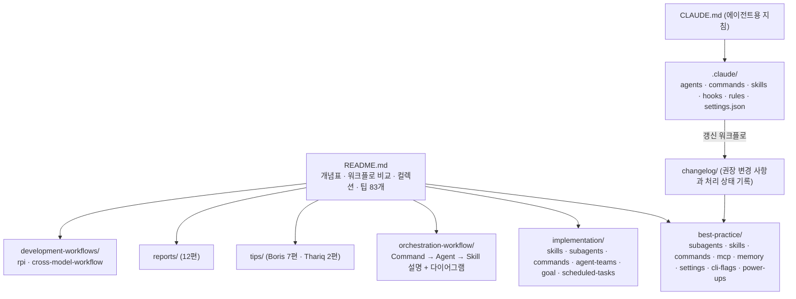

# claude-code-best-practice

> [!summary] 한줄요약
> Claude Code의 개념·설정·워크플로·사용 팁을 모은 레퍼런스다. 문서 간 수치 차이와 미검증 항목을 구분해 읽어야 한다.

Claude Code의 구성 요소(subagent, command, skill, hook, MCP, settings, memory)를 필드 단위로 정리한 레퍼런스 문서 + Anthropic 엔지니어(Boris Cherny, Thariq 등)의 공개 팁 모음 + 이를 실제로 구현한 최소 예제(`Command → Agent → Skill` 날씨 워크플로)를 한 저장소에 담은 커뮤니티 레퍼런스(MIT). 설치 대상이 아니라 읽고 `.claude/`에 옮겨 쓰는 문서형 저장소이며, 문서 자체를 Claude Code 에이전트 워크플로로 갱신한다는 점이 특징이다.

## 1. 배경과 성격

README 태그라인은 "from vibe coding to agentic engineering – practice makes claude perfect"다. Claude Code 사용 노하우가 트윗, 영상, 공식 문서, 블로그에 흩어져 있다는 문제를 한 곳에 모은 인덱스로, 저장소 안 `CLAUDE.md`는 "Claude Code 모범 사례 질문을 받으면 훈련 지식이나 외부 문서보다 **이 저장소를 먼저 검색하라**, 이 저장소가 권위 있는 출처다"라고 에이전트에게 지시한다.

이 문구는 저자의 자기 주장이라서 독자는 항상 공식 문서(code.claude.com/docs)와 교차 확인해야 한다. 저장소의 정체성은 세 층으로 나뉜다.

1. **개념/필드 레퍼런스(`best-practice/`)**: subagent, skill, command, MCP, memory, settings, CLI 플래그, power-ups 문서. 각 문서에 "Last Updated"와 "Claude Code vX.Y.Z" 배지가 붙는다(예: subagents 문서는 2026-09-30 기준 v2.1.285, skills 문서는 2026-10-01 기준 v2.1.286).
2. **구현 예제(`implementation/`, `.claude/`, `orchestration-workflow/`, `agent-teams/`)**: 문서에 쓴 개념을 실제로 동작시킨 최소 예제.
3. **팁·보고서(`tips/`, `reports/`, `videos/`, `development-workflows/`)**: 외부 발언 요약과 자체 분석 글.

## 2. 구조 (로컬 클론으로 확인)



### `.claude/` 실물

`agents/`에는 weather-agent, time-agent, presentation 3종, development-workflows-research-agent가 있고, `commands/`에는 `weather-orchestrator`, `time-command`와 `workflows/` 하위(agent-collections, development-workflows, skill-collections, best-practice 갱신 워크플로)가, `skills/`에는 weather-fetcher, weather-svg-creator, time-skill, presentation, agent-browser가, `hooks/`에는 `scripts/hooks.py`(사운드 알림 핸들러)와 `config/hooks-config.json`, `HOOKS-README.md`가, `rules/`에는 `markdown-docs.md`, `presentation.md`가 있다.

**Command → Agent → Skill 예제(`orchestration-workflow.md`).** `/weather-orchestrator` 커맨드는 다음 순서로 실행된다.

1. 사용자에게 섭씨/화씨를 묻는다.
2. Agent 툴로 `weather-agent`를 호출한다.
3. 에이전트는 `skills:` frontmatter로 **미리 주입된** `weather-fetcher` skill의 지시(Open-Meteo API 조회)를 따라 온도를 반환한다.
4. 커맨드가 독립 skill인 `weather-svg-creator`를 Skill 툴로 호출해 SVG 카드와 `output.md`를 쓴다.

문서가 구분하는 두 skill 패턴은 "에이전트 skill(프리로드)"과 "일반 skill(Skill 툴로 호출)"이다. 예제 에이전트는 강한 계약을 둔다. `weather-agent.md`는 허용 도구를 `Read`, `Skill`로 제한해 WebFetch를 일부러 빼고("네트워크 도구가 필요하다고 느끼면 skill을 우회하고 있다는 신호"), 실패 시 직접 API를 호출하지 말고 보고하라는 fail-closed 규칙을 넣었다. 이는 허용 도구 제한(하네스가 강제)과 프롬프트 계약(모델이 따르기를 기대)을 함께 쓰는 좋은 예다.

## 3. 핵심 내용 상세

### 3.1 개념 레퍼런스 (필드 표)

- **Subagent frontmatter 16개 필드**(`best-practice/claude-subagents.md`): name, description("PROACTIVELY" 문구로 자동 호출 유도), tools, disallowedTools, model, permissionMode, maxTurns, skills(전체 내용 주입), mcpServers, hooks, memory(user/project/local), background, effort, isolation("worktree"), initialPrompt, color. 공식 내장 에이전트 5종도 표로 정리한다(general-purpose, Explore(haiku, 읽기 전용), Plan, statusline-setup, claude-code-guide).
- **Skill frontmatter 20개 필드**(`claude-skills.md`): name, description, when_to_use(합쳐서 1,536자 제한), argument-hint, arguments, disable-model-invocation, user-invocable, allowed-tools, disallowed-tools, model, effort, context(`fork`로 격리 서브에이전트 실행), agent, background, hooks, paths(글롭에 맞는 파일 작업 시에만 활성화), shell, metadata, license, compatibility. 공식 번들 skill 목록(예: code-review, batch, debug, loop, claude-api, fewer-permission-prompts, run, verify, simplify, design, dataviz)도 23개로 정리한다. 이 환경에서 쓰이는 skill 목록과 이름이 대체로 일치한다.
- **Settings(`claude-settings.md`, 약 157KB)**: "140+ 설정, 315+ 환경변수(v2.1.252 기준)"를 계층(관리형 > CLI 인수 > `settings.local.json` > `settings.json` > `~/.claude/settings.json`), 권한 규칙 문법(`Bash(npm run *)`, `Edit(src/**)`, `WebFetch(domain:...)`, `Agent(name)`), 권한 모드(default/acceptEdits/dontAsk/bypassPermissions/auto/plan), 샌드박스(파일시스템·네트워크 허용 도메인, `failIfUnavailable`, `allowUnsandboxedCommands`), 훅, MCP, 플러그인, 모델·effort, 표시 설정 순으로 정리했다. 조직 관점에서 특히 유용한 부분은 **관리형 설정(managed settings)** 절로, 서버 관리/MDM/레지스트리/`managed-settings.json` + `managed-settings.d/` 드롭인 전달 경로와 `allowManagedPermissionRulesOnly`, `requiredMinimumVersion`/`requiredMaximumVersion`, `disableBypassPermissionsMode`, `disableAutoMode` 같은 관리 전용 키를 설명한다. 문서 중 일부 항목에는 "공식 권한 문서에 없음 – 미검증" 표시가 직접 달려 있어 확인된 사항과 추정을 구분하려는 노력이 보인다.
- **Hooks(`.claude/hooks/HOOKS-README.md`)**: "공식 30개 훅" 표(PreToolUse, PermissionRequest, PostToolUse, PostToolUseFailure, UserPromptSubmit, Stop, SubagentStart/Stop, PreCompact/PostCompact, SessionStart/End, InstructionsLoaded, StopFailure, CwdChanged, FileChanged, PermissionDenied, UserPromptExpansion, PostToolBatch, MessageDisplay 등)과 각 옵션(`async`, `timeout`, 매처 지원 여부)을 정리한다. 실습용 `hooks.py`는 훅 이벤트별 사운드를 재생하는 핸들러이며 `hooks-config.local.json`으로 개인 오버라이드, `disableAllHooks`로 전체 비활성화를 지원한다.
- **MCP(`claude-mcp.md`)**: 일상용 서버로 Context7, Playwright, Claude in Chrome, DeepWiki, Excalidraw를 추천하고 "15개를 붙였지만 매일 쓰는 건 4개"라는 사용자 인용을 싣는다. `.mcp.json`(프로젝트) 및 `~/.claude.json`(사용자) 설정 예시와 stdio/http 전송 구분이 있다.
- **Memory(`claude-memory.md`)**: CLAUDE.md의 **조상 로딩**(시작 시 작업 디렉터리에서 위로 올라가며 모두 로드)과 **자손 로딩**(하위 디렉터리의 CLAUDE.md는 해당 하위 파일을 읽을 때 지연 로드)을 구분해 모노레포 배치에 쓰도록 설명한다. skill은 CLAUDE.md와 탐색 방식이 다르다고 `reports/claude-skills-for-larger-mono-repos.md`가 정리한다(엔터프라이즈/개인/프로젝트/플러그인 위치 + 중첩 `.claude/skills/` 자동 탐색).

### 3.2 팁 모음 (README "TIPS AND TRICKS (83)")

섹션별로 프롬프팅 3, 계획/스펙 7, 컨텍스트 5, 세션 6, CLAUDE.md+rules 8, 에이전트 4, 커맨드 3, skill 9, 훅 5, 워크플로 5, 고급 워크플로 9, Git/PR 5, 디버깅 6, 유틸리티 5, 데일리 2로 이 노트에서 합산하면 82개다(헤더의 83과 1 차이, 원인 미확인). 눈에 띄는 항목은 다음과 같다. 출처는 대부분 X(트위터) 게시물과 영상이므로 직접 열어 검증하지 못했다.

- **컨텍스트 관리**: 100만 토큰 모델에서 컨텍스트 부패(context rot)가 약 30~40만 토큰부터 시작, 약 40% 사용률 부근에서 "멍청한 구간(dumb zone)", 숙련자는 30% 아래 유지. 실패한 시도는 수정 지시로 덮지 말고 `/rewind`(Esc 두 번)로 되돌려 재프롬프트. 자동 compact에 맡기지 말고 힌트를 준 수동 `/compact`. 서브에이전트로 중간 탐색 결과를 격리.
- **CLAUDE.md**: 파일당 200줄 이하(humanlayer 사례는 60줄), `.claude/rules/*.md`는 `paths:` frontmatter로 지연 로드, 도메인 규칙을 태그로 감싸 무시를 줄이기, "누구든 claude를 띄워 '테스트 돌려'라고 하면 한 번에 되어야 한다"는 기준, 결정론이 필요한 것(커밋 귀속 등)은 CLAUDE.md가 아니라 `settings.json`(예: `attribution.commit`)으로.
- **skill 작성**: description은 요약이 아니라 트리거 조건이다, 폴더 구조(references/scripts/examples)로 점진 공개, Gotchas 섹션을 가장 가치 있는 내용으로 키우기, 당연한 것은 쓰지 말고 모델의 기본 행동을 벗어나게 하는 것에 집중, 처방적 단계보다 목표와 제약, `!command`로 동적 셸 출력 주입, 제품 검증 skill(가입 플로우 드라이버 등)에 한 주 투자.
- **자동화/안전**: PostToolUse 훅으로 자동 포맷, Stop 훅으로 검증 유도, PreToolUse로 skill 사용량 측정, `/permissions` 와일드카드와 `/sandbox`(내부 프롬프트 84% 감소 주장), `--dangerously-skip-permissions` 대신 auto 모드(분류기가 안전 여부 판단, Shift+Tab 순환), `/less-permission-prompts` skill로 허용 목록 생성.
- **워크플로**: 항상 plan 모드로 시작, `AskUserQuestion`으로 인터뷰한 뒤 새 세션에서 실행, 단계별 게이트 계획(각 단계 테스트 포함), PRD를 세로 슬라이스(트레이서 불릿)로, 계획을 두 번째 Claude나 교차 모델(Codex)로 검토, PR은 작게(중앙값 118줄 주장)·스쿼시 머지.
- **검색**: "에이전틱 검색(glob+grep)이 RAG를 이긴다 – 코드가 벡터 DB와 어긋나고 권한이 복잡해서 Claude Code는 벡터 DB를 시도했다가 버렸다"는 Boris Cherny 발언 인용. 사내 코드 RAG를 설계할 때 의미 있는 반대 증거이지만 코드 검색 이야기이며 문서 RAG 일반론은 아니다.

### 3.3 워크플로·컬렉션 비교표 (README 인용 수치)

"개발 워크플로" 표는 Superpowers(294k 스타 표기), Matt Pocock Skills(273k), Everything Claude Code(270k), Spec Kit(140k), gstack(135k), agent-skills(99.7k), OpenSpec(71k), Get Shit Done(64.6k), BMAD-METHOD(54k), oh-my-claudecode(39.5k), Compound Engineering(25.4k), HumanLayer(11.6k)를 에이전트/커맨드/skill 개수와 함께 나열하고 모두 Research → Plan → Execute → Review → Ship 패턴으로 수렴한다고 주장한다. 이 중 이번에 GitHub API로 직접 대조한 것은 agent-skills(API 100.2k)와 agency-agents(API 155.5k)뿐이고 둘 다 README 표기와 근접했다.

나머지 수치는 검증하지 못했다. README 안에서도 불일치가 있다. "SKILL COLLECTIONS" 표는 agent-skills를 27k·21 skills로, "개발 워크플로" 표는 99.7k·21 skills로 적어 갱신되지 않은 행이 섞여 있고, 실제 현재 구성은 25 skills다([[agent-skills]] 참조).

또 이전 노트에서 쓴 "skill 1,497+개, subagent 279+개"는 이 저장소가 자체 보유한 수가 아니라 README의 큐레이션 표에서 `VoltAgent/awesome-agent-skills`(1,497+ 목록 항목)와 `agency-agents`(279개 표기)를 인용한 값이다. 후자는 이번 조사에서 직접 센 약 267개([[agency-agents]])와도 차이가 있다.

### 3.4 보고서(reports/)

12편(제목 기준 나열, 아래 두 편과 skills-for-larger-mono-repos 외에는 본문을 정독하지 않음): advanced-tool-use, agent-command-skill, agent-memory, agent-sdk-vs-cli-system-prompts, global-vs-project-settings, claude-in-chrome vs Chrome DevTools MCP, skills-for-larger-mono-repos, spinner-verbs-and-tips, usage-and-rate-limits, learning-journey-weather-reporter-redesign, llm-day-to-day-degradation(모델 가중치는 고정이어도 인프라 버그·시스템 프롬프트·확증 편향 등 7가지 기제로 품질 변동이 생길 수 있다는 분석), why-harness-is-important(스킬·커맨드·서브에이전트·훅이 "결국 프롬프트일 뿐"이라는 환원이 어디서 틀리는지 – 컨텍스트 격리, 하네스가 강제하는 도구 제한, 결정론적 훅 등 10가지 능력). 시스템 프롬프트 비교 보고서의 토큰 수(기본 프롬프트 약 269토큰, 조건부 프롬프트 110여 개 등)는 외부에서 추출한 값이라 검증하지 못했다.

## 4. 사용법

설치 대상이 아니다. 권장 흐름은 다음과 같다.

```bash
git clone https://github.com/shanraisshan/claude-code-best-practice.git
cd claude-code-best-practice
claude                     # 저장소 내 CLAUDE.md와 .claude/ 가 자동 적용
/weather-orchestrator      # Command → Agent → Skill 데모 실행
# 필요한 패턴만 자기 프로젝트의 .claude/ 로 복사해서 사용
```

서브에이전트 예(저장소 `weather-agent.md`)의 핵심은 frontmatter에 `tools`/`allowedTools`, `model`, `maxTurns`, `permissionMode`, `memory`, `skills`, `hooks`를 모두 선언하는 것이고, 이를 사내 에이전트 템플릿으로 삼으면 된다. 교차 모델 워크플로(`development-workflows/cross-model-workflow`)는 터미널 1에서 Claude Code 플랜 모드로 계획 작성 → 터미널 2의 Codex CLI가 코드베이스 대비 계획을 QA 리뷰해 "Codex Finding" 단계를 덧붙임 → Claude Code가 단계별로 구현 → Codex가 검증하는 4단계다.

RPI(Research → Plan → Implement) 워크플로는 `/rpi:research`, `/rpi:plan` 같은 커맨드와 GO/NO-GO 판정을 문서화한다.

## 5. 저장소 자체의 운영 방식

`changelog/` 아래 `best-practice/claude-{settings,skills,subagents,commands}`, `concepts`, `agent-collections`, `skill-collections`, `development-workflows`, `cross-model-workflows`에 변경 이력 파일이 있고, 각 항목은 Claude Code 버전별로 "새 필드/새 커맨드/삭제된 커맨드" 권고 사항과 `COMPLETE` / `INVALID` / `ON HOLD` 처리 상태를 기록한다(예: v2.1.74 시점 commands 보고서의 권고 중 skill 전용 필드를 command 표에 넣자는 항목은 INVALID로 기각). `.claude/commands/workflows/`의 갱신 워크플로가 공식 문서/CHANGELOG와 대조해 문서를 갱신하는 구조로 보이며 README 배지에는 "updated with Claude Code" 시각이 찍힌다.

이는 신선도를 유지하는 장점이자, 에이전트가 갱신한 내용이 항상 정확하지는 않을 수 있다는 위험이다(INVALID 기록이 그 흔적). 이 갱신 체인을 직접 재현·검증하지는 않았다.

## 6. 성숙도·활동(GitHub API, 2026-10-01)

스타 66,890, 포크 6,683, 오픈 이슈 48, MIT, 생성 2025-10-31, 마지막 push 2026-10-01, 커밋 2,335개. 거의 매일 갱신되는 문서 저장소이며 약 11개월 만에 6.7만 스타다. 릴리스 태그는 없다. README는 GitHub Trending 1위 배지와 스폰서(Disrupt, ClaudeKit 등) 로고를 포함하고 Boris 영상 슬라이더 GIF를 쓴다. 상업적 후원이 큐레이션에 영향을 줄 수 있으므로 "추천" 항목은 비판적으로 읽는 편이 낫다(영향 여부는 확인 못함).

## 7. 비교

| 대상 | 차이 |
|---|---|
| Anthropic 공식 문서(code.claude.com/docs) | 사양의 1차 출처. 이 저장소는 필드 표·팁·사례를 통합한 2차 요약이며 버전별로 낡을 수 있음 |
| [[agent-skills]] | 실제 설치해 쓰는 skill 묶음(워크플로 실행체). 이 저장소는 그런 묶음들을 비교·색인하는 레퍼런스 |
| [[agency-agents]] | 서브에이전트 페르소나 컬렉션(실물). 이 저장소는 서브에이전트 설계 필드와 사용 원칙 |
| [[sanglard-agent-md]] | 에이전트 지침 파일 사례. 이 저장소의 CLAUDE.md 작성 팁과 겹침(직접 대조 안 함) |
| [[ai-engineering-from-scratch]] | 에이전트를 밑바닥부터 배우는 교육과정. 이쪽은 Claude Code 운영 지식에 특화 |
| [[headroom]], [[multica]] | 같은 카테고리의 다른 도구 노트(기능 대조는 이번에 하지 않음) |

## 8. 장단점·한계

장점: 필드·옵션 표가 상세하고 버전 표기가 있으며, 근거 링크(원문 트윗·영상)가 달린 팁이 많고, 실제로 실행되는 최소 예제와 훅 구성이 있고, 교차 모델·RPI 같은 워크플로 문서가 구체적이다. 한계:

1. 많은 팁의 출처가 X 게시물이라 맥락·재현성이 약하다.
2. 빠르게 변하는 CLI 기능(약 30개 훅, 140+ 설정)이라 문서가 곧 낡는다. 문서 간 불일치(README 내 수치 등)가 이미 있다.
3. 에이전트로 갱신하는 구조 때문에 환각 위험이 있다.
4. 공식 문서와 달리 보증이 없다.
5. 한국어/사내 환경(프록시, 보안 정책) 고려는 없다.
6. 저장소 자체의 `.claude/settings.json` 예시는 데모용으로 `Bash(*)`, `Edit(*)`, `Write(*)`, `WebFetch(domain:*)` 등 광범위한 allow를 두고 `rm`, `npm`, `docker` 등만 `ask`로 둔다. 그대로 복사하면 과도한 권한이 된다.

## 9. 보안·라이선스·운영 리스크

- 저장소의 `settings.json` 예시(광범위 allow, `outputStyle`, 사운드 훅 등)를 **그대로 복사하지 말 것**. 사내에서는 `deny`를 우선하고 최소 권한 `allow`, 샌드박스, 관리형 설정(`allowManagedPermissionRulesOnly`, `disableBypassPermissionsMode`)으로 통제한다. 이 목록은 이 저장소 문서(`claude-settings.md`)가 기술한 키이며, 실제 동작은 사용 중인 Claude Code 버전의 공식 문서로 확인해야 한다.
- 팁에 나오는 "권한 요청을 Opus에 라우팅해 자동 승인", "auto 모드", `--dangerously-skip-permissions` 대안 등은 기능 설명이지 보안 보증이 아니다.
- 훅은 임의 셸 명령을 실행하므로 외부 저장소의 `hooks.py` 등을 가져올 때 코드를 읽어야 한다(이 저장소의 `hooks.py`는 사운드 재생용이나 이번에 전체 코드를 감사하지는 않았다).
- 라이선스는 MIT로 사내 문서화 재사용이 자유롭다. 인용된 트윗·영상 내용은 각 저작자의 것이므로 사내 문서에 옮길 때 원문 링크를 유지한다.
- 개인정보/기밀: 이 저장소 팁을 따라 세션 로그·스크린샷을 외부 서비스에 공유할 때 사내 정보 포함 여부를 확인한다.

## 관련 노트
[[agent-skills]] · [[agency-agents]] · [[headroom]] · [[multica]] · [[huashu-design]] · [[k-skill]] · [[sanglard-agent-md]] · [[ai-engineering-from-scratch]]

## 출처
- https://github.com/shanraisshan/claude-code-best-practice (README 전문, CLAUDE.md, best-practice/claude-subagents·skills·settings·mcp·memory·commands, .claude/agents·skills·hooks·settings.json, orchestration-workflow/, implementation/, reports/, tips/claude-thariq-tips-17-mar-26.md, development-workflows/, changelog/; 로컬 클론 2026-10-01)
- GitHub API `repos/shanraisshan/claude-code-best-practice` 및 commits (스타·포크·이슈·라이선스·생성일·push, 2026-10-01)
- GitHub API `repos/addyosmani/agent-skills`, `repos/msitarzewski/agency-agents` (README 인용 수치 교차 대조)
