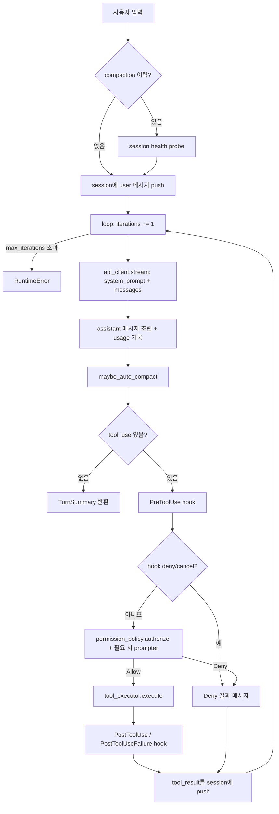
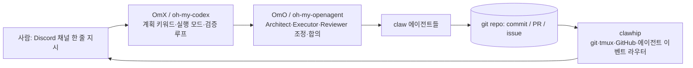

# Claw Code

> [!summary] 한줄요약
> Claude Code 형태의 CLI 에이전트 harness(`claw`)를 Rust 워크스페이스(crate 11개 디렉터리)로 구현한 MIT 저장소. 그러나 README 스스로 "serious production project가 아니라 museum exhibit"라고 선언하며, 진짜 가치는 코드보다 이 코드를 만들어 낸 "claw 에이전트 + Discord + clawhip" 자율 개발 시스템(PHILOSOPHY.md)에 있다고 주장한다.

> [!warning] 먼저 알아둘 것
> 이 저장소는 (1) Anthropic과 무관하고, (2) 원본 Claude Code 소스의 소유권을 주장하지 않으며, (3) 저장소 대부분이 에이전트에 의해 자동 유지된다. "실제로 일을 시킬 것이면 LazyCodex나 Gajae-Code로 가라"는 안내가 README 맨 위에 있다. 사내 도입 후보라기보다 **학습·비교용 참조 구현**으로 읽는 것이 맞다.

## 1. 배경 — 무엇이고 어떤 문제를 겨냥하나

2026-03-31에 생성된 저장소로(GitHub API created_at), 생성 직후 폭발적으로 스타를 모아 현재 약 195.3k stars / 108.3k forks(GitHub API, 2026-10-01 조회)에 이르렀다. 통상적인 오픈소스와 비교하면 fork 비율이 비정상적으로 높은데, 이 수치가 어떻게 만들어졌는지(바이럴, 자동화된 fork 등)는 확인하지 못했다. 수치는 "관심도 지표"로만 읽고 품질 지표로 쓰면 안 된다.

README의 자기 서술은 이렇다. "Claw Code is the public Rust implementation of the `claw` CLI agent harness. The canonical implementation lives in `rust/`." 같은 README의 IMPORTANT 블록은 이 저장소를 "closer to a museum exhibit than a product pitch"라고 부른다. "crustacean-run artifact kept alive by clawed gajaes" 같은 표현이 계속 나오는데, 요약하면 사람이 손으로 운영하는 일반 제품 저장소가 아니라 에이전트 harness들이 계획·실행·검증·라벨링·보존을 수행하는 "agent-managed exhibit"라는 뜻이다.

해결하려는 문제는 두 층위다.

1. **제품 층위**: Claude Code처럼 터미널에서 도구(bash, 파일 읽기/쓰기/편집, grep/glob, web fetch/search, subagent, todo, notebook 편집)를 호출하며 코딩 작업을 수행하는 에이전트 루프를, 단일 바이너리(Rust)로, 여러 모델 provider(Anthropic·OpenAI 호환·xAI·DashScope·로컬 Ollama)에서 돌릴 수 있게 하는 것.
2. **방법론 층위**: PHILOSOPHY.md가 말하는 "사람은 방향만 주고(Discord 한 줄), claw들이 병렬로 계획·구현·테스트·재시도·push 한다"는 자율 개발 모델의 공개 시연. "Python rewrite도 부산물, Rust rewrite도 부산물이고, 연구할 가치가 있는 것은 그것을 만든 시스템"이라는 문장이 핵심이다.

저장소 구조 자체가 이 이력을 보여 준다. 루트에는 `rust/`(정식 구현) 외에 `src/`(Python 참조 워크스페이스: `command_graph.py`, `execution_registry.py`, `cost_tracker.py`, `memdir`, `coordinator` 등 69개 항목)와 `tests/`가 남아 있는데, README는 "companion Python/reference workspace and audit helpers; not the primary runtime surface"라고 명시한다. 처음 Python으로 재작성한 뒤 Rust로 옮긴 흔적이 그대로 보존된 저장소다.

## 2. 아키텍처

### 2.1 Cargo 워크스페이스 구성

`rust/crates/` 아래 crate와 `*.rs` 줄 수(클론에서 직접 `wc -l`로 합산)는 다음과 같다. 합계는 약 11.6만 줄로, rust/README.md의 "~20K lines" 문구는 최신 상태와 맞지 않는다(`PARITY.md`는 2026-04-03 시점 48,599 LOC라고 기록했다).

| crate | 줄 수(대략) | 역할(rust/README.md 기준) |
|---|---|---|
| `runtime` | 41,700 | `ConversationRuntime`, 설정 로딩, 세션 영속화, 권한 정책, MCP client lifecycle, system prompt 조립, 사용량 추적 |
| `rusty-claude-cli` | 30,800 | 실제 `claw` 바이너리: REPL(rustyline), one-shot prompt, 서브커맨드, 스트리밍 렌더링 |
| `api` | 11,900 | provider 클라이언트, SSE 스트리밍, 요청/응답 타입, 인증, 요청 크기·context window preflight |
| `tools` | 11,800 | 도구 스펙·실행: Bash, ReadFile, WriteFile, EditFile, GlobSearch, GrepSearch, WebSearch, WebFetch, Agent, TodoWrite, NotebookEdit, Skill, ToolSearch |
| `commands` | 7,200 | 슬래시 명령 레지스트리·파싱·도움말 |
| `claw-analog` | 4,800 | Cargo.toml description: "Minimal agent harness: tool loop with explicit permissions and workspace jail" |
| `plugins` | 4,500 | 플러그인 메타데이터, install/enable/disable/update, hook 연동 |
| `claw-rag-service` | 1,150 | SQLite + 임베딩 코사인 유사도(선형 스캔 MVP)의 워크스페이스 RAG 서비스 |
| `mock-anthropic-service` | 1,150 | 결정론적 Anthropic 호환 `/v1/messages` mock |
| `telemetry` | 530 | 세션 트레이스 이벤트 |
| `compat-harness` | 360 | upstream fixture와의 동작 비교 유틸 |

특히 `runtime`이 크다. `src/` 목록을 보면 엔진이 단순 루프 이상이라는 걸 알 수 있다: `bash_validation.rs`, `sandbox.rs`, `permission_enforcer.rs`, `policy_engine.rs`, `hooks.rs`, `compact.rs`/`summary_compression.rs`, `mcp_stdio.rs`/`mcp_client.rs`/`mcp_lifecycle_hardened.rs`/`mcp_server.rs`, `lsp_client.rs`, `task_registry.rs`, `team_cron_registry.rs`, `worker_boot.rs`, `branch_lock.rs`, `stale_branch.rs`, `recovery_recipes.rs`, `green_contract.rs`, `lane_events.rs`, `trust_resolver.rs`, `oauth.rs`, `remote.rs` 등. 이 중 `lane_events`, `green_contract`, `branch_lock`, `stale_branch`, `worker_boot`은 PHILOSOPHY가 말한 "여러 claw가 병렬 lane으로 작업"하는 시스템을 뒷받침하는 조정(coordination) 프리미티브로 보인다. 다만 이 모듈들이 실제로 얼마나 깊게 구현됐는지까지는 모든 파일을 읽지 못했다(확인 못함).

### 2.2 대화 루프 (`runtime/src/conversation.rs`)

`ConversationRuntime::run_turn`의 흐름을 코드로 직접 확인했다.



핵심은 세 가지다. 첫째, `max_iterations` 가드가 있어 무한 도구 루프를 끊는다. 둘째, **도구 실행 전 PreToolUse hook이 권한 결정을 덮어쓸 수 있다**(`PermissionOverride::{Allow, Deny, Ask}`, 그리고 `updated_input`으로 입력 자체를 수정 가능). 셋째, auto-compaction은 입력 토큰 임계치(환경변수에서 읽는 `auto_compaction_input_tokens_threshold`)를 넘으면 다음 API 호출 전에 동작하고, compaction 이후 턴에서는 "session health probe"로 컨텍스트 무결성을 먼저 확인한다(ROADMAP #38 주석). Claude Code의 구조와 매우 유사하다. (PostToolUse 이후 단계는 위 코드 발췌 범위 밖이라 다이어그램은 README의 hook 설명을 근거로 그렸다.)

### 2.3 권한 모델

`permissions.rs`에는 `PermissionMode { ReadOnly, WorkspaceWrite, DangerFullAccess, Prompt, Allow }`가 있고, USAGE.md가 세 가지 대표 모드를 설명한다.

- `read-only`: 파일 읽기, glob/grep, 로컬 skill, 상태 조회만. 워크스페이스 변경, 네트워크 fetch/search, 임의 명령 실행 불가.
- `workspace-write`(기본값): 읽기 + 현재 워크스페이스 안의 파일 편집. 네트워크 도구, 셸 실행, subagent 실행, REPL subprocess는 명시적 상향 필요.
- `danger-full-access`: 모든 도구 허용. `--permission-mode danger-full-access`, `--dangerously-skip-permissions`, env, config 중 하나로 명시 opt-in.

여기에 `sandbox.rs`(`FilesystemIsolationMode::{Off, WorkspaceOnly, AllowList}`, namespace 제한, 네트워크 격리)와 `bash_validation.rs`(read-only 검증, 파괴적 명령 경고, sed/path 검증 등), `file_ops.rs`(바이너리 감지, 읽기/쓰기 크기 상한, 워크스페이스 경계·symlink 탈출 방지)가 겹겹이 방어한다. PARITY.md lane 기록에 따르면 sandbox는 "unshare 바이너리 존재가 아니라 실제 capability를 probe"하도록 수정됐다.

### 2.4 Provider 라우팅

USAGE.md의 provider matrix: Anthropic(`ANTHROPIC_API_KEY`/`ANTHROPIC_AUTH_TOKEN`), xAI(`XAI_API_KEY`), OpenAI 호환(`OPENAI_API_KEY`, `OPENAI_BASE_URL`), DashScope(`DASHSCOPE_API_KEY`). 라우팅은 모델명 prefix 우선(`claude*`→Anthropic, `grok*`→xAI, `openai/`·`local/`·`gpt-`→OpenAI 호환, `qwen*`·`kimi*`→DashScope)이고, `OPENAI_BASE_URL`이 있으면 `llama3.2` 같은 로컬 이름은 OpenAI 호환 클라이언트로, 아무것도 없으면 환경의 자격증명 순서(Anthropic → OpenAI → xAI)로, 최종 기본은 Anthropic이다. 별칭은 `opus`→`claude-opus-4-7`, `sonnet`→`claude-sonnet-4-6`, `haiku`→`claude-haiku-4-5-20251213`이며 `~/.claw/settings.json`, `.claw/settings.json`, `.claw/settings.local.json`에서 사용자 별칭을 추가할 수 있다. 비-Claude provider는 "response-shape·tool-call 호환성 때문에 일부 workflow가 거칠 수 있다"고 FAQ가 직접 인정한다.

### 2.5 PHILOSOPHY의 3요소 시스템

PHILOSOPHY.md가 말하는 "진짜 제품"은 다음 구조다.



clawhip은 commit, tmux 세션, GitHub issue/PR, 에이전트 lifecycle 이벤트를 감시해 Discord로 라우팅하며, **모니터링·알림 포맷팅을 에이전트의 context window 밖에서** 처리하는 것이 설계 포인트다. 이 문서의 결론은 "병목은 타이핑 속도가 아니라 아키텍처 명확성, 작업 분해, 판단, taste"라는 것이다. 이는 문서에 적힌 주장이지 이 저장소가 독립적으로 입증한 결과는 아니다.

## 3. 핵심 기능 상세

### 3.1 CLI 표면
`rust/README.md`의 기능표는 모두 체크로 표기돼 있으나 이는 자기 보고다. 주요 서브커맨드는 `prompt`, `status`, `sandbox`, `acp`, `dump-manifests`, `bootstrap-plan`, `agents`, `mcp`, `skills`, `system-prompt`, `init`, `doctor`다. 슬래시 명령은 `/compact`, `/diff`, `/commit`, `/pr`, `/issue`, `/review`, `/security-review`, `/subagent`, `/team`, `/cron`, `/plugin`, `/hooks` 등 Claude Code와 유사한 집합이고, 추가로 `/ultraplan`(심화 계획), `/teleport`(파일·심볼 점프), `/bughunter`(버그 스캔)가 USAGE.md에 설명돼 있다.

### 3.2 자동화 친화성
눈에 띄는 설계 방향은 **거의 모든 상태가 JSON으로 노출**된다는 점이다. `--output-format json`, `CLAW_OUTPUT_FORMAT`, `claw version --output-format json`(`git_sha`, `is_dirty`, `rustc_version`, `binary_provenance`), `status`의 `workspace.memory_files[]`, `mcp_validation`, `hook_validation`, 오류에 typed `kind`(`invalid_tool_name`, `invalid_cwd`, `unsupported_acp_invocation` 등)가 붙는다. 다른 에이전트(claw)가 이 CLI를 도구로 호출하는 상황을 전제로 한 설계다.

### 3.3 설정과 프로젝트 메모리
설정 우선순위(뒤가 앞을 덮어씀): `~/.claw.json` → `~/.config/claw/settings.json` → `<repo>/.claw.json` → `<repo>/.claw/settings.json` → `<repo>/.claw/settings.local.json`. 프로젝트 지침은 `CLAUDE.md` → `CLAW.md` → `AGENTS.md` 순으로 우선하며 git root까지로 탐색을 제한한다. `.claw/rules/`, `.claw/rules.local/`(gitignored)의 규칙 파일도 읽고, 기본값(`rulesImport: "auto"`)으로 Cursor(`.cursorrules`), GitHub Copilot(`.github/copilot-instructions.md`), Windsurf, Plandex, Crush의 규칙도 가져온다. 편리하지만 의도치 않은 외부 규칙이 system prompt에 섞일 수 있으므로 `"none"` 설정을 고려할 만하다.

### 3.4 Hook
`hooks.PreToolUse`/`PostToolUse`/`PostToolUseFailure`를 지원하며 `matcher`(대소문자 무시, `*` 와일드카드, 쉼표/파이프 대안)와 중첩 command hook 구조다.

```json
{
  "hooks": {
    "PreToolUse": [
      { "matcher": "Bash",
        "hooks": [ { "type": "command", "command": "scripts/audit-bash.sh" } ] }
    ]
  }
}
```

문법 오류 항목이 있어도 유효한 hook은 유지하는 "partial success" 정책이 특징이며, 알 수 없는 이벤트 이름(`Stop`, `Notification` 등)은 invalid로 기록만 한다. 즉 Claude Code의 hook 이벤트 전체를 지원하는 것은 아니다.

### 3.5 MCP, LSP, Skills, Agents, Plugins
MCP는 stdio client와 서버 모드(`mcp_server.rs`), lifecycle 브리지를 갖는다. PARITY.md는 MCP 레지스트리가 "연결 상태·리소스 목록·도구 디스패치 acknowledgement"를 추적하지만 "end-to-end 연결 채움과 transport 깊이는 더 넓은 MCP 런타임에 의존"한다고 단서를 단다. Skill은 `SKILL.md`가 있는 디렉터리를 `claw skills install <path>`로 설치한다(`.codex` 등 레거시 경로도 스캔). `claw agents create <name>`은 `.claw/agents/<name>.toml` 스캐폴드를 만든다. 플러그인은 `/plugin install|enable|disable|uninstall|update`.

### 3.6 확장 실험: claw-analog, RAG 서비스, "Life OS"
`docs/rag-web-ui.md`(러시아어)는 RAG를 별도 프로세스로 분리하는 설계를 설명한다. `claw-analog`의 `retrieve_context` 도구가 `POST {RAG_BASE_URL}/v1/query`를 호출하고, `claw-rag-service`는 SQLite + 임베딩 + 선형 스캔 코사인 유사도 MVP이며 `qdrant-index` feature가 선택 가능하다. `docs/personal-assistant-roadmap.md`는 `claw`를 Discord/Telegram 브리지, 음성, 개인 메모리(RAG), MCP 액션, 선제적 루프를 갖춘 개인 비서("Life OS")로 확장하는 구상을 담는다. 로드맵 성격이며 완성도는 확인하지 못했다.

### 3.7 Mock parity harness
`mock-anthropic-service`와 `rusty-claude-cli/tests/mock_parity_harness.rs`가 결정론적 시나리오(`streaming_text`, `read_file_roundtrip`, `grep_chunk_assembly`, `write_file_allowed/denied`, `multi_tool_turn_roundtrip`, `bash_stdout_roundtrip`, `bash_permission_prompt_approved/denied`, `plugin_tool_roundtrip`, `auto_compact_triggered`, `token_cost_reporting`)를 돌려 실 API 없이 CLI 동작을 end-to-end 검증한다. `./scripts/run_mock_parity_harness.sh`로 실행. 모델 호출을 mock으로 고정해 회귀 테스트하는 방식은 우리에게 가장 실용적으로 차용 가능한 부분이다.

## 4. 설치·사용

공식 경로는 **소스 빌드만** 지원한다. README가 강하게 경고하는 함정: `cargo install claw-code`는 crates.io의 deprecated stub을 설치하며 `claw`가 아니라 `claw-code-deprecated` 바이너리를 만든다(실행하면 "claw-code has been renamed to agent-code"만 출력). 사용하지 말 것.

```bash
git clone https://github.com/ultraworkers/claw-code
cd claw-code/rust
cargo build --workspace            # release 빌드는 5~10분 소요라고 README가 언급

export ANTHROPIC_API_KEY="sk-ant-..."   # API 키 방식. Claude 구독 로그인은 미지원
./target/debug/claw doctor              # 첫 헬스체크
./target/debug/claw prompt "say hello"
./target/debug/claw                     # 대화형 REPL

# 권한·도구 제한 예
./target/debug/claw --permission-mode read-only prompt "summarize Cargo.toml"
./target/debug/claw --allowedTools read,glob "inspect the runtime crate"
./target/debug/claw --resume latest /status /diff

# 로컬 모델 (Ollama 등 OpenAI 호환)
export OPENAI_BASE_URL=http://localhost:11434/v1
./target/debug/claw --model qwen2.5-coder:7b prompt "explain this repo"
```

프롬프트 안에서 `@path/to/file`로 파일을 컨텍스트에 제출한다. 세션은 `.claw/sessions/`에 저장돼 `--resume`으로 이어간다. 프록시는 환경변수 또는 `proxy_url` config로 지정한다. 컨테이너 워크플로(`Containerfile`, `docker-compose.yml`, `docs/container.md`)와 Windows PowerShell 안내(`docs/windows-install-release.md`)도 있다. `claw acp`는 Zed용 ACP 지원이 **아직 없고** 상태만 보고하는 alias임을 명시한다.

## 5. 디렉터리·코드에서 직접 확인한 것

- 루트: `rust/`, `src/`(Python), `tests/`, `docs/`(g002~g013 검증 맵, `MODEL_COMPATIBILITY.md` 등), `USAGE.md`(약 34KB), `PARITY.md`, `ROADMAP.md`(약 1.19MB), `prd.json`, `progress.txt`, `concept.md`, `AGENTS.md`, `CLAUDE.md`, `SECURITY.md`. 클론 기준 파일 395개.
- `ROADMAP.md`가 1.2MB에 달한다는 점은 에이전트가 번호가 붙은 핀포인트를 계속 추가·갱신하는 구조(코드 주석에 "#38", "#3106" 같은 항목 번호가 등장)를 시사한다. 사람이 읽는 로드맵이라기보다 에이전트의 작업 큐에 가깝다.
- `g004-events-reports-contract.md`, `g007-mcp-lifecycle-mapping.md`처럼 "gNNN" 스트림 번호가 붙은 검증 맵이 많다. 병렬 lane 작업의 증거 문서 체계로 보인다.
- 루트 `CLAUDE.md`는 "Rust 검증은 `scripts/fmt.sh --check`, `cargo clippy --workspace --all-targets -- -D warnings`, `cargo test --workspace`"라고 안내한다.
- `PARITY.md`(2026-04-03 갱신)는 당시 292 commits, 9 crates, 48,599 Rust LOC, 3 authors, 기간 2026-03-31~04-03(4일)이라고 기록한다. 4일 만에 5만 줄 가까이 생긴 속도가 이 프로젝트의 정체성을 말해 준다. 또 "Bash tool — upstream has 18 submodules, Rust has 1"처럼 원본 대비 부족분을 솔직히 남긴다(현재는 일부 보완됐을 수 있음).

## 6. 비교

| 항목 | Claw Code | Claude Code | 비고 |
|---|---|---|---|
| 구현 | Rust, 소스 빌드 | 공식 제품(소스 비공개) | 확인한 범위 |
| Provider | Anthropic·OpenAI 호환·xAI·DashScope·로컬 | Anthropic 중심 | USAGE.md 기준 |
| 인증 | API 키/Bearer 토큰(구독 로그인 미지원) | 구독 로그인 + API 키 | README 명시 |
| 성격 | 연구/시연 산출물, 자동 유지 | 상용 제품 | README 명시 |
| 호환 | CLAUDE.md·AGENTS.md·skill·hook·MCP 유사 | 원본 | - |

같은 생태계의 [[nullclaw]]와는 목표가 다르다(별도 노트 참조). [[generic-agent]]는 "9개 atomic tool + 약 100줄 loop"의 극단적 최소주의로, 대화 루프에 compaction·권한·hook·MCP·sandbox를 모두 얹은 Claw Code와 정반대 설계 철학이다. 상용에 가까운 harness를 쓰고 싶으면 README가 직접 추천하는 LazyCodex, Gajae-Code, 혹은 oh-my-claudecode 쪽이 맞다(이들 저장소는 열어 보지 않았다).

## 7. 장단점·한계·성숙도

사실 지표(GitHub API 2026-10-01): stars 195,282 / forks 108,297 / open issues 48 / 라이선스 MIT / 주 언어 Rust / 생성 2026-03-31 / **마지막 push 2026-08-16** / 커밋 약 1,690개(commits API 마지막 페이지 번호) / **GitHub Release 없음**(latest release API 404). 로컬 클론의 최신 커밋 날짜도 2026-08-16이다. 6주 이상 활동이 멈춘 상태로, "agent가 계속 자동 유지"라는 서술과 최근 활동 사이에 간극이 있다. 원인은 확인하지 못했다.

장점
- Claude Code 구조(대화 루프, 권한 3단계, hook, compaction, MCP, skill, subagent)를 **읽을 수 있는 Rust 코드**로 볼 수 있는 드문 공개 자료.
- 권한·sandbox·파일 경계 방어가 모듈로 분리돼 보안 설계 학습에 좋다.
- mock 서비스 기반 결정론적 harness, 전면적 JSON 출력, typed error라는 자동화 친화 설계.
- 다중 provider와 로컬 모델 라우팅 규칙이 문서화돼 있다.

단점·한계
- "not production"이라는 명시. 릴리스/버전 체계 없음, 소스 빌드만 가능.
- README 통계(~20K lines)와 실제 규모(약 11.6만 줄)가 불일치하는 등 문서 신뢰도 편차.
- API 키 필요, 구독 로그인 불가. 비-Claude provider는 tool-call 호환 이슈 가능.
- ACP/Zed 미지원, hook 이벤트 일부만 지원, Bash 검증은 upstream 대비 축소 이력.
- 코드 변경이 에이전트 주도라 리뷰 부담이 크고, 사람이 품질을 검증한 공개 감사 보고서는 확인하지 못했다.

## 8. 보안·라이선스·운영 리스크

- **출처/법적 불확실성**: README는 "원본 Claude Code 소스의 소유권을 주장하지 않는다", "Anthropic과 무관"이라고 적는다. 사내에서 포크해 제품화하면 출처(clean-room 여부)와 상표 문제를 법무가 확인해야 한다. 이 저장소가 원본을 어떻게 참조했는지는 확인하지 못했다.
- MIT 라이선스이므로 라이선스 자체는 허용적이다.
- **공급망**: 소스 빌드 시 Rust 의존성 트리(reqwest, tokio 등)를 `cargo audit`로 점검해야 한다. `cargo install claw-code`가 엉뚱한 stub을 설치한다는 점은 네임스페이스 혼선의 실사례다.
- **실행 권한**: `danger-full-access`와 `--dangerously-skip-permissions`는 임의 명령 실행을 허용한다. 사내에서는 `read-only` 또는 `workspace-write` 기본값을 강제하고 컨테이너 안에서만 실행해야 한다.
- **자동 import 규칙**: `rulesImport: auto`가 외부 도구의 규칙 파일을 system prompt에 합친다. 신뢰할 수 없는 저장소를 열면 prompt injection 경로가 될 수 있으므로 `none` 권장.
- **자격증명·로그**: `SECURITY.md`가 로그·JSON 출력·telemetry 안의 credential 노출을 in-scope 취약점으로 규정한다. 세션 파일(`.claw/sessions/`)에 대화 전문이 남으므로 개인정보·사내 기밀이 평문 저장될 수 있다.
- **운영**: 최근 push가 6주 이상 멈춰 있어 보안 패치 지연 가능성이 있고, 릴리스가 없어 버전 고정은 commit SHA로 해야 한다.

## 10. 확인하지 못한 항목

- 스타·fork 수치 형성 경위, 최근 6주 활동 정체 이유.
- `trident.rs`, `green_contract.rs`, `worker_boot.rs` 등 개별 모듈의 실제 동작 깊이.
- LazyCodex, Gajae-Code, clawhip, oh-my-codex 등 연관 저장소 내용.
- X(트위터) 링크 원문(열지 않음, 사용자 수동 확보 필요).
- 실제 빌드·실행 테스트(이번 조사는 코드·문서 정독 기준이며 빌드하지 않았다).

## 관련 노트
[[nullclaw]] · [[generic-agent]] · [[claude-code-best-practice]] · [[agent-skills]] · [[actguard]] · [[headroom]]

## 출처
- https://github.com/ultraworkers/claw-code (클론 후 README.md, USAGE.md, PHILOSOPHY.md, PARITY.md, SECURITY.md, CLAUDE.md, rust/README.md, docs/rag-web-ui.md, docs/personal-assistant-roadmap.md)
- 소스: rust/crates/runtime/src/conversation.rs, permissions.rs, sandbox.rs, rust/crates/claw-analog/Cargo.toml, claw-rag-service/src/lib.rs
- GitHub API: repos/ultraworkers/claw-code, commits(페이지 수), releases/latest (2026-10-01)
