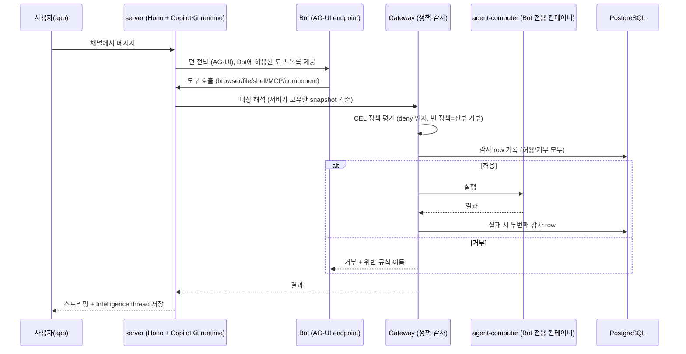

# OpenBot (CopilotKit)

> [!summary] 한줄요약
> 어떤 AG-UI 에이전트든 "coworker"로 붙일 수 있는 자체 호스팅 에이전트 플랫폼 **템플릿**. Bot마다 브라우저·파일·셸이 있는 전용 컴퓨터(컨테이너)를 주고, 모든 행동을 단일 gateway에서 CEL 정책으로 판정(deny 우선, fail closed)한 뒤 PostgreSQL에 감사 기록을 남긴다. MIT, TypeScript(Bun), alpha(v0.0.15).

> [!warning] 템플릿이지 제품이 아니다
> README: "A template, not a product." 호스티드 버전이 없고, 저장소의 모든 workspace가 `private`라 패키지로 의존할 수 없다. clone한 뒤 `examples/` 아래 예시 tenant package를 자기 coworker·channel·skill로 교체해서 쓰는 구조다. 또한 영속 스레드·메모리는 상용 **CopilotKit Intelligence**에 의존한다.

## 1. 배경 — 해결하려는 문제

ChatGPT/Claude/Grok과 같은 모양의 업무용 AI 어시스턴트를 회사가 직접 소유(자체 인프라, 모든 것을 수정 가능)하고 싶다는 요구가 출발점이다. 하지만 에이전트가 실제 업무에 쓰이려면 "도구를 쓸 수 있다"는 것만으로는 부족하고 **"무엇을 했는지 사전 판정·사후 기록이 된다"**는 통제가 필요하다. README의 문장이 이를 요약한다: "That is the difference between an agent that can use your tools and an agent you can let near them."

OpenBot이 정면으로 다루는 문제는 다음 네 가지다.

1. **프레임워크 종속**: AG-UI 프로토콜로 LangGraph, Mastra, CrewAI, Pydantic AI, Google ADK, 직접 작성한 에이전트까지 모두 같은 방식으로 붙인다. 거버넌스는 프레임워크가 아니라 프로토콜 위에 얹힌다.
2. **에이전트 행동의 통제**: 브라우저 클릭, 파일 쓰기, 셸 명령, MCP 도구 호출이 모두 서버 gateway를 거쳐야 하며, 우회 경로가 없다.
3. **사람 개입**: 로그인·2FA 같은 구간에서 에이전트가 도움을 요청하고, 사람이 같은 화면에서 제어권을 가져갔다 반환한다.
4. **무인 실행(routine)의 위험**: 스케줄로 도는 작업이 사람이 지켜보지 않는 상태에서 동작할 때를 별도로 식별·제한한다.

## 2. 아키텍처

### 2.1 서비스 구성 (docs/architecture.md, README 표)

| 구성요소 | 포트 | 책임 |
|---|---|---|
| `app` | 3010 | React/Vite UI (채널, Bot 채팅, 라이브 화면, 설정, admin) |
| `server` | 3001 | Hono API, CopilotKit runtime, 인증·역할, tenant package, coworker, channel, 정책, 감사, credential, plugin, component |
| `agent-computer` | 4100 | Chromium, `/workspace`, 브라우저 프로필, 스크린샷/스냅샷, 파일 도구 |
| `agent-bot` | 4200 | 개념 증명 AG-UI Bot |
| `agent-langgraph` | 4201 | LangGraph AG-UI Bot |
| `supervisor` | 4500(host)/4300(container) | Bot당 computer 컨테이너 생성·중지·리셋·목록 (Docker socket 보유) |
| PostgreSQL + pgvector | 5432 | 제품 데이터, 감사 row, credential, 정책, grant, channel, component 메타 |
| CopilotKit Intelligence | 외부 | 영속 thread, 메모리, 실시간 gateway |

저장소 루트에는 `agent-adk/ag2/agno/claude-sdk/crewai/langgraph/langgraph-agui/langroid/llamaindex/mastra/microsoft/pydantic-ai/strands` 등 프레임워크별 Bot 예제 디렉터리, `server/`, `app/`, `worker/`, `supervisor/`, `desktop/`(Tauri 기반 데스크톱 앱), `spire/`(선택적 SPIRE 서비스 설정), `charts/`(Helm), `examples/`(`fintech`, `langgraph-bot`, `mastra-bot`, `pydantic-ai-bot`)가 있다. 클론 기준 파일 약 1,380개, `server/src`의 비테스트 TypeScript가 약 6.2만 줄이다(대략치, find+cat 합산).

### 2.2 요청 흐름



문서가 강조하는 불변식은 "행동이 일어나기 전에 감사 row가 먼저 존재한다"는 것이다. `agent-computer` 자체는 정책을 판단하지 않고 서버 gateway가 유일한 행동 경계다. 컴퓨터 서비스가 노출하는 저수준 엔드포인트는 토큰으로 보호되며 "gateway를 우회하는 데 쓰지 말라"고 문서가 경고한다.

### 2.3 정책 엔진 (`server/src/computer/policy.ts`)

코드 주석에 따르면 CopilotKit 엔터프라이즈 agent gateway의 정책 엔진을 그대로 따르며(규칙의 의미가 같도록), 규칙 표 대신 CEL(cel-js)을 택한 이유로 "회사가 원하는 경계는 문장이다. 예: 자사 도메인 밖 페이지에서 Submit이라고 쓰인 것은 클릭하지 마라"를 든다.

- 구조: `{ mode: "dry-run" | "enforce", deny: string[], allow: string[] }`. deny가 먼저 평가되고 하나라도 참이면 거부. allow가 하나도 참이 아니면(빈 목록 포함) 아무것도 허용 안 됨.
- fail closed: 정책 없음 = 거부, 깨진 deny 규칙 = 거부, 깨진 allow 규칙 = 허용하지 않음, 형식이 잘못된 `AGENT_COMPUTER_POLICY` JSON은 서버 시작 자체를 막는다.
- `dry-run`은 판정·기록만 하고 통과시켜, 실제 트래픽으로 규칙을 시험한 뒤 enforce로 전환하게 한다. 코드 주석: "A governance feature nobody dares switch on is not a governance feature."
- 규칙에서 참조 가능한 속성: `tool.name`, `intent`, `bot.id`, `actor.id`, `page.url`/`page.host`, `element.ref/role/name/type`, `key`, `command`, `file.path/name/extension`, `mcp.server/tool/effect`, `initiator.kind/id`. 문자열은 대소문자 무시 `contains()`/`matches()`.
- 우회 방지 설계: `element`는 호출자가 주장한 라벨이 아니라 서버가 직접 가져온 snapshot에서 해석한다. 또 "Submit 클릭 거부 규칙을 피해 Enter 키를 누르는" 우회를 막기 위해 `key` 속성과 `computer_type`의 `submit` 플래그까지 컨텍스트에 포함한다("폼에는 세 개의 문이 있다"는 주석).
- 기본 시작 정책은 `deny: []`, `allow: ["true"]`(명시적으로 전부 허용). 즉 **출하 기본값은 전부 허용**이며, 운영자가 `/admin/boundaries`에서 deny 규칙·프리셋을 추가해야 통제가 시작된다.

### 2.4 initiator(누가 시작했나) 추적

감사 row의 `actor.id`는 "누구의 권한으로 실행됐는가"를 말하지만, routine은 소유자 권한으로, Bot 간 hop은 대화를 시작한 사람 권한으로 실행되기 때문에 사람이 지켜보고 있었는지 알 수 없다. 그래서 `initiator_kind`가 추가로 기록된다: `person`(사람이 있었음), `deployment`(시작 시 경계 등), `routine`(스케줄), `handoff`(다른 Bot이 부탁). Audit 화면의 **Nobody watching** 필터는 routine+handoff를 합쳐 "사람이 자리를 비운 사이 누구 권한으로 무엇이 실행됐나"를 답한다. 값은 배포가 서명한 run assertion 안에 `depth`와 함께 실려 Bot이 자기 라벨을 바꿀 수 없다.

### 2.5 Bot 간 위임 (`message_bot`)

한 Bot이 다른 Bot에게 일을 넘길 수 있으며 받은 Bot이 직접 답한다. 입력은 자유 텍스트가 아니라 타입화(과업, 제약, 좋은 답의 모양)된다. 배포가 결정하는 네 가지: 대상 해석(요청자가 볼 수 있는 roster 안에서만, 존재하지 않는 Bot과 볼 수 없는 Bot은 같은 문구로 거부해 열거 불가), 답이 도착할 곳(서명된 assertion), 질의자(서버가 기록한 row), 체인 깊이(A→B→C→A 무한 루프 방지). 답은 그 Bot 자신의 대화에 도착한다(Intelligence thread는 정확히 하나의 agent가 소유).

### 2.6 Routine과 공유 work queue

routine은 폼이 아니라 "평일 9시에 요약해줘"라는 대화로 만든다. 제약: 최소 15분 간격, 사용자당 활성 20개 상한, 실패는 성공 이후 첫 실패만 1회 알리고 **연속 10회 실패면 자동 비활성**(재시도 정책이 아니라 "이 routine을 계속 돌릴 가치가 있나"의 판단). 누락된 시간대는 재생하지 않고 스탬프만 앞으로 이동한다(한 달 뒤 worker가 살아나도 30개의 낡은 요약이 쏟아지지 않음). 구현은 `work_items` 하나의 PostgreSQL 테이블을 `select ... for update skip locked`로 claim하고 lease는 DB 시계 기준, 시도 횟수 상한이 있다. 타이머를 API 프로세스 안에 두지 않는 이유는 replica마다 독립적으로 "발화 시점"을 판단하기 때문이다. routine을 만들려면 관리자가 `/admin/plugins/routines`에서 Bot별로 `create_routine/update_routine/delete_routine`을 grant해야 한다.

## 3. 핵심 기능 상세

- **Bot별 컴퓨터**: `COMPUTER_SUPERVISOR_URL`을 설정하면 Bot마다 컨테이너·`/workspace` 볼륨·브라우저 프로필이 생긴다. 설정하지 않으면 모든 Bot이 `AGENT_COMPUTER_URL` 하나를 공유한다. `COMPUTER_RUNTIME=runsc`로 gVisor, `COMPUTER_SANDBOX=on`으로 Chromium 샌드박스. 컴퓨터는 `127.0.0.1`에만 바인딩되고 컨테이너별 토큰이 필요하다. DB는 별도 `data` 네트워크에 두어 Bot 셸이 닿지 못하게 분리한다(셸은 컨테이너가 닿는 곳이면 어디든 닿기 때문).
- **셸**: 같은 gateway를 통해 실행되며 규칙으로 셸 전체 또는 특정 명령을 거부할 수 있다. 명령은 PATH·locale·terminal·proxy 변수만 상속하고 배포의 나머지 환경변수는 상속하지 않는다(`COMPUTER_SHELL_ENV`로 추가).
- **관전·인계(Watch / Take the wheel)**: 화면은 websocket으로 프록시되는 라이브 브라우저, Activity 탭은 Bot이 실행한 명령·출력·종료코드·파일 읽기/쓰기 목록. Activity는 브라우저 메모리에만 있고 새로고침하면 사라지는 "창"이며, 기록은 서버측 감사 로그다. 인계는 `computer.help_requested/control_taken/control_released`로 기록되고, 사람이 조작하는 동안 Bot 행동은 큐에 쌓이지 않고 거부된다. secret 입력은 transcript에 값 대신 "요청됐다 + 글자 수"만 남는다.
- **Bring your own agent**: `/agents`에서 이름·직함·역할·가시성(private/public)·AG-UI endpoint·write-only 인증 헤더로 coworker를 만든다. endpoint는 등록 시와 리다이렉트마다 브라우저 이동과 동일한 대상 검사를 받고, 사설 주소는 `AGENT_ENDPOINT_ALLOWED_HOSTS`(예: `agents.internal,10.0.0.42:9000`, 와일드카드·URL 표기는 시작 거부)에 있어야 한다.
- **Components**: Bot이 산문 대신 React 컴포넌트로 답한다. 컴파일된 컴포넌트(`app/src/components/gallery/`)와 `/admin/playground`에서 작성·publish하는 sandbox 컴포넌트. 호출마다 서버가 "존재·publish·해당 Bot에 비차단" 여부를 확인하며, 데이터 함수(`botActivity`, `recentRefusals`)는 컴포넌트별 별도 grant가 필요하다.
- **Governed MCP / plugins**: Google Drive, Notion이 카탈로그에 있고 Composio가 수백 개 앱을 단일 계정으로 중개한다(요청한 사람의 계정으로 접근, `COMPOSIO_API_KEY`는 환경변수로만 설정). 알 수 없는 도구와 사용자 정의 서버의 도구는 write로 취급한다.
- **Skills**: 지침이지 권한이 아니다. 개인 skill은 작성자의 Bot에만, 배포 skill은 관리자가 소유. skill 이름을 Bot에 붙여도 grant가 없으면 아무 도구도 열리지 않는다(예제 YAML 주석: "THIS GRANTS NOTHING"). `skill-creator` skill을 가진 Bot은 대화 중 skill을 만들되 사용자가 카드의 버튼을 눌러야 저장된다.
- **Automatic Learning**: 관리자가 지정한 Bot의 완료된 대화를 Intelligence Learning container로 보내 skill 후보를 제안받고, 사람이 검토·publish한 revision만 Bot 실행에 로드된다. 활성화만으로 자동 승인되지 않는다. runtime key는 관리 자격이 아니며 브라우저에 두면 안 된다.
- **Sign-in**: Google/Microsoft/Okta를 환경변수로, 자체 SAML/OIDC를 Admin → Identity providers에서 이메일 도메인 라우팅으로 등록. `INITIAL_ADMIN_EMAILS` 필수(다른 경로로는 관리자 부여가 안 됨). 반쯤 설정된 provider는 시작 시 거부(client id만 있고 secret 없음, 32자 미만 secret 등). 그룹 기반 접근(`channels.allowed_groups`)은 `users.groups`를 채우는 로그인 경로가 없어 **실제로는 동작하지 않는 선언**이라고 문서가 직접 밝힌다.

## 4. 설치·사용

요구: Docker, Bun 1.3+, CopilotKit Intelligence 프로젝트와 라이선스(free plan, self-host 가능), 모델 키(개념 증명 Bot은 OpenAI, LangGraph Bot은 OpenAI/Anthropic/Google).

```bash
cp .env.example .env && bun install
npx --yes copilotkit@latest login
npx --yes copilotkit@latest project select
bun scripts/setup-learning.ts          # Intelligence runtime key + openbot Learning container를 .env에 기록
# .env에 OPENAI_API_KEY 입력, KEY_ENCRYPTION_KEY는 로컬이면 예제값 가능
#   운영용 생성: openssl rand -base64 32
bash scripts/start.sh                  # Docker(PostgreSQL, computer, bots, supervisor) + server + app, health 확인
# http://localhost:3010
bash scripts/stop.sh
```

서버가 필수로 요구하는 환경변수: `DATABASE_URL`, `KEY_ENCRYPTION_KEY`, `INTELLIGENCE_API_URL`, `INTELLIGENCE_GATEWAY_WS_URL`, `INTELLIGENCE_API_KEY`(없으면 시작 거부). `COPILOTKIT_LICENSE_TOKEN`은 선택.

단일 이미지 배포:

```bash
docker run -p 3001:3001 --env-file .env \
  -e EMBEDDED_POSTGRES=on -v openbot-data:/var/lib/postgresql \
  ghcr.io/copilotkit/openbot:latest        # 또는 :v0.0.9 처럼 버전 고정
```

docs/deployment.md의 주의: 볼륨은 `/var/lib/postgresql`(부모)에 마운트해야 한다. ext4 볼륨의 `lost+found` 때문에 `data` 디렉터리에 직접 마운트하면 `initdb`가 실패하고 컨테이너는 떴는데 502만 나온다. supervisor는 Docker socket이 필요하므로 서버리스 컨테이너 플랫폼에서는 쓸 수 없고, 그 경우 모든 Bot이 하나의 브라우저를 공유한다. 이미지에는 앱·API·Chromium이 들어 있으며 출시마다 digest가 `container-images.json`에 고정된다.

tenant package 예(`examples/fintech/agents.yaml`, 일부):

```yaml
agents:
  - id: general-assistant
    name: General Assistant
    type: built-in               # 또는 remote-ag-ui + endpoint
    system_prompt: You are a helpful general assistant...
    skills: [bot-creator, skill-creator]   # 지침만 부여, 도구 권한은 grant로 별도
```

`examples/fintech/model.yaml`은 `provider: openai`, `credential_secret_ref: openai-api-key`로 모델/자격증명 참조를 선언한다(기본 모델명이 `gpt-5.6-terra`로 적혀 있으나 실제 존재 여부는 확인하지 못함).

## 5. 코드·디렉터리에서 확인한 것

- `examples/fintech/agents/`의 coworker 10종(expense-review, feedback-digest, interview-notes, meeting-follow-ups, onboarding-buddy, oncall-handover, release-notes, research-desk, ticket-triage, vendor-review)은 코드가 아니라 YAML 설정이다. 특히 `expense-review.yaml`은 프롬프트 설계 참고 가치가 높다: 결과를 WITHIN POLICY/OVER A LIMIT/NOT COVERED/INCOMPLETE 네 범주로만 보고하고, 정책이 침묵하면 추론하지 말고 "정책이 말하지 않는다"고 쓰며, 승인·거절은 하지 않고 사람에게 결정을 넘긴다. 근거 문서가 없으면 답하지 않는 것이 옳다는 설계다.
- `Knowledge` coworker의 system prompt 주석은 실제 사고 사례를 담고 있다: 과거 "연결된 소스가 없으면 없다고 말하라"는 고정 지시가 있었는데 Drive 커넥터가 grant된 뒤에도 Bot이 도구가 돌려준 실제 파일 목록을 보고도 접근 권한이 없다고 답했다. 고정 부정 지시가 관측 증거보다 우선했기 때문이며, 조건을 "도구가 파일을 돌려주면 연결된 소스" 같은 관측 가능한 형태로 바꿨다.
- 서버 `server/src/` 하위: `computer/`(gateway, policy, policy-store, policy-dry-run, sandbox, supervisor, target, snapshot-store), `routines/`, `work/`, `learning/`, `plugins/`, `components/`, `auth/`, `routing/`(classify, model), `voice/`, `dictation/`, `host-access/` 등.
- CI 워크플로: `ci.yml`, `release.yml`, `publish-release.yml`, `desktop*.yml`, 그리고 GitHub Actions 정적 분석 `security_zizmor.yml`. 린트/포맷은 Biome, 테스트는 `bun test`, 목 LLM으로 `@copilotkit/aimock`을 devDependency로 쓴다.
- CHANGELOG는 "배포가 다르게 동작하는 변경만 기록"하는 운영자용 문서이며, `start.sh`가 macOS bash 3.2·Compose v5에서 실패한 사례 같은 운영 디테일이 있다.

## 6. 비교

| 대상 | OpenBot | 비고 |
|---|---|---|
| [[openworker]] / [[agentspace]] | 둘 다 사내용 에이전트 작업 환경 계열 | 각 노트 참조. OpenBot은 AG-UI+CEL 정책+감사가 차별점 |
| [[ag-ui-docs]] / [[pytorchkr-ag-ui-copilotkit]] | AG-UI 프로토콜의 레퍼런스 소비자 | 프로토콜 자체가 아니라 그 위의 거버넌스 제품 |
| [[actguard]] | 정책 기반 에이전트 행동 통제 | OpenBot은 통제와 실행 환경(컴퓨터)·UI를 한 묶음으로 제공 |
| 일반 에이전트 프레임워크(LangGraph 등) | 에이전트 로직을 만드는 쪽 | OpenBot은 그 에이전트를 "붙이는 플랫폼" |
| [[onyx]] | 사내 검색/챗 플랫폼 | OpenBot은 지식 검색보다 "컴퓨터를 쓰는 coworker" 중심 |

## 7. 장단점·한계·성숙도

사실 지표(GitHub API 2026-10-01): stars 5,773 / forks 768 / open issues 22 / MIT / TypeScript / 생성 2026-08-17 / 마지막 push 2026-10-01 / 최신 릴리스 v0.0.15(2026-09-22) / 커밋 약 453개 / 기여자 약 34명(API 응답 길이, per_page 100 한도 안). 생성 6주 만에 453 커밋으로 매우 빠르게 움직이는 초기 프로젝트다.

장점
- 통제를 위한 설계가 코드 수준에서 일관된다: deny 우선, fail closed, dry-run, 우회 경로(Enter 키, 라벨 위조) 방어, 서명된 initiator, 열거 방지 같은 세부가 문서와 주석에 근거와 함께 있다.
- 문서 품질이 높다. 설계 결정의 이유("왜 타이머를 API에 두지 않나")를 적은 문서는 사내 설계서 작성에도 참고가 된다.
- 단일 이미지+임베디드 PostgreSQL로 PoC가 쉽고, Helm chart와 SPIRE 설정이 있어 확장 방향이 보인다.

단점·한계
- alpha. 모든 workspace가 private이라 업스트림을 라이브러리처럼 가져다 쓸 수 없고, 포크 유지보수 부담이 전적으로 우리 몫이다.
- 영속 thread/메모리가 CopilotKit Intelligence(상용, free plan 존재, self-host 가능)에 의존한다. 자체 호스팅 Intelligence의 배포 난이도와 라이선스 조건은 확인하지 못했다.
- 출하 기본 정책이 "전부 허용"이다. 통제는 운영자가 규칙을 쓰는 만큼만 생긴다.
- 그룹 기반 채널 접근 제어가 미구현 선언 상태.
- `OPENBOT_SINGLE_USER=true`가 `.env.example`에 켜져 있어 모든 요청이 관리자로 처리된다. 운영 전 sign-in 설정이 필수다(미설정 시 시작을 거부하도록 설계됐다고 문서가 설명).
- 서버리스 플랫폼에서는 per-Bot 컴퓨터를 쓸 수 없다.

## 8. 보안·라이선스·운영 리스크

- **자격증명을 가진 브라우저**: `agent-computer`는 실제 로그인 세션을 가진 Chromium이다. loopback 바인딩과 토큰 유지, 외부 노출 금지가 필수다. `AGENT_COMPUTER_ALLOW_PRIVATE_HOSTS`는 노트북 전용이며 `NODE_ENV=production`에서는 시작이 거부된다.
- **Docker socket**: supervisor가 보유하므로 사실상 호스트 권한에 준한다. 사내 클러스터에서는 별도 노드/네임스페이스 격리, 가능하면 gVisor(`runsc`)를 고려.
- **셸 권한**: Bot에게 셸을 열어 주면 컨테이너가 닿는 네트워크 전체가 공격면이 된다. 네트워크 분리(`data` 네트워크 분리 구조 활용)와 egress 제한이 필요하다.
- **Prompt injection**: 브라우저로 외부 웹을 읽는 Bot은 페이지 내 지시문에 취약하다. CEL 규칙은 행동 단위로 막을 뿐 내용 오염을 막지 못한다. 외부 도메인에서의 submit/전송류 행동 deny 규칙을 기본으로 추가하는 편이 맞다.
- **Credential**: `/admin/credentials`로 write-only 암호화 저장, API로 반환 안 됨, 감사 로그에서 redact. `KEY_ENCRYPTION_KEY` 예제값은 공개이므로 운영에서는 반드시 교체.
- **공급망**: Bun 생태계와 Playwright, 다수의 프레임워크별 Bot 이미지. ghcr 이미지는 digest 고정 권장(docs/releasing.md).
- **라이선스**: OpenBot은 MIT. Intelligence는 별도 상용/free plan 조건이 있으므로 사내 데이터를 외부 managed Intelligence에 보내는 구성은 정보보호 검토 대상이다(자체 호스팅 또는 managed 선택에 따라 달라지며 세부 조건은 확인하지 못함).
- **감사 데이터**: 감사 row는 그 자체로 민감 데이터(URL, 명령, 파일 경로)를 담을 수 있다. 보관 기간(`audit-retention.ts`)과 접근 권한을 정해야 한다.

## 10. 확인하지 못한 항목

- 실제 구동 테스트(Docker 기동, 정책 거동)는 하지 않았다. 문서·코드 정독 기준.
- CopilotKit Intelligence의 가격·self-host 상세 조건, 데이터 저장 위치.
- `desktop/`(Tauri) 앱과 `spire/`/`charts/`(Helm)의 완성도.
- 정책 프리셋 목록과 `/admin/boundaries`의 실제 UI 동작.
- gpt-5.6-terra 등 예제 모델명의 실제 유효성.

## 관련 노트
[[ag-ui-docs]] · [[pytorchkr-ag-ui-copilotkit]] · [[openworker]] · [[agentspace]] · [[actguard]] · [[onyx]] · [[weknora]]

## 출처
- https://github.com/CopilotKit/openbot (클론 후 README.md, docs/architecture.md, docs/routines.md, docs/automatic-learning.md, docs/deployment.md, docs/plugins/composio.md, CHANGELOG.md, package.json)
- 소스: server/src/computer/policy.ts, examples/fintech/agents.yaml, examples/fintech/agents/expense-review.yaml, examples/fintech/model.yaml
- GitHub API: repos/CopilotKit/openbot, releases/latest, commits(마지막 페이지 번호), contributors (2026-10-01)
