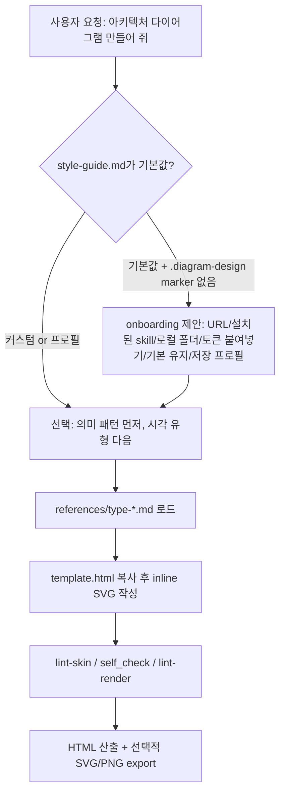

# diagram-design

> [!summary] 한줄요약
> 디자인 토큰과 검증 규칙에 따라 기술 다이어그램을 HTML·SVG로 만드는 skill이다. 기존 그림도 구조를 추출한 뒤 다시 그린다.

Claude Code·Codex·GitHub Copilot·Factory Droid·Pi·Kiro·OpenCode 등 Agent Skills 호환 호스트에서 "editorial 품질" 다이어그램 41종을 **스크립트·외부 의존성 없는 단일 HTML + inline SVG**로 생성하는 MIT skill. 브랜드 색/폰트를 웹사이트에서 추출해 토큰화(onboarding)하고, draw.io·Mermaid·Excalidraw 원본을 이 디자인 시스템으로 "다시 그려"(redraw) 주며, 린터·기하 검증·CI 게이트로 산출물 품질을 기계적으로 보증하는 것이 특징이다.

## 1. 배경 — 어떤 문제를 푸는가

LLM에게 "아키텍처 다이어그램을 그려 줘"라고 하면 대개 둥근 사각형, 임의의 그림자, 과한 색을 쓴 평범한 결과가 나온다. README의 문제의식("Why I built it")은 두 가지다. 첫째, 에이전트가 그린 다이어그램이 디자이너가 보면 쓸 수 없는 수준이라는 것. 둘째, Figma에서 색 고르는 데 30분을 쓰거나 아예 다이어그램을 포기하는 비용. 해법은 모델의 임의 판단 대신 **디자인 시스템을 skill로 고정**하는 것이다. 핵심 철학은 SKILL.md 1절에 있다.

- "The highest-quality move is usually deletion." — 노드 하나하나가 존재 이유를 가져야 한다. 늘 같이 다니는 두 노드는 하나로, 정보를 싣지 않는 선은 제거한다.
- accent 색은 독자가 먼저 봐야 할 1~2개에만 쓴다(5개에 쓰면 신호가 사라진다).
- 목표 밀도 4/10. 노드가 9개를 넘으면 두 개의 다이어그램으로 나눈다.
- 그릴 필요가 없는 경우를 명시한다: 목록은 표/불릿, 단순 before/after는 표, 도형 하나짜리는 문장으로. "독자가 잘 쓴 문단보다 이것에서 더 많이 배우는가?"를 먼저 묻는다.

즉 이 저장소는 "다이어그램 렌더러"가 아니라 **에이전트에게 주는 편집 기준 + 템플릿 + 검증기**의 묶음이다. 모델이 HTML/SVG를 직접 작성하되, 허용 가능한 문법(layout grammar)과 토큰이 문서로 못 박혀 있다.

## 2. 동작 원리·아키텍처

### 2.1 Progressive disclosure 구조

SKILL.md는 frontmatter(이름, MIT, `metadata.version: "2.6"`)와 "철학 → 사용 시점 → 선택표 → 체크리스트"만 담고, 유형별 상세는 `references/type-*.md`에 분리돼 있다. 에이전트는 선택한 유형의 reference만 읽는다. 따라서 일반 다이어그램 하나는 SKILL.md + 해당 `type-*.md` + `style-guide.md` 정도만 컨텍스트에 올린다. 이 구조를 지키기 위한 장치가 ADR 0004다: SKILL.md는 40,000 bytes 상한(`verify-semantic-motion.py`가 검사)이고, frontmatter `description`은 모든 유형 이름을 포함해야 한다(`verify-docs-sync.py`가 검사).

이유는 description이 "skill을 열기 전에 에이전트가 보는 유일한 텍스트"이기 때문에 라우팅 표면을 본문 절약과 맞바꾸지 않는다는 결정이다.



### 2.2 의미 패턴(semantic pattern) → 시각 유형

"행동·상태·강제·위험이 의미의 핵심일 때"는 먼저 의미 패턴을 고르고 그다음 가장 가까운 시각 유형으로 레이아웃을 정한다. 현재 9개 패턴이 있다(`semantic-patterns.md`).

- fan-in queue/병목 → Data flow
- stage framework(반복 슬롯) → Process
- 비정형 입력 → 구조화 산출물 → Data flow
- 두 정책 평가 trace 비교(pass/fail/skipped/not-reached, 첫 분기점) → Flowchart
- secure paved road(신뢰 경계와 허용/금지 경로) → Architecture
- governance/control 카탈로그 → Layer stack
- compensating security layers(앞 방어선의 공백을 뒤가 보완, 잔여 위험 전파) → Layer stack
- traceable block decomposition(ID로 주소 지정되는 계층 분해 + 블록별 I/O·제약·코드 링크) → Tree
- lifecycle phase map → State machine

ADR 0002는 "의미 패턴은 유형 분류를 늘리지 않는다"는 결정이다.

### 2.3 41개 시각 유형

SKILL.md 선택표 기준으로, architecture, IT current-state, flowchart, sequence, state machine, ER, timeline, swimlane, quadrant, radar, polar, loop(flywheel), nested, tree, org chart, layer stack, Venn, pyramid/funnel, bar, waterfall, treemap, heatmap, line(slopegraph·ridgeline·bump 변형 포함), Gantt, scatter(bubble·beeswarm 변형), high-level, process, medallion, data flow, DP integration, DP security matrix, Sankey, fishbone, Wardley map, kanban, user journey, deployment, dependency graph, UML class, story map, database schema. 마지막 10개(Sankey~DB schema)는 v2.5.10에서 추가됐다. 모든 유형이 minimal light, minimal dark, full-editorial 세 변형으로 `skills/diagram-design/assets/example-<type>*.html`에 있다.

"DP integration", "DP security matrix", "medallion", "high-level" 같은 데이터 플랫폼 계열 유형이 포함돼 있다는 점은 사내 데이터 플랫폼/RAG 아키텍처 문서화에 직접 쓸 만하다.

### 2.4 토큰과 접근성

`references/style-guide.md`가 색·폰트의 단일 진실 원천이다. 의미 역할(semantic role)로만 참조하며 hex를 다른 reference에 쓰지 않는다. 기본 skin의 라이트 값: paper `#f5f5f5`, paper-2 `#ececec`, ink `#2d3142`, muted `#4f5d75`, soft `#7a8399`, rule-solid `#bfc0c0`, accent `#eb6c36`, link `#2e5aa8`.

다크는 paper와 ink를 뒤집고 accent를 약간 밝게(`#f08a59`) 한다. 다중 시리즈가 꼭 필요한 유형(radar 등)에만 desaturated 시리즈 팔레트(sage, dusty-blue, mustard, rust-brown, slate)를 허용한다. 템플릿은 SVG마다 `role="img"`, 해소되는 `aria-labelledby`, 첫 자식 `<title>`/`<desc>`를 요구하고 ID를 다이어그램·변형별 prefix로 구분해 한 페이지에 여러 SVG를 안전하게 인라인할 수 있게 한다.

### 2.5 정적 기본, 고정된 모션 컨트롤러

ADR 0001: 공유 가능한 단일 HTML에 임의 inline JavaScript를 넣으면 검토 부담이자 보안 표면이므로 기본 출력은 스크립트 없는 정적(`data-motion-mode="none"`)이다. 모션이 요청되면 `<script data-diagram-controls>` 블록 **정확히 하나**를 허용하되 본문이 `assets/template-motion.html`의 검토된 컨트롤러와 바이트 단위로 일치해야 한다(SHA-256으로 lint와 별도 검증이 이중 확인).

모드는 `none`/`reveal`/`step`/`loop`이고, reduced-motion에서는 완전한 정적 프레임을 보여 주고 재생 컨트롤을 숨긴다. ADR 0003은 `reveal`만 자동재생이 허용된다고 정한다. 부작용으로 다이어그램별 맞춤 인터랙션은 이 skill의 범위 밖이라고 ADR이 인정한다.

## 3. 핵심 기능 상세

### 3.1 브랜드 onboarding (약 60초)
"onboard diagram-design to https://yoursite.com"처럼 말하면 에이전트가 홈페이지를 가져와 지배 색과 폰트 스택을 뽑고 의미 역할로 매핑한다: `<body>` 배경 → paper, 본문색 → ink, 보조/캡션 → muted, 카드/컨테이너 → paper-2, CTA·링크·제목에서 가장 많이 쓰인 브랜드 색 → accent, `<h1>` 폰트 → title, `<body>` 폰트 → node-name, `<code>/<pre>` 폰트 → sublabel. 변경 diff를 보여 주고 승인받은 뒤 `style-guide.md`에 쓴다. 토큰을 쓰기 전에 ink/paper의 WCAG AA 대비를 검증하고 9~12px 크기에서 실패하면 조정안을 제시한다.

샘플링한 URL, 색 역할, 폰트 패밀리·두께·출처 URL, 대체 폰트를 담은 fidelity receipt를 남기며, 공개 사이트 폰트는 렌더 후 실제 적용을 검증한다.

### 3.2 First-run gate와 프로젝트별 프로필
기본 토큰 그대로면(= 브랜드 프로젝트에 기본 skin을 조용히 내보내지 않도록) 첫 다이어그램 전에 멈춰서 6가지 선택지(URL, 설치된 skill, 로컬 폴더/디자인 시스템, 토큰 붙여넣기, 기본 유지, 저장된 프로필)를 묻는다. 여러 고객/브랜드를 오가는 경우 `~/.diagram-design/profiles/<slug>.md`에 프로필을 저장하고 프로젝트 루트에 `profile: <slug>`를 적은 `.diagram-design` marker를 두면 해당 프로젝트가 프로필을 직접 읽는다(공유 `style-guide.md`를 덮어쓰지 않음).

프로필은 skill 업데이트로 사라지지 않는다. 슬래시 명령: Claude Code `/diagram-design:profile`, Pi·Droid `/profile`.

### 3.3 Import redraw (draw.io / Mermaid / Excalidraw)
변환이 아니라 **다시 그리기**다. 원본에서 구성요소·관계·그룹·방향만 가져오고 좌표, 팔레트, 폰트, draw.io의 대각선 커넥터, Mermaid 자동 레이아웃, Excalidraw의 손그림 기하는 버린다. 파서 스크립트 `drawio_extract.py`, `mermaid_extract.py`, `excalidraw_extract.py`는 텍스트만 제한적으로 파싱하며 원본을 평가·렌더·fetch·실행하지 않고, 라벨과 디렉티브를 모두 "신뢰할 수 없는 데이터"로 취급한다(`import-mermaid.md`).

실패 시 exit 2로 메시지를 그대로 보고하고 온라인 편집기로 우회하지 않는다. 입력 형식은 `.drawio`, `.drawio.xml`, `.drawio.png`(임베디드), `.drawio.svg`(압축 payload 포함), `.mmd`/`.mermaid`/Markdown 속 mermaid 블록(지원 문법: flowchart/graph, sequenceDiagram, stateDiagram-v2, erDiagram), `.excalidraw`.

네 개의 다이얼이 결과를 정한다.

| 다이얼 | 선택지 | 바뀌는 것 |
|---|---|---|
| Format | html, svg, png, html+png | 산출물 형식 |
| Size | doc-inline, doc-wide, slide-16x9, slide-4x3, social-og, social-square, print-a4/a3/letter-landscape, fit | viewBox와 타입 램프(슬라이드는 노드명 16px) |
| Detail | faithful(≤24 노드, zone), balanced(≤12), simplified(≤7) | 원본 보존 정도. 장식 → 중복 → leaf 클러스터 → 인프라 순으로 줄이는 고정 사다리 |
| Audience | engineer, mixed, executive | 문구 수준. `Auth Service / JWT · RS256 · :8443` → `Auth Service / token check` → `Sign-in` |

모든 import는 fidelity ledger(무엇을 합치고 접고 버렸는지)로 끝난다. 예: `Detail: balanced · 12 source nodes → 8 drawn`, `Dropped: 1 sticky note`. 명령 예: `/diagram-design:import-drawio platform.drawio --size=slide-16x9 --detail=simplified --audience=executive`.

### 3.4 Export
`/diagram-design:export-diagram path/to/diagram.html [--svg-only|--png-only --scale=3|--registry]`. SVG는 `<svg>`를 추출하고 Google Fonts를 주입해 단독 렌더되게 하고, PNG는 Playwright로 기본 2배 래스터화한다(`pip install playwright && playwright install chromium`). 다이어그램만 대상이며 `-full` 변형의 편집용 카드/헤더는 포함하지 않는다.

`--registry`는 "traceable block decomposition" 패턴의 `data-block-*` 메타데이터를 JSON 사이드카로 내보낸다.

### 3.5 doctor
`/doctor`는 설치와 런타임 준비 상태(import/export, 명령 라우팅)를 파일 수정이나 의존성 설치 없이 점검해 pass/warn/fail로 보고한다. `--strict`, `--json` 옵션. 설치된 skill 모드와 maintainer 체크아웃 모드(CONTRIBUTING.md, ci.yml, verify-plugin-package.py가 있을 때)를 구분한다.

## 4. 설치·사용

```text
# Claude Code
/plugin marketplace add cathrynlavery/diagram-design
/plugin install diagram-design@diagram-design
# 이후 /plugin → Marketplaces → diagram-design → Enable auto-update (서드파티 마켓플레이스는 기본 auto-update 꺼짐)
```

```bash
# Codex
codex plugin marketplace add cathrynlavery/diagram-design
codex plugin add diagram-design@diagram-design
# GitHub Copilot
copilot plugin marketplace add cathrynlavery/diagram-design
copilot plugin install diagram-design@diagram-design
# Factory Droid
droid plugin marketplace add https://github.com/cathrynlavery/diagram-design
droid plugin install diagram-design@diagram-design --scope user
# Pi
pi install https://github.com/cathrynlavery/diagram-design
# Kiro: .../tree/main/skills/diagram-design URL을 skill로 import
# OpenCode: skills/diagram-design/ 를 ~/.config/opencode/skills/ 로 복사 또는 symlink
```

직접 편집(editable) 설치는 클론 후 `ln -s ~/code/diagram-design/skills/diagram-design ~/.claude/skills/diagram-design`처럼 심볼릭 링크를 건다. 이유는 관리형 설치에서는 `references/style-guide.md` 수정이 패키지 업데이트에 덮일 수 있기 때문이다(프로필은 `~/.diagram-design/profiles/`에 있어 안전). Claude Cowork 조직 마켓플레이스는 private/internal 저장소만 허용하므로 조직 소유 저장소로 미러링한 뒤 Organization settings → Plugins에서 연결하라고 안내한다.

사용 예(자연어):

```text
"Make me an architecture diagram of my app: frontend, backend, database, Redis cache."
"I need a quadrant showing Q2 projects by impact vs effort."
"redraw this drawio file for my deck"
```

템플릿 직접 사용: `cp skills/diagram-design/assets/template.html my-diagram.html`(minimal light), `template-full.html`(요약 카드 포함 editorial), `template-motion.html`(접근성 모션). 전체 갤러리는 `skills/diagram-design/assets/index.html`(라이트/다크/full 탭)이고 GitHub Pages에도 게시돼 있다.

## 5. 디렉터리·코드에서 확인한 것

- 구성: `skills/diagram-design/`(SKILL.md, references 약 60개, scripts 4개, assets 174개·약 2.6MB), `commands/`(export-diagram, import-drawio, import-mermaid, import-excalidraw, profile, doctor), `prompts/`(Pi용 템플릿), `scripts/`(린터·검증기·테스트), `docs/adr/`(ADR 0001~0011), `docs/cookbook.md`, 플러그인 매니페스트 4종(`.claude-plugin`, `.codex-plugin`, `.factory-plugin`, `.agents/plugins`). 클론 기준 파일 562개.
- 플러그인 매니페스트 버전은 `2.6.46`(`.claude-plugin/plugin.json`), SKILL.md metadata 버전은 `2.6`. 버전은 main에서 머지 후 올린다(ADR 0009), `bump-plugin-version.py`가 Claude/Codex/Factory 버전을 동기화한다.
- **검증 스크립트가 유난히 많다**: `lint-skin.py`(소스 무결성: 색 토큰 준수, 원격 asset·CSS `@import`·비-fragment `url()`·`onclick`/`srcdoc` 같은 실행 속성 거부, a11y 카테고리), `lint-render.py`(Chromium 렌더 레이아웃 검사), `verify-geometry.py`(뒤에 선언된 노드가 라벨 마스크와 겹치면 텍스트가 잘리므로 CI 실패), `verify-treemap.py`(셀 면적 비율과 인쇄된 값 일치 — 면적이 곧 인코딩이므로), `verify-waterfall.py`(누계 보존·브릿지 막대 위치), `verify-sankey.py`(유량 보존), `verify-polar/heatmap/bubble/beeswarm/ridgeline/slopegraph/streamgraph/marimekko/dumbbell/bump.py`, `verify-block-registry.py`(`data-block-id` 중복, 부모 해소 불가, 순환, 빈 값), `verify-docs-sync.py`(description에 유형 이름 누락, 갤러리 도달 불가, README 트리의 없는 파일, 깨진 상대 링크 검출), `verify-semantic-motion.py`, `verify-plugin-package.py`, 각각에 대응하는 `test-*.py`(적대적 변형 테스트). 이는 "LLM이 만든 시각물은 렌더 결과가 그럴듯해도 수치가 틀릴 수 있다"는 문제를 정량 게이트로 해결한 사례다.
- CI(`.github/workflows/ci.yml`)는 Linux/Windows/macOS 러너에서 돌며 `permissions: contents: read`, `persist-credentials: false`, Python 3.12, Node를 쓴다.
- 서드파티 번들: Tabler Icons(MIT), Simple Icons(CC0), log-z/logos(MIT)의 아이콘이 `primitive-icons.md`와 `assets/icons.html`에 포함(`THIRD_PARTY_LICENSES.md`). 아이콘 빌드 스크립트 `build-icons.py`가 SVG를 `currentColor`로 정규화한다.
- `SECURITY.md`: 버전별 릴리스를 게시하지 않고 `main` 최신 커밋만 보안 수정 대상이며, GitHub private vulnerability reporting을 사용한다.

## 6. 비교

| 도구 | 방식 | diagram-design과 차이 |
|---|---|---|
| Mermaid | 텍스트 DSL → 자동 레이아웃 렌더 | 빠르고 diff 가능하지만 시각 품질·브랜드 통제는 약함. diagram-design은 Mermaid를 입력으로 받아 *재작성*한다 |
| draw.io / 로컬 `drawio` skill | GUI 편집 가능한 `.drawio` 산출 | 사후 GUI 편집·팀 협업은 draw.io가 유리. diagram-design 산출물은 HTML 코드 기반이라 편집은 에이전트 재요청/코드 수정 |
| Excalidraw | 손그림 화이트보드 | 입력으로만 지원(텍스트 파싱), 손그림 기하는 버린다. 단 `primitive-sketchy.md`로 선택형 스케치풍 변형은 제공 |
| [[huashu-design]] | 디자인 계열 skill | 별도 노트 참조. 이 저장소는 "다이어그램 전용 + 검증 게이트"가 차별점 |
| 일반 LLM의 즉석 SVG | 모델 재량 | 스타일 일관성·접근성·수치 정확성에 보증이 없음 |

사용자 환경에는 이미 `diagram-design:diagram-design`, `diagram-design:export-diagram`, `drawio` skill이 모두 설치되어 있다(시스템 skill 목록). 용도 구분: 사내 문서/발표용으로 보기 좋은 정적 그림은 diagram-design, 팀이 계속 손으로 고칠 구조도는 drawio, 코드 옆에서 diff되는 가벼운 그림은 Mermaid가 맞다.

## 7. 장단점·한계·성숙도

사실 지표(GitHub API 2026-10-01): stars 42,909 / forks 2,760 / open issues 30 / MIT / 주 언어 표기 HTML / 생성 2026-04-16 / 마지막 push 2026-09-29 / 커밋 약 207개 / 기여자 30명 / GitHub Release 없음(latest 404, 대신 플러그인 매니페스트 버전 2.6.46 사용). 생성 5개월 동안 207 커밋, 스타 4만 이상으로 관심도가 높고 최근 이틀 전에도 push가 있다.

스타 수가 높은 이유(바이럴 등)는 확인하지 못했다. 이 저장소의 `.github/pr-previews`와 Trendshift 배지 언급은 있으나 외부 검증은 하지 않았다.

장점
- 산출물이 단일 HTML이고 JS·외부 이미지·CDN 의존이 없어 이메일 첨부, 사내 위키, 정적 호스팅에 안전하게 쓰기 쉽다(폰트는 SVG export 시 Google Fonts 주입 — 사내 폐쇄망이면 별도 대응 필요).
- 41개 유형 + 의미 패턴 + 토큰 시스템으로 일관성이 높고, 수치 정확성(treemap 면적, waterfall 누계, sankey 보존)을 코드로 검증한다.
- 7개 이상 호스트 지원, 관리형/직접 편집 설치 모두 문서화.
- import redraw의 fidelity ledger로 "무엇이 사라졌는지"를 투명하게 보고한다.

단점·한계
- 편집이 코드 기반이라 비개발 협업자가 GUI로 고치기 어렵다.
- style-guide.md가 인정하듯 `assets/`의 일부 예제 HTML은 이전 skin 기준이라 현재 style-guide와 어긋날 수 있다(style-guide의 note: "Regenerating them ... is a v5.1 task"). `lint-skin-baseline.txt`로 레거시 파일을 예외 처리한다.
- 모션은 고정 컨트롤러 하나뿐이라 맞춤 인터랙션 불가(설계상 의도).
- PNG export는 Playwright + Chromium 설치가 필요하다.
- LLM이 생성하는 SVG 좌표는 여전히 모델 능력에 의존한다. 검증 게이트는 *저장소 예제*와 *설치 후 self_check*를 위한 것이고, 사용자 요청마다 모든 게이트가 자동으로 돌아가는지는 확인하지 못했다(`self_check.py`가 "packaged output self-check (runs installed)"라고 README에 적힘).
- 단일 메인테이너 중심 프로젝트로 보인다(기여자 30명이나 편중 정도는 확인하지 못함).

## 8. 보안·라이선스·운영 리스크

- 라이선스: skill 본체 MIT. 번들 아이콘은 MIT/CC0이며 `THIRD_PARTY_LICENSES.md`에 출처가 있다. 사내 산출물에 브랜드 로고 아이콘(Docker, AWS 등)이 들어가면 해당 상표 사용 규정은 별개이니 확인이 필요하다.
- **임포트 파서의 안전성**: 설계상 원본을 실행·렌더·네트워크 접근하지 않고, 라벨을 untrusted data로 취급해 prompt injection을 의식하고 있다. 그래도 외부에서 받은 `.drawio`/Mermaid를 에이전트에 넘기는 것은 라벨에 숨은 지시문 위험이 있으므로 출처 신뢰가 필요하다.
- **onboarding의 웹 fetch**: URL을 주면 에이전트가 사이트를 가져온다. 사내 인트라넷 URL이나 로그인 필요 페이지를 넘기지 않는다. 사내 토큰은 "붙여넣기" 경로로 명시 입력하는 편이 안전하다.
- **마켓플레이스 신뢰**: `/plugin marketplace add` + auto-update 활성화는 업스트림 main이 바뀌면 에이전트 지침(SKILL.md, commands)이 자동으로 바뀐다는 뜻이다. 사내에서는 포크/미러링 후 특정 커밋을 고정하거나 auto-update를 끄는 것을 권장한다(README도 조직 마켓플레이스는 private 미러를 요구).
- **스크립트 실행**: commands가 `python3 .../mermaid_extract.py` 같은 로컬 스크립트를 실행한다. 설치 전 소스를 검토할 가치가 있다(Python 표준 라이브러리 위주로 보이나 전체 의존성 감사는 하지 않았다).
- 릴리스 태그가 없어 버전 고정은 커밋 SHA로 해야 한다.

## 10. 확인하지 못한 항목

- 실제 skill을 실행해 산출 품질을 평가하지는 않았다(문서·코드·ADR 정독 기준).
- 갤러리 사이트(cathrynlavery.github.io/diagram-design)는 열지 않았다.
- 스타 급증 원인, 외부 사용 사례.
- `self_check.py`가 일반 사용 흐름에서 자동 실행되는지 여부.
- 개별 type reference 41개의 세부 내용(선택표와 일부 reference만 읽음).

## 관련 노트
[[huashu-design]] · [[agent-skills]] · [[claude-code-best-practice]] · [[mengto-skills]] · [[k-skill]]

## 출처
- https://github.com/cathrynlavery/diagram-design (클론 후 README.md, skills/diagram-design/SKILL.md, references/style-guide.md, references/import-mermaid.md, references/doctor.md, docs/adr/0001·0004, THIRD_PARTY_LICENSES.md, SECURITY.md, .claude-plugin/plugin.json, .github/workflows/ci.yml, scripts/lint-skin.py)
- GitHub API: repos/cathrynlavery/diagram-design, commits(마지막 페이지 번호), contributors, releases/latest 404 (2026-10-01)
