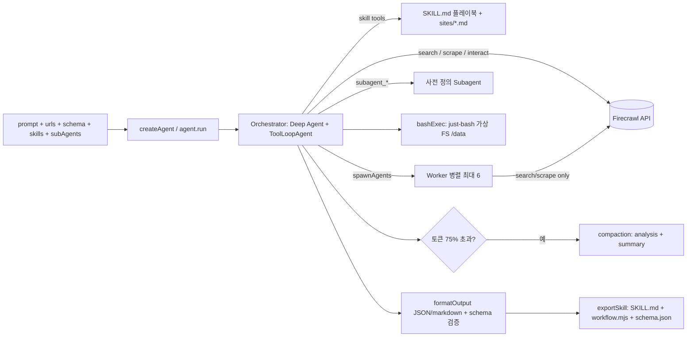

# Firecrawl Web Agent

> [!summary] 한줄요약
> Firecrawl의 호스티드 리서치 에이전트(firecrawl.dev/app/agent)와 같은 구조를 직접 만들어 쓸 수 있게 공개한 MIT 오픈소스 기반 코드. LangChain **Deep Agents**를 하네스로, Firecrawl의 Search/Scrape/Interact(브라우저 자동화)를 Vercel AI SDK 도구로 연결해 "계획 → 행동 → 관찰" 루프, 병렬 subagent, SKILL.md 플레이북, 스키마 강제 JSON 출력, 컨텍스트 compaction을 제공한다. 단 모든 웹 접근이 Firecrawl API 키(유료 크레딧)를 전제로 한다.

> [!note] 저장소의 위치
> 이 저장소는 "agent-core(라이브러리) + 템플릿 3종(Next.js, Express, Library)"이다. README가 스스로 "open-source foundation to build your own — fork it, swap models, add skills, and deploy however you want"라고 쓴다. 호스티드 제품은 Firecrawl의 자체 "Spark 1" 모델을 쓴다고 하지만 이 저장소에는 그 모델이 없고 Gemini/Claude/OpenAI/OpenAI 호환 모델을 붙이는 구조다(`resolve-model.ts`).

## 1. 배경 — 해결하는 문제

웹 리서치 자동화의 흔한 실패 유형은 (1) 첫 페이지만 긁고 "충분하다"고 선언하는 조기 종료, (2) 모델이 학습 데이터로 값을 채워 넣는 환각, (3) 긴 스크레이프 결과로 컨텍스트가 터지는 문제, (4) 사이트마다 필요한 탐색 요령(페이지네이션, 필드 위치)이 달라 매번 처음부터 시행착오를 겪는 문제다. 이 저장소는 이를 코드와 프롬프트로 정면 대응한다.

- 시스템 프롬프트가 "페이지에서 스크레이프한 사실만 쓴다. 학습 데이터로 채우지 않는다"를 최우선 임무로 박는다(`mission`, `known_failure_patterns`).
- `completeness_policy`: 목록을 긁은 뒤 "페이지가 주장하는 총 개수 vs 실제 추출 개수 vs 페이지네이션 진행 vs 요청 필드 vs 채운 필드"를 스스로 점검하게 한다.
- `scrape`에 `query` 파라미터를 우선 쓰게 해 전체 페이지를 컨텍스트에 덤프하지 않는다.
- 사이트별 요령은 SKILL.md와 `sites/*.md` 플레이북으로 외부화한다.

## 2. 아키텍처

### 2.1 레이어

README의 "Open Source" 표는 아래에서 위로 쌓이는 5개 층을 보여 준다.

| 층 | 내용 | 설치 |
|---|---|---|
| Next.js / Express 템플릿 | 채팅 UI·스트리밍·Skills·Subagents·구조화 출력 / API 서버 | `firecrawl create agent -t next|express` |
| Agent Core | Deep Agents 기반 orchestrator, Skills, Subagents, 구조화 출력 | `firecrawl create agent -t library` |
| Firecrawl AI SDK | Search/Scrape/Interact를 Vercel AI SDK 도구로 | `npm i firecrawl-aisdk` |
| Firecrawl SDK | Scrape/Search/Crawl/Extract 클라이언트 | `npm i @mendable/firecrawl-js` |
| API Reference | REST (v2) | docs.firecrawl.dev |

### 2.2 agent-core 데이터 흐름



핵심 코드 근거:

- `src/agent.ts`(약 675줄): `createAgent()` 공개 API. `run`, `stream`, `plan` 제공.
- `src/orchestrator/index.ts`: 모델 해석 → 스킬 발견 → 스킬/subagent/worker/exportSkill 도구 구성 → 업로드 파일을 가상 파일시스템 `/data/`에 시드 → 스키마·필드 체크리스트·출력 형식을 프롬프트에 주입(`buildSchemaBlock`, `buildFieldChecklist`, `buildFormatInstructions`). 스키마가 있으면 "정확히 이 필드만, 누락도 추가도 금지"와 `formatOutput` 호출 전 체크리스트 점검을 강제한다.
- `src/orchestrator/compaction.ts`: 모델별 토큰 한도 표(예: Claude 계열 200,000, Gemini 계열 1,000,000, gpt-5.4 128,000)를 두고 **임계치 0.75**에서 요약을 수행한다. 요약 프롬프트는 "텍스트만 응답, 도구 호출 금지"를 선언한 뒤 `<analysis>`와 `<summary>` 블록을 요구하며, 요약에 원 과업, 스크레이프한 URL별 결과, 수집한 데이터, 스키마 진행도(채운/비운 필드), 생성한 워커와 결과, 오류와 해결, 현재 작업을 포함하도록 지시한다. Claude Code의 compaction 방식과 유사한 설계다.
- `src/toolkit.ts`: Firecrawl 도구 래퍼. `interact` 호출은 기본 60초 하드 타임아웃으로 경쟁시키고(`DEFAULT_INTERACT_TIMEOUT_MS = 60_000`), 타임아웃 시 `AbortController`로 업스트림을 취소하고 구조화된 에러 봉투를 반환한다. 또 응답의 null/빈 문자열 필드를 제거(`stripInteractNulls`)해 모델이 "null" 코드블록을 그대로 출력하는 UI 버그를 근원에서 막는다.
- `src/worker/index.ts`: 병렬 워커. 워커는 `interact`에 접근할 수 없고(search/scrape만), 응답은 500단어 이하, 큰 데이터는 `/data/{TASK_ID}.json`에 저장한다.
- `src/tools.ts`: `formatOutput`과 `bashExec`(Vercel Labs의 `just-bash`로 구현된 jq/awk/sed/grep 등 제한된 bash. python/node/curl/wget/npm/pip 등은 사용 불가라고 프롬프트에 명시).
- `src/schema-validate.ts`: 출력 스키마 검증, `schema-adherence.live.test.ts`로 실제 모델 대상 스키마 준수 테스트.
- 지원 모델 해석(`resolve-model.ts`): `google`, `anthropic`, `openai`, `custom-openai`(baseURL 지정). 기본값은 문서상 `google:gemini-3-flash-preview`(Express README가 "free tier"라 표기).

### 2.3 Orchestrator와 Worker의 위임 정책

시스템 프롬프트는 병렬 위임을 "기본 수단"이 아니라 "정당화될 때만"으로 제한한다. 작은 작업(약 8 step 미만)이거나 대상이 독립적이지 않거나 `interact`가 필요하면 위임하지 않고, 독립 대상이 5개 이상이거나 사용자가 명시적으로 병렬·전수 조사를 요구할 때만 `spawnAgents`를 쓴다. 각 워커는 격리된 컨텍스트를 가지므로 "정확한 URL, 추출 필드, 반환 형식, 완료 기준"을 포함한 자급자족형 프롬프트가 필요하고, 막연한 위임("이 회사 조사해줘")은 나쁜 예로 명시돼 있다. 이는 멀티에이전트 설계에서 "위임 프롬프트 품질" 가이드로 그대로 읽을 만하다.

## 3. 핵심 기능 상세

### 3.1 Skills와 사이트 플레이북
`src/skills/definitions/`에 기본 6종이 있다: `deep-research`(3개 이상 출처의 교차 검증, 신뢰도 high/medium/low 부여, 반대 관점 포함), `e-commerce`, `financial-research`(사이트별 `sites/sec-gov.md`, `sites/yahoo-finance.md`), `pricing-tracker`(과금 단위 식별: per seat/per token/per GB 등, 연간 할인·초과 요금·좌석 최소·기능 게이팅 같은 함정 표기), `competitor-analysis`, `structured-extraction`. `discovery.ts`가 각 디렉터리의 `SKILL.md` frontmatter를 파싱하고 `sites/*.md`의 `domains` 메타로 **URL 도메인에 맞는 플레이북을 자동 매칭**한다. 실행 시 `skills: ['deep-research']`로 미리 로드하거나 `skillInstructions`로 실행별 지침을 덮어쓸 수 있다("peer-reviewed 출처만 사용" 등). 사용자 정의 스킬은 `skillsDir`로 지정한다.

### 3.2 Subagents
두 종류가 있다. (1) 동적 `spawnAgents` 워커(최대 6개, step 10), (2) 사전 정의된 `subAgents`(id, name, description, instructions, model, tools, skills, maxSteps). 사전 정의 subagent마다 서로 다른 모델을 줄 수 있다(예: 가격 분석은 Claude, 기능 리뷰는 Gemini). Deep Agents의 `task` 툴과 `subagents` primitive에 기반한다. 각 subagent는 도구 범위(`tools: ['scrape']` 등)와 자신의 interact 브라우저 세션 상태를 분리한다.

### 3.3 구조화 출력
`schema`에 JSON 예시 객체를 넘기면(null 자리표시자 형태, README의 NVIDIA 예) 에이전트가 정확히 그 필드를 채우고 `formatOutput`으로 JSON을 반환한다. `format: 'markdown'`도 가능하다. 응답 형태는 `{ text, data, format, steps, usage, durationMs, model }`.

### 3.4 exportSkill — 실행을 재사용 가능한 skill로 결정화
`exportSkill: true`를 주면 실행 결과에 `exportedSkill`이 포함된다: `name`, `skillMd`(self-healing 지침이 있는 전체 SKILL.md), `workflow`(`@mendable/firecrawl-js`를 쓰는 결정론적 Node.js 스크립트), `schema`(출력 검증용 JSON Schema). 한 번은 에이전트가 탐색하고, 이후에는 `FIRECRAWL_API_KEY=fc-... node workflow.mjs`처럼 **LLM 없이 스크립트만** 돌릴 수 있다(종료 코드 0=수집 성공, 1=부분 성공, 2=URL stale이므로 에이전트 재실행 필요). 반복 모니터링(가격 추적 등)에서 비용을 줄이는 영리한 설계다. [[generic-agent]]의 "작업을 skill로 결정화"와 같은 발상이다.

### 3.5 스트리밍·계획
`agent.stream()`은 이벤트 단위(`event.type === 'text'` 등) 스트림, `agent.plan(prompt)`는 실행 없이 계획만 반환한다. HTTP API는 `openapi.yaml`로 명세돼 있고 모든 템플릿이 구현한다: `POST /v1/run`, `POST /v1/plan`, 헬스 `GET /`.

## 4. 설치·사용

```bash
# 1. Firecrawl CLI 설치 + 인증 (브라우저 로그인)
npx -y firecrawl-cli@latest init -y --browser
# 2. 템플릿 스캐폴드
firecrawl create agent -t next      # 또는 express, library
```

수동(Express 템플릿):

```bash
npm install
cp .env.example .env          # FIRECRAWL_API_KEY + 모델 키 입력
npm run doctor                # 환경변수 점검
npm run dev                   # http://localhost:3000
```

```bash
# .env 최소
FIRECRAWL_API_KEY=fc-...
GOOGLE_GENERATIVE_AI_API_KEY=AIza...      # 또는 ANTHROPIC_API_KEY / OPENAI_API_KEY
# MODEL=google:gemini-3-flash-preview
```

라이브러리로 직접 사용:

```typescript
import { createAgent } from '@firecrawl/agent-core'

const agent = createAgent({
  firecrawlApiKey: process.env.FIRECRAWL_API_KEY!,
  model: { provider: 'anthropic', model: 'claude-sonnet-4-6' },
  maxSteps: 50, maxWorkers: 6, workerMaxSteps: 10,
})
const result = await agent.run({
  prompt: 'Compare Vercel and Netlify pricing',
  skills: ['pricing-tracker'],
  schema: { vendors: [{ name: '', tiers: [{ name: '', price: null }], sources: [] }] },
  format: 'json',
})
```

HTTP 호출:

```bash
curl -X POST http://localhost:3000/v1/run -H 'Content-Type: application/json' \
  -d '{"prompt":"Get pricing for Vercel","format":"json"}'
```

Node 20 이상이 필요(`engines.node >= 20`). LangChain 제공자 패키지(`@langchain/anthropic` 등)는 optional peer dependency라 쓰는 제공자만 설치한다. 트러블슈팅 항목에 Gemini가 `scrape` 도구 스키마의 JSON Schema `const` 키워드를 거부해 400 `Unknown name "const"` 오류가 나는 사례가 있고, 다른 제공자로 전환하라고 안내한다.

## 5. 디렉터리·코드 구조에서 확인한 것

- 루트는 `agent-core/`, `agent-templates/`, `LICENSE`, `README.md`뿐인 작은 저장소다(루트 파일 4개). 템플릿 3종이 각각 `agent-core`를 포함하는 구조이며 `next` 템플릿은 `app/`, `components/`, `prompts/` 등 Next.js 앱 전체를 담는다.
- `agent-core/package.json`: `@firecrawl/agent-core` v0.1.0, MIT, 의존성 `ai ^6`, `deepagents ^1.9`, `firecrawl-aisdk 0.12.0-beta.2`(베타 고정), `gray-matter`, `just-bash ^2.14`, `langchain ^1.3.1`, `zod ^3.25`. 테스트는 vitest(`schema-adherence.live`, `agent.test`, `toolkit.test`, `tools.test` 등).
- 비테스트 소스 합계 약 4.7천 줄(`wc -l`)로 작다. 대부분의 힘은 프롬프트(`orchestrator/prompts/system.md` 149줄)와 외부 라이브러리(Deep Agents, firecrawl-aisdk)에 있다. 즉 이 저장소의 지적 자산은 "프롬프트 엔지니어링 + 배선"이다.
- 프롬프트 설계가 구체적이다. 예: "interact는 scrape로 얻을 수 없을 때만(로그인, 무한 스크롤, 다단계 폼). 탐색용으로 쓰지 말라", "스크린샷을 요청하지 말라(당신은 이미지를 볼 수 없다)", "scrape가 404나 bot-check면 같은 URL을 재시도하지 말라", "오늘 날짜를 주입하고 검색어에 현재 연도를 쓰라", "'조기 종료하고 싶은 충동'을 인식하고 반대로 하라"는 `known_failure_patterns`. 이 프롬프트 자체가 에이전트 프롬프트 작성 사례 연구로 가치가 있다.

## 6. 비교

| 대상 | 차이 |
|---|---|
| 호스티드 Firecrawl Agent (firecrawl.dev/app/agent) | 같은 개념의 상용 서비스. Spark 1 모델 사용. 이 저장소는 자체 호스팅·모델 교체가 가능한 오픈소스 기반 |
| LangChain Deep Agents 단독 | 이 저장소는 그 위에 Firecrawl 도구·스킬·스키마 강제·compaction·exportSkill을 더한 "웹 리서치 특화 구성" |
| [[onyx]] / [[weknora]] | 내부 문서 RAG 중심. 이 저장소는 외부 웹 수집·추출 중심이라 보완 관계 |
| [[generic-agent]] | 로컬 PC 제어형. 이쪽은 클라우드 API 기반 웹 전용이며 보안 노출 면이 작다 |
| [[insane-search]] | 검색 계열 도구(별도 노트) |
| 직접 Playwright/Scrapy 크롤러 | 통제와 비용은 유리하나 JS 렌더링·봇 회피·유지보수를 직접 해야 함 |

## 7. 장단점·한계·성숙도

사실 지표(GitHub API 2026-10-01): stars 1,240 / forks 160 / open issues 3(조회 시 목록에는 `#13 Creating a Browser Extension` 1건) / MIT / TypeScript / 생성 2026-03-27 / **마지막 push 2026-04-19** / 커밋 538개 / 기여자 2명(API 응답 길이) / GitHub Release 없음 / archived 아님. 즉 초기에 집중 개발된 뒤 5개월 넘게 push가 없는 상태이며, 커밋 538개 대비 기여자 2명이라 사실상 소수 팀(또는 자동 동기화)이 관리하는 저장소로 보인다. 정체 이유(제품 코드가 다른 곳으로 옮겨졌는지 등)는 확인하지 못했다. `package.json`의 repository URL이 `firecrawl/firecrawl-agent`로 되어 있어 과거 이름에서 이름이 바뀐 흔적이 있다.

장점
- 작고 읽기 쉬운 코드(4.7천 줄)로 "웹 리서치 에이전트의 정석 구성"을 빠르게 이해할 수 있다.
- 프롬프트가 실패 모드 중심으로 정교하다(조기 종료, 환각, 플레이스홀더 값, 페이지네이션).
- exportSkill로 탐색 비용을 한 번만 지불하고 결정론적 스크립트로 반복 실행할 수 있다.
- 모델 중립(Gemini/Claude/OpenAI/OpenAI 호환), 하위 레이어 재사용 가능(AI SDK 도구만 따로 사용 가능).

단점·한계
- **Firecrawl API 종속**: 모든 웹 접근(search/scrape/interact)이 Firecrawl 클라우드 크레딧을 소비한다. WebFetch로 확인한 공식 가격 페이지 요약(2026-10-01 조회): Free 1,000 크레딧/월, Hobby $16/월(5,000), Standard $83/월(100,000), Growth $333/월(500,000), Scale $599/월(1,000,000)(연간 결제 기준 표기), 크레딧 소비는 scrape·crawl·map 1/페이지, search 2/10 results, interact 2/브라우저 분, Agent(Preview)는 하루 5회 무료 후 동적 과금. 이 숫자는 요약 도구 출력이므로 계약 전 원 페이지 확인이 필요하다. 해당 페이지에서 self-host 언급은 확인하지 못했다.
- `firecrawl-aisdk`가 `0.12.0-beta.2`로 고정된 베타 의존이고 agent-core 버전도 0.1.0. API 안정성 보장 없음.
- 5개월 이상 push 정지(위 지표). 이슈 대응·업데이트 지속성이 불확실하다.
- 워커는 `interact` 불가, 따라서 로그인/무한 스크롤이 필요한 병렬 작업은 구조상 제한된다.
- 시스템 프롬프트가 영어 응답과 "이모지 금지"를 강제한다. 한국어 사내 용도에는 프롬프트 수정이 필요하다.
- 호스티드 제품 대비 성능(Spark 1)은 이 저장소로 재현되지 않는다고 봐야 한다. 정량 벤치마크는 저장소에서 확인하지 못했다.

## 8. 보안·라이선스·운영 리스크

- **데이터 외부 전송**: 모든 검색어, 대상 URL, 스크레이프 콘텐츠가 Firecrawl 클라우드를 경유하고, 추가로 LLM 제공자(Google/Anthropic/OpenAI)에도 전달된다. 사내 기밀·고객 정보가 들어간 프롬프트/URL은 보내지 않는다. 사내 URL(인트라넷)은 Firecrawl 클라우드가 접근할 수 없고 접근 가능하게 만들면 안 된다.
- **Interact와 자격증명**: 로그인 뒤 페이지를 다루게 하면 세션/자격증명 처리가 생긴다. 이 저장소가 자격증명 저장을 어떻게 다루는지는 확인하지 못했다. 가급적 공개 웹 한정으로 쓴다.
- **웹 콘텐츠를 통한 prompt injection**: 스크레이프한 페이지가 곧 모델 입력이다. 프롬프트는 "시스템 컨텍스트만 신뢰"하는 `trusted_runtime_context` 구획을 두지만, 악의적 페이지가 모델의 도구 사용(`bashExec`, `spawnAgents`, `interact`)을 유도할 수 있다. `bashExec`이 just-bash 가상 환경이라 호스트 셸 접근은 없으나 네트워크·파일 전체 제한 정도는 확인하지 못했다.
- **스크래핑의 법적 문제**: 대상 사이트의 약관, robots.txt, 저작권·개인정보보호(개인정보 수집), 국내 정보통신망법 등을 별도 검토해야 한다. 코드는 이를 강제하지 않는다.
- **키 관리**: `.env`의 `FIRECRAWL_API_KEY`, 모델 키를 커밋하지 않는다. Express 템플릿은 CORS가 기본 활성화(`CORS_ORIGIN`으로 제한)이고 인증이 내장돼 있는지는 확인하지 못했다. 그대로 외부에 공개하면 누구나 크레딧을 소모하는 엔드포인트가 될 수 있으므로 앞단 인증이 필요하다.
- **라이선스**: 이 저장소는 MIT. Firecrawl 본체나 호스티드 서비스의 약관·라이선스는 별개다.
- **비용 폭주**: `maxSteps` 50, 워커 6 x 10 step, interact 분당 크레딧이 곱해진다. 예산 상한과 모니터링 필요.

## 10. 확인하지 못한 항목

- 실제 실행 결과(품질·비용·지연). 키가 없어 구동하지 않았고 코드·문서 정독 기준이다.
- Next.js 템플릿 UI 코드 상세, Express의 인증 유무.
- Firecrawl 본체의 라이선스/자체 호스팅 가능 여부와 약관. 가격 정보는 WebFetch 요약에 의존.
- Spark 1 모델 성능, 호스티드 에이전트와의 정량 비교.
- 저장소 정체 이유, `firecrawl/firecrawl-agent`로의 이전 여부.

## 관련 노트
[[generic-agent]] · [[onyx]] · [[agent-skills]] · [[gepa]] · [[insane-search]] · [[weknora]]

## 출처
- https://github.com/firecrawl/web-agent (클론 후 README.md, agent-core/README.md, agent-core/package.json, src/orchestrator/{index.ts,compaction.ts,prompts/system.md}, src/worker/prompts, src/toolkit.ts, src/skills/{discovery.ts,definitions/deep-research,pricing-tracker}, agent-templates/README.md, agent-templates/express/README.md)
- https://www.firecrawl.dev/pricing (WebFetch 요약, 2026-10-01)
- GitHub API: repos/firecrawl/web-agent, commits(마지막 페이지 번호), contributors, issue list (2026-10-01)
