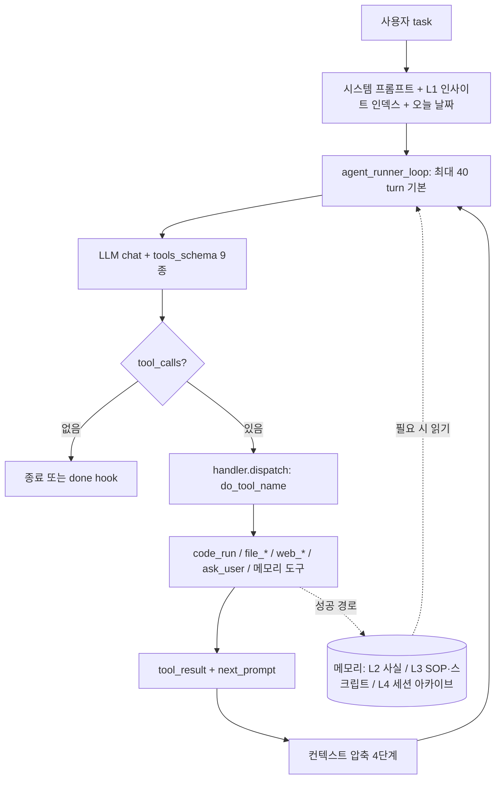

# GenericAgent

> [!summary] 한줄요약
> 약 3K 줄 시드 코드, 9개 atomic tool, 132줄짜리 agent loop(`agent_loop.py`)로 LLM에게 로컬 PC(브라우저·터미널·파일·키보드 마우스·화면·ADB)의 시스템 수준 제어권을 주고, 성공한 작업 경로를 5계층 메모리(L0~L4)의 SOP/코드로 결정화(crystallize)하는 self-evolving 에이전트 프레임워크(MIT, Python). 설계 원칙은 "context information density maximization": 컨텍스트를 키우는 대신 30K 토큰 미만의 고밀도로 유지한다. 논문 arXiv 2604.17091이 있다.

> [!warning] 권한 범위가 매우 큼
> 이 에이전트는 사용자의 **실제 로그인된 Chrome 세션**에 확장 프로그램으로 주입되고, 임의 코드(Python/PowerShell)를 실행하며, 창·키보드·마우스·화면을 제어한다. 편리함의 원천이 곧 위험이다. 사내에서는 격리 VM 안에서, 업무 계정과 분리된 환경에서만 실험해야 한다.

## 1. 배경 — 해결하려는 문제

논문 초록의 문제 정의는 이렇다. 장기 실행(long-horizon) LLM 에이전트는 context에 의해 근본적으로 제한된다. 상호작용이 길어질수록 도구 설명, 검색된 메모리, 원시 환경 피드백이 쌓여 의사결정에 필요한 정보를 밀어내고, 한 과업에서 얻은 경험은 에피소드를 넘어 사라진다. 저자들의 주장은 "장기 성능은 컨텍스트 길이가 아니라 **유한한 컨텍스트 예산 안에 의사결정에 유효한 정보가 얼마나 유지되느냐**로 결정된다"는 것이다. 논문은 1M 토큰 컨텍스트에 기대는 프레임워크들이 비용이 크고 환각도 늘린다고 보며, 현 모델의 "hallucination-free context length"는 그보다 대략 한 자릿수 작다고 주장한다. 그래서 GA는 30K 토큰 미만의 예산을 목표로 하고, 확장 대신 압축에 투자한다.

README 철학은 한 줄이다: "don't preload skills, evolve them." 즉 skill 라이브러리를 미리 채워 넣지 않고, 에이전트가 새 과업을 풀 때마다 실행 경로를 skill(SOP 또는 스크립트)로 굳혀 개인 skill tree를 키운다. 또한 "Self-Bootstrap Proof"라는 주장이 있다: 저장소의 모든 것(Git 설치, `git init`, 모든 커밋 메시지)을 GenericAgent가 자율 수행했고 저자는 터미널을 한 번도 열지 않았다는 것이다. 이는 README의 자기 주장이며 검증하지 못했다.

## 2. 동작 원리·아키텍처

### 2.1 세 축: 계층 메모리 × 최소 도구 × 자율 루프



**에이전트 루프(`agent_loop.py`, 132줄)**: `agent_runner_loop(client, system_prompt, user_input, handler, tools_schema, max_turns=40, ...)`가 전부다. 매 턴 `client.chat(messages, tools)`를 호출하고 tool_calls를 `handler.dispatch`(메서드 이름 규칙 `do_<tool_name>`)로 실행하며, 결과(`StepOutcome(data, next_prompt, should_exit)`)를 다음 user 메시지로 넘긴다. 히스토리는 `*Session`이 보관하고 루프는 새 메시지만 보낸다. 10턴마다 도구 설명 캐시를 리셋하고, `plugins.hooks`의 hook 지점(`agent_before`, `turn_before`, `llm_before/after`, `tool_before/after`, `turn_after`, `agent_after`)을 노출한다. 최대 턴을 넘으면 `MAX_TURNS_EXCEEDED`.

**9개 atomic tool(`assets/tools_schema.json`)**: `code_run`(Python 우선, 여러 번 호출 가능, 코드블록 실행), `file_read`, `file_patch`(고유한 old_content를 new_content로 치환, 정확히 일치해야 함), `file_write`(대규모 편집 전용, `{{file:path:start:end}}` 확장), `web_scan`(단순화된 HTML과 탭 목록, 숨김·떠 있음·가려진 요소 제거), `web_execute_js`, `update_working_checkpoint`(단기 작업 메모, 매 턴 자동 주입), `ask_user`(사용자 결정 요청), `start_long_term_update`(긴 작업 후 장기 메모리 증류). 나머지 능력(OCR, 비전, computer use, ADB 등)은 `code_run`으로 스크립트를 쓰고 SOP로 남기는 방식으로 "자기 환경을 스스로 키운다".

**시스템 프롬프트(`assets/sys_prompt_en.txt`, 8줄)**: "Physical-Level Omnipotent Executor" 역할. "can't do it로 회피하지 말고 도구로 탐색하라", 매 턴 단계·직전 결과·다음 전략을 서술, 실패 에스컬레이션(1회: 오류 이해, 2회: 환경 탐색, 3회: 심층 분석 후 전환 또는 사용자 질문), "새 정보 없이 같은 행동을 반복하지 말라", 되돌릴 수 없는 작업은 사용자에게 먼저 묻기.

### 2.2 5계층 메모리

| 층 | 이름 | 실제 파일 | 규칙 |
|---|---|---|---|
| L0 | Meta Rules(META-SOP) | `memory/memory_management_sop.md` | 메모리를 쓰기 전에 반드시 읽는다. 핵심 공리: "No Execution, No Memory"(성공한 도구 호출 결과만 기록), 검증된 데이터는 삭제 불가(압축·이동만 허용), 휘발성 상태(타임스탬프, PID, 절대경로 등) 저장 금지, 최소 충분 포인터 |
| L1 | Insight Index | `memory/global_mem_insight.txt` | 30줄 이하, 1k 토큰 미만. 장면 키워드 → 메모리 위치 매핑 + RULES(치명적·은밀한 오류의 레드라인, 자주 틀리는 점). How-to 세부는 쓰지 않음 |
| L2 | Global Facts | `memory/global_mem.txt` | 장기 운영으로 축적되는 안정 지식 |
| L3 | Task Skills / SOPs | `memory/*.md`, `*.py` | 작업 유형별 재사용 절차. 저장소에 이미 `web_setup_sop`, `tmwebdriver_sop`, `plan_sop`, `scheduled_task_sop`, `subagent`, `goal_mode_sop`, `morphling_sop` 등 약 40개 파일이 시드로 들어 있음 |
| L4 | Session Archive | `memory/L4_raw_sessions/` | scheduler reflect가 완료 세션을 증류해 보관, 장기 회상용 |

`insight_fixed_structure_en.txt`의 "CONSTITUTION"은 다섯 조항이다: (1) 자기 소스 코드 수정은 사용자에게 먼저 묻고 `./` 안에서는 자유 실험, 패키지·포터블 도구 설치 허용, (2) 결정 전 메모리 확인, 증거 없이 단언 금지, (3) 단계별 실행·blast radius 제한, (4) 키/시크릿 파일은 참조만 하고 읽거나 옮기지 않는다, (5) 메모리 쓰기 전 META-SOP 확인, `memory/` 파일은 패치만(새 파일 생성 제외). 중요한 점은 이 헌법이 **프롬프트 수준의 규칙**이지 기술적 강제가 아니라는 것이다(`code_run`은 사실상 임의 코드를 실행한다).

### 2.3 컨텍스트 압축 (논문 3절)

토큰을 정확히 셀 수 없어 문자 수 휴리스틱을 쓴다: 예산 `B = α·W`, `α ≈ 3 chars/token`. 논문 자신이 CJK 문자는 1~2토큰을 소비해 이 비율이 사용량을 과소평가할 수 있다고 인정한다(한국어 환경에서 중요). 네 단계 트리밍:

1. **도구 출력 절단**: 도구별 임계치 L(예: `code_run` 10,000자, `web_execute_js` 8,000자, `web_scan` text_only 10,000자) 초과 시 앞뒤 L/2만 남기고 중간 생략.
2. **태그 수준 압축**: 오래된 항목에서 가치 낮은 조각 제거. 5턴 간격으로 수행해 변하지 않은 과거 메시지가 prompt cache에 약 80% 턴에서 적중하도록 하며, 최근 10개 메시지는 압축 면제.
3. **메시지 퇴출**: 총 문자 예산 초과 시 더 엄격한 규칙으로 Stage 2 재실행(최근 4개만 면제) 후 가장 오래된 메시지부터 제거.
4. **working checkpoint**: 단기 메모 도구로 핵심 상태를 매 턴 재주입.

`web_scan`은 라이브 DOM을 복제해 요소별 가시성을 계산하고 오버레이·파티션 분석으로 주 영역/비필수 영역을 구분한 뒤 가려진 요소를 제거하고 직렬화한다(`simphtml.py`, 873줄).

### 2.4 반사(reflect)·자율 모드

`reflect/`에는 `autonomous.py`, `goal_mode.py`, `scheduler.py`, `checklist_master.py`, `agent_team_worker.py`가 있다. `goal_mode.py`는 "시간 예산이 소진될 때까지 계속 자기 구동": 완료 선언이 불가능하고 계속 깨워지며 생성 → 검증 → 개선 단계를 교대한다. 프롬프트에는 "개선 단계에서 '변경 없음' 산출 금지, 검증이 사소한 문제만 찾으면 검증 기준이 낮은 것이므로 기준 상향 보고서를 낸다" 같은 규칙이 있다. README의 2026-05 소식에는 Goal mode(05-08), Conductor sub-agent 오케스트레이션(05-14), Goal Hive(BBS 조정 마스터/워커 병렬, 05-17), Morphling(외부 저장소에서 목표와 테스트를 추출해 컴포넌트별로 호출·재작성·폐기를 결정, 05-18), TUI v3(05-23)가 기록돼 있다.

### 2.5 TMWebDriver — "실제 브라우저" 제어

`TMWebDriver.py`(288줄)가 로컬 WebSocket 서버를 열고, `assets/tmwd_cdp_bridge/`의 Chrome 확장(MV3, 이름 "TMWD CDP Bridge" v2.0)이 연결된다. 확장 권한은 `cookies`, `tabs`, `activeTab`, `debugger`, `scripting`, `alarms`, `declarativeNetRequest`, `management`, `contentSettings` 및 host_permissions `<all_urls>`이고, 모든 프레임의 `document_start` MAIN world에 `disable_dialogs.js`를 주입한다. 즉 모든 사이트의 쿠키·탭·디버거(CDP)에 접근 가능한 매우 강한 권한이다. README는 헤드리스 자동화가 탐지되는 반면 GA의 웹 도구는 SannySoft 56/56, bot.incolumitas 36/36, reCAPTCHA v3 0.9 등을 통과한다고 표로 제시한다(자체 보고). 이는 봇 탐지 회피 능력을 홍보하는 것이므로 약관 위반 위험과 직결된다.

## 3. 핵심 기능 상세

- **Self-evolution**: 최초 수행 시 의존성 설치·스크립트 작성·디버깅·검증 → SOP/스크립트로 L3에 기록 → 이후 "one-line invoke". README 예: WeChat 메시지 읽기, Hacker News 모닝 다이제스트(스케줄 포함), 주식 모니터링 알림, Gmail 전송(OAuth 구성).
- **고급 능력 해제는 지시로**: "Set up your web automation capability" 같은 한 문장이 사전 설치된 SOP를 읽고 필요한 것을 설치·적응해 메모리에 남긴다. 단 사전 SOP가 **중국어로 작성**돼 있고(한국어 사용자에게 읽기 장벽, 에이전트는 읽을 수 있음) Windows에서 다듬어졌다고 README가 밝힌다. 영어 SOP로 재작성하라고 시킬 수 있다.
- **프런트엔드**: TUI v3(`frontends/tui_v3.py`, 6,060줄, prompt_toolkit+rich), TUI v2(Textual), Streamlit(`launch.pyw`), 데스크톱 GUI·펫, Telegram·Discord·Lark/Feishu·WeChat·QQ·WeCom·DingTalk 봇, ACP 브리지(`genericagent_acp_bridge.py`), P2P Hub(`hub_p2p.py`).
- **서브에이전트**: `memory/subagent.md` — `--func`(단발 순수 함수 모드, `prompt.out.txt`에 결과)와 `--task`(파일 기반 지속 협업: `output.txt`의 `[ROUND END]`, `reply.txt`, 개입 파일 `_stop`/`_keyinfo`/`_intervene`).
- **키체인(`memory/keychain.py`)**: `keys.set("name", file="path")` 후 `keys.name.use()`로 쓰고 출력은 마스킹. 단 저장 방식이 `sha256(f"{user}@ga_keychain")`을 마스크로 한 **XOR**이다(홈 디렉터리 `ga_keychain.enc`). 이것은 암호화가 아니라 난독화이므로 같은 사용자 계정의 프로세스나 파일을 얻은 공격자가 복원할 수 있다.
- **Plugin/hook**: `plugins/hooks.py`, `langfuse_tracing.py`(Langfuse 트레이싱), `project_mode.py`.

## 4. 평가(논문 4절, 자체 평가)

논문과 README는 5개 차원에서 Claude Code, OpenAI Codex, OpenClaw를 기준선으로 비교한다(Claude Sonnet 4.6, Opus 4.6, GPT-5.4, MiniMax M2.7 백본). 확인한 수치:

| 항목 | 결과 (논문 본문 기준) |
|---|---|
| Lifelong AgentBench | GA 정확도 100%, 입력 토큰 222k(Claude Code 800k, OpenClaw 1.43M), 효율 비율 4.15 |
| SOP-Bench | GA 100%(효율비 0.48), Claude Code 85%(효율비 0.68), GA 입력 2.02M vs OpenClaw 2.60M vs Claude Code 1.23M |
| RealFin-benchmark | GA 65%(효율비 5.70), Claude Code 60%/55%, CodeX 60%, OpenClaw 35% |
| 도구 효율(5개 장기 과제) | 성공 100%(Claude Code와 동일, OpenClaw 80%), GA 188,829 토큰은 Claude Code 537,413의 35.1%, OpenClaw 633,101의 29.8% |
| 반복 실행 효율 | 5회 반복에서 시간 102초→약 66초, 토큰 200,439→약 100,000 |
| 9라운드 장기(LangChain) | 1라운드 대비 9라운드에서 시간 7m30s→1m38s(-78.2%), LLM 호출 32→5(-84.4%), 토큰 222,203→23,010(-89.6%). 6~9라운드는 약 23k±1k 토큰 |
| 교차 과제 8개 | 후속 실행이 첫 실행보다 모두 토큰 감소(절감률 하한 61.0%는 본문 일부만 확인) |
| 전체 프롬프트 길이(Table 7) | GA 2,298 토큰 vs Claude Code 22,821, CodeX 23,932, OpenClaw 43,321 |
| 웹(Claude Opus 4.6 동일) | WebCanvas GA 0.834(0.18M 토큰) vs OpenClaw 0.722(0.71M), Custom Tasks GA 0.577(0.26M) vs 0.500(0.76M) |
| LoCoMo(Table 6) | 외부 검색 없이 Mem0 등 임베딩 기반 시스템을 앞선다고 서술(Mem0 F1 수치 등 표는 존재, 전 비교 수치는 읽지 않음) |

해석 주의: (1) 평가자가 저자 본인들이며 데이터는 별도 저장소(JinyiHan99/GA-Technical-Report)에 있어 재현하지 않았다. (2) 비교 대상의 설정(Claude Code가 이 과제에 최적화돼 있는지 등)에 따라 결과가 달라질 수 있다. (3) 샘플 수가 작은 벤치마크가 많다(예: BrowseComp-ZH는 10개 무작위 샘플, 도구 벤치는 11+5 과제). (4) README의 "30K 미만 context"는 이 논문의 목표 예산이고 실제 세션 길이 분포는 확인하지 못했다.

논문이 스스로 밝힌 한계: 30라운드 실행 상한(복잡한 연구는 여러 세션에 걸쳐야 하고 연속성은 보고서와 태스크 리스트로만 유지), 반영 기반 가중치 조정은 예비 설계로 장기 효과 미입증, 자기 개선 로그는 수동 큐레이션 의존, 스킬 트리의 병합·폐기 등 구조 관리는 전부 수동.

## 5. 설치·사용

권장: Python 3.11 또는 3.12 (README: 3.14는 `pywebview` 등과 비호환; `pyproject.toml`은 `>=3.10,<3.14`).

```bash
git clone https://github.com/lsdefine/GenericAgent.git && cd GenericAgent
uv venv && uv pip install -e ".[ui]"
cp mykey_template_en.py mykey.py        # LLM API 키를 직접 기입 (git에 커밋 금지)
python frontends/tui_v3.py              # 터미널 UI(권장)
python launch.pyw                       # Streamlit 웹 UI
# 헤드리스: ga CLI (pyproject scripts: ga = ga_cli.cli:main), python agentmain.py --func prompt.txt
```

원라인 설치 스크립트(`assets/ga_install.sh`, `ga_install.ps1`)가 있다. README는 읽어 본 뒤 쓰라고 안내한다.

```bash
GLOBAL=1 bash -c "$(curl -fsSL https://raw.githubusercontent.com/lsdefine/GenericAgent/main/assets/ga_install.sh)"
```

원격 스크립트를 내려받아 즉시 실행하는 방식이므로 사내에서는 쓰지 말고 클론한 소스를 검토 후 설치한다. 코어 의존성은 `requests`, `beautifulsoup4`, `bottle`, `simple-websocket-server`, `aiohttp` 5개이며 UI(Streamlit, textual, prompt_toolkit, rich, pillow, pywebview)와 봇 SDK(telegram, qq-botpy, lark-oapi, dingtalk-stream 등)는 extras다. "Playwright도 LangChain도 없음"이 코어 의존성의 특징이다. 웹 자동화는 "Set up your web automation capability."라고 말하면 안내에 따라 번들 Chrome 확장을 `chrome://extensions`에 드래그해 설치한다. 

## 6. 디렉터리·코드 구조에서 확인한 것

- 루트 핵심: `agent_loop.py`(132줄), `agentmain.py`(347줄), `llmcore.py`(1,241줄, LLM 클라이언트·세션), `ga.py`(608줄, `GenericAgentHandler`가 `do_code_run`, `do_web_scan`, `do_file_patch` 등 도구를 구현), `TMWebDriver.py`(288줄), `simphtml.py`(873줄). 즉 "3K 줄 코어"는 대략 이 파일들의 합(약 3.5천 줄)과 일치한다. 
- 전체 Python 파일 합계는 약 5.2만 줄(`wc -l`)이고 대부분이 프런트엔드(`tuiapp_v2.py` 8,877줄, `tui_v3.py` 6,060줄, `desktop_bridge.py` 3,003줄, `qtapp.py` 2,478줄 등)다. "3K 줄"은 코어 한정이라는 점을 알아야 한다.
- `memory/`는 시드 SOP와 보조 스크립트(`ljqCtrl.py` 키보드·마우스 제어, `ocr_utils.py`, `ui_detect.py`, `procmem_scanner.py`(프로세스 메모리 스캐너 SOP도 포함), `adb_ui.py`, `keychain.py`) 포함. `memory/L4_raw_sessions/`는 런타임 아카이브.
- `assets/`: 시스템 프롬프트 한/영, 도구 스키마 한/영, `GenericAgent_Technical_Report.pdf`, `ga_httpapp.py`, `supergrok_proxy.py`, `tmwd_cdp_bridge/`.
- `SECURITY.md`가 없다(루트 파일 목록 확인).
- `agent_loop.py`와 `plugins/hooks`: `try: from plugins.hooks import trigger ... except ImportError: no-op` 구조로 선택적 확장.

## 7. 비교

| 항목 | GenericAgent | OpenClaw (README 비교표) | Claude Code |
|---|---|---|---|
| 코드 규모 | 코어 약 3K 줄 | 약 530,000 줄 | 대규모 |
| 배포 | pip + API 키 | 다중 서비스 오케스트레이션 | CLI + 구독 |
| 브라우저 | 실제 브라우저(세션 유지) | 샌드박스/헤드리스 | MCP 플러그인 경유 |
| OS 제어 | 마우스·키보드·비전·ADB | 멀티에이전트 위임 | 파일+터미널 |
| 자기 진화 | 자율 skill 성장 | 플러그인 생태계 | 세션 간 무상태 |

(비교표는 README 서술이며 각 제품의 현행 기능과 다를 수 있다. "Claude Code는 세션 간 무상태"는 CLAUDE.md와 auto memory가 있는 현재 상태와 맞지 않는 측면이 있다.) 같은 계열 노트 [[claw-code]]는 Claude Code 구조를 충실히 재현하는 쪽, GenericAgent는 최소 도구+메모리 결정화라는 정반대 방향이다. 웹 전용·클라우드 API 기반의 [[firecrawl-web-agent]]와도 구분된다(이쪽은 로컬 PC 전권). 컨텍스트 압축이라는 문제의식은 [[headroom]]과 맞닿아 있으나 Headroom은 프록시/라이브러리로 외부에서 압축하는 반면 GA는 에이전트 설계 안에 압축을 내장한다. [[nullclaw]]와의 비교는 해당 노트 참조.

## 8. 장단점·한계·성숙도

사실 지표(GitHub API 2026-10-01): stars 14,277 / forks 1,663 / open issues 172 / MIT / Python / 생성 2026-01-16 / 마지막 push 2026-09-30 / 커밋 약 1,370개 / 릴리스는 `desktop-portable-vX.Y.Z` 형식(최신 v0.2.0, 2026-08-24; 그 이전 v0.1.8 2026-07-21, v0.1.5 2026-07-11, v0.1.4 2026-06-26)으로 데스크톱 포터블 패키지 릴리스이며 라이브러리 버전과는 별개다. `pyproject.toml`의 패키지 버전은 0.1.0. 활동은 매우 활발하다(이전 노트의 "최근 활동 2026-05"는 틀렸고 실제로는 어제까지 push). 열린 이슈 172개는 규모 대비 적지 않다.

장점
- 코어가 작고 읽기 쉽다. 에이전트 루프, 도구 디스패치, 메모리 규율을 한 번에 이해하기 좋은 교재다.
- 메모리 설계가 구체적이다: "No Execution, No Memory", 검증 데이터 불가침, 휘발 상태 금지, 인덱스 30줄 상한 같은 규칙은 어떤 에이전트 메모리 설계에도 이식 가능한 원칙이다.
- 컨텍스트 압축 4단계와 prompt cache 적중을 고려한 5턴 주기 압축은 실무적 통찰이다.
- 반복 실행에서 토큰이 수렴(논문: 222k→23k)한다는 주장은 "결정화"의 가치를 정량으로 제시한다(자체 평가).

단점·한계
- 안전장치가 프롬프트 규칙 중심이다. 코드 실행·브라우저 쿠키·키보드 마우스 제어가 기본 경로이고 샌드박스가 없다.
- 시드 SOP가 중국어이며 Windows 중심으로 다듬어졌다. 한국어 환경(토큰 환산, 폰트, 한글 입력) 검증은 확인하지 못했다. 문자 수 휴리스틱(α=3)은 한글에서 부정확하다.
- 논문이 인정한 한계(30라운드 상한, 수동 큐레이션, 예비 설계) 외에, 평가가 저자 자체 수행이며 샘플이 작다.
- 이슈 172개, 프런트엔드가 방대(코드 5.2만 줄 중 대부분)해 코어의 단순함과 주변부 복잡도가 공존한다.
- README의 "자율 구축" 서사와 상업 파트너 언급(DintalClaw, "정무(政務) 봇" 소개)은 홍보 성격이 섞여 있다. 공식 채널은 GitHub와 gaagent.ai뿐이라는 고지가 있고, 이름을 도용하는 제3자 사이트가 있다는 경고로 읽힌다.

## 9. 보안·라이선스·운영 리스크

- **실제 로그인 세션 노출**: 확장 권한(`cookies`, `debugger`, `<all_urls>`)과 MAIN world 주입은 은행·사내 그룹웨어·메일 같은 로그인 세션을 에이전트와 LLM 컨텍스트에 노출할 수 있다. 업무용 브라우저 프로필에서 절대 사용하지 않는다.
- **임의 코드 실행과 자기 수정**: `code_run`은 임의 Python/PowerShell을 실행하고 에이전트가 자기 SOP·메모리를 수정한다. 프롬프트 인젝션(웹 페이지, 이메일, 파일 내용)이 곧 호스트 침해 경로가 된다. 헌법의 "시크릿 파일은 읽지 않는다"는 강제력이 없다.
- **키체인 XOR 난독화**: 위 3절 설명대로 암호화가 아니다. API 키는 환경변수 또는 OS 키체인/시크릿 매니저에서 주입하고 `mykey.py`를 커밋하지 않는다.
- **원격 설치 스크립트**: `curl | bash`, `irm | iex` 방식. 사내에서는 금지, 소스 검토 후 설치.
- **봇 탐지 회피**: 서비스 약관·정보통신망법 상 문제가 될 수 있다. 사내 업무 자동화에 쓰더라도 대상 사이트 정책 확인 필요. 프로세스 메모리 스캐너(`procmem_scanner`) 같은 도구도 시드 SOP에 있어 보안 정책상 별도 승인 영역이다.
- **라이선스**: MIT. 의존성은 코어 5개로 단순하나 UI/봇 extras와 번들 Chrome 확장은 별도 감사 필요.
- **데이터 전송**: 모든 컨텍스트가 선택한 LLM 제공자(Claude/Gemini/Kimi/MiniMax 등)로 전송된다. 사내 기밀·개인정보가 컨텍스트에 섞이지 않게 해야 하고, 중국 계열 모델 API 사용은 사내 정책 확인 대상이다. 메모리 L4 세션 아카이브는 로컬 디스크에 대화를 보존한다.
- **운영**: 자율 모드(Goal mode, scheduler)는 사람이 지켜보지 않는 상태로 장시간 실행되므로 비용·행동 상한이 필요하다.

## 11. 확인하지 못한 항목

- GenericAgent를 실제로 실행해 보지 않았다(문서·코드·논문 정독 기준). 논문의 모든 표와 부록(예: LoCoMo 전체 수치)을 끝까지 검증하지는 않았다.
- 별도 평가 저장소 JinyiHan99/GA-Technical-Report의 원자료.
- `llmcore.py`의 세션/캐시 세부, `desktop_bridge.py`와 데스크톱 GUI 패키지의 보안.
- 기여자 수(API 호출 구문 오류로 확인 못함), 이슈 172개의 성격(버그/기능 요청 비율).
- "Self-Bootstrap" 주장, million-scale Skill Library, DintalClaw 서비스의 실체.
- README에 링크된 WeChat 기사(mp.weixin.qq.com)는 열지 않았다.

## 관련 노트
[[nullclaw]] · [[claw-code]] · [[firecrawl-web-agent]] · [[headroom]] · [[gepa]] · [[claude-code-best-practice]] · [[sanglard-agent-md]]

## 출처
- https://github.com/lsdefine/GenericAgent (클론 후 README.md, pyproject.toml, agent_loop.py, agentmain.py, ga.py, assets/sys_prompt_en.txt, assets/tools_schema.json, assets/insight_fixed_structure_en.txt, assets/tmwd_cdp_bridge/manifest.json, memory/keychain.py, memory/subagent.md, reflect/goal_mode.py)
- https://arxiv.org/abs/2604.17091 및 https://arxiv.org/html/2604.17091 (본문 전체를 텍스트로 변환해 정독)
- GitHub API: repos/lsdefine/GenericAgent, commits(마지막 페이지 번호), releases (2026-10-01)
