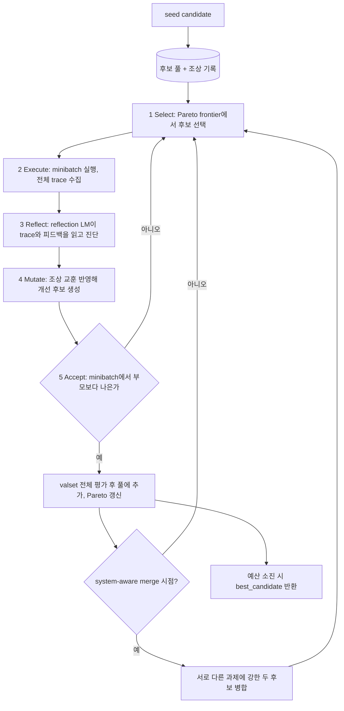

# GEPA (Genetic-Pareto)

> [!summary] 한줄요약
> 실행 기록과 평가 피드백을 읽어 프롬프트·코드 같은 텍스트 후보를 반복 개선하는 최적화 프레임워크다. 평가 함수의 품질이 성과를 좌우한다.

시스템의 "텍스트 파라미터"(프롬프트, 코드, 설정, 에이전트 스캐폴드, 도구 설명 등)를 **LLM이 실행 trace를 자연어로 읽고 반성(reflect)해 변이시키고, Pareto frontier로 후보를 보존·선택**하는 방식으로 최적화하는 프레임워크. 논문 "GEPA: Reflective Prompt Evolution Can Outperform Reinforcement Learning"(arXiv 2507.19457)의 공식 구현이며, 코어 라이브러리는 런타임 의존성이 0개(`dependencies = []`)다.

MIT, Python, PyPI `gepa`, 최신 v0.1.4.

## 1. 배경 — 해결하는 문제

LLM 기반 시스템을 개선하는 전통적 선택지는 (a) 사람이 프롬프트를 손으로 고치는 것, (b) RL(GRPO 등)이나 fine-tuning으로 가중치를 바꾸는 것이다. (b)는 스칼라 보상 하나로 롤아웃 전체를 압축하므로 수천~수만 번의 롤아웃이 필요하고 API 전용 모델에는 쓸 수 없다. GEPA의 문제의식은 "롤아웃은 결국 자연어로 직렬화 가능한 trace(지시문, 추론 과정, 도구 호출, 도구 출력, 에러 메시지, 프로파일링 결과)이고, 이 텍스트 안에는 스칼라보다 훨씬 풍부한 학습 신호가 있다"는 것이다.

그래서 LLM이 trace를 직접 읽고 "왜 실패했는지"를 진단해 프롬프트를 고치게 한다.

논문 초록(arXiv, 2025-07 제출)의 핵심 주장: 6개 과제에서 GEPA는 GRPO를 평균 6%, 최대 20% 앞서면서 롤아웃은 최대 35배 적게 사용하고, 당시 대표 프롬프트 최적화기 MIPROv2를 10% 이상(예: AIME-2025에서 +12%p) 앞서며, 코드 최적화의 inference-time search로도 가능성을 보였다. README는 "If you can measure it, you can optimize it"이라는 문구로 범위를 확장한다.

일반 운영 관점에서 정리하면, GEPA는 **"평가 함수가 있는 모든 텍스트 산출물을 에이전트처럼 반복 개선하는 엔진"**이다. 평가 함수(evaluator)를 쓸 수 있고 그 평가 함수가 실행 로그/오류 같은 진단 텍스트를 함께 돌려줄 수 있을 때 효과가 크다.

## 2. 동작 원리

### 2.1 핵심 루프 (README "How It Works", 논문 Algorithm)



- **Pareto 기반 선택**: 평균 점수 최고 후보만 반복 선택하면 지역 최적점에 갇힌다. GEPA는 검증 인스턴스별로 "그 인스턴스에서 최고 점수를 낸 후보들"의 집합(frontier)을 유지하고, 그중에서 후보를 (빈도 가중으로) 샘플링한다. 코드에서 `strategies/candidate_selector.py`가 `ParetoCandidateSelector`(기본), `CurrentBestCandidateSelector`, `EpsilonGreedyCandidateSelector`, `TopKParetoCandidateSelector`를 제공한다.
- **Reflective mutation**: `proposer/reflective_mutation/reflective_mutation.py`(714줄)의 `ReflectiveMutationProposer`가 선택된 후보를 minibatch에서 실행하고(`capture_traces=True`), 어댑터가 만든 reflective dataset(입력, 출력, 피드백)을 reflection LM에 주어 대상 컴포넌트의 새 텍스트를 제안하게 한다(`strategies/instruction_proposal.py`가 프롬프트 템플릿과 응답 파싱, 잘림 감지 담당). 컴포넌트 선택은 기본 `round_robin`.
- **Merge(crossover)**: `proposer/merge.py`(404줄)가 공통 조상을 찾아, 서로 다른 컴포넌트에서 각각 개선된 두 후보를 합친다(`use_merge=True`, `max_merge_invocations=5`). 논문은 Merge가 GPT-4.1 Mini에서는 잘 작동했지만 Qwen3 8B에서는 성능이 떨어지는 경우가 있었다고 보고한다(롤아웃 예산 배분 때문이라고 해석).
- **Acceptance**: 기본 `strict_improvement`(minibatch 점수 합이 부모보다 높아야 함), 옵션 `improvement_or_equal`.
- **ASI(Actionable Side Information)**: 평가 함수가 점수와 함께 돌려주는 진단 텍스트(에러 메시지, 프로파일러 출력, 추론 로그). README는 "텍스트 최적화의 gradient 유사물"이라고 부른다. `optimize_anything`에서는 `oa.log("...")`로 남긴다.
- **조상 교훈 누적**: 변이할 때 부모뿐 아니라 계보 전체에서 얻은 교훈이 reflection 입력에 반영돼 "같은 실수 반복"을 줄인다.

### 2.2 핵심 코드 구조 (`src/gepa/`)

| 경로 | 줄 수/역할 |
|---|---|
| `api.py`(502) | `gepa.optimize()` 진입점. 주요 인자: `seed_candidate: dict[str,str]`, `trainset`, `valset`, `adapter`, `task_lm`, `reflection_lm`, `candidate_selection_strategy`(`pareto`/`current_best`/`epsilon_greedy`/`top_k_pareto`), `reflection_minibatch_size`, `module_selector`, `use_merge`, `max_metric_calls`, `max_reflection_cost`, `cache_evaluation`, `use_wandb`/`use_mlflow`, `run_dir`, `seed`, `acceptance_criterion` 등 |
| `optimize_anything.py`(540) | 범용 API: 임의 문자열 후보 + `evaluator` + `objective`. `GEPAConfig`, `EngineConfig`로 설정 |
| `core/engine.py`(1,304), `core/state.py`(1,165) | 최적화 엔진과 상태(후보, 점수, Pareto front 매핑, 조상 트리) |
| `core/adapter.py`(256) | `GEPAAdapter` 프로토콜: `evaluate(batch, candidate, capture_traces) -> EvaluationBatch(outputs, scores, trajectories, objective_scores)`와 `make_reflective_dataset(...)`. 점수는 minibatch 수락에서는 합, valset/Pareto 추적에서는 평균 사용 |
| `proposer/reflective_mutation/` | 반성 기반 변이. `combee.py`(762)는 병렬 제안 전략(구체 동작은 읽지 않음) |
| `strategies/` | 후보 선택, 배치 샘플링(`epoch_shuffled`), 컴포넌트 선택, 평가 정책, 수락 기준 |
| `adapters/` | `default_adapter`, `confidence_adapter`(logprob), `dspy_adapter`, `dspy_full_program_adapter`, `generic_rag_adapter`, `mcp_adapter`, `langchain_adapter`, `terminal_bench_adapter`, `anymaths_adapter`, `optimize_anything_adapter` |
| `oa/` | optimize_anything 엔진 계열: `ensemble.py`(778), `eval_server.py`(744, 에이전틱 최적화용 HTTP 평가 서버), `sandbox.py`(369), `budget.py`, `config.py` |
| `gskill/` | 코딩 에이전트용 저장소별 skill 자동 학습 |

설치 의존성이 `dependencies = []`이고 `full` extra에 `litellm>=1.83,<1.92`, `tqdm`, `cloudpickle`, `datasets`, `mlflow`, `wandb` 등이 들어간다. `pyproject.toml` 주석이 흥미롭다: litellm 1.92가 manylinux 휠만 배포해 macOS/Windows/3.14에서 설치가 깨지므로 상한을 고정했다는 설명이다.

즉 최신 litellm을 쓰는 환경에서는 버전 충돌 가능성을 확인해야 한다. 요구 Python은 `>=3.10,<3.15`.

### 2.3 optimize_anything과 에이전틱 백엔드

최근 버전에서 `optimize_anything`은 단일 인터페이스 아래 여러 backend(`engine=`)를 갖는다. `.claude/skills/gepa-optimize-anything/SKILL.md`에 따르면 `gepa`(기본, 반성 기반 진화 탐색), `autoresearch`(Claude Code 서브프로세스 하나가 work dir에서 연구자처럼 반복하며 HTTP 평가 서버로 점수를 받음), `meta_harness`(Claude 서브프로세스가 frontier/히스토리를 읽고 새 후보를 쓰면 엔진이 벤치마크), 그리고 비교 기준용 `best_of_n`이 있고, `optimize_sequential/parallel/best_of/vote` 같은 조합 헬퍼와 plateau 시 backend를 바꾸는 스케줄러도 있다.

에이전틱 백엔드는 `claude` CLI를 `subprocess.Popen`으로 띄우며, Linux에서는 `bwrap`(bubblewrap) 기반의 자체 샌드박스(`oa/sandbox.py`: `/usr` 읽기 전용 바인드, `work_dir`만 쓰기 가능, `WebFetch`/`WebSearch` 도구는 차단, 네트워크 네임스페이스는 호스트와 공유)를 쓰고 macOS는 Claude Code 내장 Seatbelt 샌드박스를 쓴다. `sandbox=False`는 무방비 실행이므로 경고가 표시된다.

SKILL의 `references/gotchas.md`는 실전 함정을 솔직히 적어 놓았다. 주요 주의점은 다음과 같다.

1. **보상 해킹**: KernelBench에서 정확성만 점수로 주자 "참조 구현을 감싸라"는 프롬프트를 찾아 pass@1 약 0.87을 얻었지만 실제 목표(빠른 커널)는 기준선 수준으로 붕괴했다. 해결책은 정확성 게이트 후 목표 지표에 비례하는 gated objective다.
2. **winner's curse**: 검증 집합에서 max를 취하므로 best_score는 낙관적이고 held-out `test_set`으로 정직한 수치를 따로 봐야 한다.
3. N=1 확률적 평가에서는 분산에 주의해야 한다.
4. 기본 `max_evals=100`은 대개 부족하다(선택 집합의 15~20배 이상 권장).
5. `engine_config`는 엄격 검증되므로 오타 키는 `TypeError`를 낸다.
6. 에이전틱 백엔드는 사전 요건(`claude` CLI 인증, `bwrap`, `jq`)을 갖춰야 한다.
7. 점수 상한이 있는 지표에는 `stop_at_score`가 필수다.

## 3. 핵심 기능 상세

- **`gepa.optimize()`**: 프롬프트용 고수준 API. `seed_candidate`는 `{"system_prompt": "..."}`처럼 컴포넌트 이름 → 텍스트의 dict이며 여러 컴포넌트를 동시에 진화시킬 수 있다.
- **`optimize_anything`**: 임의 문자열 후보. 평가자 규약은 "텍스트 입력, 점수(높을수록 좋음)와 선택적 피드백 출력" 하나뿐이다. 단일 문제 최적화와 여러 문제로 일반화하는 generalization 모드를 모두 지원한다(`test_set`은 보고 전용).
- **DSPy 통합**: `dspy.GEPA(metric=..., max_metric_calls=150, reflection_lm=...)`. DSPy 사용자는 이 경로가 가장 쉽다.
- **어댑터**: 위 표 외에 DSPy Full Program 어댑터는 시그니처·모듈·제어 흐름까지 진화(README: MATH 67%→93%). Generic RAG 어댑터는 ChromaDB/Weaviate/Qdrant/Pinecone을 추상화. MCP 어댑터는 도구 설명과 시스템 프롬프트를 최적화하며 단일/다중 도구를 지원하고 Ollama 같은 로컬 모델 경로도 문서화돼 있다.
- **gskill**: SWE-smith로 대상 저장소의 실제 커밋에서 검증 가능한 과제를 대량 생성(버그 주입, Docker 환경, 테스트), 빈 skill에서 시작해 mini-SWE-agent가 병렬 Docker에서 실행한 pass/fail, trace, 테스트 출력을 reflection 모델이 읽고 skill을 개선, 결과 `best_skills.txt`를 에이전트 시스템 프롬프트에 주입. 학습된 skill은 다른 에이전트로 이전된다고 README가 주장한다.
- **Agent Skill 배포**: 저장소를 클론하면 `.claude/skills/gepa-optimize-anything/`가 Claude Code 등에서 자동 발견되고, 다른 프로젝트에는 `/plugin marketplace add gepa-ai/gepa`, `/plugin install gepa-optimize-anything@gepa`로 설치한다. `scripts/preflight.py`가 실행 전 점검을 한다.
- **관측/재현**: wandb·mlflow 로깅, `run_dir` 상태 저장·재개, `cache_evaluation`(기본 꺼짐), `seed`, `callbacks`, `visualization.py`.

## 4. 성과 주장과 검증 상태

| 주장 | 출처 | 내가 확인한 것 |
|---|---|---|
| GRPO 대비 평균 +6%, 최대 +20%, 롤아웃 최대 35배 적음 | README, 논문 초록 | 논문 초록·서론에서 확인(재현 안 함). IFBench에서 678 롤아웃 만에 최적 프롬프트 발견이라는 표 설명 |
| MIPROv2 대비 +10% 이상, 집계 +13% vs MIPRO +5.6% | 논문 서론 | 확인(논문 본문) |
| GEPA 프롬프트가 MIPROv2의 약 33% 이하 길이 | 논문 부록 Figure 17 | 문구 확인. 짧은 프롬프트가 추론 비용을 줄인다는 해석 |
| AIME 2025: GPT-4.1 mini 46.6→56.6% | README 퀵스타트 | README 서술만 확인 |
| Databricks 사례 "90x cheaper" | README, Databricks 블로그 | 블로그 WebFetch 요약으로 확인: IE Bench에서 GEPA 최적화 gpt-oss-120b가 Claude Opus 4.1 기준선을 약 2.2점 앞서고(+4.3점 향상), **서빙 비용**(공시 가격×토큰 분포)이 약 90배 낮다는 의미. 같은 글의 단서: GEPA 최적화 시간이 약 2~3시간(대안 약 1시간), 최적화된 프롬프트가 길어져 서빙 토큰 비용이 늘어날 수 있음, 대규모(10만+ 요청) 운영을 가정해야 초기 최적화 비용이 무시됨. Claude Opus 4.1은 GEPA로 +6.4, Sonnet 4는 +4.8 향상 |
| ARC-AGI 에이전트 32%→89%, 클라우드 스케줄링 40.2% 비용 절감, Jinja 코딩 에이전트 55%→82% | README Key Results(블로그 링크) | 블로그는 열지 않음. 확인 못함 |
| 50+ production uses (Shopify, Databricks, Dropbox, OpenAI, Pydantic, MLflow 등) | README | 확인 못함(문구만) |

해석 주의:

1. "90x cheaper"는 **추론 단가** 비교이지 최적화 비용을 포함한 비용이 아니고, 대상 벤치마크가 정보 추출 과제로 한정된다.
2. "35x fewer rollouts"는 Qwen3 8B vs GRPO 비교다.
3. 최적화 성과는 평가셋 품질과 일반화 격차(winner's curse)에 크게 좌우되며, gotchas가 이를 스스로 경고한다.
4. AIME 같은 수학 과제에서의 향상은 도메인 지침 암기에 가까운 면이 있다(README의 예시 최적화 프롬프트가 수학 문제 유형별 요령을 길게 담고 있음). 그 프롬프트가 같은 분포의 문제에는 유효하지만 분포가 바뀌면 이득이 줄 수 있다.

## 5. 설치·사용

```bash
pip install gepa              # 코어(의존성 없음)
pip install "gepa[full]"      # litellm, mlflow, wandb, datasets 등
pip install "gepa[confidence]"  # logprob 기반 ConfidenceAdapter
pip install git+https://github.com/gepa-ai/gepa.git   # main
```

```python
import gepa

trainset, valset, _ = gepa.examples.aime.init_dataset()
seed = {"system_prompt": "You are a helpful assistant. Answer the question. "
                         "Put your final answer in the format '### <answer>'"}
result = gepa.optimize(
    seed_candidate=seed,
    trainset=trainset, valset=valset,
    task_lm="openai/gpt-4.1-mini",     # 최적화 대상 모델
    reflection_lm="openai/gpt-5",      # 반성용 강한 모델
    max_metric_calls=150,               # 예산(평가 호출 수)
)
print(result.best_candidate["system_prompt"])
```

```python
# optimize_anything: 임의 텍스트(코드/설정/프롬프트)
import gepa.optimize_anything as oa
from gepa.optimize_anything import optimize_anything, GEPAConfig, EngineConfig

def evaluate(candidate: str) -> float:
    r = run_my_system(candidate)
    oa.log(f"Output: {r.output}")     # ASI: 반성에 쓰이는 진단 텍스트
    oa.log(f"Error: {r.error}")
    return r.score

result = optimize_anything(seed_candidate="<초기 산출물>", evaluator=evaluate,
    objective="무엇을 최적화하는지 서술",
    config=GEPAConfig(engine=EngineConfig(max_metric_calls=100)))
```

```text
# Claude Code에서 skill로 사용
/plugin marketplace add gepa-ai/gepa
/plugin install gepa-optimize-anything@gepa
```

실전 팁(SKILL/gotchas 기반):

- 평가자를 먼저 설계한다.
- 보상 해킹을 막는 gated objective를 쓴다.
- `max_evals`와 `stop_at_score`를 명시한다.
- N>1 샘플 평균으로 분산을 줄인다.
- `test_set`으로 최종 보고 수치를 따로 낸다.

## 6. 디렉터리·코드에서 확인한 것

- 루트: `src/`, `tests/`, `docs/`(mkdocs), `examples/`, `assets/`, `AGENTS.md`, `CLAUDE.md`, `CITATION.cff`, `uv.lock`. 파일 약 600개.
- 저장소 자체가 Claude Code로 개발되는 흔적(`CLAUDE.md`, `AGENTS.md`, `.claude/skills/`)이 있다.
- `src/gepa/core`와 `proposer`, `strategies`가 알고리즘의 심장이고 어댑터와 oa/gskill이 응용이다. 코어 알고리즘 파일(engine+state+reflective_mutation+merge)만 약 3.5천 줄.
- 라이선스 MIT, 저자 연락처가 UC Berkeley(Lakshya A Agrawal). Stanford DSPy와의 관계가 깊다(DSPy 어댑터가 DSPy 쪽 저장소에도 있음).
- 열린 이슈 136개로 사용량 대비 이슈가 많은 편.

## 7. 비교

| 대상 | 차이 |
|---|---|
| DSPy MIPROv2 | 지시문+few-shot 조합을 베이지안 탐색. GEPA는 trace를 읽는 반성 기반이라 샘플 효율이 높다고 논문이 주장(+10% 이상). `dspy.GEPA`로 DSPy 안에서 쓰는 것이 권장 경로 |
| GRPO/RL | 가중치 업데이트, 대량 롤아웃, 오픈 가중치 필요. GEPA는 API 전용 모델 가능, 100~500 평가. 둘은 상호보완(README: "GEPA로 먼저, 그다음 RL") |
| TextGrad/OPRO 계열 | 텍스트 피드백으로 반복 개선하는 유사 계열이나, GEPA는 Pareto 후보 풀과 merge가 특징(비교 실험은 직접 확인하지 못함) |
| [[firecrawl-web-agent]]의 `exportSkill` | 한 번의 탐색 결과를 skill로 굳히는 방식. GEPA는 평가셋을 반복 돌려 skill 텍스트를 개선하는 방식이라 서로 보완적 |
| [[generic-agent]]의 SOP 결정화 | 성공 경로 기록 중심, 평가셋 기반 개선은 없음. GEPA는 그 SOP 품질을 올리는 외부 최적화기로 쓸 수 있음 |
| [[mengto-skills]] / [[sanglard-agent-md]] | 사람이 쓰는 skill/AGENTS.md 지침. GEPA는 이를 평가셋으로 자동 개선하는 방법을 제시 |

## 8. 장단점·한계·성숙도

사실 지표(GitHub API 2026-10-01): stars 6,827 / forks 557 / open issues 136 / MIT / 주 언어 표기 Jupyter Notebook(실제 코어는 `src/gepa` Python) / 생성 2025-08-05 / 마지막 push 2026-09-29 / 커밋 약 885개 / 기여자 50명 이상(API 응답이 100 한도 내 50) / 릴리스 v0.1.1(2026-03-16), v0.1.2(2026-07-14), v0.1.3(2026-07-14), v0.1.4(2026-07-15). 버전이 0.x이고 7월에 하루 간격으로 연속 패치가 나왔다.

논문 연도(2025-07) 이후 1년 넘게 활발히 유지되고 DSPy, MLflow, Opik, Pydantic, Google ADK 등 다수 프로젝트에 통합되었다고 README가 밝힌다(개별 통합의 실존 여부는 링크를 열어 확인하지 못함).

장점
- 평가 함수만 있으면 적용 대상이 넓다(프롬프트, 코드, 설정, 도구 설명, 에이전트 구조).
- 샘플 효율: 100~500 평가 수준. 적은 데이터(최소 3개 예제)로도 동작한다고 README가 주장.
- 결과가 사람이 읽을 수 있는 텍스트이며, 최적화 trace가 남아 감사가 쉽다.
- 코어 의존성 0, 어댑터 인터페이스가 작다(`evaluate`, `make_reflective_dataset`).
- gotchas 문서가 보상 해킹·선택 편향을 명시하는 등 정직하다.

단점·한계
- 성패가 평가자 품질에 달려 있다. 약한 proxy는 반드시 악용된다(KernelBench 사례).
- 비용: 반성용 강한 LLM 호출 + 후보 평가 반복. Databricks 블로그도 최적화 시간(2~3시간)과 프롬프트 길이 증가를 단서로 단다.
- 최적화된 프롬프트가 길고 도메인 특화돼 분포 이동에 취약할 수 있고, 모델 교체 시 재최적화가 필요하다.
- 0.x 버전, 이슈 136개, 에이전틱 백엔드는 `claude` CLI/bwrap 등 환경 의존성이 크다.
- litellm 버전 상한 고정 등 의존성 관리 취약점.
- 성과 수치 대부분이 저자/파트너 자체 보고. 이번 조사에서 재현하지 않았다.

## 9. 보안·라이선스·운영 리스크

- **평가 데이터의 민감정보**: trainset/valset 예제와 실행 trace 전체가 reflection LM(외부 API)에 전달된다. 개인정보·사내 기밀·고객 데이터는 반드시 익명화하거나 사내 호스팅 모델(예: vLLM)을 `reflection_lm`으로 지정해야 한다. 조직 정책상 PII 포함 데이터는 처리하지 않는다.
- **에이전틱 백엔드의 코드 실행**: `autoresearch`/`meta_harness`는 `claude` 서브프로세스가 work dir에서 자유롭게 파일을 읽고 쓰고 코드를 실행한다. 네트워크 네임스페이스를 호스트와 공유하므로 샌드박스가 있어도 로컬 서비스 접근이 열려 있다. `sandbox=False` 사용 금지, 격리 컨테이너/VM에서만 실행.
- **평가자가 곧 실행 코드**: 코드 후보를 `evaluate`에서 실행하는 경우(`utils/code_execution.py`) 후보 코드가 악성이거나 파괴적일 수 있다. 샌드박스 실행 필요.
- **비용 폭주**: `max_metric_calls`, `max_reflection_cost`, `stop_at_score`를 반드시 설정한다. `max_evals=None` 및 `max_token_cost=None`이면 무제한이다.
- **재현성**: LLM 비결정성 때문에 같은 seed에서도 결과가 달라질 수 있다. `seed`와 `run_dir` 저장, 캐시 설정을 병행한다.
- **라이선스**: MIT. 의존성 중 mlflow, wandb, litellm 등은 각자 라이선스/상용 서비스 조건이 있다. wandb는 외부 서비스로 로그가 나가므로 사내망에서는 mlflow 로컬 트래킹만 쓰는 편이 안전하다.
- **프롬프트 인젝션/오염**: 반성 단계에서 trace에 포함된 외부 텍스트(웹 문서 등)가 reflection LM의 지시로 작용해 프롬프트가 오염될 수 있다. 최적화 결과는 사람이 검토 후 배포한다.

## 11. 확인하지 못한 항목

- 어떤 성과 수치도 직접 재현하지 않았다. README의 ARC-AGI, 클라우드 스케줄링, Jinja skills 수치와 "50+ production uses"는 블로그/사례 링크를 열지 않아 확인하지 못했다.
- `combee.py` 병렬 전략과 `oa/ensemble.py`의 세부 동작, 에이전틱 백엔드의 실제 실행 안정성.
- 기여자 수 정확값(API 응답이 100 한도 내 50으로 반환), 논문 부록 표의 모든 수치.
- 한국어 과제에서의 효과(논문/문서에 한국어 평가 없음).
- DSPy, MLflow, Opik, Google ADK 등 통합 문서의 실제 동작.

## 관련 노트
[[sanglard-agent-md]] · [[mengto-skills]] · [[actguard]] · [[openviking]] · [[weknora]] · [[onyx]] · [[agent-skills]] · [[firecrawl-web-agent]] · [[generic-agent]]

## 출처
- https://github.com/gepa-ai/gepa (클론 후 README.md, pyproject.toml, src/gepa/{api.py,core/adapter.py,strategies/candidate_selector.py,strategies/instruction_proposal.py,proposer/*,oa/sandbox.py}, src/gepa/gskill/README.md, src/gepa/adapters/mcp_adapter/README.md, .claude/skills/gepa-optimize-anything/{SKILL.md,references/gotchas.md})
- https://arxiv.org/abs/2507.19457 및 https://arxiv.org/html/2507.19457 (본문 텍스트 정독)
- https://www.databricks.com/blog/building-state-art-enterprise-agents-90x-cheaper-automated-prompt-optimization (WebFetch 요약)
- GitHub API: repos/gepa-ai/gepa, commits(마지막 페이지 번호), contributors, releases (2026-10-01)
