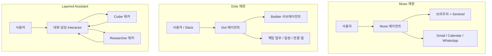
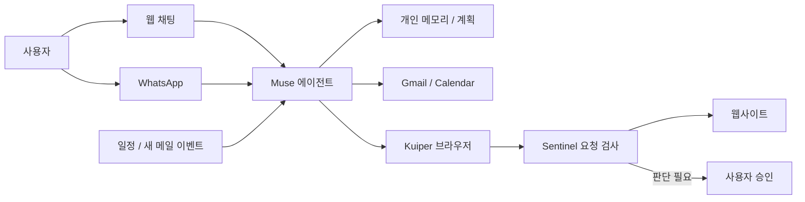
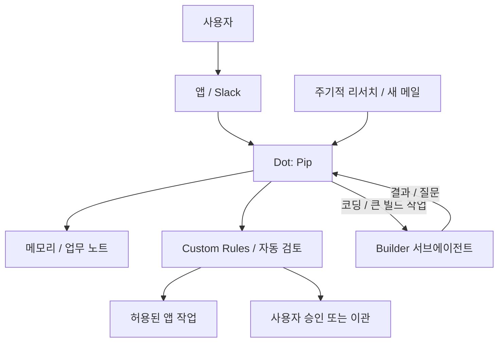
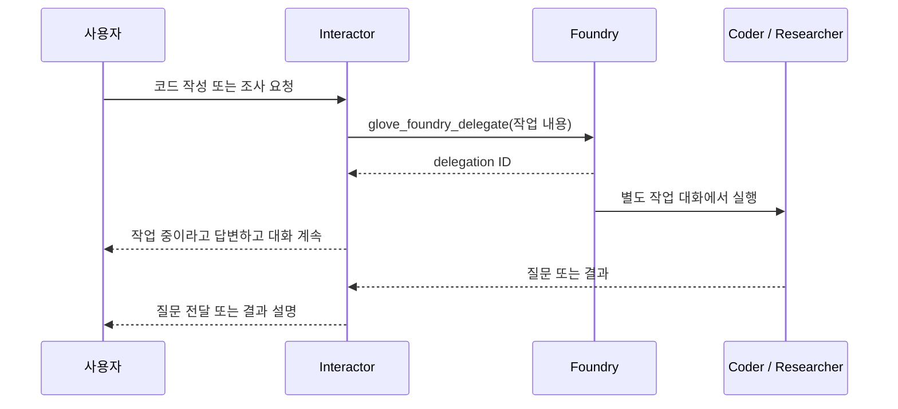
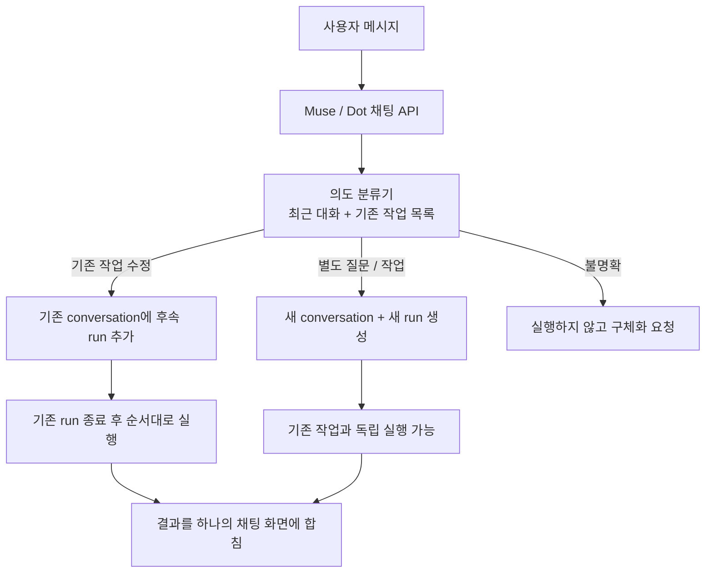
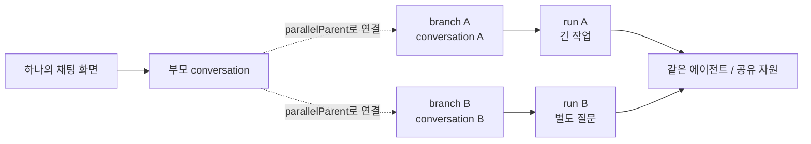
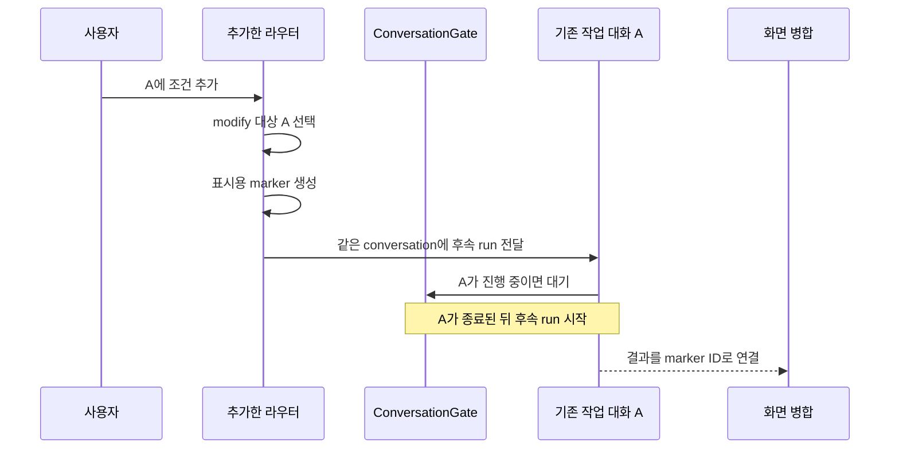

# Glove Foundry 세 가지 보조 에이전트 — 대화, 위임, 실행 경계

Glove Foundry의 세 예제는 같은 런타임을 쓰면서 개인 업무, 지속적인 책임 업무, 대화와 작업의 분리에 각각 초점을 둔다. 특히 **같은 에이전트의 별도 실행**, **다른 에이전트에 대한 위임**, **진행 중인 실행에 새 지시를 반영하는 것**은 서로 다른 계약이다.



> **새 run과 답변 병합을 보려면:** [새 run 생성](#새-conversation과-run을-만드는-순서) · [수정 요청 연결](#수정-요청은-어떻게-연결하나) · [답변 병합](#여러-run의-답변을-한-화면에-병합)

## 자료와 검토 범위

- 원본: [Glove 저장소](https://github.com/porkytheblack/glove), MIT 라이선스. 아래 소스 링크는 [검토한 커밋 `0e6c0ad`](https://github.com/porkytheblack/glove/tree/0e6c0ad24e6062d52fd8d8a1ed0d2933c1f5e2bc)에 고정한다.
- 예제: [Personal Agent](https://github.com/porkytheblack/glove/tree/0e6c0ad24e6062d52fd8d8a1ed0d2933c1f5e2bc/examples/foundry-personal-agent), [Standing Agents](https://github.com/porkytheblack/glove/tree/0e6c0ad24e6062d52fd8d8a1ed0d2933c1f5e2bc/examples/foundry-standing-agents), [Layered Assistant](https://github.com/porkytheblack/glove/tree/0e6c0ad24e6062d52fd8d8a1ed0d2933c1f5e2bc/examples/foundry-layered-assistant).
- Muse와 Dots는 제3자가 공개 자료를 참고해 만든 **재현 예제**다. Meta Muse나 OpenAI Dots의 원본 구현에 관한 증거가 아니다.
- 정적 검토: 에이전트 조립, 채널, 저장, 일정, 위임 도구와 conversation 직렬화 코드를 확인했다.
- 별도 로컬 실험: Personal Agent와 Standing Agents의 웹 채팅에 자체 메시지 분류·병렬 실행 코드를 추가하고 OpenRouter 모델로 제한된 E2E를 수행했다. 이는 **Glove 원본 동작이 아니다**. 세부 범위는 아래에 구분한다.

## 공통 런타임과 식별 단위

```text
Agent definition   모델·도구·메모리·일정·위임 대상의 정의
      ↓
Agent instance     특정 사용자의 실제 에이전트
      ↓
Conversation       에이전트와 대화의 맥락 / 직렬화 경계
      ↓
Run                메시지나 이벤트를 처리하는 실행

Delegation         에이전트가 다른 에이전트에게 맡긴 작업
```

각 예제는 `defineAgent`로 구성을 선언하고 `defineAgentInstance`로 사용자 소유 인스턴스를 만든다. 앱 설정은 Foundry 데이터를 파일 기반 어댑터로 저장하고, 에이전트는 conversation별 transcript용 `FileStore`를 사용한다. 메모리, 이벤트 및 앱별 로그까지 전부 같은 한 파일에 들어간다는 뜻은 아니다. [예제 앱 구성](https://github.com/porkytheblack/glove/blob/0e6c0ad24e6062d52fd8d8a1ed0d2933c1f5e2bc/examples/foundry-layered-assistant/foundry.application.ts), [transcript 저장](https://github.com/porkytheblack/glove/blob/0e6c0ad24e6062d52fd8d8a1ed0d2933c1f5e2bc/examples/foundry-layered-assistant/lib/file-store.ts)

Foundry의 `ConversationGate`는 같은 conversation의 run을 직렬화한다. 앞선 run이 종료되고 프로세스가 자리를 놓으면 다음 대기 run이 시작된다. 다른 conversation은 이 동일한 lane을 공유하지 않지만, 실제 동시 실행은 런타임의 실행 슬롯과 자원에 영향을 받는다. [ConversationGate](https://github.com/porkytheblack/glove/blob/0e6c0ad24e6062d52fd8d8a1ed0d2933c1f5e2bc/packages/glove-foundry/src/conversation-gate.ts)

| | Personal Agent | Standing Agents | Layered Assistant |
| --- | --- | --- | --- |
| 중심 | 한 사람의 개인 업무 | 계속 맡아 둘 책임 업무와 규칙 | 대화 담당과 작업 담당의 분리 |
| 대화 담당 | Muse | Dot | Interactor |
| 위임 | 확인한 정의에 전용 worker 선언 없음 | Builder 서브에이전트 | Coder, Researcher |
| 작업 수단 | 연결 앱, Kuiper 브라우저 | 연결 앱, 자체 작업 환경, Builder | worker별 작업 환경 |
| 자동 분류 실험 | 수정된 웹 채팅에서 수행 | 수정된 웹 채팅에서 수행 | 적용·실행 검증하지 않음 |

## 1. Personal Agent — 개인 업무와 브라우저 경계



Muse 정의는 모델, 앱, 개인 메모리, 계획, 도구, 일정과 이벤트 playbook을 조합한다. WhatsApp 수신과 새 Gmail을 각각 대응하는 playbook으로 연결하며 하루 간격 제안 일정도 정의한다. [에이전트 정의](https://github.com/porkytheblack/glove/blob/0e6c0ad24e6062d52fd8d8a1ed0d2933c1f5e2bc/examples/foundry-personal-agent/agents/muse/agent.ts), [playbook](https://github.com/porkytheblack/glove/blob/0e6c0ad24e6062d52fd8d8a1ed0d2933c1f5e2bc/examples/foundry-personal-agent/agents/muse/playbook.ts)

Kuiper가 설정된 경우 브라우저를 마운트하고 프로필·세션 식별자를 보존하도록 구성한다. Sentinel은 브라우저 요청을 검사해 허용·차단·사용자 확인으로 나누고 사이트 읽기와 전송 권한을 구분한다. 사용자 로그인은 브라우저 handoff로 처리하도록 설계됐다. 이것은 코드의 경계 설명이며 외부 서비스 연결이나 모든 우회 경로에 대한 보안 검증 결과는 아니다. [browser](https://github.com/porkytheblack/glove/blob/0e6c0ad24e6062d52fd8d8a1ed0d2933c1f5e2bc/examples/foundry-personal-agent/agents/muse/browser.ts), [Sentinel](https://github.com/porkytheblack/glove/blob/0e6c0ad24e6062d52fd8d8a1ed0d2933c1f5e2bc/examples/foundry-personal-agent/agents/muse/sentinel.ts)

## 2. Standing Agents — 지속 업무, 권한 분리, Builder



Dot 인스턴스에는 이름, 책임 업무, 사용자 규칙, 전달 경로가 데이터로 들어간다. 서로 다른 채널은 각 대화 기록을 가지면서 사용자 메모리를 공유하도록 구성된다. Dot은 작업 환경을 사용할 수 있고, 코딩·큰 빌드 작업은 소유한 durable `builder` 서브에이전트에 위임할 수 있다. builder는 처음 필요할 때 생성되며 Dot의 개인 메모리나 연결 앱을 그대로 상속하지 않는다. [Dot 정의](https://github.com/porkytheblack/glove/blob/0e6c0ad24e6062d52fd8d8a1ed0d2933c1f5e2bc/examples/foundry-standing-agents/agents/dot/agent.ts), [builder 정의](https://github.com/porkytheblack/glove/blob/0e6c0ad24e6062d52fd8d8a1ed0d2933c1f5e2bc/examples/foundry-standing-agents/agents/builder/agent.ts)

주기적 리서치는 기본 2시간 간격이며 환경 변수로 바꿀 수 있다. 리서치·새 메일 등 사용자 비개시 실행은 읽기 위주로 제한하고 행동 및 builder 위임 도구를 제거한다. 사용자 시작 실행이나 허용된 후속 실행은 별도 규칙 검토를 거친다. 이것은 도구 구성상의 경계이며 권한 정책 전체를 보안 감사한 것은 아니다. [research](https://github.com/porkytheblack/glove/blob/0e6c0ad24e6062d52fd8d8a1ed0d2933c1f5e2bc/examples/foundry-standing-agents/agents/dot/research.ts), [도구 구성](https://github.com/porkytheblack/glove/blob/0e6c0ad24e6062d52fd8d8a1ed0d2933c1f5e2bc/examples/foundry-standing-agents/agents/dot/tools.ts)

Builder의 가상 작업 환경은 에이전트 인스턴스 범위로 보존한다. 따라서 설계상 다른 작업에서도 이전 파일이 남을 수 있다. 이는 아래 Layered worker의 conversation 범위 저장과 다르다. [builder workspace](https://github.com/porkytheblack/glove/blob/0e6c0ad24e6062d52fd8d8a1ed0d2933c1f5e2bc/examples/foundry-standing-agents/agents/builder/workspace.ts)

## 3. Layered Assistant — 대화와 작업 위임



Interactor는 사용자와 대화하고 개인 메모리를 관리한다. 프롬프트는 직접 코딩·웹 탐색을 하기보다 목표와 제약을 담아 워커에 위임하고 대화를 계속하라고 지시한다. worker는 원래 대화를 자동으로 볼 수 없으므로 위임 메시지에 필요한 맥락을 넣어야 한다. [Interactor 정의](https://github.com/porkytheblack/glove/blob/0e6c0ad24e6062d52fd8d8a1ed0d2933c1f5e2bc/examples/foundry-layered-assistant/agents/assistant/agent.ts), [프롬프트](https://github.com/porkytheblack/glove/blob/0e6c0ad24e6062d52fd8d8a1ed0d2933c1f5e2bc/examples/foundry-layered-assistant/agents/assistant/prompt.ts)

Coder는 네트워크·호스트 접근이 없는 가상 파일시스템과 스크립트 환경을, Researcher는 공개 호스트에 대한 HTTP 접근을 추가한 환경을 사용한다. 두 환경의 저장 범위는 delegation별 conversation이다. [coder 환경](https://github.com/porkytheblack/glove/blob/0e6c0ad24e6062d52fd8d8a1ed0d2933c1f5e2bc/examples/foundry-layered-assistant/agents/coder/workspace.ts), [researcher 환경](https://github.com/porkytheblack/glove/blob/0e6c0ad24e6062d52fd8d8a1ed0d2933c1f5e2bc/examples/foundry-layered-assistant/agents/researcher/workspace.ts)

### 위임의 왕복

1. Interactor가 `glove_foundry_delegate`로 대상과 독립적으로 이해 가능한 작업을 전달하면 `delegationId`가 즉시 반환된다.
2. Foundry는 worker conversation과 그 context에 위임 기록을 두고 별도 실행을 시작한다. 기록에는 요청자, 작업, 상태, 질문·결과가 있다.
3. worker가 `glove_foundry_ask`로 질문하면 Interactor가 아는 내용으로 답하거나 사용자에게 물어본 뒤 `glove_foundry_reply`를 보낸다.
4. 결과·질문은 `<delegation>` 메시지로 돌아온다. 전달되지 않은 업데이트를 재전달하기 위한 기록과 conversation별 mailbox도 있다.

Coder는 답변을 같은 run에서 최대 2분 기다리도록 지정한다. 그 안에 답이 오지 않으면 턴을 끝내고 이후 답변이 다음 메시지로 전달되는 경로가 있다. 이 자료만으로 장애 상황 전반의 exactly-once 전달이나 외부 효과의 중복 방지를 주장할 수는 없다. [위임 상태와 도구](https://github.com/porkytheblack/glove/blob/0e6c0ad24e6062d52fd8d8a1ed0d2933c1f5e2bc/packages/glove-foundry/src/delegation.ts), [coder 설정](https://github.com/porkytheblack/glove/blob/0e6c0ad24e6062d52fd8d8a1ed0d2933c1f5e2bc/examples/foundry-layered-assistant/agents/coder/agent.ts)

## 별도 로컬 변경: 새 메시지 자동 분류 실험

다음은 **원본 기능이 아니라 로컬 실험에서 추가한 구현**이다. Muse와 Dot의 웹 채팅 API에서 새 메시지를 처리하기 전에 최근 대화와 기존 작업 후보를 LLM에 보내 `modify`, `question`, `task`, `clarify` 중 하나로 분류했다. 기본 분류 모델은 OpenRouter의 `deepseek/deepseek-v3.2`였다.



`question`과 `task`는 표시 이름만 다르고 둘 다 같은 에이전트의 독립 conversation에서 실행했다. 즉 분류기가 직접 별도 worker에 위임한 것은 아니다. Dot의 새 run이 이후 자체 판단으로 builder를 사용할 수는 있다. `modify`는 대상 conversation의 큐에 추가했기 때문에 **현재 실행에 조건을 실시간 주입하지 않는다**. 이미 실행된 도구나 외부 효과를 되돌리지도 않는다.

분류기가 내놓은 confidence가 0.7 미만이거나 수정 대상 ID가 후보에 없으면 다시 구체화하도록 했다. 모델이 낸 confidence는 정확도의 보장이 아니다. 독립 실행들은 같은 에이전트와 자원을 공유하므로 파일·외부 자원 충돌도 별도로 해결하지 않았다. 분류와 답변에 대화 일부가 모델 제공자에게 전달된다. 라우팅은 두 앱의 **웹 채팅 경로에만** 추가했으며 Slack·WhatsApp·Layered에는 적용하지 않았다.

### 새 conversation과 run을 만드는 순서

`question` 또는 `task`로 분류되면 다음 순서로 처리했다.

1. 같은 화면의 부모 conversation ID를 `parallelParent`로 저장하면서 **새 branch conversation**을 만든다. 이 branch에는 원래 사용자 메시지와 분류 종류도 기록한다.
2. 현재 화면에 보이던 대화에서 이벤트 표시를 제외하고 최근 최대 20개 메시지를 골라 스냅샷을 만든다. 각 메시지는 최대 4,000자로 제한한다.
3. 스냅샷을 배경 맥락으로, 새 입력을 별도 요청으로 묶어 **같은 에이전트에** `client.send(agentId, branchConversationId, message)`를 호출한다.
4. Foundry가 이 branch conversation에 대한 새 run을 만든다. 원래 작업과 conversation ID가 다르므로 같은 conversation의 직렬화 대기열에 묶이지 않는다. 다만 실행 슬롯이 확보돼야 실제로 시작된다.



이 경로는 사용자 채팅을 물리적으로 같은 transcript에 추가하며 여러 run을 동시에 실행하는 방식이 아니다. **부모 ID로 연결된 별도 conversation을 만들고 나중에 표시를 합치는 방식**이다. 새 run은 이전 대화 전체를 실시간 공유하는 대신 생성 시점의 제한된 스냅샷을 받는다. 이후 다른 run에서 완성된 답변이 이미 실행 중인 run의 맥락에 자동으로 삽입되지는 않는다.

### 수정 요청은 어떻게 연결하나

`modify`는 새 독립 작업이 아니라 분류기가 선택한 **기존 branch conversation**에 보낸다. 단, 화면에서 해당 요청과 그 결과를 별도 메시지처럼 보여 주기 위해 표시용 marker conversation을 하나 더 만든다.



marker ID는 후속 run의 입력 context에 기록한다. 나중에 상태를 읽을 때 이 ID로 run을 찾아 수정 요청과 답변을 연결한다. 이 방식은 **현재 실행 중인 A를 중단하거나 변경하지 않는다**. A가 외부 작업을 먼저 완료했을 수 있다.

### 여러 run의 답변을 한 화면에 병합

웹 화면은 보이는 동안 약 1.5초마다 서버에서 채팅 상태를 조회한다. 서버의 `parallelState`는 부모 ID로 branch와 marker들을 찾고, 각 conversation의 transcript 또는 marker에 연결된 run 결과를 읽어 화면용 메시지로 바꾼다.

- 사용자 메시지는 branch 또는 marker의 **생성 시각**을 사용한다.
- 답변은 연결된 run의 **완료 시각**을 사용한다.
- 분류 표시는 요청 시각에 붙이고, 실패·취소는 상태 메시지로 표시한다.
- 완료 시각·상태를 branch context에 기록하며, 수정 marker는 답변도 함께 기록한다.
- 이렇게 만든 branch 메시지를 시각순으로 정렬한 뒤 기존 부모 대화 메시지와 함께 화면에 제공한다.

예를 들어 A가 긴 작업이고 B가 독립 질문이면, 입력은 A 다음 B여도 답변은 B가 먼저 나타날 수 있다.

| 시각 | 이벤트 | 화면에 보이는 순서 |
| --- | --- | --- |
| 10:00:01 | 긴 작업 A 요청 | A 요청 |
| 10:00:02 | 별도 질문 B 요청 | A 요청 → B 요청 |
| 10:00:05 | B 완료 | A 요청 → B 요청 → **B 답변** |
| 10:00:30 | A 완료 | A 요청 → B 요청 → B 답변 → **A 답변** |

이 정렬은 추가한 branch 메시지 내부의 규칙이다. 기존 부모 transcript와 branch 메시지 전체를 하나의 전역 이벤트 로그로 재정렬하는 구현은 아니다. 조회 기반이므로 화면 반영에 주기만큼의 지연이 생길 수 있으며, 동시에 여러 branch의 토큰을 각각 실시간 스트리밍하는 구조도 아니다. 병합 상태가 재시작·장애·대량 동시 입력에서도 완전하게 복구되는지는 검증하지 않았다.

### 확인한 결과와 범위

- 실제 모델을 이용한 단일 시나리오에서 Muse와 Dot 모두 기존 작업 수정, 별도 질문, 별도 작업을 각각 분류하고 답변을 표시했다. Muse에서는 독립 질문 답변이 원래 작업보다 먼저 도착했다. 수정은 기존 실행이 끝난 뒤 처리됐다.
- 공통 웹 키트 테스트 25개와 두 앱의 타입 검사가 통과했다. 이 테스트는 모델 분류 정확도나 동시성의 포괄적 검증이 아니다.
- Layered의 위임에 대해서는 위 코드와 README를 정적으로 확인했으며, 이 기록에서 실제 모델의 위임 왕복 E2E 성공을 주장하지 않는다.
- 장애 주입, 동시 파일 변경, 장시간 실행, 외부 앱·브라우저·승인 및 운영 환경 안전성은 검증하지 않았다. 로컬 변경분은 원본 커밋에 포함되지 않는다.

## 비교할 때의 질문

1. 새 입력이 기존 작업의 제약일 때 현재 run에 끼워 넣어야 하는가, 아니면 현재 run이 끝나길 기다려도 되는가?
2. 독립 run과 전용 worker 중 어느 단위가 대화·메모리·파일·권한을 공유하는가?
3. worker 결과가 도착한 시점에 대화 담당이 바쁘거나 중단됐을 때 어떻게 전달하고 중복을 다루는가?
4. 실행 취소·재시작 전후 외부 효과의 성공 여부를 어떻게 확인하는가?

관련: [[에이전트-스킬/dsh-superagent-prototype|DSH Superagent — Ticket과 Worker 실행]] · [[에이전트-스킬/idempotent-api-retries|멱등 API 재시도]]
