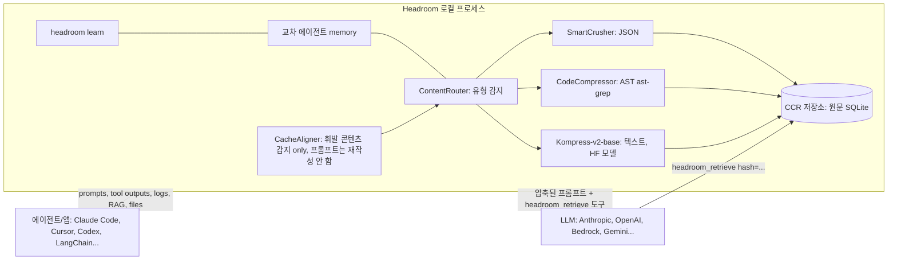

# Headroom

> [!summary] 한줄요약
> 도구 출력·로그·RAG 청크·파일·히스토리를 로컬에서 압축해 LLM 입력을 줄이는 Apache-2.0 컨텍스트 최적화 계층이다.

- **사용 형태**: 라이브러리(`compress()`), 프록시(`headroom proxy`), 에이전트 래퍼(`headroom wrap claude` 외 15종 이상), MCP 서버의 4가지다. 코딩 에이전트와 LLM 앱에 적용한다.
- **핵심 설계**: 압축 원문을 로컬 SQLite에 보관하고 `headroom_retrieve`로 되찾는 **CCR(Compress-Cache-Retrieve) 가역 압축**을 제공한다. "live-zone only" 정책으로 prompt cache를 깨지 않는 것을 목표로 한다.

> [!warning] 읽기 전 주의 (보안 사실)
> README "Telemetry"와 SECURITY.md가 직접 밝히듯 익명 beacon이 **기본 켜짐(opt-out)**이고, CCR 캐시(`~/.headroom/ccr_store.db`)는 압축 전 원문(도구 출력, 파일 내용, 검색 청크)을 **평문으로 디스크에 저장**한다. "압축은 로컬이다"라는 말은 사실이지만, 프록시가 모든 트래픽과 자격증명을 거치는 지점이라는 점이 사내 보안 검토의 핵심이다.

## 1. 배경 — 해결하는 문제

에이전트형 코딩 도구를 쓰면 입력 토큰의 대부분이 사용자의 질문이 아니라 **도구가 돌려준 대용량 출력**(코드 검색 결과 100건, 로그 수천 줄, 반복되는 JSON 배열, 파일 전체)으로 채워진다. 이 때문에 (1) 비용이 늘고, (2) 컨텍스트가 빨리 차 compaction이 자주 일어나며, (3) 불필요한 내용이 모델의 주의를 분산한다. 공급자 내장 compaction은 "과거 대화를 요약해 버리는" 방식이라 정보가 되돌릴 수 없게 사라지고 provider 전용이다.

Headroom이 택한 접근은 세 가지 원칙으로 요약된다.

1. **입력 쪽에서, 내용 유형별로 압축**: JSON은 통계 기반으로 대표 항목만 남기고, 코드는 AST로, 로그/텍스트는 학습된 압축 모델로 줄인다.
2. **가역성(CCR)**: 압축은 손실이 있을 수 있으나 원문을 로컬에 보관하고 모델이 필요하면 해시로 되찾을 수 있게 해 "너무 많이 버려서 답을 못 하는" 위험을 줄인다.
3. **prompt cache 존중**: 시스템 프롬프트·도구 정의·과거 히스토리(frozen prefix)는 바이트 단위로 건드리지 않고 **새로 들어온 부분(live zone)만** 압축한다. 압축으로 절약한 토큰이 cache miss로 날아가는 역효과를 막기 위해서다.

README의 대표 정량 주장은 "Same answers, fraction of the tokens"이며, 서브타이틀(pyproject)은 "Cut costs by 50-90%"다. 이 범위는 워크로드 의존적이다(아래 4절).

## 2. 아키텍처

### 2.1 구성



README가 서술하는 요청 수명주기는 `Setup → Pre-Start → Post-Start → Input Received → Input Cached → Input Routed → Input Compressed → Input Remembered → Pre-Send → Post-Send → Response Received`이며 `compress()`, SDK, 프록시가 같은 수명주기를 공유한다. 확장 지점은 파이프라인 확장(`on_pipeline_event`), 압축 hook, 프록시 확장(ASGI 미들웨어, 라우트, 시작 정책)이다.

### 2.2 압축기들

- **SmartCrusher(JSON)**: 객체 배열·중첩 객체를 다루며, 오류 항목·통계적 이상치·처음/마지막 경계를 필드 분산 통계로 선택해 남기고 나머지를 접는다("키워드 목록이 아니라 통계"). 반복되는 JSON/로그는 `benchmarks/bench_latency.py`에서 90% 이상 줄어든다고 README가 서술.
- **CodeCompressor(AST)**: ast-grep 기반으로 Python, JS/TS, Go, Rust, Java, C/C++, C#, PHP의 코드 구조를 보존한 채 줄인다.
- **Kompress-v2-base**: 에이전트 trace로 학습한 Hugging Face 모델(`chopratejas/kompress-v2-base`)을 텍스트 압축에 사용.
- **그 외**: 이미지 압축(학습된 라우터로 40~90% 감소 주장), `log_compressor`, `diff_compressor`, `html_extractor`, `cross_turn_dedup`, `dense_line_elider`, `lossless_compaction` 등(`headroom/transforms/`에서 파일 확인).
- **Live-zone 압축**: 새 바이트(방금 나온 도구 출력, 최신 턴)만 압축하고 frozen prefix는 그대로 둔다. 히스토리는 절대 드롭하지 않는다고 README가 명시한다.
- **CacheAligner**: 공급자 KV-cache 접두부를 깨뜨릴 휘발성 내용을 경고만 하고 재작성하지 않는다.

### 2.3 CCR (Compress-Cache-Retrieve)

`wiki/ccr.md`가 설명하는 예시 흐름은 다음과 같다.

1. **압축**: SmartCrusher가 1,000개 항목을 20개로 줄인다.
2. **보관**: 원문을 해시 키(예: `abc123`)로 LRU/SQLite에 저장한다.
3. **복원 안내**: 압축물에 `[1000 items compressed to 20. Retrieve more: hash=abc123]` 마커를 넣고, LLM 도구 목록에 `headroom_retrieve` 정의를 주입한다.
4. **필요한 경우 복원**: 모델이 20개로 충분하다고 판단하면 그대로 종료한다(문서의 설명: 90% 절감). 부족하면 `headroom_retrieve(hash=abc123)`를 호출하고, 응답 핸들러가 자동 실행해 원문을 반환한다.

보관 기간은 설정된 TTL을 따른다. 기본 백엔드는 SQLite이며, `HEADROOM_CCR_BACKEND=memory`로 디스크 저장을 끌 수 있다(SECURITY.md).

### 2.4 코드 규모와 구현 언어

클론 기준 Python `headroom/` 약 23.3만 줄, Rust `crates/` 중 `headroom-core` 약 4.5만 줄, `headroom-proxy` 약 3.3만 줄, `headroom-py` 약 0.2만 줄, `headroom-parity`, `headroom-simulators` 각 약 0.1만 줄(`wc -l` 합산). 즉 대형 하이브리드 저장소다. 주목할 점은 `REALIGNMENT/` 디렉터리(00-overview ~ 06-phase-D 등)다. 이는 프로젝트가 스스로 "잘못된 멘탈 모델 위에 만들어졌다"고 감사한 문서로, 요약하면 다음과 같다.

- 이전 모델은 "압축 = 히스토리에서 무엇을 버릴지 고르는 것"(IntelligentContextManager가 메시지 점수화 후 삭제)이었고, 이것이 prompt cache를 깨는 **5개의 최상위 버그**를 낳았다.
- 올바른 모델은 "passthrough is sacred; 압축은 live zone에서 유형별·해시 키 기반·위치 보존으로"이다.
- 계획: Phase A(락다운, `/v1/messages` 압축을 passthrough화, 시스템 프롬프트 변형 중지, Python forwarder의 재직렬화 제거), B(live-zone 엔진을 Rust로 재구축, 약 1만 줄 삭제), C(Rust 프록시 경로: 바이트 수준 SSE 파서, `/v1/chat/completions`, `/v1/responses`), D(Bedrock/Vertex 네이티브), E(캐시 안정화: 도구 배열 결정적 정렬, `cache_control` 자동 배치 최대 4개, OpenAI `prompt_cache_key` 자동 주입), F(인증 모드별 정책: payg/oauth/subscription), G(RTK+관측성), H(Python 프록시 폐기), I(테스트 인프라). 문서에 따르면 9 phase, 40 PR, 순차 13주 또는 병렬 8주 규모의 재정렬이다.
- 이 문서는 구현 후 결과가 아니라 **계획과 감사 결과**이며, 현재 main이 어느 phase까지 반영했는지는 README의 "IntelligentContext and RollingWindow were retired in PR-B1"이라는 문구 외에는 확인하지 못했다. 긍정적 신호는 프로젝트가 자기 결함(예: `X-Headroom-*` 요청 헤더가 업스트림으로 새는 문제, 구독형 계정에서 fingerprint 위험, Bedrock/Vertex 패리티가 "가짜"였다는 지적)을 문서화했다는 점이고, 반대로 이런 결함이 존재했다는 것은 초기 버전들의 신뢰도에 대한 경고이기도 하다.

## 3. 핵심 기능 상세

**배포 모드**는 적용 지점에 따라 선택한다.

1. **Library**: Python의 `from headroom import compress`, TypeScript의 `await compress(messages, { model })`. SDK 래퍼로 `withHeadroom(new Anthropic())`, Vercel AI SDK `headroomMiddleware()`, LiteLLM `HeadroomCallback`, LangChain `HeadroomChatModel`, Agno, Strands, ASGI `CompressionMiddleware`도 제공한다.
2. **Proxy**: `headroom proxy --port 8787`. OpenAI 호환 클라이언트의 base URL만 바꿔 사용한다.
3. **Agent wrap**: `headroom wrap claude|codex|grok|copilot|cursor|aider|opencode|cline|continue|goose|openhands|openclaw|vibe|omp|zcode`. 해제 명령은 `headroom unwrap <tool>`이다.
4. **MCP 서버**: `headroom_compress`, `headroom_retrieve`, `headroom_stats`를 노출한다. `headroom mcp install`, `headroom mcp serve`로 설정·실행한다.

그 밖의 기능과 설정 변경은 다음과 같다.

- **`headroom wrap`의 부수 동작**: 로컬 프록시를 띄우고 **Serena**(시맨틱 코드 탐색 MCP)를 설치해 Claude Code에는 해당 프로젝트에만 `local` 스코프 MCP 서버로 등록한다(`~/.claude.json` 수정). `--code-memory-scope user`로 전역화, `--code-memory none`으로 생략. 즉 래퍼가 사용자 설정 파일을 수정하므로 도입 전에 diff를 확인해야 한다.
- **교차 에이전트 memory**: Claude, Codex, Gemini, Grok이 하나의 저장소를 공유하고 출처(provenance)와 자동 중복 제거를 가진다(`headroom/memory/`, 외부 벡터 저장소로 Qdrant/Neo4j 개발 컨테이너 언급). `--mode cache`에서는 Anthropic 경로에 자동 memory 주입을 하지 않고(캐시 접두부 보존), `--mode token`에서만 주입한다.
- **`headroom learn`**: 실패한 세션을 분석해 교정 지침을 `CLAUDE.local.md`(기본, gitignored), `CLAUDE.md`, `AGENTS.md`, `GEMINI.md`, `GROK.md`에 기록한다. `--verbosity`는 과거 세션에서 사용자가 긴 답변을 끊거나 넘긴 행동을 보고 응답 간결도를 추정한다(`--apply`로 저장). 이 기능은 CLAUDE.md를 자동 수정하므로 결과를 사람이 검토해야 한다.
- **출력 토큰 절감(opt-in)**: `HEADROOM_OUTPUT_SHAPER=1`일 때 (a) verbosity steering — 시스템 프롬프트 **끝**에 "간결하게, 컨텍스트를 반복하지 말라" 문구를 덧붙여 cache가 유지됨, (b) effort routing — 도구 결과 직후 재개 턴처럼 단순한 경우에만 thinking effort를 낮추고(OpenAI `reasoning_effort`, Anthropic `thinking.budget_tokens`/`output_config.effort`, clamp-only 불변식) 새 질문과 오류에서는 전체 effort 유지. 효과는 반사실적(counterfactual)이라 `headroom output-savings`가 신뢰구간과 함께 "estimated"로 표시하고, `HEADROOM_OUTPUT_HOLDOUT=0.1`로 10%를 대조군으로 두면 "measured"가 된다(README 예: Reduction 31.7%, 95% CI 27.7~35.7%는 사용 예시 출력).
- **관측**: `headroom doctor`, `headroom perf`, `headroom dashboard`(라이브 절감), `headroom savings`, Prometheus 메트릭(`proxy/prometheus_metrics.py`), OpenTelemetry API 의존.
- **영속 설치**: `headroom install apply`로 macOS launchd, Linux systemd/cron, Windows 서비스/작업으로 감독 실행(`headroom/install/supervisors.py`), `--env KEY=VALUE` 전달. Docker 이미지 `ghcr.io/headroomlabs-ai/headroom:latest`.
- **비용 인지 모델 라우팅(opt-in, Unreleased)**: `HEADROOM_MODEL_ROUTER_ENABLED=1`과 `HEADROOM_MODEL_ROUTES` JSON 규칙으로 모델 재작성(CHANGELOG의 Unreleased 항목).
- **Copilot 구독 트래픽**: `headroom copilot-auth login` 후 `headroom wrap copilot --subscription`. GitHub OAuth 토큰을 Copilot 단기 토큰으로 교환하며, 리프레시 토큰을 `~/.headroom/copilot_auth.json`에 평문(권한 0600 best-effort)으로 저장한다.

## 4. 성능·정확도 주장과 검증 상태

README "Proof"의 수치(시드 고정 오프라인 스크립트 `uv run python benchmarks/index_proof_table.py --seed 20260902`, MCP 서버 출력 형식에서 만든 4개 시나리오, 공급자 토크나이저 측정):

| 시나리오 | Before | After | 절감 |
|---|---:|---:|---:|
| 코드 검색(100 결과) | 17,199 | 13,597 | 21% |
| SRE 인시던트 디버깅 | 55,957 | 24,340 | 57% |
| 코드베이스 탐색 | 58,801 | 33,895 | 42% |
| GitHub 이슈 분류 | 46,067 | 32,429 | 30% |

README는 "절감은 페이로드의 반복성에 비례한다. 산문과 이미 조밀한 출력은 거의 줄지 않는다"고 명시한다. 지연과 정확도는 별도의 자체 측정치다.

- **지연**: 10K 토큰 JSON 검색 결과 p50 0.21ms, 100K 토큰 1.4ms.
- **정확도 평가 명령**: `python -m headroom.evals suite --tier 1`.
- **GSM8K**: 0.870 → 0.870(N=100).
- **TruthfulQA**: 0.530 → 0.560(N=100). README는 "±0.03은 N=100 신뢰구간 안이므로 개선이 아니라 차이 없음"으로 해석한다.
- **SQuAD v2**: 97% at 19% 압축.
- **BFCL**: 97% at 32% 압축.

정확도 표는 **소규모(N=100) 합성에 가까운 벤치마크**다. 실제 코딩 에이전트의 장기 과제(SWE-bench류) 성공률에 미치는 영향은 보여 주지 않는다. 모든 수치는 프로젝트 자체 측정이며 독립 검증은 확인하지 못했다.

"50~90% 절감"이라는 마케팅 범위는 위 표(21~57%)보다 높은 쪽 값이다. 실제 도입 판단에는 자기 데이터로 `headroom savings`를 측정해야 한다.

## 5. 설치·사용

```bash
# 설치 (Python 3.10+)
uv tool install --python 3.13 "headroom-ai[all]"      # CLI를 격리 환경에
pip install "headroom-ai[all]"
npm install headroom-ai                               # TS SDK만 (CLI 없음)
docker pull ghcr.io/headroomlabs-ai/headroom:latest

# 사용 모드
headroom wrap claude                  # Claude Code를 래핑해 실행 (프록시 + Serena 등록)
headroom proxy --port 8787            # 코드 수정 없는 프록시
headroom deploy                       # 로컬 배포 + 에이전트 설정
headroom doctor && headroom perf && headroom dashboard
headroom unwrap claude                # 래핑 해제
```

```python
from headroom import compress
from openai import OpenAI
result = compress([{"role": "user", "content": "Analyze these results"}], model="gpt-4o")
resp = OpenAI().chat.completions.create(model="gpt-4o", messages=result.messages)
print(f"Saved {result.tokens_saved} tokens ({result.compression_ratio:.0%})")
```

```bash
# 출력 토큰 절감(opt-in)과 추정치 측정
export HEADROOM_OUTPUT_SHAPER=1
headroom proxy --port 8787
headroom output-savings
# 텔레메트리 끄기
export HEADROOM_BEACON=off   # 또는 DO_NOT_TRACK=1, --offline, HEADROOM_OFFLINE=1
```

설치 노트: 네이티브 휠은 macOS Apple Silicon과 Linux. Intel macOS는 Docker 설치. x86에서 ONNX 기반 기능(Magika 콘텐츠 감지, 임베딩 relevance)은 **AVX2**가 필요하고 없으면 BM25/휴리스틱으로 폴백. Codex 등 MCP 클라이언트는 셸 PATH를 상속하지 못하므로 `command`에 `headroom` 절대 경로(`command -v headroom`)를 쓴다.

## 6. 디렉터리·코드에서 확인한 것

- `pyproject.toml`: 패키지 `headroom-ai` 0.39.1, Apache-2.0, 분류자 "Development Status :: 4 - Beta", 빌드 maturin(Rust 확장). 핵심 의존성 `tiktoken`, `pydantic`, `litellm>=1.96.2,<2`, `click`, `rich`, `opentelemetry-api`, `ast-grep-cli>=0.30.0,!=0.44.1`, `pyyaml`, `tomlkit`, `truststore`. `[proxy]` extra에 fastapi, uvicorn, httpx[http2], openai, `mcp>=1.28.1,<2`, magika, zstandard, websockets.
- **공급망 사고의 흔적**: 의존성 주석에 "`ast-grep-cli` 0.44.1은 침해된 공급망 빌드였고 정상 바이너리 옆에 info-stealer `sg.exe`(Trojan:Win64/Lazy!MTB)를 싣고 있었다(GH #2332)"라고 적어 해당 버전만 제외(`!=0.44.1`)했다. 프로젝트가 의존성 사고에 대응한 구체적 증거이며, 동시에 의존성 트리가 넓어 공급망 노출이 크다는 뜻이다. click에 대해서도 PYSEC-2026-2132(command injection) 수정 버전을 하한으로 둔다.
- `truststore` 의존성은 macOS Keychain·Windows 인증서 저장소를 통해 업스트림 TLS를 검증해 Zscaler/Netskope 같은 기업 TLS 검사 루트를 지원한다(사내 프록시 환경에 우호적).
- `headroom/` 주요 하위: `ccr/`(batch_store, mcp_server, tool_injection, response_handler), `compression/`, `transforms/`(content_router, code_compressor, kompress_compressor, log_compressor, diff_compressor, cache_aligner, cross_turn_dedup 등), `memory/`(adapters, backends, bridge, sync, traffic_learner), `learn/`(analyzer, scanner, verbosity, writer, plugins), `proxy/`(anthropic_wire, audit, auth_mode, auth_policy, savings_tracker, prometheus_metrics), `install/`(planner, supervisors, health), `providers/`(claude, copilot, codex, grok, gemini, openclaw).
- `SECURITY.md`: 지원 대상은 PyPI 최신 릴리스뿐(백포트 없음), 신고는 security@headroomlabs.ai, 48시간 내 확인·치명적 이슈 7일 내 해결 목표.
- CHANGELOG "Unreleased"의 수정 사례들(예: 프록시가 이미지 압축 크래시 시 원본 이미지로 fail-open, 플러그인 이름 `..` 거부로 경로 탈출 방지, 대시보드 메타데이터를 loopback 호출자에게만 노출하되 DNS rebinding 방어를 위해 Host 헤더 게이트 유지, `NaN`/`Infinity` 입력으로 프록시가 죽던 문제)는 활발한 하드닝을 보여 주지만, 프록시가 자격증명을 다루는 소프트웨어치고 변경 속도가 매우 빠르다는 점도 시사한다.
- 로컬 제어 라우트(`/admin/*`, `/debug/*`, `/v1/retrieve*`, `/v1/telemetry*`, `/v1/toin/*`, `/settings*`)는 loopback 클라이언트 주소와 loopback `Host:` 헤더, 변경 요청에는 same-origin 검사를 요구한다. "같은 호스트의 모든 프로세스를 신뢰하는 local-trust 모델"이라고 문서가 명시한다. `HEADROOM_PROXY_TRUSTED_DASHBOARD_CLIENT_CIDRS`를 설정하면 이 경계가 의도적으로 넓어진다.

## 7. 비교

README "Compared to" 표: Headroom은 모든 컨텍스트(도구, RAG, 로그, 파일, 히스토리)를 프록시/라이브러리/미들웨어/MCP로 로컬 처리하고 가역적이라고 주장한다. Compresr, Token Co.는 텍스트를 자기 API로 보내는 호스티드 방식(비로컬, 비가역), OpenAI Compaction은 provider-native 대화 히스토리 압축(비로컬, 비가역)으로 분류된다. 이 표는 프로젝트 자체 비교이므로 각 경쟁 제품의 현행 기능은 직접 확인하지 못했다.

관련 노트 관점:
- [[generic-agent]]: 같은 문제(컨텍스트 낭비)를 에이전트 설계 안에서 푼다(30K 미만 목표, 4단계 트리밍). Headroom은 외부 계층에서 프록시로 푼다. 두 접근은 상호 배타적이지 않다.
- [[claude-code-best-practice]]: `/compact`, prompt caching, MCP 도구 출력 관리 같은 수동 기법을 자동화하는 도구로 볼 수 있다.
- 로컬 대안으로 사용자 환경에는 lean-ctx 같은 도구 출력 압축 MCP/훅이 이미 있다(시스템 설정에 `ctx_*` 도구). 기능이 겹치므로 중복 적용 시 상호작용(이중 압축, 캐시 접두부 변화)을 점검해야 한다. README는 Ponytail(출력 간결화 skill)을 "recommended companion"으로 언급한다.
- [[onyx]], [[weknora]]: RAG 검색 결과 청크를 LLM에 넣기 전 압축하는 전처리 단계로 평가할 수 있다.

## 8. 장단점·한계·성숙도

사실 지표(GitHub API 2026-10-01): stars 74,199 / forks 5,736 / open issues 490 / Apache-2.0 / 주 언어 Python(Rust·TypeScript 혼재) / 생성 2026-01-07 / 마지막 push 2026-10-01 / 커밋 약 3,020개 / 기여자 100명 이상(API 응답이 100 한도) / 릴리스 v0.37.0(2026-08-27), v0.38.0(2026-09-21), v0.39.0(2026-09-25), v0.39.1(2026-09-26). 생성 9개월에 3천 커밋, 지난 5주간 4번 릴리스로 매우 빠르게 움직이는 0.x 프로젝트다. 열린 이슈 490개와 pyproject의 "Beta" 분류가 성숙도를 말해 준다. 스타 수가 74k로 매우 높으나 그 원인(바이럴, 기업 지원 등)은 확인하지 못했다.

장점
- 문제 정의가 정확하고(입력 쪽 tool output) 코드 수정 없이 적용된다(프록시/래퍼).
- 가역성(CCR)과 prompt cache 존중 정책이 설계에 명시돼 있고, 자체 감사 문서(REALIGNMENT)로 결함을 공개한다.
- 다중 에이전트·다중 provider(Anthropic, OpenAI, Bedrock, Vertex, Gemini, Copilot) 지원, 관측 도구(dashboard, doctor, savings), 출력 절감의 측정 방법론(holdout 대조군)을 제공한다.
- Apache-2.0이고 SBOM(`sbom/`), `deny.toml`(cargo-deny), `codecov.yml` 등 위생 요소가 있다.

단점·한계
- 절감률은 워크로드 의존적(21~57% 사례, 산문·조밀한 출력은 거의 무효). 장기 과제 성공률 영향의 독립 검증은 없다.
- 손실 압축이 모델 답변에 미치는 영향은 CCR에 기대지만, 모델이 "무엇이 빠졌는지" 인지하고 `headroom_retrieve`를 호출하는지는 모델과 프롬프트에 의존한다. 실제 복원 품질은 직접 평가 필요(확인하지 못함).
- 변경 속도가 빠르고 구조 재정렬(Python→Rust) 진행 중이라 버전 간 동작 차이와 회귀 가능성이 있다. 지원은 최신 릴리스만.
- 코드베이스가 크고(Python 23만 줄 + Rust 8만 줄), 자체 감사를 직접 하기 어렵다.
- 래퍼가 사용자 설정(`~/.claude.json`, VS Code 설정, Codex 설정 등)을 수정한다.
- Intel macOS 네이티브 미지원, AVX2 요구 기능, 일부 extras는 C++ 툴체인 필요.

## 9. 보안·라이선스·운영 리스크

- **중간자 지점**: 프록시는 모든 프롬프트와 provider 자격증명을 통과시킨다. 키는 "전달되고 저장되지 않는다"고 하지만 예외가 문서화돼 있다. `ANTHROPIC_TARGET_API_HEADERS`/`OPENAI_TARGET_API_HEADERS`를 대시보드 설정 GUI로 입력하면 `~/.headroom/settings.json`에 **평문 저장**되고(게이트웨이 키가 흔히 들어가는 자리), Copilot OAuth 리프레시 토큰이 평문 JSON(0600 best-effort)으로 저장된다.
- **평문 캐시**: CCR이 압축 전 원문(코드, 로그, 검색 청크, 고객 데이터가 섞일 수 있음)을 `~/.headroom/ccr_store.db`에 암호화 없이 저장한다. 공용 호스트에서 위험. 완화: `HEADROOM_CCR_BACKEND=memory`, 디스크 암호화, 홈 디렉터리 권한.
- **텔레메트리 기본 ON**: `HEADROOM_BEACON`은 opt-out이며 콘텐츠 없는 카운터, 설치별 랜덤 UUID, 버전, OS, 아키텍처를 Headroom Labs로 POST한다. 프롬프트·응답·파일 내용·경로는 포함하지 않는다고 하지만, 사내 폐쇄 정책상 허용되지 않는다면 `HEADROOM_BEACON=off`, `DO_NOT_TRACK=1`, `--offline`/`HEADROOM_OFFLINE=1`을 기본값으로 강제한다(선택적 `HEADROOM_TELEMETRY`는 별개로 opt-in이며 로컬에 머문다). `--offline`에서 모델 다운로드 등 다른 동작이 어떻게 바뀌는지는 확인하지 못했다.
- **모델 다운로드**: Kompress-v2-base 등 HF 모델과 ONNX 런타임을 내려받는다. 폐쇄망에서는 사전 반입/미러가 필요하다. 모델 라이선스는 확인하지 못했다.
- **로그**: `~/.headroom/logs/proxy.log`는 항상 켜져 있고, `--log-file`, 특히 `--log-messages`는 요청/응답 내용을 디스크에 쓴다.
- **로컬 신뢰 모델**: 같은 호스트의 모든 프로세스를 신뢰한다. 다중 사용자 서버에 공용 프록시로 두면 안 된다. 외부 노출 금지, 필요 시 인증 앞단.
- **공급망**: 의존성 중 한 패키지(ast-grep-cli)의 침해 빌드 사고 이력이 있다. 락파일(`uv.lock`), 해시 검증, 사설 미러, SBOM 확인, 의존성 버전 고정 필요.
- **정책 리스크**: 구독형 계정(Claude/Copilot 구독) 트래픽을 프록시로 우회시키는 구성은 서비스 약관상 문제가 될 수 있다. REALIGNMENT가 `X-Headroom-*` 헤더 유출과 fingerprint 계열 "구독 해지 리스크"를 직접 거론한다(이후 수정됐는지는 확인하지 못함). 사내에는 API 키(PAYG) 기반만 쓰는 편이 안전하다.
- **라이선스**: Apache-2.0(NOTICE에 tiktoken MIT, Pydantic MIT, sentence-transformers Apache-2.0 및 일부 사전학습 모델의 추가 제한 가능성 명시). 조직용 유료 관리형/지원 모델은 별도 영업 제안("Headroom for teams")이며 OSS 코드는 계속 Apache-2.0이라고 README가 선언한다.

## 11. 확인하지 못한 항목

- 실제 설치·구동·품질 A/B는 하지 않았다(문서·코드·CHANGELOG 정독 기준).
- 현재 main이 REALIGNMENT의 어느 phase까지 구현했는지, `X-Headroom-*` 헤더 유출 등 지적 사항이 모두 수정됐는지.
- Kompress-v2-base 모델의 라이선스와 학습 데이터, 모델 카드 내용(HF 페이지는 열지 않음).
- 외부 독립 벤치마크, 장기 코딩 과제에서의 성공률 영향.
- docs.headroomlabs.ai의 Security Model, Limitations 페이지(링크는 확인했으나 열지 않음).
- 경쟁 제품(Compresr, Token Co.)의 실제 기능, 스타 수 급증 원인.
- 기여자 정확한 수(API가 100으로 잘려 반환).

## 관련 노트
[[claude-code-best-practice]] · [[onyx]] · [[generic-agent]] · [[agent-skills]] · [[weknora]] · [[gepa]] · [[claw-code]]

## 출처
- https://github.com/headroomlabs-ai/headroom (클론 후 README.md, pyproject.toml, SECURITY.md, NOTICE, CHANGELOG.md, REALIGNMENT/00-overview.md, wiki/ccr.md, headroom/·crates/ 디렉터리 구조와 줄 수)
- GitHub API: repos/headroomlabs-ai/headroom, commits(마지막 페이지 번호), contributors, releases (2026-10-01)
