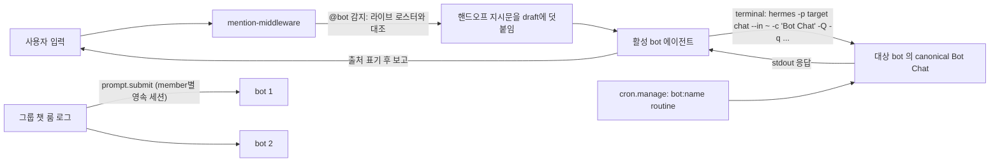

# Hermes Bot Mode

> [!summary] 한줄요약
> Hermes Agent의 profile을 영속 채팅과 이름·아바타·성격·루틴을 가진 bot으로 보여주는 데스크톱 UI 플러그인이다.

- **구현**: MIT, JavaScript 단일 파일 약 6,460줄. "에이전트 profile 하나 = bot 하나" 모델을 사용한다.
- **현재 상태**: 2026-08 중순에 아카이브됐으며, 기능은 hermes-agent 본체(`apps/desktop/src/plugins/hermes-bots/`)의 기본 활성 번들 플러그인으로 흡수됐다.
- **참고 가치**: 현재는 코드 자체보다 **profile 격리, 에이전트 간 메시징 프로토콜, 제한된 라운드의 그룹 챗**이라는 설계 패턴이 중요하다.

## 배경 — 해결하려는 문제

Hermes Agent(NousResearch)는 `~/.hermes/profiles/<name>/` 아래에 설정, 메모리, skills, 자격증명, 대화 이력을 profile별로 격리하는 에이전트 런타임이다.

Profile은 원래 CLI 개념(`hermes -p <name> ...`)이다. 여러 profile을 팀원처럼 쓰려면 매번 profile을 바꿔 대화를 열어야 한다. 다음 상태도 한눈에 파악하기 어렵다.

- 지금 작업 중인 profile
- 각 profile에 걸린 정기 작업
- 다른 profile에 일을 넘길 수 있는지 여부

Bot Mode는 이를 보완하는 **데스크톱 앱 플러그인**이다. "에이전트마다 하나의 영속 채팅(one chat per agent)"이라는 슬랙/메신저식 모델로 profile 목록을 연락처 목록처럼 보여 준다.

중요한 점은 이 플러그인이 새 런타임을 만들지 않는다는 것이다. README는 "No core patches, no background daemons, no extra storage: everything is standard Hermes surface"라고 명시한다. 즉 기능 대부분은 이미 존재하던 gateway RPC와 CLI를 UI에서 묶어준 것이다.

> [!warning] 상태 확인 (2026-10-01 기준)
> README 최상단에 "ARCHIVED — Bot Mode now ships built into Hermes Desktop"이 있고, GitHub API에서도 `archived=true`다. 신규 이슈/PR은 `NousResearch/hermes-agent`로 보내라고 안내한다. 따라서 이 저장소를 설치하는 것은 최신 Desktop에서는 불필요하고, 옛 빌드 호환 목적일 때만 의미가 있다.

## 동작 원리와 아키텍처

### 구성 요소

저장소 구조는 매우 단순하다. 확인한 파일은 `plugin.js`(약 238KB, 6,461줄), `LICENSE`(MIT), `README.md`, `docs/`(스크린샷 PNG 및 `pr-assets/`), `tests/`(Node 내장 test runner용 `*.test.mjs` 35개 안팎)가 전부다. 빌드 단계, `package.json`, 번들러 설정이 없다. `plugin.js`가 ES module로 직접 로드되며 `@hermes/plugin-sdk`, `react`, `react/jsx-runtime`만 import한다(외부 npm 의존성 없음 — 소스 상단 import 구간 확인).

플러그인은 `export default { id: 'hermes-bots', name: 'Bots', register(ctx) {...} }` 형태이고, `register`에서 다음을 등록한다.

| 등록 항목 | area | 역할 |
|---|---|---|
| `pane` (Bots) | panes, 좌측 260px, Sessions 패널 아래 dock | bot 로스터 UI |
| `routines` (Cronjobs) | panes, 워크스페이스 우측 dock 250px | 현재 대화 중인 bot의 cron 작업 |
| `new-agent` | PALETTE_AREA | 커맨드 팔레트 항목(실제로는 Bots 패널 안내 토스트) |
| `mention-middleware` | COMPOSER_AREAS.middleware | 입력창의 `@bot` 멘션을 핸드오프 지시문으로 변환 |

상태는 SDK의 `atom`으로 들고(`$lastRoster`, `$botUnread`, `$botMeta`, `$groupChats`, `$activityToasts` 등), 영속 설정은 `ctx.storage`에 저장한다. 소스 주석에 따르면 storage는 동기/비동기/부재 모두 가능하다고 가정하고 `Promise.resolve`와 try/catch로 감싸 "storage 문제로 플러그인 로드가 절대 실패하지 않게" 한다. 아바타/제목 등 꾸밈 정보(`bot-meta`)는 profile 디렉터리가 아니라 플러그인 storage에 저장해 "profile 자체는 깨끗하게" 유지한다(README Notes).

### 호출하는 gateway RPC

`plugin.js`에서 `host.request('...')`로 호출하는 메서드를 grep으로 집계했다(횟수는 호출 지점 수).

| 메서드 | 용도(소스 맥락) |
|---|---|
| `profiles.list / create / describe / configure / set_asset` | bot 목록, 생성(`clone_from` 포함), 조회, 모델·skill·toolset·SOUL 편집, 자산 동기화 |
| `session.create / resume / list / set_hidden` | bot별 canonical 채팅 생성·복원, 세션 목록(최대 200개), 사이드바에서 Bot Chat 숨기기 |
| `prompt.submit` | 그룹 챗 member 턴 전송 |
| `cron.manage` | routine 목록/일시정지/생성 (`profile` 파라미터로 bot별 cron 저장소 범위 지정) |
| `image.generate` | AI 아바타 생성(로컬/원격 gateway 모두, data URL 반환) |
| `skills.manage`, `mcp.catalog`, `model.options`, `pet.gallery` | Advanced 설정과 pet 아바타 |
| `cli.exec` | `hermes -p <bot> chat ...` 형태의 CLI 위임 |

그 외 `host.openSession(id, { profile })`, `host.newChat`, `host.deleteProfile`, `host.warmProfile`, `host.notify` 같은 호스트 API를 쓴다. README는 "`profiles.*`/`image.generate` RPC는 mid-2026 이후 hermes-agent 빌드에서 제공되고, 플러그인은 구형 gateway를 feature-detect해 로스터만 동작하고 Advanced 편집과 아바타 생성은 RPC가 있을 때 켜진다"고 적는다. 실제로 이슈 #80(McpTab export가 없는 Desktop 빌드에서 로드 실패)과 #90(gateway v0.20.1이 profiles를 REST로만 노출해 로스터가 빈 문제)이 닫혀 있어, SDK/RPC 표면이 빠르게 변하던 시기의 호환성 관리가 이 플러그인의 주요 유지보수 부담이었음을 알 수 있다.

### 데이터 흐름 — 세 가지 통신 경로



1. **@mention 핸드오프.** 사용자가 어느 채팅에서든 `@researcher 이거 좀 봐줘`라고 쓰면 middleware가 라이브 로스터와 대조해(그래서 `user@example.com`이나 모르는 `@`는 그대로 통과) 입력 뒤에 지시문을 덧붙인다. 지시문의 요지는 "활성 bot이 직접 메시지를 *작성*해서(원문 그대로 전달 금지), 터미널 도구를 `background=true`, `notify_on_complete=true`로 한 번만 호출하고, 사용자를 막지 말고 턴을 끝낸 뒤 백그라운드 프로세스 알림으로 답이 오면 출처를 밝혀 전달하라"이다. 소스 주석은 "텍스트 파이프는 의도를 이해할 수 없지만 활성 bot은 이해한다"는 이유를 든다. 헤더 주석은 @mention 전달이 "gateway RPC, CLI 릴레이 없음"이라고 적고 있는데, 이는 README의 CLI 핸드오프 설명 및 이 middleware의 실제 지시문(`hermes -p ... chat`)과 완전히 일치하지 않는다. 즉 구현이 중간에 바뀐 흔적으로 보이며, 정확한 최종 경로는 코드 한 파일만으로는 단정하지 못했다(확인 못함).
2. **bot 간 메시지.** 모든 bot은 생성 시 만들어지는 단 하나의 canonical "Bot Chat" 대화를 가진다. 메시지는 `Message from 🤖 <name> (@<handle>): ...` 접두로 시작해 수신자 입장에서는 DM처럼 보인다. 이 프로토콜은 각 bot의 SOUL.md에 `messagingProtocolSection()`이 생성한 "Messaging other agents" 절로 주입된다. 소스 주석에 따르면 사용자가 SOUL.md를 직접 쓰면 이 절이 조용히 사라져 @mention이 깨진 버그(#16)가 있었고, 그래서 커스텀 SOUL에도 프로토콜 절을 자동 보존하도록 분리했다. 수신은 invocation 단위이며(README Notes) 실행 중인 bot에 라이브 인터럽트하는 것은 upstream 과제다.
3. **그룹 챗.** 아래 별도 절.

## 핵심 기능 상세

**로스터와 Active now.** Bots 패널은 profile당 한 행(아바타, 최근 메시지 미리보기, 시각)이다. 클릭하면 canonical 채팅으로, 컨텍스트 메뉴의 Sessions는 해당 profile의 최근 저장 세션 200개(`PROFILE_SESSION_LIST_LIMIT`)를 검색한다. Active now 띠는 gateway가 busy인 profile과 최근 90초(`ACTIVE_WINDOW_S`) 안에 쓴 bot을 칩으로 보여주되 로스터 순서를 바꾸지 않는다. 읽지 않음 배지는 roster poll의 `last_active` 워터마크로 판정하므로 RPC, CLI(bot 간), cron, 다른 기기 등 모든 전달 경로를 잡는다는 것이 소스 주석의 설명이다. 활동 토스트는 기본 OFF다(바쁜 로스터에서는 폭주하기 때문).

**New Agent / Edit Profile.** 이름, 제목, 설명만으로 생성하고, Advanced를 열면 기존 profile clone, provider/model pin, SOUL.md 직접 작성, 번들 skill 생략을 고를 수 있다. 이름 규칙은 `^[a-z0-9][a-z0-9_-]{0,63}$`. 편집 시에는 skill/toolset 단위 enable, 모델 pin, SOUL.md 전체를 라이브 profile에 반영한다. Duplicate는 config, skills, SOUL.md, memory, 외형을 통째로 복제하고, Delete는 Hermes Desktop의 profile 메뉴와 같은 파괴적 확인을 거친다(default profile은 삭제 불가).

**"영원한 채팅" 원칙.** 소스에서 인상적인 부분: bot의 canonical 채팅에서 `/new`나 `/reset`을 치면 middleware가 이를 `/compact`로 바꿔 "This chat never resets"라고 알린다. 관계(대화 맥락)가 갈라지지 않게 하려는 설계이며, 일회성 대화는 Sessions 모드를 쓰라고 안내한다.

**Routines.** Hermes cron을 그대로 쓴다. 작업 이름은 `[bot:<name>] <routine>` 규칙이라 `hermes cron list`와 코어 Cron 페이지에도 보인다. 소스에는 `SAFE_ROUTINE_MARKER = '[bot-mode:routine:v2] '`와 `LEGACY_DELEGATED_ROUTINE_PREFIX`가 있어, 예전의 "위임 래퍼" 방식 routine을 감지해 자동으로 일시정지하는 마이그레이션 로직이 들어 있다(일시정지 실패가 목록 로드 실패로 번지지 않게 각각 catch). 이는 routine 프롬프트에 shell 값이 섞이는 문제(#21, "routine-prompt fix")를 고치는 과정에서 나온 것으로, 테스트 `routine-prompt.test.mjs`(약 8KB)가 따로 있다.

**아바타.** 7~8종 도형 x 10색의 기하 얼굴(작업 중 눈이 스캔), 업로드 이미지, `image.generate` AI 초상, `pet.gallery`의 픽셀 pet. pet은 bot이 바쁠 때 아바타 옆에서 통통 튄다(CSS keyframe을 `<style>`로 직접 주입 — 플러그인 클래스는 앱의 precompiled CSS에 없기 때문이라고 주석에 있음).

### 그룹 챗의 coordination 모델

가장 흥미로운 코드는 2258행 부근 주석 블록이다. 모델은 "clean-room"으로 서술되며 요점은 다음과 같다.

- 그룹 대화는 플러그인이 소유하는 **하나의 순서 있는 룸 로그**다.
- 사용자 전송 1회는 최대 `GROUP_CHAT_MAX_ROUNDS = 3`회의 **직렬 라운드**를 일으킨다. 병렬 없음, LLM 라우터 없음.
- 각 라운드에서 누가 말할지는 **마지막 사용자 메시지 이후의 @mention 파싱**(결정적)으로 정한다: 멘션된 member만, 없으면 전원. `@name`, 표시 제목, 공백 제거형, `@everyone/@all`을 지원.
- 발언 여부는 member 스스로 결정한다. 정확히 `(pass)`(느슨하게 pass, 빈 응답, 실패 포함)이면 침묵. 한 라운드 전원이 침묵하면 대화가 settle된 것으로 본다.
- 하드 캡: 턴당 메시지 10개(`GROUP_CHAT_MAX_MESSAGES`), 라운드 3개, member 최대 6명, 룸 이력 24개 윈도우, member 턴 타임아웃 180초(`GROUP_TURN_TIMEOUT_MS`), 2초 폴링.
- 각 member는 자기 **영속 `Group: <name>` 세션**에서 턴을 돌리며, 마지막으로 본 이후의 **새 룸 메시지 delta만** 받는다(워터마크 인덱스를 로그 trim 시 같이 보정).
- 참여 규칙은 SOUL이 아니라 **턴 payload**에 실어 보낸다(`buildGroupChatTurnPrompt`) — 기존 bot이 profile 마이그레이션 없이도 그룹에 참여하게 하려는 선택. 규칙: 새로 보탤 말이 있을 때만 1~3문장, 없으면 `(pass)`, `@user`는 판단이 필요할 때만(헤더에 "needs you" 배지), 1:1 비공개 대화 내용 노출 금지.

테스트(`tests/group-chat.test.mjs`, 약 10.6KB)는 vm 샌드박스에 플러그인을 로드하고 scripted `prompt.submit` 응답으로 pass 감지, 멘션 라우팅, 다음 라운드 합류, 전원 pass 시 settle, 메시지 캡, 실패 턴을 pass로 처리, delta 주입, needs-you 배지, "턴 전송은 gateway-native(session RPC)이며 적대적 텍스트가 그대로 전달됨" 등을 검증한다. 이는 멀티 에이전트 대화에서 *종료 조건과 비용 상한을 코드로 강제*하는 좋은 예다.

## 설치·사용

현재 Desktop 빌드에는 번들되어 있으며 Settings → Plugins에서 토글한다(README). 구형 빌드에서만 수동 설치:

```bash
# 반드시 Hermes "데스크톱 앱"이 실행되는 머신에 설치 (원격/SSH gateway 서버가 아님)
git clone https://github.com/NousResearch/Hermes-Bot-Mode ~/.hermes/desktop-plugins/hermes-bots
# 또는 plugin.js만 ~/.hermes/desktop-plugins/hermes-bots/ 에 내려받기
```

설치 후 Ctrl+K → "Reload desktop plugins" 또는 앱 재시작. Sessions 옆에 Bots 탭이 생기고 Routines(Cronjobs) 타일이 대화 옆에 도킹된다. 요구사항은 plugin SDK가 있는 Desktop, `host.openSession(id, { profile })` 지원 빌드, 그리고 mid-2026 이후 gateway의 `profiles.*` RPC다. bot 간 수동 메시지는 SOUL이 안내하는 아래 형태와 같다(소스 확인).

```bash
hermes -p researcher chat --in ~ -c "Bot Chat" -Q -q "Message from 🤖 writer (@writer): 이 초안의 근거 자료 찾아줘"
```

## 비교 대상

| 도구 | 차이점 |
|---|---|
| Hermes Bot Mode | 실행 엔진(Hermes)은 그대로 두고 profile을 UI에서 "팀원"으로 가시화. 서버 없이 데스크톱 로컬 중심. |
| [[multica]] | 이슈 배정·PR 리뷰·역할 권한을 가진 팀 단위 워크스페이스(Go+PostgreSQL 서버). Bot Mode는 개인 데스크톱용 채팅 로스터. |
| [[agentspace]] | 에이전트 협업/공간 개념. Bot Mode는 채팅-앱 은유(DM, 그룹, 존재 표시)에 특화. |
| [[agency-agents]] | 역할별 에이전트 프롬프트 모음(정적 정의). Bot Mode는 그 정의를 실제로 돌리고 서로 통신하게 하는 층. |
| Claude Code subagent | 부모가 자식에게 위임하고 결과를 받는 트리 구조, 자식은 휘발성. Bot Mode의 bot은 영속 메모리/채팅을 가진 peer이며 비동기 DM 방식. |

## 장단점·한계·성숙도

GitHub API에서 2026-10-01에 확인한 사실은 다음과 같다.

- **독립 저장소**: 스타 666, fork 130, MIT. 생성일은 2026-08-13, 마지막 push는 2026-08-17이며 `archived=true`다. 커밋은 shallow clone에 보이는 아카이브 안내 1개만 확인했다.
- **열린 이슈**: 13개. 목록 상단의 #108(per-task 워크플로 의도 질문), #48(조용한 핸드오프 드롭 + restore checkpoint가 전송을 막음), #43(composer @ 자동완성에 Bot Mode 에이전트 포함 요청)은 OPEN이다.
- **상위 hermes-agent**: 스타 약 25만, MIT, push 2026-10-01로 활동이 매우 활발하다(API 확인).
- **본체 통합**: PR #87886의 제목은 "bundle Bot Mode as built-in default-on plugin + core teammate protocol"이다. 작성자는 teknium1이며 2026-08-17에 병합됐다.

**장점**

- 의존성 0에 가까운 단일 파일이라 읽기 쉽다.
- 테스트 비중이 크다(35여 개 파일).
- 멀티 에이전트 대화의 종료 조건과 상한을 명시한다.
- 구형 gateway에서는 feature-detect와 graceful degrade로 호환성을 관리한다.

**한계**

- 독립 저장소의 유지보수는 종료됐다.
- 에이전트가 터미널에서 CLI를 실행하는 간접 통신 방식이라, 실패가 조용히 사라질 수 있다(이슈 #48).
- 핸드오프 신뢰성은 LLM의 지시문 준수에 의존한다.
- README에 따르면 전달은 invocation 단위이며 라이브 인터럽트는 불가하다.
- 6천 줄짜리 단일 JS 파일이라는 구조는 유지보수에 불리하다. 이는 코드 구성에 대한 관찰이다.

## 보안·라이선스·운영 리스크

- 라이선스 MIT(LICENSE 파일 확인), 상업 이용 제약 없음.
- **프롬프트 인젝션/셸 인젝션 표면**: middleware가 활성 에이전트에게 "터미널에서 이 명령을 실행하라"는 지시를 입력에 덧붙이고, 송신자 제목은 자유 텍스트다. 소스에 `shellQuote`/`shellDoubleQuote`로 모든 보간 값을 shell-literal로 만드는 처리와 "routine-prompt fix #21" 언급이 있어 이미 한 번 문제가 된 영역임을 알 수 있다. 이런 패턴을 가져올 땐 입력 검증과 이스케이프를 반드시 재검증해야 한다.
- 에이전트가 서로에게 메시지를 보내는 구조는 한 bot이 탈취되면 다른 bot에게 전파되는 경로가 된다(분석상의 추론, 소스에 방어책 명시는 확인 못함). 권한이 큰 bot(파일/셸)과 작은 bot을 분리해야 한다.
- 그룹 챗 로그와 bot-meta는 플러그인 storage에 평문으로 저장된다. 사내 기밀 대화가 로컬 디스크에 남는다는 점을 고려.
- 이미지 생성(`image.generate`)은 외부 이미지 백엔드로 프롬프트가 나갈 수 있으므로 사내에서는 비활성 권장.

## 관련 노트

[[agentspace]] · [[agency-agents]] · [[openworker]] · [[openviking]] · [[multica]] · [[claude-code-best-practice]]

## 출처

- https://github.com/NousResearch/Hermes-Bot-Mode (README 전문, `plugin.js` 주요 구간: 상단 import/상태, 그룹 챗 2240~2420행, messagingProtocolSection 2717행, routines 4775행, register 6231행~끝, `tests/group-chat.test.mjs`, git log, 이슈 목록)
- GitHub API: repos/NousResearch/Hermes-Bot-Mode, repos/NousResearch/hermes-agent, repos/NousResearch/hermes-agent/pulls/87886 (2026-10-01 조회)
- 확인 못함: hermes-agent 본체 쪽 번들 구현의 현재 코드, 최신 Desktop에서의 실제 동작
