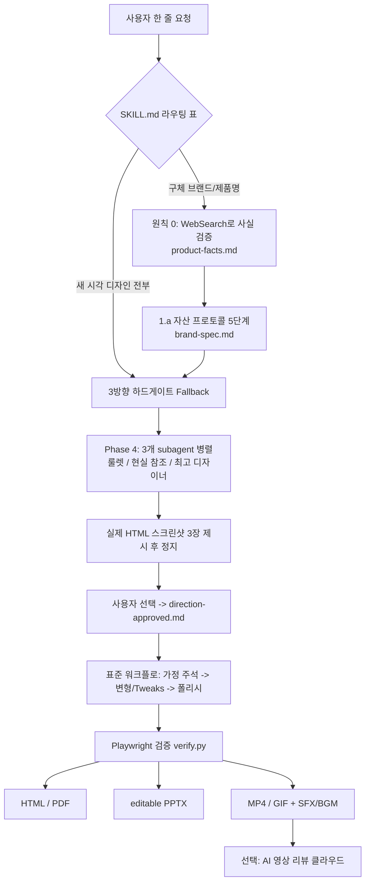

# huashu-design

> [!summary] 한줄요약
> "화수(花叔) Design" — Claude Code·Cursor·Codex 같은 에이전트에 설치하면, 자연어 한 줄로 HTML 기반의 고충실도 프로토타입·슬라이드 덱·모션(MP4/GIF)·인포그래픽·디자인 리뷰를 만들어 주는 대형 SKILL 패키지. 핵심은 코드가 아니라 **에이전트의 작업 순서를 강제하는 규율 문서**(SKILL.md 약 65KB + references 약 36개)이고, 렌더링·내보내기는 Playwright/ffmpeg/pptxgenjs 로컬 스크립트가 맡는다. MIT(2026-05-14 재라이선스), 스타 약 24.6k.

## 1. 배경 — 어떤 문제를 푸는가

LLM에게 "예쁜 랜딩 페이지 만들어 줘"라고 하면 보라색 그라데이션, 이모지 아이콘, 둥근 카드+왼쪽 컬러 보더, Inter 폰트처럼 **학습 코퍼스의 시각적 최대공약수**가 나온다. 저자는 이를 "AI slop"이라 부르고, 이것이 단순한 미감 문제가 아니라 "사용자의 브랜드가 알아보이지 않게 희석되는 문제"라고 정의한다(SKILL.md 6.1절). 즉 이 skill의 목표는 모델 능력을 끌어올리는 것이 아니라, **모델이 기본값으로 쏟아내는 평균 디자인에서 벗어나도록 절차와 금지 목록, 실제 자산(logo·제품 이미지) 수집 규칙을 강제하는 것**이다.

저자(@AlchainHust, 화수/Huasheng)는 README의 "Origin Story"에서 Anthropic의 Claude Design 출시 직후 그 구조(커뮤니티에 돌던 시스템 프롬프트, brand asset protocol, 컴포넌트 메커니즘)를 에이전트로 해체·증류해 자신의 Claude Code용 skill로 만들었다고 밝힌다. 그래서 "기존 design context에서 출발하라, 빈 화면에서 hi-fi를 그리지 마라"는 원칙이 철학의 1순위로 들어가 있다.

README가 말하는 포지셔닝은 Claude Design(웹 GUI 제품, 구독 쿼터, Canvas+Figma export)과 대비된다. huashu-design은 skill 형태이며 대화로 쓰고, 출력이 HTML/MP4/GIF/편집 가능 PPTX/PDF이고, 에이전트 비종속(Claude Code/Cursor/Trae/Hermes/OpenClaw)이라는 점을 내세운다. 한계도 스스로 적는다: 레이어 편집 가능한 PPTX-to-Figma 왕복 불가, Framer Motion급 3D·물리·파티클 불가, 브랜드 없이 처음부터 그리면 품질이 "60–65점"으로 떨어진다는 것. README의 표현으로는 "100점짜리 제품이 아니라 80점짜리 skill"이다.

> [!note] 확인 범위
> 이 노트는 레포의 README.en.md, SKILL.md 전문, SECURITY.md, LICENSE, package.json, .env.example, scripts/design-gate-hook.sh, references 중 workflow·verification·critique-guide·editable-pptx·design-styles·hyperframes-backend·animation-pitfalls(목차) 등을 직접 읽고 작성했다. 로컬 clone이 불완전해 `gh api`의 raw contents로 같은 파일들을 받아 읽었다. 생성 결과물의 실제 품질은 직접 실행해 보지 않았으므로 평가하지 않는다.

## 2. 한눈에 보는 산출물

README의 capability 표 기준(소요 시간은 저자 주장이며 직접 검증하지 않음):

| 능력 | 산출물 | 저자가 제시한 소요 |
|---|---|---|
| 인터랙티브 프로토타입(App/Web) | 단일 HTML, 실제 iPhone bezel, 클릭 가능, Playwright 검증 | 10–15분 |
| 슬라이드 덱 | HTML 덱 + 편집 가능한 PPTX(텍스트 프레임 유지) | 15–25분 |
| 모션 디자인 | MP4(25fps/60fps 보간), GIF(팔레트 최적화), BGM | 8–12분 |
| 디자인 변형 | 3개 이상 병렬 비교, Tweaks 실시간 파라미터 | 10분 |
| 인포그래픽 | 인쇄급 타이포, PDF/PNG/SVG 내보내기 | 10분 |
| 디자인 방향 자문 | 5개 유파 x 20개 철학(README 표기), 3개 방향 추천 후 데모 병렬 생성 | 5분 |
| 전문가 리뷰 | 레이더 차트 + Keep/Fix/Quick Wins | 3분 |

## 3. 동작 원리 / 아키텍처

### 3.1 "코드 없는 제품"이라는 구조

이 레포의 실행 주체는 서버가 아니라 **에이전트 자신**이다. 사용자가 `npx skills add alchaincyf/huashu-design`으로 설치하면 `~/.claude/skills/huashu-design/` 같은 위치에 SKILL.md와 하위 디렉터리가 놓이고, 에이전트는 사용자 요청이 SKILL.md의 description(트리거 단어: 做原型, PPT, 幻灯片, 动画, 设计风格, 评审, UI mockup, 导出MP4/GIF 등)과 맞을 때 이를 로드한다. SKILL.md는 "라우팅 표 → 핵심 원칙 → 방향 자문(Fallback) → 표준 워크플로 → 기술 레드라인 → 컴포넌트/레퍼런스 라우팅 표"의 순서로 구성되고, 세부 내용은 `references/*.md`로 분리되어 **작업 유형별로 필요한 문서만 읽는 progressive disclosure** 구조다. SKILL.md 본문이 약 65KB로 길기 때문에 약한 모델에서는 컨텍스트가 터지고, 저자도 이를 알고 "약한 runtime 강등 모드"를 따로 둔다(4.8절).



### 3.2 구성요소

- **SKILL.md** — 에이전트 지침의 본체. 정체성("당신은 HTML 쓰는 프로그래머가 아니라 디자이너, 그리고 6개 역할(아트 디렉터, 브랜드 리서처, 비주얼 디자이너, 모션 디자이너, 프런트엔드 엔지니어, 카피라이터)을 순차로 수행하는 스튜디오")를 정하고, 라우팅·게이트·금지 목록을 정의한다.
- **references/** (약 36개 문서) — 작업별 드릴다운. 예: `workflow.md`(필수 질문 5종, Junior Designer 모드), `brand-asset-protocol.md`(5단계 자산 수집), `design-styles.md`(약 63KB 스타일 라이브러리), `slide-decks.md`(36KB), `editable-pptx.md`·`pptx-from-rendered-html.md`(PPTX 두 경로), `animation-pitfalls.md`·`animation-best-practices.md`·`camera-language.md`·`storyboard-basics.md`·`gsap-recipes.md`(모션), `voiceover-pipeline.md`(해설 영상), `video-export.md`·`audio-design-rules.md`·`sfx-library.md`(영상·오디오), `critique-guide.md`(리뷰), `verification.md`, `hyperframes-backend.md`, `launch-film-director-notes.md`, `multi-perspective-parallel-case-study.md` 등.
- **assets/** — 바로 복사해 쓰는 스타터 컴포넌트. `animations.jsx`(Stage/Sprite/useTime/Easing/interpolate), `ios_frame.jsx`·`android_frame.jsx`·`macos_window.jsx`·`browser_window.jsx`(디바이스 프레임), `deck_stage.js`(단일 파일 덱 web component), `deck_index.html`(멀티 파일 덱의 3D 개요 벽), `design_canvas.jsx`(변형 나란히 비교), `cursor.jsx`(제품 UI 데모용 커서), `narration_stage.jsx`(해설 구동 모션), `showcases/`(8개 장면 x 3개 스타일 = 24개 샘플 HTML), `director-notes-samples/`.
- **scripts/** — 내보내기 파이프라인: `render-video.js`(HTML -> 25fps MP4), `render-video-seek.js`(프레임 단위 seek로 진짜 60fps), `convert-formats.sh`(60fps·GIF 파생), `add-music.sh`, `export_deck_pdf.mjs`(Playwright `page.pdf()` + pdf-lib 병합), `export_deck_stage_pdf.mjs`, `export_deck_pptx.mjs` + `html2pptx.js`(DOM -> PPT 객체), `pptx_from_rendered.py`(렌더된 좌표 기반 변환), `verify.py`(Playwright 검증), `fetch_images.py`(Wikimedia 이미지), `narrate-pipeline.mjs` + `scripts/cloud/tts-doubao.mjs`(TTS), `scripts/cloud/ai-review-video.py`(AI 영상 리뷰), `design-gate-hook.sh`(선택적 PreToolUse 훅).
- **demos/** — README에서 참조하는 능력 데모(c1~c6, w1~w3, 중·영 각각). `package.json` 의존성은 `pdf-lib`, `playwright`, `pptxgenjs`, `sharp` 4개뿐이다.

### 3.3 데이터 흐름의 특징

산출물의 "정본"은 항상 **HTML**이다. 모든 출력 형식이 HTML에서 파생된다: PDF는 Playwright 인쇄, PPTX는 DOM/렌더 좌표 번역, 영상은 headless 브라우저 녹화 또는 seek 렌더, GIF는 MP4에서 파생. 반대로 말하면 **HTML에서 PPTX로의 변환이 손실 구간**이고 저자도 README 한계 항목과 references 곳곳에서 이를 인정한다(그라데이션·background-image·복잡 SVG 불가 등, 4.6절).

## 4. 핵심 기능 상세

### 4.1 원칙 #0 — 사실 검증 우선

SKILL.md는 "구체적인 제품·기술·사건의 존재/출시 상태/버전/스펙에 대한 단언은 첫 단계로 WebSearch로 검증하고, 학습 코퍼스 기억으로 단언하지 말라"를 모든 흐름 위에 둔다. 근거로 2026-04-20 실제 실패 사례를 든다: DJI Pocket 4 발표 애니메이션을 요청받아 "아직 출시 안 됐다"고 기억에 의존해 컨셉 실루엣을 만들었으나 4일 전에 이미 출시되어 공식 소재가 있었다는 것. 검색 비용 10초 대 재작업 2시간이라는 대비가 반복된다. 결과는 프로젝트의 `product-facts.md`에 기록한다. "에이전트가 기억으로 사실을 단언하지 않게 하는 규칙"의 구체적 사례로 참고할 만하다.

### 4.2 핵심 자산 프로토콜(1.a) — 5단계

브랜드가 걸린 작업(자사 물량뿐 아니라 비교·랭킹·평가 덱에서 제3의 제품명을 언급하는 경우 포함)은 **공식 logo가 필수 자산**이라는 철칙이다. 5단계: (1) 로고/제품 사진/UI 스크린샷/색상/폰트/금지 영역을 한 번에 질문, (2) 공식 채널 검색(`<brand>.com/brand`, press kit 등), (3) 자산 유형별 3가지 폴백 경로로 다운로드(로고는 svgl API -> simpleicons -> Google favicon), (4) 로고·제품 이미지의 진위 검증과 색상 추출(기억으로 추측 금지), (5) `brand-spec.md`로 고정. README는 v1 대비 v2에서 에이전트 6개 기준 안정성 분산이 5배 줄었다고 주장한다(저자 A/B 테스트, 재현 자료는 확인하지 못함). 자산 중요도 순위는 로고 > 제품 렌더 > UI 스크린샷 > 색상 > 폰트다. 단일 HTML 산출물에서는 로고·이미지를 base64로 내장하라는 규칙도 있다(상대경로는 폴더 이동 시 깨지며, 블라인드 평가에서 패배 원인이었다고 서술).

### 4.3 3방향 하드 게이트(Fallback "디자인 방향 자문")

이 skill의 가장 눈에 띄는 설계다. SKILL.md는 2026-07-18부터 **새 시각 디자인을 만드는 모든 작업에서 예외 없이** 먼저 3개의 차별화된 방향(실제 초안)을 사용자에게 보여주고 선택받아야 한다고 못박는다. 스타일을 지정해도("애플 발표 영상 스타일") 면제되지 않는다: "스타일 단어는 해석 범위를 좁힐 뿐 선택권을 이전하지 않는다". 면제는 세 가지뿐이다: 사용자가 이번 세션에서 건너뛰라고 명시, 이미 선택된 방향의 후속 수정, 비디자인 기계적 작업(변환·내보내기·버그 수정).

초안 형태는 산출물에 따라 정의된다: 웹/인포그래픽/프로토타입은 방향당 완전한 HTML 1개 + 스크린샷, 멀티페이지 덱은 방향당 대표 2페이지, 영상은 방향당 "방향판"(hero 키프레임 HTML 정지 이미지 1–2장 + 색상띠 + 한 줄 기질 + 참조 작품명 — 완성 영상 3편이 아님), 커버는 실제 이미지 1장. 제시 후에는 **반드시 턴을 종료하고 사용자의 선택을 기다린다**(무인 세션도 예외 아님). 사용자가 글만 보고 스타일을 고르면 근거가 없다는 이유로, 저자는 이를 "선택 무효 철칙"이라 부른다.

흐름은 7 Phase다. Phase 1 대화로 요구 파악+참조 요청(한 번에 최대 3문항, 무응답이면 가정 표시하고 진행), Phase 2 200자 이상 재진술, Phase 3 500자 이상 상세 spec(세 subagent의 유일한 공통 입력; 출력 포맷·픽셀 크기 필수), Phase 3.5 이미지 필요성 판정과 실제 이미지 확보(Wikimedia/Met/BHL/Unsplash/Pexels 등; 콘텐츠에 필수인 이미지를 CSS 색 블록으로 때우면 실패), Phase 4 세 subagent 병렬, Phase 5 사용자가 실제 스크린샷을 보고 선택(그리고 `direction-approved.md`에 사용자 원문 기록), Phase 6 본 워크플로 진입.

Phase 4의 세 논리가 독특하다.
- **논리 1 초 룰렛**: `date +%S`의 초를 20으로 나눈 나머지+1번 스타일을 `design-styles.md`에서 강제로 뽑는다. 모델이 안전한 미니멀로 쏠리는 결정적 편향을 시간이라는 난수로 깨는 장치.
- **논리 2 현실 참조**: Awwwards/CSS Design Awards/FWA/Apple Design Award급 실제 사이트 1개를 WebSearch로 실존 확인 후 구성·색·서체를 분해해 이식.
- **논리 3 최고 디자이너**: "예산 무제한이면 이 사용자·제품에 가장 적합한 스튜디오/디자이너는 누구인가"(Pentagram, Collins, IDEO 등)를 골라 그 사고방식으로 설계.

세 결과는 독립 컨텍스트에서 만들며(서로 참조 금지), 뼈대(내비게이션·구성·콘텐츠 영역)가 서로 달라야 하고(껍데기만 바꾼 것은 블라인드 평가에서 간파됨), 가독성 하한(본문 14px 이상, 라벨 12px 이상, 대비 4.5:1 이상)이 적용된다. subagent를 못 만드는 런타임(Codex/Cursor/대화형)에서는 같은 세 논리를 **직렬로** 돌리되 서로 기억을 격리하라고 한다. 산출 후 `design-demos/` 아래 HTML 3개 존재를 자체 점검한다.

### 4.4 Junior Designer 워크플로

표준 흐름은 `TaskCreate`로 추적하고 정지 체크포인트가 있다: (1) 질문 목록을 한 번에 묻고 일괄 답변을 기다림, (2) 자산 자체 점검, (3) form 도출 5문항 + 시스템을 말로 설명해 동의받은 후에만 코딩, (4) HTML 첫머리에 assumptions/reasoning/placeholder를 쓰고 회색 블록 단계에서라도 먼저 보여줌, (5) 인도 전 브라우저에서 직접 확인. `workflow.md`의 필수 질문은 Design Context·Variations 차원·Fidelity/Scope·Tweaks·과제별 4개 이상이다(보통 10개 이상 질문). 원칙으로는 "placeholder > 어설픈 구현", "variation은 최종 답이 아니라 탐색", "system over filler"가 있다.

### 4.5 Gate 파일 프로토콜과 훅

체크포인트가 긴 세션에서 "계속"의 관성에 씻겨 나가는 문제(SKILL.md가 인용한 2026-07-17 B00 사례: 방향 확인을 건너뛰고 210초 영상을 렌더해 전체 재작업)에 대응해, 핵심 체크포인트를 **프로젝트 디렉터리에 있어야 하는 파일**로 물질화한다: `brand-spec.md`(브랜드 자산), `direction-approved.md`(3방향 스크린샷 경로 + 사용자 선택 원문), `导演稿.md`/director's notes(20초 이상 애니메이션의 콘티·시각 밀도 조항). 파일이 없으면 단계가 수행되지 않은 것으로 본다는 자체 점검 가능한 규칙이다.

여기에 `scripts/design-gate-hook.sh`가 있다. 직접 읽은 내용으로는 Claude Code `PreToolUse(Bash)` 훅으로, 렌더 명령(`hyperframes render`, `render-video(-seek).js`, `render-narration.sh`, `npm run render`)이 감지되면 합성 길이를 `--duration=` 인자 또는 `index.html`의 `data-duration`에서 읽어 **45초 이상이면서 `direction-approved.md`가 없을 때** exit 2로 차단한다. `SKIP_DESIGN_GATE=1`을 명령에 붙이면 감사 가능한 탈출구로 통과한다. 이 훅은 자동 설치되지 않으며 사용자가 `settings.json`에 직접 등록해야 한다(파일 주석과 SECURITY.md 모두 명시). 프롬프트 규율을 **기계적 제약으로 승격**시킨 사례라 사내 에이전트 가드레일 설계에 참고할 만하다.

### 4.6 슬라이드/PPTX — 두 경로

기본 산출은 **멀티 파일 덱**(페이지당 독립 HTML, 1920x1080) + `assets/deck_index.html` 개요 벽(그리드 iframe 또는 무한 갤러리의 두 가지 3D 개요, 약 60/40 확률)이다. 단일 파일(`deck_stage.js` web component)은 5페이지 이하 핏치용. 요청 없이 PDF를 자동 출력하고, 편집 가능한 PPTX는 **물어본 뒤** 낸다. PPTX 경로는 둘:

- **경로 A**(HTML을 아직 쓰기 전): `html2pptx.js`로 DOM을 요소 단위 번역. HTML이 **4개 하드 제약**을 처음부터 지켜야 한다. 확인한 규칙 1은 "div에 텍스트를 직접 두지 말고 `<p>`/`<h1>`-`<h6>`로 감쌀 것(span은 단독으로 텍스트 박스가 안 됨)", 규칙 2는 "CSS gradient 불가(background-image의 한 종류)"이며 background-image 금지가 별도 언급된다. 나머지 세부는 이번 조사에서 전부 읽지 않았다. 기본 캔버스는 960x540pt(13.333x7.5in, pptxgenjs `LAYOUT_WIDE`)이고 ±0.1in 검증이 걸린다. 1920x1080px 같은 큰 body는 PPTX가 벡터 문서라 글자가 상대적으로 작아져 권장하지 않는다.
- **경로 B**(이미 쓴 시각 위주 HTML, 또는 고객사 템플릿 상속 필요): `pptx_from_rendered.py`가 브라우저 렌더 후 `getBoundingClientRect` 좌표를 읽어 변환(HTML 구조 개조 불필요). 고객사 `.pptx`를 베이스로 마스터/레이아웃을 상속할 수 있다고 한다(pptxgenjs로는 불가). 두 경로를 한 프로젝트에서 섞지 말라고 한다.

주목할 점은 최근 커밋 이력이다. 2026-09-22 커밋에서 "Anthropic pptx skill에 기반한 html2pptx.js 제거(클린룸 재작성 준비)" 후 "SPEC.md의 행동 규격만으로 처음부터 재구현해 Anthropic 독점 코드를 대체"했고, editable-pptx.md의 4개 제약 절도 원문 번역 개작이었던 것을 독자 문서로 교체했다고 커밋 메시지에 적혀 있다. 즉 이 레포는 MIT로 공개하면서 **외부 독점 코드 혼입 문제를 정리한 이력**이 있다. 사내 도입 시 라이선스 실사 관점에서 의미 있는 사실이다(재작성 결과의 법적 충분성은 판단하지 않음).

### 4.7 모션·영상 파이프라인

`animations.jsx`의 Stage/Sprite 시간 슬라이스 모델에 `useTime/useSprite/interpolate/Easing` 네 API가 기본이다. 새 애니메이션의 기본 렌더 백엔드는 **HyperFrames**(HeyGen 오픈소스, Apache 2.0이라고 `hyperframes-backend.md`에 적힘): 순수 HTML + 일시정지 GSAP timeline을 headless 브라우저에서 프레임 단위로 seek하는 결정적 렌더. 합성 계약은 루트의 `data-composition-id/data-start/data-duration/data-width/height`, 각 클립의 `class="clip"` + `data-*`, `window.__timelines[id] = gsap.timeline({paused:true})`, `Date.now()`/`Math.random()`/런타임 fetch 금지 등이다. 약한 런타임·더블클릭 단일 파일·인터랙티브 데모는 자체 Stage 경로, 해설 포함 장편은 자체 narration 파이프라인을 쓴다.

`animation-pitfalls.md`의 목차는 이 도메인의 실전 함정을 보여준다: 레이어 `position: relative`, 희귀 유니코드 회피, 장면 전환 연속성, **seek 가능한 pure render**, 폰트 로드 전 측정 금지, 녹화 시 진행바/재생 버튼 등 Chrome 요소 오염, warm-up 프레임 누수, `__ready`×tick×lastTick 3중 함정, 녹화 시 loop 금지(`window.__recording` 신호), 60fps는 minterpolate보다 프레임 복제가 호환성 좋음, `file://`+외부 `.jsx`의 CORS, HyperFrames에서 CSS transition+class 전환은 seek 시 비결정적 등 20개 항목.

영상 기본 산출은 **음향이 있는 MP4**다. BGM 6곡과 SFX 37종을 `audio-design-rules.md`의 ffmpeg 템플릿으로 이중 트랙 믹싱(SFX 고음역, BGM 저음역)하고, 납품 전 `ffprobe -select_streams a`로 오디오 스트림 존재를 확인한다. 밀도 가이드는 "발표용 hero 약 6개/10초, 도구 데모 0–2개/10초"다. 해설 영상은 `voiceover-pipeline.md`: 해설 원고(`## scene-id`, `[[cue:xx]]`)를 소스 코드처럼 쓰고 TTS(Doubao)가 **실측한 시간**으로 timeline.json을 만든 뒤 애니메이션을 만든다. 실패 모드 1호는 "각 장면이 독립 레이아웃+fade-up+페이지 전환 = 음성 있는 PowerPoint"로 명시한다. 애니메이션 산출물에는 기본으로 "Created by Huashu-Design" 워터마크를 넣는다는 규칙이 있다(슬라이드·인포그래픽·프로토타입·웹에는 안 넣음; 사용자가 원치 않으면 제거).

### 4.8 App/iOS 프로토타입 및 약한 런타임 강등

iOS 프로토타입은 기본이 **단일 파일 inline React**(`file://` 더블클릭 동작, 이미지 base64), 4–6개 주요 화면을 평면 배치하고 각각이 독립 미니 상태 머신, **디바이스 프레임은 반드시 `assets/ios_frame.jsx`**(Dynamic Island 고정 124x36 등 위치 버그 때문에 수작업 금지), 인도 전 Playwright로 3종 클릭 테스트와 `pageerror` 0 확인이다. React+Babel 사용 시 레드라인: `const styles = {...}` 금지(고유 이름), `<script type="text/babel">` 간 scope 미공유라 `Object.assign(window, {...})`, `scrollIntoView` 금지, 자체 Stage 작성 시 `window.__ready`/`window.__recording` 지원.

약한 런타임(subagent 없음·비 Claude·작은 컨텍스트: Codex, Gemini CLI, Copilot 등)은 강등 모드로 들어간다: 3방향을 직렬화, 그래도 빠듯하면 주 버전 1개+색·타이포만 바꾼 경량 변형 2개, references는 작업당 1개만 읽기, 덱은 단일 파일, 체크포인트 문답을 가정 목록으로 대체. "다양성과 절차는 희생해도 anti-slop 하한과 실제 자산 프로토콜은 희생하지 않는다"가 원칙이다. 단 gate 파일은 강등 모드에서도 써야 한다.

### 4.9 디자인 스타일 라이브러리와 리뷰

`design-styles.md`는 **웹 20종 + PPT 20종 + 인포그래픽 20종 = 60종**을 "대담/중립/조용" 3단계 온도로 분류한다. 대담한 스타일을 일부러 다수로 둬 모델의 안전 미니멀 편향을 민다. 각 항목은 참조·적합 용도·시각 DNA(색 hex, 서체, 레이아웃, 시그니처 요소)·HTML 구현·오픈소스 대체 폰트·재현도(예: "대담·재현 98%")를 가진다. 예로 Bloomberg Businessweek 계열 "Editorial Brutalism", The Verge 2022 계열 "Neo-Brutalism", 융자 핏치 덱 계열 "Neo-Swiss Billboard Editorial", Nicholas Felton 연간 보고서 계열 "Personal Annual Report"를 확인했다. 재현도 70% 미만은 순색 블록으로 강등했음을 산출물에 명시하라고 한다. 금지 영역은 GitHub-dark 게으른 해(균일한 `#0D1117` 심청색+범용 네온 글로우)이며, 영화적 어둠이나 작가 의도가 있는 다크는 허용한다.

리뷰는 README의 "5차원"과 달리 현재 `critique-guide.md`에서 확인되는 평가 축이 **0번 개념(Concept) + 1 철학 일관성 + 2 시각 위계 + 3 디테일 실행 + 4 기능성 + 5 독창성**으로 6개다. 개념이 5점 이하면 총점 상한 6.0이 걸리는 규칙이 있고, "고객명/제품명을 바꿔도 성립하면 템플릿이므로 개념 5점 이하"라는 판정 질문이 있다. 출력은 총평+Keep+Fix(치명/중요/최적화)+Quick Wins 3개. `verification.md`는 "검증 도구부터 검증하라"를 0조로 둔다: macOS `qlmanage` 썸네일은 텍스트 겹침 버그 4개를 놓쳤고, macOS의 LibreOffice는 중국어 PPTX를 두부 글자로 렌더했다는 실전 사례를 들며, 신뢰도 순서(Keynote+AppleScript PDF 및 실제 PowerPoint/WPS 확인이 높음)를 제시한다.

### 4.10 Tweaks 시스템

호스트 `postMessage`가 없는 환경이므로 **순수 프런트엔드 + localStorage**로 색·서체·밀도 등을 매개변수화하고 측면 패널로 실시간 전환한다(새로고침 후 유지). 변형을 여러 HTML로 나누지 않고 한 프로토타입 안에서 레이아웃 옵션을 토글로 바꾸게 하는 방식이다.

## 5. 설치·사용법

```bash
# 설치 (skills CLI v1.5.19 이상 권장)
npx skills add alchaincyf/huashu-design
# 구버전 CLI(<=1.5.15)는 SKILL.md만 동기화하는 버그가 있음
npm i -g skills@latest        # 또는 npx skills@latest add alchaincyf/huashu-design

# CLI 문제 시 git clone 폴백
git clone https://github.com/alchaincyf/huashu-design.git ~/.claude/skills/huashu-design

# 설치 확인: 아래 하위 디렉터리가 모두 보여야 함
ls ~/.claude/skills/huashu-design/{references,assets,scripts,demos}
```

사용은 대화형이다. README 예: "AI 심리학 키노트를 만들어 줘, 3가지 스타일 방향 중 고르게", "뽀모도로 앱 iOS 프로토타입 4화면, 실제 클릭 가능하게", "이 로직을 60초 애니메이션으로, MP4와 GIF로", "이 디자인에 5차원 전문가 리뷰". 렌더/내보내기 의존성(`playwright`, `pptxgenjs`, `pdf-lib`, `sharp`, 그리고 `ffmpeg`)은 작업 시점에 설치가 필요하다. 클라우드 기능(Doubao TTS, AI 영상 리뷰)을 쓰려면 `.env.example`을 복사해 본인의 키를 넣는다:

```bash
# .env.example 에서 확인한 키 이름 (값은 사용자 본인 것)
DOUBAO_TTS_API_KEY=...        # 火山引擎 openspeech TTS
DOUBAO_TTS_ENDPOINT=https://openspeech.bytedance.com/api/v1/tts
ARK_API_KEY=...               # 火山方舟(Volcengine Ark), AI 영상 리뷰

# 클라우드 스크립트는 명시적 동의 없이는 전송 전에 종료
uv run scripts/cloud/ai-review-video.py --video out.mp4 --context 导演稿.md --yes
```

## 6. 디렉터리/코드 구조에서 확인한 것

- 레포 루트: `SKILL.md`(65,262 bytes), `README.md`/`README.en.md`(각 약 19KB), `SECURITY.md`, `LICENSE`, `package.json`, `.env.example`, `test-prompts.json`(2.7KB).
- `references/`: 약 36개 마크다운(최대 `design-styles.md` 62.8KB, `slide-decks.md` 36.2KB, `gsap-recipes.md` 35.6KB, `animation-pitfalls.md` 30.8KB). **전부 중국어**로 작성되었다(README.en.md도 "SKILL.md와 references는 중국어이나 에이전트는 이중언어라 영어 작업에도 동작"이라고 명시).
- `assets/showcases/`: 8개 장면(cover, infographic, ppt, website-ai-nav, website-ai-writing, website-devdocs, website-homepage, website-saas) x 3개 스타일(build, pentagram, takram) = 24개 HTML 샘플.
- `scripts/`의 큰 파일: `html2pptx.js`(약 34.5KB), `pptx_from_rendered.py`(약 25KB), `ai-review-video.py`(약 20KB), `render-video.js`·`render-video-seek.js`·`narrate-pipeline.mjs`(각 10–12KB).
- 이슈 정황(GitHub API, 2026-10-01): 열린 이슈 4건 — #56 `pptx_from_rendered.py`가 `<svg>` 등 비인라인 자식과 맨 텍스트가 같은 요소에 있으면 텍스트를 조용히 버림, #54 Claude/Grok/Codex/Pi 플러그인 마켓플레이스 추가 제안, #51 skill을 `skills/huashu-design/` 하위 디렉터리로 좁혀 vendoring 하기 쉽게 하자는 제안, #50 OfficeCLI 사용 제안. 닫힌 이슈 중 #47/#48은 `npx skills add`가 SKILL.md만 동기화하던 문제(위 v1.5.19 안내의 근거), #55는 html2pptx의 SVG className TypeError.
- 기여자: alchaincyf 88 커밋, Jiandong7 2 커밋(contributors API 상위 2명). 사실상 **1인 메인테이너 프로젝트**이다. 일부 커밋에는 `Co-Authored-By: Claude ...` 트레일러가 있어 AI 에이전트와 함께 개발된 레포임을 알 수 있다.

## 7. 비교 대상

| 대상 | 성격 | huashu-design과의 차이 |
|---|---|---|
| Claude Design (Anthropic) | 웹 GUI 제품, 구독 쿼터 | README 자체 비교: GUI 편집 vs 대화형 skill. huashu는 에이전트 비종속·MP4/PPTX 출력, 대신 GUI 편집은 없음 |
| [[diagram-design]] | 다이어그램 특화 skill(HTML+inline SVG) | 범용 디자인이 아니라 기술 다이어그램 스타일에 집중. huashu는 프로토타입·덱·모션까지 포괄하지만 다이어그램 전용 정밀도는 확인하지 못함 |
| [[mengto-skills]] | 웹디자인/GSAP/Three.js/영상->프롬프트 skill 모음 | MengTo는 가볍고 독립적인 개별 skill 집합, huashu는 단일 skill 안에 게이트·라우팅·내보내기 파이프라인을 묶은 모놀리식 구조 |
| [[agent-skills]], [[agency-agents]] | 범용 skill/에이전트 페르소나 컬렉션 | 도메인이 넓은 대신 절차 강제 수준은 낮음. huashu는 도메인(디자인)에 깊고 절차가 강함 |
| Figma/AE 같은 GUI 도구 | 사람이 편집 | huashu 산출물은 HTML이라 "Keynote에서 텍스트 위치 직접 수정" 같은 레이어 편집 왕복은 제한적(README 한계 항목) |
| Remotion | 코드 기반 영상 | `hyperframes-backend.md`가 대량 파라미터 영상은 Remotion으로 분리하라고 안내(규모 템플릿 영상은 범위 밖) |

## 8. 장단점·한계·성숙도

**성숙도 수치(GitHub API, 2026-10-01 조회)**: 스타 24,555, 포크 2,798, 구독자(watchers) 98, 열린 이슈 4, 라이선스 MIT, 주 언어 표기 HTML, 레포 생성 2026-04-19, 마지막 push 2026-09-22, master 커밋 약 90개(커밋 API 페이지 수 기준), 릴리스는 v2.0(2026-04-21, 에셋 20개)뿐. 생성 후 약 5개월 만에 스타 2만 이상이라는 속도는 저자의 SNS 영향력(README: 합산 팔로워 30만 이상)과 관련이 클 것으로 보이나, 이 해석은 확인된 사실이 아니라 추정이다.

**장점**
- 절차가 구체적이고 실패 사례(날짜와 프로젝트명)로 근거를 단다. 에이전트용 규율 문서의 좋은 표본이다.
- 로컬에서 닫힌 파이프라인(HTML -> PDF/PPTX/MP4)과 검증 스크립트가 있다.
- SECURITY.md가 네트워크 목적지·키·서브프로세스·삭제 범위를 전수 선언한다(9절 참조).
- 게이트를 파일과 훅으로 물질화한다.

**단점·한계**
- **중국어 중심**: 지침이 전부 중국어라 한국어 조직이 수정·감사하기 어렵다. 한국어 번역은 커뮤니티 레포(`ktkarchive/ktk-design`)가 README에 링크되어 있으나 품질·라이선스는 각 메인테이너 책임이라고 적혀 있고 내용은 확인하지 못했다.
- **무겁다**: SKILL.md 65KB를 한 번에 올리면 작은 컨텍스트 모델에서 실패한다. 저자도 강등 모드를 둔 것으로 인정한다. SKILL.md는 이슈 #2/#6/#41 사용자가 효과를 재현 못 한 원인이 약한 런타임이었다고 서술한다(해당 이슈는 직접 열람하지 않음).
- 3방향 게이트는 **모든 새 디자인에서 무조건** 요구하므로 단순 작업에도 왕복이 늘어난다(비용 대비 효과는 사용 목적에 따라 다름).
- PPTX 변환의 손실(그라데이션/배경이미지/복잡 SVG), 이슈 #56의 무음 텍스트 누락 같은 알려진 버그. 최근 `html2pptx.js`를 전면 재작성했으므로 안정화 정도는 확인하지 못했다.
- 결과 품질은 모델에 의존하며 직접 평가한 적이 없다. 데모 영상·GIF는 저자 제공물이다.
- 1인 메인테이너 + 급격한 변화(최근 몇 달 사이 라이선스 변경, 게이트 규칙 변경, 핵심 스크립트 재작성).

## 9. 보안·라이선스·운영 리스크

**라이선스**: MIT, Copyright (c) 2026 alchaincyf. README에 따르면 2026-05-14에 이전 "Personal Use License"(상업 이용 제한)에서 MIT로 재라이선스했다. 즉 과거 버전/포크는 조건이 다를 수 있으므로 **어느 시점의 스냅숏을 쓰는지 고정하고 LICENSE를 해당 커밋에서 확인**해야 한다. 제3자 브랜드 로고를 자동 수집해 쓰는 설계이므로 산출물의 상표 사용은 별도 법무 판단 대상이다(SKILL.md의 "非官方出品" 접두어 규칙은 법적 보증이 아님). `design-styles.md`가 실존 스튜디오·매체의 스타일을 참조하므로 스타일 모방 수준의 쟁점도 있을 수 있다(법적 판단 아님).

**데이터 흐름(SECURITY.md 직접 확인)**: 핵심 파이프라인(디자인 -> 렌더 -> MP4/PDF/PPTX)은 로컬에서 네트워크 호출·API 키 0개라고 선언한다. 외부 호스트는 `ark.cn-beijing.volces.com`(ByteDance Volcengine Ark; 렌더한 영상 조각을 AI 리뷰용으로 전송), `openspeech.bytedance.com`(해설 텍스트 TTS; 엔드포인트가 `*.bytedance.com`/`*.volces.com` 화이트리스트로 검증되어 `.env`를 변조해도 키 리디렉션 불가), `commons.wikimedia.org`(이미지 검색), 브랜드 공식 사이트/simpleicons/Google favicon(에이전트가 지침에 따라 GET), 출력 HTML 열 때의 Google Fonts/unpkg 같은 CDN. 클라우드 스크립트 두 개는 `--yes` 또는 `HUASHU_CLOUD_OK=1` 동의 게이트가 있고 텔레메트리는 없다고 한다. 서브프로세스는 `ffmpeg/ffprobe/ffplay`와 Playwright/Chromium뿐이고 curl|sh 패턴이 없다. 삭제는 스크립트가 만든 타임스탬프+PID 임시 디렉터리로 한정된다.

주의할 점은 다음과 같다.
- 이 선언은 **저자의 자기 선언**이다. 코드를 이번 조사에서 전수 감사하지 않았다. 사내 도입 전 `grep -rn "https://" scripts/`(SECURITY.md가 권장)로 직접 대조해야 한다.
- **중국 클라우드(ByteDance/Volcengine)로 영상·텍스트가 나가는 옵션 기능**이 있다. 사내 정책상 비활성(키 미설정, 동의 플래그 미사용)으로 두는 것이 안전하다.
- `npx hyperframes init`은 **19개 hyperframes 문서 skill을 `~/.claude/skills/`에 설치**한다(docs에 경고 있음). HyperFrames는 CLI 버전이 매우 빨리 바뀐다고 적혀 있고(300개 이상 릴리스) 프로젝트가 정확한 버전을 pin한다. 외부 npm 패키지 공급망 리스크는 별도로 고려해야 한다.
- SKILL.md 끝의 **"버전 자체 점검(조용히)"** 절: 30일마다 `git ls-remote origin HEAD`로 원격 최신 여부를 확인하라고 에이전트에 지시한다. 설치 디렉터리가 git clone일 때만 하며 업데이트는 사용자 결정에 맡기고 자동 `pull`하지 않는다. 그래도 에이전트가 **자동으로 외부 네트워크(git remote)에 접근**하는 지시이므로 폐쇄망 환경에서는 이 절을 제거하는 것이 좋다.
- 로컬 PreToolUse 훅은 선택 설치. 규칙이 `grep` 기반이라 우회 가능성이 있으며, 보안 통제가 아니라 프로세스 가드다.
- `references/react-setup.md` 옵션 B는 데모 페이지에 Anthropic API 키를 붙여 넣는 방식이며 SECURITY.md가 로컬 데모 전용·비권장이라고 명시한다. 사내에서는 쓰지 말 것.
- 생성된 HTML이 CDN 스크립트를 로드하므로 사내 배포용은 **CDN 의존을 제거하고 자체 포함(React/Babel 인라인 등, animation-pitfalls 17절에 방법 있음)**하는 편이 좋다.

## 11. 관련 노트

[[diagram-design]] · [[agent-skills]] · [[claude-code-best-practice]] · [[mengto-skills]] · [[im-not-ai]] · [[agency-agents]]

## 12. 출처

- https://github.com/alchaincyf/huashu-design (README.en.md, SKILL.md 전문, SECURITY.md, LICENSE, package.json, .env.example)
- https://github.com/alchaincyf/huashu-design/blob/master/scripts/design-gate-hook.sh
- https://github.com/alchaincyf/huashu-design/tree/master/references (workflow, verification, critique-guide, editable-pptx, design-styles, hyperframes-backend, animation-pitfalls)
- GitHub API(2026-10-01 조회): repo 메타데이터, 파일 트리, 커밋·이슈·기여자·릴리스 (`gh api repos/alchaincyf/huashu-design/...`)

## 13. 확인하지 못한 것

- 생성 산출물의 실제 품질(직접 실행 안 함), README의 소요 시간·"안정성 5배" 수치의 근거.
- 스크립트 전체 코드의 보안 감사, `html2pptx.js` 재작성 후의 안정성, editable-pptx.md의 4개 제약 중 3·4번 세부.
- 한국어 커뮤니티 번역 레포(ktkarchive/ktk-design)의 내용·품질.
- references 중 이번에 읽지 않은 문서(storyboard, camera-language, gsap-recipes, voiceover, sfx 등)는 목차/라우팅 설명 수준으로만 반영.
