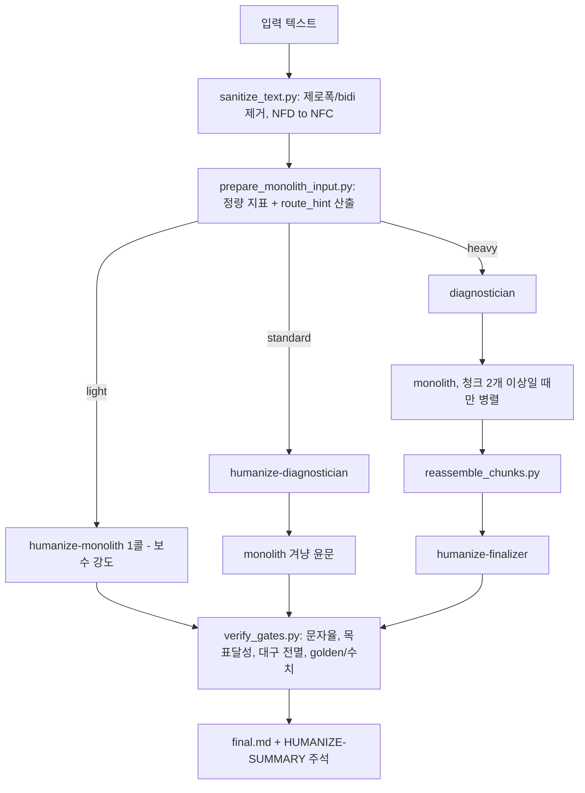

# im-not-ai (Humanize KR — 한글 AI 티 제거기)

> [!summary] 한줄요약
> AI가 쓴 한국어 글의 "AI 티"를 10개 대분류 x 85개 서브 패턴 분류 체계로 진단하고, 내용(사실·수치·고유명사·인용)은 보존한 채 문체만 고치는 humanize-korean skill. 입력 글의 정량 점수가 `route_hint`(light 1콜 / standard 2콜 / heavy 3+콜)를 결정하고, 윤문 결과는 LLM 호출 없는 결정적 스크립트(`verify_gates.py`)가 사후 검증하는 구조다. MIT, v2.3.2.

## 배경 — 해결하려는 문제

ChatGPT·Claude·Gemini가 쓴 한국어 문장에는 영어 번역투("~를 통해", "~에 있어서", "~에 의해 생성된", 이중 피동), 기계적 병렬("첫째·둘째·셋째"), 상투적 결산("결론적으로", "시사하는 바가 크다"), 문두 접속사 남발, 형식명사 과다("것이다", "점", "수", "바") 같은 공통 패턴이 있다. README는 영어권 humanizer(QuillBot, Hix, Undetectable AI)가 한국어에 약하다는 전제에서 출발하며, 한국어 AI 글의 티가 대부분 영어 번역투에서 나온다고 본다. 즉 이 프로젝트는 "탐지기를 속이는 도구"가 아니라 **한국어 글쓰기 품질 개선 도구**를 표방한다(README 라이선스&윤리 절: "AI 탐지기 우회가 아니라 한글 글쓰기 품질 개선", "학술 제출·저널리즘 진실성 보증 도구가 아님").

이 프로젝트의 진짜 특징은 프롬프트 한 장이 아니라 **측정과 게이트**에 있다. 윤문을 LLM에 맡기되, (1) 입력을 먼저 정량 채점해 얼마나 무겁게 처리할지 결정적으로 정하고, (2) 출력은 변경률·구조 지표·수치 보존을 코드로 다시 검사한다.

## 동작 원리와 아키텍처

### 파이프라인 (v2.3)



**1. 정량 shim(`scripts/prepare_monolith_input.py`, 1,018줄).** 입력을 정리(`sanitize_text.py`: 제로폭·bidi·태그 문자 제거, NFD로 분해된 한글을 NFC로 정규화)한 뒤 `metrics.py`/`metrics_v2.py`의 지표를 계산한다. 지표는 KatFish(Park et al.) 코퍼스 기준 baseline 대비 z-score 및 risk_band(low/medium/high)로 표현된다. 대표 지표는 연결어미 뒤 쉼표율(C-11, 에세이에서 4.84배 분리도라고 README가 인용), 쉼표 포함률, 쉼표 분절 평균 길이, 결산·균형 lexicon, 한자어 밀도, 어휘 다양성 등이고, v2.0에서 post-editese(Toral 2019)의 단순화·정규화·간섭 3축을 14개 metric으로 추가했다. 모두 표준 라이브러리만으로 구현했다고 README가 설명한다(형태소 분석기 미사용, 정규식·접미사 근사).

**2. route_hint 산출(`compute_route_hint`).** 소스에서 확인한 결정 규칙은 다음과 같다.
- 입력 길이 15,000자 초과 -> `heavy` (`ROUTE_HEAVY_MIN_CHARS = 15000`).
- `risk_band == high` 이면서 "카운트형 티"(결산 전환, 안전 균형, 이중 피동, "에 의해" 피동, have/make 직역, 이중 조사, 그리고 v2.6 신형 티 정규식 합) 합이 8 이상 -> `heavy`.
- 카운트형 티 합이 2 이하이고 risk가 low 또는 medium -> `light`.
- 그 외 -> `standard`.
밀도·z-score 지표는 판정에서 제외한다고 주석에 적혀 있다(v2 baseline이 placeholder라 불안정하기 때문). 산출이 실패하면 점수 없이 `standard`로 진행(graceful degrade). 사용자가 `--strict`/"정밀 모드"를 말하면 heavy 고정, "가볍게"는 light 고정이다.

소스 주석에는 이 구조가 생긴 사고 기록이 있다. 카운트 지표가 전부 v1.6 시절 것이라, 은유가 관통하는 저자 추천사(1,124자)가 risk low, tells 0으로 light에 배정되어 아무것도 고쳐지지 않은 사례가 있었고, 이를 막으려고 v2.6 신형 티(분열문 D-8, "이유다" D-10, 시간지평 D-11, 은유 가족 D-14, 피동 진행 A-20, 범용 동사 F-7 등)를 정규식으로 직접 세는 `count_v26_tells`가 추가됐다. "라우터가 못 보는 티는 어떤 경로에서도 고쳐지지 않는다"는 주석이 설계 교훈을 요약한다.

**3. 에이전트 역할.** `agents/`에는 윤문 런타임용 3개와 유지보수용 1개, 릴리스 회차 전용 개발 도구 5개가 있다.

| 에이전트 | 역할 | 비고 |
|---|---|---|
| `humanize-monolith` | 모든 경로 공용 단일 호출 윤문(탐지+윤문+자체검증) | model: opus, 도구 호출 3회 캡(입력 Read, 룰북 Read, final.md Write) |
| `humanize-diagnostician` | 글 전체의 지배 패턴 3~6개를 taxonomy ID와 처방으로 진단 | span 열거가 0~18개로 요동해서 "지배 패턴" 판단으로 대체(README v2.1 회고) |
| `humanize-finalizer` | 원문-윤문본 직접 대조로 의미 보존 15항 + 자연성 판정, 문제 구간만 국소 보정 | heavy 전용, 전체 재작성 금지 |
| `korean-ai-tell-taxonomist` | 분류 체계(SSOT) 관리, 신규 패턴 승격 | 별도 명령 |
| 개발 도구 5종 | translationese-research-distiller, korean-translation-scholar, taxonomy-gap-analyzer, post-editese-metric-engineer, quick-rules-integrator | v2.0 학술 흡수 작업용, 윤문과 무관 |

`install.sh`는 개발용 에이전트가 description 매칭으로 다른 작업에 잘못 호출될 수 있다는 이유로, 기본값으로는 런타임 4종만 전역 설치하고 나머지는 `--all-agents`일 때만 설치한다. 열린 이슈 중에는 개발 에이전트를 `dev/agents/`로 분리하는 리팩터링 건도 보인다.

**4. 결정적 게이트(`scripts/verify_gates.py`, 437줄, LLM 콜 0).** 독스트링 기준 축은 다음과 같다. P0 문자율(변경률 30% 경고, 50% 중단), P1 목표 달성(진단이 지목한 z>+2.0 지표가 윤문 후 z<=+1.0으로 내려왔는지, 과교정 z<-1.5는 경고), P2 대구 전멸 방지(C-8 "A가 아니라 B" 구문이 원문 5개 이상이었는데 0개가 되면 FAIL — 필자 목소리를 지우지 못하게), P3 golden+수치 주입 차단, P4 문장 터치율(보고만), P5 서법 보존(당위 "~해야 한다"·추측 "~할 수 있다"가 짝 문장에서 사라지면 WARN). 종료 코드 0 수렴, 1 경고, 2 중단(문자율 50% 이상, 윤문본 채택 금지), 3 실행 오류. 문자 diff만으로는 구조 편집을 못 본다는 실측("change_rate 2.77% 뒤에 문장 터치율 29.7%, ending_comma -86%, C-8 대구 -75%가 숨어 있었다")이 이 게이트의 동기다.

### 분류 체계 (SSOT: `skills/humanize-korean/references/ai-tell-taxonomy.md`)

| 대분류 | 내용 | 예 |
|---|---|---|
| A 번역투 | 영어/일본어식 구문 직역 | "~를 통해", 이중 피동 "되어진다", 대명사 "그/그녀"(A-16), 관계절 좌향 수식(A-18), 이중 조사 "-에서의"(A-19) |
| B 영어 인용·용어 과다 | 괄호 병기, 번역 가능한 영어 | |
| C 구조 | 기계적 번호 목록, 불릿·이모지, 콜론 부제 헤딩(C-10), 연결어미 뒤 쉼표(C-11) | |
| D 관용구 | "결론적으로", "시사하는 바가 크다", hype 어휘, 변환 공식 "X에서 Y로"(D-7) | |
| E 리듬 | 문장 길이 균일, 종결어미 반복, 경어법 일관성 손실(E-7) | |
| F 수식·중복 | "매우", "정말", "-적/-성/-화" 남발 | |
| G hedging | 다중 완곡 | |
| H 접속사 | 문두 "또한/따라서/나아가" 연속 | |
| I 형식명사 | "것이다", "~할 필요가 있다" | |
| J 시각 장식 | 과도한 볼드, 따옴표, 대시 | |

심각도는 S1(한 번만 나와도 AI로 확신, 무조건 제거) / S2(3회 이상 반복 시 제거) / S3(중첩될 때만). 윤문 후 등급은 A(S1 0건, S2 2건 이하, 개선 70%+) ~ D(S1 3건+ 또는 심각한 과윤문, 사람 검토). 분류 체계 문서는 패턴마다 `quick: true/false` 메타를 가지고, `build_quick_rules.py`가 이를 읽어 monolith용 슬림 룰북(`quick-rules.md`)을 생성한다. 진단용 슬림 인덱스(`diagnosis-rules.md`)도 `build_diagnosis_rules.py`가 생성하며 `--check`로 drift를 막는다. README v2.3은 진단 콜이 읽는 taxonomy 74.8KB를 약 13KB 인덱스로 줄여(83% 감소) 진단 콜 토큰이 35~50% 줄었다고 주장한다(프로젝트 자체 실측).

학술 계보도 특이하다. v2.0은 한국 번역학계의 8대 번역투 유형(이근희, 김정우, 김도훈, 곽은주, 김혜영 등 인용)과 Toral 2019 post-editese를 흡수했고, 인용은 `scholarship.md`에 분리 보관한다. A-17(무정물 '-들')은 자체 코퍼스에서 양성 0건이라 "우리 데이터에서 검증 안 된 패턴은 본진 등재하지 않는다"는 원칙으로 hold 상태다. 이 인용들의 학술적 정확성은 직접 검증하지 못했다(확인 못함).

### 철칙(CLAUDE.md, 소스 확인)

1. 의미 불변, 2. 탐지 근거가 있는 span만 수정, 3. 장르 유지, 4. 과윤문 금지(30% 경고, 50% 중단), 5. register 양방향 보존('-했-'을 '-하였-'로 올리지 않음), 6. "빼기만 하고 넣지 않는다"(원문에 없던 상투구 신규 삽입 금지). 윤문 전에 문장별 핵심 내용 명사를 내부 목록으로 잡고, 앵커가 사라지는 edit은 롤백하는 `anchor_ledger` 계약이 v2.3.1에 들어갔다(README: 보호 어휘 유실 2회에서 0회, 계약 적용 전후 각 11 run).

## 핵심 기능 상세

- **세 경로의 비용 구조.** README 실측: 1만자 글을 청킹 7콜로 처리하면 610K 토큰, 단일 콜은 134K(품질 동등 주장). 청크마다 룰북·진단이 재로드되는 비용 때문이므로 청킹은 heavy 전용, 15,000자 이하는 비권장. v1.5 회고에서도 wall-clock의 진짜 변수는 모델이 아니라 "에이전트 내부 도구 호출 횟수"였다고 정리한다(5인 파이프라인 25분 -> monolith 3.5분). 이 수치들은 모두 저장소 README의 자체 보고이며 재현하지 않았다.
- **산출물.** `_workspace/{날짜-번호-TAG}/`에 `01_input.txt`, `00_metrics.json`, `02_diagnosis.md`(standard/heavy), `final.md`(본문 + 끝에 `<!-- HUMANIZE-SUMMARY -->` HTML 주석으로 메트릭·등급·자체검증 6항·주요 변경), heavy는 `chunk_manifest.json`, `03_reassembled.md`, `09_finalize.json` 등이 추가된다. TAG는 동시 세션이 같은 디렉터리를 덮어써 게이트가 남의 원문과 비교하는 사고를 막기 위한 장치다(SKILL.md 경고문).
- **보조 스킬.** `humanize`(슬래시), `humanize-scan`(전수 윤문 가치가 있는지 6개 판별력 높은 지표만 시험), `humanize-redo`("번역투만 다시" 등 부분 재실행, heavy로 자동 승급), 선택 설치 `commit-ko`(커밋 메시지 사무체 제거, `./install.sh --extras`).
- **오탐 대응 기록.** 데이터 품질 기업 Pebblous의 외부 티어다운(README 인용, 2026-08-20 블로그)이 "2020년 사람 에세이가 위험도 최고 판정"이라는 반례를 제시했고, 저장소는 클린 사람 코퍼스 532편에서 판정기의 high 오판이 285편(53.6%)이었다고 인정한 뒤 계열 상한+독립 2계열 요건(#119), column/report 장르 셀(#121)로 0편까지 낮췄다고 보고한다(in-sample 한계 명시). 이 블로그는 직접 열람하지 못했고 README 서술만 확인했다.
- **워터마크 입장.** CLAUDE.md는 Anthropic의 텍스트 워터마킹(SynthID-Text 방식) 도입 발표에 대해 "제거 기능은 탑재하지 않는다"고 못박고, `sanitize_text.py`는 워터마크와 무관한 텍스트 위생 도구이며 대신 `eval_baseline.py`/`eval_compare.py`로 품질 변화를 계측한다고 쓴다. 이 서술은 저장소 문서의 주장이며 외부 사실 확인은 하지 않았다.

## 설치·사용

```bash
# Claude Code 마켓플레이스 (클론 불필요)
/plugin marketplace add epoko77-ai/im-not-ai
/plugin install humanize-korean@im-not-ai
# 새 세션에서
/humanize-korean            # 또는 자연어: "이 글 AI 티 없애줘"

# Copilot CLI (단일 호출 경로만 지원)
copilot plugin marketplace add epoko77-ai/im-not-ai
copilot plugin install humanize-korean@im-not-ai

# Claude Code + Codex 클론 설치 (심링크)
git clone https://github.com/epoko77-ai/im-not-ai.git && cd im-not-ai
./install.sh            # claude/codex/gemini 자동 감지
./install.sh --codex-only
./update.sh             # 업데이트, 제거는 ./uninstall.sh
```

Codex에서는 `$humanize-korean`, 정밀 모드 강제는 `--strict`. 게이트를 직접 돌리는 형태는 다음과 같다(독스트링 기준).

```bash
python3 scripts/verify_gates.py \
  --before _workspace/{run_id}/01_input.txt \
  --after  _workspace/{run_id}/final.md \
  --genre essay
```

런타임 호환 표(README): Claude Code와 Codex는 light/standard/heavy·청킹·구조 게이트 전체 지원, Copilot CLI와 Gemini CLI는 light(단일 호출)만 제공하고 구조 게이트 대신 자체 검증이다. 요구사항은 파일·셸·에이전트 기능이 있는 CLI(웹 Claude.ai나 일반 ChatGPT는 불가), Python 3(스크립트용).

## 디렉터리·코드 구조에서 확인한 것

- `skills/`: `humanize`, `humanize-korean`(SKILL.md 345줄 + `references/`: taxonomy, playbook, scholarship, baseline*.json, quick-rules, diagnosis-rules, `metrics.py`, `metrics_v2.py`, empirical-validation, design-notes), `humanize-redo`, `humanize-scan`.
- `scripts/`: 19개 Python 스크립트(shim 1,018줄, `verify_gates.py` 437줄, `checks.py` 497줄, `corruption_engine.py`, `eval_baseline.py`, `eval_compare.py`, `reassemble_chunks.py` 등).
- `agents/` 9개 정의, `codex/skills/humanize-korean/`(Codex 포트: `agents/openai.yaml`, scripts), `copilot/skills/`, `gemini-extension.json`/`GEMINI.md`, `extras/skills/commit-ko`.
- `tests/`: 최상위 `test_*.py` 34개(route_hint, gates, sanitize, chunking, install smoke, plugin manifests, 런타임 경계 등) + `golden/`·`golden_commit/` fixtures + `baselines/*.json`. README 기준 pytest 236 passed(v2.3.2 시점, 직접 실행은 하지 않음).
- 관찰한 불일치: 루트 `plugin.json`은 v2.3.2이지만 `description`이 Copilot용이고 `gemini-extension.json`은 version 1.5.0·"40+ 패턴" 설명으로 낡아 있다. 배포 매니페스트 드리프트가 실제로 존재한다(`test_version_sync.py` 같은 테스트가 있는 이유로 보임).

## 비교 대상

| 도구 | 차이 |
|---|---|
| 영어권 humanizer (QuillBot 등) | 탐지기 회피 지향·영어 기반. 이 프로젝트는 한국어 번역투 분류와 의미 불변 게이트가 핵심. |
| `humanize-korean` 플러그인 (이 볼트에 설치된 skill) | 이 저장소의 배포판과 같은 계열(에이전트 목록에 humanize-diagnostician 등 동일). |
| [[diagram-design]], [[huashu-design]] | 산출물 스타일을 지정하는 skill. im-not-ai는 "측정 가능한 규칙 + 사후 검증 스크립트"를 갖춘 점이 다르다. |
| [[k-skill]] | 한국 서비스 조회 skill 모음. im-not-ai는 한국어 텍스트 후처리에 특화. |

## 장단점·한계·성숙도

확인한 사실(GitHub API, 2026-10-01): 스타 5,811, fork 641, 열린 이슈 16개(일부는 에이전트 계약·문서 정합성 지적), 라이선스 MIT, 생성 2026-04-24, 마지막 push 2026-09-26, 최신 릴리스 v2.3.2(2026-08-18) 외 v2.3.1, v2.3.0, v2.2.0, v2.1.0. 불과 5개월 사이에 v1.x에서 v2.3까지 롤백·재설계를 여러 번 거쳤다(v1.2~v1.4 폐기 후 v1.5 롤백). 커밋 수는 shallow clone이라 확인 못함.

장점은 (1) 규칙·지표·게이트가 코드와 테스트로 공개되어 있고, (2) 실패 사례(조용히 누락된 shim, 라우터 실명, 오탐 53.6%)를 README에 투명하게 기록하며, (3) 콜 수 절감을 실측으로 설계에 반영했다는 점이다.

한계: (1) 윤문 자체는 LLM이라 결과 일관성은 모델에 의존한다. (2) 정량 baseline은 KatFish 등 외부 코퍼스와 자체 소규모 코퍼스에 기반하고 일부 셀은 placeholder·in-sample이라(README 한계 절) 지표의 절대 해석은 조심해야 한다. (3) 대부분의 효과 수치(변경률, 등급 A 5/5, 토큰 절감)는 메인테이너 자체 보고이며 독립 재현은 없다. (4) 한국어 AI 글의 통계적 특성은 모델 세대에 따라 변하므로 규칙 유지보수 부담이 크다. (5) Copilot/Gemini에서는 게이트 없는 단일 콜만 제공한다. (6) 1인 프로젝트 성격이 강해 버스 팩터가 낮다(관찰).

## 보안·라이선스·운영 리스크

- 라이선스 MIT. 분류 체계 문서도 MIT 범위에서 자유 이용 가능(README).
- **텍스트가 외부 LLM으로 나간다.** 윤문 대상 본문은 사용하는 CLI의 모델 제공자에게 전송된다. 사내 기밀 문서·개인정보를 넣지 말고, 사내 정책상 허용된 모델 경로만 사용한다.
- **`_workspace/` 평문 잔존.** 입력 원문과 중간 산출물이 cwd 아래 디렉터리에 그대로 남는다. 민감 문서를 처리했다면 삭제 절차가 필요하다.
- **설치 스크립트가 홈 디렉터리의 `~/.claude`, `~/.codex`에 심링크를 생성**한다. 원격 스크립트 파이프 실행은 아니지만 클론한 저장소를 신뢰하는 구조이므로 업데이트(`git pull`) 시 diff 검토가 바람직하다. 설치 정리는 심링크 대상으로 소유권을 판별해 사용자 파일을 건드리지 않는다고 README가 설명한다.
- 에이전트 정의가 많아 자동 라우팅 오호출 위험이 있어 기본 설치는 4종으로 제한한다(스크립트 주석).
- 윤리: 탐지 회피가 목적이 아니라는 문구가 있으나, 학교 과제·기사 제출 등에서 AI 사용 은닉에 쓰일 수 있는 이중 용도다. 사내 사용 시 "AI 생성물 표기 정책"과 충돌하지 않게 목적을 문서화할 것.

## 관련 노트

[[agent-skills]] · [[k-skill]] · [[claude-code-best-practice]] · [[huashu-design]] · [[diagram-design]]

## 출처

- https://github.com/epoko77-ai/im-not-ai (README.md 전문, CLAUDE.md, INSTALL 관련 install.sh, plugin.json, gemini-extension.json, skills/humanize-korean/SKILL.md, references/ai-tell-taxonomy.md 서두, scripts/prepare_monolith_input.py, scripts/verify_gates.py, agents/humanize-monolith.md, tests 목록)
- GitHub API: repos/epoko77-ai/im-not-ai, 릴리스 목록, 열린 이슈 제목 (2026-10-01 조회)
- 확인 못함: Pebblous 블로그 원문, 학술 인용(이근희 외·Toral 2019 등)의 정확성, 커밋 총수(shallow clone), pytest 실제 통과 여부, README의 토큰/시간 절감 수치 재현
