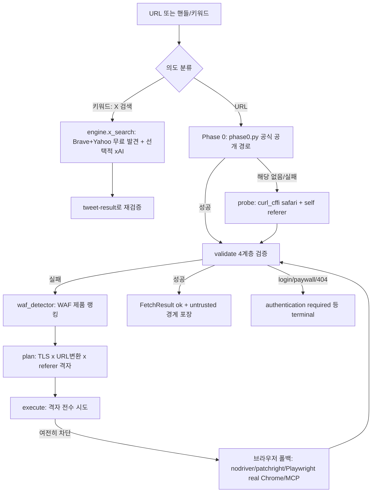

# insane-search

> [!summary] 한줄요약
> 일반 fetch가 차단된 공개 페이지에 대해 단계별 수집 경로를 시도하는 Claude Code 플러그인이다. 도입 전 정책·법무 검토가 필요한 dual-use 도구다.

- **시도 순서**: 플랫폼 공식 공개 경로(Phase 0) → 경량 probe → `curl_cffi` TLS impersonation 격자 → 실제 Chrome 브라우저. 403/WAF 차단 상황을 대상으로 한다.
- **구성**: MIT, Python 엔진 약 4,500줄. API 키 없이 사용할 수 있다.
- **설계상 경계**: 로그인/페이월에서는 `authentication required`로 멈추도록 설계됐다. 다만 anti-bot 우회 성격은 남아 있으므로 사내 도입 시 검토가 선행되어야 한다.

## 배경 — 해결하려는 문제

Claude Code의 기본 `WebFetch`는 단순 HTTP 클라이언트라 Cloudflare, Akamai, DataDome 같은 WAF/봇 방어가 걸린 사이트(X, Reddit, 네이버 블로그, 쿠팡 등)에서 403/402/챌린지 페이지를 받고 "읽을 수 없다"로 끝난다. 에이전트는 이때 즉흥적으로 `curl` 헤더를 바꿔 보거나 포기하는데, SKILL.md는 이를 "chrome 200에서 break → safari 미시도 → Playwright 미설치라 포기" 같은 오판 패턴으로 명시하고 이를 막는 **하네스 규칙(R1~R8)**을 에이전트에게 강제한다. 즉 이 프로젝트의 핵심은 "새로운 우회 기법의 발명"보다 **방어 우회 시도를 체계화한 결정 절차(스케줄러)와, 그 절차에서 에이전트가 이탈하지 못하게 하는 지침**이다.

## 동작 원리와 아키텍처

### 구성 요소

저장소(shallow clone 기준)는 다음과 같이 구성된다.

- `.claude-plugin/plugin.json` — 플러그인 메타(v0.16.3, license MIT).
- `skills/insane-search/SKILL.md` — 에이전트용 지침 본문(R1~R8, Phase 안내, 명령 예시).
- `skills/insane-search/references/*.md` — 12개 참조 문서: `fallback`, `tls-impersonate`, `playwright`, `metadata`, `jina`, `cache-archive`, `rss`, `json-api`, `public-api`, `twitter`, `naver`, `media`. SKILL.md가 "문제가 생겼을 때만 해당 파일을 Read, 선제적으로 전부 읽지 않는다"고 지시해 컨텍스트를 아낀다.
- `skills/insane-search/engine/` — 실제 Python 엔진. 라인 수 확인: `fetch_chain.py` 1,290, `executor.py` 434, `validators.py` 349, `transport.py` 310, `x_search.py` 289, `phase0.py` 273, `waf_detector.py` 214, `waf_profiles.yaml` 223, 합계 약 4,500줄. `tests/` 하위에 단위 테스트 약 19개 파일.
- `engine/templates/` — 브라우저 폴백용 템플릿(`playwright_real_chrome.js`, `playwright_mobile_chrome.js`, `nodriver_fetch.py`, `patchright_fetch.py`, `package.json`).
- `setup/setup.sh`, `setup/gptaku-update-check.cjs` — 최초 실행 설정과 업데이트 알림 hook.
- `PLATFORMS.md`, `DISCLAIMER.md`, `CHANGELOG.md`(약 33KB), 다국어 README(ko/ja/zh/es).

### Phase 0→3 escalation



SKILL.md와 코드 구조에서 확인한 단계는 다음과 같다.

1. **Phase 0 (`phase0.py`)** — 플랫폼이 공식 공개한 엔드포인트만. Reddit은 `.rss` Atom(비인증 `.json`은 403이므로), X 단일 트윗은 `cdn.syndication.twimg.com/tweet-result`와 oEmbed, X 프로필은 syndication timeline, YouTube는 `yt-dlp`, Threads 영상은 인라인 JSON의 `video_versions`를 URL shortcode와 가장 가까운 블록에서 추출(yt-dlp에 Threads extractor가 없기 때문). 이 외에 Bluesky(AT Protocol), Mastodon, Hacker News(Firebase+Algolia), Stack Overflow(SE API v2.3), arXiv(Atom), CrossRef, Wikipedia, GitHub(`gh`/REST), npm/PyPI, Wayback CDX 등은 `references/`에 문서화된 공개 API다. 한국용으로 네이버 검색과 네이버 금융 비공식 JSON(`api.finance.naver.com/siseJson.naver`)이 있다.
2. **probe/validate** — `curl_cffi` + safari 지문 + self-referer로 먼저 시도하고, 200을 "성공"이 아니라 **검사 시작 조건**으로 취급한다(R2). 성공 판정은 4계층 AND: (a) 챌린지 마커 부재(`sec-if-cpt-container`, `Access Denied`, `Just a moment...`, `DataDome`), (b) 비정상 크기 아님(3KB 미만 등), (c) 쿠키 센서 정상(`_abck=~-1~` 아님), (d) 호출자가 준 `success_selectors` 매칭(있으면 `strong_ok`, 없으면 `weak_ok`).
3. **detect/plan** — `waf_detector.py`가 쿠키·헤더·서버 문자열·본문 마커를 다중 신호로 점수화해 WAF 제품을 순위화한다. `waf_profiles.yaml`에는 `akamai_bot_manager`, `cloudflare_turnstile`, `f5_big_ip`, `aws_waf`, `datadome_probable`, `perimeterx_human`, `kasada_ips`, `imperva_incapsula`, `unknown_challenge` 프로파일이 있고, 각 프로파일은 TLS impersonation 후보 그룹, 피해야 할 지문(`tls_impersonate_avoid`), referer 전략, URL 변환 순서, 필요한 capability 태그(`needs_real_tls_stack`, `needs_js_exec`, `needs_protocol_stealth`)를 담는다. 프로파일은 "추천(prior)이지 결정론적 레시피가 아니다"라고 파일 머리에 명시돼 있다.
4. **execute** — TLS 지문(safari, safari_ios, chrome99~146, chrome_android, firefox …) x URL 변환(`original`, `mobile_subdomain` www→m, `am_prefix`, `m_prefix_subdomain` blog.→m.blog., `drop_www`) x referer(`self_root`, `google_search`, `none`) 격자를 첫 200에서 멈추지 않고 전수 시도한다. 시도 사이에는 150~400ms 지터(`INSANE_JITTER_MS_MIN/MAX`)가 들어간다. 설치된 `curl_cffi`가 지원하는 지문과의 교집합만 시도해 버전 불일치로 시도를 낭비하지 않는다.
5. **브라우저 폴백 (`executor.py`)** — capability 태그에 따라 실행기를 고른다: `needs_protocol_stealth`는 nodriver(raw CDP) → patchright(channel=chrome), `needs_real_tls_stack + needs_js_exec`는 로컬 Node의 `playwright_real_chrome.js`, `needs_js_exec`만이면 Playwright MCP(이 경우는 엔진이 아니라 Claude가 세션에서 직접 `browser_navigate → browser_snapshot` 호출). SKILL.md는 headless Chrome은 신호만으로 봇 점수를 받아 Cloudflare를 못 넘기므로 브라우저 레인이 **headful이 기본**이라고 적는다(v0.16.0).
6. **실패 게이트 (R6)** — 실패 시 엔진은 `ok=false`와 함께 아직 안 해본 경로(`untried_routes`), `grid_exhausted`, `must_invoke_playwright_mcp`, `stop_reason`, `block_class`(`bot_detection` vs `infra_or_auth`)를 반환하고, CLI는 `⛔ NOT EXHAUSTED` 블록을 stderr에 출력한다. `auth_required`/`404`/paywall 같은 terminal 사유일 때만 정직하게 실패를 인정하고, 429는 terminal이 아니라 백오프 재시도 대상이다.

### 콘텐츠 후처리와 학습

후처리는 콘텐츠 형식별로 나뉜다.

- **HTML**: 기본은 `markdownify`로 구조를 보존한 마크다운으로 변환한다. 표는 파이프표, `<pre>`는 펜스로 바꾼다. 설정은 `extraction_source=raw+md`이며 `--no-markdown`으로 끈다. `resiliparse` 본문 추출은 opt-in(`--maincontent`)이다.
- **PDF**: `pdfplumber`를 우선 사용하고 없으면 `pypdf`를 쓴다. SKILL.md는 라이선스 오염 방지를 이유로 AGPL인 `pymupdf4llm`/`PyMuPDF`를 "사용 금지"로 명시한다.
- **불완전한 페이지**: 얇은 SPA 셸에는 JSON-LD `articleBody`나 렌더된 innerText를 이용하는 content-rescue 경로가 있다. 응답 전체의 OGP/JSON-LD도 스캔해 부분 페이지에서 제목·가격을 확보한다.

**경로 학습**은 `learning.py`가 담당한다. 호스트별 마지막 성공 경로(impersonate x referer x 변환 x phase)를 `~/.insane_search/learned.json`에 기록하고 다음 방문에서 먼저 시도한다. TTL은 30일, 최대 항목 수는 500개다. 실제 차단으로 2회 연속 실패하면 항목을 삭제하며 429나 404는 감점하지 않는다. `INSANE_LEARN=0`으로 끌 수 있다.

## 핵심 기능 상세

**X(Twitter) 키워드 검색 (`engine/x_search.py`).** 무료 Brave·Yahoo 검색 결과를 병렬로 모으고, `XAI_API_KEY` 또는 로컬 xAI OAuth가 있으면 xAI `x_search`를 추가로 병렬 호출해 URL을 교차 병합한 뒤, **모든 후보 URL을 tweet-result 공개 엔드포인트로 재검증**한다. 검색 snippet이나 Grok 요약은 최종 근거로 쓰지 않는다. `--free-only` 또는 `INSANE_SEARCH_XAI=off`면 유료 경로를 호출하지 않으며, xAI 실패 시에도 무료 결과가 있으면 성공하고 `degraded_reason`/`discovery_errors`에 상태를 남긴다(v0.15.0).

**프롬프트 인젝션 방어 (R8, `content_safety.py`).** 가져온 웹 본문은 `untrusted_public_web`로 취급되어 `[BEGIN UNTRUSTED WEB CONTENT]`/`[END UNTRUSTED WEB CONTENT]` 경계(본문 해시 기반 boundary id가 붙어 본문 안의 위조 마커와 구분)로 감싸진다. 정규식 기반 신호 규칙(`instruction_override`, `system_prompt_access`, `credential_access`, `tool_execution`, `data_exfiltration`)으로 `prompt_injection_risk`를 메타데이터에 붙인다. 정규식 휴리스틱이라 우회 가능하며 완전한 방어는 아니다(분석).

**SSRF 방어 (`safety.py`).** `curl_cffi`가 리다이렉트 목적지를 검증하지 않으므로, 엔진이 리다이렉트를 직접 해석해 http(s) 외 스킴, 사설/루프백/링크로컬/예약 IP, 클라우드 메타데이터 주소(169.254.169.254), DNS가 내부로 풀리는 호스트를 기본 차단한다. 로컬 테스트용 `INSANE_ALLOW_PRIVATE=1`로만 해제된다.

**자격증명 마스킹.** v0.16.1에서 `url_masking.py`가 로그/trace/`source_url`에 남는 URL의 credential 형태 쿼리 값을 가린다. v0.16.2 이후 Playwright 봉투 파싱 실패 시 raw stdout(쿠키 포함 가능)을 본문으로 올리던 경로를 fail-closed로 바꿨다(CHANGELOG).

**`--json-content` (v0.16.3).** 한 번의 수집 결과에 메타데이터·trace·경계로 감싼 `untrusted_text`를 함께 반환한다. 기존 `--json`은 본문을 생략하는 계약을 유지한다.

**범위 축소 이력.** CHANGELOG 0.14.0은 "내부/비공개 API 발굴 서브시스템"(`endpoint_miner.py`, `auto_forge.py`, 사이트별 `recipes/`)을 전면 제거하고 "dual-use 정직화"를 선언했다. 그러나 현재 README는 여전히 "It finds hidden APIs — watches a real browser's network traffic and reuses the site's own internal JSON"이라고 홍보한다(마지막 커밋 메시지도 "hidden-API reuse"를 언급). README 홍보 문구와 CHANGELOG의 제거 기록이 어긋나 보이며, 현재 코드에서 숨은 API 발굴이 실제로 남아 있는지는 확인하지 못했다(`references/playwright.md`의 network_requests 활용 가능성은 있으나 미검증).

## 설치·사용

```bash
/plugin marketplace add https://github.com/fivetaku/gptaku_plugins.git
/plugin install insane-search@gptaku-plugins
/reload-plugins
```

별도 슬래시 명령은 없고 평소처럼 요청하면 SKILL이 트리거된다(description에 한국어 트리거 "트위터/X 못 열어", "레딧 안 읽혀", "사이트 차단됨" 등 포함). 엔진을 직접 쓰는 예(SKILL.md의 명령):

```bash
cd "${CLAUDE_PLUGIN_ROOT}/skills/insane-search"
python3 -m engine "https://example.com/path" --trace                 # 일반 URL
python3 -m engine "<URL>" --selector "article" --device mobile --trace
python3 -m engine "<URL>" --json-content                              # 본문+trace 1회 수집
python3 -m engine.x_search "Claude Code" --limit 10 --free-only      # X 키워드
```

```python
from insane_search.engine import fetch
r = fetch(url, success_selectors=["article"], device_class="auto",
          user_hint={"impersonate_first": "safari_ios"}, timeout=25)
if r.ok:
    agent_text = r.to_untrusted_text()   # LLM 컨텍스트에는 raw content가 아니라 이것을 전달
```

설치 동작은 일반 의존성과 브라우저 폴백을 구분해야 한다.

- **첫 사용 시 자동 설치**: `curl_cffi>=0.15.0`, `beautifulsoup4`, `pyyaml`, `pypdf`, `markdownify`. 필요하면 `yt-dlp`, `feedparser`도 설치한다.
- **브라우저 폴백**: `nodriver`/`patchright` 설치에는 `INSANE_AUTO_INSTALL=1`이 필요하다. Node 의존성은 `~/.insane-search/node`에 한 번 설치하며, 번들 Chromium 대신 시스템 Chrome을 사용한다.

주요 환경변수는 `INSANE_AUTO_INSTALL`, `INSANE_LEARN`, `INSANE_LEARN_TTL_DAYS`, `INSANE_ALLOW_PRIVATE`, `INSANE_SEARCH_XAI`, `INSANE_NO_SESSION_POOL`, `INSANE_OBSERVATIONS_DIR`다.

## 디렉터리·코드에서 확인한 설계 철학

- **No-Site-Name 규칙(R3).** `engine/**`와 `waf_profiles.yaml`에는 특정 사이트 도메인·셀렉터·브랜드명을 하드코딩하지 않고, `engine/bias_check.py`가 CI 게이트로 이를 린트한다. 사이트별 지식은 런타임 `user_hint`나 데이터 파일(`learned.json`, `observations/*.jsonl`)에만 둔다. 유지보수성 측면에서 합리적인 제약이다. 예외는 Phase 0(공식 API 라우터)로, "합의된 접근 경로"라서 면제다.
- 회귀 테스트가 실제 사고에서 나온 것이 많다: `test_m_prefix_subdomain.py`(프로파일에 안 실리면 변환이 안 도는 문제), `test_envelope_fail_closed.py`, `test_url_masking.py`, `test_t7_browser_gate.py`(429/404 시 브라우저 진행 여부) 등. `tests/coverage_battery.py`는 플랫폼별 모든 후보 경로를 실제 네트워크로 때려 PASS/FAIL을 찍어 "썩은 예시"를 적발한다.
- CHANGELOG의 실측 수치(예: v0.12.0 "14개 사이트 라이브 벤치 9/14 → 12/14", v0.16.0 Cloudflare Turnstile 페이지 "전 라우트 실패 → nodriver 7.8s weak_ok") 자체는 저자 보고이며 독립 재현은 하지 않았다.

## 비교 대상

| 도구 | 차이점 |
|---|---|
| 기본 WebFetch | 단순 HTTP. 차단 시 종료. insane-search는 차단 신호에서 다단계 escalation. |
| Jina Reader(`r.jina.ai`) | WAF 없는 일반 페이지의 마크다운 변환에 좋고 insane-search도 `jina.md`로 활용 안내. WAF 사이트엔 무효(SKILL.md 명시). |
| [[firecrawl-web-agent]] | 클라우드 크롤링/에이전트 서비스(호스팅·API 키 기반). insane-search는 로컬 실행, 키 불필요, 대신 우회 책임이 사용자에게 있음. |
| Playwright MCP / 일반 헤드리스 | 자동화 프로토콜이 지문화되어 고급 WAF에서 실패. insane-search는 nodriver/patchright와 TLS 지문 격자를 앞단에 둔다. |
| 공식 API/RSS | 가장 안정적이고 합법적. insane-search의 Phase 0도 결국 공식 공개 경로를 우선하는 구조. |

## 장단점·한계·성숙도

확인한 사실(GitHub API, 2026-10-01): 스타 약 2.5k(2,531), fork 296, 라이선스 MIT, 생성 2026-04-07, 마지막 push 2026-09-28, 최신 릴리스 v0.16.3(2026-09-08), 최근 릴리스 v0.16.2(09-06), v0.16.1(09-04), v0.16.0(08-27), v0.15.0(08-24)로 개발이 빠르다. 열린 이슈 1개(#11 Windows에서 `UnicodeEncodeError`로 성공한 수집 결과가 print 단계에서 폐기됨). 언어는 Python.

**장점**

- **실패 판단**: 실패 게이트와 `untried_routes`가 에이전트의 성급한 실패 선언을 막는다.
- **응답 검증**: 4계층 검증으로 "200이면 성공"이라는 오판을 줄인다.
- **안전장치**: SSRF 차단, URL 마스킹, 비신뢰 콘텐츠 경계 등 에이전트용 fetch 도구의 방어 장치가 비교적 갖춰져 있다.
- **한국 서비스 대응**: 네이버 블로그 모바일 변환, 네이버 금융 JSON 경로를 다룬다.

**한계**

- 방어 시스템이 계속 바뀌므로 성공을 보장할 수 없다. 지문 목록은 분기마다 갱신해야 하며 프로파일 주석도 quarterly refresh를 명시한다.
- headful Chrome이 기본이라 서버/CI 환경에서 쓰기 어렵다.
- 단일 개발자 중심 프로젝트로 보이며 README 홍보 문구와 실제 기능(hidden API)에 불일치가 있다.
- Windows 호환 이슈가 열려 있다.
- `curl_cffi` 등 의존성을 자동 설치하는 동작이 있다.

## 보안·라이선스·운영 리스크

- **법적/정책 리스크가 가장 크다.** DISCLAIMER.md는 이를 "inherently dual-use"로 규정하고 대상 사이트의 ToS, `robots.txt`, rate limit, 관련 법령 준수와 접근 권한은 전적으로 사용자 책임이라고 한다. 로그인/페이월은 우회하지 않는다고 하나, 봇 차단 자체를 회피하는 행위가 ToS 위반이나 정보통신망법상 문제가 될 수 있는지는 법무 판단 사안이다(확인 못함, 법률 자문 필요).
- **설정 파일 수정.** `setup.sh`는 최초 실행 시 `~/.claude/scripts/gptaku-update-check.cjs`를 복사하고 `~/.claude/settings.json`에 SessionStart hook(`gptaku-update-check`)을 추가하며, `~/.gptaku-setup/`에 마커를 남긴다. v0.14.1에서 settings.json이 손상된 경우 설정 전체가 지워지던 버그를 고쳤다(원자적 쓰기, 파싱 실패 시 쓰기 거부). 사내에서는 hook 주입 자체를 정책으로 검토해야 한다. 또한 SKILL이 사용자에게 GitHub star를 물어보고 yes면 `gh api`로 스타를 누르는 흐름이 있다(기본은 묻기만 하고 임의로 누르지 않음).
- **자동 패키지 설치**와 `pip install`/`npm install`이 에이전트 세션에서 실행된다. 공급망 리스크 관점에서 버전 고정과 사내 미러 사용이 필요하다.
- **프롬프트 인젝션.** 외부 웹 본문이 에이전트 컨텍스트로 들어오는 구조 자체가 위험 경로다. 경계 마커와 정규식 신호는 완화책일 뿐 대체재가 아니다. 도구 권한(셸, 파일)이 큰 에이전트에 붙일 때 특히 주의.
- **데이터 유출.** 수집 대상 URL이 외부 서비스(Brave/Yahoo 검색, Jina, Wayback, 선택적 xAI)로 전달될 수 있다. 사내 URL이나 내부 키워드를 넘기지 않도록 해야 한다.
- 라이선스는 MIT. 단 의존 라이브러리는 각각 확인 필요(`resiliparse` Apache-2.0, `markdownify` MIT; AGPL `PyMuPDF`는 의도적으로 제외).

## 관련 노트

[[openviking]] · [[weknora]] · [[ai-engineering-from-scratch]] · [[firecrawl-web-agent]] · [[agent-skills]]

## 출처

- https://github.com/fivetaku/insane-search — README.md 전문, DISCLAIMER.md 전문, PLATFORMS.md 전문, CHANGELOG.md(0.16.3~0.11.0 구간), `skills/insane-search/SKILL.md` 전문, `engine/waf_profiles.yaml`(앞부분), `engine/safety.py`, `engine/content_safety.py`(앞부분), `engine/learning.py`(앞부분), `setup/setup.sh`, `setup/gptaku-update-check.cjs`(앞부분), `.claude-plugin/plugin.json`, 파일 트리와 `fetch_chain.py` 함수 목록, 환경변수 grep
- GitHub API / `gh release list` / `gh issue list` (2026-10-01 조회)
- 확인 못함: `fetch_chain.py` 전체 로직의 세부 동작, 라이브 벤치 수치의 재현, 현재 코드에서 hidden API 발굴 기능의 잔존 여부, 각 플랫폼 경로의 현재 실제 성공률(실행하지 않음)
